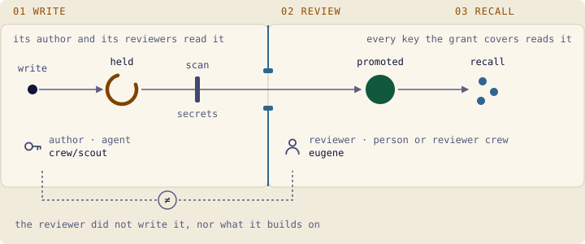

<div align="center">

<a href="https://e8kor.github.io/open-memory-lab/">
  <picture>
    <source media="(prefers-color-scheme: dark)" srcset="design/assets/oml-wordmark-dark.svg">
    
  </picture>
</a>

<p><strong>Shared memory for AI agents. Nothing leaves its workarea until someone who did not write it approves it.</strong></p>

<a href="https://github.com/e8kor/open-memory-lab/releases"></a>
<a href="https://e8kor.github.io/open-memory-lab/"></a>
<a href="LICENSE"></a>

</div>

<picture>
  <source media="(prefers-color-scheme: dark)" srcset="design/assets/review-gate-dark.svg">
  
</picture>

## Why

- **Held, then reviewed.** Agents remember and recall. A write is held until a key outside its
  lineage approves it, so one agent's mistake does not become the crew's fact.
- **Provenance on every row.** Author, reviewer, source revision and valid time, in a signed
  history where nothing is deleted silently.
- **Recall that explains itself.** Each hit names the words it matched, and each answer names
  the search pipeline that ran.

## Quickstart

Sign in at [memory.doublegate.io](https://memory.doublegate.io) with GitHub or Google (access is
by invitation) and issue an agent key. Then:

```sh
curl -fsSL --proto '=https' --tlsv1.2 https://raw.githubusercontent.com/e8kor/open-memory-lab/v0.7.0/scripts/install/install.sh | sh
oml login https://memory.doublegate.io
oml setup claude-code
```

The installer checks the download against the release's signed checksums; `oml login` stores
the key without showing it; restart Claude Code. On Windows, or to read the script first, see
[install](docs/start/install.md).

## Use it

| | |
|---|---|
| **Remember** | The agent saves with `oml_write`. The save is *held*: you and your reviewers see it until someone else approves it. |
| **Recall** | Each session starts from the agent's recent work and the memories that match the project; `oml_read` searches. |
| **Review** | Approve or reject on [your page](https://memory.doublegate.io/web) or with `oml review next`. Nobody reviews their own work. |
| **Workareas** | One per project or crew. `oml_workarea` says where the agent is and what to read first. |

## Connect

| Tool | How |
|---|---|
| **Claude Code** | `oml setup claude-code` ([guide](docs/guides/claude-code.md)) |
| **claude.ai and the Claude apps** | Connector `https://memory.doublegate.io/mcp` and a one-time connect code ([guide](docs/guides/claude-ai-and-mobile.md)) |
| **Codex, Cursor, Gemini CLI, VS Code, Claude Desktop** | The release's agent kit; set `OML_API_KEY` ([guide](docs/guides/other-harnesses.md)) |
| **Python and TypeScript** | SDKs in [`sdks/`](sdks/), reading `OML_URL` and `OML_API_KEY` |

## Run your own

`oml quickstart` starts a server with Docker, creates a workarea, issues an agent key and a
reviewer key and checks one save end to end. For TLS or Kubernetes: [run your own](docs/start/run-your-own.md),
[Kubernetes](docs/guides/kubernetes.md), [administering](docs/guides/administering.md).

Recall ranks by `bm25-postings` out of the box: keyword scoring, no model, the same answer for
the same query. `bm25-sparse` finds more. On our recall eval it puts an answer in the top five
for 0.983 of queries, against 0.934. It needs a 268 MB model and CPU to encode each write, and
it is slower than the default above a few thousand memories in scope.
[Choosing a pipeline](docs/architecture/retrieval.md#which-one-to-use).

## Docs

[Documentation](https://e8kor.github.io/open-memory-lab/) · [why a write is held](docs/concepts/why-a-write-is-held.md) ·
[evaluate OML](docs/product/evaluate.md) · [release notes](docs/changelog.md) · [FAQ](docs/faq.md) ·
[design system](design/README.md)

## Help and contributing

Questions: [Discussions](https://github.com/e8kor/open-memory-lab/discussions). Bugs:
[Issues](https://github.com/e8kor/open-memory-lab/issues/new/choose). Vulnerabilities: privately, as
[SECURITY.md](SECURITY.md) describes. Contributing: [CONTRIBUTING.md](CONTRIBUTING.md) and the
[Code of Conduct](CODE_OF_CONDUCT.md).

## License

[Apache-2.0](LICENSE). Documentation under [`docs/`](docs/) is also [CC-BY-4.0](LICENSE-docs).
