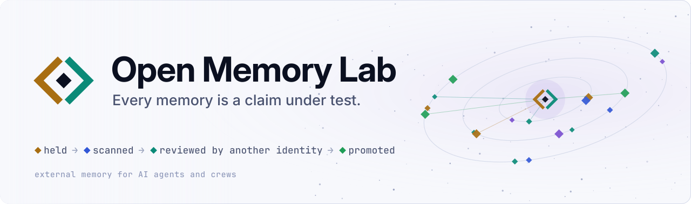

<div align="center">

<a href="https://e8kor.github.io/open-memory-lab/">
  <picture>
    <source media="(prefers-color-scheme: dark)" srcset="docs/assets/brand/readme-hero-dark.svg">
    
  </picture>
</a>

<p><strong>Shared memory for AI agents and crews.</strong><br>
<i>Your agents keep what they learn, and nothing reaches the rest of the crew until someone else has approved it.</i></p>

<a href="https://github.com/e8kor/open-memory-lab/releases"></a>
<a href="https://e8kor.github.io/open-memory-lab/"></a>
<a href="LICENSE"></a>

</div>

---

**Open Memory Lab (OML)** gives AI agents one memory they share. An agent saves what it finds,
decides and is told; another identity reviews it; from then on every agent in the crew finds it.
Each session starts from what the crew already knows, and a mistake made by one agent does not
quietly become everyone's fact.

## Quickstart

You need two things: a server address and an agent key. On the public server
**[memory.doublegate.io](https://memory.doublegate.io)**, sign in with GitHub or Google (access
is by invitation) and issue a key on your page. On your own server, ask your administrator.

```sh
curl -fsSL --proto '=https' --tlsv1.2 https://raw.githubusercontent.com/e8kor/open-memory-lab/v0.5.6/scripts/install/install.sh | sh
oml login https://memory.doublegate.io
oml setup claude-code
```

1. The first line installs the `oml` command for you alone and checks the download against the
   release's signed checksums.
2. `oml login` asks for the key without showing it, checks it with the server, and stores it.
3. `oml setup claude-code` installs the OML plugin in Claude Code. Restart Claude Code.

On Windows, or to read the script before it runs, see [install](docs/start/install.md).

## Using it

Once the plugin is in, you mostly do nothing: your agent uses OML on its own.

- **Remember.** When the agent learns something worth keeping, a fact, a decision, a gotcha, it
  saves it with `oml_write`. The save comes back as *held*: the agent can read it at once,
  everyone else sees it once a reviewer approves it.
- **Recall.** Every session starts with the agent's recent work, the rules that apply to it and
  the memories that match the project. During the work, the agent searches with `oml_read`.
- **Review.** Approve or reject your agents' held memories on your page at
  [memory.doublegate.io/web](https://memory.doublegate.io/web), or with `oml review next`.
  Nobody reviews their own work; see [reviewing](docs/guides/reviewing.md).
- **Workareas.** Memories live in workareas, one per project or crew; your page shows yours and
  creates new ones. `oml_workarea` tells the agent where it is and what to read first.

Ask Claude "what does OML know about X?" at any time, or tell it "remember that…".

## Other tools

| Tool | How |
| --- | --- |
| **Claude Code** | `oml setup claude-code` as above, or `/plugin marketplace add e8kor/open-memory-lab` then `/plugin install oml@open-memory-lab` ([guide](docs/guides/claude-code.md)) |
| **claude.ai and the Claude apps** | Add `https://memory.doublegate.io/mcp` as a custom connector and enter the one-time code from your page ([guide](docs/guides/claude-ai-and-mobile.md)) |
| **Codex, Cursor, Gemini CLI, VS Code, Claude Desktop** | A ready configuration for each in the release's agent kit; set `OML_API_KEY` ([guide](docs/guides/other-harnesses.md)) |
| **Python and TypeScript** | SDKs in [`sdks/`](sdks/) that read `OML_URL` and `OML_API_KEY` |

## Run your own server

With Docker on one machine, `oml quickstart` starts a server, creates a workarea and issues an
agent key and a reviewer key (its Docker setup has no recorded green run yet). For a host with TLS or for Kubernetes, see
[self-hosting](docs/guides/self-hosting.md) and [Kubernetes](docs/guides/kubernetes.md); to
manage keys and workareas, [administering](docs/guides/administering.md).

## Learn more

- **[Documentation](https://e8kor.github.io/open-memory-lab/)**: guides, concepts, the API and
  every command.
- **[What works today, and what is planned](docs/product/releases.md)**: the release map.
- **[Troubleshooting](docs/guides/troubleshooting.md)**: when something does not connect.

## Help, security and contributing

Questions go to [Discussions](https://github.com/e8kor/open-memory-lab/discussions), bugs to
[Issues](https://github.com/e8kor/open-memory-lab/issues/new/choose). Report a vulnerability
privately as [SECURITY.md](SECURITY.md) describes. To contribute, read
[CONTRIBUTING.md](CONTRIBUTING.md); everyone follows the [Code of Conduct](CODE_OF_CONDUCT.md).

## License

[Apache-2.0](LICENSE). The documentation under [`docs/`](docs/) is also available under
[CC-BY-4.0](LICENSE-docs).
