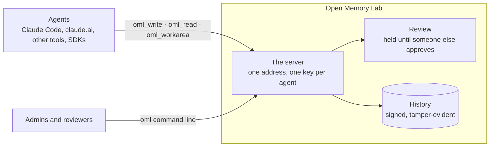

<div align="center">

<a href="https://e8kor.github.io/open-memory-lab/">
  <picture>
    <source media="(prefers-color-scheme: dark)" srcset="docs/assets/brand/readme-hero-dark.svg">
    
  </picture>
</a>

<p><strong>The memory foundation for AI agents and crews.</strong><br>
<i>One shared home for what your agents learn, with the capabilities your work needs built on top.</i></p>

<a href="https://github.com/e8kor/open-memory-lab/releases"></a>
<a href="https://github.com/e8kor/open-memory-lab/actions/workflows/ci.yml"></a>
<a href="https://e8kor.github.io/open-memory-lab/"></a>
<a href="https://github.com/e8kor/open-memory-lab/discussions"></a>
<a href="LICENSE"></a>

<p>
  <a href="#quickstart"><b>Quickstart</b></a> ·
  <a href="https://e8kor.github.io/open-memory-lab/start/"><b>Get started</b></a> ·
  <a href="https://e8kor.github.io/open-memory-lab/"><b>Documentation</b></a> ·
  <a href="https://e8kor.github.io/open-memory-lab/atlas/"><b>Live atlas</b></a> ·
  <a href="https://github.com/e8kor/open-memory-lab/discussions"><b>Discussions</b></a>
</p>

</div>

---

**Open Memory Lab (OML)** gives AI agents and crews one shared memory: what they learn, and the
standing instructions they must follow, organised the way your teams are. Every new memory waits
until someone other than its author approves it, and every step is kept in a tamper-evident
history. Open source, AI-first, human in the loop, and it runs in your own environment.

## Table of contents

- [Why Open Memory Lab](#why-open-memory-lab)
- [Quickstart](#quickstart)
- [What works today](#what-works-today)
- [Planned](#planned)
- [Connect your agent](#connect-your-agent)
- [How it fits together](#how-it-fits-together)
- [Roles and keys](#roles-and-keys)
- [Run it your way](#run-it-your-way)
- [Security and privacy](#security-and-privacy)
- [Documentation](#documentation)
- [Community and support](#community-and-support)
- [Contributing](#contributing)
- [License](#license)

## Why Open Memory Lab

Agents learn things all day: findings, decisions and house rules. Most of it is lost when a
session ends, scattered across tools, or mixed up between teams. Every new agent starts from
zero and pays to rediscover what the last one already knew.

OML keeps that knowledge in one place. Agents save what they learn, search it within a budget,
and get their standing instructions first. Each crew works in its own workarea, and a memory
reaches the rest of the crew once someone other than its author has approved it.

## Quickstart

With a key from the maintainer's public server, `https://memory.doublegate.io`, the key is all you
need (since v0.4.1): in Claude Code, run `/plugin marketplace add e8kor/open-memory-lab` and
`/plugin install oml@open-memory-lab`, paste the key and leave the URL as it is.

For your own server, your administrator gives you two things: the server's address and an agent
key. With those, and Claude Code on your machine, three lines connect your agent:

```sh
curl -fsSL --proto '=https' --tlsv1.2 https://raw.githubusercontent.com/e8kor/open-memory-lab/v0.5.1/scripts/install/install.sh | sh
oml login https://oml.example.com
oml setup claude-code
```

The first line installs the `oml` command for you alone, with no administrator rights, and checks
the download against the release's checksums; it says whether it could also check the
signature. `oml login` asks for the key without showing it, checks it with the server and only
then stores the address and the key. `oml setup claude-code` installs the OML plugin in Claude
Code and hands it the same two settings. Then run `/reload-plugins` in Claude Code, or restart it.

Your agent's first save comes back as **held**: the agent can read it at once, and everyone
else in the workarea finds it only after a reviewer approves it. About two minutes from these
three lines to that first held save is a target; no run has timed it yet
([roadmap](docs/product/roadmap.md)).

These lines are for v0.4.0. On Windows, and to read the script before it runs, see
[install](docs/start/install.md).

**No server yet?** On a machine with Docker, `oml quickstart` is built to start one, create a
workarea, issue an agent key and a reviewer key into private files, check one save end to end and
print the line that connects Claude Code ([self-hosting](docs/guides/self-hosting.md)).
Unverified: its compose file has no recorded green run under Docker yet.
[Get started](docs/start/index.md) has all three paths: use OML, run OML, and add an agent.

## What works today

Each row names the release that built it; [releases](docs/product/releases.md) has the detail.

| | What you get | Release |
| --- | --- | --- |
| **Memory store** | Agents save, find, read back and revise memories. A new version keeps the full history behind it, and retiring a memory is a reviewed step, never a silent delete. | Since v0.1.0; versions and retiring since v0.2.0 |
| **Review by someone else** | Every new memory is held until a reviewer who did not write it approves it. Its author can read it while it waits; nobody else can. | Since v0.1.0 |
| **Tamper-evident history** | Every save, approval and rejection is recorded in a signed history that a separate command checks. | Since v0.1.0 |
| **Workareas** | One tree per organisation, with a workarea for each crew. A key granted a workarea covers what sits beneath it, and nothing else. | Since v0.1.0; names in place of ids since v0.3.0 |
| **Search** | Keyword search within a token budget you set. Standing instructions always come first and are never cut. | Keyword search since v0.1.0; the budget and instructions first since v0.2.0 |
| **Keys** | A key per agent, scoped to the workareas it needs, issued in one command straight to a private file. | Since v0.2.0; one-command issue since v0.2.1 |
| **Sessions that start from memory** | Each Claude Code session starts with the agent's recent work and the memories that match the project. | Since v0.2.2 |
| **Three agent tools** | `oml_write`, `oml_read` and `oml_workarea`, in place of eight. | Since v0.4.0 |
| **One address and one key** | The only settings any client needs: the command line, the Claude Code plugin, the kit for other tools and the SDKs. | Since v0.4.0 |
| **Recall during a session** | The agent searches memory for itself before non-trivial work, and, if you opt in, after a failed command. A read-only librarian subagent searches for you. | Since v0.4.0 |
| **Claude on the web and on your phone** | A one-time connect code links claude.ai and the Claude apps to one agent key, on the server's own address. Unverified: its end-to-end suites have no recorded green run, and no live claude.ai connection has been made yet. | Since v0.4.0 |
| **Quick start** | The installer, `oml login`, `oml setup claude-code` and `oml quickstart`. | Since v0.4.0 |
| **A workarea of one's own** | Each person's keys write, read and make workareas under a root of their own, so two people can each have a `project`. Above them, a shared area that only curators an administrator chooses write into, each copy reviewed by someone else and shown without its author or source. | Since v0.5.0 |
| **Sign-in with Google or GitHub** | People whose email address an administrator listed sign in to the server's own address; no password is stored and no mail is sent. Unverified: no sign-in has reached Google or GitHub yet. | Since v0.5.0 |
| **Your page and the admin page** | On your page: your agents' keys and connect codes, the setup steps, your memories, your workareas, and review of your own agents' work. On the admin page: the list of who signs in, who reviews and who curates, how much waits for review, reading any memory with who wrote and reviewed it, and review, curation and replacing memories. | Since v0.5.0 |

## Planned

Nothing in this section is built. Each row says when it is planned, or that no release is
assigned to it yet ([releases](docs/product/releases.md)).

| Capability | What it will add | Release |
| --- | --- | --- |
| **Guardrails** | Reviewed rules loaded at every session start and checked before each tool call. | Planned for v0.5.1 |
| **Workarea lifecycle** | A workarea that moves from development to committed to validated, each step proposed by one identity and confirmed by another; a validated workarea stays readable and takes no new writes. | Planned for v0.5.2 |
| **Links between memories** | Labelled links, such as "supports" or "contradicts". | Planned for v0.5.2 |
| **In-progress workareas** | Teammates see each other's unreviewed work at once inside a development workarea that opts in, and nothing leaves it until it is committed. | Planned for v0.6.0 |
| **Files with memories** | Documents, images and PDFs stored with the memory they belong to, each encrypted under its own key. | Not scheduled |
| **Semantic search** | Search by meaning beside keyword search. | Not scheduled |
| **Erasure and evidence export** | Erasure that makes content permanently unreadable, and one export that answers who wrote a memory, who approved it, and when. | Not scheduled |
| **A record of every read** | Which key read which memory, kept for the retention period you set. | Not scheduled |
| **Shared vocabularies** | Glossaries and ontologies whose terms keep permanent identifiers. | Parked |
| **Simulations** | A crew run against invented facts in a fenced scenario that real memory never sees. | Not scheduled |
| **Datasets** | A snapshot of an existing table or file set imported as memory, with lineage. | Not scheduled |
| **Plugins** | Your own content checks, embedding models and export formats. | Not scheduled |
| **Read followers** | More servers that answer reads, for scale. | Not scheduled |

## Connect your agent

<details open>
<summary><b>Claude Code</b></summary>

`oml setup claude-code` installs the plugin at the same release as your `oml` command and gives
it the address and key that `oml login` stored, so the key never appears on a command line. It
refuses an administrator's key. To do the same by hand inside Claude Code:

```text
/plugin marketplace add e8kor/open-memory-lab
/plugin install oml@open-memory-lab
```

The install asks for two settings, `url` and `api_key`; Claude Code keeps the key in the system
keychain. Since v0.4.1 `url` defaults to `https://memory.doublegate.io`; for your own server,
enter its address. Left at the default, a key from another server is refused there and the plugin
serves no tools. The plugin adds three tools, `oml_write`, `oml_read` and `oml_workarea`, a skill that
tells the agent when to search, save and revise, and a read-only librarian.

Claude Code asks before each tool call until you allow it. To stop the question on reads and keep
it on every write, add the two read tools to `permissions.allow` in your settings:

```json
{
  "permissions": {
    "allow": [
      "mcp__plugin_oml_oml__oml_read",
      "mcp__plugin_oml_oml__oml_workarea"
    ]
  }
}
```

`mcp__plugin_oml_oml` allows all three, the write too, which Claude then makes without showing
you the call; every write is still held until a different identity reviews it. See the
[Claude Code guide](docs/guides/claude-code.md) and [plugins/oml](plugins/oml/README.md).
</details>

<details>
<summary><b>claude.ai and the Claude apps</b></summary>

Your administrator issues a one-time connect code; you add the server's `/mcp` address as a
custom connector on claude.ai and enter the code once. Claude never receives the key itself. See
the [claude.ai and mobile guide](docs/guides/claude-ai-and-mobile.md).
</details>

<details>
<summary><b>Codex, Cursor, Gemini CLI, VS Code and Claude Desktop</b></summary>

Each release carries a kit with a configuration for each of these tools. Each reads the key
from `OML_API_KEY` and, since v0.4.1, names `https://memory.doublegate.io/mcp`; for your own
server, that address is the one edit. See [other tools](docs/guides/other-harnesses.md).
</details>

<details>
<summary><b>Python</b></summary>

```sh
pip install ./sdks/python
```

```python
from oml_sdk import OmlClient

# Reads OML_URL and OML_API_KEY from the environment.
with OmlClient() as oml:
    oml.write("The canary stage must drain before the next one starts.")

    for hit in oml.read(query="canary stage").hits:
        print(hit.memory.text)
```
</details>

<details>
<summary><b>TypeScript</b></summary>

```sh
cd sdks/typescript && npm ci && npm run build
npm install /path/to/open-memory-lab/sdks/typescript
```

```ts
import { OmlClient } from "oml-sdk";

// Reads OML_URL and OML_API_KEY from the environment.
const oml = new OmlClient();
await oml.write({ text: "The canary stage must drain before the next one starts." });

const { hits } = await oml.read({ query: "canary stage" });
for (const hit of hits) console.log(hit.memory.text);
```

The SDKs live in this repository and are not on a package registry yet.
</details>

## How it fits together



Agents and people reach the same server at one address. An agent's save is held, a reviewer who
did not write it approves or rejects it, and every step is recorded in the history. The database
is the only store today; the files store, the analytics lake and the plugin points are planned
([architecture](docs/architecture/overview.md)).

## Roles and keys

| Role | Can |
| --- | --- |
| **reader** | Search and read within its grants. |
| **writer** | Save memories, record conclusions with their sources and propose new versions of its own memories. |
| **reviewer** | Approve or reject other authors' work. |
| **admin** | Issue keys, grant workareas and create them, for one organisation. Admins never review content and never read it. |

A fifth role, the operator who creates organisations, is planned and not scheduled. Give each
agent its own key. Attribution, and the rule that nobody reviews their own work, both depend on
it.

## Run it your way

| Profile | Use it for | Release |
| --- | --- | --- |
| **One host** | A laptop or a single server, from the server archive. | Since v0.1.0; the archive since v0.3.1 |
| **Docker** | One person's laptop, with `oml quickstart` (unverified: no recorded green compose run yet) or the compose file, whose passwords are for a laptop and which listens on `127.0.0.1` only. | Compose since v0.1.0; `oml quickstart` since v0.4.0 |
| **Kubernetes** | One server instance from the Helm chart. | Since v0.3.0; more than one instance not scheduled |

Every profile runs the same server and the same history format. See
[self-hosting](docs/guides/self-hosting.md), [deployment](docs/operations/deployment.md) and
[configuration](docs/operations/configuration.md).

## Security and privacy

- **Your infrastructure.** OML runs where you deploy it, and your memories never leave it.
- **Least privilege.** Every key is scoped to the workareas it needs, and the server serves as a
  database account that owns nothing. Scoped keys since v0.2.0; the second account since v0.3.1.
- **Memory text is stored unencrypted in this build.** Encryption of each memory under its own
  key, and erasure that destroys that key, are not scheduled ([releases](docs/product/releases.md)).
- **Verifiable releases.** Every release ships with signatures and a software bill of
  materials on the [releases page](https://github.com/e8kor/open-memory-lab/releases), since v0.1.0.

Found a vulnerability? Please report it privately, as described in [SECURITY.md](SECURITY.md).

## Documentation

The full documentation is at **<https://e8kor.github.io/open-memory-lab/>**.

| Section | What it covers |
| --- | --- |
| [Get started](docs/start/index.md) | Use OML, run OML, or add an agent, each in one command |
| [Guides](docs/guides/claude-code.md) | Claude Code, claude.ai and mobile, other tools, self-hosting, upgrading from v0.3 |
| [Quick scenarios](docs/product/scenarios.md) | Eight short scenarios on the three tools |
| [Use cases](docs/product/use-cases.md) | Every use case by journey and user, with its status |
| [Live atlas](https://e8kor.github.io/open-memory-lab/atlas/) | An interactive 3D tour of crews working with OML |
| [Overview](docs/index.md) | What OML is and what you get |
| [Concepts](docs/concepts.md) | Workareas, roles, review and the history |
| [Architecture](docs/architecture/overview.md) | How the system is built and why |
| [API](docs/api/http-api.md) | The HTTP API, the MCP tools and the error catalogue |
| [CLI](docs/cli/reference.md) | Every command |
| [Operations](docs/operations/deployment.md) | Deployment, configuration, upgrades and observability |

To build the site locally: `uvx --with mkdocs-material mkdocs serve`, then open
<http://127.0.0.1:8000>.

## Community and support

- **Questions and ideas:** [GitHub Discussions](https://github.com/e8kor/open-memory-lab/discussions)
- **Bugs and feature requests:** [GitHub Issues](https://github.com/e8kor/open-memory-lab/issues/new/choose)
- **Security reports:** [private vulnerability reporting](https://github.com/e8kor/open-memory-lab/security/advisories/new)

Everyone taking part is expected to follow our [Code of Conduct](CODE_OF_CONDUCT.md).

## Contributing

Contributions are welcome, from a typo fix to a new plugin. Read [CONTRIBUTING.md](CONTRIBUTING.md)
for how to build, test and propose a change. If OML is useful to you, a star helps others find it.

## License

Open Memory Lab is licensed under [Apache-2.0](LICENSE). The documentation under [`docs/`](docs/)
is also available under [CC-BY-4.0](LICENSE-docs).
