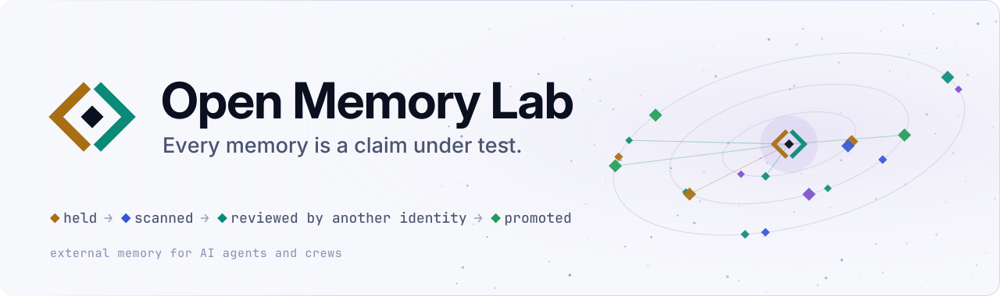
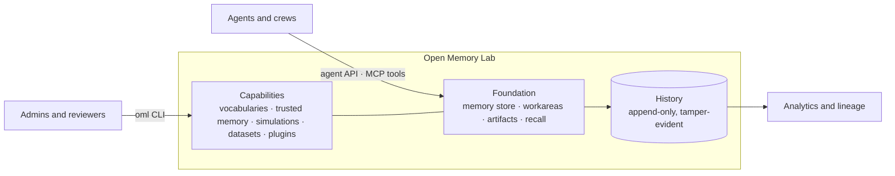

<div align="center">

<a href="https://e8kor.github.io/open-memory-lab/">
  <picture>
    <source media="(prefers-color-scheme: dark)" srcset="docs/assets/brand/readme-hero-dark.svg">
    
  </picture>
</a>

<p><strong>The memory foundation for AI agents and crews.</strong><br>
<i>One shared home for what your agents learn, with the capabilities your work needs built on top.</i></p>

<a href="https://github.com/e8kor/open-memory-lab/releases"></a>
<a href="https://github.com/e8kor/open-memory-lab/actions/workflows/ci.yml"></a>
<a href="https://e8kor.github.io/open-memory-lab/"></a>
<a href="https://github.com/e8kor/open-memory-lab/discussions"></a>
<a href="LICENSE"></a>

<p>
  <a href="#quickstart"><b>Quickstart</b></a> ·
  <a href="https://e8kor.github.io/open-memory-lab/"><b>Documentation</b></a> ·
  <a href="https://e8kor.github.io/open-memory-lab/atlas/"><b>Live atlas</b></a> ·
  <a href="https://github.com/e8kor/open-memory-lab/discussions"><b>Discussions</b></a>
</p>

</div>

---

**Open Memory Lab (OML)** gives AI agents and crews one shared memory: what they learn, the files
that go with it, and the standing instructions they must follow, organised the way your teams
are. The foundation is steady and built not to break. Around it sit capabilities you add where
they pay off: shared vocabularies, trusted memory, what-if simulations, dataset imports and
plugins. Open source, AI-first, human in the loop, and it runs in your own environment.

## Table of contents

- [Why Open Memory Lab](#why-open-memory-lab)
- [The foundation](#the-foundation)
- [Capabilities](#capabilities)
- [Works with](#works-with)
- [Quickstart](#quickstart)
- [Connect your agent](#connect-your-agent)
- [How it fits together](#how-it-fits-together)
- [Roles and keys](#roles-and-keys)
- [Run it your way](#run-it-your-way)
- [Security and privacy](#security-and-privacy)
- [Documentation](#documentation)
- [Community and support](#community-and-support)
- [Contributing](#contributing)
- [License](#license)

## Why Open Memory Lab

Agents learn things all day: findings, decisions, files and house rules. Most of it is lost when
a session ends, scattered across tools, or mixed up between teams. Every new agent starts from
zero and pays to rediscover what the last one already knew.

OML keeps that knowledge in one place. Agents save what they learn, recall it within a budget,
and find the right instructions first. Each crew works in its own space, and what a crew has
approved can be locked as the baseline the next team starts from.

## The foundation

Everything in this section is part of every OML deployment.

| | What you get |
| --- | --- |
| **Memory store** | Agents remember, recall, fetch and revise memories through one stable agent interface. A new version keeps the full history behind it, and retiring a memory is a recorded step, never a silent delete. |
| **Workareas** | One tree per organisation, with a workarea for each crew. Access follows the tree, so a key granted a workarea covers what sits beneath it, and nothing else. |
| **Artifact store** | Documents, images and PDFs live with the memory they belong to. Each file is named by its own fingerprint, so it can't be swapped later, and encrypted with its own key. |
| **Recall** | Keyword and semantic search within a budget you set. Standing instructions always come first and are never cut, so house rules are never crowded out by search results. |
| **Lifecycle** | A workarea moves one way from development, to committed, to validated. Each step is proposed by one person or agent and confirmed by another. A validated workarea is locked: it stays readable and takes no new writes. |
| **Access** | A key per agent, scoped to the workareas it needs. Names instead of ids everywhere, safe retries on every write, and an event feed that shows each key only what it may see. |

## Capabilities

Each capability builds on the foundation and shares its access model, so you add value without
moving your data.

| Capability | What it adds |
| --- | --- |
| **Vocabularies** | Shared glossaries and ontologies. Terms keep permanent identifiers, are released in versions, and are deprecated with a pointer to their successor. A workarea can require every write to use valid terms, so "active customer" means the same thing in every crew. |
| **Trusted memory** | A second look on every write. A new memory reaches other agents once someone other than its author approves it, and every decision is kept in a tamper-evident history. One export answers "who wrote this, who approved it, and when" for any memory, and erasure is a recorded act that makes content permanently unreadable. |
| **Simulations** | Safe what-if testing. Run a crew against invented facts, such as a market shock, inside a fenced scenario. Only the agents in it can see those facts, and real memory never changes. |
| **Datasets** | Import a snapshot of an existing table or file set as memory, checked as one batch with sampled rows. An analytics layer keeps lineage, so every figure traces back to its source. |
| **Plugins** | Swap in your own content checks, embedding models and export formats. A plugin can make the rules stricter, never looser. |

## Works with

| Surface | Use it for |
| --- | --- |
| **Claude Code plugin** | Give a coding agent its memory in two commands ([plugins/oml](plugins/oml/README.md)). |
| **Any MCP client** | The same agent tools over the open Model Context Protocol ([docs](docs/api/mcp-plugin.md)). |
| **HTTP API** | Any language, any framework ([OpenAPI](docs/api/openapi.yaml)). |
| **Python and TypeScript SDKs** | Typed clients for the HTTP API ([Python](sdks/python/README.md), [TypeScript](sdks/typescript/README.md)). |
| **`oml` CLI** | Administration and review, with JSON output for scripts and your own dashboards ([reference](docs/cli/reference.md)). |

## Quickstart

You need Docker with the compose plugin, `curl` and `jq`. From a checkout:

```sh
docker compose up -d          # the database and oml-server on 127.0.0.1:8080
bash scripts/quickstart.sh    # enroll the server, create a workarea, issue keys
```

The quickstart creates a workarea and issues two keys: an agent key that stores and searches,
and a reviewer key. It writes a first memory with the agent key, approves it with the reviewer
key, and finds it again with a search. Then it prints the lines to connect Claude Code. Each key
is shown once, so store them when they're printed.

To review what agents have written:

```sh
docker compose exec oml-server oml --server http://127.0.0.1:8080 --key <reviewer key> review next
docker compose exec oml-server oml --server http://127.0.0.1:8080 --key <reviewer key> \
    review verdict --memory <artifact_id> --approve
```

The compose credentials are for a laptop, and the server listens on the loopback interface
only. For production, see [Run it your way](#run-it-your-way).

## Connect your agent

<details open>
<summary><b>Claude Code</b></summary>

```sh
export OML_URL=http://127.0.0.1:8080
export OML_API_KEY=<agent key>
claude plugin marketplace add e8kor/open-memory-lab
claude plugin install oml@open-memory-lab
```

The plugin adds the OML tools and a skill that tells the agent when to recall, remember and
revise. See [plugins/oml](plugins/oml/README.md).
</details>

<details>
<summary><b>Python</b></summary>

```sh
pip install ./sdks/python
```

```python
from oml_sdk import OmlClient

# Reads OML_URL and OML_API_KEY from the environment.
with OmlClient() as oml:
    oml.remember("deploy-runbook", "The canary stage must drain before the next one starts.")

    for hit in oml.recall("canary stage").hits:
        print(hit.memory.body)
```
</details>

<details>
<summary><b>TypeScript</b></summary>

```sh
cd sdks/typescript && npm ci && npm run build
npm install /path/to/open-memory-lab/sdks/typescript
```

```ts
import { OmlClient } from "oml-sdk";

// Reads OML_URL and OML_API_KEY from the environment.
const oml = new OmlClient();
await oml.remember({
  claim_key: "deploy-runbook",
  body: "The canary stage must drain before the next one starts.",
});

const { hits } = await oml.recall({ query: "canary stage" });
for (const hit of hits) console.log(hit.memory.body);
```
</details>

## How it fits together



The foundation's agent API carries a compatibility promise: what you build on it keeps working
as OML grows. Administration and capabilities live on a separate API surface, so they extend
the foundation without changing it. One core holds every rule. Storage, transport and plugins
sit behind explicit boundaries around it.

## Roles and keys

| Role | Can |
| --- | --- |
| **reader** | Recall, search and fetch within its grants. |
| **writer** | Remember, learn, attach files and propose new versions of its own memories. |
| **reviewer** | Review and approve other authors' work, and propose edits and connections. |
| **admin** | Manage keys, grants, workareas, lifecycle steps, erasure, simulations and exports for one organisation. Admins never review content. |
| **operator** | Create organisations and their first admin key. Operators never read memory. |

Give each agent its own key. Attribution, and the rule that nobody reviews their own work, both
depend on it.

## Run it your way

| Profile | Use it for |
| --- | --- |
| **One host** | A laptop or a single server. |
| **Compose** | A small team, with read followers when more agents rely on it. |
| **Cluster** | Production, from one chart, with read followers for scale. |

Every profile runs the same binaries, the same history format and the same conformance suite.
See [deployment](docs/operations/deployment.md) and [configuration](docs/operations/configuration.md).

## Security and privacy

- **Your infrastructure.** OML runs where you deploy it, and your memories and files never
  leave it.
- **Least privilege.** Every key is scoped to the workareas it needs, and every read is logged
  for the retention period you set.
- **Encryption per item.** Memory content and files are encrypted with their own keys, and
  erasure destroys the key.
- **Verifiable releases.** Every release ships with signatures and a software bill of
  materials on the [releases page](https://github.com/e8kor/open-memory-lab/releases).

Found a vulnerability? Please report it privately, as described in [SECURITY.md](SECURITY.md).

## Documentation

The full documentation is at **<https://e8kor.github.io/open-memory-lab/>**.

| Section | What it covers |
| --- | --- |
| [Live atlas](https://e8kor.github.io/open-memory-lab/atlas/) | An interactive 3D tour of crews working with OML |
| [Overview](docs/index.md) | What OML is and what you get |
| [Concepts](docs/concepts.md) | Workareas, roles, vocabularies, simulations and the history |
| [Architecture](docs/architecture/overview.md) | How the system is built and why |
| [API](docs/api/http-api.md) | The HTTP API, the MCP tools and the error catalogue |
| [CLI](docs/cli/reference.md) | Every administration and review command |
| [Operations](docs/operations/deployment.md) | Deployment, configuration, upgrades and observability |

To build the site locally: `uvx --with mkdocs-material mkdocs serve`, then open
<http://127.0.0.1:8000>.

## Community and support

- **Questions and ideas:** [GitHub Discussions](https://github.com/e8kor/open-memory-lab/discussions)
- **Bugs and feature requests:** [GitHub Issues](https://github.com/e8kor/open-memory-lab/issues/new/choose)
- **Security reports:** [private vulnerability reporting](https://github.com/e8kor/open-memory-lab/security/advisories/new)

Everyone taking part is expected to follow our [Code of Conduct](CODE_OF_CONDUCT.md).

## Contributing

Contributions are welcome, from a typo fix to a new plugin. Read [CONTRIBUTING.md](CONTRIBUTING.md)
for how to build, test and propose a change. If OML is useful to you, a star helps others find it.

## License

Open Memory Lab is licensed under [Apache-2.0](LICENSE). The documentation under [`docs/`](docs/)
is also available under [CC-BY-4.0](LICENSE-docs).
