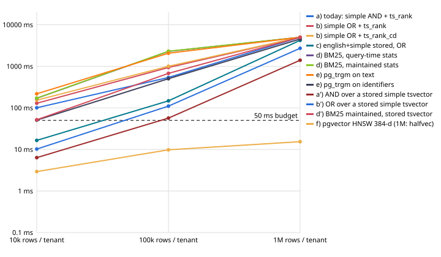

# Scale bench report: candidate search at 10k, 100k and 1M memories per tenant

Measured 2026-11-04 on `origin/main` bb40436 (migrations 0001–0016), PostgreSQL 18.6, pgvector 0.8.1,
8 vCPU / 15 GiB, one client. Method and limits: [BASELINE.md](BASELINE.md). Every table:
[results/tables.md](results/tables.md). Plans: [results/explain.md](results/explain.md). Raw numbers:
`results/*.json`; one `oml-bench/1` file per approach × scale under `results/offline/<method>/<rows>.json`.

The data is synthetic text templated from the recall eval's 200 seeds, and the vectors are synthetic
clusters. Latency, size and write cost carry over to real data in shape; relevance does not, and nothing
here measures it.

## Verdicts

| approach | holds a 50 ms p95 to | at 1M per tenant (warm p95, RLS) | verdict |
|---|---|---:|---|
| a) today: `simple` AND + `ts_rank` | not at 10k (101 ms) | ≥ 5,000 (timeouts) | **does not scale under RLS**: the GIN index is never used |
| b) any-word OR + `ts_rank` / `ts_rank_cd` | not at 10k (129 / 153 ms) | ≥ 5,000 | does not scale; with or without RLS, OR on common words touches most rows |
| c) english + simple stored tsvectors, OR | ~30k (fit) | 4,215 | 10× cheaper than b per row; still a scan of every readable row |
| a') AND over a stored `simple` tsvector | ~67k (fit) | 1,400 | the cheapest text form under RLS; holds only to ~100k at universe scope |
| d) BM25 in SQL (query-time or maintained stats) | not at 10k (170 ms) | ≥ 5,000 | the statistics are not the cost; scoring every OR candidate is |
| e) `pg_trgm`, text / identifiers | not at 10k (218 / 51 ms) | ≥ 5,000 / 4,535 | the slowest; no index use under RLS, and `word_similarity` per row is expensive |
| f) pgvector HNSW, 384-d | past 1M (halfvec 1M: p95 15.4) | 15.4 (halfvec) | **holds to 1M** when resident and with `relaxed_order`: its ORDER BY uses the index under RLS |
| g) ADR-0050 similar check per write | 50 ms p50 at ~100k | p50 128, p95 180 | affordable to ~100k per tenant; at 1M it adds a fifth of a second to each write |
| added: exact halfvec scan, no index | 100k at any share (p95 ≤ 32 ms) | ~250–300 (not measured; linear) | exact and simple to 100k; it reads the whole partition whatever the scope (no workarea index on vectors), so ~250–300 ms at 1M; HNSW plus relaxed_order beats it from ~100k |
| added: learned-sparse inverted table | under 30k unpruned; ~300k with the 100 commonest tokens pruned (extrapolated) | 3,959 (unpruned) / 137 (pruned) (extrapolated) | **its index works under RLS** (int equality is leakproof); cost is the postings of common tokens: unpruned queries fail at 30k, queries without the 100 most frequent tokens hold 50 ms to ~300k (extrapolated) |

**The one finding that decides the rest: under OML's row security no text index is used.** Every
full-text and trigram operator PostgreSQL ships (`@@`, `%`, `<%`, `ts_rank`) is not `LEAKPROOF`
(`pg_proc.proleakproof = false`). The planner puts the `tenant_isolation` policy's predicate at a lower
security level than the query's own predicates, and a non-leakproof predicate cannot become an index
condition above it. Only the leakproof `uuid` and `int` equalities reach an index, so each text approach
is an index scan on `(tenant_id, workarea_id, …)` followed by a per-row filter over **every readable
row** (EXPLAIN below). Its latency is the readable row count times the per-row cost of the operator. The
0009 migration says so in one line ("An FTS read scans its tenant's partition under row-level
security"); this bench puts numbers on it. The same statements as the superuser use the GIN index and
answer today's AND query in 1.4 / 2.7 / 34.7 ms p95 at 10k / 100k / 1M instead of 101 / 539 / ≥ 5,000.
pgvector's `<=>` is not leakproof either, but it is an ORDER BY operator, not a qual, so HNSW still
drives the scan under the policy.

Three ways out, none measured as a change to OML, each a decision for the review:

1. **Mark the operators leakproof** (`ts_match_vq`, `word_similarity_op`): superuser only, rejected by
   ADR-0034 d13, unavailable on most managed PostgreSQL. The no-RLS column is its upper bound.
2. **Query the text index through one `SECURITY DEFINER` function** owned by a role that bypasses row
   security, which pins `tenant_id` from `oml.tenant_id` and takes the readable workareas from the
   caller. The fence becomes that function's code instead of the policy. Its latency is the no-RLS
   column.
3. **Keep the per-row filter, but make the row cheap and the readable set small**: a stored tsvector
   (a', c) and narrow scopes. This is the only option that keeps the policy as the fence, and it runs
   out at about 100k readable rows (a' at 100k universe scope: p50 53 ms, p95 69 ms).

## Headline: warm p95 (ms), serving role under row security

Warm p95 over 330 queries (30 in each of the eval's 11 categories; 40% leaf, 40% project and 20%
universe scope). † is a statement timeout (5 s at 1M, 10 s elsewhere) counted as the timeout, so that
cell is a lower bound.

| approach | 10k | 100k | 1M | 10 tenants × 100k | slope (log-log) | crosses 50 ms p95 at |
|---|---:|---:|---:|---:|---:|---|
| a) today: simple AND + ts_rank | 101 | 539 | ≥5,000† | 339 | 0.85 | already at 10k |
| b) simple OR + ts_rank | 129 | 936 | ≥5,000† | 582 | 0.79 | already at 10k |
| b) simple OR + ts_rank_cd | 153 | 1,003 | ≥5,000† | 644 | 0.76 | already at 10k |
| c) english+simple stored, OR | 16.5 | 148 | 4,215 | 146 | 1.20 | ~30k |
| d) BM25, query-time stats | 170 | 2,284 | ≥5,000† | 1,390 | 0.73 | already at 10k |
| d) BM25, maintained stats | 171 | 2,306 | ≥5,000† | 1,484 | 0.73 | already at 10k |
| e) pg_trgm on text | 218 | 2,063 | ≥5,000† | 2,066 | 0.68 | already at 10k |
| e) pg_trgm on identifiers | 50.7 | 503 | 4,535 | 511 | 0.98 | already at 10k |
| a') AND over a stored simple tsvector | 6.3 | 56.6 | 1,400 | – | 1.17 | ~67k |
| b') OR over a stored simple tsvector | 10.2 | 110 | 2,716 | – | 1.21 | ~42k |
| d') BM25 maintained, stored tsvector | 51.7 | 677 | ≥5,000† | – | 0.99 | already at 10k |
| f) pgvector HNSW 384-d (1M: halfvec) | 2.9 | 9.8 | 15.4 | – | 0.36 | not by 1M (fit: ~18.6M) |



**Readable scope decides latency more than tenant size.** At 1M, today's statement answers a leaf
scope (one leaf plus `universe`, about 1% of rows) at p50 98 ms / p95 134 ms, a project scope at
142 / 261 ms, and the universe scope (605k readable rows) at 3,309 ms / ≥ 5,000 ms. Every text approach
behaves this way: its cost is the readable rows, not the matches.

## Per approach

### a) Today: `to_tsvector('simple') @@ plainto_tsquery` (AND) + `ts_rank`

- **Latency:** p95 101 ms at 10k, 539 ms at 100k, ≥ 5,000 ms at 1M (29 of 330 queries time out, all
  universe scope). The cold pass matches the warm pass because the scan is CPU-bound: it computes
  `to_tsvector` for every readable row, about 5 µs a row on this host.
- **Plan under RLS** (1M, exact query, universe scope): a parallel bitmap heap scan on the
  `(tenant_id, workarea_id, …)` index, `Rows Removed by Filter: 215455` per worker, 3.2 s. The same
  statement without the policy uses `Bitmap Index Scan on …_claim_fts` (5,860 rows) and takes 106 ms,
  mostly `ts_rank` recomputing `to_tsvector` for the 3,621 matches.

```
-- serving role, RLS (1M, "Idempotency-Key header", universe scope)
Parallel Bitmap Heap Scan on memories_t_<tenant> m_1 (actual time=63.859..3189.324 rows=1207.00 loops=3)
  Recheck Cond: ((tenant_id = '<uuid>') AND (workarea_id = ANY (…)) AND is_tip AND (status = 'promoted'))
  Filter: ((NOT retirement) AND (kind = ANY (…)) AND (to_tsvector('simple', claim) @@ '…'::tsquery))
  Rows Removed by Filter: 215455
-- the same statement without the policy
Bitmap Heap Scan on memories_t_<tenant> m (actual time=8.619..105.736 rows=3621.00 loops=1)
  ->  Bitmap Index Scan on memories_t_<tenant>_claim_fts (actual time=6.642..6.643 rows=5860.00 loops=1)
```

- **Index cost:** the GIN expression index is 81 MiB at 1M and builds in 5.8 s, and under RLS it serves
  no read.
- **Failure modes:** AND returns nothing for 266–286 of 330 queries (eval queries are long), so the
  scan costs the full price to return nothing.

### b) Any word (OR) + `ts_rank` / `ts_rank_cd`

- **Latency under RLS:** p95 129 / 936 / ≥ 5,000 ms (`ts_rank`), 153 / 1,003 / ≥ 5,000 ms
  (`ts_rank_cd`). `ts_rank_cd` costs 5–15% more.
- **Without RLS OR is no better:** 79 / 1,197 / 4,822 ms p95. Common words ("the", "is", "and" in the
  long, question and negation queries) match most rows, and the bitmap then has to rank them all. At 1M
  one 4-word exact query matched 83,409 rows in the GIN index. OR needs stopwords, or a cap on
  candidates before ranking, whatever the fence.
- **Empty results** fall from 266 to 8 of 330 at 100k: the recall eval's reason to want OR.

### c) `english` + `simple` stored generated tsvectors, GIN each, OR

- **Latency under RLS:** p95 16.5 / 148 / 4,215 ms. About 7× cheaper per row than b, because the filter
  reads a stored tsvector instead of parsing the text, and the english configuration drops stopwords.
  It is still a scan of every readable row.
- **Without RLS it is slower** (58 / 625 / 3,049 ms): the `BitmapOr` of two GIN scans over common stems
  builds a bigger bitmap than the RLS plan's sequential filter.
- **Cost:** the table rewrite adding two stored columns grows the heap from 460 MiB to 1,176 MiB at 1M
  (47 s), and the two GIN indexes add 88 + 70 MiB. Write cost is unchanged within noise (insert p50
  1.8–4.8 ms across scales).

### a') b') d') The same statements over the stored `simple` tsvector

These were added after the first runs to separate "stored column" from "english":

- **a' (AND, stored):** p95 6.3 / 56.6 / 1,400 ms. That is 10–16× better than a, from the stored
  tsvector alone. By scope at 100k: leaf 5.9, project 29, universe 69 ms.
- **b' (OR, stored):** p95 10.2 / 110 / 2,716 ms.
- **d' (BM25, maintained stats, stored):** p95 52 / 677 / ≥ 5,000 ms.

A stored tsvector is the cheapest change that keeps the policy as the fence. It costs about 0.7 KiB a row
for two columns (half that for `simple` alone).

### d) BM25 in SQL

- **Latency under RLS:** query-time statistics p95 170 / 2,284 / ≥ 5,000 ms; maintained statistics
  171 / 2,306 / ≥ 5,000 ms. The two are the same within noise at every scale. The statistics are not the
  cost: N and avgdl read one aggregate, and df comes free from the candidates. The cost is
  materialising and scoring every OR candidate's lexemes. Over a stored tsvector (d') this is about 3×
  cheaper.
- **Correctness against RLS:** at every scale, df summed from the maintained per-(workarea, term)
  counts over the readable workareas equals df counted at query time under the policy, for every term
  checked (157, 158 and 163 terms). The tenant-wide df, the obvious maintained form, differs from the
  readable df for 95 / 115 / 104 of those terms. A tenant-wide idf would rank by, and so reveal, terms
  in rows the key cannot read. Statistics must be kept per workarea (or per scope) and summed over the
  readable set, as here.
- **Cost:** the maintained table has 1.22M rows (190 MiB) at 1M memories with 451 workareas, and builds
  in 26 s. The trigger adds about 1 ms to the promotion UPDATE (0.5 → 1.1 ms at 10k, 0.9 → 2.0 ms at
  100k). Every promotion in a workarea updates the same hot (workarea, common term) rows, so concurrent
  promotions in one workarea will serialise on them. That contention is not measured here (one client).

### e) `pg_trgm` (GIN `gin_trgm_ops`)

- **Latency under RLS:** text p95 218 / 2,063 / ≥ 5,000 ms; identifiers p95 51 / 503 / 4,535 ms. This
  is the most expensive per-row operator measured: `word_similarity` over a 176-character claim.
- **Without RLS:** text 13 / 110 / 983 ms, identifiers 2.7 / 16.5 / 140 ms. Even then, text trigram
  search misses 50 ms at about 100k, because a multi-word query's trigrams are common and the GIN
  recheck runs `word_similarity` over many candidates.
- **Index cost:** the claim index is 4.7 / 37.6 / 265 MiB, and the identifier index 1.2 / 9.6 /
  74 MiB.
- **Failure modes:** `word_similarity` with its 0.6 threshold returns nothing for 197 of 330 queries at
  10k (long natural-language queries rarely match one extent of the claim). Queries under 3 characters
  have no trigrams. Identifier search returns nothing for 298 of 330 non-identifier queries, as
  expected; it is a narrow tool for one category.

### f) pgvector HNSW, 384-d

- **Latency under RLS:** warm p95 2.9 / 9.8 ms at 10k / 100k (`vector`); at 1M, halfvec p50 9.2, p95
  15.4 ms (float `vector` at 1M did not fit beside the other builds on the shared filesystem). It is the only approach under 50 ms at 1M. The plan is `Index Scan using …_hnsw … Order By:
  (embedding <=> …)`, with the scope and the policy as a filter.
- **Cold:** the first query after a restart reads the graph from disk: 384 ms at 10k, 5.6 s at 100k,
  and it timed out at 5 s at 1M (halfvec), where 11 of 330 cold-pass queries timed out. HNSW needs its
  index resident; at 1M that is 1.09 GiB (halfvec) or ~1.9 GiB (extrapolated from 10k and 100k) (vector).
- **Recall:** see added case 1. With `relaxed_order` (as here), recall@10 against a forced exact scan
  is 0.95–0.999 at 10k and 100k under 1–100% readable shares. Without iterative scan it falls to
  0.09 at a 1% share. The synthetic vectors are clustered noise, so these numbers show the filter's
  effect and are not a quality figure. (The main runs' own recall check compared the index with
  itself and is withdrawn.)
- **Cost:** at 1M the halfvec table is 869 MiB and the HNSW index 1,116 MiB, built in 101 s with 8
  workers. One vector insert costs 1.8 / 4.5 / 5.8 ms p50 (graph insertion), more than a memories
  insert with all its indexes.

### g) ADR-0050 d1: one any-word recall per write

The served-tip and own-held statements, simple OR, k 3, the new text (a 176-character claim, 20–30
lexemes) as the query, at a leaf's scope:

| scale | p50 | p95 | p99 |
|---|---:|---:|---:|
| 10k | 13.3 | 87.7 | 98.6 |
| 100k | 39.8 | 152 | 422 |
| 1M | 128 | 180 | 306 |

A write's own text is the worst case for OR, since it is long and full of common words. The check
already costs 10× the write it guards at 100k (insert + promote p50 3.4 ms). At 1M it adds 128 ms p50 to
every write, even at the narrowest scope, because the leaf scope includes `universe`. Before 1M it needs
a stored tsvector, stopwords, or a cap on query terms (the k-most-selective terms of the new text).

### Added case 1: exact halfvec scan against HNSW under selective scopes

The same statement (`ORDER BY embedding <=> q LIMIT 10` with the scope filter) as the serving role under row security, on halfvec(384); exact = `ORDER BY (embedding <=> q) + 0`, which no index can serve: a scan of the tenant's partition; HNSW ef_search 40. The readable share is of the tenant's served rows.

| scale | readable share | exact p50 / p95 | HNSW, no iterative scan: p50 / p95 / recall@10 / short | HNSW, relaxed_order: p50 / p95 / recall@10 / short |
|---|---:|---:|---:|---:|
| 10k | 100% | 3.5 / 7.3 | 0.5 / 1.0 / 0.999 / 0 | 0.5 / 1.0 / 0.999 / 0 |
| 10k | 10% | 1.7 / 3.5 | 0.5 / 1.0 / 0.453 / 277 | 1.4 / 2.3 / 0.992 / 0 |
| 10k | 1% | 1.4 / 3.4 | 0.6 / 1.1 / 0.204 / 309 | 1.5 / 3.0 / 0.999 / 0 |
| 100k | 100% | 27.8 / 31.7 | 1.2 / 1.8 / 0.975 / 0 | 1.1 / 1.9 / 0.975 / 0 |
| 100k | 10% | 20.1 / 24.6 | 1.0 / 1.6 / 0.379 / 296 | 1.1 / 1.9 / 0.992 / 0 |
| 100k | 1% | 17.7 / 26.4 | 0.8 / 1.0 / 0.086 / 324 | 5.1 / 12.3 / 0.950 / 0 |

HNSW on halfvec(384) in the main workload (leaf / project / universe scopes):

| scale | warm p50 | warm p95 | cold p95 | first query (cold) | HNSW MiB | build s |
|---|---:|---:|---:|---:|---:|---:|
| 100k | 1.7 | 8.2 | 127 | 5,892 | 111.6 | 6.6 |
| 1M | 9.2 | 15.4 | 3,541 | ≥5,000† | 1,116.1 | 101 |

- **HNSW without iterative scan loses recall exactly as pgvector's documentation warns.** It
  post-filters ef_search 40 candidates, so a key that reads 10% of the rows gets recall@10 0.38–0.45,
  and 1% gets 0.09–0.20. Most queries return fewer than 10 rows (277–324 of 330), silently.
- **`hnsw.iterative_scan = relaxed_order` recovers it**: recall@10 0.99 at 10%, and 0.95–1.00 at 1%,
  with no short results. The cost is latency at the narrowest scope (100k, 1%: p95 12.3 ms against
  1.0 ms), because the scan walks further for matches. OML must set it; the main runs did.
- **The exact scan is the safe default to ~100k**: p95 3.5–7 ms at 10k and 25–32 ms at 100k, with
  recall 1 by definition and no index to build, keep resident or warm. It reads the whole tenant
  partition whatever the scope, because nothing indexes the workarea on the vector table, so it grows
  linearly to roughly 250–300 ms at 1M (not measured). HNSW plus relaxed_order is 10–15× faster from
  100k on.
- The main runs' recall@10 of 1.000 was an artefact. Their "exact" side kept the HNSW plan, because
  PostgreSQL 18 plans a disabled index scan (`Disabled: true`) rather than none. This case forces the
  exact side with an ORDER BY no index can serve.

### Added case 2: learned-sparse inverted table

60 non-zero Zipf-distributed tokens per memory over a 30,522-token vocabulary, 10 query tokens, btree on token_id, the serving role under row security (token_id = ANY(int[]) is a leakproof operator, so the index is usable under the policy). Pruned = the same queries without the 100 most frequent token ids. The 1M row is a log-log extrapolation from the measured scales (60M postings did not fit on the shared build filesystem).

| scale | postings | heap MiB | token btree MiB | warm p50 | warm p95 | pruned p50 | pruned p95 | cold p95 | postings touched p50 | write 60 postings p50 |
|---|---:|---:|---:|---:|---:|---:|---:|---:|---:|---:|
| 30k | 1,633,056 | 132.0 | 11.6 | 59.9 | 96.6 | 1.9 | 4.9 | 101 | 110,170 | 1.80 |
| 100k | 5,441,729 | 438.5 | 36.9 | 217 | 328 | 6.5 | 15.3 | 323 | 360,548 | 2.71 |
| 200k | 10,883,870 | 877.0 | 73.1 | 443 | 735 | 12.5 | 29.6 | 771 | 698,964 | 5.81 |
| 1M (extrapolated) | ~60,000,000 | 4,369.3 | 346.7 | 2,443 | 3,959 | 61.0 | 137 | 4,042 | – | – |

- **The index is used under row security.** `token_id = ANY(int[])` and the `uuid` equalities are
  leakproof, so the plan is `Index Scan using …_token … Index Cond: (token_id = q.token_id)` with the
  policy as a filter. That is the property every text operator above lacks.
- **The cost is the postings of common tokens.** With Zipf-distributed tokens, 10 query tokens touch
  110k / 361k / 699k postings at 30k / 100k / 200k memories (about 3.5 per memory), and the
  `HashAggregate` over them is linear: p95 97 / 328 / 735 ms, about 4 s at 1M (extrapolated).
- **Dropping the 100 most frequent token ids from the query** cuts that 30× (p95 4.9 / 15.3 /
  29.6 ms, about 137 ms at 1M, extrapolated). Real inference-free sparse encoders weight common tokens
  low through IDF, and sparse retrievers prune them, so the pruned row is closer to practice. It still
  crosses 50 ms at about 300k readable rows (extrapolated), because posting lists grow with the
  tenant. Past that it needs posting-list pruning at write time, a cap on postings read per term, or a
  block-max/WAND evaluator: an engine, not a GROUP BY.
- **Space is the hard limit on one host:** 60 postings per memory is about 4.4 GiB of heap plus
  0.35 GiB of btree per 1M memories (extrapolated), against 0.46 GiB for the memories themselves. A
  write adds 60 postings, 1.8–5.8 ms p50.

## Row security and partitions (migrations 0007–0009)

- **The policy makes the text operators unindexable** (above). EXPLAIN shows it as a
  `One-Time Filter: (NULLIF(current_setting('oml.tenant_id', true), '')::uuid = '<tenant>')` over the
  partition and the text predicate in `Filter:`, never in `Index Cond:`.
- **The partition prunes the scan to one tenant:** 10 tenants × 100k in one partitioned table measure
  like one tenant of 100k (a: p95 339 against 539, with different workloads per run; c: 146 against
  148). The same rows in one unpartitioned table (the pre-0009 shape, with the same policy) cost 3–4×
  more (a: p95 1,148 against 339; b: 2,335 against 582). The per-row filter then walks a btree whose
  leaf pages interleave ten tenants, which touches about twice the buffers for the same rows.
  Partitions therefore pay for themselves twice: no other tenant's lexemes in `pg_stats` (spike 3), and
  locality.
- **Without the policy, partitioning matters little for an indexed query** (a no-RLS: 3.1 ms
  partitioned, 12.5 ms unpartitioned).

## Where each approach crosses a 50 ms p95 on this host

Log-log fit of warm p95 against rows per tenant over the measured scales (a fit through a timeout is a
lower bound on the slope); see the last two columns of the headline table. All the text approaches
have a slope of 0.7–1.2: linear in readable rows, as a per-row filter must be. HNSW's slope is about 0.5.

## Beyond one host

- **Text search has no scaling headroom under the policy as written**: a bigger host divides the
  per-row cost and leaves it linear. Past ~100k readable rows, recall needs one of: an index the policy
  lets the planner use (a leakproof operator, a `SECURITY DEFINER` search function, or an integer-keyed
  inverted table like added case 2, whose `token_id = ANY(int[])` is leakproof); a search engine with
  one index per tenant (Tantivy, OpenSearch) fed from the outbox, with the readable-workarea filter
  applied inside it; or keeping the scopes narrow by design.
- **HNSW is bounded by memory**: about 2 GiB per 1M memories (halfvec, table plus index), resident.
  Tenants in the tens of millions need a dedicated vector host or a disk-friendly index (pgvectorscale's
  StreamingDiskANN, VectorChord), and the cold-start penalty measured here grows with the graph.
- **Writes are not the limit** at any measured scale (single-digit ms per memory with every index). The
  ADR-0050 check and HNSW insertion are the costliest parts of a write, and they scale with the readable
  scope and the graph.
- **Replicas** spread the read load but do not change any per-query number here.

## Synthetic-data limits, said plainly

The texts recombine 200 seeds. Common-word posting lists are long, as in real text, but the vocabulary
is smaller and more regular than a real team's, so the OR and trigram worst cases may be milder or
harsher in production. The embeddings are clustered noise, so the HNSW recall of 1.000 is easier than
it would be with a real model. One client ran on a host shared with other workloads, so p99 values
include that noise, and write-cost differences under about 1 ms are within it (the 1M `+BM25 trigger`
insert row is faster than its own base). The 1M runs are split across fresh loads with the same seed.
