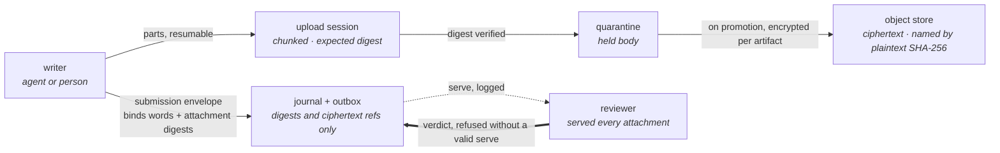

<!--
id: adr/ADR-0004-bodies-and-attachments
tier: engineering
status: accepted design
answers: how bodies and attachments are content-addressed, encrypted per artifact, and referenced digest-only in the journal
-->

# ADR-0004 — Bodies and attachments: content-addressed, per-artifact encryption, digest-only journal

**Status:** accepted design · 2026-10-29

## Context

A memory is words plus, often, files: a screenshot and what it shows, a regulator's PDF and a
comment on it. Four commitments shape how OML holds them, and each has a failure it exists to
prevent:

- **Binding by content hash.** An artifact's identity is the hash of its canonical form, with
  lifecycle state kept out of the hashed form so that erasure never renames an id.
- **Words and bytes keep separate identities.** If the file itself were the body, a re-issued
  PDF with a new `/CreationDate` and identical words would claim a supersession that is a lie
  about the knowledge. The comment and the file it is about are different things with different
  identities.
- **One claim, one verdict.** A claim is its words and up to a few attachments, uploaded in
  parts, bound into the signed envelope by hash, with one verdict covering both — and a
  promoting signature counting only from a reviewer the service itself served every attachment
  to.
- **Content addressing over version pretending.** A stored thing is named by the hash of its
  bytes, never by a mutable alias.

The substrate makes these commitments compatible with erasure: bodies and attachments are
encrypted per artifact from day one (the precondition of erasure by crypto-shredding,
[ADR-0005](ADR-0005-erasure-by-crypto-shredding.md)), the plaintext never enters the journal or
the lake, and the stored original is kept. Everything below is decided, not built; nothing here
has been measured.

## Decision

- **d1 — Journal and outbox payloads never carry body plaintext.** A journal or outbox event
  references content only as a plaintext digest or as a per-artifact-DEK ciphertext reference. The
  ed25519 signature covers that digest/ciphertext envelope, not the bytes, so per-tenant chain
  verification survives crypto-shredding: destroying a DEK invalidates no signature and breaks no
  `prev_hash` link. This is the rule that makes [ADR-0005](ADR-0005-erasure-by-crypto-shredding.md)
  possible rather than merely declared, and it is why the journal and outbox rows appear in that
  record's erasure inventory as "digest-only — never needs touching". The event payload shapes are
  the [event catalog](../data/event-catalog.md)'s; this record fixes only what they may not
  contain.

- **d2 — Attachments are content-addressed by SHA-256 of plaintext, and the signed submission
  envelope binds them by digest.** An attachment has no state, verdict or recall identity of its
  own; it exists as an object a claim's envelope names by hash. The envelope carries the words'
  digest and the ordered list of attachment digests, so the artifact identity commits to every
  attachment: the same words about a different file are a different claim. The envelope contract
  is specified in the [storage architecture](../architecture/storage.md) and the
  [Postgres schema](../data/postgres-schema.md). Its versioning discipline is additive: a later
  envelope version may add optional fields, never remove, rename or retype one, so earlier ids
  stay valid.

- **d3 — Bytes are uploaded through resumable upload sessions, and an unbound upload is not
  content.** A session records the expected plaintext digest up front; parts arrive chunked; a
  retry resumes or restarts the session — the failure path is defined, not improvised. The gate
  verifies the digest at completion, and a submission may bind only the caller's own completed
  uploads: the identity that wrote a claim's words uploaded its bytes, which keeps the bytes'
  writer and the words' writer one identity. An upload nothing has
  bound sits outside the journal, is addressable by no one but its uploader, and expires; "no
  silent deletion" governs admitted content — what a signed event names — and no event names an
  upload. Session shape, part limits and expiry values are unbuilt and undecided at this level;
  the `upload_sessions` table is sketched in the [Postgres schema](../data/postgres-schema.md).

- **d4 — Stored objects are ciphertext in an S3-compatible object store, encrypted per artifact,
  with both digests recorded.** The object is named by the SHA-256 of its plaintext
  (`oml-bodies/<tenant>/<digest>`); the bytes at that name are per-artifact-DEK ciphertext. Object
  integrity metadata records the ciphertext digest, so the key-less reconciler can verify stored
  bytes without ever holding a DEK; plaintext-digest verification is scoped to the serving path,
  which is the only path that decrypts. The cost of this split is honest: an end-to-end
  plaintext-integrity check exists only where keys exist, and the reconciler's digest-mismatch
  finding — part of the closed finding vocabulary on the
  [reconciliation page](../architecture/reconciliation.md) — speaks about ciphertext.
  The original file is kept, deliberately: the evidence a reviewer signed must stay re-openable
  later, and the object store is the durable home for a regulator's PDF or a screenshot.

- **d5 — A reviewer is served every attachment of a claim before a verdict counts.** A promoting
  verdict on a claim with attachments is refused unless the service's own serving log shows every
  attachment was served to that reviewer — the service proves delivery, not attention, and nobody
  signs bytes the service never handed them. The
  mechanism is the serve binding: `oml review next` serves the item with all attachments
  under a `serve_id` bound server-side to (reviewer key, artifact version, attachment digest set),
  expiring, consumed by its first verdict, and invalidated by any change to the served content;
  the journalled verdict records the served digests, and a verdict without a valid serve is
  refused server-side. The serve ceremony itself is owned by the admission and CLI records
  (ADR-0012 and ADR-0015's surfaces; [admission](../architecture/admission.md),
  [CLI reference](../cli/reference.md)); this record fixes that attachments are inside it.

- **d6 — Extraction is honest per type, and no reader ever falls back to decoding bytes as
  text.** Where a deterministic text extractor exists for an attachment's type, the extracted text
  is scanned and gated like any claim text. For opaque binaries, the reviewed claim is exactly
  provenance + digest + scan result, and the documentation says so per type — a clean scan of a
  file whose pixels nobody read is not a clean picture. The refusals are named per type and never
  improvised, because the fallback they forbid has a known failure class: decoding arbitrary
  bytes with replacement characters and embedding the result as text manufactures mojibake that a
  scanner then "reads" as if it were content. This rule closes that class by construction. Which
  extractors exist, and what they cost, is unmeasured and unbuilt; extractor choice per type is
  design work tracked on the [roadmap](../product/roadmap.md).

## Consequences

- Chain verification and erasure stop competing. Because no journal or outbox payload holds
  plaintext (d1), [ADR-0005](ADR-0005-erasure-by-crypto-shredding.md)'s inventory can mark the
  journal "never needs touching", and a verified chain after an erase is a design property, not a
  cleanup job. The cost: the journal alone cannot answer "what did this memory say" — that is the
  serving tier's job while a DEK exists, and nobody's job after.
- Deduplication across tenants or writers does not exist. Content addressing would permit it;
  d3's writer-uploads-its-own-bytes rule and per-artifact DEKs forbid it, deliberately — a shared
  plaintext object would make one artifact's erasure another's, and a hash carries no authorship
  the service could check. Re-uploading a large file every time it is attached is the price.
- The reconciler stays key-less (d4), which keeps the trusted computing base small at the price
  of ciphertext-only integrity findings outside the serving path.
- A reviewer must be served every attachment before a counting verdict (d5), so attachment count
  and size directly price review. Review throughput is unmeasured — the
  [roadmap](../product/roadmap.md) carries it as an FR.
- Everything here is decided, not built. Upload-session limits, admitted media types, extractor
  choices and the serve-binding expiry are open at the level named in each decision, and each
  open point lives as a roadmap row, not as silence.

## Rejected alternatives

- **An attachment as a row of its own**: bytes as a row with no verdict of their own,
  made readable by another row's promotion, need a second read rule and a second authorship
  check, and split the bytes' writer from the words' writer. One row, one review, one verdict is
  strictly simpler and keeps R2 checkable at one point.
- **Extracted text as the submitted body, original dropped**: a
  re-issued file with identical words claims a false supersession, and the evidence a reviewer
  signed cannot be re-opened later. OML keeps both identities and both artifacts.
- **Plaintext bodies in the object store behind access control.** Access control is revocable;
  stored plaintext is forever everywhere it was copied (versions, backups, caches). Per-artifact
  encryption is what makes [ADR-0005](ADR-0005-erasure-by-crypto-shredding.md)'s erasure claim
  scoped-but-true instead of broad-but-false, and it costs a KMS dependency and a decrypt on
  every serve.
- **Body plaintext in journal payloads** (one store, no indirection): simplest possible read
  path, and it makes the hash chain and erasure permanently incompatible — every erase would
  either break a signature or be a lie. The digest-only rule (d1) is non-negotiable for that
  reason.
- **A separate byte store under its own service**: a
  third storage engine, a second backup domain and an outage state of its own, buying nothing the
  object store plus d2's binding does not already give.
