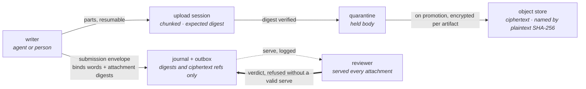

<!--
id: adr/ADR-0004-bodies-and-attachments
tier: engineering
status: accepted design
answers: how bodies and attachments are content-addressed, encrypted per artifact, and referenced digest-only in the journal
-->

# ADR-0004 — Bodies and attachments: content-addressed, per-artifact encryption, digest-only journal

**Status:** accepted design · 2026-10-29 · amended 2026-11-17 (d3, the upload session's values, #451)

**Release:** not built ([releases](../changelog.md)), except d3's upload sessions, built for bundle import (#451, v0.8.2)

## Context

A memory is words plus, often, files: a screenshot and what it shows, a regulator's PDF and a
comment on it. Four commitments shape how OML holds them, and each has a failure it exists to
prevent:

- **Binding by content hash.** An artifact's identity is the hash of its canonical form, with
  lifecycle state kept out of the hashed form so that erasure never renames an id.
- **Words and bytes keep separate identities.** If the file itself were the body, a re-issued
  PDF with a new `/CreationDate` and identical words would claim a supersession that is a lie
  about the knowledge. The comment and the file it is about are different things with different
  identities.
- **One claim, one verdict.** A claim is its words and up to a few attachments, uploaded in
  parts, bound into the signed envelope by hash, with one verdict covering both — and a
  promoting signature counting only from a reviewer the service itself served every attachment
  to.
- **Content addressing over version pretending.** A stored thing is named by the hash of its
  bytes, never by a mutable alias.

The substrate makes these commitments compatible with erasure: bodies and attachments are
encrypted per artifact from day one (the precondition of erasure by crypto-shredding,
[ADR-0005](ADR-0005-erasure-by-crypto-shredding.md)), the plaintext never enters the journal or
the lake, and the stored original is kept. Everything below is decided, not built; nothing here
has been measured.

## Decision

- **d1 — Journal and outbox payloads never carry body plaintext.** A journal or outbox event
  references content only as a plaintext digest or as a per-artifact-DEK ciphertext reference. The
  ed25519 signature covers that digest/ciphertext envelope, not the bytes, so per-tenant chain
  verification survives crypto-shredding: destroying a DEK invalidates no signature and breaks no
  `prev_hash` link. This is the rule that makes [ADR-0005](ADR-0005-erasure-by-crypto-shredding.md)
  possible rather than merely declared, and it is why the journal and outbox rows appear in that
  record's erasure inventory as "digest-only — never needs touching". The event payload shapes are
  the [event catalog](../data/event-catalog.md)'s; this record fixes only what they may not
  contain.

- **d2 — Attachments are content-addressed by SHA-256 of plaintext, and the signed submission
  envelope binds them by digest.** An attachment has no state, verdict or recall identity of its
  own; it exists as an object a claim's envelope names by hash. The envelope carries the words'
  digest and the ordered list of attachment digests, so the artifact identity commits to every
  attachment: the same words about a different file are a different claim. The envelope contract
  is specified in the [storage architecture](../architecture/storage.md) and the
  [Postgres schema](https://github.com/e8kor/open-memory-lab/tree/main/migrations). Its versioning discipline is additive: a later
  envelope version may add optional fields, never remove, rename or retype one, so earlier ids
  stay valid.

- **d3 — Bytes are uploaded through resumable upload sessions, and an unbound upload is not
  content.** A session records the expected plaintext digest up front; parts arrive chunked; a
  retry resumes or restarts the session — the failure path is defined, not improvised. The gate
  verifies the digest at completion, and a submission may bind only the caller's own completed
  uploads: the identity that wrote a claim's words uploaded its bytes, which keeps the bytes'
  writer and the words' writer one identity. An upload nothing has
  bound sits outside the journal, is addressable by no one but its uploader, and expires; "no
  silent deletion" governs admitted content — what a signed event names — and no event names an
  upload. Session shape, part limits and expiry values are unbuilt and undecided at this level;
  the `upload_sessions` table is sketched in the [Postgres schema](https://github.com/e8kor/open-memory-lab/tree/main/migrations).

  *(Amended 2026-11-17, #451: the values, decided by the coordinator under the operator's "Build
  resumable first", which put upload sessions before bundle import (ADR-0084 d15). They are built
  for one purpose, `import`; attachments (d2) reuse the same sessions when they are built.)*

  - **Storage.** Parts are objects behind the object store port at `storage.url`, a local
    directory by default (`oml-objects`, beside the keyring), the port ADR-0090 d16 names for the
    lake. Another scheme is refused at start by name until an object store adapter exists. A row of
    `upload_sessions` holds metadata only: the key that opened it, the purpose, the declared size
    and SHA-256, the parts received, the state and its times.
  - **Encryption at rest.** Each session draws a 256-bit key, kept in `upload_sessions.part_key`.
    Every part is stored as XChaCha20-Poly1305 ciphertext under it, with a random 192-bit nonce
    and the session id and part number as associated data, so a part cannot be moved to another
    position or session. The key is nulled when the session expires, is abandoned, fails its
    digest, or when the verb that bound it ends: nulling it is the shred. Wrapping the key under
    the tenant's KEK (ADR-0005 d1) is a follow-up; until then the key and the ciphertext are one
    database restore apart, which ADR-0005's inventory row says.
  - **Routes.** Five, under `/v2/uploads`:
    - `POST /v2/uploads {purpose, size, sha256}` opens a session and answers its id, part size,
      part count and expiry;
    - `PUT /v2/uploads/{id}/parts/{n}` stores part `n`, counted from 1; sending a part again
      replaces it, so a retry after an interruption resumes where the status says;
    - `GET /v2/uploads/{id}` answers the state, the parts received, the parts missing and the
      expiry;
    - `POST /v2/uploads/{id}/complete` reads the parts in order, checks the SHA-256 of the
      plaintext against the declared one, and completes the session or fails it;
    - `DELETE /v2/uploads/{id}` abandons it.
  - **States.** `open`, then `completed` or `failed`; `completed`, then `bound`; and `expired` or
    `abandoned` from any state but `bound`. A session binds once, in the transaction of the verb
    that consumes it, and only for the key that opened it. Only a writer key opens a session
    (`access.verb_ceiling` for any other role); the consuming verb checks its own rule at the bind.
    Every route answers any key but the opener `access.not_found`, as for a row outside its reads.
  - **Limits.**
    - Parts are a fixed 8 MiB (8,388,608 bytes); the last part is the remainder. A part of any other
      length is refused.
    - One upload is at most 1 GiB, `uploads.max_bytes`.
    - A key holds at most 4 sessions that are open or completed and unbound.
    - A tenant holds at most 4 GiB of declared bytes in sessions that are open or completed and
      unbound, `uploads.tenant_max_bytes`.
  - **Expiry.** An open session expires 24 hours after its last opening or part, and never later
    than 72 hours after it opened. A completed session nobody bound expires 24 hours after its
    completion. A sweep in the lead, every 5 minutes, marks each such session `expired`, nulls its
    key, and then deletes its objects, in that order, so a failure between the two leaves only
    ciphertext no key opens, which the next sweep deletes.
  - **Refusals.** Ten codes, each with a row on the errors page and counted by code on the
    `uploads` doctor line: `upload.session_invalid` (409, the session's state does not allow the
    act; `details.state`), `upload.digest_mismatch` (422; the session fails), `upload.expired`
    (410), `upload.too_large` (413, over `uploads.max_bytes`), `upload.part_size` (422),
    `upload.part_number` (422, outside 1 to the part count), `upload.incomplete` (409,
    `details.missing`), `upload.session_limit` (409, the key's 4), `upload.tenant_limit` (409,
    the tenant's 4 GiB) and `upload.storage_failed` (503, the object store failed; retryable, and
    nothing changed state).
  - **Nothing is journalled.** No event names a session, a part or its completion. The verb that
    binds an upload journals what it does with the bytes; an import records the upload's digest in
    `workspace.imported`.
  - **Doctor and limits.** The `oml doctor` line `uploads` reads the metrics listener: sessions
    by state, the stored bytes, the sessions whose key is gone and whose objects remain, the last
    sweep's failure, and the refusals by code. Upload storage is a row on the limits page; its
    throughput is unmeasured.
  - **Readings of 2026-11-17 (the coordinator, while #451 was built).**
    - The declared `sha256` is 64 lowercase hexadecimal characters with no prefix; anything else
      is `request.validation`.
    - Any writer key may open a session. A verb that is a person's only, such as import
      (ADR-0084 d11), checks that rule when it binds the session, not when the session opens.
    - Deleting a session that is already `expired` or `abandoned` answers 204 and changes nothing;
      deleting a `bound` session is `upload.session_invalid`.
    - A session's row is kept after it ends, with its key nulled and its objects deleted, so the
      doctor and an import's record can name it. Those rows grow by one per upload; the doctor's
      `uploads` line counts them by state and the limits page carries the row as a bottleneck,
      with no retention yet.
    - The doctor line reads the metrics listener, so the routes stay five: no status route is
      added for it.
    - An import's staging key (ADR-0084 d11) is the bound session's `part_key` (ADR-0084 I4).
  - **Readings of 2026-11-18 (the coordinator, the review of bulk B; for the operator's batch).**
    - A bound upload's plaintext is read back through the digest: reading it recomputes the
      SHA-256 over the parts as decrypted and refuses `upload.digest_mismatch` when it differs from
      the session's, so bytes changed at rest after completion are never imported.
    - Binding requires the session unexpired at the instant of the bind (`expires_at > at`).
    - The local object store writes each object to a temporary file under a random name opened
      exclusively, renames it into place and syncs the parent directory; it creates its root
      owner-only (0700).
    - A bound session whose import stopped is shredded by the sweep (ADR-0084 I11), and a bound
      session whose key is still set 24 hours after binding is the doctor warning
      `upload_staging_stale`. A failure to shred is logged with its reason.
  - **Note of 2026-11-18 (the coordinator, CI of bulk B; for the operator's batch).** An optional
    feature never stops the server from starting. The lead opens the directory `storage.url` names
    on first use, not at start: one it cannot create or open is logged once at start as
    `upload_store_unavailable` with its reason, and the lead starts and serves every other route.
    While the store cannot be opened, opening an upload session, storing a part and an import that
    reads its upload answer `upload.storage_failed` (503, retryable); recall and every route that
    does not touch the store are unaffected. Each sweep tries to open the store again, and the
    metrics listener serves `oml_upload_store_unavailable{reason}` at 1 while it cannot, `reason`
    being the closed kind of the failure (`permission_denied`, `read_only`, `not_a_directory`,
    `not_found`, `full`, `other`), which `oml doctor` reads as the warning
    `upload_store_unavailable: object store unavailable: <reason>`. The log line names the path
    and the error; neither is served in an API answer or a metric label, since a label value comes
    from a closed set and the path is the server's. The default stays the relative `oml-objects`; the release
    image sets `storage.url` to `/var/lib/oml/objects`, a directory its user owns, and the Compose
    file and the Helm chart mount a writable volume there.
  - **Note of 2026-11-18, second (the coordinator, the review of the CI fix; for the operator's
    batch).** The lead tightens a `storage.url` root to owner-only only when it owns it. A root it
    does not own is never chmodded: one its group or others can write is refused, naming the owner
    and the mode, as a volume's root owned by root is; one they cannot write is used only when a probe file shows the lead can write it, and refused
    otherwise, so `ready()` fails before a session opens. So
    the Helm chart sets `storage.url` to `/var/lib/oml/objects/store`, a directory below its volume
    that the lead creates owned by itself, and `scripts/check_chart.py` refuses a storage URL that
    is not strictly below a mounted volume. The first open, and each later try while the store is
    closed, run off the async workers. A part the store no longer holds at completion, as after a
    pod lost its emptyDir, is named by `upload.incomplete`, not `upload.storage_failed`, so the
    client sends it again. The chart's objects emptyDir defaults to `sizeLimit: 8Gi`, past which the
    kubelet evicts the lead: the per-tenant cap bounds one tenant, not the node. `objects.persistence`
    mounts a ReadWriteOnce claim instead, off by default, so a restart or an upgrade keeps the parts
    in flight. CI proves the write: `scripts/quickstart.sh` opens, fills and completes an upload on
    the chart and Compose installs.

- **d4 — Stored objects are ciphertext in an S3-compatible object store, encrypted per artifact,
  with both digests recorded.** The object is named by the SHA-256 of its plaintext
  (`oml-bodies/<tenant>/<digest>`); the bytes at that name are per-artifact-DEK ciphertext. Object
  integrity metadata records the ciphertext digest, so the key-less reconciler can verify stored
  bytes without ever holding a DEK; plaintext-digest verification is scoped to the serving path,
  which is the only path that decrypts. The cost of this split is honest: an end-to-end
  plaintext-integrity check exists only where keys exist, and the reconciler's digest-mismatch
  finding — part of the closed finding vocabulary on the
  [reconciliation page](https://github.com/e8kor/open-memory-lab/blob/main/design/reconciliation.md) — speaks about ciphertext.
  The original file is kept, deliberately: the evidence a reviewer signed must stay re-openable
  later, and the object store is the durable home for a regulator's PDF or a screenshot.

- **d5 — A reviewer is served every attachment of a claim before a verdict counts.** A promoting
  verdict on a claim with attachments is refused unless the service's own serving log shows every
  attachment was served to that reviewer — the service proves delivery, not attention, and nobody
  signs bytes the service never handed them. The
  mechanism is the serve binding: `oml review next` serves the item with all attachments
  under a `serve_id` bound server-side to (reviewer key, artifact version, attachment digest set),
  expiring, consumed by its first verdict, and invalidated by any change to the served content;
  the journalled verdict records the served digests, and a verdict without a valid serve is
  refused server-side. The serve ceremony itself is owned by the admission and CLI records
  (ADR-0012 and ADR-0015's surfaces; [admission](../architecture/admission.md),
  [CLI reference](../cli/reference.md)); this record fixes that attachments are inside it.

- **d6 — Extraction is honest per type, and no reader ever falls back to decoding bytes as
  text.** Where a deterministic text extractor exists for an attachment's type, the extracted text
  is scanned and gated like any claim text. For opaque binaries, the reviewed claim is exactly
  provenance + digest + scan result, and the documentation says so per type — a clean scan of a
  file whose pixels nobody read is not a clean picture. The refusals are named per type and never
  improvised, because the fallback they forbid has a known failure class: decoding arbitrary
  bytes with replacement characters and embedding the result as text manufactures mojibake that a
  scanner then "reads" as if it were content. This rule closes that class by construction. Which
  extractors exist, and what they cost, is unmeasured and unbuilt; extractor choice per type is
  design work tracked on the [open issues](https://github.com/e8kor/open-memory-lab/issues?q=label%3Aroadmap).

## Consequences

- Chain verification and erasure stop competing. Because no journal or outbox payload holds
  plaintext (d1), [ADR-0005](ADR-0005-erasure-by-crypto-shredding.md)'s inventory can mark the
  journal "never needs touching", and a verified chain after an erase is a design property, not a
  cleanup job. The cost: the journal alone cannot answer "what did this memory say" — that is the
  serving tier's job while a DEK exists, and nobody's job after.
- Deduplication across tenants or writers does not exist. Content addressing would permit it;
  d3's writer-uploads-its-own-bytes rule and per-artifact DEKs forbid it, deliberately — a shared
  plaintext object would make one artifact's erasure another's, and a hash carries no authorship
  the service could check. Re-uploading a large file every time it is attached is the price.
- The reconciler stays key-less (d4), which keeps the trusted computing base small at the price
  of ciphertext-only integrity findings outside the serving path.
- A reviewer must be served every attachment before a counting verdict (d5), so attachment count
  and size directly price review. Review throughput is unmeasured — the
  [open issues](https://github.com/e8kor/open-memory-lab/issues?q=label%3Aroadmap) carries it as an issue.
- Everything here is decided, not built. Upload-session limits, admitted media types, extractor
  choices and the serve-binding expiry are open at the level named in each decision, and each
  open point lives as a issue, not as silence.

## Rejected alternatives

- **An attachment as a row of its own**: bytes as a row with no verdict of their own,
  made readable by another row's promotion, need a second read rule and a second authorship
  check, and split the bytes' writer from the words' writer. One row, one review, one verdict is
  strictly simpler and keeps R2 checkable at one point.
- **Extracted text as the submitted body, original dropped**: a
  re-issued file with identical words claims a false supersession, and the evidence a reviewer
  signed cannot be re-opened later. OML keeps both identities and both artifacts.
- **Plaintext bodies in the object store behind access control.** Access control is revocable;
  stored plaintext is forever everywhere it was copied (versions, backups, caches). Per-artifact
  encryption is what makes [ADR-0005](ADR-0005-erasure-by-crypto-shredding.md)'s erasure claim
  scoped-but-true instead of broad-but-false, and it costs a KMS dependency and a decrypt on
  every serve.
- **Body plaintext in journal payloads** (one store, no indirection): simplest possible read
  path, and it makes the hash chain and erasure permanently incompatible — every erase would
  either break a signature or be a lie. The digest-only rule (d1) is non-negotiable for that
  reason.
- **A separate byte store under its own service**: a
  third storage engine, a second backup domain and an outage state of its own, buying nothing the
  object store plus d2's binding does not already give.
