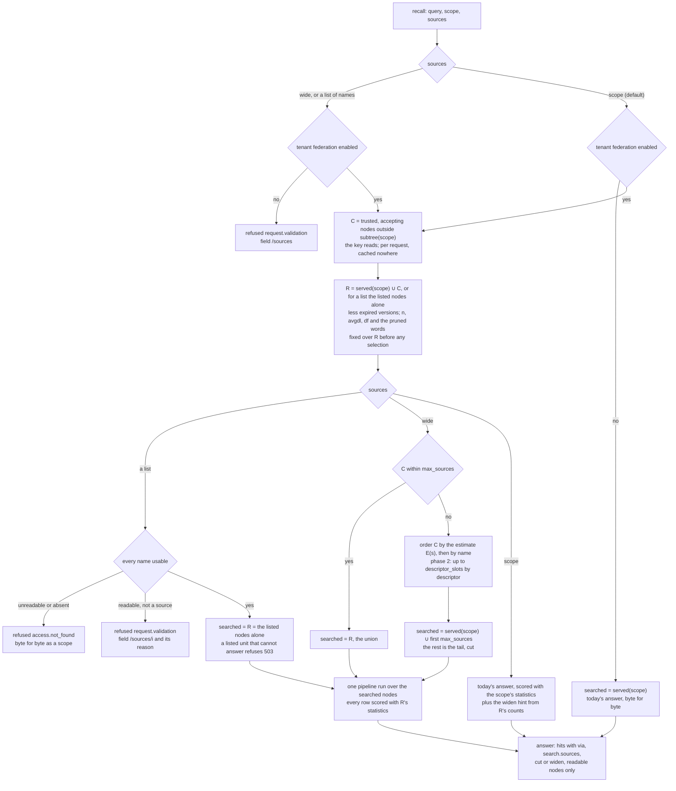
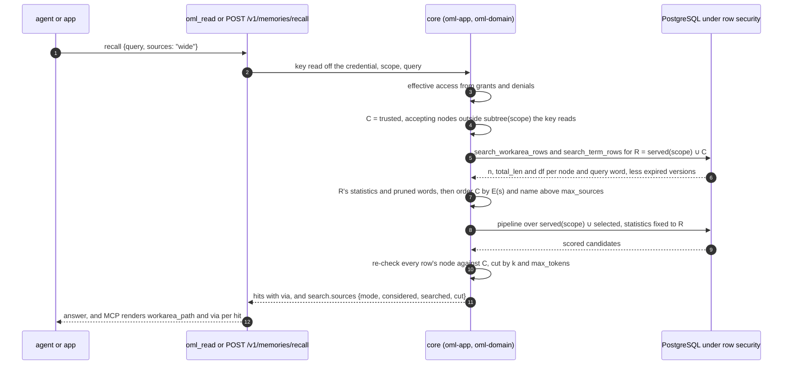

<!--
id: adr/ADR-0072-recall-searches-the-trusted-workareas-a-key-already-reads-chosen-per-query-by-reviewed-descriptors-and-never-widens-what-it-may-read
tier: engineering
status: proposed
answers: what recall searches today and what federated recall adds; who gains from it and how the gain is measured; which workareas are trusted sources and why no new flag; what a workarea's descriptor holds, who writes and reviews it, how it is scanned and how far it can move a selection; why advertising grants nothing and whether a key can discover a workarea it cannot read; how a recall chooses its sources (candidates, the reference set, the selection estimate, the cap, the descriptor slots, the tail) and why a hit's score never depends on which sources were selected; the `sources` argument, its two modes and its fixed list, answered whole or refused; the hint that tells an agent to widen; the per-workarea and tenant policies; what each answer and each refusal may name; what makes the answer repeatable; the cost, limits and latency budget; the eval; the three phases and their leakage tests; what the operator still has to answer
-->

# ADR-0072 — Recall searches the trusted workareas a key already reads, chosen per query by reviewed descriptors, and never widens what it may read

**Status:** proposed · 2026-11-08 · revised after review round 1, 2026-11-08, round 2,
2026-11-10 and round 3, 2026-11-10 (review log at the end)

**In short.** Recall can search the trusted workareas a key already reads: `sources: "wide"`, or a
fixed list such as `sources: ["acme.legal", "acme.product"]`. It is off until a tenant admin enables
it. Every hit says where it came from, a list is answered whole or refused, and a `scope` answer
says when a wider search would find more. Nothing becomes readable that was not, and no hit's score
depends on which sources were chosen. Phase 1 selects by exact word counts; reviewed descriptors
join only in phase 2, and only if phase 1's measurements ask for them.

**Decisions at a glance.**

| | Decision | Phase |
|---|---|---|
| d1 | A trusted source is a `committed` or `validated` node outside every in-progress subtree; no new flag | 1 |
| d2 | A descriptor is a reviewed claim of kind `descriptor`, one live per workarea | 2 |
| d3 | A descriptor is scanned, checked and bounded; a hold finding never advertises | 2 |
| d4 | Selection runs in the core: the union below the cap, an exact size-aware estimate above it | 1 |
| d5 | One `sources` field (`scope`, `wide` or a list); one policy per workarea, three per tenant | 1 |
| d6 | Advertising grants nothing; a key learns of no workarea it cannot read | 1 |
| d7 | A hit's score never depends on which sources were selected | 1 |
| d8 | The answer names its sources and why; a normalised-rate hint says when to widen | 1 |
| d9 | The same inputs give the same answer; no clock, randomness or model | 1 |
| d10 | Ontology overlap and generated questions read reviewed content only | 3 |
| d11 | The eval measures every mode against `scope` and the union, with numeric gates | 1, 2 |
| d12 | Exact counts, a latency budget, a cap, no access cache | 1 |
| d13 | Three phases, each closed by its leakage tests | 1 to 3 |

**Amends:** ADR-0039 (d4: recall mode gains `sources`), ADR-0044 (d10: `universe` becomes one
trusted source among others when `sources` is not `scope`), ADR-0049 (d6: the answer says which
sources it searched and why, and may hint that a wider search would find more)

## Context

**What recall searches today.** Read in `crates/oml-app/src/app.rs`, `App::recall_as` and
`App::served_nodes`: the hits of a recall are the served tips on subtree(scope) where reader is
in the key's effective access (`nodes_with`), less every node whose in-progress root differs from
the scope's (ADR-0030 d2). The scope's *ancestors* contribute steering only
(`steering_in_force` over the readable ancestry, ADR-0025 d8), never hits. The one exception is
ADR-0044 d10: a scope inside a user root also searches the `universe` node's own claims. So a
recall at `research-crew.experiments` never meets a reviewed claim in `ops-crew` or in
`research-crew.lit-review`, even when the key reads both: the agent must know the other workarea's
name and recall there. The scope is the agent's default workarea unless it names another
(ADR-0039 d4), and agents rarely name one.

**What the operator asked, on 2026-11-08.** "Recall will happen not only from one workarea or its
parents but from trusted production-ready, verified and reviewed workareas, and advertisement
workareas as well, for example with bm25 or with hypothetical question embedding, and based on
workarea metadata, its ontology etc, we will use it in recall call or not." Two corrections to
the premise, from the code above: hits come from the scope's subtree, not its parents; and
"production-ready" has no field today, so this record has to say which existing status means it.

**Who gains, and how it is measured.** A key gains only when it reads a trusted workarea outside
its scope's subtree. An agent key granted reader on its own crew's subtree, the common shape, has
at most `universe` outside it and gains little. Three uses gain:

1. **Cross-team reuse.** A team grants another crew reader on its committed area; that crew's
   agents' recalls then find the area's reviewed claims without naming it. The owner's only act
   is the grant (`accept_federated` is on by default, d5).
2. **A person's or a lead agent's key with broad reader**, which today must recall once per
   workarea it suspects.
3. **A production RAG application on a fixed set**, for instance "the legal and product
   workareas, nothing else", which today makes one recall per workarea and fuses the lists
   itself, losing the single ranking of d7. It names the set as a `sources` list (d5) and gets
   one ranking over those workareas alone, no selection, and the same answer for the same inputs,
   or a named refusal, never a partial answer.

The gain is measured, not assumed. Before phase 1 is built, #205 reports the distribution of the
candidate count |C| (d4) over the live keys of the public server, a one-off read of each key's
readable trusted nodes. If most agent keys have |C| ≤ 1, phase 1's value rests on uses 1 and 3,
and the documentation leads with the grant that enables use 1. The eval (d11) then measures what
the reach buys: success@5 and nDCG@10 on cross-workarea queries against `scope`, and selection
precision and recall where a cap selects.

**The forces.**

- **Access is the boundary, and nothing here may move it.** Effective access is computed per
  request from grants and denials and cached nowhere ([workareas](../architecture/workareas.md#effective-access));
  every retriever receives the node list the core computed and filters before its own `LIMIT`
  (ADR-0049 d2). Federation may only search *more of what the key could already read*.
- **R3.** The gate changes visibility, not ranking, and review never reorders results
  ([ADR-0001](ADR-0001-the-constitution.md) d3). A descriptor that is itself reviewed must not
  turn a verdict into a ranking input, and must not change the score of any hit.
- **Occam.** Three tools ([ADR-0039](ADR-0039-the-api-rewritten-for-v0-4-0.md) d2); a new
  capability is a parameter before it is a tool (d8), and a caller is shown an intent, not the
  algorithm behind it.
- **Repeatability.** The same key, query, approved set and time give the same answer (#176); the
  default pipeline is model-free at recall time ([ADR-0049](ADR-0049-search-is-a-pipeline-of-retrievers-behind-a-port-chosen-by-name-and-gated-by-the-recall-eval.md) d9; #201's design constraints).
- **OML is not a federation of strangers.** Every workarea of a tenant sits in one PostgreSQL
  partition, under one postings table, with BM25 statistics kept per workarea and summed over the
  readable nodes at query time ([ADR-0052](ADR-0052-text-search-reads-integer-postings-that-row-security-lets-an-index-serve.md) d5),
  counting served rows only. The hard half of distributed retrieval, merging scores from engines
  that do not share statistics, does not arise here (d7). In one database the union of every
  readable trusted source *is* the single virtual collection, so selection is an efficiency trade
  against the union, never a quality gain over it. It pays for itself when the union is too
  large to search inside the budget, and under [ADR-0073](ADR-0073-a-leader-signs-every-write-and-nodes-serve-the-workareas-placed-on-them-each-read-routed-to-the-closest-less-busy-replica-fresh-enough-for-it.md)
  (proposed, PR #212), where every searched source is a fan-out.
- **Ontology is proposed, not on main.** Terms and `oml:about` edges are
  [ADR-0051](https://github.com/e8kor/open-memory-lab/pull/58) (proposed, PR #58), which unparks
  the edge of ADR-0027 (proposed on the unmerged `feat/ontology-crews` branch) and parks its crew
  kinds and classifier. Every use of terms below (d2's `about`, d10) depends on ADR-0051 landing;
  phases 1 and 2 work without it, a descriptor's `about` then being empty.

**What the literature says about choosing sources.** Fetched and quoted from the primary sources:

- Callan, Lu and Croft, *Searching Distributed Collections with Inference Networks*, SIGIR 1995
  (CORI): ranking collections uses "statistics that are analogous to tf and idf in normal document
  retrieval; for example, document frequency df (the number of documents containing the term) and
  inverse collection frequency icf (the number of collections containing the term)", and "it is
  possible to select subsets of the available collections for searching without affecting
  retrieval effectiveness". The same paper names the alternative OML can afford: "One approach
  would be to treat the distributed collections as a single, large, 'virtual' collection."
- Callan and Connell, *Query-Based Sampling of Text Databases*, ACM TOIS 19(2), 2001: CORI-class
  algorithms "can automatically select which text databases to search for a given information
  need, but only if given a set of resource descriptions that accurately represent the contents
  of each database."
- Si and Callan, *Relevant Document Distribution Estimation Method for Resource Selection*
  (ReDDE), SIGIR 2003: distributed retrieval has three sub-problems, "resource representation",
  "resource ranking" and "result-merging"; CORI "does not do well in environments with a mix of
  'small' and 'very large' databases", which ReDDE answers with "information about database sizes
  as well as database contents"; and, the warning this record's eval is built around, "better
  resource selection does not always produce better document rankings."
- Cormack, Clarke and Büttcher, *Reciprocal Rank Fusion outperforms Condorcet and individual
  Rank Learning Methods*, SIGIR 2009: "RRFscore(d ∈ D) = Σ_{r∈R} 1/(k + r(d)), where k = 60 was
  fixed during a pilot investigation and not altered during subsequent validation."
- Nogueira, Yang, Lin and Cho, *Document Expansion by Query Prediction*, arXiv 1904.08375, 2019
  (doc2query): "we propose a simple method that predicts which queries will be issued for a given
  document", the write-time mirror of a query-time hypothetical answer, which #201 adopts.

In OML's terms: a *resource description* is the per-workarea statistics ADR-0052 already keeps,
complete rather than sampled, and in phase 2 a workarea descriptor (d2); *resource ranking* is
source selection (d4), needed only above the cap; *result-merging* is unnecessary because every
source shares one index and one set of statistics (d7). OML is the mix ReDDE warns about, with
`universe` near 100,000 memories ([scale](../benchmarks/scale.md)) beside crews of hundreds, and
it has what ReDDE's correction needs: exact sizes and exact contents.

Decided, not built.

## Decision

The source-selection flow, d4 to d7:

A recall with `sources: wide`, in order:

- **d1 — A trusted source is a `committed` or `validated` workarea outside every in-progress
  subtree; no new flag.** Both statuses hold R2 and R3 without exception (ADR-0001 d5): every
  promoted row in them was reviewed by a non-author, and nothing in them is `self_signed`. A
  `development` workarea is never a source, even where the key reads it, because tenant policy
  may relax review there and its marked rows are "readable only inside that workarea" (ADR-0001
  d5); every node of an in-progress subtree is `development` by construction (ADR-0030 d1), so
  it is excluded twice. `universe` is permanently `committed` and is a source like any other for
  a scope outside a user root, served under ADR-0044 d9 (no author, no source); a user root's
  recall still searches it under `scope`, as ADR-0044 d10 says. A user root and the workareas
  under it reach `committed` with `same_user` review (ADR-0046 d1, d2) and are trusted for the
  only keys that read them, their user's. No setting widens the set to `development`. A source is
  one **node**, judged on its own status: a `committed` parent with a `development` child is a
  source; the child is not.
  The cost: "production-ready" is read as `committed`, the working state of a governed space,
  and not as `validated`, which is frozen. A tenant whose committed areas are drafts has no
  narrowing switch in phase 1: its owners turn `accept_federated` off on those areas (d5), and a
  `min_status` setting returns as an amendment when a tenant names that use.

- **d2 — A descriptor is a reviewed claim of a new kind, `descriptor`, on the workarea it
  describes, one live per workarea; promoting it is the owner's opt-in to selection by it.** Its
  claim key is fixed, `oml:descriptor`, and its format is `application/json` under ADR-0056's
  strict parse, with a closed schema:

    | Field | Written by | Holds |
    |---|---|---|
    | `summary` | the author | at most 600 characters: what the workarea holds and for whom |
    | `about` | the author | at most 8 terms, each a CURIE of a readable active term (ADR-0051 d2, d4), linked as `oml:about` edges ratified with the descriptor |
    | `questions` | the author | at most 8 questions the workarea's promoted rows answer (phase 3 adds generated ones, d10) |
    | `owner` | served, never authored | the workarea's crew record (ADR-0008 d7) or, in a user root, its user |
    | `status` | served | the workarea's ladder status |
    | `freshness` | served | the descriptor's promotion time and the workarea's latest promotion time |

  A writer key with writer access on the workarea writes it, an agent's included: the agents
  working in a workarea know best what it answers. A write naming `oml:descriptor` on any other
  workarea is refused `request.validation`, and a second live descriptor is a supersession, never
  a sibling (ADR-0050 d2). It is held, scanned (d3) and reviewed by a non-author dreamer on the
  same workarea, R2 against the lineage closure, like every claim; a validated workarea refuses a
  new descriptor as it refuses every write (ADR-0009 d1), so its last promoted descriptor stands.
  The descriptor is not a hit kind: it is never a recall candidate, never in `HIT_KINDS`, and it
  is served by the workarea read (`oml_workarea`) beside `brief` (ADR-0046 d9), a held one to its
  author alone. The author-written fields are signed with the descriptor; the served fields are
  read at recall time and never signed, so a descriptor cannot lie about its own status or
  freshness. A promoted descriptor is the opt-in: there is no separate `advertise` switch, and
  `accept_federated` (d5) is the owner's off switch for federation as a whole. A descriptor
  matters only when a key's candidates exceed `max_sources` (d4): below the cap every candidate is
  searched and the descriptor changes nothing.
  The cost: a new kind, one more row per described workarea, and a review per change. The brief
  (ADR-0046 d7) is not reused: it lists claims for an agent entering a workarea, and a descriptor
  describes the workarea to a query that has not entered it.

- **d3 — A descriptor is kept honest by scanning, by review with a check its reviewer sees, and
  by a bounded reach that cannot touch a hit's score.** Four layers, the last the one that holds:
  1. **Scanning, and a hold finding never advertises.** A descriptor is scanned like every claim
     over its three author fields: by ADR-0065's rule set today and by `oml-scan/2` of
     [ADR-0074](https://github.com/e8kor/open-memory-lab/pull/219) (proposed, PR #219) when it
     lands. A refuse finding refuses the write, as for any claim. One rule is stricter here: a
     descriptor version that carries a **hold** finding, recorded at write or added later by a
     rescan under a newer rule set (ADR-0074 d14), never advertises. It is not indexed for
     selection, it scores no candidate, and the workarea is selected by content alone, as if it
     had no descriptor, whatever verdict the version received. A person may still approve it
     under ADR-0074 d2, and a person may dismiss its finding under ADR-0074 d19; either serves it
     on the workarea read with its findings (ADR-0074 d12), and neither restores selection. The
     author supersedes it with text that scans clean. The reason is the reader: an ordinary
     claim's hold finding is judged by a person for the people who read that workarea, while a
     descriptor's text steers selection for every crew that reads it, so no single verdict covers
     its audience. Before ADR-0074 lands, ADR-0065's `injection.*` findings, which hold (ADR-0065
     d5), are the hold findings meant here. An annotate finding (ADR-0074 d1) is served to the
     author and the reviewer and does not stop selection. The descriptor's prose is never served
     in a recall answer: `matched` (d8) names words, a descriptor version and question indices,
     never text, so instruction-shaped text has no path into another agent's context through
     recall.
  2. **Review.** The reviewer reads the workarea the descriptor describes (dreamer on it) and
     accepts or rejects the descriptor whole.
  3. **The answer check.** At hold time, in the scanner's queue and off the write path, the
     server runs each `questions` entry as a recall over the described **node alone**, not its
     subtree, under the author's effective access and the tenant's default pipeline, and attaches
     an advisory finding, `descriptor.question_unanswered`, for each question with no promoted hit
     in its top 5, and `descriptor.term_unused` for each `about` term no promoted memory of the
     node is linked to. The node alone is what federation searches (d1), and a check confined to
     it says nothing about a child the reviewer may be denied. Findings never veto, as ADR-0050
     d6's advisory findings do not; the reviewer sees them, and only the author and the reviewer
     are served them.
  4. **Bounded reach.** No descriptor enters any hit's score (d7). A descriptor can only move a
     source into the searched set, and only (a) when the key's candidates exceed the cap, and (b)
     into at most `descriptor_slots` of the `max_sources` slots. The bound is the cap: the further
     condition that the source's promoted rows hold one of the query's kept words (d4.5) is met
     by almost every source when no word is pruned, so it excludes little. A descriptor that
     claims every topic therefore displaces at most `descriptor_slots` honest sources, only those
     the content estimate placed last inside the cap, and its rows are served only where they
     earn their score. Telemetry measures it: `selection_yield`, per source, the
     share of selections that served a hit in the top `k`, for a tenant admin only (ADR-0054 d2's
     audience), with a doctor line below a floor the eval sets. Yield never feeds selection
     automatically.
  The cost: the answer check runs up to 8 recalls per descriptor version in the scanner's queue,
  inside its time budget (ADR-0065); a descriptor with a hold finding stops advertising where a
  claim would only wait for a person, and its author rewrites it.

- **d4 — Source selection runs inside the core over the sources the key reads; below the cap it
  searches the union, above it a size-aware estimate over exact counts orders the candidates,
  deterministically.** Per recall:
  1. **Candidates.** C = every node outside subtree(scope) where reader is effective for the key
     (the union over its reader grants' subtrees, `nodes_holding`), that is a trusted source (d1),
     accepts federated reads (d5), and passes the in-progress boundary rule (ADR-0030 d2).
     Computed per request from grants and denials, like every access decision, cached nowhere.
  2. **The reference set.** Under `scope` and `wide`, R = served(scope) ∪ C; under a list, R =
     the listed nodes alone, which are also the searched set (d5), so a list's answer is a
     function of the listed workareas and nothing else: the availability, cost and churn of every
     other workarea the key reads cannot move it. R is fixed once per request, with the key's
     access (d6). Its statistics, BM25's `n`, `avgdl` and
     per-word `df`, are summed over R from ADR-0052 d5's counts, which count served rows only,
     less the versions expired at `now`, which the counts still hold and `bm25-postings` already
     subtracts over a scope (`POSTINGS_EXPIRED` in `oml-pg`), now over R's nodes; that is one more
     read per recall by the `memories_valid_until` index, bounded by R's expired tips. The
     **pruned words** are decided over R as well: ADR-0052 d6's `FREQUENT_SHARE` and
     `POSTING_BUDGET` read R's sums, so which words a recall drops depends on R and the query
     alone. Both happen before any selection. Since every searched set is a subset of R, the
     postings it reads are at most R's, and the budget still bounds the read. R holds readable
     nodes alone, so no statistic of an unreadable, held or expired row enters the computation;
     and R does not depend on which sources are selected, so d7's scores do not either. **A source
     that cannot be reached for R's statistics** (ADR-0073 d9's first round) is never dropped
     from R silently, since every score would move with nothing in the answer to show why. Under a
     list it refuses the recall `503 cluster.source_unavailable {workarea, reason}`, the same
     error as a listed source that cannot answer (d5; ADR-0073), and no other workarea's state
     can cause it. Under `wide` the candidate is dropped from C and from R together and listed in
     `search.sources.missing` with its reason (ADR-0073), and `recall_events` records R's node
     ids, so replay computes the same R. A scope node that cannot be reached fails the recall
     whole, as it does today under ADR-0073.
  3. **The union below the cap.** If |C| ≤ `max_sources`, every candidate is searched: the answer
     is the single virtual collection of R, exactly, and no selection decision is made.
  4. **The estimate above the cap.** If |C| > `max_sources`, each candidate s is ordered by the
     share of R's matching rows it holds, weighted by each kept word's rarity in R:

     E(s) = Σ over kept words w of IDF_R(w) · df_s(w) / df_R(w)

     with IDF_R the non-negative form log(1 + (n_R − df_R(w) + 0.5) / (df_R(w) + 0.5)), and a word
     with df_R(w) = 0 contributing nothing. Each term is a share in [0, 1] of the rows in R that
     hold the word, so a source of 300 rows holding five of the six rows that contain a rare word
     outranks `universe` holding the sixth, and a large source ranks high only by holding most of
     the matches: ReDDE's size correction, computed from complete counts instead of a sample. It
     has no tuned constant. Candidates are ordered by E descending, then by workarea name
     ascending (names are tenant-unique and immutable, ADR-0026), and the first `max_sources` are
     searched; a candidate with E = 0 holds no kept word and is ordered last, by name.
  5. **Descriptor slots (phase 2).** Under the tenant selector `described` (d5, phase 2), the last
     `descriptor_slots` (default 2 of 8, unmeasured, #206) of the `max_sources` slots go to the
     candidates outside the content order's first `max_sources − descriptor_slots` whose
     descriptor score is highest and at least α × the query's top descriptor score (α set by the
     eval, #206), among those with E > 0; a slot no descriptor fills goes back to the content
     order. The descriptor score is BM25 over the candidates' descriptors, a descriptor one
     document, its `summary`, `questions` and the labels of its `about` terms one text, with the
     non-negative IDF above over the candidates' descriptors alone (d12's index). Phase 3 adds two
     lists to the descriptor score, ontology overlap and generated questions (d10), fused with
     the descriptor list by reciprocal rank, k 60, as ADR-0049 d3 fuses retrievers.
  6. **The tail.** The candidates with E > 0 that were not searched are the `cut`. The answer
     reports how many there are and a lower bound on their rows that hold a kept word, the
     maximum over w of Σ over s in the cut of df_s(w), so an agent knows what it did not search
     (d8). No hit comes from the cut, and the cut's statistics stay in R, so every searched hit
     scores as if the cut had been searched and returned nothing above it.
  The cost: a key whose grants reach many trusted workareas pays for a statistics read over all
  of them on every `scope` and `wide` recall of a federated tenant, since the widen hint reads it
  too (d8, d12); a list pays for the listed workareas alone.

- **d5 — Controls: one `sources` field on recall, `"scope"`, `"wide"` or a list of workarea
  names, default `"scope"`; one policy per workarea and three per tenant in phase 1, each
  journalled.**
  - **`sources`** on `oml_read` recall and `POST /v1/memories/recall` says where to search. A
    string is a mode and an array is a fixed set:
    - `"scope"`: today's answer exactly, plus the widen hint of d8 on a federated tenant.
    - `"wide"`: the scope plus the candidates d4 selects. The caller states the intent, not the
      algorithm: phase 1 selects by content (d4.4); phase 2 adds the tenant setting
      `federation.selector`, `content` or `described` (d4.5), and a selector other than `content`
      is admitted only after it passed ADR-0049 d9's gate on the eval (d11).
    - **a list**, for instance `["acme.legal", "acme.product"]`, of 1 to `max_sources` distinct
      workarea names: the search is the listed nodes **alone**, as one d7 ranking, with no
      selection. The scope still supplies steering and guardrails (ADR-0025 d8), but not
      statistics: R is the listed nodes alone (d4.2), so a listed node's rows score as one
      collection of exactly what was named. They differ from the same rows' scores under `wide` or
      `scope`, which use other statistics (d7); the scope's own nodes are
      searched only when the list names them. It is the fixed set a production RAG application
      wants and the call of an agent that knows where to look. Each name is checked before the
      search: a name the key cannot read and a name that does not exist are each refused
      `access.not_found`, byte for byte as they are for a scope today; a readable name that is
      not a trusted source (d1), or that lies outside subtree(scope) on a workarea that declines
      federated reads, is refused `request.validation` with `details.field: /sources/<i>` and its
      reason, `source_untrusted` or `source_declines_federation`. A name inside subtree(scope) is
      accepted whenever it passes d1. **A list is answered whole or refused, never in part**: the
      first unusable name refuses the request, and under ADR-0073 a listed source that no node
      can answer, in the statistics round or in the search, fails the recall `503
      cluster.source_unavailable {workarea, reason}`, as the scope does. Only `wide` may be
      answered without a source, and it says so (ADR-0073's `missing`). **Validation order**,
      each step before any search: (1) the shape of `/sources`: an empty list, a duplicate name,
      more than `max_sources` names, or a non-string element is `request.validation` with
      `details.field: /sources`; (2) federation enabled on the tenant, else `/sources`; (3) the
      pipeline is not `Cc`, else `/search` (d7.2); (4) the names in index order, the first
      unusable one deciding. `access.not_found` carries `details.field: /sources/<i>` too, the same
      for an unreadable and an absent name, so a RAG application can find its stale name; the
      index names a position the caller sent and discloses nothing. A name inside subtree(scope)
      must pass d1 like any other: a `development` or in-progress scope (ADR-0030) cannot list
      its own nodes, so "these workareas plus mine" is not expressible from there, while `wide`
      searches the scope whatever its status.
  - Absent, `sources` is the tenant's `federation.default_sources`, `"scope"` unless a tenant
    admin sets `"wide"`, which is admitted only after `wide` passed the same gate; a list is never
    a default. On a tenant with federation off, `"wide"` and a list are refused
    `request.validation` with `details.field: /sources`, never answered as `"scope"`, as `terms`
    is refused today (`recall_inner`). The default is `"scope"` because it is the only value that
    changes nothing for any caller, keeps every existing eval number and pinned expectation valid,
    and is the only one with evidence today; `"wide"` becomes a default the way `bm25` did, by
    measurement.
  - **Per workarea**, served by the workarea read under `federation` beside `policy`, set by
    `POST /v2/workareas/{workarea}/federation` and `oml workareas federation`, journalled
    `workarea.federation_set {workarea_id, field, value, from}`, by a dreamer key `held_by:
    human` with dreamer access on the node or by a tenant admin (an agent key is refused
    `access.verb_ceiling`, reason `federation_is_human_only`, ADR-0030 d1's predicate):
    `accept_federated` (default `true` on a trusted source): recalls scoped elsewhere may search
    this workarea. It grants nothing, and nothing changes until a tenant enables federation and a
    caller asks; turning it off changes no access, since a key that reads the workarea still
    recalls there by naming it as the scope.
  - **Per tenant**, `federation` in the tenant policy, journalled `federation.policy_set`, by a
    tenant admin: `enabled` (default `false`), `default_sources`, `max_sources` (default 8,
    unmeasured, #205). Phase 2 adds `selector` and `descriptor_slots`.
  The cost: one per-workarea field and three tenant fields, each a refusal to name and a doctor
  line to keep. A per-scope `exclude` list and a tenant `min_status` were drafted and left out
  until a tenant names a use for them (Occam, ADR-0039); each returns as an amendment with its
  case. A caller with a fixed list must keep its names current, since a source that turned
  untrusted or declines federation is refused rather than skipped.

- **d6 — Advertising grants nothing, and a key can never learn of a workarea it cannot read
  through recall, its refusals or its timing; discovery without read is a directory workarea, not
  a new grant.** C and R are subsets of the nodes the key reads, so a descriptor, a statistic, a
  name or a count of an unreadable workarea never enters a score, an estimate, a list, a hint, a
  refusal or a response. What a key could otherwise learn, and what stops it:

    | Channel | Would leak | Closed by |
    |---|---|---|
    | hits, scores, order | an unreadable row's content or rarity | R holds readable nodes only (d4.2); ADR-0049's law `a_row_outside_the_scope_never_changes_a_candidates_score` holds with R as the scope |
    | `search.sources`, `considered`, `cut`, `widen` | an unreadable workarea's name, existence or size | every list and count is over C, and the key's access is fixed once per request, as `now` is (d9): the same grants and denials decide C, R and the answer, so a source's statistics never stay in R after it is dropped from the answer. A grant revoked during a request applies to the next |
    | refusals | which names exist | an unreadable and an absent name give the same `access.not_found` bytes; a reason that names a status or a policy is served only after the read check passes (d5) |
    | `did_you_mean` | a spelling held only by an unreadable or unsearched source | spellings come from the searched nodes alone (ADR-0049 d6's rule with the searched nodes as the scope) |
    | descriptor text | its topics, in another crew's agent's context | never served by recall (d3.1); a held descriptor is served to its author only (d2); a version with a hold finding never selects (d3.1) |
    | the answer check | whether a denied child holds an answer | runs over the node alone, under the author's access, off the request path (d3.3) |
    | score values, `estimate`, `cut`, `widen` counts, and differential queries (varying the query, or comparing `scope`, `wide` and lists) | an unreadable row's words or their frequencies, by subtraction | every value is a function of the query and R's rows, and R holds readable, served, unexpired rows only, so any difference of two answers is a function of rows the key reads. The exact per-word counts are deliberate and not quantised: they are readable counts, which the key could compute by reading each node of R, and quantising them would hide nothing it cannot read while breaking d7's exact scores. A change to R's definition is reviewed against this row |
    | timing | the size of an unreadable workarea | the statements read only R's rows, so a recall's work depends on readable candidates alone; a statistical timing test holds it (d13). The one inherited channel is a list name's lookup: a name that exists and fails the read check may take a different time from a miss, as a scope does today; test 4 compares the two latencies |
    | review timing | when a descriptor is judged | the answer check runs in the scanner's queue, on no request a non-author makes; findings and verdicts are served to the author and the reviewer |

  A person who wants others to find a workarea they cannot read publishes a description as an
  ordinary reviewed claim in a **directory workarea** the audience reads (for instance a node
  `directory` under `universe` or under a crew): reader on the directory *is* the discover grant,
  its entries are reviewed text whose fields the publisher chose, and no live count or freshness
  is served from it. Reading the directory grants nothing on the described workarea; access is
  still a grant an admin issues. This needs no new role, no new grant attribute and no new rule,
  and it is buildable today; phase 1 ships a documented recipe for it.
  The cost: a directory entry is a copy that can go stale, and federated recall never routes to
  it.

- **d7 — A hit's score never depends on which sources were selected: every retriever scores with
  R's statistics, and the searched sources are ranked as one list.** For a list R is the listed
  nodes, so the rest of this decision holds with R read that way. The scope's served nodes and
  the searched sources' nodes form one `promoted_nodes` list in one `CandidateScope`, and the
  tenant's pipeline runs once over it, with BM25's `n`, `avgdl`, document frequencies and pruned
  words taken from R (d4.2), not from the searched nodes. Under a list the searched nodes are the
  listed ones alone (d5), and R is the same nodes, so every listed row scores against exactly the
  listed workareas. Under `scope` nothing here applies: hits score with
  the scope's statistics, as today, and R is read only for the hint (d8). Precisely:
  1. **Score independence.** A row's retriever score is a function of the row, the query and R's
     statistics. It is the same whether or not any other source was selected, whatever the
     selector or the descriptor slots. Under a list the same holds for any listed set: R is the
     listed nodes, and the score is independent of which of them are searched and of every
     unlisted workarea. A row's score under a list may differ from its score under `wide`, whose R is
     larger. The pruned words are R's too, so a selection that would have pushed a
     word over `POSTING_BUDGET` prunes nothing it would not have pruned anyway.
  2. **Stability under adding or removing a source.** Under a single-list pipeline (`Single`, the
     default `bm25` among them), the answer for any searched set equals the union's ranking of R
     restricted to that set and then cut by `k` and `max_tokens`: removing a source removes its
     rows and nothing else, and every other pair of hits keeps its order. Under `Rrf` the fused
     value of a hit depends on ranks, so a newly searched source can move another hit only by
     placing its own rows above it in a retriever's list on their own scores, never by being
     selected. `Cc` normalises each list by its own minimum and maximum (ADR-0052 d13), which an
     added source can shift, so `wide` and a list on a `Cc` pipeline are refused
     `request.validation` (`details.field: /search`) until its bounds are taken over R; #205
     names that change.
  3. **Size skew needs no normalisation for hits.** A row in a 300-row crew and a row in
     `universe` are scored by the same IDF and the same `avgdl`, so neither source's size
     advantages its rows; `avgdl` over R is dominated by the largest source, as it is today at a
     `universe` scope.
  Fusion across retrievers is otherwise ADR-0049 d3's and unchanged, with ties by memory id.
  Steering and guardrails stay structural, from the scope's ancestry (ADR-0025 d8): a federated
  source contributes hits only. Own held rows (`include_unreviewed`) and an in-progress scope's
  other authors' held rows stay on the scope's served nodes (ADR-0030 d3, d4), and under a list
  appear only from a listed node of served(scope), scored with R, which holds served rows
  alone; a federated source contributes promoted tips
  only. Descriptor postings (memory kind 3) are never hits and are not
  counted in R's statistics. The cuts by `k` and `max_tokens` apply to the merged list as today
  (ADR-0025 d7), with no reserved share for the scope's hits: a quota would be a second ranking
  rule, and d11's gate already fails a mode under which a scope-answerable category falls.
  The cost: under `wide` a scope hit's score differs from its score under `scope`, and a listed
  row's from its score under `wide`, because R's statistics differ; the mode, never the selection,
  moves it, and the eval measures it (d11).

- **d8 — Explainability: the answer lists the sources it searched and why, each hit says whether
  it came from the scope or a federated source, and a thin scope answer says that widening would
  find more.** Under `wide` or a list the answer's `search` (ADR-0049 d6) gains `sources`:
  `{mode, considered, searched: [{workarea_id, workarea_path, via, estimate, matched}],
  cut: {count, matches_at_least}}`, where `mode` is `wide` or `list`, `via` is `scope` or
  `federated`, `considered` is |C|,
  `estimate` is E(s), and `matched` is `{words, descriptor_version, question_indices}`, empty for
  the scope and never descriptor text; phase 2 adds `selector`. With `explain: true` the cut's
  workarea paths are served
  too. Each federated answer's hits gain `via` and their `workarea_path`, so the agent knows a hit
  came from another team's context. The MCP rendering carries `workarea_path` and `via` per hit
  and the `cut` line; the full block is served over HTTP and under `explain: true`.
  **The widen hint.** Under `scope`, on a tenant with federation enabled, the core reads R's
  counts for the query's words (d12) on every recall. Raw counts would carry the size bias that
  E(s) exists to correct (`universe` holds the rarest word more often than any crew), so the hint
  compares **rates**. For a source s with n_s served rows, ρ(s) = Σ over kept words w of
  IDF_R(w) · df_s(w) / n_s, the matches per readable row weighted by rarity, the same weights as
  E(s) over the source's own size; ρ(scope) is taken over served(scope) and `universe` is one more
  candidate with its own, small, rate. `search` gains `widen: {sources: "wide", candidates,
  matches_at_least}` when either holds:
  1. **A richer source.** Some candidate s has ρ(s) ≥ 2 · ρ(scope) and a kept word w with
     df_s(w) ≥ 2 (a single stray row never fires it); with ρ(scope) = 0 that means any such
     candidate. The factor 2 and the two-row floor are fixed, not tuned per tenant.
  2. **A thin answer.** The answer has fewer than `k` hits and some candidate has E > 0.
  A hit count alone would rarely fire, since OR-semantics BM25 returns `k` weak hits from almost
  any populated scope; a candidate that is proportionally richer in the query's rare words is the
  signal that the scope is the wrong place. `candidates` counts the
  candidates with E > 0 and `matches_at_least` is d4.6's lower bound taken over all of C, which an
  agent reads as, for instance, "at least 14 memories in 3 trusted workareas you read share a
  word with the query", and may retry with `sources: "wide"`. It names no workarea and counts
  readable candidates only. d11 measures how often it fires and how often widening then helps,
  and gates the factor. The MCP server instructions gain one line, "a recall answer with
  `search.widen` may be retried with `sources: "wide"`": a hint in the answer, not a tool, as
  ADR-0039 d8 asks.
  Every name and number in the answer is of a node the key reads (d6). On a tenant with
  federation off a `scope` answer is unchanged byte for byte, and no statistics read runs; on one
  with it on, a `scope` answer differs only by `widen`.
  The cost: on a federated tenant every `scope` recall pays d12's statistics read, not only a thin
  one (budget in d12). A hint can still fire on a query the scope answered well, a rate-rich
  candidate costing the agent one retry.

- **d9 — Repeatability: the inputs are named, selection uses no clock, no randomness and no
  model, and ties break by name.** For fixed inputs — the key's grants and denials, the query's
  NFC text, `now`, the promoted rows and descriptors, the federation policies and settings, the
  `sources` given, the pipeline and, in phase 3, the stored questions — R, the
  searched sources, their order and the hits are byte-identical across calls and processes,
  `recall_id` aside (#176). What changes the answer is listed on #176's page: a promotion,
  demotion, supersession or retirement in any node of R; a policy or setting change; a grant
  change; and, in phase 3, a question backfill under a new model or prompt version.
  `recall_events` gains `sources` (the mode, or the list as workarea ids), `federated_workarea_ids`
  and `reference_workarea_ids` (R's nodes after any round-1 miss, d4.2), and in phase 2 `selector`, so ADR-0054 d11's replay reproduces a
  federated recall; all fall under recall telemetry's erasure row (ADR-0054 d4). `now` is one
  point, fixed once per request, and the one value every statement reads, bound as `$NOW`.
  Under ADR-0073, where the nodes of R sit on different servers, the coordinator passes that
  point to every source, and the log records the position each source actually answered at,
  per unit, so replay compares at the positions that answered rather than at a requested
  minimum.

- **d10 — Phase 3's two selection lists read reviewed content only.** **Ontology overlap**: the
  terms the query matches by ADR-0051 d6's label matcher, scored per candidate by the count of
  matched terms among its descriptor's `about` and among the `oml:about` edges of its promoted
  memories, from a per-workarea term count kept as ADR-0052 d5 keeps word counts. **Generated
  questions**: #201's questions, stored per promoted memory with model and prompt version, indexed
  as postings; a candidate scores by BM25 over its memories' questions, so a source is found by
  the questions its rows answer. No model runs at recall. A question of a held, demoted or erased
  memory scores nothing, and erasing a memory removes its questions' postings in the same erase.
  The descriptor's own `questions` stay author-written and reviewed; generated questions are
  index data and never shown as a descriptor field (#201's "index data, not claims"). Both lists
  feed d4.5's descriptor score only, so they inherit its slots and its content gate.

- **d11 — The recall eval gains a cross-workarea split, a skew split and an adversarial
  descriptor, and every mode is measured against `scope` and against the union.** The
  200-memory corpus is loaded as one `committed` workarea per `topic` (11, from
  `eval/recall/corpus.json`), and new labelled queries are scoped at one topic with relevant
  memories in others; the existing queries run scoped at their relevant memory's topic. A **skew
  split** pads one topic's workarea with SciFact abstracts ([scale](../benchmarks/scale.md)) to at
  least 100 times the others' size, the shape of `universe` beside a crew, and sets `max_sources`
  below the topic count so that the estimate must choose. Reported per mode (`scope`, `wide` under
  each selector, and the union of R as the upper reference): success@5, nDCG@10 and
  `unanswerable` false hits; selection precision (searched sources holding a relevant memory over
  searched sources) and selection recall (sources holding a relevant memory that were searched);
  and p95 latency. On the skew split E(s) is also compared with the exact ReDDE analogue, the
  union's top 100 counted per source. The gates: `wide` becomes a tenant default only if it beats
  `scope` on the cross split and no scope-answerable category falls by more than one query,
  ADR-0049 d9's rule; `described` is admitted only under the numeric floor below, since ReDDE's warning is that better
  selection need not rank better; an **adversarial descriptor** whose text matches every query
  must not lower selection recall by more than one query; and the **widen hint** (d8) is reported
  by its firing rate and its precision, the share of hints after which `wide` raised success@5,
  on the cross split and on the existing queries run scoped at their relevant topic, and it ships
  only if it stays silent on at least 90 per cent of those scope-answerable queries and its
  precision on the cross split is at least 50 per cent; otherwise its factor changes by
  amendment. **The phase 2 floor, in numbers.** The baseline is `bm25` on the 121-query synthetic
  set, success@5 0.926 and nDCG@10 0.876 ([recall-synthetic](../benchmarks/recall-synthetic.md)),
  where one query is 0.83 points of success@5 and, in a category of 11, 9.1 points; the cross
  split's size is fixed when it is written, and no margin is smaller than one query. `described`
  is admitted only if, against `content` on the cross and skew splits together, success@5 rises by
  at least 3 points (four of the 121 queries, above ADR-0049 d9's one-query noise), selection
  recall does not fall, and success@5 on the scope-only queries falls by no more than one query.
  `α` and the `selection_yield` floor are set on one random half of the skew split and reported
  on the held-out half: α is the value that maximises selection recall, and the yield floor is
  half the median yield of content-selected sources. The leakage suite of d13 runs with the eval.

- **d12 — Scale: a budget, a cap, an index already built, and no access cache.** Candidates per
  recall are bounded by the trusted nodes the key reads; descriptors per tenant by its
  workareas. Phase 1's statistics read takes `search_term_rows` and `search_workarea_rows` by
  their primary key `(tenant_id, workarea_id, kind, memory_kind, token_id)` with
  `workarea_id = ANY($r)` and `token_id = ANY($words)`, leakproof equalities that serve the serving
  role (ADR-0052 d1); one read serves R's statistics, the pruned words, the estimate and the
  hint, and the expired subtraction of d4.2 is the second. On a federated tenant both run on
  every `scope` and `wide` recall (d8); under a list they run over the listed nodes alone
  (d4.2); on a tenant with federation off neither runs. Phase 2 indexes
  descriptor text as `search_postings` rows of memory kind 3, under the same partition, policy,
  trigger and erase, read with the candidates as the workarea list and excluded from the hit
  retrievers; phase 3's term counts and question postings follow the same shape. Nothing is
  cached beyond these materialised counts, so a revoked grant applies to the next recall. Budget:
  the two reads add at most 10 ms p95 at 1,000 candidate sources, inside the 128 ms
  first-stage recall SLO ([operating](../operations/operating.md)); unmeasured, #205.
  `bm25-postings` measured 25.5 ms p95 at 99,721 readable memories at universe scope
  ([scale](../benchmarks/scale.md)), the shape of the union's search over many nodes, so the union
  below the cap is expected to fit; #205 measures it and sets `max_sources` from it. Above 1,000
  candidates a doctor line, served to a tenant admin only, names the key and the count; a recall
  is never refused for its candidate count, since access is the boundary and a second, hidden
  reach limit would not be. The counts are **exact**, never a sketch: d4.2's statistics, d7's
  score independence and d13's test 6 rest on exact `df`, and a sampled or compact summary would
  make a federated answer approximate. Under ADR-0073 the statistics read is a network round
  unless the per-workarea counts travel with the tenant's spine; that record answers how (its
  d9), and states what exact counts on a node that does not hold the unit disclose to it (its d2,
  d11).

- **d13 — Three phases, each closed by its leakage tests; phase 2 is built on evidence, phase 3
  after its dependencies.**

    | Phase | Builds | Issue | Built when | Leakage and invariance tests (each red first by breaking its clause) |
    |---|---|---|---|---|
    | 1 | `sources` (`"scope"`, `"wide"`, a list), d1's trust set, R with its expired subtraction and pruned words, d4's estimate and cap, d5's policies (`enabled`, `default_sources`, `max_sources`, `accept_federated`), d7, d8 with the widen hint, d9, the eval's cross and skew splits, the directory recipe | #205 | after the candidate-count distribution is reported | (1) an unreadable W (a per-grant deny on a child of a readable parent) whose rows match every query changes no byte of `sources`, `considered`, `cut`, `widen`, hits, scores, `did_you_mean`, `explain` counts or `recall_events`, against W absent; (2) the same for W readable but `development`, in progress or `accept_federated: false`; (3) a reader of the scope without reader on W reads the scope workarea: W's id and name are absent from the whole body; (4) an unreadable W named in a `sources` list gives `access.not_found` byte-identical to a nonexistent name, and a list with one unusable name is refused whole, never answered from the rest, with the latency of an unreadable name compared to an absent one over many runs, and each list-shape refusal (empty, duplicate, over `max_sources`, `Cc`) in the order of d5; (5) reader on S revoked, then a recall at once: S absent, no candidate cache; (6) a scope hit's score is identical whether source X is selected or not, and the `bm25` answer for any searched set equals the union's restricted to it, on `bm25` and on `bm25-postings` with a selection whose postings would cross `POSTING_BUDGET`; (7) timing over many runs, W with 0 against 100,000 matching rows: p50 and p95 within noise; (8) with federation off `scope` reproduces today byte for byte and `wide` and a list are refused; (9a) a list's scores and answer are byte-identical whatever the unlisted workareas hold, and whether any of them is unreachable; an unreachable listed unit refuses `503 cluster.source_unavailable` and an unreachable candidate under `wide` is in `missing` and absent from `reference_workarea_ids`; (9b) the widen hint stays silent on a scope whose rate equals the candidates', fires on one 2 times richer, and ignores a candidate's single stray row |
    | 2 | kind `descriptor`, d3's hold rule, check and yield, memory-kind-3 postings, the `selector` setting and the `described` selector with `descriptor_slots` | #206 | only if, after phase 1, content selection's recall on the skew split is below 0.90 or more than two queries below the exact ReDDE analogue (d11), **and** a tenant's measured candidate count exceeds `max_sources`; its admission gate is d11's numeric floor, and open question 1 is answered first | (9) held, rejected and superseded descriptors select exactly what no descriptor selects, and a held descriptor is not served to a non-author; (10) a descriptor on an unreadable W changes no byte; (11) an adversarial descriptor matching every query lowers selection recall by at most one query and displaces at most `descriptor_slots` sources; (12) a descriptor version with a hold finding, at write or added by a rescan after promotion, selects exactly what no descriptor selects, whether a person approved it or dismissed the finding, and no descriptor text appears in any recall answer; (13) kind-3 postings are never hits and do not change R's statistics |
    | 3 | d10's ontology and question lists, fused by RRF into the descriptor score | #207 | after ADR-0051 and #201 land, and phase 2 is built | (14) a term or question held only by unreadable rows selects nothing and changes no count; (15) a question of a held, demoted or erased memory never scores a source, and erasure removes its postings |

## Consequences

- `docs/architecture/retrieval.md` gains a section on source selection, and `workareas.md` the
  per-workarea `federation` policy and the directory recipe, when phase 1 is built; `errors.md`,
  `openapi.yaml` and `http-api.md` gain `sources`, `search.widen`, their refusals
  and `workarea.federation_set` then, not before (ADR-0039 d9).
- **Route and usage.** ADR-0074 d12 names the recall route `POST /v2/recall`; main has
  `/v1/memories/recall`, which this record uses, and ADR-0074 follows it (a one-word fix there).
  A hit served `via: federated` is recorded in `recall_events` but does not count as another
  reader's use toward the memory's rank in its home workarea (ADR-0054): otherwise crew B's
  agents would move crew A's ranking within ADR-0054's bound. A later amendment may count it,
  with its case.
- `oml-domain` gains the trust predicate as a pure function beside `effective_roles` and the
  in-progress boundary rule, and E(s) as a pure function of counts; `oml-app` computes C, R and
  the selection; the store gains the statistics read over R and its expired subtraction (phase 1)
  and the descriptor postings
  (phase 2). No adapter decides a candidate (ADR-0049 d2), and every adapter scores with the
  statistics the core hands it.
- Two metrics with closed labels, `oml_recall_sources_total{mode}` and
  `oml_recall_federated_hits_total`, inside ADR-0054 d1's series budget. Doctor lines: federation
  enabled with `max_sources` 0; a descriptor with unanswered questions; a workarea whose live
  descriptor carries a hold finding and so advertises nothing (d3.1); a source whose
  `selection_yield` is below the floor; a key with more than 1,000 candidate sources (tenant
  admin only).
- For ADR-0073, which runs this selection across nodes: its first round needs R's **exact**
  counts, in one statistics round per unit holding R (d12), with what they disclose to a node that does
  not hold the unit stated there; the request's single `now` as a point (d9); each source's
  answering position logged (d9); each node returning every retriever's list to the depth the
  pipeline uses for it (ADR-0049), so a fused or reranked answer equals one node's; a list
  answered whole or refused `503 cluster.source_unavailable` (d5), so a region-pinned workarea
  named in a list is a refusal for a caller in another region, not a silent omission; and a
  coordinator whose own view of the key's access is leased, so that a `missing` list names only
  readable workareas (d6's rule).
- The constitution holds, row by row:

    | | R1 | R2 | R3 | R4 |
    |---|---|---|---|---|
    | `sources` | a read | — | searches readable rows only; no verdict and no selection enters a score | — |
    | descriptor | a held write; the agent promotes nothing | a non-author dreamer on the workarea; a person for a hold finding (ADR-0074 d2), which still never advertises | invisible until promoted; once promoted and free of hold findings it can move at most `descriptor_slots` sources into the search and never a hit's score | superseded, never deleted |
    | policies | a person's or an admin's act, never an agent's | — | they change what is searched, never who reads | journalled |

- Issues: #205 (phase 1), #206 (phase 2, conditional), #207 (phase 3, after ADR-0051 and #201),
  each in the Later milestone and on #200's checklist; #176 gains federated recall's inputs;
  #201 gains d10 as a consumer.

## Rejected alternatives

| Decision | Alternative | Why not |
|---|---|---|
| d1 | **A new `production_ready` flag** | A second word for what the ladder already attests through a two-identity transition (ADR-0009 d3), and a field that can disagree with the status it would shadow. |
| d1 | **`validated` only** | Frozen areas are the minority; a governed working area is the source most recalls need. A tenant narrowing to it (`min_status`) waits for a tenant that asks (d5). |
| d1 | **Every readable workarea** | Brings `development` rows, including `self_signed` ones ADR-0001 d5 keeps inside their workarea. |
| d1 | **A source is a subtree** | A `committed` node can have `development` children; judging each node keeps the trust predicate one comparison. |
| d2 | **Descriptor as unreviewed metadata on the workarea row** | It would steer every reader's recall with text no second identity read, the one thing R2 exists to prevent. |
| d2 | **Descriptor in a central catalog workarea** | Its reviewers would not read the workarea it describes, so they could not judge it; d6 keeps that shape for discovery only. |
| d2 | **Reuse the brief (ADR-0046 d7)** | The brief is for an agent inside the workarea and is cut by a token budget; a descriptor is matched against queries from outside. |
| d2 | **A `memory` with a reserved key** | It would be a recall hit and compete with the rows it describes. |
| d2 | **An `advertise` switch beside the descriptor** | A second opt-in after a reviewed descriptor, a human-only act per workarea and a doctor line for the mismatch, for no effect the promotion does not already have. |
| d3 | **Veto a descriptor that fails the answer check** | The check runs under one pipeline and could refuse an honest descriptor of a workarea whose vocabulary that pipeline misses; a reviewer judges. |
| d3 | **Refuse a descriptor with an injection finding** | ADR-0074 d1 reserves refuse for text no true memory needs, and a workarea about prompt injection may describe itself in those words; the version is kept, served with its findings, and simply never advertises. |
| d3 | **Let a person's approval or dismissal restore a descriptor with a hold finding** | The person judges for the workarea's own readers, while a descriptor steers selection for every crew that reads it, so no single verdict covers its audience; the author's rewrite costs one supersession on a record that changes rarely. |
| d3 | **Feed `selection_yield` back into selection** | Ranking by usage is ADR-0054's bounded, opt-in pipeline; doing it here would add a second, unbounded usage loop. |
| d4, d7 | **Statistics summed over the selected sources only** | The selected set would then move every hit's IDF and `avgdl`, so a descriptor that won a slot would shift the scope's own scores, and an over-advertising one would gain by it; R fixes the statistics before selection. |
| d4 | **CORI's belief as the estimate** | Three constants (the default belief and K's two), and ReDDE's quoted finding that it is weak where small and very large sources mix, which is OML's shape; E(s) uses the complete counts ReDDE's correction needs and has no constant. |
| d4 | **ReDDE's sampled estimate** | It estimates relevant rows from a centralised sample; OML has the complete counts, so the estimate needs no sample. The exact analogue, the union's top 100 counted per source, is the eval's reference for E (d11). |
| d4 | **Select by a score threshold (`min_score`)** | A raw score is not comparable across queries of different length and rarity; below the cap the union needs none, and above it the cap is the bound. |
| d4 | **Let descriptors order every slot** | One over-advertising descriptor could then displace any honest source; `descriptor_slots` and the content gate bound what a descriptor can move. |
| d4 | **A query-time model (HyDE, an LLM router)** | A model call per recall, latency and variance, against #176 and the model-free default; #201 moves the model to write time. |
| d4 | **Embedding similarity over descriptors** | ADR-0048 puts meaning last, gated on a measured paraphrase gap; phase 3's questions are the lexical attempt first. |
| d5 | **`sources` with one value per selector (`trusted`, `auto`)** | Shows the caller the algorithm, which it cannot choose between meaningfully; the tenant's selector and the eval's gate decide how `wide` selects. |
| d5 | **Default `wide`** | Changes every existing answer without evidence; ADR-0049 d9 moves a default only by the gate. |
| d5 | **A new tool, `oml_federated_recall`** | ADR-0039 d8: a parameter first. |
| d5 | **Silently answer `scope` when federation is off, or drop an unusable list name** | Fails open in the sense that matters: the caller believes it searched more than it did. Refused by name, as `terms`. |
| d5 | **Two fields, `sources: scope \| wide` and `source_list`** | One intent, where to search, in two mutually exclusive parameters, which costs a third refusal for giving both and one more field in openapi, the MCP schema and `recall_events`. A string is a mode and an array is a set. |
| d4, d5 | **R over every candidate for a list** | A two-name list would pay the statistics read of every trusted workarea the key reads, and its answer would move with their churn and fail on their unavailability, for a use whose promise is the same answer for the same inputs. R over the listed nodes is exactly the collection named. |
| d4 | **Drop a candidate that misses the statistics round without saying so** | R would change and every score of the answer with it, with nothing to show why; `wide` lists it in `missing` and logs R, a list refuses. |
| d5 | **A list searched together with the scope** | Cannot express its own use case, "these workareas, nothing else": a RAG application's answer would carry the key's default workarea. The list names the scope when the caller wants it. |
| d5 | **Answer a list from the sources that are reachable** | The same inputs would give a narrower answer flagged only in `search.sources`, which a RAG application does not read; under ADR-0073 a region-pinned workarea would be silently missing for every caller elsewhere. |
| d5 | **A per-scope `exclude` list and a tenant `min_status` in phase 1** | No tenant has asked for either; `exclude` alone needed a filtered serve rule, two leakage tests and a doctor line. Each returns as an amendment with its use case (Occam, ADR-0039). |
| d5 | **Let an agent set the policies** | They change what other keys' recalls search; ADR-0030 d1 makes such marks a person's act. |
| d5 | **`accept_federated` off until an owner opts in** | Cross-team reuse would then need an act from every owner on top of the grant that already lets the other crew read; it grants nothing and does nothing until a tenant enables federation, and the tenant's `enabled`, default off, is the opt-in. The security review preferred it. |
| d6 | **A `discover` grant role** | A new role in the ceiling matrix, a grant that reads something without reader, and a second visibility rule to audit; a directory workarea gives the same capability with reader alone. |
| d6 | **Route through descriptors of unreadable workareas and say "ask for access"** | Every descriptor field leaks something (its name, topics, owner or activity), and a route that names a workarea the key cannot read is a disclosure. |
| d6 | **Quantise score values and counts** | Every value is already a function of rows the key reads (d6's table); rounding would hide nothing beyond the boundary and would break the exact scores of d7. |
| d7 | **Search each source separately and fuse by RRF** | RRF discards score magnitude, so a weak source's first hit ties a strong source's; N searches instead of one; and per-source statistics would make the same row score differently by where it was searched. One shared index makes the single virtual collection exact. |
| d7 | **Per-source score normalisation (CORI merge)** | A heuristic for engines that do not share statistics; OML's do. |
| d7 | **Weight hits by their source's selection score** | The descriptor's author would then move hit scores, which d3's fourth layer forbids. |
| d7 | **Reserve part of `k` for the scope's hits** | A second ranking rule beside the one ranking; d11's gate fails a mode that crowds scope-answerable queries out. |
| d8 | **No hint; tell agents always to pass `wide`** | The default would then mean nothing, and every agent would pay `wide`'s search, not only its statistics read. |
| d8 | **A hint on raw counts of the rarest word** | A raw count carries the size bias E(s) removes, so `universe` or any large candidate fires it on almost every recall and agents learn to ignore it; rates per readable row compare like with like. |
| d8 | **The hint only on fewer than `k` hits** | Under OR-semantics BM25 a populated scope returns `k` weak hits for almost any query, so the hint would stay silent exactly when the scope answered poorly. |
| d12 | **Cache each key's candidate set** | Effective access is cached nowhere ([workareas](../architecture/workareas.md#grants-bind-to-node-ids)); a revoked grant must apply to the next recall. |
| d12 | **Refuse a recall above a candidate count** | A second, hidden reach limit beside access; the doctor line and the measured budget come first. |

## Open questions for the operator

1. **Who reviews a descriptor.** This record decides that any non-author dreamer may promote it,
   an agent's key included, with the hold rule of d3.1, no descriptor text in any answer and the
   `descriptor_slots` bound; ADR-0074 d2 already puts a person in front of any descriptor with a
   hold finding. The Round 1 security review and the Round 2 product review recommend a reviewer
   `held_by: human` for every descriptor, as the policies require: a descriptor steers other
   crews' selection, there is one per workarea, and it changes rarely, so the cost is a few
   reviews per tenant. **This record recommends the person.** If the operator does not answer,
   the decision above stands, which costs nothing until phase 2, itself conditional (d13); the
   answer is needed before #206 starts, and `selection_yield` can show later whether agents'
   descriptors are reliable. Should promoting a descriptor need a person?
2. **Cross-tenant federation.** A confirmation, not a choice. It stays out: every source is in the
   key's tenant ([workareas](../architecture/workareas.md#the-tree)), the tenant is the isolation
   unit (ADR-0007), and `universe` already carries curated shared knowledge. **Recommend: out.**
   Confirm.

Answered in this revision, on the product review's recommendations: no reserved floor for scope
hits (d7); `accept_federated` on by default (d5); the directory workarea is the discovery path and
recall never routes to an unreadable workarea (d6); any writer may author a descriptor (d2); no
refusal by candidate count, a narrowing by the cap and a doctor line instead, reach being anything
the key reads (d12); `universe` is a source for scopes outside a user root, and ADR-0044 d10 is
unchanged under `scope` (d1). Answered in round 2: one `sources` field, a list searched alone and
answered whole or refused (d5); three tenant fields and one workarea field in phase 1, with
`selector` in phase 2 (d5); a descriptor with a hold finding never advertises (d3.1).

## Review log

**Round 1, 2026-11-08.** Three reviews, each covering this record and ADR-0073. Security and
leakage: 3 blockers, 9 majors and 10 minors in all, of which M1, M2, M3 and m3 to m7 concern this
record. Algorithms and distributed systems: 3 blockers, 11 majors and 9 minors in all, of which
M11 and m1 to m4 concern this record, and M2a, M5c, M6, M7, M8 and m7 its seam with ADR-0073.
Product: 3 blockers, 12 majors and 13 minors in all, of which M1 to M6, minors 1 to 5 and seven
open-question answers concern this record. No blocker was against this record. What changed:

- **Scoring independence (security M1).** The statistics moved from the searched nodes to the
  reference set R = served(scope) ∪ C, fixed before selection (d4.2, d7). A hit's score no longer
  depends on what was selected, and the `bm25` answer for any searched set is the union's
  restricted to it, a test phase 1 can pass as written (test 6). `Cc` pipelines are refused under
  `wide` until their bounds are taken over R.
- **Over-advertising and crowding (security M1, algorithms M11).** Below the cap the union is
  searched and no descriptor matters; above it the content estimate E(s) orders the slots, and a
  descriptor can fill at most `descriptor_slots` of them, only for a source whose rows hold a kept
  word (d3.4, d4.5). The adversarial-descriptor gate and test were added (d11, test 11).
- **Leakage (security M3, m3 to m7).** The served `exclude` is filtered to what the reader reads;
  refusals for unreadable and absent names are byte-identical; `did_you_mean` comes from the
  searched nodes only; the answer check runs over the node alone under the author's access, in the
  scanner's queue; kind-3 postings are excluded from hits and statistics; timing is tested
  statistically. d6 is now a table by channel, and d13 names 15 tests.
- **Descriptors as an injection vector (security M2).** Scanned by ADR-0065, and by ADR-0074 when
  it lands, with an injection finding vetoing a descriptor; no descriptor prose in any recall
  answer. Whether a person must review a descriptor stays open (question 1).
- **API (product M2 to M4, M6).** `sources: scope | wide`, with the selector a tenant setting;
  `source_list` for a fixed set; the `search.widen` hint on a thin scope answer; `advertise` and
  `min_score` dropped.
- **Use cases and measurement (product M1, M3).** Cross-team reuse, the broad key and the RAG app
  on a fixed list, with the candidate-count distribution reported before phase 1 and the eval's
  cross and skew splits.
- **Algorithms (algorithms M11, m1 to m3).** The union below the cap; E(s), a size-aware share
  over complete counts, replaces CORI and its three constants; the non-negative IDF; the tail
  reported as `cut` with a lower bound on its matches; no raw-score threshold.
- **Phases (product M5).** Phase 2 is built only on phase 1's evidence; phase 3 after ADR-0051
  and #201. #205, #206 and #207 were updated to match.
- **Open questions** narrowed from seven to two.
- The title and file name are kept so that ADR-0073's links hold; phase 1 selects by content
  statistics, and descriptors select only in phase 2, above the cap.

**Round 2, 2026-11-10.** Two reviews, each covering this record and ADR-0073. Correctness,
security and leakage: of its findings M10, M12 and m5 to m7 concern this record, and M4, M6, M7
and m3 its seam with ADR-0073; it found no leak across the access boundary, including through
score values and differential queries. Product and operations: of its findings M1 to M6 and
minors 1 to 3 concern this record, with answers to both open questions. No blocker was against
this record. What changed:

- **API (product M2, M3, M6).** `sources` and `source_list` are one field: `"scope"`, `"wide"` or
  a list of names. A list searches the listed nodes alone, accepts a name inside subtree(scope)
  that passes d1, and is answered whole or refused, never in part, including across nodes (d5).
  The refusal for giving both fields is gone, and a list name's refusal points at
  `/sources/<i>`.
- **Knobs (product M5).** Phase 1 keeps `enabled`, `default_sources`, `max_sources` and
  `accept_federated`; `selector` moves to phase 2; `exclude` and `min_status` are dropped until a
  tenant asks, with the filtered-`exclude` rule, its leakage clauses and its doctor line (d1, d5,
  d6, d13).
- **Pruning and expiry (correctness M10, m5).** ADR-0052 d6's pruned words and the expired
  subtraction are both taken over R before selection, so a selection that crosses
  `POSTING_BUDGET` moves no score; test 6 gains a `bm25-postings` variant (d4.2, d7, d13).
- **Score values and differential queries (correctness, leakage section; m3a).** Shown bounded:
  every value is a function of rows the key reads, and the exact counts are deliberate. A d6 row
  says so, and quantising is rejected (d6).
- **Descriptors and ADR-0074 (PR #219).** The injection veto is replaced: a descriptor is scanned
  by ADR-0065 and `oml-scan/2`, a refuse finding refuses it, and a version with a hold finding,
  at write or from a rescan, never advertises, whatever a person later decides; the workarea
  read serves it with its findings (d3.1, d13 test 12, a doctor line). This also answers product
  minor 1, the citation of an unpushed record.
- **The widen hint (product M4, minor 2).** It fires on the query's rarest kept word as well as
  on a thin answer, so the statistics read runs on every `scope` recall of a federated tenant,
  and its copy counts memories that share a word with the query (d8, d12).
- **Smaller corrections.** The E > 0 gate is named near-vacuous and the cap the bound (correctness
  m6, d3.4); the counts are exact, never a sketch (product minor 3, d12); `now` is one point and
  the log records each source's answering position (correctness m3, M7, d9); the ADR-0073 bullet
  in Consequences lists the seam's six requirements.
- **Diagrams (correctness M12, m7).** The sequence diagram's `;` in message text is replaced, and
  the flowchart draws the one field, the `scope` path with the hint, and both list refusals. All
  diagrams were rendered with headless Chromium and mermaid 10.9.1.
- **Length (product M1).** An In short block opens the record. The rest of the proposed cut, to
  about 250 lines, is not taken in this round: the sequence diagram and the review log stay at
  the operator's direction, and the literature quotes stay until a research page exists for them.

**Round 3, 2026-11-10.** One holistic review of this record against ADR-0073 and ADR-0074: no
leak across the access boundary, no blocker, 3 majors and 8 minors, all text-level. What changed:

- **A list's reference set (M1).** For a list R is the listed nodes alone, so its answer cannot
  move with, cost for, or fail on an unrelated workarea; list scores differ from `wide`'s, and the
  clause tying them is gone (d4.2, d5, d7). A candidate missed in ADR-0073's statistics round
  refuses a list `503 cluster.source_unavailable`, and under `wide` is dropped from C and R
  together, listed in `missing` and absent from `reference_workarea_ids` in `recall_events`
  (d4.2, d9); tests 9a and a changed test 4.
- **The widen hint (M2).** It compares rates, matches per readable row weighted by rarity, with a
  factor of 2 and a two-row floor, so `universe` weighs by its own rate; d11 gates its firing and
  precision, and test 9b is new (d8, d11).
- **Phase 2's floor (M3).** A build condition of selection recall below 0.90 or two queries below
  the ReDDE analogue, and a candidate count above the cap; an admission gate of 3 points of
  success@5 on the cross and skew splits with no more than one query lost on scope-only queries,
  from the 121-query synthetic baseline; α and the yield floor set on half the skew split (d11,
  d13).
- **Minors.** Open questions state the record's recommendation and default (m1); a decisions
  table opens the record (m2); access is fixed once per request (m3, d6); list validation order,
  refusals and `details.field` (m4, d5); the route name (m5) and federated hits' non-effect on
  ADR-0054 usage (m8) in Consequences; a development scope cannot list itself (m6, d5); list-name
  timing noted as inherited and tested (m7, d6, test 4).
