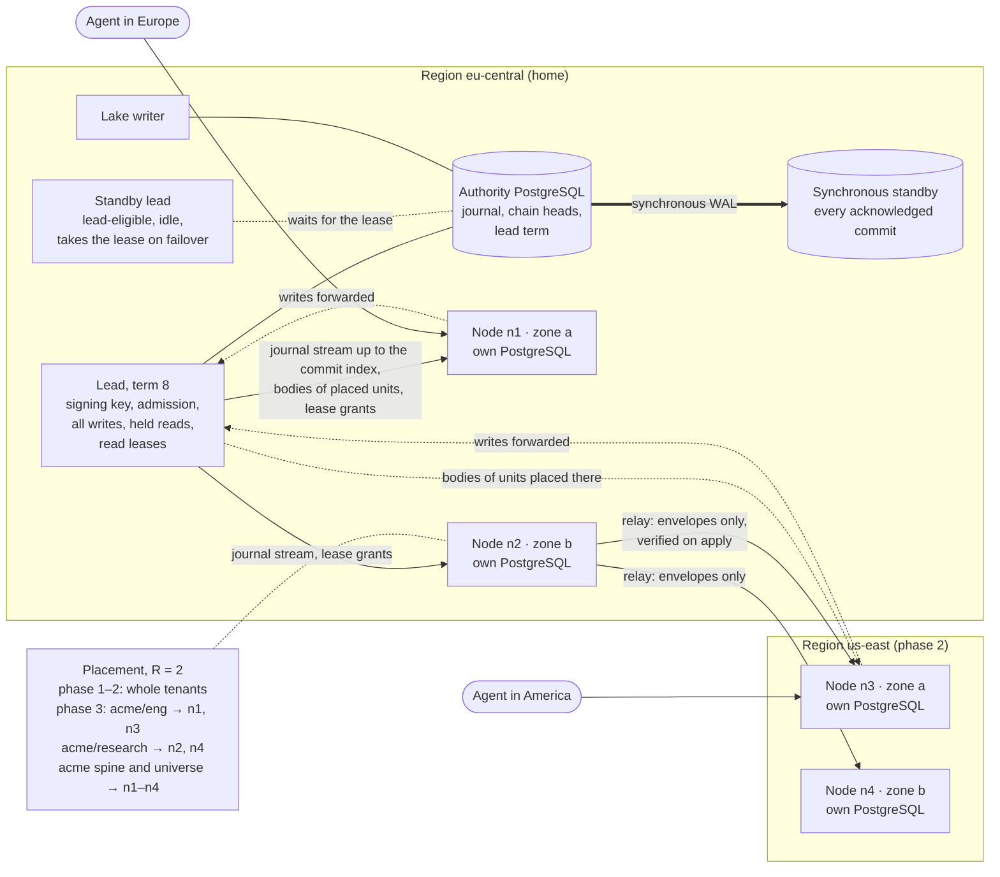
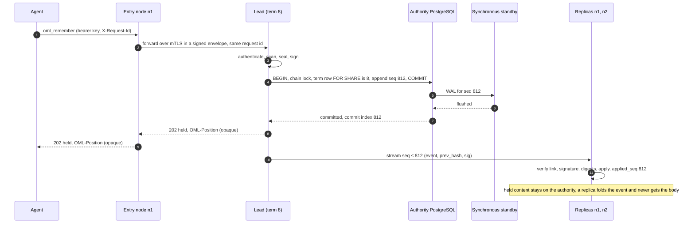
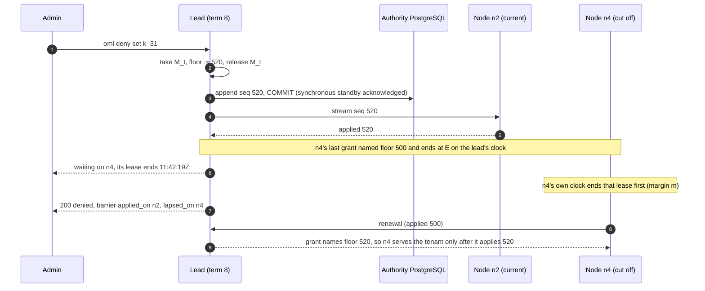
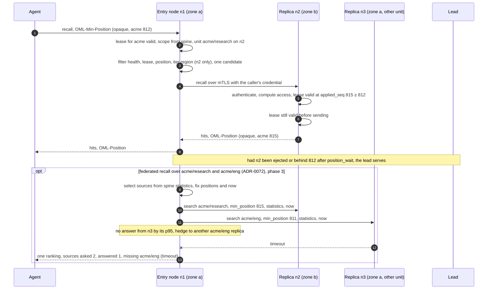
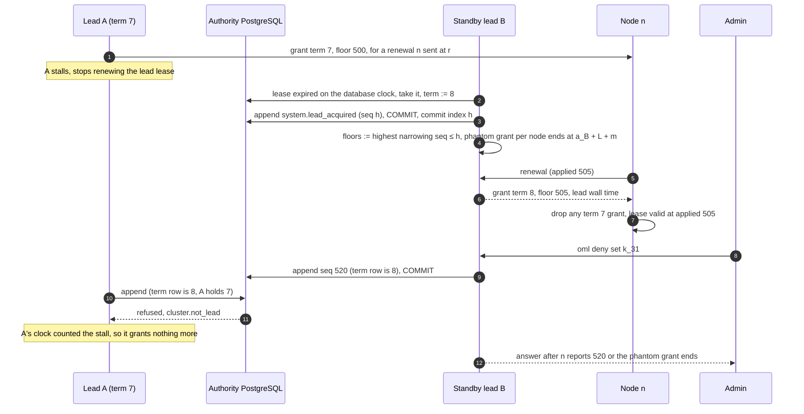

<!--
id: adr/ADR-0073-a-leader-signs-every-write-and-nodes-serve-the-workareas-placed-on-them-each-read-routed-to-the-closest-less-busy-replica-fresh-enough-for-it
tier: engineering
status: proposed
answers: which node holds the signing chain and which serve reads; how a standby lead and rolling upgrades keep the API up through a restart; what a node holds of a tenant and how a workarea subtree is placed on R nodes; why replication ships the signed journal, only up to the position the authority's synchronous standby holds, and verifies each event and each snapshot before it is applied; how a read picks the closest, least busy, fresh enough replica and when it goes to the lead; how a revoked grant, a denial, a demotion or an erasure applies on every node before its caller hears it took effect, with leases bound to the lead's term and granted in step with narrowing commits; the clock assumptions; read-your-writes by a position token; how a federated recall scatters to the nodes holding its sources; what a compromised node can and cannot do; what happens to R1–R4 when the lead, the authority database, a replica or the network fails; the metrics, readiness, doctor lines and dashboard; when not to run more than one process; the three phases and their acceptance tests
-->

# ADR-0073 — A leader signs every write and nodes serve the workareas placed on them, each read routed to the closest, less busy replica fresh enough for it

**Status:** proposed · 2026-11-08

**Amends:** ADR-0023 (d13: a follower serves from a replica in a PostgreSQL of its own, not from
the lead's database; d14: the lead lease's epoch becomes a term that fences every commit and every
read lease, so the lease is load-bearing for reads; d16: a follower holds the units placed on it,
not every tenant), ADR-0024 (d9: the LSN fence becomes the journal-position token of d7 here, and
promoted-row staleness is bounded per request), ADR-0002 (d2: the synchronous durability domain is
the authority database alone; a node's replica is outside it and is rebuilt from the journal),
ADR-0042 (d1, d4: one request id across every hop, and three new fields on the `http_request`
line)

## Context

**Today one lead serves everything, and every upgrade stops the API.** The
[limits](../reference/limits.md) page says "One lead, no follower. Every upgrade or restart stops
the API until the new instance is ready", and lists "read followers and cluster mode" under *Not
available in this build*. Writes are signed one after another on one chain per tenant:
`commit_chain` in `crates/adapters/oml-pg/src/lib.rs` takes `pg_advisory_xact_lock` on the
tenant's chain head, reads `journal_chain_head`, and appends each signed event at `seq + 1` before
`COMMIT` ([ADR-0002](ADR-0002-postgresql-system-of-record.md) d3). The journal row is
`(tenant_id, seq)` with `prev_hash`, `signed_bytes_hash` and an Ed25519 `sig`, and its payload is
"digest references only, never bodies" (`migrations/0001_init.sql`). Row security fences every
tenant table and the serving role owns nothing
([ADR-0034](ADR-0034-the-lead-serves-as-a-role-that-owns-nothing.md)); text search reads integer
postings through leakproof equalities and keeps its statistics per workarea, summed at query time
([ADR-0052](ADR-0052-text-search-reads-integer-postings-that-row-security-lets-an-index-serve.md)
d1, d5). Recall hides a version whose valid time has ended by comparing `valid_until_us` with the
server's clock (`oml-pg/src/lib.rs`). The lake writer drains the outbox from the same database
under a session advisory lock
([ADR-0060](ADR-0060-the-lake-writer-drains-the-outbox-it-has-seals-what-it-materializes-and-answers-only-the-operator.md)
d4, d5). The public server runs to six SLOs, among them `/readyz` availability 99.5% and recall
95% within 128 ms
([ADR-0058](ADR-0058-the-public-server-runs-to-stated-slos-with-an-error-budget-and-without-backups-until-a-second-person-stores-data.md)
d2), and every request logs one line under one id
([ADR-0042](ADR-0042-every-request-logs-one-line-under-an-id-the-caller-may-name-and-metrics-stay-off-the-public-port.md)).
One lead measured recall at 25.5 ms p95 over 99,721 readable memories, at the database
([limits](../reference/limits.md), `bench/scale/REPORT.md`).

**The design already has a lead and followers, and two records disagree about where a follower
reads.** [ADR-0023](ADR-0023-install-profiles-and-cluster-mode.md) d13–d17 decide one lead that
holds the signing key and N followers that never load it and forward writes, elected by a
Postgres lease row (holder, address, epoch, expiry) that d14 calls "never load-bearing" because
the chain lock is. It rejected "Postgres read replicas instead of followers": a follower was an
OML process reading the lead's database. [ADR-0024](ADR-0024-performance-foundation.md) d9 then
speaks of "the follower's local replica", "replication lag" and an "LSN fence".
[ADR-0016](ADR-0016-kubernetes-workloads.md) puts "the journal domain on synchronous quorum
replication". None of it is built, and none places data: every follower would see every tenant.

**The operator asked on 2026-11-08 for a distributed memory provider.** Their words: "leader will
be forwarding to closest less busy node, and workareas will be replicated across nodes". So a
follower holds data of its own, the unit is a workarea, and routing weighs distance and load.

**Five forces bound the answer.** The chain has one writer per tenant, so writes cannot spread.
"A revoked grant or a new denial applies to the key's next request"
([workareas](../architecture/workareas.md#grants-bind-to-node-ids)), and R3 makes a review change
visibility; a replica that lags must not show what the lead has stopped showing, including through
a lead failover. A node is a new copy of content, so erasure
([ADR-0005](ADR-0005-erasure-by-crypto-shredding.md)) must reach it. An upgrade must not stop the
API, which is the first thing a second process buys. And
[ADR-0072](ADR-0072-recall-searches-the-trusted-workareas-a-key-already-reads-chosen-per-query-by-reviewed-descriptors-and-never-widens-what-it-may-read.md)
(proposed, PR #208) lets a recall search several workareas as one ranking; once workareas live on
different nodes, that recall spans nodes. ADR-0072 picks the sources; this record places them and
serves them.

Decided, not built.

### Topology

## Decision

- **d1 — Roles: one lead holds every tenant's chain and every write, a standby lead waits for its
  lease, and nodes serve the promoted reads of what is placed on them.** The lead is ADR-0023
  d13's: it alone loads the deployment signing key, runs admission, signs and appends journal
  events, grants read leases (d8), and stays elected by d14's lease on the authority database,
  whose epoch is now the **term** of d8. A **standby lead** is a second lead-eligible process,
  configured with the key, that serves nothing until it takes the lease (d14). The **authority
  database** is the PostgreSQL the lead writes, with ADR-0002 d2's synchronous standby, which
  cluster mode requires (d5); the lake writer, the indexer outbox and the reconciler stay on it.
  A **node** (`oml-server-follower`) runs its own PostgreSQL holding a replica of the units placed
  on it (d2) and serves recall, get, list and the brief over their promoted state. A request may
  enter at any node of its region. A node forwards to the lead every write verb, every read of the
  caller's own held rows, every read scoped inside an in-progress workarea
  ([ADR-0030](ADR-0030-an-in-progress-workarea-serves-unreviewed-memories-inside-it-and-nothing-leaves-until-a-person-commits-it.md)
  d2, d3), every read no replica qualifies for (d6), and every request for a tenant whose spine it
  does not hold with a valid lease, over ADR-0024 d9's pooled HTTP/2 channel, never a redirect.
  Held content therefore never leaves the authority. The cost: write throughput stays one lead's
  and one chain lock's per tenant, as today, and an agent far from the home region pays a
  cross-region round trip on every write (unmeasured, #210). A lead per tenant group is a later
  record, opened only when one lead's admission is measured as the limit (#209).

- **d2 — The unit of placement is a placement root, a workarea subtree; a node that holds any
  unit of a tenant also holds that tenant's spine.** A placement root is a workarea node an admin
  marks (`oml placement set <workarea>`); its subtree, down to the next placement root, is one
  unit. The tenant root is always a placement root, and in phases 1 and 2 the only one, so whole
  tenants are placed (d13). From phase 3 each user root
  ([ADR-0044](ADR-0044-every-user-works-under-a-root-of-their-own-and-universe-serves-curated-claims-without-their-source.md))
  is one by default, since a person's recall stays inside it, and doctor suggests a root when a
  unit outgrows a node; roots are never made automatically, because a root moves data and changes
  the erasure inventory. A subtree is the unit because grants, denials and recall scopes are
  subtrees ([workareas](../architecture/workareas.md)): a scoped read then needs one unit, not a
  scatter. The **spine** of a tenant is everything access and routing read: the workarea tree, key
  hashes and roles, grants, denials, crews, policies, ADR-0072's promoted descriptors (never a
  held one), and the journal from the latest signed checkpoint (d4) onward, whose payloads are
  digests only. Every node holding a unit of the tenant holds the spine and the `universe` node's
  promoted content, which every user recall searches (ADR-0044). Content (versions, bodies,
  postings, ADR-0052 d5's statistics) lives only on the nodes holding its unit. The spine is listed
  in the erasure inventory, and its digests are over sealed bytes, so a digest confirms no guessed
  plaintext after a shred. The cost: a node holds a tenant's metadata for units it does not serve,
  sized by events since the last checkpoint, not by bodies; the spine's size per tenant is
  unmeasured, #209.

- **d3 — Placement is weighted rendezvous hashing over the eligible nodes, top R spread across
  zones, filtered by the unit's region hint, recomputed on membership only.** For unit *u*, each
  node *n* in the regions `placement.regions` names (all regions when unset) scores
  `w_n / −ln(h(u, n))`, with *h* a 64-bit hash of the unit's id and the node's id mapped into
  (0, 1) and `w_n` the node's capacity weight. The R highest scores win, taking at most one node per
  zone until every zone of the eligible set holds one. Walking down that ranking, a node whose
  placed bytes exceed (1 + β) times the mean is skipped, so units that differ in size by orders of
  magnitude do not pile onto one node (bounded loads in the sense of Mirrokni, Thorup and
  Zadimoghaddam, *Consistent Hashing with Bounded Loads*, SODA 2018, not fetched; β is
  `placement.load_slack`, unmeasured, #211). `placement.replicas` (R) defaults to 1 on a
  single-zone deployment and 2 when the eligible set spans two zones or more; the authority's copy
  is never counted, so R = 1 still survives the loss of that node by serving from the lead.
  Rendezvous is chosen because every router computes the same set from the node list alone, with
  no ring state to agree on, and because removing a node moves only what it held: rendezvous
  (highest random weight) hashing lets clients "achieve distributed agreement" on k of n options,
  each picking "the k sites that yield the k largest hash values", and "When a site fails, only
  the objects mapped to that site need to be remapped"
  ([Rendezvous hashing](https://en.wikipedia.org/wiki/Rendezvous_hashing), after Thaler and
  Ravishankar, *Using Name-Based Mapping Schemes to Increase Hit Rates*, IEEE/ACM Transactions on
  Networking, 1998; fetched 2026-11-08; the weighting formula is the article's, and is
  Schindelhauer and Schomaker's logarithmic method, *Weighted Distributed Hash Tables*, SPAA 2005,
  not fetched). A node's region, zone and `w_n` are set by the admin at enrolment and bound into
  its certificate (d11); a node never reports them, so it cannot attract units by inflating its
  weight. Placement is recomputed when a node is enrolled or removed, or when an admin changes a
  root or a hint, never on health, so a flapping node causes no re-replication. The lead computes
  it, stores it under a monotonic placement epoch, and journals each change as
  `system.placement_changed` on the tenant's chain, so replicas and routers apply it in chain
  order and the journal answers "which nodes held this unit when". A tenant can be pinned to
  dedicated nodes (`placement.dedicated`), which removes every other tenant from them and gives the
  tenant a client-facing address of its own, so its credentials enter only at its own nodes (d11).

- **d4 — A rebalance makes the new replica before it breaks the old one, and a joining replica
  loads only state a signature covers.** A placement change gives each moving replica a state,
  journalled with the change: `joining` → `serving` → (on the old node) `draining` → `removed`.
  While a unit moves it has R + 1 copies, and the old replica keeps serving. A joining node copies
  a snapshot of the unit and the spine at a **signed checkpoint** *p*: every
  `cluster.checkpoint_every` events, and at every placement change, the lead signs a
  `system.checkpoint` event on the tenant's chain carrying the Merkle root of the folded state at
  *p*, a spine root and one root per unit, each over a canonical encoding of the folded rows and
  the sealed body digests. The joiner verifies the checkpoint's signature, hashes the spine and its
  units' rows to the roots the checkpoint names, checks every body against its digest, derives
  postings and statistics itself with the compiled adapters (they are never shipped), and refuses
  anything else by name (`replica.snapshot_verify`). Before a tenant's first checkpoint, the joiner
  re-folds the chain from its first event, checking every link and signature. It then tails the
  stream from *p* + 1 (d5) and becomes `serving`, and routable, once its lag is under
  `placement.join_lag`. Only then does the old replica turn `draining`: routers stop choosing it at
  the next placement epoch, its in-flight requests finish, and it drops the unit's rows, bodies,
  postings and statistics and reports `system.copy_destroyed`, which the lead journals. A copy that
  never reports stays listed by doctor (`cluster.copy_unconfirmed`), because a removed node holding
  content is a copy the erasure inventory must count (d11). Weighted rendezvous moves only the
  units whose top R changed, and `placement.max_moving` bounds how many move at once. A checkpoint
  also lets a node keep only the latest checkpoint and the journal after it. The cost: during a move
  a unit has R + 1 copies; the snapshot's read load lands on one serving replica; the lead hashes
  the folded state at each checkpoint (cost unmeasured, #209).

- **d5 — Replication ships the tenant's signed journal up to the commit index, with the bodies of
  the units placed on the receiver, and a node verifies every event before it applies it.** The
  lead serves an internal stream per tenant, `(seq, event, prev_hash, sig)` in seq order, with, for
  each content event of a unit placed on the receiving node, the sealed body bytes the event's
  digests name. Only promoted bodies are shipped: no held or in-progress body, postings row or
  count is ever written on a node.
    - **The commit index.** The stream ships seq ≤ the tenant's **commit index**, the highest seq
      whose `COMMIT` has returned to the lead. Cluster mode runs the authority with
      `synchronous_commit = on` and a synchronous standby named, and PostgreSQL says "the
      application will not receive explicit acknowledgment of the successful commit of a
      transaction until the WAL data is known to be safely received by all the synchronous
      standbys", while "Some transactions may not show as committed on the standby, even though
      they show as committed on the primary"
      ([log-shipping standby servers](https://www.postgresql.org/docs/17/warm-standby.html)
      §26.2.8.4, fetched 2026-11-08). So the lead never streams a row merely visible on the
      primary. A new lead sets the commit index to the seq of its own `system.lead_acquired`, once
      that commit returns: WAL is a prefix, so every earlier row is on the standby too. When no
      synchronous standby is attached, the commit index stops; nodes keep serving within their
      leases and fall behind, narrowing acts are refused `503 cluster.authority_unsynced` (an act
      the standby lacks could be lost by a failover after its caller heard it took effect), and
      doctor names the same code.
    - **Verification.** Per-tenant commit order is seq order, because each append takes the chain
      lock and holds it to commit (ADR-0002 d3), so the stream needs no stable-prefix computation of
      the kind ADR-0060 d4 makes for the outbox. A node checks, per event: `prev_hash` equals its
      own head, the Ed25519 signature verifies against the deployment's public key, and each body
      hashes to its digest; it then folds the event into its tables with the same fold code the
      lead runs and derives postings and statistics with the same compiled-in adapters
      ([ADR-0056](ADR-0056-a-claim-version-names-its-format-the-signature-covers-its-source-and-adapters-compiled-into-the-server-derive-what-search-reads.md)),
      one transaction per batch under a non-owner apply role with `app.tenant_id` set to the
      stream's tenant, which also records `applied_seq`. A row carrying another tenant's id is
      refused by row security. An event that fails a check is never applied: the tenant stops
      serving on that node, and doctor names `replica.verify`. Two different events at one seq stop
      it with `replica.fork`, which is how a replica sees a forked chain that a physical or logical
      copy would carry silently.
    - **The sender enforces placement.** The lead, a replica or a relay serves a unit's rows and
      bodies only to a requester whose certificate's node id the journalled placement at that seq
      lists for that unit (`joining` or `serving`), and a tenant's spine only to a node placed on
      some unit of it; any other request is refused by name and nothing is sent. A **relay** (phase
      2) forwards event envelopes, which carry digests only; a receiver fetches bodies of its units
      from the lead or from a replica of the same unit. Verification is end to end, so a relay
      cannot alter what it forwards, and it never holds a body of a unit not placed on it.

  The three mechanisms compared:

    | Mechanism | Unit it can place | What verifies the copy | Fit with OML |
    |---|---|---|---|
    | **Journal shipping, verified on apply (chosen)** | any unit: content filtered per event, the spine whole | chain link, Ed25519 signature, body digest, on every event; a signed checkpoint for a snapshot | reuses the fold, the chain and the adapters; a second apply path that must equal the lead's, held by a test (#209); apply throughput unmeasured (#209) |
    | PostgreSQL logical replication with row filters | a row filter per table: "a row is replicated only if its data satisfies the row filter expression", but "The `WHERE` clause allows only simple expressions" | nothing beyond the connection; the subscriber trusts the publisher | "The database schema and DDL commands are not replicated", and OML creates partitions per tenant at runtime (ADR-0034); apply "will switch roles to the table owner", the role ADR-0034 keeps away from serving; "Sequence data is not replicated" ([restrictions](https://www.postgresql.org/docs/17/logical-replication-restrictions.html), [row filters](https://www.postgresql.org/docs/17/logical-replication-row-filter.html), [security](https://www.postgresql.org/docs/17/logical-replication-security.html), fetched 2026-11-08) |
    | Physical streaming replicas plus routing | none: a standby restored from "a base backup of the primary" holds every tenant | WAL replay; the standby trusts the primary | every node holds every tenant; queries on a standby conflict with replay and "Conflicting queries will be canceled once it has taken longer than the relevant delay setting" ([hot standby](https://www.postgresql.org/docs/17/hot-standby.html), [log shipping](https://www.postgresql.org/docs/17/warm-standby.html), fetched 2026-11-08). Kept for what it fits: the authority database's own standby (ADR-0002 d2) |

  The cost: OML owns an apply path, a snapshot path, a checkpoint and their tests, which the two
  PostgreSQL mechanisms would have given for free; every node must run fold and adapter versions
  the lead's events are written for (d14); and the stream waits for the standby's acknowledgment,
  so replica lag includes the synchronous commit's round trip.

- **d6 — A read goes to a replica holding its units that is healthy, leased and fresh enough, the
  nearest such tier first, spilling by proportion, and the less busy of two random picks within
  it; the lead serves when none qualifies.** The entry node resolves the request's tenant and scope
  against its spine, which it may do only while it holds a valid read lease for the tenant (d8);
  otherwise it forwards the request to the lead (d1). It finds the unit and filters its replicas:
    1. **Health.** An active check of each peer's internal `/readyz?role=node` (d12) every
       `cluster.health_interval`, and outlier ejection on passive failures in Envoy's shape:
       ejection after `cluster.eject_consecutive` consecutive 5xx or timeouts, for "the
       outlier_detection.base_ejection_time value multiplied by the number of times the host has
       been ejected in a row", never ejecting more than `cluster.max_ejection_percent` of a unit's
       replicas ([outlier detection](https://www.envoyproxy.io/docs/envoy/latest/intro/arch_overview/upstream/outlier),
       fetched 2026-11-08).
    2. **Lease.** The replica holds a valid read lease for the tenant (d8).
    3. **Freshness.** Its applied position is at or past the request's `OML-Min-Position` (d7),
       and its lag is within `routing.max_lag`.
  The survivors are ordered by locality tier: the entry node itself, then its zone, then its
  region, then any region, with RTT measured by the health checks breaking ties between regions.
  **Cost.** Each candidate's cost is its peak-EWMA latency times its in-flight requests plus one, as
  Finagle's balancer does: "Peak EWMA uses a moving average over an endpoint's round-trip time
  (RTT) that is highly sensitive to peaks", "weighted by the number of outstanding requests"
  ([Finagle clients](https://twitter.github.io/finagle/guide/Clients.html), fetched 2026-11-08).
  The average decays with elapsed time, not per sample, so a replica that is avoided after one slow
  peak recovers; health-check round trips are fed in as samples, so an idle replica keeps a fresh
  estimate. A replica that has just turned `serving` starts at its tier's median cost and its
  weight ramps up over `routing.slow_start`, so entry nodes do not all send to a cold cache at
  once.
  **Choice within a tier.** With three candidates or more, the entry node draws two and sends to
  the one with the lower cost. Two choices are enough: in Mitzenmacher's supermarket model "Having
  d ≥ 2 choices leads to exponential improvements in the expected time a customer spends in the
  system over d = 1, whereas having d = 3 choices is only a constant factor better than d = 2"
  (*The Power of Two Choices in Randomized Load Balancing*, IEEE TPDS 12(10), 2001, abstract;
  fetched 2026-11-08), and Envoy's least-request balancer samples "N hosts", default 2, and "picks
  the host which has the fewest active requests"
  ([load balancers](https://www.envoyproxy.io/docs/envoy/latest/intro/arch_overview/upstream/load_balancing/load_balancers)).
  With two candidates, "two of two" would always pick the cheaper and herd every entry node onto
  it, so the entry node picks one at random weighted by inverse cost; with one, it sends there. The
  draw is seeded by HMAC(node secret, request id), so a caller who names the request id cannot
  steer it, and a logged decision replays from the logged seed.
  **Spill.** A tier keeps traffic in proportion to its capacity: when the tier's candidates' summed
  in-flight count passes `routing.max_inflight` times their number, the excess share of requests
  goes to the next tier, in proportion to the deficit, rather than all at once at a threshold. This
  is how Envoy's zone-aware routing "tries to push as much traffic as possible to the local
  upstream zone" while sending the rest by "the percentage of upstream hosts"
  ([zone aware routing](https://www.envoyproxy.io/docs/envoy/latest/intro/arch_overview/upstream/load_balancing/zone_aware),
  fetched 2026-11-08). Load is each entry node's own view of its outstanding requests, gossiped
  nowhere; health answers carry the peer's in-flight count as a hint.
  **When no replica qualifies the lead serves**, since the authority holds every unit. Above
  `lead.max_read_inflight` the lead refuses the read `503 cluster.no_replica` with `Retry-After`,
  and the answer never falls back to a replica outside the bounds. An alert fires on the lead's
  share of reads (`route_total{outcome="lead"}`), because the lead's read headroom is part of the
  write SLO's budget. The cost: an entry node that holds none of a tenant pays a hop on every read,
  and the lead is the read path of last resort.

- **d7 — Read-your-writes by an opaque position token the client carries; bounded staleness
  otherwise; monotonic reads by the position each answer returns.** Every answer, write or read,
  carries `OML-Position`, an opaque token sealed with AEAD under a cluster secret over
  `(tenant, key id, one position per placement unit)`, each position a seq of the tenant's chain:
  for a write, the seq its commit appended, against the unit it wrote; for a read, the applied seq of
  each replica that answered, against its unit. In phases 1 and 2 the tenant is the only unit, so
  the token holds one seq. A client that sends it back as `OML-Min-Position` on a read is answered,
  for each unit the read touches, by a replica at or past that unit's position, or the entry node
  waits up to `routing.position_wait` for one, or sends the read to the lead. A token that does not open, or was minted for another key or tenant,
  is refused `request.validation` without waiting, so a client can neither probe another tenant's
  head nor force waits with a seq it was never handed; the seq inside is not readable, so the token
  does not widen #129's tenant-wide count to every answer. The SDKs and the plugin keep the highest
  token per tenant and send it on every read, so two reads in a row never go backwards. Where it
  matters most is the reviewer's read-back and monotonic reads: an agent's recall of its own new
  memory reads held rows, which the lead serves anyway (d1). Without a token a read accepts a
  replica within `routing.max_lag`. This is the shape of bounded-staleness reads elsewhere:
  CockroachDB's `with_min_timestamp` "Defines a minimum timestamp at which to perform the bounded
  staleness read" and `with_max_staleness(INTERVAL)` "is equivalent to
  `with_min_timestamp(now() - INTERVAL)`", served by a follower once its closed timestamp, below
  which "no new writes can ever be introduced", passes the read's
  ([follower reads](https://docs.cockroachlabs.com/docs/stable/follower-reads), fetched
  2026-11-08); Spanner's strong reads "observe the effects of all transactions that committed
  before the start of the operation, independent of which replica receives the read", and its
  stale reads are "read at a timestamp in the past"
  ([reads](https://docs.cloud.google.com/spanner/docs/reads), fetched 2026-11-08). OML's position
  is a per-tenant journal seq, not a clock; the chain gives the order. The position replaces
  ADR-0024 d9's LSN fence, which named one database's WAL and does not survive a node with a
  database of its own. **The review gate:** a promotion is a journal event, so a version becomes
  readable on a replica when that replica applies the promotion, never before; the lead's answer to
  the verdict carries its token, and a reviewer who reads it back through a node sees it. Until
  then the version is invisible there, which is R3's direction: late, never early. The cost: a
  token header on every answer, and a client without the SDK that wants read-your-writes must echo
  it itself.

- **d8 — What narrows visibility applies on every node before its caller hears it took effect: a
  read lease bound to the lead's term, granted in step with narrowing commits, and a barrier the
  next lead inherits.** [Workareas](../architecture/workareas.md) promises "A revoked grant or a new
  denial applies to the key's next request", and R3 says what the gate hides is not readable. A
  widening event may appear on a node late; a narrowing one may not. The invariant this decision
  keeps, stated once: **for every narrowing seq s, at every real instant after s's answer leaves the
  lead, every read lease valid on any node holding the tenant was granted naming a floor ≥ s, and
  the node serves under it only at an applied seq ≥ s.**
    1. **Which events narrow.** A closed predicate over the event catalog, **narrowing by default**.
       Only two lists skip the barrier: *widening* events (a promotion, a grant added or widened, a
       workarea created, a promoted descriptor, a node enrolled, a placement added, a checkpoint)
       and *held-only* events, which touch only content no node holds (a held write, the rejection
       of a held tip). Everything else narrows, among them: a grant revoked or narrowed,
       `key.denied` and a per-grant deny, a key disabled or suspended, `key.rotated` (the
       predecessor stops), a tenant suspended, a demotion, a retirement (an agent's own included),
       an erasure, a workarea moved, put in progress or excluded, a placement removed, and
       ADR-0072's `accept_federated` turned off, an `exclude` added, `federation.enabled` turned off
       and `min_status` narrowed. A test enumerates the event enum and fails on a type in neither
       list. Spine events wait on every node holding the tenant's spine; from phase 3, a content
       event (demotion, retirement, erasure) waits only on its unit's holders, and on every spine
       holder when the content is `universe`'s.
    2. **Clocks.** Three assumptions, and nothing else about time. *C1*: every process measures
       intervals on CLOCK_BOOTTIME, which "is identical to CLOCK_MONOTONIC, except that it also
       includes any time that the system is suspended", where CLOCK_MONOTONIC "does not count time
       that the system is suspended" and "is affected by frequency adjustments"
       ([clock_gettime(2)](https://man7.org/linux/man-pages/man2/clock_gettime.2.html), fetched
       2026-11-08). Rust's `Instant` reads CLOCK_MONOTONIC on Linux, so the lease code reads
       CLOCK_BOOTTIME itself, and a process that cannot refuses to start in cluster mode
       (`cluster.clock_source`). A suspended or live-migrated machine therefore resumes with its
       leases expired. *C2*: any two processes' interval clocks run within a factor 1 ± ρ of real
       time, ρ being `cluster.max_drift`, an assumption the operator's time discipline must meet;
       doctor estimates each node's rate against the lead from successive renewals and names
       `cluster.clock_margin` when it passes ρ/2. *C3*: no decision depends on agreement of wall
       clocks. The one wall-clock input, valid time, is decided on the lead's time, conservatively
       (item 7). Every lease margin derives from ρ: with L = `cluster.read_lease`, the margin is
       m = 3ρ·L (a node's L, measured on a clock up to ρ slow, plus the lead's bound, measured on a
       clock up to ρ fast, rounded up).
    3. **The term fences commits.** The lead lease row of ADR-0023 d14 keeps its epoch as the
       **term**, in a row of its own that only an acquisition writes; renewals write the expiry
       row. An acquisition is one transaction that locks both rows `FOR UPDATE`, checks the expiry
       against the database's own clock, and writes holder, term + 1 and expiry. `commit_chain`
       reads the term row `FOR SHARE` in the same transaction as its append, and appends only if
       the holder and term are its own; otherwise it fails `cluster.not_lead` and appends nothing.
       The two locks conflict, so a commit and an acquisition are ordered: a commit before the
       acquisition precedes the new term's `system.lead_acquired` in the chain, and a commit after
       it fails. This is a fencing token checked by the store itself (Kleppmann, *How to do
       distributed locking*, 2016, not fetched). A lead acts as lead (grants leases, answers
       narrowing acts, advances the commit index) only while its interval clock shows less than
       T_lead · (1 − 2ρ) since it sent its last successful lease renewal, T_lead being
       `cluster.lead_lease`; by C2 it stops before the database's clock lets a successor in.
    4. **A lease grant is linearized with narrowing commits.** The lead keeps, per tenant and under
       one in-process lock M_t, the tenant's **floor** (the highest narrowing seq committed or
       about to commit) and, per node, the record of its grants (grant id, floor named, expiry
       bound). A node renews once per `cluster.read_lease / 3` with one request covering every
       tenant it holds, sent at its own instant r and carrying its applied seq per tenant. To grant
       for tenant t, the lead takes M_t, checks its own term is current (item 3), reads the floor f,
       records `(id, f, E)` with E = its interval clock now + L + m, releases M_t, and sends
       `(term, id, f, the lead's wall time)`. The node holds the grant with the highest id from the
       highest term it has seen, in a grant or in an applied `system.lead_acquired`, and ignores
       any other. The lease is valid while the node's clock shows less than L since r **and** the
       node's applied seq is at or past f. A narrowing commit of seq s, which the lead knows under
       the chain lock before `COMMIT`, first takes M_t and raises the floor to s, then commits. A
       floor left by a failed commit only asks nodes to reach a seq the chain will hold anyway.
    5. **The barrier.** After the narrowing `COMMIT` returns, and without the chain lock, the lead
       holds the act's **answer** until, for every node n in the act's waiting set (item 1), n has
       reported an applied seq ≥ s, or the lead's interval clock has passed the largest E among
       n's grants that named a floor below s. Every grant recorded after the floor rose names ≥ s,
       so that largest E is fixed when the barrier starts and cannot move later; the barrier
       re-reads the nodes' reports as they arrive, never a deadline computed from a stale record.
       A node checks its lease inside the request's read transaction, against the `applied_seq`
       that transaction sees, and again before it sends the answer; a request whose lease lapsed
       in between is refused and retried elsewhere. A read that overlaps the act may still see the
       old state, which is the order a single server gives two overlapping requests. The answer
       carries `barrier: {applied_on, lapsed_on: [{node, lease_ended_at}]}`, and while it waits
       longer than a second the CLI prints which node it waits on and when that node's lease ends:
       "denied on the lead; waiting on n4, unreachable, whose lease ends 11:42:19Z; after that no
       node serves it". The worst case is L + m, one number the commitments page states. Barrier
       waits count against the calling key's in-flight limit, so an agent's own retirements cannot
       tie up the lead.
    6. **A new lead inherits every pending barrier.** The barrier keeps no state beyond the journal
       and the leases: the narrowing events are in the chain, classified by item 1, and a new lead
       reads them. On acquisition, at instant a_B, the new lead commits `system.lead_acquired`
       (seq h), sets each tenant's floor to the highest narrowing seq ≤ h, and records for every
       node a **phantom grant** with floor 0 and E = a_B + L + m on its own clock, standing for
       every grant the previous term may have made. Its own grants name that floor from the start,
       so reads continue on nodes that have applied it. It answers a narrowing act, a new one or the
       retry of one the old lead committed but never answered, only through item 5's barrier,
       phantom grants included. A retry is recognised by the chain already holding the act, and
       answers through the barrier of the seq that first recorded it. On a **planned handover**
       (d14) the outgoing lead stops granting, then releases the lease in one transaction that also
       writes `grace_until`, its largest E converted to the database's clock; the new lead's phantom
       grants end at `grace_until` instead, so narrowing answers wait only as long as a lease the
       old lead actually granted.
    7. **Valid time on the lead's clock.** Each grant carries the lead's wall time t_L. A node bounds
       the lead's time at a later instant x of its own as [t_L, t_L + (x − r)(1 + ρ)], r being when
       it sent the renewal. It hides a version as expired when `valid_until` is below the upper
       bound, and treats a version as not yet valid when `valid_from` is above the lower bound, so
       its error only narrows. Its own wall clock is never read for visibility. A federated recall
       takes a single `now`, the coordinator's interval, once (d9): every serving node uses it for
       valid time, and refuses the source with reason `lease` when its own bound of the lead's time
       does not contain it, so no node answers under a `now` its lease cannot vouch for. The cost: a version may disappear from a node up to one renewal interval before it
       disappears from the lead.
    8. **The interleavings.** Each scenario the reviews raised, step by step:
        - *A renewal races a narrowing commit.* Grant G for node n and commit s both take M_t, so
          one is first. If G is first, G's record (f < s, E) exists when the floor rises, and the
          barrier waits for E or for n's report of s. If the commit is first, G names f ≥ s, and n's
          lease is valid only once n has applied s. G cannot read the floor in one step and record
          itself in another, because both happen under one hold of M_t. So when s's answer leaves,
          every lease on n names ≥ s or has an E already past on the lead's clock, which by C2 and
          m means n's own clock already shows it expired.
        - *A deposed lead keeps granting.* (1) Lead A, term 7, grants n a lease with floor 500.
          (2) A stalls; the database's lease expires; B takes term 8 at a_B. (3) By item 3, A's own
          validity ended before a_B, so any grant A sends answers a renewal sent at r before A's
          last check, before a_B, and n's clock ends it before a_B + L + m. (4) An admin's `oml
          deny set` through B commits seq 520; B's barrier for n waits for n's report of 520 or the
          phantom E = a_B + L + m. (5) A resumes: its clock counted the stall, so it refuses to
          grant; a commit it attempts fails `cluster.not_lead` on the term. A grant it sent before
          stalling was anchored at an r before a_B, so step (3) holds. When B answers, no lease from
          A is valid on n, and every lease from B requires 520.
        - *The lead crashes mid-barrier.* A commits 520 and crashes before answering. The caller's
          connection drops and it retries on B. The denial is in the chain, so the retry is the
          idempotent path, and it answers through 520's barrier, phantom grants included: not before
          every node has applied 520 or every lease of term 7 has ended.
        - *The authority fails over.* A node applied seq 812 only because 812 was at or below the
          commit index, so the standby held it. The promoted standby holds 812, the new lead appends
          813 after it, and no node forks. A narrowing act's answer follows its `COMMIT`, so the act
          survives the promotion too.
        - *A node is suspended.* Its lease had 2 s left; the machine sleeps for 60 s. CLOCK_BOOTTIME
          counts the sleep, so on waking the node finds its lease expired and serves nothing until a
          renewal from the current term names a floor it has applied. Under CLOCK_MONOTONIC it would
          have believed 2 s were left.

  Access on a node is computed per request from its applied grants, as on the lead; nothing is
  cached, and the answer's `permission_epoch` is the node's. This is a lease in Gray and Cheriton's
  sense, and it carries the cost Raft states for lease-based reads: they "rely on timing for safety
  (it assumes bounded clock skew)" (Ongaro and Ousterhout, *In Search of an Understandable Consensus
  Algorithm*, extended version, §8; fetched 2026-11-08). OML narrows that assumption to C2's rate
  bound. The cost: a narrowing act with a partitioned node answers only after that node's lease
  runs out, and after an unplanned failover every narrowing answer waits up to L + m; so L is
  bounded by revocation latency (seconds, measured in #209), and read survival through a slow lead
  rests on the lead fallback (d6), not on a long lease.

- **d9 — A federated recall selects from statistics the coordinator already holds, scatters the
  search to the nodes holding its sources at fixed positions, and merges one ranking
  deterministically, saying which sources answered.** ADR-0072 selects sources from the
  per-workarea counts of ADR-0052 d5 (d4 there) and scores them as one collection with the
  statistics summed (d7 there). Across nodes the entry node coordinates, and only while it holds a
  valid read lease for the tenant in the current term (d8), like any reader; any other entry
  forwards the whole recall to a node that does, or to the lead.
    1. **Statistics and selection.** The selection statistics (per workarea `n` and total length,
       and a compact per-term document-frequency summary) are spine data on every node of the
       tenant, as ADR-0072 keeps them in the replicated spine, so every node selects the same way and
       selection runs on the coordinator with no network round. The caller's `sources: wide`, or an
       explicit `source_list`, is ADR-0072's; this record only finds the replicas of what it
       selects.
    2. **Search.** The coordinator fixes, per unit, the position its spine stands at (or the
       request token's, if later), and takes one `now`, d8 item 7's interval. The replicas of the scope and the selected
       sources receive the statistics ADR-0072 d7 names, `min_position` per unit and `now`, run the
       tenant's pipeline over their own nodes, and each returns its top `k` per retriever with
       scores. Each source goes to a replica at or past its unit's fixed position, chosen by d6. Scores are comparable because every node used the same statistics and
       positions, so the coordinator merges each retriever's lists by score (ties by memory id, the
       ADR-0049 order), fuses the merged lists as ADR-0049 d3 does, cuts by `k` and `max_tokens`,
       and runs the reranker (ADR-0053) last, on the coordinator. The result equals one node's only
       for exact retrievers; an approximate nearest-neighbour index answers per node, so
       federation either uses exact search for that retriever or says the answer is approximate.
  When one node holds the scope and every selected source, the search is one call to it, the
  common case under d2's placement. **Tail latency.** Sources are searched in the coordinator's
  region only; a source with no in-region replica is reported `missing` with reason `remote`, not
  fetched across regions within a 128 ms SLO. Each source's search is hedged: after that source's
  observed p95, the coordinator sends the same request to a second qualifying replica and cancels
  the loser (Dean and Barroso, *The Tail at Scale*, CACM 56(2), 2013, not fetched), within an extra
  load budget measured in #211; `federation.source_timeout` bounds the whole. A missing source leaves its hits out, and every other hit keeps its score, since the statistics were fixed
  first; the scores are those of a search in which the missing source returned nothing above the
  cut. The answer's `search.sources` (ADR-0072 d8) gains `asked`, `answered` and
  `missing: [{workarea_id, reason}]` with `reason` one of `timeout`, `no_replica`, `lease`,
  `remote`; a client renders it as "2 of 3 sources answered". `missing` is filtered through the
  coordinator's leased access at answer time, so it names only workareas the key reads now (ADR-0072
  d6). **The scope is never partial:** if its unit does not answer, the recall fails
  `503 cluster.scope_unavailable` rather than serve federated hits alone. Each source's position and
  the fixed `now` are listed in the answer and logged with the recall (ADR-0072 d9), so a distributed
  recall replays. Each node authenticates the caller and computes access itself (d11); the
  coordinator's view grants nothing.

- **d10 — Failure keeps R1–R4 by refusing, never by guessing: the lead fails over by lease and
  term, the authority database by an operator's promotion, and a node that loses the lead stops
  serving when its lease runs out.** Lead election is ADR-0023 d14's lease row on the authority
  database with d8's term, taken only by a lead-eligible process; the new lead runs the fork check,
  signs `system.lead_acquired` first and inherits the barriers (d8 item 6). Consensus is not added
  (ADR-0023 rejected Raft for the same reason it is rejected here). The authority database fails
  over by an operator-driven promotion of its synchronous standby, or by an HA manager the operator
  runs (the deployment page carries a tested Patroni recipe; the profile does not ship one), because
  "PostgreSQL does not provide the system software required to identify a failure on the primary
  and notify the standby database server", and the old primary must be fenced, "necessary to avoid
  situations where both systems think they are the primary"
  ([failover](https://www.postgresql.org/docs/17/warm-standby-failover.html), fetched 2026-11-08).
  The signing key lives in the lead's KMS or Secret, mounted only on lead-eligible processes in the
  home region; no node and no relay ever holds it.

    | Failure | What happens | R1 verb ceiling | R2 reviewer ≠ author | R3 visibility | R4 no silent deletion |
    |---|---|---|---|---|---|
    | **Lead lost** | writes refused `503` with `Retry-After` until the standby lead takes the lease (within T_lead); nodes keep serving reads under their leases, which the new lead renews at once; narrowing answers wait up to L + m | holds: no node has a verb the lead lacks, and a node cannot sign | holds: verdicts are writes, refused until the new lead | holds: a narrowing act committed but not answered is answered by the new lead only through the phantom-grant barrier (d8 item 6) | holds: nothing is appended, so nothing is deleted |
    | **Authority database lost** | the lead loses its lease and refuses writes; the operator promotes the synchronous standby; replicas resume tailing at their `applied_seq` | holds | holds | holds: nodes applied only seqs at or below the commit index, all on the standby (d5), so none forks | holds: no acknowledged commit is lost; a commit the standby lacked was never streamed nor answered |
    | **Authority standby out of the sync set** | the commit index stops; nodes fall behind and lose their leases at the next narrowing floor; narrowing acts refused `503 cluster.authority_unsynced` | holds | holds | holds: no node applies a seq the standby lacks | holds |
    | **Split brain: two leads** | both may run, but only the current term's commits append (d8 item 3); the deposed lead stops granting before the successor's term begins | holds | holds | holds: the deposed lead's grants end within L + m, which the new lead's barrier waits for | holds: the chain cannot fork |
    | **Split brain: two authority primaries** | two chains may grow; every replica that receives both sees two events at one seq and stops with `replica.fork` | holds | holds | holds on nodes: a forked tenant serves nothing | holds: neither branch is deleted; the operator chooses, journalled |
    | **Lagging replica** | dropped from routing past `routing.max_lag` or a client's position; still applying | holds | holds | holds: narrowing waits for it or for its lease (d8) | holds |
    | **Node suspended or paused** | its leases are expired when it resumes (CLOCK_BOOTTIME); it serves nothing until renewed at its floor | holds | holds | holds | holds |
    | **Network partition** | a node cut from the lead keeps serving until its lease expires, then stops; an entry node cut from every replica sends reads to the lead; a region cut from the home region serves reads until its leases expire and refuses writes by name, `503 cluster.lead_unreachable` | holds | holds | holds: narrowing on the lead's side waits at most L + m for the cut nodes | holds |

  The cost: availability of reads during a partition is bounded by the lease, and of writes by the
  home region's reachability. A cluster spanning regions is still one write region.

- **d11 — Nodes know each other by enrolled identities over mutual TLS, never sign, and re-check
  every caller themselves; a compromised node reaches only what is placed on it and the requests
  that enter at it.**
    - **Identity and mTLS.** A node joins with `oml cluster join <code>`, a one-time code the lead
      mints like the enrolment token; the lead issues the node an X.509 certificate for a key the
      node generated, binding the region, zone and capacity weight the admin set, and journals
      `system.node_enrolled`. Every internal call (stream, forwarding, scatter, health, lease) is
      mutual TLS on an internal listener that is never the public port, and `oml cluster remove`
      journals `system.node_removed` and revokes the certificate.
    - **A node cannot sign.** `oml-server-follower` is a separate binary that composes no signer
      port (ADR-0024 d9, C7), and it refuses to start when a signing key or a KMS signing binding
      is configured (`cluster.signing_key_on_node`). The key exists on the lead and on each standby
      lead, two copies in the smallest deployment, and on no other process.
    - **No identity from a peer.** The entry node forwards the caller's own credential over mTLS,
      inside an envelope the entry node signs with its certificate key, binding the request id, a
      hash of the credential and the time; the lead and the serving node log it, so a credential
      replayed outside the request it came with is visible. The serving node authenticates the
      caller against its replica of key hashes and computes access from its applied grants. A
      peer's claim about who the caller is grants nothing.
    - **At rest and the unwrap keys.** A node stores bodies sealed as the authority stores them and
      holds no long-lived unwrap credential: each lease renewal carries, for each unit placed on the
      node, that unit's unwrap keys (ADR-0005's hierarchy), wrapped to the node's certificate key,
      valid for the lease and kept in memory only. An erasure destroys the key at the authority, and
      the next renewal omits it, so a node's copy is unreadable within one lease whether or not the
      node has applied the erasure. Its PostgreSQL volume is encrypted by the operator's disk or
      volume encryption, stated in [deployment](../operations/deployment.md) and not checkable by
      doctor. Every node is a copy class in the erasure inventory
      ([audit and lineage](../architecture/audit-and-lineage.md)). An erasure's answer separates
      `unreadable_everywhere`, due when its barrier releases, from `destroyed_everywhere`, which
      lists `copies_pending: [node]` until each node's `system.copy_destroyed` for it arrives;
      `cluster.copy_unconfirmed` covers both erasure-pending and removed nodes.
    - **Tenant isolation on shared nodes.** A node's PostgreSQL runs the same migrations, `FORCE
      ROW LEVEL SECURITY`, the owner/serving split (ADR-0034) and leakproof candidate SQL (ADR-0052)
      as the lead; the stream is applied by a non-owner role in that tenant's transaction setting
      (d5). CPU and IO stay shared, as ADR-0007 states for the lead; `placement.dedicated` (d3) is
      the answer for a tenant that needs its own machines and its own entry address.
    - **A compromised node**, one whose process or disk an attacker controls:

        | It can | It cannot |
        |---|---|
        | read the promoted content of the units placed on it, and the spine of each tenant it holds, while placed | forge or insert an event: it has no signing key, and every peer verifies each signature (d5) |
        | read the bearer credentials of requests that enter at it, and replay them to the lead as the caller; the signed envelope makes a replay outside its request visible, not impossible | reorder, drop or rewrite events another node applies: chain links and seq order are checked on every event, and a snapshot must hash to a signed checkpoint (d4) |
        | answer the callers that enter at it, or are routed to it, with anything it holds, a revoked or denied row included, since the barrier relies on the node applying what it receives | obtain a unit or spine not placed on it: the sender checks the journalled placement against its certificate (d5); relays carry no bodies |
        | keep plaintext it has already decrypted | decrypt a unit's bodies after the unit leaves it, or after an erasure, beyond one lease: its unwrap keys are lease-bound (above) |
        | | attract more units by claiming a larger weight or another zone: both are in its certificate, set by the admin |

      The residual is stated in [security](../architecture/security.md) when this is built: a
      compromised node is a compromised server for the units placed on it and the requests that
      reach it, which is wider than a compromised lead today by the number of nodes.

- **d12 — Every node reports its role, its units, its lag, its leases and its routing; doctor names
  each failure, and one dashboard shows the cluster.**
    - **Readiness per role.** The public `/readyz` (ADR-0058 d2's probe) answers aggregate readiness
      only, with no tenant id and no seq. The internal `/readyz?role=node`, on the mTLS listener,
      lists per tenant `serving`, `joining`, `draining`, `lease_expired`, `verify_failed` or
      `fork`, with `applied_seq`, lag, lease state and fold version; peers' health checks and the
      operator read it. The lead is ready when it holds the lead lease in the current term, its fork
      check passed and the authority database answers; a node is ready as an entry point when it
      reaches the lead or one peer. A node that serves no unit is still ready as an entry.
    - **Metrics**, on ADR-0042 d11's metrics listener, labels from closed sets and no tenant
      label (ADR-0042 d12): `oml_cluster_replica_lag_events` and `oml_cluster_replica_lag_seconds`
      (the maximum over the node's tenants, and a histogram), `oml_cluster_inflight` by peer role,
      `oml_cluster_route_total{tier, outcome}` with `outcome` in `replica`, `lead`, `refused`,
      `oml_cluster_ejections_total`, `oml_cluster_lease_lapsed_total`,
      `oml_cluster_apply_refused_total{reason}` with `verify`, `fork` or `snapshot`,
      `oml_cluster_lead_term`, `oml_cluster_commit_index_lag_seconds` on the lead,
      `oml_cluster_narrowing_wait_seconds` on the lead, and `oml_cluster_federated_sources{state}`
      with `answered` or `missing`.
    - **The request line.** ADR-0042 d1's `http_request` line gains `node` (the node that wrote it),
      `served_by` (the node or `lead` that answered) and `route` reason (`local`, `zone`, `region`,
      `remote`, `lead_fallback`, `lead_required`, `forwarded_write`, `forwarded_unleased`), and the
      request id is the same on every hop (ADR-0042 d4). These fields are on every request, so a
      request id from a support ticket always resolves to where it went. A sampled `route_decision`
      line, at `cluster.route_log_sample`, adds the candidates, the filter each failed, the tier, the
      draw and its seed, and the costs; it is the routing decisions feed of the Cluster page.
    - **Doctor lines.** `cluster.lead` (no lease holder in the current term), `cluster.standby_lead`
      (no lead-eligible standby), `cluster.authority_unsynced`, `cluster.node_unreachable`,
      `cluster.replica_lag` (over `routing.max_lag`), `cluster.lease_lapsed`, `replica.verify`,
      `replica.fork`, `replica.snapshot_verify`, `cluster.checkpoint` (no checkpoint within twice
      `cluster.checkpoint_every`), `cluster.placement_short` (a unit with fewer than R serving
      replicas and no move in progress), `cluster.copy_unconfirmed`, `cluster.version_skew` (a node
      that cannot fold an event version it has received), `cluster.clock_source`,
      `cluster.clock_margin`, `cluster.signing_key_on_node`.
    - **Grafana.** `docs/operations/dashboards/oml-cluster.json`: nodes by role and region with
      in-flight and p95 latency; lag per node; the lead term and the standby's state; routing
      outcomes by tier; the lead's share of reads against its alert threshold; ejections and lease
      lapses; narrowing wait; federated sources answered and missing. It ships with phase 1 beside
      `oml-web-traffic.json`.
    - **The Cluster page**, a section of the Administration page, shows the same:
      [mockup (not built)](../design/distributed-nodes/cluster-mockup.html), with nodes and their
      region, role, load against limit, lag, lease and version; a lookup that resolves a workarea to
      its unit, replicas and the node each zone would choose now, or a request id to its
      `http_request` line; the placement matrix, with moves shown as R + 1 copies; the routing
      decisions feed; and health. Every name and number on it is illustrative.

- **d13 — Three phases, each giving the operator one benefit and closed by its tests: survive
  upgrades, then serve near the agent, then outgrow one node.**
    1. **A standby lead, rolling upgrades and read followers for whole tenants, in one region
       (#209).** The term and fenced commits; a standby lead and planned handover (d14); the fold
       version window; nodes holding whole tenants by rendezvous with zone spread; journal shipping
       up to the commit index, verified on apply, with fork detection; signed checkpoints and
       verified joins; make-before-break moves of whole tenants; the read lease, linearized grants,
       the barrier and its inheritance; CLOCK_BOOTTIME and valid time on the lead's clock; opaque
       position tokens; forwarding with signed envelopes; sender-enforced placement; lease-bound
       unwrap keys; routing by health, lease and freshness, the entry node first, else the cheapest
       qualifying replica, else the lead; enrolment and mTLS; readiness, doctor and the dashboard.
       Closed by: a lead restart and a rolling upgrade drop no read inside the lease, and writes
       resume within `cluster.lead_lease` (test); a replica's recall answers equal the lead's byte
       for byte at one position on the recall eval; a bad signature, chain link, digest or snapshot
       is refused by name; the five interleavings of d8 item 8 as deterministic harnesses (the
       renewal paused between reading the floor and recording, a frozen old lead, a crash between
       `COMMIT` and the answer, a primary killed between local commit and standby acknowledgment, a
       suspended node); for every narrowing type, a lagging node never serves after the act's
       answer; a read above a replica's position is never answered there; held and in-progress
       reads only on the lead, and no held body, postings row or count on any node at rest; a
       stream or snapshot request for a tenant not placed on the requesting certificate is refused
       and writes nothing; cross-tenant, forged and unminted position tokens are refused without
       waiting; the public `/readyz` carries no tenant id or seq; an erasure with a partitioned node
       lists it pending, and that node cannot decrypt the body after one lease; a node with a
       signing key refuses to start.
    2. **Regions, locality and closest-least-busy routing (#210).** Regions and zones, region hints
       for whole tenants, entry nodes per region, relays carrying envelopes only, locality tiers,
       proportional spill, peak EWMA with time decay and slow start, two choices and weighted
       random below three candidates, HMAC-seeded draws and `route_decision` lines, the lead-share
       alert. Closed by: the same placement in every process; adding a node moves only the tenants
       whose top R changed; a disqualified replica is never chosen; a node claiming another weight
       or zone is ignored; a relay holds no body of a unit not placed on it; a region cut from home
       serves until its leases expire and refuses writes by name; measured, cross-region write
       latency and p95 recall through an entry node against direct.
    3. **Placement roots and federated scatter-gather (#211).** Workarea placement roots, user
       roots by default, bounded-load placement, barriers scoped to a unit's holders, and the
       federated recall of d9. Closed by: a rebalance under load answers every recall within its
       bound; a removed copy is destroyed or named by doctor; a federated recall over three nodes
       equals the same recall on one node at equal positions and `now`, for exact retrievers; a
       missing source is reported and changes no other hit; a scope that does not answer fails the
       recall; `missing` never names an unreadable workarea, and is identical whether an unreadable
       workarea's node is up or down; a federated scatter to a node lagging on a denial of source S
       returns none of S's rows. Depends on ADR-0072 phase 1 (#205).

- **d14 — A standby lead and a fold version window keep the API up through a restart and an
  upgrade.** This is phase 1's value, and the reason most operators would run a second process.
    - **The standby lead.** A second lead-eligible process polls the lease row. On an unplanned
      loss it takes the lease once the database's clock passes the expiry, so writes are refused for
      at most `cluster.lead_lease` plus the takeover; reads continue on nodes, whose leases the new
      lead renews at once (d8 item 6), and on the standby itself once it is lead. Narrowing answers
      wait up to L + m after the takeover.
    - **Planned handover.** `oml lead step-down` makes the lead stop admitting writes, finish the
      ones in flight, stop granting, and release the lease with `grace_until` (d8 item 6) in one
      transaction; the standby takes it at once. Writes pause for the handover itself, not for a
      lease expiry.
    - **Rolling upgrade order.** Each release folds the event versions of the release before it and
      its own. The order is: nodes one at a time (each drains, upgrades, catches up and turns
      `serving` again; R ≥ 2 or the lead fallback carries its reads), then the standby lead, then a
      planned handover to it, then the old lead, which becomes the standby. The lead writes a new
      event version only once every node and the standby report a fold version that reads it. A
      node that meets an event version it cannot fold stops applying, keeps serving within its lease
      at its applied position, and doctor names `cluster.version_skew`; the next narrowing floor it
      cannot reach ends its lease, so skew fails closed. Authority migrations follow the existing
      live-safe rule (expand, then contract a release later), so the old and new lead run against
      one schema.
    - **Without nodes.** A lead and a standby lead with no node at all is a supported deployment:
      it removes upgrade downtime for writes and reads both, and needs none of d2–d9.

### The write path

A narrowing write differs in three steps (d8): before `COMMIT` the lead raises the tenant's
floor under M_t; after `COMMIT` it holds the answer; and it releases the answer once every node in
the waiting set has reported the seq or its last grant naming a lower floor has ended:

### The read and recall path

### Failover, the lease and the term

On a planned handover (d14) step 2 is `oml lead step-down`, the lease is released with
`grace_until`, and the phantom grants end then.

## Consequences

- **What changes in other records.** ADR-0023 d13's follower gains a PostgreSQL of its own and
  holds units, not every tenant; its rejection of "Postgres read replicas" stands, since a node is
  an OML process applying a verified journal, not a standby. ADR-0023 d14's lease epoch becomes
  d8's term, and every commit checks it, so the lease is load-bearing for reads while the chain lock
  stays load-bearing for the chain. ADR-0024 d9's LSN fence becomes d7's position token. ADR-0002
  d2's synchronous domain is the authority database, and cluster mode requires its synchronous
  standby; replicas are outside it and rebuilt from the journal. ADR-0042's request line gains
  `node`, `served_by` and `route`. ADR-0005's unwrap keys reach a node only inside a lease. ADR-0072
  composes with d9 here: its selection statistics live in the replicated spine, its position token
  carries one position per placement unit, a federated recall takes one `now`, and its coordinator
  is leased and term-bound.
- **New events** for the [event catalog](../data/event-catalog.md): `system.placement_changed`,
  `system.node_enrolled`, `system.node_removed`, `system.copy_destroyed`, `system.checkpoint`.
  **New errors** for [errors](../api/errors.md): `cluster.no_replica`, `cluster.scope_unavailable`,
  `cluster.lead_unreachable`, `cluster.authority_unsynced`, and the internal `cluster.not_lead`.
  **New headers**: `OML-Position` and `OML-Min-Position`, entering `openapi.yaml` in the change that
  serves them (ADR-0042 d15's rule).
- **Pages that change when this is built:** [limits](../reference/limits.md) (cluster mode
  leaves *Not available*), [deployment](../operations/deployment.md) (the standby lead, the node
  profile, the authority's synchronous standby, disk encryption, the Patroni recipe, the smallest
  deployment below), [observability](../operations/observability.md) (metrics, doctor lines,
  dashboard), [security](../architecture/security.md) (the node column of the custody map and the
  compromised-node residual), [audit and lineage](../architecture/audit-and-lineage.md) (nodes as a
  copy class), [commitments](../product/commitments.md) (narrowing latency bounded by L + m).
- **When not to run more than one process.** One region, recall load under one lead's measured
  capacity (25.5 ms p95 at 99,721 readable memories, at the database), and an upgrade window the
  users accept: run one lead, as today. Each step up buys one thing:

    | Need | Run | Processes | PostgreSQL instances |
    |---|---|---|---|
    | none of the below | one lead | 1 | 1 |
    | writes and reads survive restarts and upgrades | a lead and a standby lead, the authority with its synchronous standby | 2 | 2 |
    | reads beyond one lead's capacity, or reads that survive the lead and its database | add one node per zone (phase 1) | 3 or more | 3 or more |
    | agents in a second region with a measured round-trip problem | nodes in that region (phase 2) | 5 or more | 5 or more |
    | one tenant larger than a node | placement roots (phase 3) | as measured | as measured |

  The smallest useful cluster is the third row with one node: a lead, a standby lead, one node, the
  authority PostgreSQL with its synchronous standby, and the node's own PostgreSQL, three processes
  and three databases. The public server stays in one region, with the current host's region as
  home, until users in another region have a measured round-trip problem.
- **Operational costs.** Per node: one PostgreSQL, a certificate to renew, an encrypted volume, and
  CPU to apply and derive every event of every tenant it holds (unmeasured, #209). Per cluster: the
  authority's synchronous standby, which adds its round trip to every commit; the signing key on
  every lead-eligible process; one lease renewal per node every L / 3; a checkpoint hash every
  `cluster.checkpoint_every` events. Network: the stream carries the bodies of placed units, so
  cross-region egress grows with the write rate times the number of remote replicas; a node's disk
  is the spine since the last checkpoint plus its units (both sized in #209 and #211). Latency: a
  narrowing act as slow as the slowest replica or L + m, and every narrowing answer up to L + m
  after an unplanned failover. People: an operator who can promote the authority's standby.
- **The settings.** Only a node's region and zone, set at enrolment, and its join code are
  required; every other setting has a default published before phase 1 closes, from #209's
  measurements.

    | Setting | Unit | Protects | Default from |
    |---|---|---|---|
    | `cluster.read_lease` (L) | seconds | revocation latency, L + m | #209 |
    | `cluster.lead_lease` | seconds | write downtime on lead loss | #209 |
    | `cluster.max_drift` (ρ) | ratio | every lease margin | the operator's time discipline |
    | `cluster.checkpoint_every` | events | join time, spine size | #209 |
    | `cluster.health_interval`, `cluster.eject_consecutive`, `cluster.max_ejection_percent` | seconds, count, % | routing around a failed node | #209 |
    | `routing.max_lag`, `routing.position_wait` | seconds | staleness, read-your-writes | #209 |
    | `routing.max_inflight`, `routing.slow_start` | requests, seconds | spill and cold starts | #210 |
    | `lead.max_read_inflight` | requests | the write SLO's headroom | #209 |
    | `placement.replicas` (R) | count | read survival | 1, or 2 across zones (d3) |
    | `placement.join_lag`, `placement.max_moving` | events, units | rebalance load | #209 |
    | `placement.load_slack` (β) | ratio | placement balance | #211 |
    | `cluster.route_log_sample` | ratio | log volume | #210 |
    | `federation.source_timeout` | ms | the recall SLO | #211 |

- **The honest costs, in one place:** one write region and one lead; an apply path, a snapshot path
  and a checkpoint OML owns; a narrowing act as slow as the slowest replica or the lease, and slower
  after a failover; a spine on every node of a tenant; the lead as the read path of last resort;
  the synchronous standby as a cluster requirement; clock-rate drift as the one timing assumption.
- **Issues opened:** #209 (phase 1), #210 (phase 2), #211 (phase 3), each in the Later milestone
  and on tracking issue #200. Every unmeasured figure here (apply throughput, lag, lease and
  narrowing latency, spine size, checkpoint cost, the forwarding hop, cross-region write latency,
  the per-source timeout) is measured in its phase's issue before its default ships.

## Rejected alternatives

| Alternative | Why not |
|---|---|
| **PostgreSQL logical replication per workarea** | Row filters can select a workarea, but the copy is trusted, not verified; DDL "is not replicated" while OML creates tenant partitions at runtime; apply switches to the table owner, the role ADR-0034 keeps off the serving path. Reopen if verification moves into PostgreSQL. |
| **Physical streaming replicas behind a router** | Every replica holds every tenant, so nothing is placed and a shared node holds tenants it never serves; replay cancels conflicting queries. It stays the authority database's standby. |
| **Raft per tenant, or a consensus group per placement unit** | A second authority beside PostgreSQL, rejected by ADR-0023 for lead election and again here: the chain lock and the term already order writes, and replicas verify rather than vote. |
| **Every node signs (multi-leader)** | Many copies of the deployment key, and a chain that two writers could extend; superseded by ADR-0023 d13. |
| **Consistent hashing on a ring with virtual nodes** | Also moves little on a membership change, but needs ring state every router agrees on; rendezvous needs only the node list and gives top R directly. |
| **Static assignment by an admin** | Fails to rebalance when a node joins or leaves; kept as `placement.dedicated` for the cases that need it. |
| **Round robin, or least-loaded across all replicas** | Round robin ignores load; a global least-loaded needs a shared view of load and herds onto one replica when that view is stale. Two choices, or a weighted draw below three candidates, need only the entry node's own counts. |
| **Checking every read against the lead's grant epoch** | Meets the revocation rule, but adds a round trip to the lead on every read, cross-region for far nodes, and makes the lead a dependency of reads. The lease pays that cost only on narrowing acts. |
| **Stale grants within a TTL** | Breaks "a revoked grant or a new denial applies to the key's next request". |
| **Persisting every lease grant in the authority database** | Lets a new lead read the old term's grants instead of waiting a grace, but costs a write per node per renewal; the grace costs L + m once per unplanned failover, and a planned handover writes one `grace_until`. |
| **Leases timed on CLOCK_MONOTONIC or wall time** | CLOCK_MONOTONIC does not count suspension, so a resumed machine believes a stale lease; wall time needs agreement between clocks the design does not assume. |
| **Streaming every committed row the primary shows** | A row is visible on the primary before the standby acknowledges it, so a failover would fork every node that applied it. |
| **Trusting a snapshot by its head event's signature** | The signature covers the event, not the folded state shipped beside it; a replica could ship a valid head with a denial removed. |
| **Synchronous replication of every event to every replica** | Gives every read the latest state, but puts every write behind the slowest replica, against the write SLO; d8 makes only narrowing acts wait. |
| **Replicating held content to nodes** | Puts unreviewed bodies on more machines for reads that are few and author-only; held and in-progress reads go to the lead instead. |
| **A topology-aware client that routes itself** | ADR-0022's dumb-client premise and ADR-0024 d9's rejection of redirects hold; the opaque position token is the only cluster fact a client sees. |
| **Federated recall merged by reciprocal rank across nodes without shared statistics** | Scores from different statistics are not comparable, and ADR-0072 d7 requires one ranking equal to a single collection's; fixed statistics and positions keep it exact. |
| **Per-workarea placement first** | It adds rebalance risk before any tenant outgrows a node; whole tenants give upgrade survival and locality first, and placement roots come last (d13). |

## Open questions for the operator

1. **The authority's synchronous standby on the public server.** Cluster mode requires one (d5),
   and ADR-0058 runs the public server without backups until a second person stores data. Is phase
   1 for the public server, which then gains a second PostgreSQL, or only for self-hosted
   deployments until then?
2. **Narrowing acts while the standby is out of the sync set.** This record refuses them
   `503 cluster.authority_unsynced`, so an admin is never told a denial took effect that a failover
   could lose. The alternative accepts them and answers `durable: false`, so an emergency denial is
   never refused. Which does the operator want an admin to meet during an incident?

Answered from the reviews, no longer open: one lead, and a lead per tenant group is a later record
opened when admission is measured as the limit (d1); the operator promotes the authority database
by hand, with a Patroni recipe in the deployment docs (d10); R is 1 on one zone and 2 across zones,
and L is bounded by revocation latency (d3, d8); the SDKs and the plugin always send their token
(d7); the lead serves when no replica qualifies, bounded and refused by name (d6); an admin marks
placement roots and doctor only suggests them (d2); the public server stays in one region, home at
the current host (Consequences).

## Review log

**Round 1, 2026-11-08.** Three reviews: algorithms and distributed systems (3 blockers, 11 majors,
9 minors across ADR-0072 and this record; 3 blockers, 8 majors and 6 minors here), security and
leakage (3 blockers, 9 majors, 10 minors; 3 blockers, 6 majors and 6 minors here), and product (3
blockers, 12 majors, 13 minors; 3 blockers, 6 majors, 8 minors and the 7 open questions here,
counting the mockup). What changed:

- **Leases and terms** (algorithms B1, B2; security B1, B2). The lease epoch is a term that fences
  every commit in the store; a grant is recorded under the same lock that raises the narrowing
  floor; the barrier waits on fixed expiry bounds and re-reads reports; a new lead inherits pending
  barriers through phantom grants; five interleavings are argued step by step and become phase 1
  harnesses (d8 items 3–6, 8).
- **Clocks** (algorithms M2). C1–C3 are stated, leases run on CLOCK_BOOTTIME, the margin derives
  from the drift bound, and valid time is decided on the lead's clock, conservatively (d8 items 2,
  7).
- **Replication safety** (algorithms B3, M1; security B3, M9, m1, m8). The stream stops at the
  commit index; a joiner loads only state a signed checkpoint covers; senders enforce placement;
  relays carry envelopes only; narrowing acts are refused while the authority is unsynced; no held
  content is ever at rest on a node (d4, d5).
- **A compromised node** (security B3, M5, m9). Its reach is stated as a table; weights and zones are
  in its certificate; unwrap keys are lease-bound; forwarded credentials ride a signed envelope;
  key copies are counted (d3, d11).
- **Erasure** (algorithms M9; security M4). `unreadable_everywhere` and `destroyed_everywhere` are
  separate, with copies pending listed (d11).
- **Routing** (algorithms M3, M4, m5, m6, m8, M8; product B3, minor 7). A weighted draw below three
  candidates, proportional spill, time-decayed EWMA with slow start, HMAC-seeded draws, opaque
  position tokens, bounded-load placement recomputed on membership only, an entry node that
  coordinates only under a valid lease, and an alert on the lead's share (d3, d6, d7, d9).
- **Federation** (algorithms M5, M6, M7, M8, m7). Selection statistics from the spine, one round
  instead of two, one position per unit in the token, one `now` per recall, hedged searches,
  sources in region only, `missing` filtered at answer time, exactness only for exact retrievers
  (d9).
- **Narrowing set and barrier scope** (algorithms M10, m9; security M7, M8, m2, m10). A closed
  predicate, narrowing by default; barriers scoped to a unit's holders from phase 3; barrier waits
  bounded per key; promoted descriptors only, and sealed-byte digests, in the spine (d2, d7, d8).
- **Product** (product B1, M7–M10, minor 6, minor 8). The upgrade decision and the standby lead
  (d14) are phase 1's value; the phases are reordered to upgrades and standby, then locality, then
  placement roots and federation (d13); "when not to run more than one process", the smallest
  deployment, the operational costs and the settings table are added; the barrier's progress and
  answer are specified; the read-your-writes claim is narrowed; five of seven open questions are
  answered, two kept for the operator.
- **Readiness** (security M6). The public `/readyz` is aggregate only (d12).
- **Diagrams and mockup** (product B2, B3, M11, M12, minors 9–13). The topology shows the standby
  lead, the synchronous standby and the commit index; the write, narrowing, read and failover
  sequences show the term, the floor and the handover. The mockup shows moves as R + 1 copies,
  generates its routing feed from d6, adds a lookup, node cards on phones, lease and version, load
  against its limit, word chips instead of memory-state glyphs, and sits under Administration.
- **Not taken here:** algorithms M11 and m1–m4, and security M1–M3 and m3–m7, concern ADR-0072
  alone.
