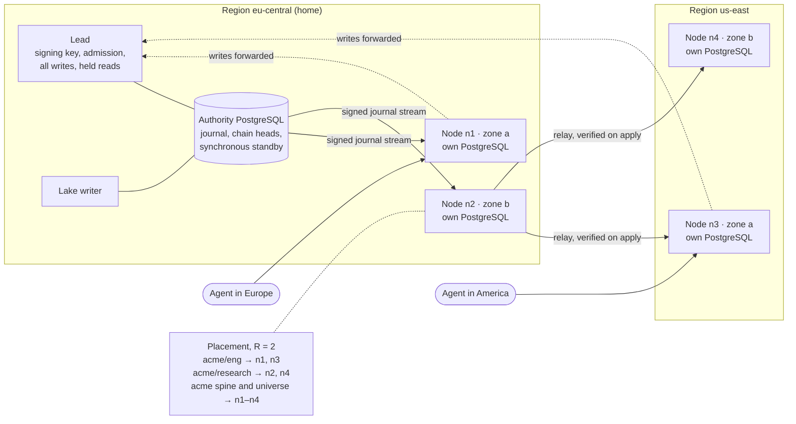

<!--
id: adr/ADR-0073-a-leader-signs-every-write-and-nodes-serve-the-workareas-placed-on-them-each-read-routed-to-the-closest-less-busy-replica-fresh-enough-for-it
tier: engineering
status: proposed
answers: which node holds the signing chain and which serve reads; what a node holds of a tenant and how a workarea subtree is placed on R nodes; why replication ships the signed journal and verifies each event on apply instead of PostgreSQL logical or physical replication; how a read picks the closest, least busy, fresh enough replica and when it goes to the lead; how a revoked grant, a denial, a demotion or an erasure applies on every node before its caller hears it took effect; read-your-writes by a position token; how a promotion reaches followers; how a federated recall scatters to the nodes holding its sources and fuses one ranking; what happens to R1–R4 when the lead, the authority database, a replica or the network fails; node identity, mTLS and tenant isolation on shared nodes; the metrics, readiness, doctor lines and dashboard; the three phases and their acceptance tests
-->

# ADR-0073 — A leader signs every write and nodes serve the workareas placed on them, each read routed to the closest, less busy replica fresh enough for it

**Status:** proposed · 2026-11-08

**Amends:** ADR-0023 (d13: a follower serves from a replica in a PostgreSQL of its own, not from
the lead's database; d16: a follower holds the units placed on it, not every tenant), ADR-0024
(d9: the LSN fence becomes the journal-position token of d7 here, and promoted-row staleness is
bounded per request), ADR-0002 (d2: the synchronous durability domain is the authority database
alone; a node's replica is outside it and is rebuilt from the journal), ADR-0042 (d1, d4: one
request id across every hop, and three new fields on the `http_request` line)

## Context

**Today one lead serves everything.** The [limits](../reference/limits.md) page says "One lead,
no follower. Every upgrade or restart stops the API until the new instance is ready", and lists
"read followers and cluster mode" under *Not available in this build*. Writes are signed one
after another on one chain per tenant: `commit_chain` in `crates/adapters/oml-pg/src/lib.rs`
takes `pg_advisory_xact_lock` on the tenant's chain head, reads `journal_chain_head`, and appends
each signed event at `seq + 1` before `COMMIT`
([ADR-0002](ADR-0002-postgresql-system-of-record.md) d3). The journal row is
`(tenant_id, seq)` with `prev_hash`, `signed_bytes_hash` and an Ed25519 `sig`, and its payload is
"digest references only, never bodies" (`migrations/0001_init.sql`). Row security fences every
tenant table and the serving role owns nothing
([ADR-0034](ADR-0034-the-lead-serves-as-a-role-that-owns-nothing.md)); text search reads integer
postings through leakproof equalities and keeps its statistics per workarea, summed at query time
([ADR-0052](ADR-0052-text-search-reads-integer-postings-that-row-security-lets-an-index-serve.md)
d1, d5). The lake writer drains the outbox from the same database under a session advisory lock
([ADR-0060](ADR-0060-the-lake-writer-drains-the-outbox-it-has-seals-what-it-materializes-and-answers-only-the-operator.md)
d4, d5). The public server runs to six SLOs, among them `/readyz` availability 99.5% and recall
95% within 128 ms
([ADR-0058](ADR-0058-the-public-server-runs-to-stated-slos-with-an-error-budget-and-without-backups-until-a-second-person-stores-data.md)
d2), and every request logs one line under one id
([ADR-0042](ADR-0042-every-request-logs-one-line-under-an-id-the-caller-may-name-and-metrics-stay-off-the-public-port.md)).

**The design already has a lead and followers, and two records disagree about where a follower
reads.** [ADR-0023](ADR-0023-install-profiles-and-cluster-mode.md) d13–d17 decide one lead that
holds the signing key and N followers that never load it and forward writes, elected by a
Postgres lease that is never load-bearing because the chain lock is (d14). It rejected
"Postgres read replicas instead of followers": a follower was an OML process reading the lead's
database. [ADR-0024](ADR-0024-performance-foundation.md) d9 then speaks of "the follower's local
replica", "replication lag" and an "LSN fence". [ADR-0016](ADR-0016-kubernetes-workloads.md)
puts "the journal domain on synchronous quorum replication". None of it is built, and none places
data: every follower would see every tenant.

**The operator asked on 2026-11-08 for a distributed memory provider.** Their words: "leader will
be forwarding to closest less busy node, and workareas will be replicated across nodes". So a
follower holds data of its own, the unit is a workarea, and routing weighs distance and load.

**Four forces bound the answer.** The chain has one writer per tenant, so writes cannot spread.
"A revoked grant or a new denial applies to the key's next request"
([workareas](../architecture/workareas.md#grants-bind-to-node-ids)), and R3 makes a review change
visibility; a replica that lags must not show what the lead has stopped showing. A node is a new
copy of content, so erasure ([ADR-0005](ADR-0005-erasure-by-crypto-shredding.md)) must reach it.
And [ADR-0072](ADR-0072-recall-searches-the-trusted-workareas-a-key-already-reads-chosen-per-query-by-reviewed-descriptors-and-never-widens-what-it-may-read.md)
(proposed, PR #208) lets a recall search several workareas as one ranking; once workareas live on
different nodes, that recall spans nodes. ADR-0072 picks the sources; this record places them and
serves them.

Decided, not built.

### Topology



## Decision

- **d1 — Roles: one lead holds every tenant's chain and every write; nodes serve the promoted
  reads of what is placed on them; a request may enter at any node.** The lead is ADR-0023 d13's,
  unchanged: it alone loads the deployment signing key, runs admission, signs and appends journal
  events, and stays elected by d14's lease on the authority database. The **authority database**
  is the PostgreSQL the lead writes, with ADR-0002 d2's synchronous standby; the lake writer, the
  indexer outbox and the reconciler stay on it. A **node** (`oml-server-follower`) runs its own
  PostgreSQL holding a replica of the units placed on it (d2) and serves recall, get, list and
  the brief over their promoted state. Every request may enter at any node, behind one
  client-facing address per region. A node forwards to the lead every write verb, every read of
  the caller's own held rows, every read scoped inside an in-progress workarea
  ([ADR-0030](ADR-0030-an-in-progress-workarea-serves-unreviewed-memories-inside-it-and-nothing-leaves-until-a-person-commits-it.md)
  d2, d3), and every read no replica qualifies for (d6), over ADR-0024 d9's pooled HTTP/2
  channel, never a redirect. Held content therefore never leaves the authority. The cost: write
  throughput stays one lead's and one chain lock's per tenant, as today, and an agent far from the
  home region pays a cross-region round trip on every write (unmeasured, #211). A lead per tenant
  group, which would spread writes, is left out (open question 1).

- **d2 — The unit of placement is a placement root, a workarea subtree; a node that holds any
  unit of a tenant also holds that tenant's spine.** A placement root is a workarea node an admin
  marks (`oml placement set <workarea>`); its subtree, down to the next placement root, is one
  unit. The tenant root is a placement root, so phase 1 places whole tenants, and each user root
  ([ADR-0044](ADR-0044-every-user-works-under-a-root-of-their-own-and-universe-serves-curated-claims-without-their-source.md))
  is one by default, since a person's recall stays inside it. A subtree is the unit because grants,
  denials and recall scopes are subtrees ([workareas](../architecture/workareas.md)): a scoped
  read then needs one unit, not a scatter. The **spine** of a tenant is everything access and
  routing read: the workarea tree, key hashes and roles, grants, denials, crews, policies,
  ADR-0072's descriptors, and the full chain of journal events, whose payloads are digests only.
  Every node holding a unit of the tenant holds the spine and the `universe` node's promoted
  content, which every user recall searches (ADR-0044). Content (versions, bodies, postings,
  ADR-0052 d5's statistics) lives only on the nodes holding its unit. The cost: a node holds a
  tenant's metadata for units it does not serve, sized by events, not by bodies; the spine's size
  per tenant is unmeasured, #210.

- **d3 — Placement is weighted rendezvous hashing over the eligible nodes, top R spread across
  zones, filtered by the unit's region hint.** For unit *u*, each node *n* in the regions
  `placement.regions` names (all regions when unset) scores `w_n / −ln(h(u, n))`, with *h* a
  64-bit hash of the unit's id and the node's id mapped into (0, 1) and `w_n` the node's
  configured capacity weight. The R highest scores win, taking at most one node per zone until
  every zone of the eligible set holds one. `placement.replicas` (R) defaults to 2 and may be 1;
  the authority's copy is never counted, so R = 1 still survives the loss of that node by serving
  from the lead. Rendezvous is chosen because every router computes the same set from the node
  list alone, with no ring state to agree on, and because removing a node moves only what it held:
  rendezvous (highest random weight) hashing lets clients "achieve distributed agreement" on k of
  n options, each picking "the k sites that yield the k largest hash values", and "When a site
  fails, only the objects mapped to that site need to be remapped"
  ([Rendezvous hashing](https://en.wikipedia.org/wiki/Rendezvous_hashing), after Thaler and
  Ravishankar, *Using Name-Based Mapping Schemes to Increase Hit Rates*, IEEE/ACM Transactions on
  Networking, 1998; fetched 2026-11-08; the weighting formula is the article's, the paper itself
  was not fetched). The lead computes the placement, stores it in the authority database under a
  monotonic placement epoch, and journals each change as `system.placement_changed` on the
  tenant's chain, so replicas and routers apply it in chain order and the journal answers "which
  nodes held this unit when". A tenant can be pinned to dedicated nodes
  (`placement.dedicated`), which removes every other tenant from them (d11).

- **d4 — A rebalance makes the new replica before it breaks the old one, so no read loses its
  replica.** A placement change gives each moving replica a state, journalled with the change:
  `joining` → `serving` → (on the old node) `draining` → `removed`. A joining node copies a
  snapshot of the unit and the spine from a serving replica or the authority at a position *p*,
  verifies the chain head at *p* against its signature, then tails the stream from *p* + 1 (d5).
  It becomes `serving`, and routable, once its lag is under `placement.join_lag`. Only then does
  the old replica turn `draining`: routers stop choosing it at the next placement epoch, its
  in-flight requests finish, and it drops the unit's partitions and bodies and reports
  `system.copy_destroyed`, which the lead journals. A copy that never reports stays listed by
  doctor (`cluster.copy_unconfirmed`), because a removed node holding content is a copy the erasure
  inventory must count (d11). Weighted rendezvous moves only the units whose top R changed, and
  `placement.max_moving` bounds how many move at once. The cost: during a move a unit has R + 1
  copies, and the snapshot's read load lands on one serving replica.

- **d5 — Replication ships the tenant's signed journal and the bodies its events name, and a node
  verifies every event before it applies it.** The lead serves an internal stream per tenant,
  `(seq, event, prev_hash, sig)` in seq order, with, for each content event of a unit the node
  holds, the sealed body bytes the event's digests name. Per-tenant commit order is seq order,
  because each append takes the chain lock and holds it to commit (ADR-0002 d3), so the stream
  needs no stable-prefix computation of the kind ADR-0060 d4 makes for the outbox. A node checks,
  per event: `prev_hash` equals its own head, the Ed25519 signature verifies against the
  deployment's public key, and each body hashes to its digest; it then folds the event into its
  tables with the same fold code the lead runs and derives postings and statistics with the same
  compiled-in adapters
  ([ADR-0056](ADR-0056-a-claim-version-names-its-format-the-signature-covers-its-source-and-adapters-compiled-into-the-server-derive-what-search-reads.md)),
  one transaction per batch that also records `applied_seq` for the tenant. An event that fails a
  check is never applied: the tenant stops serving on that node, and doctor names
  `replica.verify`. Two different events at one seq stop it with `replica.fork`, which is how a
  replica sees a forked chain that a physical or logical copy would carry silently. Because
  verification is end to end, any node may relay the stream to another (a regional relay in
  phase 3) without being trusted. The three mechanisms compared:

    | Mechanism | Unit it can place | What verifies the copy | Fit with OML |
    |---|---|---|---|
    | **Journal shipping, verified on apply (chosen)** | any unit: content filtered per event, the spine whole | chain link, Ed25519 signature, body digest, on every event | reuses the fold, the chain and the adapters; a second apply path that must equal the lead's, held by a test (#209); apply throughput unmeasured (#209) |
    | PostgreSQL logical replication with row filters | a row filter per table: "a row is replicated only if its data satisfies the row filter expression", but "The `WHERE` clause allows only simple expressions" | nothing beyond the connection; the subscriber trusts the publisher | "The database schema and DDL commands are not replicated", and OML creates partitions per tenant at runtime (ADR-0034); apply "will switch roles to the table owner", the role ADR-0034 keeps away from serving; "Sequence data is not replicated" ([restrictions](https://www.postgresql.org/docs/17/logical-replication-restrictions.html), [row filters](https://www.postgresql.org/docs/17/logical-replication-row-filter.html), [security](https://www.postgresql.org/docs/17/logical-replication-security.html), fetched 2026-11-08) |
    | Physical streaming replicas plus routing | none: a standby restored from "a base backup of the primary" holds every tenant | WAL replay; the standby trusts the primary | every node holds every tenant; queries on a standby conflict with replay and "Conflicting queries will be canceled once it has taken longer than the relevant delay setting" ([hot standby](https://www.postgresql.org/docs/17/hot-standby.html), [log shipping](https://www.postgresql.org/docs/17/warm-standby.html), fetched 2026-11-08). Kept for what it fits: the authority database's own standby (ADR-0002 d2) |

  The cost: OML owns an apply path, a snapshot path and their tests, which the two PostgreSQL
  mechanisms would have given for free, and every node must run the same fold and adapter
  versions as the lead for the applied state to match (d13 tests it).

- **d6 — A read goes to a replica holding its units that is healthy, leased and fresh enough,
  the nearest such tier first, and the less busy of two random picks within it; the lead serves
  when none qualifies.** The entry node resolves the request's tenant and scope against its spine
  (or, when it holds none of the tenant, against the placement map), finds the unit, and filters
  its replicas:
    1. **Health.** An active check of each peer's `/readyz?role=node` (d12) every
       `cluster.health_interval`, and outlier ejection on passive failures in Envoy's shape:
       ejection after `cluster.eject_consecutive` consecutive 5xx or timeouts, for "the
       outlier_detection.base_ejection_time value multiplied by the number of times the host has
       been ejected in a row", never ejecting more than `cluster.max_ejection_percent` of a unit's
       replicas ([outlier detection](https://www.envoyproxy.io/docs/envoy/latest/intro/arch_overview/upstream/outlier),
       fetched 2026-11-08).
    2. **Lease.** The replica holds a valid read lease for the tenant (d8).
    3. **Freshness.** Its applied position is at or past the request's `OML-Min-Position` (d7),
       and its lag is within `routing.max_lag`.
  The survivors are ordered by locality tier: the entry node itself, then its zone, then its
  region, then any region, with RTT measured by the health checks breaking ties between regions.
  Within the first non-empty tier the entry node draws two candidates and sends to the one with
  the lower cost, its peak-EWMA latency times its in-flight requests plus one, as Finagle's
  balancer does: "Peak EWMA uses a moving average over an endpoint's round-trip time (RTT) that is
  highly sensitive to peaks", "weighted by the number of outstanding requests"
  ([Finagle clients](https://twitter.github.io/finagle/guide/Clients.html), fetched 2026-11-08).
  Two choices are enough: in Mitzenmacher's supermarket model "Having d ≥ 2 choices leads to
  exponential improvements in the expected time a customer spends in the system over d = 1,
  whereas having d = 3 choices is only a constant factor better than d = 2" (*The Power of Two
  Choices in Randomized Load Balancing*, IEEE TPDS 12(10), 2001, abstract; fetched 2026-11-08),
  and Envoy's least-request balancer samples "N hosts", default 2, and "picks the host which has
  the fewest active requests"
  ([load balancers](https://www.envoyproxy.io/docs/envoy/latest/intro/arch_overview/upstream/load_balancing/load_balancers)).
  The draw is seeded by the request id, so a logged decision replays. A tier spills to the next
  only when it is empty after the filters or every candidate in it is above
  `routing.max_inflight`, which keeps a zone's traffic local the way Envoy's zone-aware routing
  "tries to push as much traffic as possible to the local upstream zone"
  ([zone aware routing](https://www.envoyproxy.io/docs/envoy/latest/intro/arch_overview/upstream/load_balancing/zone_aware)).
  Load is each entry node's own view of its outstanding requests, gossiped nowhere; health
  answers carry the peer's in-flight count as a hint. **When no replica qualifies the lead
  serves**, since the authority holds every unit. Above `lead.max_read_inflight` the lead refuses
  the read `503 cluster.no_replica` with `Retry-After`, and the answer never falls back to a
  replica outside the bounds. The cost: an entry node that holds none of a tenant pays a hop on
  every read, and the lead becomes the read path of last resort, so its read headroom is part of
  the write SLO's budget (#210).

- **d7 — Read-your-writes by a position token the client carries; bounded staleness otherwise;
  monotonic reads by the position each answer returns.** Every answer, write or read, carries
  `OML-Position: <tenant>:<seq>`: for a write, the seq its commit appended; for a read, the
  applied seq of the replica that answered. A client that sends `OML-Min-Position` on a read is
  answered by a replica at or past it, or the entry node waits up to `routing.position_wait` for
  one, or sends the read to the lead. The SDKs and the plugin keep the highest position per tenant
  and send it on the next read, so an agent that remembers and then recalls sees what it can read
  of its write, and two reads in a row never go backwards. Without a token a read accepts a
  replica within `routing.max_lag`. This is the shape of bounded-staleness reads elsewhere:
  CockroachDB's `with_min_timestamp` "Defines a minimum timestamp at which to perform the bounded
  staleness read" and `with_max_staleness(INTERVAL)` "is equivalent to
  `with_min_timestamp(now() - INTERVAL)`", served by a follower once its closed timestamp, below
  which "no new writes can ever be introduced", passes the read's
  ([follower reads](https://docs.cockroachlabs.com/docs/stable/follower-reads), fetched
  2026-11-08); Spanner's strong reads "observe the effects of all transactions that committed
  before the start of the operation, independent of which replica receives the read", and its
  stale reads are "read at a timestamp in the past"
  ([reads](https://docs.cloud.google.com/spanner/docs/reads), fetched 2026-11-08). OML's position
  is a per-tenant journal seq, not a clock, so it needs no clock bound; the chain gives the order.
  The position replaces ADR-0024 d9's LSN fence, which named one database's WAL and does not
  survive a node with a database of its own. **The review gate:** a promotion is a journal event,
  so a version becomes readable on a replica when that replica applies the promotion, never
  before; the lead's answer to the verdict carries its position, and a reviewer who reads it back
  through a node sees it. Until then the version is invisible there, which is R3's direction:
  late, never early. The cost: position headers on every answer, and a client without the SDK
  that wants read-your-writes must echo the header itself.

- **d8 — What narrows visibility applies on every node before its caller hears it took effect:
  a read lease per tenant, and a narrowing barrier at commit.** A **narrowing** event is one after
  which some key reads less: a grant revoked or narrowed, a denial set (`key.denied`, a per-grant
  deny), a key disabled, a demotion, a retirement, a rejection of a tip, an erasure, a workarea
  moved, put in progress or excluded, a placement removed. A **widening** event (a promotion, a
  new grant) may appear late; a narrowing one may not, because
  [workareas](../architecture/workareas.md) promises "A revoked grant or a new denial applies to
  the key's next request", and R3 says what the gate hides is not readable. Each node serving a
  tenant holds a **read lease** for it from the lead, renewed by heartbeat, valid for
  `cluster.read_lease` from the moment the node sent the renewal, measured on its monotonic clock.
  Each grant names the tenant's highest narrowing seq; the lease is valid only once the node's
  applied seq has reached it. A node without a valid lease serves nothing of the tenant and its
  requests go elsewhere (d6). A narrowing commit is appended as any other, under the chain lock,
  and then the lead holds its **answer** until every node holding the tenant has applied it or the
  lead's record of that node's last lease, plus `cluster.clock_margin`, has passed. So when the
  admin's `oml deny set` returns, no node can serve the key a row the denial covers. A read
  concurrent with the revocation may still see the old grant, which is the order a single server
  gives two overlapping requests. This is a lease in Gray and Cheriton's sense, and it carries the
  cost Raft states for lease-based reads: they "rely on timing for safety (it assumes bounded clock
  skew)" (Ongaro and Ousterhout, *In Search of an Understandable Consensus Algorithm*, extended
  version, §8; fetched 2026-11-08). OML keeps that assumption small: the node times its lease from
  before it asked, so only clock rate drift, bounded by `cluster.clock_margin`, matters, not
  agreement on wall time. Access on a node is computed per request from its applied grants, as on
  the lead; nothing is cached, and the answer's `permission_epoch` is the node's. The cost: a
  revocation or a demotion with a partitioned node answers only after that node's lease runs out,
  so `cluster.read_lease` is also the worst case of every narrowing act's latency; both are
  unmeasured, #209, and a long lease trades revocation latency for reads that survive a slow lead.

- **d9 — A federated recall gathers statistics, selects, then scatters the search to the nodes
  holding its sources and merges one ranking deterministically, saying which sources
  answered.** ADR-0072 selects sources from the per-workarea counts of ADR-0052 d5 (d4 there) and
  scores them as one collection with the statistics summed over the nodes searched (d7 there).
  Across nodes the entry node does the same in two rounds:
    1. **Statistics.** For the scope's unit and every candidate source's unit, one replica each,
       chosen by d6, returns `search_term_rows` and `search_workarea_rows` for the query's kept
       words over the candidates it holds that the key reads, with its applied position. The
       entry node runs ADR-0072 d4's selection over the returned counts.
    2. **Search.** The replicas of the scope and the selected sources receive the summed `n`,
       `avgdl` and document frequencies and run the tenant's pipeline over their own nodes; each
       returns its top `k` per retriever with scores. Scores are comparable because every node
       used the same statistics, so the entry node merges each retriever's lists by score (ties by
       memory id), fuses the merged lists as ADR-0049 d3 does, cuts by `k` and `max_tokens`, and
       runs the reranker (ADR-0053) last, on the entry node.
  When one node holds the scope and every selected source, both rounds are one call to it, the
  common case under d2's placement. Each source gets `federation.source_timeout`, set against the
  recall SLO's 128 ms (#211), and one retry on another replica if time remains. A source missing
  in round 2 leaves its hits out; every other hit keeps the score it had, since the statistics
  were fixed after round 1; and the answer's `search.sources` (ADR-0072 d8) gains `asked`,
  `answered` and `missing: [{workarea_id, reason}]` with `reason` one of `timeout`, `no_replica`,
  `lease`. A client renders it as "2 of 3 sources answered". `missing` names only workareas the
  key reads, since candidates are only those (ADR-0072 d6). **The scope is never partial:** if its
  unit does not answer, the recall fails `503 cluster.scope_unavailable` rather than serve
  federated hits alone. Each source's position is listed, so ADR-0072 d9's repeatability holds for
  fixed positions, and an answer whose sources stand at different positions says so. Each node
  authenticates the caller and computes access itself (d11); the entry node's view grants
  nothing.

- **d10 — Failure keeps R1–R4 by refusing, never by guessing: the lead fails over by lease, the
  authority database by an operator's promotion, and a node that loses the lead stops serving
  when its lease runs out.** Lead election stays ADR-0023 d14's lease row on the authority
  database, taken only by a lead-eligible node, one configured with the signing key; the new lead
  runs the fork check and signs `system.lead_acquired` first. Consensus is not added (ADR-0023
  rejected Raft for the same reason it is rejected here). The authority database fails over by an
  operator-driven promotion of its synchronous standby, or by an HA manager the operator runs,
  because "PostgreSQL does not provide the system software required to identify a failure on the
  primary and notify the standby database server", and the old primary must be fenced, "necessary
  to avoid situations where both systems think they are the primary"
  ([failover](https://www.postgresql.org/docs/17/warm-standby-failover.html), fetched
  2026-11-08). The signing key lives in the lead's KMS or Secret, mounted only on lead-eligible
  nodes in the home region; no node and no relay ever holds it.

    | Failure | What happens | R1 verb ceiling | R2 reviewer ≠ author | R3 visibility | R4 no silent deletion |
    |---|---|---|---|---|---|
    | **Lead lost** | writes refused `503` with `Retry-After` until a lead-eligible node takes the lease; nodes keep serving reads while their leases last, then stop | holds: no node has a verb the lead lacks, and a node cannot sign | holds: verdicts are writes, refused until the new lead | holds: no narrowing can commit, so none is pending; leases lapse and reads go to the new lead | holds: nothing is appended, so nothing is deleted |
    | **Authority database lost** | the lead loses its lease and refuses writes; the operator promotes the standby; replicas resume tailing at their `applied_seq` | holds | holds | holds: a promoted standby lacking a narrowing event a node applied shows as `replica.fork` or a seq the authority lacks, and that node stops | holds: a commit lost to an asynchronous gap is detected by the fork check (ADR-0002 d6), never papered over |
    | **Split brain: two leads** | both contend on the chain lock in one authority database; one chain per tenant results | holds | holds | holds | holds: the chain cannot fork (ADR-0023 d14) |
    | **Split brain: two authority primaries** | two chains may grow; every replica that receives both sees two events at one seq and stops with `replica.fork` | holds | holds | holds on nodes: a forked tenant serves nothing | holds: neither branch is deleted; the operator chooses, journalled |
    | **Lagging replica** | dropped from routing past `routing.max_lag` or a client's position; still applying | holds | holds | holds: narrowing waits for it or for its lease (d8) | holds |
    | **Network partition** | a node cut from the lead keeps serving until its lease expires, then stops; an entry node cut from every replica sends reads to the lead; a region cut from the home region serves reads until its leases expire and refuses writes by name, `503 cluster.lead_unreachable` | holds | holds | holds: narrowing on the lead's side waits at most `cluster.read_lease` for the cut nodes | holds |

  The cost: availability of reads during a partition is bounded by the lease, and of writes by the
  home region's reachability. A cluster spanning regions is still one write region.

- **d11 — Nodes know each other by enrolled identities over mutual TLS, never sign, and re-check
  every caller themselves; a shared node isolates tenants as the lead does.**
    - **Identity and mTLS.** A node joins with `oml cluster join <code>`, a one-time code the lead
      mints like the enrolment token; the lead issues the node an X.509 certificate for a key the
      node generated, and journals `system.node_enrolled` with its id, region and zone. Every
      internal call (stream, forwarding, scatter, health) is mutual TLS on an internal listener
      that is never the public port, and `oml cluster remove` journals `system.node_removed` and
      revokes the certificate.
    - **A node cannot sign.** `oml-server-follower` composes no signer port (ADR-0024 d9, C7), and
      it refuses to start when a signing key is configured. A node that tried to inject an event
      would be refused by every other node, since each verifies signatures against the
      deployment's public key (d5).
    - **No identity from a peer.** The entry node forwards the caller's own credential over mTLS,
      and the serving node authenticates it against its replica of key hashes and computes access
      from its applied grants. A peer's claim about who the caller is grants nothing; a
      compromised node learns only the credentials sent to it, which is what a compromised lead
      learns today.
    - **At rest.** A node stores bodies sealed as the authority stores them, holds the serving
      unwrap credential only (ADR-0023 d13), and its PostgreSQL volume is encrypted by the
      operator's disk or volume encryption, stated in [deployment](../operations/deployment.md)
      and not checkable by doctor. Every node is a copy class in the erasure inventory
      ([audit and lineage](../architecture/audit-and-lineage.md)): it applies an erasure event by
      destroying its copies before the barrier of d8 releases, and a removed node's copy counts
      until `system.copy_destroyed` (d4).
    - **Tenant isolation on shared nodes.** A node's PostgreSQL runs the same migrations, `FORCE
      ROW LEVEL SECURITY`, the owner/serving split (ADR-0034) and leakproof candidate SQL
      (ADR-0052) as the lead; the stream for a tenant is fetched and applied in that tenant's
      transaction setting, as `commit_chain` sets it. CPU and IO stay shared, as ADR-0007 states
      for the lead; `placement.dedicated` (d3) is the answer for a tenant that needs its own
      machines.

- **d12 — Every node reports its role, its units, its lag, its leases and its routing; doctor
  names each failure, and one dashboard shows the cluster.**
    - **Readiness per role.** `/readyz` answers by role: the lead is ready when it holds the lead
      lease, its fork check passed and the authority database answers; a node is ready as an entry
      point when it reaches the lead or one peer, and lists per tenant `serving`, `joining`,
      `draining`, `lease_expired`, `verify_failed` or `fork`, with `applied_seq` and lag.
      `?role=node` is what peers' health checks read. A node that serves no unit is still ready
      as an entry.
    - **Metrics**, on ADR-0042 d11's metrics listener, labels from closed sets and no tenant
      label (ADR-0042 d12): `oml_cluster_replica_lag_events` and `oml_cluster_replica_lag_seconds`
      (the maximum over the node's tenants, and a histogram), `oml_cluster_inflight` by peer
      role, `oml_cluster_route_total{tier, outcome}` with `outcome` in `replica`, `lead`,
      `refused`, `oml_cluster_ejections_total`, `oml_cluster_lease_lapsed_total`,
      `oml_cluster_apply_refused_total{reason}` with `verify` or `fork`,
      `oml_cluster_narrowing_wait_seconds` on the lead, and `oml_cluster_federated_sources{state}`
      with `answered` or `missing`.
    - **The request line.** ADR-0042 d1's `http_request` line gains `node` (the node that wrote
      it), `served_by` (the node or `lead` that answered) and `route` reason (`local`, `zone`,
      `region`, `remote`, `lead_fallback`, `lead_required`, `forwarded_write`), and the request id
      is the same on every hop (ADR-0042 d4). A sampled `route_decision` line, at
      `cluster.route_log_sample`, records the candidates, the filters each failed, the two draws
      and their costs; it is the routing decisions feed of the Cluster page.
    - **Doctor lines.** `cluster.lead` (no lease holder), `cluster.node_unreachable`,
      `cluster.replica_lag` (over `routing.max_lag`), `cluster.lease_lapsed`,
      `replica.verify`, `replica.fork`, `cluster.placement_short` (a unit with fewer than R
      serving replicas), `cluster.copy_unconfirmed`, `cluster.version_skew` (a node whose fold
      or adapter version differs from the lead's), `cluster.clock_margin` (a node's lease
      renewals drifting near the margin), `cluster.signing_key_on_node`.
    - **Grafana.** `docs/operations/dashboards/oml-cluster.json`: nodes by role and region with
      in-flight and p95 latency; lag per node; routing outcomes by tier; the lead fallback rate
      against its read headroom; ejections and lease lapses; narrowing wait; federated sources
      answered and missing. It ships with phase 1 beside `oml-web-traffic.json`.
    - **The Cluster page** on the admin page shows the same: [mockup (not
      built)](../design/distributed-nodes/cluster-mockup.html), with nodes and their region,
      role, load and lag, the placement matrix of units against nodes, the routing decisions feed
      and health. Every name and number on it is illustrative.

- **d13 — Three phases, each closed by its tests.**
    1. **Read followers for whole tenants (#209).** One region; the tenant root as the only
       placement root; journal shipping with verification and fork detection; the read lease and
       the narrowing barrier; position tokens; forwarding; enrolment and mTLS; readiness, doctor
       and the dashboard. Closed by: a replica's recall answers equal the lead's byte for byte at
       one position on the recall eval; a bad signature, chain link or digest is refused by name;
       a revocation and a demotion are never served by any node after they return, a partitioned
       node included; a read above a replica's position is never answered there; held and
       in-progress reads only on the lead; a node with a signing key refuses to start.
    2. **Workarea placement and routing (#210).** Placement roots, rendezvous with zone spread,
       `system.placement_changed`, make-before-break rebalance, health, ejection, locality tiers,
       two choices by peak EWMA, lead fallback and its refusal, `route_decision` lines. Closed by:
       the same placement in every process; adding a node moves only the units whose top R
       changed; a rebalance under load answers every recall within its bound; a disqualified
       replica is never chosen; a removed copy is destroyed or named by doctor.
    3. **Multi-region and federated scatter-gather (#211).** Regions and zones, region hints,
       regional relays, the two-round federated recall with timeouts and partial results. Closed
       by: a federated recall over three nodes equals the same recall on one node at equal
       positions; a missing source is reported and changes no other hit; a scope that does not
       answer fails the recall; `missing` never names an unreadable workarea; a region cut from
       home serves until its leases expire and refuses writes by name.

### The write path

```mermaid
sequenceDiagram
    autonumber
    participant A as Agent
    participant N as Entry node n3
    participant L as Lead
    participant DB as Authority PostgreSQL
    participant R as Replicas n1, n3
    A->>N: oml_remember (bearer key, X-Request-Id)
    N->>L: forward over mTLS, caller's credential, same request id
    L->>L: authenticate, scan, seal, sign
    L->>DB: BEGIN, chain lock, append seq 812, COMMIT
    DB-->>L: committed
    L-->>N: 202 held, OML-Position acme:812
    N-->>A: 202 held, OML-Position acme:812
    DB-->>R: stream seq 812 (event, prev_hash, sig)
    R->>R: verify link, signature, digests; apply; applied_seq 812
    Note over R: held content stays on the authority: a replica folds the event, not the body
```

A narrowing write differs in one step: after `COMMIT` the lead waits for every replica holding
the tenant to report `applied_seq` at or past the event, or for its lease to lapse, before it
answers (d8).

### The read and recall path

```mermaid
sequenceDiagram
    autonumber
    participant A as Agent
    participant E as Entry node n1
    participant P as Replica n2 (zone b)
    participant Q as Replica n4 (other region)
    participant L as Lead
    A->>E: recall, OML-Min-Position acme:812
    E->>E: tenant and scope from spine; unit acme/research on n2, n4
    E->>E: filter health, lease, position; tiers: zone b before other region
    E->>P: recall over mTLS with the caller's credential
    P->>P: authenticate, compute access, applied_seq 815 ≥ 812
    P-->>E: hits, OML-Position acme:815
    E-->>A: hits, OML-Position acme:815
    Note over E,Q: had n2 been ejected, n4 would be next; had none qualified, the lead serves
    opt federated recall over acme/research and acme/eng (ADR-0072)
        E->>P: round 1: counts for kept words over candidates
        E->>Q: round 1: counts for acme/eng
        E->>E: select sources (ADR-0072 d4), sum statistics
        E->>P: round 2: search with summed n, avgdl, df
        E->>Q: round 2: search with summed n, avgdl, df
        Q--xE: timeout
        E-->>A: one ranking; sources asked 2, answered 1, missing acme/eng (timeout)
    end
```

### Failover

```mermaid
stateDiagram-v2
    [*] --> Serving
    Serving --> LeadLost: lead lease expires
    LeadLost --> Serving: lead-eligible node takes lease, fork check, system.lead_acquired
    LeadLost --> ReadsOnly: nodes keep valid leases
    ReadsOnly --> NodeStopped: lease runs out before a new lead renews it
    ReadsOnly --> Serving: new lead renews leases
    Serving --> AuthorityLost: authority PostgreSQL unreachable
    AuthorityLost --> Promoting: operator promotes the synchronous standby, fences the old primary
    Promoting --> Serving: lead re-acquires lease, replicas resume at applied_seq
    Promoting --> Forked: a replica sees two events at one seq
    Forked --> Serving: operator chooses the branch, journalled; forked replicas re-snapshot
    NodeStopped --> Serving: lease renewed after catching up to the narrowing seq
```

## Consequences

- **What changes in other records.** ADR-0023 d13's follower gains a PostgreSQL of its own and
  holds units, not every tenant; its rejection of "Postgres read replicas" stands, since a node
  is an OML process applying a verified journal, not a standby. ADR-0024 d9's LSN fence becomes
  d7's position token. ADR-0002 d2's synchronous domain is the authority database; replicas are
  outside it and rebuilt from the journal. ADR-0042's request line gains `node`, `served_by` and
  `route`. ADR-0072 composes with d9 here without change: it picks sources, this record finds
  their replicas.
- **New events** for the [event catalog](../data/event-catalog.md): `system.placement_changed`,
  `system.node_enrolled`, `system.node_removed`, `system.copy_destroyed`. **New errors** for
  [errors](../api/errors.md): `cluster.no_replica`, `cluster.scope_unavailable`,
  `cluster.lead_unreachable`. **New headers**: `OML-Position` and `OML-Min-Position`, entering
  `openapi.yaml` in the change that serves them (ADR-0042 d15's rule).
- **Pages that change when this is built:** [limits](../reference/limits.md) (cluster mode
  leaves *Not available*), [deployment](../operations/deployment.md) (node profile, disk
  encryption), [observability](../operations/observability.md) (metrics, doctor lines,
  dashboard), [security](../architecture/security.md) (the node column of the custody map),
  [audit and lineage](../architecture/audit-and-lineage.md) (nodes as a copy class),
  [commitments](../product/commitments.md) (narrowing latency bounded by the lease).
- **The honest costs, in one place:** one write region and one lead; an apply path OML owns; a
  narrowing act as slow as the slowest replica or the lease; a spine on every node of a tenant;
  the lead as the read path of last resort; clock-rate drift as the one timing assumption.
- **Issues opened:** #209 (phase 1), #210 (phase 2), #211 (phase 3), each in the Later milestone
  and on tracking issue #200. Every unmeasured figure here (apply throughput, lag, lease and
  narrowing latency, spine size, the forwarding hop, cross-region write latency, the per-source
  timeout) is measured in its phase's issue before a default ships.

## Rejected alternatives

| Alternative | Why not |
|---|---|
| **PostgreSQL logical replication per workarea** | Row filters can select a workarea, but the copy is trusted, not verified; DDL "is not replicated" while OML creates tenant partitions at runtime; apply switches to the table owner, the role ADR-0034 keeps off the serving path. Reopen if verification moves into PostgreSQL. |
| **Physical streaming replicas behind a router** | Every replica holds every tenant, so nothing is placed and a shared node holds tenants it never serves; replay cancels conflicting queries. It stays the authority database's standby. |
| **Raft per tenant, or a consensus group per placement unit** | A second authority beside PostgreSQL, rejected by ADR-0023 for lead election and again here: the chain lock already orders writes, and replicas verify rather than vote. |
| **Every node signs (multi-leader)** | Many copies of the deployment key, and a chain that two writers could extend; superseded by ADR-0023 d13. |
| **Consistent hashing on a ring with virtual nodes** | Also moves little on a membership change, but needs ring state every router agrees on; rendezvous needs only the node list and gives top R directly. |
| **Static assignment by an admin** | Fails to rebalance when a node joins or leaves; kept as `placement.dedicated` for the cases that need it. |
| **Round robin, or least-loaded across all replicas** | Round robin ignores load; a global least-loaded needs a shared view of load and herds onto one replica when that view is stale. Two choices need only the entry node's own counts. |
| **Checking every read against the lead's grant epoch** | Meets the revocation rule, but adds a round trip to the lead on every read, cross-region for far nodes, and makes the lead a dependency of reads. The lease pays that cost only on narrowing acts. |
| **Stale grants within a TTL** | Breaks "a revoked grant or a new denial applies to the key's next request". |
| **Synchronous replication of every event to every replica** | Gives every read the latest state, but puts every write behind the slowest replica, against the write SLO; d8 makes only narrowing acts wait. |
| **Replicating held content to nodes** | Puts unreviewed bodies on more machines for reads that are few and author-only; held and in-progress reads go to the lead instead. |
| **A topology-aware client that routes itself** | ADR-0022's dumb-client premise and ADR-0024 d9's rejection of redirects hold; the position header is the only cluster fact a client sees. |
| **Federated recall merged by reciprocal rank across nodes without shared statistics** | Scores from different statistics are not comparable, and ADR-0072 d7 requires one ranking equal to a single collection's; two rounds cost one extra round trip and keep it exact. |

## Open questions for the operator

1. **One lead, or a lead per tenant group?** This record keeps ADR-0023's one lead. Writes from
   several regions, or more tenants than one lead's cores can admit, would want leads by tenant
   group, each with its own lease. Is that a later record, or in scope now?
2. **Who promotes the authority database?** An operator by hand (this record's default), or an
   HA manager such as Patroni that the profile ships and configures?
3. **R and the lease.** Is `placement.replicas = 2` the right default for the public server, and
   which bounds `cluster.read_lease`: revocation latency (short) or reads that survive a slow lead
   (long)?
4. **Read-your-writes by default?** Should the SDKs and the plugin always send their highest
   position (this record), or only when a caller asks, leaving bounded staleness as the default?
5. **Lead fallback.** When no replica qualifies, should the lead serve (this record), or should
   reads refuse and keep the lead's headroom for writes?
6. **Placement roots.** Should an admin mark them, or should every committed workarea above a
   size become one automatically?
7. **Regions for the public server.** Which regions, and is the home region the current host's?
