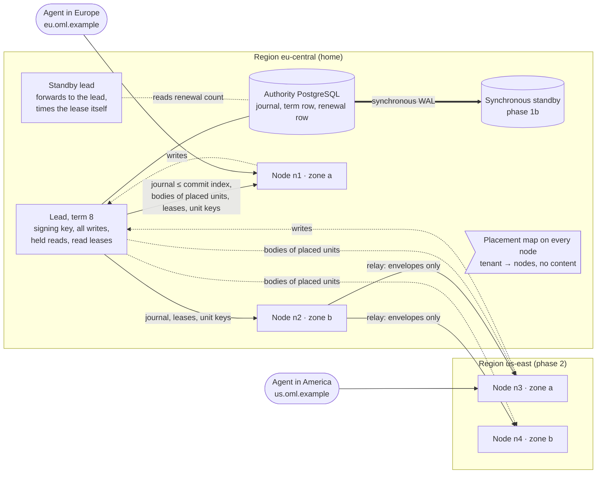
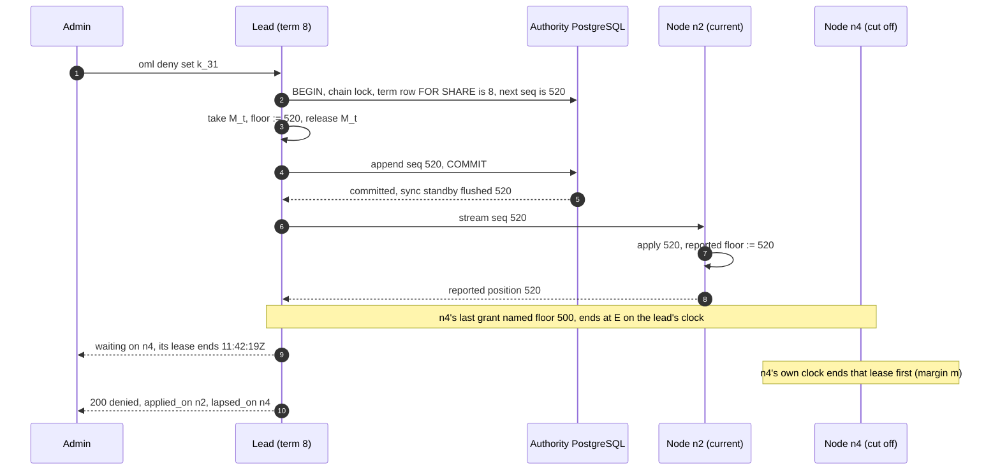
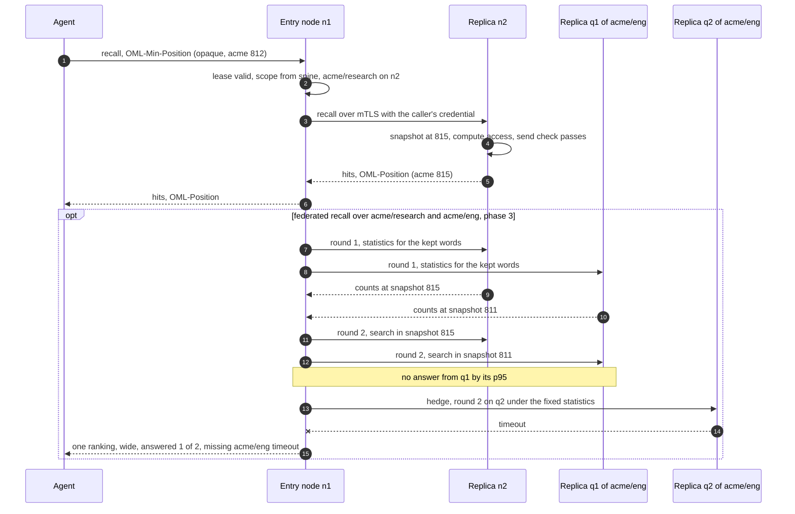
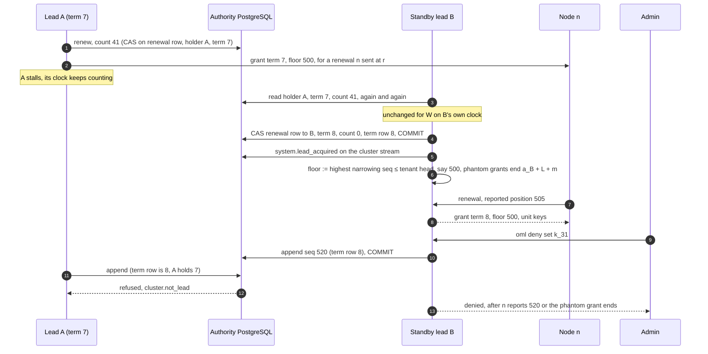

<!--
id: adr/ADR-0073-a-leader-signs-every-write-and-nodes-serve-the-workareas-placed-on-them-each-read-routed-to-the-closest-less-busy-replica-fresh-enough-for-it
tier: engineering
status: proposed
answers: roles and forwarding (d1); the unit and the spine (d2); placement (d3); moves (d4); replication to the synchronous standby's flush (d5); routing (d6); read-your-writes (d7); narrowing on every node before its answer, lead succession and restarts (d8); federated recall (d9); failure (d10); node identity, unit keys and a compromised node (d11); observability (d12); phases (d13); upgrades (d14). The decision table under In short indexes them
-->

# ADR-0073 — A leader signs every write and nodes serve the workareas placed on them, each read routed to the closest, less busy replica fresh enough for it

**Status:** proposed · 2026-11-08 · revised 2026-11-10 (Round 3)

**In short.** Phase 1a is a standby lead on the same database, so upgrades and restarts stop
stopping the API: 2 processes, 1 PostgreSQL, nothing else to run. Phase 1b adds read nodes holding
whole tenants in one region, and with them a synchronous standby for the authority database. Phase
2 adds regions; phase 3 places workarea subtrees, not whole tenants, and serves federated recall
across nodes. Each step has its own cost, and the table under Consequences says when not to take it.
What a key may read never widens: a narrowing act applies on every node before its caller hears it.

**The proposed decisions.**

| d | Decided | Phase | Main names |
|---|---|---|---|
| d1 | One lead writes; a standby lead forwards; nodes serve promoted reads of placed units; held reads go to the lead | 1a / 1b | `oml-server-follower`, placement map |
| d2 | The unit is a workarea subtree; holders of any unit hold the spine: no content per row, but every version's event metadata | 1b / 3 | `oml placement set` |
| d3 | Weighted rendezvous, top R across zones, recomputed on membership only | 1b | `placement.replicas`, `placement.load_slack` |
| d4 | Make before break; a joiner loads only signed checkpoint state | 1b | `system.checkpoint`, `replica.snapshot_verify` |
| d5 | Ship the journal up to the sync standby's flush; verify every event; quorum or degrade, promote only the most advanced standby | 1b | commit index, `cluster.authority_unsynced`, `cluster.standby_stale` |
| d6 | Route to a healthy, leased, fresh replica: nearest tier, two random choices, lead last | 1b / 2 | `routing.*`, `cluster.no_replica` |
| d7 | Read-your-writes by one sealed tenant seq | 1b | `OML-Position`, `OML-Min-Position` |
| d8 | Narrowing applies everywhere before its answer: a new term per process start, a renewal row apart from the term row, succession on the successor's own clock, leases, a send check on every node that sends an answer, a per-node barrier | 1a (items 2–3) / 1b | `cluster.read_lease`, `cluster.lead_lease`, `cluster.max_drift`, `cluster.lead_renewal` |
| d9 | Federated recall in two snapshot-pinned rounds with `now` fixed first; a list is never partial | 3 | `cluster.source_unavailable` |
| d10 | Failure refuses, never guesses; no consensus group | all | the failure table |
| d11 | mTLS identities, no signing on nodes, unit keys between KEK and DEKs, re-wrapped on removal | 1b | `oml cluster join`, `cluster.signing_key_on_node` |
| d12 | Per-node readiness, metrics, doctor, one dashboard | 1a / 1b | `/readyz?role=node` |
| d13 | Four phases, each with one benefit; 1a stands alone | — | #221, #209, #210, #211 |
| d14 | Upgrades: fold version window and order | 1a | `cluster.version_skew` |

**Amends:** ADR-0023 (d13: a follower serves from a PostgreSQL of its own; d14: the lead lease's
epoch becomes a term that fences every commit, and succession is timed on the successor's own
interval clock, never the database's; d16: a follower holds the units placed on it), ADR-0024 (d9:
the LSN fence becomes the position token of d7), ADR-0002 (d2: the synchronous durability domain is
the authority database alone), ADR-0005 (d1: a unit key level between the tenant KEK and each
artifact's DEK, d11), ADR-0042 (d1, d4: one request id across every hop, three fields on the
`http_request` line). The literature this record leans on is quoted in
[sources](https://github.com/e8kor/open-memory-lab/blob/main/design/research/distributed-nodes-sources.md); below, each source keeps one line.

## Context

**Today one lead serves everything, and every upgrade stops the API.** The
[limits](../reference/limits.md) page says "One lead, no follower. Every upgrade or restart stops
the API until the new instance is ready". Writes are signed one after another on one chain per
tenant: `commit_chain` in `crates/adapters/oml-pg/src/lib.rs` takes `pg_advisory_xact_lock` on the
tenant's chain head and appends each signed event at `seq + 1` before `COMMIT`
([ADR-0002](ADR-0002-postgresql-system-of-record.md) d3); the journal payload is "digest references
only, never bodies" (`migrations/0001_init.sql`). Row security fences every tenant table and the
serving role owns nothing ([ADR-0034](ADR-0034-the-lead-serves-as-a-role-that-owns-nothing.md)).
Bodies are sealed under one DEK per artifact, wrapped by a tenant KEK
([ADR-0005](ADR-0005-erasure-by-crypto-shredding.md) d1). Recall hides a version whose valid time
has ended by comparing `valid_until_us` with the server's clock, and serves future-dated versions.
One lead measured recall at 25.5 ms p95 over 99,721 readable memories, at the database
([limits](../reference/limits.md), `bench/scale/REPORT.md`); the public server runs to
[ADR-0058](ADR-0058-the-public-server-runs-to-stated-slos-with-an-error-budget-and-without-backups-until-a-second-person-stores-data.md)'s
SLOs, among them `/readyz` 99.5% and recall 95% within 128 ms.

**The design has a lead and followers, and two records disagree about where a follower reads.**
[ADR-0023](ADR-0023-install-profiles-and-cluster-mode.md) d13–d17 decide one lead holding the
signing key and followers that forward writes, elected by a lease row (holder, address, epoch,
expiry) that d14 calls "never load-bearing". [ADR-0024](ADR-0024-performance-foundation.md) d9
speaks of "the follower's local replica" and an "LSN fence". None of it is built, and none places
data. **The operator asked on 2026-11-08** for a provider where the "leader will be forwarding to
closest less busy node, and workareas will be replicated across nodes".

**Five forces bound the answer.** The chain has one writer per tenant. "A revoked grant or a new
denial applies to the key's next request" ([workareas](../architecture/workareas.md#grants-bind-to-node-ids)),
and R3 makes review change visibility, through a failover too. A node is a new copy of content, so
erasure must reach it. An upgrade must not stop the API. And
[ADR-0072](ADR-0072-recall-searches-the-trusted-workareas-a-key-already-reads-chosen-per-query-by-reviewed-descriptors-and-never-widens-what-it-may-read.md)
(proposed, PR #208) lets one recall search several workareas, which may sit on different nodes.

Decided, not built.

## Decision

- **d1 — Roles: one lead holds every chain and every write, a standby lead waits, and nodes serve
  the promoted reads of what is placed on them.** The lead alone loads the signing key, runs
  admission, signs and appends, grants read leases (d8), and holds the lead lease of d8 item 3. A
  **standby lead** is a second lead-eligible process on the same authority database; until it
  leads it forwards every request to the lead, so either process is a valid client address. A
  **node** (`oml-server-follower`, phase 1b) runs its own PostgreSQL holding the units placed on
  it (d2) and serves recall, get, list and the brief over their promoted state. **Addresses.**
  Clients use one name per region (a DNS name or load balancer over that region's nodes and, in
  the home region, the leads); `placement.dedicated` gives a tenant its own (d3). **Forwarding.**
  Every node holds the cluster's **placement map** (tenant and unit ids to node ids, journalled on
  a cluster stream; no content, no spine). An entry node that holds none of the request's tenant
  forwards it to a replica the map names, chosen by d6, which decides access itself (d11); a stale
  map costs a second hop, never a wrong answer. Every write verb, every read of the caller's own
  held rows, every read inside an in-progress workarea
  ([ADR-0030](ADR-0030-an-in-progress-workarea-serves-unreviewed-memories-inside-it-and-nothing-leaves-until-a-person-commits-it.md)),
  and every read no replica qualifies for (d6) is forwarded to the lead over ADR-0024 d9's pooled
  HTTP/2 channel, never a redirect, so held content never leaves the authority. The cost: write
  throughput stays one lead's per tenant; a far agent pays a cross-region round trip per write
  (unmeasured, #210); the map tells every node which tenants exist and where.

- **d2 — The unit of placement is a workarea subtree; a node holding any unit of a tenant holds
  its spine.** A placement root is a workarea an admin marks (`oml placement set`); its subtree, down
  to the next root, is one unit. The tenant root is always one, and before phase 3 the only one. From
  phase 3 each user root ([ADR-0044](ADR-0044-every-user-works-under-a-root-of-their-own-and-universe-serves-curated-claims-without-their-source.md))
  is one by default; doctor suggests a root when a unit outgrows a node and never makes one. The
  **spine** is what access and routing read: the workarea tree, key hashes and roles, grants,
  denials, crews, policies, ADR-0072's promoted descriptors, two exact aggregates per workarea
  (its promoted row count and total length, numbers only, never a sketch), and the journal
  envelopes from the latest checkpoint, whose payloads are digests over sealed bytes. **No content
  per row is spine:** no body, posting, word or per-word count; versions, the token dictionary and
  every per-term count stay on the unit's holders. **The envelopes are metadata per version:** each
  names its event type, workarea, author key, time, body digest and, for a promoted content event,
  the body's length in bytes, all under the signature. So a spine holder learns who wrote how much,
  where and when in every unit of the tenant, and a digest confirms a guessed exact body (d11's
  table). Per-unit envelopes would hide that and were rejected, because one seq per tenant orders
  every answer (d7). **The aggregates have one source:** a node computes both by folding the signed
  envelopes it applies (count from promotions and demotions, length from the signed lengths), so no
  unsigned number from the lead or a relay reaches it. The spine and `universe`'s promoted content
  go to every node holding a unit of the tenant. The spine is in the erasure inventory; its
  aggregates are recomputed when an erasure is applied. The cost: a node holds a tenant's metadata
  for units it does not serve (size unmeasured, #209).

- **d3 — Placement is weighted rendezvous hashing, top R spread across zones, filtered by region
  hint, recomputed on membership only.** Node *n* scores `w_n / −ln(h(u, n))` for unit *u*; the R
  highest win, one per zone until every zone holds one, skipping a node whose placed bytes exceed
  (1 + β) times the mean (`placement.load_slack`, #211). Every router computes the same set from the
  node list alone, and removing a node moves only what it held ([sources](https://github.com/e8kor/open-memory-lab/blob/main/design/research/distributed-nodes-sources.md#placement-and-routing)).
  R (`placement.replicas`) is 1 on one zone and 2 across zones; the authority's copy is not
  counted. Region, zone and `w_n` are set by the admin at enrolment and bound into the node's
  certificate (d11), so a node cannot attract units. A region hint (`placement.regions`) also means
  a `wide` federated recall coordinated in another region skips the unit, and the workarea's
  federation policy shows that. The lead journals each change as `system.placement_changed` under a
  placement epoch, on the tenant's chain and in the placement map, and recomputes only on
  enrolment, removal or an admin's change, never on health.

- **d4 — A move makes the new replica before it breaks the old, and a joiner loads only state a
  signature covers.** Each moving replica goes `joining` → `serving` → (old node) `draining` →
  `removed`, journalled. A join asks the lead for a checkpoint: the lead appends `system.checkpoint`
  at seq *p* under the chain lock, signing a spine root and one root per unit, each over the
  **node-visible projection** (promoted rows and sealed body digests, never held rows), and a
  checkpoint is also appended every `cluster.checkpoint_every` events. The serving replica chosen to
  copy from opens a `REPEATABLE READ` snapshot right after applying *p* and before *p* + 1, and the
  joiner copies from that snapshot only. The joiner checks the signature and hashes the copy to the
  roots (`replica.snapshot_verify`), re-derives postings with its own compiled adapters, tails from
  *p* + 1, and turns `serving` once its lag is under `placement.join_lag` **and** its applied seq is
  at or past the tenant's floor (d8). Only then does the old replica turn `draining`; it still
  receives bodies until `removed`, drops the unit, and reports `system.copy_destroyed`; a copy that
  never reports stays named by doctor (`cluster.copy_unconfirmed`). `placement.max_moving` bounds
  concurrent moves. The cost: R + 1 copies during a move, a held snapshot on one replica, and a
  root hash per checkpoint (#209).

- **d5 — Replication ships the signed journal up to what the synchronous standby has flushed, and
  a node verifies every event before applying it.** The lead streams, per tenant, `(seq, event,
  prev_hash, sig)` with the sealed body bytes of promoted content events of units placed on the
  receiver. No held body, postings row or count is ever written on a node.
    - **The commit index (phase 1b).** The lead records each append's WAL position after its
      `COMMIT` (`pg_current_wal_lsn()`, an upper bound of the commit record) and advances the
      tenant's commit index to a seq only when a `pg_stat_replication` row with `sync_state` `sync`
      or `quorum` reports a `flush_lsn` at or past it. A returned `COMMIT` alone proves nothing once
      the synchronous set has changed. The stream ships seq ≤ the commit index, so no node applies
      a row a promoted standby lacks.
    - **Without a standby, commits wait.** PostgreSQL makes every commit wait for the synchronous
      standbys, and "may never be completed" if one crashes (§26.2.8.4, [sources](https://github.com/e8kor/open-memory-lab/blob/main/design/research/distributed-nodes-sources.md#postgresql)).
      So a single named standby turns its restart into a write outage. Cluster mode makes the
      operator choose at install, and doctor shows the choice:
        - **(a) quorum:** `synchronous_standby_names = 'ANY 1 (s1, s2)'`, two standbys. Writes
          continue while one is down. 3 PostgreSQL instances for the authority. Both rows report
          `quorum`, and the commit index advances on whichever has flushed, so only the **most
          advanced** standby holds every seq a node may have applied. The runbook and the Patroni
          recipe promote the standby with the higher received LSN; when the other cannot be read,
          they refuse a candidate whose chain head for any tenant is below a node's reported
          `applied_seq`. Doctor names the lagging one `cluster.standby_stale`, as under (b).
        - **(b) degrade with an alarm:** an HA manager (Patroni's non-strict synchronous mode) or
          the operator empties the set after `cluster.sync_wait`. Commits are then durable on the
          primary alone, the commit index freezes (no `sync` row), nodes fall behind and lose their
          leases at the next narrowing floor, and doctor fires `cluster.authority_unsynced`. A
          narrowing act is accepted and answered through its barrier (d8), which waits out the
          nodes' leases. The standby is marked `stale` (`cluster.standby_stale`), and the promotion
          runbook and Patroni recipe refuse to promote it until it has caught up, so no act an admin
          was told took effect is lost by a promotion. 2 PostgreSQL instances. A lead renewal is
          a commit too and waits like any write; d8 item 3 bounds that wait below the lead lease.
        - **The install default.** Recommended: (b) while one person stores data, and (a) once a
          second person does, the condition ADR-0058 sets for backups; `oml cluster init` asks
          and doctor shows the answer.
    - **Verification.** Per event a node checks `prev_hash` against its head, the Ed25519
      signature, and each body's digest; it folds the event with the lead's fold code and derives
      postings with the same compiled adapters ([ADR-0056](ADR-0056-a-claim-version-names-its-format-the-signature-covers-its-source-and-adapters-compiled-into-the-server-derive-what-search-reads.md)),
      in one transaction per batch under a non-owner apply role with `app.tenant_id` set. A failed
      check stops the tenant on that node (`replica.verify`); two events at one seq stop it with
      `replica.fork`.
    - **The sender enforces placement.** The lead, a replica or a relay sends a unit's rows,
      bodies and wrapped DEKs only to a certificate the journalled placement lists for that unit as
      `joining`, `serving` or `draining`, and a spine only to a node placed on some unit of the
      tenant. A relay (phase 2) forwards envelopes only; verification is end to end.

    | Mechanism | What it places | What verifies the copy | Why |
    |---|---|---|---|
    | **Journal shipping, verified on apply (chosen)** | any unit, the spine whole | link, signature, digest per event; a signed checkpoint per snapshot | reuses the fold, chain and adapters; a second apply path, held equal to the lead's by test (#209) |
    | PostgreSQL logical replication with row filters | a simple row filter per table | nothing: the subscriber trusts the publisher | DDL is not replicated and OML makes partitions at runtime; apply runs as the table owner, which ADR-0034 keeps off serving |
    | Physical streaming replicas | every tenant | WAL replay, trusted | places nothing; replay cancels conflicting queries. Kept for the authority's own standby |

- **d6 — A read goes to a replica holding its unit that is healthy, leased and fresh enough,
  nearest tier first, the less busy of two random picks within it; the lead serves when none
  qualifies.** The serving candidate must pass three filters: **health** (an active check of the
  peer's internal `/readyz?role=node` every `cluster.health_interval`, and Envoy-shaped outlier
  ejection after `cluster.eject_consecutive` failures, never more than
  `cluster.max_ejection_percent` of a unit's replicas), a valid **lease** (d8), and **freshness**
  (applied seq at or past the request's `OML-Min-Position`, lag within `routing.max_lag`). Survivors
  are tiered: the entry node, its zone, its region, any region. **Cost** is peak-EWMA latency, decayed
  by elapsed time and fed by health checks, times in-flight requests plus one (Finagle); a replica
  just turned `serving` starts at its tier's median and ramps over `routing.slow_start`. **Choice:**
  with three candidates or more, draw two and take the cheaper (Mitzenmacher; Envoy's least
  request); with two, a draw weighted by inverse cost, so entry nodes do not herd; seeded by
  HMAC(node secret, request id), so a caller cannot steer it and a logged decision replays.
  **Spill:** past `routing.max_inflight` per candidate, the excess share goes to the next tier in
  proportion to the deficit (Envoy's zone-aware routing). **The lead serves** when none qualifies;
  above `lead.max_read_inflight` it refuses `503 cluster.no_replica` with `Retry-After`, never a
  replica outside the bounds. An alert fires on the lead's share of reads.

- **d7 — Read-your-writes by an opaque position token; bounded staleness otherwise.** Every answer
  carries `OML-Position`, sealed with AEAD under a cluster secret over `(tenant, key id, seq)`, one
  seq of the tenant's chain. A node applies every envelope of a tenant it holds, and a content
  event's body with it, so its applied seq is tenant-wide and one seq is enough in every phase. A
  write's token holds the seq its commit appended; a read's holds the maximum of the request's
  `OML-Min-Position` and the snapshot seq that answered (for a federated recall, the highest of its
  sources'), so the newest token received always dominates and the SDKs and plugin keep the newest
  one. Sent back as `OML-Min-Position`, it is answered by a replica at or past it, after waiting up
  to `routing.position_wait`, or by the lead. A token that does not open, or names another key or
  tenant, is refused `request.validation` without waiting. Without a token a read accepts any
  replica within `routing.max_lag` (the shape of CockroachDB's bounded-staleness and Spanner's stale
  reads). A promotion is visible on a replica only once applied there: late, never early (R3). The
  token replaces ADR-0024 d9's LSN fence.

- **d8 — What narrows visibility applies on every node before its caller hears it took effect.**
  **The invariant:** for every narrowing seq *s*, every answer a node sends after *s*'s answer leaves
  the lead was computed at a snapshot whose applied seq is ≥ *s*. Leases are how a node that does not
  report still obeys it.
    1. **Which events narrow.** A closed predicate, narrowing by default. Only *widening* events (a
       promotion, a grant added, a workarea created, a promoted descriptor, a node enrolled, a
       placement added, a checkpoint, a no-op, an `oml admin scan clear` of
       [ADR-0074](https://github.com/e8kor/open-memory-lab/pull/219)) and *held-only* events skip
       the barrier. A test fails on an event type in neither list. The **waiting set** for *s* is
       every node that, at any seq between its grant's floor and *s*, the placement lists on any
       unit of the tenant as `joining`, `serving` or `draining`: every spine holder, in every phase.
       A phase 3 content event still waits on holders of other units, because any spine holder can
       coordinate a federated recall or relay an answer that carries the unit's rows (item 5). Each
       spine holder applies every envelope (d7), so a healthy one reports within one apply; the
       cost is that a partitioned node of an unrelated unit delays the answer up to L + m.
    2. **Clocks.** *C1:* leases and lead succession are measured on CLOCK_BOOTTIME, which counts
       suspension (Rust's `Instant` does not, so the lease code reads it directly; a process that
       cannot refuses to start, `cluster.clock_source`). *C2:* any process's interval clock runs
       within 1 ± ρ of real time (`cluster.max_drift`); doctor estimates each node's rate against
       the lead from renewals and names `cluster.clock_margin` past ρ/2. A hypervisor that hides a
       paused guest's time from its clocks breaks C2, and the estimate only sees it afterwards.
       *C3:* **no wall clock, the database's included, is read by any lease or succession
       decision.** Stepping any wall clock, or promoting a database whose clock differs, changes
       none of them. The margin is m = 3ρ·L for the read lease L = `cluster.read_lease`, which
       covers (L + m)(1 − ρ) ≥ L(1 + ρ) for ρ < 1/3.
    3. **The term and lead succession.** Two rows hold the lease, and neither holds a time any
       decision reads. The **term row** holds `term` and changes only on acquisition. The
       **renewal row** holds `(holder, term, renewal_count, t_L)`. **The holder is one process
       incarnation:** a random 128-bit id drawn at process start, beside the address used to
       forward to it, never the configured name. A process renews only a term it acquired itself in
       this incarnation, and **every start, a restart on the same host included, acquires through
       succession**: a new term (term + 1 in the database), `system.lead_acquired` and phantom
       grants (item 7). A crashed lead's restart therefore waits W like any successor, because the
       old incarnation may be stalled rather than dead; a lead that stopped by planned handover
       released the lease and its successor acquires at once. The lead renews every T_lead/3
       (T_lead = `cluster.lead_lease`) by a compare-and-set on the renewal row alone that
       increments the count and writes its wall time t_L, only while holder and term are its own;
       it acts as lead (grants, narrowing answers, the commit index) only while its CLOCK_BOOTTIME
       shows less than T_lead since it **sent** its last successful renewal, and it checks that
       before each act. A successor takes the lease only after it has seen the same
       `(holder, term, count)`, unchanged, for W = T_lead / (1 − ρ)² on its own CLOCK_BOOTTIME,
       counted from the instant the **read that first returned that value completed** (an instant
       taken after the row arrives, never before the query is sent, so a slow read errs late); any
       change restarts its timer. It acquires in one transaction: a compare-and-set on the renewal
       row it watched, writing its incarnation, term + 1 and count 0, and an update of the term row
       to term + 1. `commit_chain` reads the term row `FOR SHARE` in its append transaction and
       appends only under its own term, else fails `cluster.not_lead`; acquisition's update
       conflicts with every in-flight append, so the chain cannot fork whatever the clocks do.
       Renewals touch only the renewal row, which no append locks, so a renewal never waits for an
       append nor an append for a renewal, and appends share one tuple that changes once per term.
       **Renewals commit synchronously** (never `synchronous_commit = local`): the failover
       interleaving of item 9 rests on every renewal the lead saw succeed being on every promotable
       standby. A renewal under (b) can therefore wait `cluster.sync_wait`, so a lead refuses to
       start unless `cluster.sync_wait` + T_lead/3 < T_lead, and doctor's `cluster.lead_renewal`
       fires when a renewal's round trip passes T_lead/6, well before the lead would stop acting at
       T_lead. Why W suffices: the old lead's last successful renewal was sent at r, committed after
       r, and returned by the successor's read completing at o ≥ r; the old lead acts for at most
       T_lead/(1 − ρ) of real time after r; the successor's W covers at least
       W(1 − ρ) = T_lead/(1 − ρ) of real time after o. So the old lead has stopped acting before
       a_B, the acquisition instant. The same holds when the old lead is an earlier incarnation of
       the successor's own process.
    4. **Grants are linearized with narrowing commits.** Per tenant, under one in-process lock M_t,
       the lead keeps the **floor** (the highest narrowing seq committed or about to commit) and,
       per node, its grants `(id, floor, E)`. A node renews every L/3 in one request for all its
       tenants, sent at its instant r with its reported position per tenant. To grant, the lead takes
       M_t, checks its lead validity (item 3), reads the floor f, records `(id, f, E = its clock
       now + L + m)`, releases M_t, and sends `(term, id, f, its wall time t_L)`. A grant is
       identified by `(term, id)`, and ids restart with each term; the node keeps the grant with
       the highest `(term, id)` it has seen, so a grant of a later term always wins and no restart
       can reuse an id a node already holds; a lease is valid while its clock
       shows less than L since r **and** its applied seq is ≥ f. A narrowing commit of *s* takes M_t
       and raises the floor to *s* before `COMMIT`, under the chain lock. If the commit fails
       definitely (refused before `COMMIT`), the floor is lowered back under M_t; if the outcome is
       unknown, the lead appends a `system.noop` so the seq exists either way.
    5. **Reads in flight (the send check).** A node reports to the lead its **reported position**:
       its applied seq, published only after it has raised its **reported floor**, the highest
       narrowing seq at or below it. Every answer is checked and written under a shared lock that a
       report takes exclusively: the answer goes out only if the node's lease is valid with at least
       `cluster.send_slack` left, and its snapshot seq is ≥ the reported floor; otherwise a
       single-node read is re-run once at a fresh snapshot, then refused and retried elsewhere.
       **Every node that sends an answer runs the check at its own send:** a source of either round
       of a federated recall (round 1's statistics are answers), and a federated coordinator or an
       entry node that holds the tenant and relays an answer. A relaying node holds its own lease,
       bound to the current term, and checks, under its own lock, that every part's snapshot seq is
       ≥ its own reported floor; a part that fails is dropped, a federated part is reported missing
       with reason `lease` (d9), and an answer with no part left is refused and retried elsewhere.
       *Proof:* if the barrier for *s* released on *n*'s report, that report was sent after *n*
       raised its reported floor to ≥ *s*; an answer written after the release was written after
       the report, under the lock, so it saw that floor and its snapshot is ≥ *s*. If the barrier
       released on *n*'s lease, *n*'s clock had already ended that lease (by C2 and m) and the send
       check refuses. A relaying node holds the tenant, so it is in the waiting set (item 1) and the
       same two cases apply to its own send: after the release, either its reported floor is ≥ *s*
       and every part it sends has a snapshot ≥ *s*, or its lease has ended and it sends nothing. A
       part computed below *s* on another node before the release is therefore dropped at the
       relay, however long the relay held it. An entry node that holds none of the tenant computes
       nothing; it passes bytes on, and the request it carries was sent before the answer it
       carries was computed. **What a caller sees:** a read sent after the narrowing answer
       reached its caller is computed after the release, so its snapshot is ≥ *s*.
    6. **The barrier.** After the narrowing `COMMIT`, without the chain lock, the lead holds the
       answer until, **for each node** in the waiting set, that node has reported a position ≥ *s*
       or the lead's clock has passed the largest E among **that node's** grants that named a floor
       below *s* (fixed once the floor rose). The answer carries `barrier: {applied_on, lapsed_on: [{node, lease_ended_at}]}`, and
       the CLI names the node it waits on. The worst case is L + m. Barrier waits count against the
       calling key's in-flight limit.
    7. **A new lead inherits every pending barrier.** At a_B the new lead commits
       `system.lead_acquired`, one entry on the cluster stream (never one per tenant chain, which
       would be an append per tenant on every takeover), carrying the new term and the lower bound
       of item 8 and nothing else it trusts from the old lead. It sets each tenant's floor to the
       highest narrowing seq at or below that tenant's head at a_B, read after the acquisition
       committed, so every append of the old term is below it; and it records per node a **phantom
       grant** (floor 0, E = a_B + L + m on its own clock) for whatever any earlier term or
       incarnation granted. Every old grant
       answered a renewal sent before the old lead's last validity check, so before a_B. A narrowing
       act, new or a retry, is answered only through item 6's barrier. A retry is recognised by the
       same act on the same subject already on the chain; recognising wrongly is safe, because a
       fresh narrowing seq covers the earlier one. **Planned handover:** the outgoing lead stops
       admitting and granting, lets its in-flight transactions finish, holds each new request until
       it can forward it to the successor (so no request fails), computes G, the remaining life of its largest E on its own clock, and
       in one transaction releases the lease and writes `grace_ms` = G. The successor acquires at
       once and its phantom grants end after G/(1 − ρ)² on its own clock, an interval, never a
       timestamp.
    8. **Valid time.** Each grant carries the lead's wall time t_L, and each renewal writes it into
       the renewal row; no lease or succession decision reads it (C3). A new lead's **lower bound**
       is the larger of its own wall time and the row's last t_L; `system.lead_acquired` carries it,
       and the new lead never grants, nor hides expired versions in its own recall, below it, which
       already holds in phase 1a. A node keeps the highest t_L it has seen and never lowers its
       bound. A node bounds the lead's
       time at its instant x as [t_L, t_L + (x − r)(1 + ρ)] and hides a version whose `valid_until`
       is below the upper bound, as the lead hides expired versions; like the lead, it does not hide
       future `valid_from`. A federated recall passes one point `now`, the coordinator's upper bound;
       a source refuses (`lease`) only when its own lease is invalid or the point lies outside its
       bound widened by its uncertainty. A version may disappear from a node one renewal interval
       before it disappears from the lead.
    9. **The interleavings**, each a phase 1b harness:
        - *A renewal races a narrowing commit.* Both take M_t. Grant first: its record (f < *s*, E)
          exists when the floor rises, and the barrier waits for E or a report. Commit first: the
          grant names ≥ *s*.
        - *The lead crashes and restarts within T_lead.* Incarnation a1 (term 7) grants n4 floor
          500 and crashes; systemd restarts the process 200 ms later as a2. The renewal row names
          a1, not a2, so a2 is a successor: it waits W unchanged, which also covers a1 being stalled
          rather than dead, then takes term 8 with phantom grants ending a_B + L + m. A denial at
          520 waits for n4's report or that phantom E, and n4's term-7 grant loses to any term-8
          grant, whatever the ids (`(8, 1)` > `(7, 9)`). A test kills and restarts a lead within
          T_lead and expects a new term (#221).
        - *A renewal waits on the synchronous standby.* Under (b) the standby drops out and the
          renewal waits `cluster.sync_wait`; doctor's `cluster.lead_renewal` has fired at T_lead/6,
          and the start-up check guarantees the renewal returns before T_lead, so the lead keeps
          acting. A local-only renewal would let B read count 40, see 40 again on the promoted
          standby, and acquire while A acts on 41; renewals are synchronous so that cannot happen.
        - *A coordinator holds an answer across the release.* Source P answers round 2 at
          snapshot 510, applies narrowing 520 and reports it; coordinator E waits for a hedged Q.
          E is a spine holder, so the barrier also waits for E's report or lease. If E reported 520,
          its send check sees P's part at 510 < 520 and drops it as `lease`; if E's lease ended, E
          sends nothing. Either way no part below 520 leaves E after the release.
        - *A deposed lead keeps granting.* A (term 7) stalls. B waits W unchanged and takes term 8
          at a_B; by item 3, A stopped acting before a_B. A wakes: its CLOCK_BOOTTIME counted the
          stall, so it refuses to act, and any append fails `cluster.not_lead`. A grant A sent before
          stalling answered a renewal sent before a_B, so it ends by a_B + L + m, the phantom E.
        - *A wall clock steps, or the authority fails over during succession.* A's renewal
          committed on the old primary and was read by B; the promoted standby holds it (every
          commit waited for it) or B reads an older count, which restarts B's timer. Neither clock is
          read. A renewal A sent but did not see succeed never anchors A's validity. So B still
          acquires only after A stopped, and the database clock of either primary plays no part.
        - *The lead crashes mid-barrier.* The retry reaches B, finds the act on the chain, and
          answers through its barrier, phantom grants included.
        - *The authority fails over.* A node applied seq 812 only because a sync standby had
          flushed it; under (a) only the more advanced standby is promoted (d5), so the promoted
          standby holds 812 and the new lead appends after it.
        - *A read straddles the release.* Snapshot at 510, node applies and reports narrowing 520,
          barrier releases: the send check sees reported floor 520 > 510, re-runs a single-node
          read at a snapshot ≥ 520 or refuses; a round-2 source returns `lease` instead.
        - *A node is suspended.* CLOCK_BOOTTIME counts the sleep; the node wakes with its lease
          expired and serves nothing until a current-term grant names a floor it has applied.
        - *A joiner and a draining replica during a demotion (phase 3).* Both are in the waiting set
          (item 1); the joiner cannot turn `serving` below the floor (d4).

  This is a lease in Gray and Cheriton's sense; like Raft's lease reads it rests on timing, here on
  C2's rate bound alone. The cost: a narrowing act with a partitioned node answers after that
  node's lease, and after an unplanned failover every narrowing answer may wait L + m.

- **d9 — A federated recall (phase 3) fixes its statistics and snapshots on the sources' own
  replicas in two rounds, merges one ranking, and is never partial for a list.** ADR-0072
  (`sources: "scope" | "wide" | [names]`) picks the candidates and scores them as one collection;
  this record finds and asks their replicas. The coordinator is the entry node, only under a valid
  tenant lease bound to the current term; otherwise it forwards (d1). It runs the send check of d8
  item 5 on the merged answer at its own send. The coordinator fixes the point `now` (d8 item 8)
  **before round 1**, because ADR-0072 d4.2 subtracts the versions expired at `now` from the counts.
    1. **Round 1, statistics.** Per unit holding the scope or a candidate, the coordinator picks a
       replica by d6 in its region. Each opens a `REPEATABLE READ` snapshot, returns its snapshot
       seq and, for the query's kept words (as text), the exact per-workarea counts, lengths and
       document frequencies ADR-0072 d4 and d7 need, including the counts that decide postings
       pruning. The coordinator sums them over R, selects (ADR-0072 d4), and fixes the scoring
       statistics and pruning before any search. It learns, per request, counts of the caller's own
       words in workareas the caller reads, and nothing at rest.
    2. **Round 2, search.** Each selected source's replica searches **in the snapshot it opened**,
       under the fixed statistics, `now` and pruning, and returns each retriever's list to the
       pipeline's depth for that retriever (ADR-0049: `k` for single, at least 50 for `Rrf`, at
       least 100 for `Cc`, the rerank depth when reranking), never just `k`. The coordinator merges
       per retriever by score (ties by memory id), fuses as ADR-0049 d3, cuts, and reranks last.
       Unselected snapshots are closed after round 1. A source whose send check fails in round 2
       does not re-run, which would break the fixed statistics and the logged seq: it returns
       `lease` and counts as missing (item 3). The answer and the recall log carry each
       source's snapshot seq and `now`, so the recall replays and the equality test compares at the
       recorded seqs; exactness holds for exact retrievers only.
    3. **Missing sources.** Sources are asked in the coordinator's region only, each hedged after
       its observed p95 (Dean and Barroso), bounded by `federation.source_timeout`. A hedge sends
       round 2 to a second replica under the already fixed statistics, at a snapshot of its own at
       or past the first's, and the log records it; the single-node equality is claimed only where
       no hedge won. Under `sources: "wide"`, a missing source leaves its hits out and every other
       score stands; `search.sources.missing: [{workarea_id, reason}]` with `timeout`, `no_replica`,
       `lease` or `remote`, filtered through the coordinator's leased access. Under a **list**
       (`sources: [names]`), the answer is never partial: a source with no in-region replica sends
       the whole recall to the lead, which holds every unit, as does a source dropped as `lease`
       (by itself or by the coordinator's send check), and any other missing source fails
       `503 cluster.source_unavailable {workarea, reason}`. The scope is never partial either:
       `503 cluster.scope_unavailable`. Each node authenticates the caller and computes access itself;
       the coordinator's view grants nothing.

- **d10 — Failure keeps R1–R4 by refusing, never by guessing.** Lead election is d8 item 3; no
  consensus group is added (ADR-0023 rejected Raft). The authority database fails over by the
  operator's promotion of the most advanced current standby (d5), or a Patroni recipe the deployment
  page carries; the old primary must be fenced. The signing key is mounted only on lead-eligible processes.

    | Failure | What happens | R3 visibility (R1, R2, R4 hold in every row: no node signs or has a verb the lead lacks, verdicts are writes, nothing is deleted) |
    |---|---|---|
    | **Lead lost, unplanned** | writes, and in 1a reads, pause for W plus the takeover; nodes keep serving under their leases | narrowing answers wait for the phantom grants (d8 item 7) |
    | **Lead restarted in place** | the same as an unplanned loss: the new incarnation takes a new term after W | earlier grants are phantom grants; none is resumed |
    | **Planned handover** | writes pause for the handover; the standby forwards meanwhile, so no request fails | phantom grants end after `grace_ms` |
    | **Authority database lost** | the operator promotes the most advanced current standby; doctor refuses the other (`cluster.standby_stale`); nodes resume at `applied_seq` | nodes applied only seqs that standby flushed, so none forks |
    | **Sync standby absent** | (a) writes continue on the quorum's other standby; (b) commits wait `cluster.sync_wait`, then the set is emptied, the commit index freezes, the standby is `stale` | nodes fall behind and lose leases at the next floor; a stale standby is never promoted |
    | **Two leads** | only the current term appends | the deposed lead stopped acting before a_B |
    | **Two authority primaries** | a node receiving both stops the tenant with `replica.fork` | a forked tenant serves nothing |
    | **Lagging replica** | dropped past `routing.max_lag` or a token | narrowing waits for it or its lease |
    | **Partition** | a cut node serves until its lease ends; a cut region refuses writes `503 cluster.lead_unreachable` | narrowing waits at most L + m |

- **d11 — Nodes know each other by enrolled identities over mutual TLS, never sign, re-check every
  caller, and hold only the keys of their placed units.**
    - **Identity.** `oml cluster join <code>`; the lead issues a certificate for a node-generated key
      binding region, zone and weight, and journals `system.node_enrolled`; every internal call is
      mTLS on an internal listener; `oml cluster remove` revokes it. `oml-server-follower` composes no
      signer and refuses to start with a signing key configured (`cluster.signing_key_on_node`).
    - **No identity from a peer.** The entry node forwards the caller's credential inside an
      envelope it signs (request id, credential hash, time); the serving node authenticates the
      caller against its replica of key hashes and computes access from its applied grants.
    - **Unit keys.** Each unit has a **unit key**, generated and kept at the authority, wrapped by
      the tenant KEK; each artifact's DEK in the unit is wrapped by the unit key (ADR-0005 d1 gains
      this level; the tenant KEK never leaves the authority). Wrapped DEKs travel in the stream with
      their bodies, to the unit's holders only. A node receives the unit key in a grant, wrapped to
      its certificate key, held in memory only, and only in a grant whose floor it has already
      reported reaching, so a node that stops applying receives no fresh unit key and its last one
      lapses with its lease. **When a lease lapses, the node drops its DEK serving cache
      (ADR-0024 d3) with its unit keys**, and applying an erasure purges that cache as it does on
      the lead. An erasure nulls the wrapped DEK at the authority and, when applied, on the node,
      where the same transaction removes the version's postings (ADR-0005). So after the erasure's
      barrier releases, every honest node either applied it or holds no valid unit key and no
      cached DEK: `unreadable_everywhere` is due at the release. A lapsed node may still hold the
      version's postings at rest until it applies the erasure, so `destroyed_everywhere` lists
      `copies_pending: [node]` until each holder has **applied** the erasure, and each removed copy
      until its `system.copy_destroyed`; #209's erasure test covers a node whose lease lapsed.
      A unit moved off a node stops reaching it after one lease. Splitting a unit (phase 3), and
      **`oml cluster remove`**, re-wrap the affected units' DEKs under fresh unit keys at the
      authority, so a removed node's kept unit key opens no DEK wrapped after its removal. The
      cost: one key per placed unit per renewal, and a re-wrap per split and per removal.
    - **Isolation on shared nodes.** The same migrations, `FORCE ROW LEVEL SECURITY`, the owner and
      serving split, and leakproof candidate SQL as the lead; disk encryption by the operator, stated
      in [deployment](../operations/deployment.md); every node is a copy class in the erasure
      inventory.
    - **A compromised node:**

        | It can | It cannot |
        |---|---|
        | read the promoted content, spine and unit keys of units placed on it, while placed | forge, insert, reorder or drop an event: every peer checks signatures and links |
        | read the event metadata of every unit of the tenant (type, workarea, author key, time, digest, body length), and confirm a guessed exact body by its digest | open a DEK wrapped after its removal: removal re-wraps its units |
        | keep plaintext and unit keys it already held, so an erasure does not reach what it kept | obtain a unit, a wrapped DEK or a unit key not placed on it, or the tenant KEK |
        | read and replay the credentials of requests entering at it; the signed envelope makes a replay visible | learn another unit's words: the spine holds two numbers per workarea, and per-word counts arrive only for the words of a request it coordinates |
        | answer its callers with anything it holds, a denied row included | attract units by claiming another weight or zone |
        | learn which tenants exist and where, from the placement map | |

      A compromised node is a compromised server for its units and the requests reaching it; the
      [security](../architecture/security.md) page states that when this is built.

- **d12 — Every node reports its role, units, lag and leases; doctor names each failure; one
  dashboard shows the cluster.** The public `/readyz` stays aggregate, with no tenant id or seq. The
  internal `/readyz?role=node` lists per tenant `serving`, `joining`, `draining`,
  `lease_expired`, `verify_failed` or `fork`, with `applied_seq`, lag, lease and fold version.
  **Metrics** on ADR-0042 d11's listener, no tenant label: replica lag (events, seconds), in-flight
  by peer role, `oml_cluster_route_total{tier, outcome}`, ejections, lease lapses,
  `oml_cluster_apply_refused_total{reason}`, lead term, commit index lag, narrowing wait, federated
  sources by state. **The request line** gains `node`, `served_by` and `route` (`local`, `zone`,
  `region`, `remote`, `lead_fallback`, `lead_required`, `forwarded_write`, `forwarded_placement`,
  `forwarded_unleased`), and a sampled `route_decision` line feeds the Cluster page. **Doctor:**
  `cluster.lead`, `cluster.standby_lead`, `cluster.lead_renewal`, `cluster.version_skew`,
  `cluster.clock_source`, `cluster.clock_margin` (1a); `cluster.authority_unsynced`, `cluster.standby_stale`,
  `cluster.node_unreachable`, `cluster.replica_lag`, `cluster.lease_lapsed`, `replica.verify`,
  `replica.fork`, `replica.snapshot_verify`, `cluster.checkpoint`, `cluster.placement_short`,
  `cluster.copy_unconfirmed`, `cluster.signing_key_on_node` (1b). **Grafana:**
  `docs/operations/dashboards/oml-cluster.json`. **The Cluster page**, under Administration:
  [mockup (not built)](../design/distributed-nodes/cluster-mockup.html), with a phase 1b view and the
  end state; every name and number on it is illustrative.

- **d13 — Four phases, each one benefit, closed by tests listed in its issue.**
    - **1a. A standby lead on one database (#221).** The term row and the renewal row, a new term
      per process start, fenced commits, succession on the successor's own clock (d8 items 2–3),
      the valid-time lower bound (d8 item 8), the planned handover's drain (d8 item 7, with no
      grants, G = 0), `oml lead step-down`, the fold version window and upgrade order (d14),
      forwarding by the idle process, and 1a's doctor lines. 2 processes, 1 PostgreSQL; no
      synchronous standby. **1a is independent of d2–d9:** it reads no placement, read lease, grant,
      position token, commit index or unit key, and lands without any of them; what 1b inherits
      from it is the two rows' meaning, settled here first. The standby lead serves no reads in 1a,
      though it could read the same database without a lease: its DEK cache would need the
      erasing process's purge (ADR-0024 d3), which 1b's cache rule (d11) brings, so 1a keeps one
      read path and reads pause for W after an unplanned loss. Closed when a planned handover drops
      no request and pauses writes for a measured bound, an unplanned loss resumes writes within W
      plus takeover, and a lead killed and restarted within T_lead takes a new term.
    - **1b. Read nodes for whole tenants in one region (#209).** d2–d8 for whole tenants: the
      synchronous standby choice, the commit index on `flush_lsn`, verified apply and joins, the
      placement map, leases, the send check, the barrier, position tokens, unit keys, enrolment and
      mTLS, routing. Closed by the d8 harnesses, byte-equal recall against the lead, and the leakage
      and erasure tests in #209.
    - **2. Regions and closest-least-busy routing (#210).** Region addresses, relays, tiers, spill,
      peak EWMA, two choices.
    - **3. Placement roots and federated recall (#211).** Subtree units, bounded load, d9, with
      every spine holder still in each waiting set (d8 item 1). Depends on ADR-0072 phase 1 (#205).

- **d14 — A standby lead and a fold version window keep the API up through an upgrade.** Each release
  folds its own event versions and the previous release's. The order: nodes one at a time (drain,
  upgrade, catch up, serve; R ≥ 2 or the lead carries their reads), then the standby lead, then a
  planned handover to it, then the old lead, which becomes the standby. The lead writes a new event
  version only once every node and the standby report a fold version that reads it; a node meeting
  one it cannot fold stops applying, serves within its lease, and doctor names
  `cluster.version_skew`, so skew fails closed. The same gate carries ADR-0074's output escaping:
  a node reports the escaping version it runs, and does not turn `serving` until it reports the one
  the lead names; ADR-0074 d12 owns which version that is. Under choice (a) the synchronous standbys restart one
  at a time; under (b) a standby restart degrades as d5 states. Authority migrations stay expand, then
  contract a release later.

### The narrowing write

### The read path

### Failover

## Consequences

- **Other records.** ADR-0023 d13's follower gains its own PostgreSQL and holds units; d14's epoch
  becomes the term, fenced on every commit, and its expiry column is replaced by a renewal row
  apart from the term row; its holder is a process incarnation, not a configured name.
  ADR-0024 d9's LSN fence becomes the token. ADR-0002 d2's synchronous domain is the authority
  alone. ADR-0005 d1 gains the unit key. ADR-0072 composes with d9: the spine carries two aggregates
  per workarea, per-word statistics come from round 1 on the sources' replicas, the token is one
  seq, `now` is a point, and a `sources` list is never partial.
- **New events:** `system.lead_acquired` (on the cluster stream), `system.placement_changed`, `system.node_enrolled`, `system.node_removed`,
  `system.copy_destroyed`, `system.checkpoint`, `system.noop`. **New errors:** `cluster.no_replica`,
  `cluster.scope_unavailable`, `cluster.source_unavailable`, `cluster.lead_unreachable`, and the
  internal `cluster.not_lead`. **Headers:** `OML-Position`, `OML-Min-Position`, in `openapi.yaml`
  when served.
- **Pages that change when built:** limits, deployment (the standby lead, the synchronous standby
  choice, the node profile, disk encryption, the Patroni recipe), observability, security,
  audit and lineage, commitments (narrowing latency bounded by L + m).
- **When not to run more than one process.** One region, recall under one lead's measured
  capacity, and an upgrade window users accept: run one lead.

    | Need | Run | Processes | PostgreSQL |
    |---|---|---|---|
    | none of the below | one lead | 1 | 1 |
    | planned upgrades and restarts drop no request; writes pause for the handover (1a) | a lead and a standby lead | 2 | 1 |
    | a crash: writes, and reads, return within W plus takeover (1a) | the same | 2 | 1 |
    | the authority database is lost | unchanged by this record: manual promotion | — | — |
    | reads beyond one lead, or reads through a lead crash (1b) | add nodes, and a synchronous standby | 3 or more | 3 (degrade) or 4 (quorum), plus one per node beyond the first |
    | agents in a second region with a measured round-trip problem (2) | nodes there | 5 or more | one per node more |
    | one tenant larger than a node (3) | placement roots | as measured | as measured |

  Per node the operator enrols it, renews its certificate, encrypts its volume, runs its
  PostgreSQL, and drains it on upgrade. The public server's next step is 1a.
- **Operational costs.** Per node: a PostgreSQL, a certificate, an encrypted volume, CPU to apply
  every event of its tenants (#209). Per cluster from 1b: the synchronous standby's round trip on
  every commit, one renewal per node every L/3, a checkpoint hash every `cluster.checkpoint_every`
  events, cross-region egress for bodies of placed units. Latency: a narrowing act as slow as the
  slowest replica or L + m. People: an operator who can promote the authority's standby.
- **Settings.** Only a node's region, zone and join code are required; every default is published
  from its phase's measurements: `cluster.read_lease` (L), `cluster.lead_lease` (T_lead),
  `cluster.max_drift` (ρ, from the operator's time discipline), `cluster.send_slack`,
  `cluster.sync_wait`, `cluster.checkpoint_every`, `cluster.health_interval`,
  `cluster.eject_consecutive`, `cluster.max_ejection_percent`, `routing.max_lag`,
  `routing.position_wait`, `lead.max_read_inflight` (#209); `routing.max_inflight`,
  `routing.slow_start`, `cluster.route_log_sample` (#210); `placement.load_slack`,
  `federation.source_timeout` (#211); `placement.replicas` (1, or 2 across zones).
- **Issues:** #221 (1a), #209 (1b), #210 (2), #211 (3), in the Later milestone on tracking issue
  #200; each lists its acceptance tests and what it measures before its defaults ship.

## Rejected alternatives

| Alternative | Why not |
|---|---|
| **Lead succession timed on the database's clock** | A clock step or a promoted primary with another offset lets a successor in while the old lead still grants (Round 2 B1). |
| **A restarted lead resuming its own term** | Its grants are gone from memory, so the next barrier releases at once while nodes serve under the old grants (Round 3 B1). |
| **One lease row locked by appends and updated by renewals** | Every renewal waits on every in-flight append and appends queue behind a renewal (Round 3 M3). |
| **Renewals committed locally (`synchronous_commit = local`)** | A successor could see an older count on the promoted standby and acquire while the old lead acts on a newer one. |
| **Unit-scoped waiting sets (phase 3)** | A spine holder that coordinates or relays could send a part computed below the floor after the release; a confirming round instead would cost a round trip on every federated recall. |
| **Explicit lease revocation acknowledged by every holder** | A partitioned node cannot acknowledge, so an unplanned failover still waits out its lease; the interval wait covers both cases. |
| **A single named synchronous standby with no choice** | Its restart holds every commit. |
| **Spine statistics per word, or a sketch of them** | Put every unit's vocabulary on every node of the tenant, survive erasure on nodes that never held the unit, and a sketch is not exact. |
| **Shipping the tenant KEK to nodes** | Any node could unwrap any DEK of the tenant, and keep doing so after an erasure it has not applied. |
| **Per-unit position vectors in the token** | Two answers can be incomparable; every node applies the whole chain, so one seq orders them. |
| **PostgreSQL logical replication per workarea** | Trusted copy, DDL not replicated, apply as table owner. |
| **Physical streaming replicas behind a router** | Every replica holds every tenant; replay cancels queries. |
| **Raft per tenant or per unit** | A second authority beside PostgreSQL; the chain lock and the term already order writes. |
| **Every node signs** | Many key copies and a chain two writers could extend. |
| **Consistent hashing on a ring** | Needs ring state every router agrees on. |
| **Round robin, or a global least-loaded** | Ignores load, or herds on a stale shared view. |
| **Checking every read against the lead** | A lead round trip on every read. |
| **Stale grants within a TTL** | Breaks "applies to the key's next request". |
| **Persisting every grant** | A write per node per renewal, against a wait paid once per unplanned failover. |
| **Replicating held content** | Unreviewed bodies on more machines for author-only reads. |
| **A topology-aware client** | ADR-0022's dumb client; the token is the only cluster fact a client sees. |
| **Per-workarea placement first** | Rebalance risk before any tenant outgrows a node. |

## Open questions for the operator

1. **The public server.** Recommended: take phase 1a there now (one database, no backup question);
   keep 1b self-hosted until ADR-0058's "a second person stores data" condition is met. Confirm.
2. **Narrowing acts while the standby is out of the set.** Recommended, and written into d5 (b):
   accept them, answer through the barrier, and fail closed at promotion by refusing a stale
   standby, so an emergency denial is never refused. The alternative refuses them
   `503 cluster.authority_unsynced` naming the recovery step. Confirm.

## Review log

**Round 1, 2026-11-08.** Algorithms, security and product reviews (9 blockers in all). Leases became
term-bound with grants linearized with narrowing commits and inherited barriers; clocks were stated;
the stream stopped at the commit index; joins verified against signed checkpoints; senders enforce
placement; erasure split into unreadable and destroyed; routing gained weighted draws, spill and slow
start; the phases were reordered upgrades first; the mockup showed moves as R + 1 copies.

**Round 2, 2026-11-10.** Correctness (2 blockers, 12 majors, 13 minors across ADR-0072 and this
record) and product (2 blockers, 11 majors, 13 minors). What changed here:

- **Succession without a wall clock** (correctness B1, m4): a renewal count watched for W on the
  successor's CLOCK_BOOTTIME replaces the expiry timestamp; handover grace is an interval; the
  clock-step and failover interleaving is argued (d8 items 2, 3, 7, 9).
- **Reads in flight** (B2, m2): a send check against the reported floor under a lock the report
  takes, with its proof, and the invariant restated over answers (d8 item 5).
- **Statistics and keys** (M4, M5): two aggregates per workarea in the spine, per-word statistics
  from round 1 on the sources' replicas; unit keys between the tenant KEK and the DEKs, delivered
  only to nodes that reached the floor (d2, d9, d11).
- **The synchronous standby** (M1; product B2): the commit index follows the sync standby's
  `flush_lsn`; commits wait without a standby, and the operator chooses quorum or degrade (d5).
- **Replication and moves** (M2, M3, M8, m1): on-demand checkpoints with a snapshot opened at *p*,
  roots over the node-visible projection; draining replicas keep their bodies; the waiting set
  covers joining and draining; a failed narrowing commit lowers the floor or appends a no-op (d4,
  d8).
- **Federation** (M6, M7, M9, M11, m3, m13; product M6, minor 3): per-retriever depth,
  snapshot-pinned rounds with logged seqs, a one-seq token, expiry-only valid time, a point `now`,
  and a `sources` list never partial (d7, d8, d9).
- **Product** (B1, M1, M7, M8, minor 4): phase 1 split into 1a and 1b; an In short block; quotes
  moved to [sources](https://github.com/e8kor/open-memory-lab/blob/main/design/research/distributed-nodes-sources.md) and test lists to the issues; a
  placement map and per-region addresses; the cost table split by planned, crash and database loss.
- **Diagrams** (m8–m11): the topology's placement is a note inside the home region, the narrowing
  write takes the chain lock before the floor, the hedge is drawn, and the failover's floor is the
  highest narrowing seq.
- **Mockup** (product M9–M11, minors 5–12): a standby lead row, an upgrade tile and a node
  mid-upgrade, step-down, unit cards at 375 px, a phase 1b view, and two feed lines that routed
  from nodes holding none of the tenant replaced by placement-map forwards.
- **Not taken here:** the remaining Round 2 findings concern ADR-0072 alone.

**Round 3, 2026-11-10 (final).** One holistic review (1 blocker, 7 majors, 10 minors). What changed:

- **A restarted lead** (B1): the holder is a per-incarnation id; every start takes a new term in
  the database with phantom grants, never the old one; a grant is `(term, id)`; the restart
  interleaving is argued and tested in #221 (d8 items 3, 4, 7, 9).
- **The successor's timer** (M1): counted from the completion of the read that first returned the
  value (d8 item 3).
- **Valid time across a handover** (M2): renewals write t_L into the renewal row, read by no
  decision; the new lead's lower bound is the larger of its clock and that value, nodes never lower
  theirs, and the lead's own recall in 1a uses it (d8 item 8).
- **The lease rows** (M3): a term row that appends lock and changes once per term, and a renewal row
  only renewals touch; renewals stay synchronous, the lead refuses to start unless
  `cluster.sync_wait` + T_lead/3 < T_lead, and `cluster.lead_renewal` fires at T_lead/6 (d5, d8).
- **Promotion under quorum** (M4): only the most advanced standby; doctor names the other
  `cluster.standby_stale` (d5, d10).
- **A relay or coordinator** (M5): every node that sends an answer runs the send check at its own
  send under its own term-bound lease; every spine holder stays in the waiting set in every phase;
  proved in d8 item 5 and argued as an interleaving.
- **Erasure on a lapsed node** (M6): the DEK cache drops with the unit keys; `copies_pending` until
  the erasure is applied (d11).
- **Spine metadata** (M7, m4): d2 says what the envelopes disclose, and the aggregates are folded
  from signed envelopes carrying the body length; d11's table gains the row.
- **Minors:** round 2 returns `lease` without a re-run and round 1 is checked (m1); the barrier
  releases per node (m2); `oml cluster remove` re-wraps unit keys (m3); (b) is the default below
  ADR-0058's condition, (a) above it (m5); `system.lead_acquired` is one cluster-stream entry (m6);
  the 1a handover drains, and the standby serves no reads in 1a, with the reason (m7); a decision
  table under In short and a shorter `answers` (m8); `now` is fixed before round 1 (m9); `scan
  clear` is a widening and the fold gate carries ADR-0074's escaping version (m10).
- **Not taken here:** m9's rewording of ADR-0072's composition paragraph ("one statistics round per
  unit holding R") belongs to PR #208.
