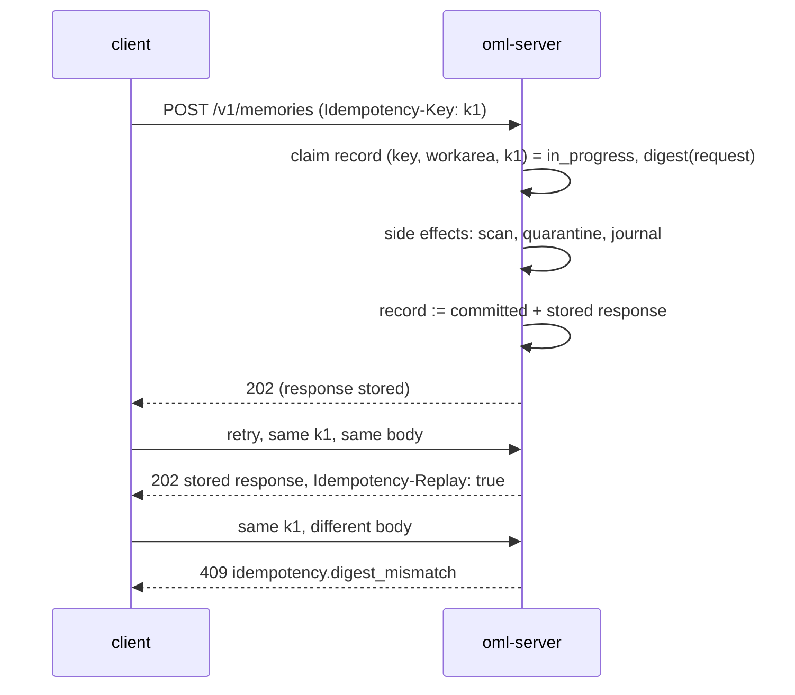

<!--
id: api/http-api
tier: engineering
status: design draft for review · decided, not built
answers: what the two-ring JSON surface commits — /v1 provider and /v2 lab routes, authentication, idempotency records, the pagination convention, and the verb ceiling per endpoint; which events a key sees on the events tail; which records carry a name, what a name may spell, and how a name is accepted and resolved wherever an id is; the /mcp challenge, the discovery documents, the OAuth endpoints and the authorization page of connections
-->

# HTTP API

**Status:** design draft for review · decided, not built

**Release:** the routed operations arrived in v0.1.0, v0.2.0 and v0.3.0; the rewrite arrived in v0.4.0 ([releases](../product/releases.md)).

This page owns decision **D13** as contract: the two-ring JSON surface — the provider ring
(`/v1`) and the lab ring (`/v2`) — authentication, idempotency
records, the pagination convention, and the verb ceiling each endpoint enforces. The
machine-readable form is two documents: [openapi.yaml](openapi.yaml) declares exactly the
operations the server routes, with only the fields it accepts, and
[openapi-designed.yaml](openapi-designed.yaml) holds the designed operations and, under
`x-oml-designed-fields`, the designed fields of served ones
([ADR-0039](../adr/ADR-0039-the-api-rewritten-for-v0-4-0.md) d9). This page describes both and
marks each endpoint served or designed; a divergence between them is a documentation bug, not an
ambiguity to interpret. A designed operation answers 404 until the change that serves it moves its
entry to openapi.yaml, and a designed field sent to a served operation answers its v0.3.0 code. Every refusal cited
below is a typed error declared in [errors.md](errors.md). The MCP agent plugin is a stateless
facade over the agent-safe subset of this API ([mcp-plugin.md](mcp-plugin.md)); the `oml` CLI
drives the administrative and review verbs over this same API
([cli/reference.md](../cli/reference.md)) — there is no second surface and no private RPC. The
one-transport posture is deliberate: a second surface would mean a second authentication path, a
second audit story, and a place for the two contracts to drift apart.

Field names and endpoint spellings are design identifiers: normative in shape, adjustable in
spelling at implementation without a design change (the same caveat the
[event catalog](../data/event-catalog.md) carries).

Python and TypeScript clients are generated from [openapi.yaml](openapi.yaml) alone, so they carry
only served operations, with hand-written
wrappers for the key, idempotency keys, pagination and the error taxonomy; the generators, the
wrappers and the rule that regenerates them on every change to this contract are decided on
[client SDKs](../engineering/sdks.md).

## Two rings

*Available since v0.1.0; `workarea` in the request in place of the `X-OML-Workarea` header since v0.4.0 · [releases](../product/releases.md)*

One keyed listener carries two **stability rings**
([ADR-0022](../adr/ADR-0022-two-ring-api.md)); this page remains the one contract document for
both, and `/healthz` and `/readyz` stay unversioned.

- **The provider ring (`/v1`)** is the memory provider foundation: submit (and the reserved
  `POST /v1/memories:batch`, [FR-12](../product/roadmap.md)), read own and promoted, recall,
  supersede, and the attachment upload/fetch flow. **The covenant:** once
  [FR-21](../product/roadmap.md) declares v1 stable, v1 changes are additive only — no field
  removed, no semantic changed, no status code repurposed; anything that would break a v1 client
  is, by definition, a v2 capability. A provider-ring request names its workarea in one field,
  `workarea` — a node id or [name](#names-and-ids), honored only within the key's grants — in the
  body of a submit, supersede or recall and in the query of the listing or the events tail;
  omitted, the key's journalled `default_workarea` is the target, and a submit, recall or non-own
  listing from a key with neither answers `request.workarea_unresolved` ([errors.md](errors.md)).
  Get, the own-work listing (`own=true`) and supersede never answer it: get resolves no
  workarea, an own-work listing without `workarea` reads every workarea the key wrote in, and
  supersede takes the target's workarea. v0.3.0's `X-OML-Workarea` header is refused with
  `request.validation`, `details.field` naming the header and `details.renamed_to` the field
  ([ADR-0039](../adr/ADR-0039-the-api-rewritten-for-v0-4-0.md) d4, d7).
- **The lab ring (`/v2`)** is the evolving memory lab: review and ratification ceremonies, claim
  edges, workarea, key and claim administration, bans, simulations, exports, settings, tenants,
  bootstrap, the events tail and vocabularies. It prefers additive change but may re-version to
  `/v3` without ever touching `/v1`. Lab requests keep explicit workarea references — ids or
  [names](#names-and-ids) — in paths and bodies: an administration surface names what it
  administers.

The split is a stability contract, not a trust boundary: the verb ceiling (R1), admission, RLS
and every guarantee in [commitments](../product/commitments.md) apply identically on both rings,
and a `/v1` write is held until review like any write — what `/v1` hides is the machinery, not
the constitution.

## Conventions

| Convention | Rule |
|---|---|
| Base path | Two rings on one listener ([Two rings](#two-rings)): `/v1` the provider ring (covenant-bound once FR-21 closes), `/v2` the lab ring (evolving; may re-version to `/v3` without touching `/v1`). Additive fields are not breaking, and clients must ignore unknown response fields. |
| Content type | `application/json; charset=utf-8`, except attachment part upload (`application/octet-stream`) and the export bundle download. A request body in any other media type answers `415 request.unsupported_media` ([errors.md](errors.md)). Responses are `application/json`; `Accept` is not negotiated in v1. The OAuth endpoints of [connections](#connections-oauth-for-hosted-mcp-clients) are outside both rings and take their RFCs' media types: the token request and the page's form are `application/x-www-form-urlencoded`, and the authorization page is `text/html`. |
| Rate and quota | `429 limit.rate` / `limit.quota` may be answered by any operation; it is declared explicitly only on the v1 ring and high-traffic v2 surfaces ([errors.md](errors.md)). |
| Timestamps | RFC 3339, UTC, e.g. `2026-10-29T14:03:17Z`. |
| Digests | `sha256:<64 hex>`. An attachment is named by the SHA-256 of its plaintext ([storage.md](../architecture/storage.md)). |
| Identifiers | Opaque strings (`artifact_id`, `workarea_id`, `key_id`, `serve_id`, …). Clients never parse them. The ids of workareas, crews, keys and tenants are UUIDs in RFC 9562 hex-and-dash text, so that the server can tell an id from a [name](#names-and-ids). |
| Request id | Every response carries `X-Request-Id` and `X-Correlation-Id`; error bodies repeat the request id as `request_id`. Since v0.4.1 a valid inbound `X-Request-Id` is the id ([request ids](#request-ids-correlation-and-trace-context)). |
| Deletion | No endpoint is `DELETE`. Every removal is a journalled `POST` act — demote keeps bytes, erase is crypto-shredding (constitution R4; [audit-and-lineage.md](../architecture/audit-and-lineage.md)). |

## Request ids, correlation and trace context

*Available since v0.4.1 · [releases](../product/releases.md)*

Three request headers are read and two response headers returned on every route, the probes,
`/mcp` and the OAuth endpoints included ([ADR-0042](../adr/ADR-0042-every-request-logs-one-line-under-an-id-the-caller-may-name-and-metrics-stay-off-the-public-port.md) d4–d6, d13). None of them is refused:
a value the rule does not admit is replaced, and the request goes on.

| Header | Direction | Rule |
|---|---|---|
| `X-Request-Id` | request and response | Honoured when there is one instance and its value is 1 to 128 characters from `A`–`Z`, `a`–`z`, `0`–`9`, `-`, `_`, `.` and `:`; otherwise the server mints `req_<32 hex>`. Every response returns the id, an error's included, and the error envelope's `request_id` and an MCP tool refusal's `request_id` are the same value ([errors.md](errors.md)). |
| `X-Correlation-Id` | request and response | The same rule. Absent or not admitted, the correlation id is the request id. Every response returns it. |
| `traceparent` | request only | W3C Trace Context, version `00`. Read only while the deployment exports traces (`server.otlp_endpoint`, [configuration](../operations/configuration.md)): a valid value makes the server's span its child, an invalid one starts a new trace. `tracestate` is not read, and no response carries `traceparent`. |

A request id the client sends is a label it chose. Another client can send the same one, so the
server never uses it as an idempotency key, which stays `Idempotency-Key` scoped to the
authenticating key ([Idempotency](#idempotency)), nor for any authorization or rate decision, and
never stores it. The server's log records whether each id was the caller's or minted
([observability](../operations/observability.md#the-request-line)). [openapi.yaml](openapi.yaml)
declares the three request headers on every operation and the two response headers on every
answer ([ADR-0039](../adr/ADR-0039-the-api-rewritten-for-v0-4-0.md) d9).

## Versioning and deprecation

The rings version independently ([Two rings](#two-rings)); this section fixes what *additive*
means, because the v1 covenant is only as strong as that definition.

**Additive** — permitted on a frozen ring without a version change:

- a new endpoint;
- a new **optional** request field (absent means the prior behavior, exactly);
- a new response field — clients must ignore unknown response fields
  ([Conventions](#conventions)), which is what makes this additive;
- a new error code under an existing HTTP status (the taxonomy is closed per release, and a
  client branches on codes it knows — an unknown code under a known status degrades to the
  status's generic handling).

**Not additive for v1, settled exactly this way: extending a response enum.** A client that
matches exhaustively on `state`, `verdict` or any other enumerated response field breaks on a
member it has never seen, so a new enum member is a breaking change on `/v1` — it ships as a
new field, or as a `/v2` capability, never as a quiet widening. Request-side enums may gain
members (a client that never sends the new value never sees a difference).

**The `/v2` evolution process.** The lab ring prefers additive change under the same
definition. Every surface change, additive or breaking, is announced in the release changelog
(no release exists yet — the process binds from the first one). A breaking `/v2` change mints
`/v3`; the retiring ring keeps being served alongside its successor for a stated minimum
overlap window of **one minor release cycle**, and the overlap is announced with the change.
Deprecated endpoints will carry `Deprecation` and `Sunset` headers once implemented — decided,
not built, like everything on this page.

**Freezing v1.** [FR-21](../product/roadmap.md) is the freeze act: a recorded v1-stable
declaration pinning the provider ring at a named revision of [openapi.yaml](openapi.yaml)
(currently `0.5.7-design`), from which moment the covenant — and this section's definition of
additive — is in force.

## Authentication and authorization

*Available since v0.1.0; grants of several roles per key since v0.2.0; `tenant` in place of `tenant_id` since v0.4.0 · [releases](../product/releases.md)*

Every request on either ring carries `Authorization: Bearer <api-key>`. `/mcp` is designed to
take the same header with either a key value or, where the deployment sets `oauth.issuer`, a
connection's access token, which resolves to its key; as built it takes a key value alone
([connections](#connections-oauth-for-hosted-mcp-clients);
[roles and keys](../architecture/roles-and-keys.md#connections)). On `/v1` and `/v2` an access
token is not a credential and answers `auth.invalid` like any non-key. Only `/healthz`, `/readyz`,
the two discovery documents and the OAuth endpoints are unauthenticated.

- **Tenant is derived server-side from the key, never from the request** (D6;
  [security.md](../architecture/security.md)). No endpoint takes a tenant parameter, with one
  exception: an operator key may name `tenant` when creating a tenant's first admin key —
  operator keys are provider-level and have no tenant of their own.
- **Roles do not nest.** A key is issued with one role — `reader`, `writer`, `dreamer`, `admin`,
  `operator` — which names the grant roles it may carry (the
  [admissibility table](../architecture/roles-and-keys.md#grant-admissibility-and-refusal-order));
  each grant confers a role over one workarea subtree
  ([roles-and-keys.md](../architecture/roles-and-keys.md)). Where an endpoint
  below says *requires reader*, it means reader **effective access** on the workarea the request
  names, resolved from grants and denies at call time ([workareas.md](../architecture/workareas.md));
  where it says *requires admin* or *requires operator*, it means the key's role itself, because
  the verb governs tenant- or provider-level objects.
- **The verb ceiling is structural** (constitution R1): no agent-facing role reaches promote, sign,
  demote, delete, or any admin verb, and the refusal is the typed error
  [`access.verb_ceiling`](errors.md) naming the rule. The ceiling per endpoint is stated in
  the [surface table](#the-surface) and repeated per section.
- **Reads fail closed as absence.** A resource outside the key's effective read scope — including
  every simulation row for a key outside that simulation's audience (D10) — answers
  `access.not_found`, indistinguishable from a resource that does not exist. A resource the key can
  see but lacks the verb for answers `access.grant_refused`.
- **One refusal order.** Every workarea-scoped verb resolves its refusal in the fixed four-step
  order declared on
  [roles-and-keys.md](../architecture/roles-and-keys.md#grant-admissibility-and-refusal-order),
  which also names the role each verb needs; this page does not restate it.
- **Every read is logged** (D12): key, role, workarea, the memory ids served, timestamp, and for a
  recall the canonical request digest — in the retention-bounded read log whose batch digests
  anchor into the journal ([retrieval.md](../architecture/retrieval.md#the-read-log)).

Bearer keys are the shipped mechanism on every route; `/mcp` also accepts a connection's access
token, as exactly the key the connection is bound to, and no other route does
([ADR-0031](../adr/ADR-0031-oauth-connections-by-connect-code.md)). The role vocabulary and key authorization semantics are owned by
[roles-and-keys.md](../architecture/roles-and-keys.md).

## Names and ids

*Available since v0.3.0; request fields named after the kind they reference, the v0.3.0 spellings refused, and `text` in place of `body` since v0.4.0 · [releases](../product/releases.md)*

This section is the single declaration site for names
([ADR-0026](../adr/ADR-0026-names-are-keys.md)): which records carry one, what a name may spell,
where a name is accepted in place of an id, and how the server resolves it. Ids stay the binding
everywhere state is kept — grants, denials, journal payloads, idempotency scopes, the read log,
cursors — and a name is only how a caller addresses a row.

**Which records.** Workareas, crews, keys and tenants each carry a `name`, given at creation,
unique in its namespace, never changed (no verb renames a row) and never released: a revoked or
expired key keeps its name, and no other key may take it.

| Kind | Namespace | Named at |
|---|---|---|
| workarea | its tenant, the whole tree | `POST /v2/workareas`; the root is `universe`, created with its tenant ([workareas](../architecture/workareas.md#the-tree-one-universe-per-tenant)) |
| crew | its tenant | `POST /v2/crews` |
| key | its tenant; operator keys share the provider's | `POST /v2/keys`, `POST /v2/keys/{key}/rotate` (the successor), `POST /v2/bootstrap/claim` |
| tenant | the deployment | `POST /v2/tenants` |

The reserved provider tenant ([storage](../architecture/storage.md)) carries no name: it is not a
row of the deployment's tenant namespace, its `tenant.genesis` carries `name: null`, and no
reference resolves to it.

**The two forms.** An id of these four kinds is RFC 9562 §4 hex-and-dash text: 8-4-4-4-12
hexadecimal digits, either case accepted, lowercase served
([RFC 9562](https://www.rfc-editor.org/rfc/rfc9562.html), fetched 2026-10-30), whose version
digit — the first digit of the third group (§4.2) — is not `8`. The server mints every id of the
four kinds as version 4 (§5.4); version 8 (§5.8) is reserved for the
[unresolved value](#the-unresolved-value), so a hex-and-dash value of version 8 is not an id
(RFC 9562 sections fetched 2026-10-31). A name is a
lowercase RFC 1035 label — a letter first, then letters, digits and hyphens, a letter or digit
last, 1–63 characters ([RFC 1035](https://www.rfc-editor.org/rfc/rfc1035.html) §2.3.1, fetched
2026-10-30):

```
^[a-z]([a-z0-9-]{0,61}[a-z0-9])?$
```

— and is neither the hex-and-dash form nor 32 hexadecimal digits, so that no name ever looks like
an id. That is the **reference grammar**, which every field that names a row checks. A creation
checks the **creation grammar**, which also refuses the derived form: `tenant-`, `wa-`, `crew-` or
`key-` followed by 32 hexadecimal digits, which only rows created before names hold
([below](#rows-created-before-names)). A derived name is therefore a name in a reference and
`request.validation` in a creation body. There is no normalization and no case mapping: every
allowed character is ASCII, and names compare byte for byte. `Metals-Crew` is refused, never read
as `metals-crew`.

**Where a name is accepted.** Every request field, path parameter, query parameter and header
that names one of the four kinds takes its id or its name. On the key and workarea routes a
request field or path parameter is named after the kind it references, `workarea`, `crew`, `key`
or `tenant`, and the v0.3.0 spelling (`parent_id`, `default_workarea_id`, `tenant_id`, a grant's
`workarea_node_id`, a deny entry's `subtree_node_id`, a denial's `workarea_node_id`) is refused
with `request.validation`, `details.field` naming the spelling sent and `details.renamed_to` the
one to send ([ADR-0039](../adr/ADR-0039-the-api-rewritten-for-v0-4-0.md) d7). The provider
ring's memory routes and the events tail take `workarea`, and refuse the `X-OML-Workarea` header
and the `workarea_id` query parameter the same way. A response keeps its v0.3.0 names, but for
the claim's `text`, which v0.3.0 called `body`: a response field called `workarea_id` always
carries the id, and each object of the four kinds carries its `name`.

| Kind | Accepted in |
|---|---|
| workarea | `workarea` on submit, supersede and recall, and on `GET /v1/memories` and `GET /v2/events`; the `{workarea}` of every `/v2/workareas/{workarea}` route; `workarea_id` on `GET /v2/edges` and `GET /v2/vocab/suggest`; `workarea` on `GET /v2/review/queue`, on `POST /v2/review/next` and on `GET /v2/keys/{key}/effective-access`; `parent` on create, `new_parent_id` on re-parent, `from_workarea_id` and `to_workarea_id` on a workarea edge proposal, `workarea_id` on reassign and tip-override; a grant's `workarea` and its denies' `workarea`, a denial's `workarea`, and `default_workarea` on issuance |
| crew | the `{crew}` of every `/v2/crews/{crew}` route; `crew` on workarea create, on `POST /v2/workareas/{workarea}/crew` and on issuance |
| key | the `{key}` of every `/v2/keys/{key}` route; `key_id` in a simulation audience entry |
| tenant | `tenant` on an operator key's issuance of a tenant's first admin key |

The MCP tools pass their workarea arguments through to these fields
([agent plugin](mcp-plugin.md)), and every CLI argument that names one of the four kinds takes
either form ([CLI](../cli/reference.md#conventions)). Neither resolves anything itself.

**Classification and resolution.** Two steps, on the server:

1. **At parse**, before any check that consults state, each value is classified: in the id form,
   it is an id; otherwise, if it matches the reference grammar, a name, a derived name included;
   otherwise the request is refused with `request.validation`, `details.field` naming the field.
   A derived path
   (`universe.procurement`) contains `.`, so it is neither: paths are served and looked up, never
   accepted as a reference, and `GET /v2/workareas?path=` is the lookup by path.
2. **After the verb ceiling**, which needs no row — step 1 of the
   [refusal order](../architecture/roles-and-keys.md#grant-admissibility-and-refusal-order), or
   the key-role check of an admin or operator verb — each name is replaced by the id of the row
   that holds it in the caller's namespace, or, when no row holds it, by its
   [unresolved value](#the-unresolved-value). The request then runs exactly as the same request
   by id runs.

The namespace is fixed by the caller and the kind:

- A tenant's key, of any role, resolves every name in its tenant.
- An operator key resolves a tenant name in the deployment, and a key name in the provider's
  namespace, which holds operator keys only, so a key name an operator sends never resolves to a
  tenant's key.
- An operator key's issuance of an operator key carries no `tenant`, and its `name` is in the
  provider's namespace, where `name.taken` checks it. Only its issuance of a tenant's first admin
  key resolves `tenant` first, in the deployment, and then the key's `name`, its `crew` and
  every other reference of the body in that tenant.
- The bootstrap claim's `name` is in the provider's namespace.

<a id="user-namespaces"></a>**User namespaces — since v0.5.0**
([ADR-0044](../adr/ADR-0044-every-user-works-under-a-root-of-their-own-and-universe-serves-curated-claims-without-their-source.md) d5). With
[user roots](../architecture/workareas.md#user-roots), the workarea namespace
splits in two. The **shared namespace** holds `universe`, every user root's name and every shared
workarea's name; each **user namespace** holds the names strictly beneath one user root, where
`universe` and the user's own name are reserved. A name is unique within its namespace, so
`alice.project` and `bob.project` coexist. A workarea inside a user root also has the
**qualified name** `<user>.<name>`, unique in the tenant and never changed, since nothing is
re-parented across a user root's boundary; a shared workarea's qualified name is its name.
Every field that takes a workarea id or name takes a qualified name too: exactly two labels
joined by one `.`, the first naming a user root. A value whose first label is `universe`, or with
more than two labels, is still a path and still `request.validation`. A
[user key](../architecture/roles-and-keys.md#user-keys) resolves a bare workarea name in
its own user namespace, plus `universe` and its own root's name; every other tenant key, admin
keys included, resolves a bare name in the shared namespace; every tenant key resolves a
qualified name. A user key creating a workarea is told `name.taken` for a name in its own user
namespace and for no other.

<a id="the-unresolved-value"></a>**The unresolved value.** The unresolved value of name *n* of
kind *k* in namespace *s* is the version-8 UUID that RFC 9562 Appendix B.2 builds for a
name-based value: the first 128 bits of SHA-256 over the UTF-8 bytes of `oml-unresolved`, *s*,
*k* and *n*, each of the first three followed by one zero byte, with the version field (bits
48–51) set to `8` and the variant (bits 64–65) to `0b10` (§5.8, fetched 2026-10-31). *k* is
`workarea`, `crew`, `key` or `tenant`; *s* is the tenant's id in lowercase hex-and-dash text
for a tenant's namespace, `deployment` for the tenant names and `provider` for the operator
keys. It is deterministic, so retries of one unknown name share a scope; it differs for every
kind, name and namespace, barring a SHA-256 collision; and its version is 8, which no id carries
and every request is refused for sending, so it never equals an id, a value a caller sent, or the
nil scope value of a lab record.

Names therefore add no refusal path. An unknown name and a name outside the key's access both answer
`access.not_found`, at the same step and with the same code, rule and details, the echoed value
aside, as the id would. A refusal echoes a reference only as the request spelled it. It names the id
a name resolved to only where the naming rule of
[ADR-0025](../adr/ADR-0025-the-agent-only-memory-surface.md) d3 already discloses that id to the
key, which means `access.grant_refused`'s `details.workarea_id` on a node where reader is effective.
`access.not_found` never carries, in its message or its details, an id or an unresolved value that a
name was replaced by. Resolution never confirms that a name exists: a lookup by a name the key may
not see answers `access.not_found`. The derived paths and parent ids of the nodes a key can read
still disclose the names and ids of their ancestors, and a re-parented node's former parent, as
[ADR-0025](../adr/ADR-0025-the-agent-only-memory-surface.md) d3's naming rule states
([own](../architecture/roles-and-keys.md#own)).

**Refusals.** A value that is neither form is `request.validation`. An unknown or unreadable name
is `access.not_found`. A taken name at creation is `409 name.taken`, which fires as its
[errors](errors.md) row states. Only admin and operator keys hold a creating verb. An admin sees
every row of its tenant; an operator sees the deployment's tenants and the provider's namespace,
and its one creation in a tenant's namespace, the first admin key, is refused at step 2 of the
[issuance order](../architecture/roles-and-keys.md#grant-admissibility-and-refusal-order) unless
that namespace holds no key. No agent key therefore ever learns that a name is taken.

**Idempotency.** Path parameters and body fields are digested as sent
([Idempotency](#idempotency)), so a `/v2` request that names a row in a path or a body and the
same request by its id are two requests: reusing one `Idempotency-Key` for the other is
`idempotency.digest_mismatch`. A `/v1` submit's `workarea` is digested, and its record scoped,
as the resolved node id, so a submit whose `workarea` names the node and the same submit whose
`workarea` carries its id are one request, and the second replays. On `/v1` the field is
resolved after step 1 of the refusal order and before the record is looked up; an unresolved
`workarea` puts its unresolved value in the scope, so every unknown name has a scope of its own,
as every unknown id does.

**Paths.** A workarea's derived path is the names from `universe` to the node joined with `.`
([workareas](../architecture/workareas.md#grants-bind-to-node-ids-paths-are-derived)); its last
segment is the node's name, which the workarea read serves as a child's `path_leaf`. A re-parent
changes a path and never a name.

### Rows created before names

At its first start on the schema version that adds names, and before it serves a request, the
lead names every row that has no name, under rules 1–4, lifts every denial rule 5 names, and
journals the result:

1. Each tenant's root workarea is named `universe`, whatever its `workarea.create` says.
2. For each kind and namespace, in journal order of creation, a row whose creation event carries
   a name the creation grammar admits, that is not `universe` for a non-root workarea and that no
   earlier row of its kind holds, keeps it.
3. Every other row — one with no name, every key before ADR-0026 among them; one whose name the
   creation grammar refuses; one whose name an earlier row holds — is named `<prefix>-<32
   lowercase hex digits of its id>`, the prefix `tenant`, `wa`, `crew` or `key`. Ids are unique
   and the creation grammar refuses this form, so a derived name collides with nothing.
4. Each workarea's current crew object — the latest of its `workarea.create` and
   `workarea.crew_updated` — is read in journal order; each distinct `{name, charter_uri,
   external_manager}` becomes one crew record with a fresh id, named by rules 2 and 3 in order of
   first appearance, and each workarea with that object points at it. Keys that predate names
   have no crew.
5. Every global denial on an admin key that is not yet lifted is lifted by the lead in the same
   start, journalled as `key.denial_lifted` with `reason_digest` over the fixed reason
   `adr-0026-d15`, in the commit that carries `system.names_assigned`. The export then shows that
   the denial ended and why, and no denial on an admin key outlives the upgrade
   ([admin structure reads](../architecture/roles-and-keys.md#permission-matrix), footnote 6).

One `system.names_assigned` event per chain that has anything to assign — each tenant's chain,
and the provider chain for tenant and operator-key names, the reserved provider tenant itself
unnamed and unlisted — lists every row of the chain that
predates names, those rule 2 keeps included (with `name` equal to `prior_name`), and every crew
record it creates ([event catalog](../data/event-catalog.md)). The fold takes every such row's
name from this event alone, never from a creation event, and a re-fold reads it before the
creation events it names ([folds](../data/postgres-schema.md#folds-of-the-journal-vs-operational-tables)).
`prior_name` is read from the journal, as the creation event carried it; the migration carries no
creation-time name into `name`, and keeps the PoC's `tenants.name` and `workareas.name` as
`prior_name` columns that no reference reads. Every earlier event stays as it was signed. The
schema steps around the event — the PoC's columns renamed, the new `name` columns added
nullable, filled by the fold, then made `NOT NULL` — are on
[PostgreSQL schema](../data/postgres-schema.md#names-and-tenants).

A follower on the schema version that adds names reports not ready on `/readyz` until it has
folded `system.names_assigned` for every chain; until then it serves no request. Because the
migration renames columns the earlier binaries read, this upgrade stops every earlier binary
before it migrates, and the deployment serves nothing until the lead has journalled the result
([upgrades](../operations/upgrades.md#the-upgrade-order)).

An admin who wants a chosen name on a key named by rule 3 issues a new key under that name and
revokes the old one; the derived name stays on the old key, and still addresses it.

## Idempotency

*Available since v0.1.0; the body's `workarea` as the resolved workarea component since v0.4.0; the in-progress answer is not built · [releases](../product/releases.md)*

Every state-creating `POST` requires an `Idempotency-Key` header (missing →
`request.idempotency_key_required`). Read-shaped `POST`s — `recall`, `settings/validate` — do not
take one, and attachment part `PUT`s need none: a part is addressed by `(session, part_number)`
and verified by digest at completion, so replaying a part is harmless.

The semantics are D13's **idempotency record**: `(key_id, workarea, idem_key) → request digest +
state + stored response`, claimed in its own transaction **before any side effect** (the row lives
in Postgres; [postgres-schema.md](../data/postgres-schema.md)). On the provider ring the
workarea component is the **resolved** target — the body's `workarea`, else the key's
`default_workarea` ([ADR-0039](../adr/ADR-0039-the-api-rewritten-for-v0-4-0.md) d7). For supersede, and for lab
endpoints that name no workarea (keys, bans, review verdicts, simulations, exports, settings, tenants), the
workarea component of the scope is a fixed nil value, so no supersede target's workarea ever
enters a record ([ADR-0025](../adr/ADR-0025-the-agent-only-memory-surface.md) d10).

A supersede record is looked up after step 1 of the
[supersede rule](../architecture/roles-and-keys.md#grant-admissibility-and-refusal-order) and
before step 2, and the replay table below answers from it whatever the target's state or the
key's access now: a retry of a committed supersession replays its stored response even after
the target was erased or reassigned, or the key lost its reader grant, because that response
names only the caller's own successor and discloses nothing new. With no record, step 2 runs,
and the record is claimed only after it passes, so a refusal at step 1 or 2 claims no record.

The request digest is SHA-256 over the RFC 8785 JSON of `{method, route, path_params, body}`:
the HTTP method, the route template (`/v1/memories/{artifact_id}/supersede`, say), the path
parameters by name, and the parsed request body (`null` when there is none). Two requests to
different targets therefore never share a digest, whatever their bodies. Path parameters and body
fields are digested as sent, before any [name](#names-and-ids) is resolved, so a request that
names a row in a path or a body and the same request by its id have different digests. The one
exception is a `/v1` submit's `workarea`, which enters the digest and the record only as the
resolved workarea component, so the field by name and by id is one request. Headers are not
digested.



| Case | Answer |
|---|---|
| First request | Processed; response stored against the record. |
| Replay, same request digest, record `committed` | The stored response, byte for byte, with header `Idempotency-Replay: true`. A replayed submit does not create a second version. |
| Replay while the record is `in_progress` | `409 idempotency.in_progress`, retryable, with `Retry-After`. The first attempt is still running — crashed attempts leave `in_progress` records that expire. |
| Same key, different request digest | `409 idempotency.digest_mismatch`. The key names exactly one request; reusing it for another is refused, never silently honored. |

**A connect-code response is stored without the code.** The idempotency record of
`POST /v2/keys` with `connect_code: true` and of `POST /v2/keys/{key_id}/connect-codes` stores its
response without the code, so no idempotency record holds a connect code. A replay returns that body
with `Idempotency-Replay: true`; the first answer is the only one that carries the code, and a
caller that lost it mints a new one
([CLI reference](../cli/reference.md#oml-keys-issuance-revocation-rotation);
[connections](../architecture/roles-and-keys.md#connections)). This is the one exception to the
byte-for-byte replay above, decided, not built
([ADR-0031](../adr/ADR-0031-oauth-connections-by-connect-code.md) d7, amending ADR-0014 d3). A
bearer key's issuance or rotation replays byte for byte, value included
([FR-36](../product/roadmap.md)). As built, the key routes keep no idempotency record at all: a
retried connector-key issuance answers `name.taken`, and a retried `connect-codes` call mints
another code, which voids the first.

A `committed` record is retained for at least **24 hours** — a committed floor, not an
estimate. The `idempotency.retention` setting
([configuration](../operations/configuration.md)) may only **raise** that floor, never lower
it. When retention expires the record is gone, and a later retry with the same key is
processed as a fresh request — expiry-then-reprocess is documented behavior, not an anomaly.
A client whose retry horizon can exceed the deployment's retention must treat a retry past it
as possibly-second work; retry loops belong inside the window.

## Pagination

List endpoints share one convention:

- Request: `limit` (1–200, default 50 — the ceiling is the `api.page_limit_max` setting,
  [Limits](#limits)) and `cursor` (opaque, from the previous page; absent for the first page).
- Response: `{"items": [...], "next_cursor": "..."}` — `next_cursor` is `null` when the listing is
  exhausted. Cursors are scoped to the key that obtained them and expire; a stale cursor answers
  `request.validation`.
- **Ordering** is `created_at` **descending** — newest first — on every list endpoint, so the
  first page is the most recent work. The one exception is below.
- **Cursors are positional, not snapshots.** A cursor marks a position in the live ordering;
  it freezes nothing. An item promoted, demoted or reassigned between pages may appear on a
  later page or vanish from one, and two walks of the same listing can disagree about rows that
  changed in between. A consumer that needs a consistent, replayable view reads the
  [events tail](#events-tail) instead — that is what the journal is for.
- Cursor lifetime is the `api.cursor_ttl` setting
  ([configuration](../operations/configuration.md)); an expired cursor answers
  `request.validation`, never a silent restart from page one.

One deliberate exception: the [events tail](#events-tail) paginates by `after_seq` and is
ordered `seq` **ascending**, because the per-tenant journal sequence is meaningful to clients
and is the resume point a consumer stores.

## The surface

Grouped by ring ([Two rings](#two-rings)). **The provider ring (`/v1`)** — submit, recall,
supersede and the listing take `workarea`, which supersede accepts only when it names the
target's workarea, and every one of them, get included, refuses the v0.3.0 `X-OML-Workarea`
header with `request.validation`. Get, the own-work listing and supersede never answer
`request.workarea_unresolved`: get resolves no workarea, an own-work listing without `workarea`
reads every workarea the key wrote in, and supersede takes the target's workarea. The reserved `POST /v1/memories:batch` ([FR-12](../product/roadmap.md)) will
join this table. The Contract column says where each endpoint is declared: **served** in
[openapi.yaml](openapi.yaml), routed by the server, or **designed** in
[openapi-designed.yaml](openapi-designed.yaml), decided and answering 404 until it is built:

| Endpoint | Verb ceiling (effective access unless noted) | Contract |
|---|---|---|
| `POST /v1/memories` | writer — and every `derives_from` ancestor readable by the key; lineage is attribution, not a connection proposal | served |
| `POST /v1/memories/recall` | reader | served |
| `GET /v1/memories` | reader; `own=true` admits any tenant role, own rows only | served |
| `GET /v1/memories/{artifact_id}` | reader; the calling key fetches its own rows in any state | served |
| `POST /v1/memories/{artifact_id}/supersede` | writer (own claims) or dreamer(propose); includes retirement | served |
| `POST /v1/memories/{artifact_id}/source-check` | the version's author key, or dreamer on its workarea; a promoted, anchored served tip only | served |
| `GET /v1/guardrails` | reader on the scope node; the set under the key's reader access and `guardrail_scope` ([Guardrails](#guardrails-get-v1guardrails)) | served |
| `POST /v1/attachments/uploads` | writer | designed |
| `PUT /v1/attachments/uploads/{session_id}/parts/{part_number}` | writer (session owner) | designed |
| `POST /v1/attachments/uploads/{session_id}/complete` | writer (session owner) | designed |
| `GET /v1/attachments/{digest}` | reader; reviewer under a valid `serve_id`; the author for own held | designed |

**The lab ring (`/v2`):**

| Endpoint | Verb ceiling (effective access unless noted) | Contract |
|---|---|---|
| `GET /v2/memories/{artifact_id}/lineage` | reader | designed |
| `GET /v2/edges` | `kind=claim`: reader; `kind=brief`: reader on the workarea, each edge served only when its claim is read ([ADR-0046](../adr/ADR-0046-the-lifecycle-claim-edges-and-the-brief-ship-in-v0-5-2-inside-user-roots-with-no-new-tool.md) d7); `kind=workarea` designed: reader, or admin (key role), structure only and tenant-wide ([admin structure reads](../architecture/roles-and-keys.md#permission-matrix)); *since v0.5.2* | served |
| `POST /v2/edges` | `kind=claim`: dreamer(propose); `kind=brief`: dreamer on the workarea, a promoted served tip the key reads; `kind=workarea` designed: dreamer(propose) on ≥1 endpoint, reader on both (edge-authority rule, [workareas.md](../architecture/workareas.md)); *since v0.5.2* | served |
| `POST /v2/edges/{edge_id}/ratify` | dreamer(review), on the workarea for `kind=brief`, on both endpoints for `kind=workarea`; never the proposer (R2); *since v0.5.2* | served |
| `GET /v2/workareas/{workarea}` · `/tree` | reader; or admin (key role), structure only and tenant-wide ([admin structure reads](../architecture/roles-and-keys.md#permission-matrix)) | served |
| `GET /v2/workareas` | reader; or admin (key role), structure only and tenant-wide | designed |
| `POST /v2/workareas` | admin (key role) | served |
| `POST /v2/workareas/{workarea}/reparent` | admin (key role) | designed |
| `POST /v2/workareas/{workarea}/crew` | admin (key role) | served |
| `POST /v2/workareas/{workarea}/mode` | a dreamer key held by a human, dreamer on the node; never an agent key ([ADR-0030](../adr/ADR-0030-an-in-progress-workarea-serves-unreviewed-memories-inside-it-and-nothing-leaves-until-a-person-commits-it.md) d1); *since v0.6.0* | served |
| `GET /v2/crews` · `GET /v2/crews/{crew}` · `POST /v2/crews` · `POST /v2/crews/{crew}/update` | admin (key role) | served |
| `POST /v2/workareas/{workarea}/transitions` | dreamer or admin; *since v0.5.2* | served |
| `POST /v2/workareas/{workarea}/transitions/{transition_id}/ratify` | a second, non-proposing dreamer or admin; *since v0.5.2* | served |
| `GET /v2/events` | reader | served |
| `GET /v2/vocab/suggest` · `GET /v2/vocab/terms/{curie}` · `GET /v2/vocab/terms/{curie}/hierarchy` · `GET /v2/vocab/mappings` | reader | designed |
| `POST /v2/review/next` · `POST /v2/review/verdicts` | dreamer(review); refused per row by lineage-closure exclusion | served |
| `GET /v2/review/held` · `POST /v2/review/verdicts/bulk` | dreamer(review) on a key `held_by: human`; refused per row by lineage-closure exclusion; *since v0.5.7* | served |
| `GET /v2/review/queue` · `POST /v2/review/reopen` | dreamer(review); refused per row by lineage-closure exclusion | designed |
| `POST /v2/keys` · `GET /v2/keys/{key}` · `POST /v2/keys/{key}/denials` | admin (key role); operator only for operator keys and a tenant's first admin key | served |
| `GET /v2/keys` · `POST /v2/keys/{key}/revoke` · `/rotate` · `/grants` · `GET /v2/keys/{key}/effective-access` · `POST /v2/keys/{key}/grants/{grant_id}/revoke` · `POST /v2/keys/{key}/denials/{denial_id}/lift` | admin (key role) | designed |
| `POST /v2/keys/{key}/connect-codes` · `POST /v2/keys/{key}/connections/{connection_id}/revoke` | admin (key role) | served |
| `GET /v2/whoami` | any live key, of any role; its own record only ([Whoami](#whoami-get-v2whoami)) | served |
| `GET /v2/bans` · `POST /v2/bans` · `POST /v2/bans/{ban_id}/lift` | admin (key role) | designed |
| `GET /v2/simulations` · `GET /v2/simulations/{id}` · `POST /v2/simulations` · `POST /v2/simulations/{id}/audience` · `POST /v2/simulations/{id}/end` | admin (key role) | designed |
| `POST /v2/memories/{artifact_id}/reassign` · `/demote` · `/erase`, `POST /v2/claims/tip-override` | admin (key role) | designed |
| `POST /v2/exports` · `GET /v2/exports` · `GET /v2/exports/{export_id}` · `/bundle` | admin (key role) | designed |
| `GET /v2/settings` · `POST /v2/settings/validate` · `POST /v2/settings/apply` | admin (key role) | designed |
| `POST /v2/tenants` | operator (key role) | designed |
| `POST /v2/bootstrap/claim` | single-use enrollment token (bootstrap ceremony only) | served |
| `GET /v2/web/emails` · `POST /v2/web/emails` · `POST /v2/web/emails/remove` | admin (key role); *since v0.5.0* ([Web pages](#web-pages-the-user-page-and-the-admin-page)) | served |
| `POST /v2/admin/memories/search` · `GET /v2/admin/memories/{artifact_id}` | admin (key role), lead only, every answer journalled as `memory.admin_read`; *since v0.5.0* ([admin read](#admin-read)) | served |
| `GET /v2/search` · `POST /v2/search/default` | admin (key role); the tenant's default search pipeline, journalled as `search.default_set`; *since v0.5.5* ([search settings](#search-settings)) | served |
| `GET /v2/usage/settings` · `POST /v2/usage/settings` · `GET /v2/usage/events` · `POST /v2/usage/eval` | admin (key role); the tenant's recalls, its query-text setting journalled as `telemetry.settings_set`, and the real-usage replay; *since v0.5.7* ([recall telemetry](#recall-telemetry)) | served |

A `held_by: service` key is refused every review-class verb above — the review endpoints and
edge ratify of either kind — and status-transition ratify, with
`access.verb_ceiling` before any lookup, whatever its grants
([roles and keys](../architecture/roles-and-keys.md#grant-admissibility-and-refusal-order)).

`GET /healthz` · `GET /readyz` are unversioned and unauthenticated ([Health](#health)), and served.
The discovery documents and the OAuth endpoints are unversioned and unauthenticated, outside both
rings, and routed only where the deployment sets `oauth.issuer`
([Connections](#connections-oauth-for-hosted-mcp-clients)):

| Endpoint | Verb ceiling (effective access unless noted) | Contract |
|---|---|---|
| `GET /.well-known/oauth-protected-resource/mcp` · `GET /.well-known/oauth-authorization-server` | none, unauthenticated; no tenant data | served |
| `GET /oauth/authorize` · `POST /oauth/authorize` | none; the person proves authority with the connect code | served |
| `POST /oauth/token` · `POST /oauth/register` | none; public clients only | served |

*Since v0.5.0 ([ADR-0045](../adr/ADR-0045-people-sign-in-to-a-user-page-and-an-admin-page-on-the-servers-own-origin.md)):* the web pages are unversioned, outside both
rings, routed only by the lead and only where the deployment sets `oauth.issuer` and a sign-in
provider, and authenticated by a session cookie alone, never by a key
([Web pages](#web-pages-the-user-page-and-the-admin-page)):

| Endpoint | Verb ceiling (effective access unless noted) | Contract |
|---|---|---|
| `GET /web` · `POST /web` | none for the sign-in page; a session, acting as its `<user>-web` session key, for the user page | served |
| `POST /web/sign-in` · `GET /web/callback/{provider}` | none; the person proves a listed, verified email at the provider | served |
| `GET /web/admin` · `POST /web/admin` | a session whose allowlist entry is an admin's, acting as the session key each act needs | served |

Promote, sign and delete appear nowhere in these tables on purpose: promotion is an effect of
ratification inside the admission pipeline, signing is `oml-server`'s alone, and deletion does not
exist (R1, R4).

## Memories

### Submit — `POST /v1/memories`

*Available since v0.1.0; `workarea` in the body, the optional `verb` and `kind`, and the derived `claim_key` since v0.4.0 · [releases](../product/releases.md)*

One endpoint for the two submission verbs; `verb` selects the journal event
(`submission.remember` / `submission.learn`, [event catalog](../data/event-catalog.md)). The
target is the body's `workarea`, an id or a name honored only within the key's grants, else the
key's journalled `default_workarea` ([Two rings](#two-rings);
[ADR-0039](../adr/ADR-0039-the-api-rewritten-for-v0-4-0.md) d7). A key with neither is refused
with `request.workarea_unresolved` (422).

```json
{
  "verb": "remember",
  "claim_key": "deploy-runbook",
  "kind": "memory",
  "body": "The canary stage must drain before …",
  "workarea": "deploy-crew",
  "attachments": ["sha256:9c1e…"],
  "derives_from": [],
  "simulation_id": null,
  "simulated_time": null
}
```

- `attachments`, `simulation_id` and `simulated_time` above, and the vocabulary fields `terms`,
  `term_status`, `successors` and `mapping` ([ADR-0021](../adr/ADR-0021-ai-human-ontologies.md)),
  are designed fields, declared in
  [openapi-designed.yaml](openapi-designed.yaml) and not in openapi.yaml; each sent here answers
  its v0.3.0 code ([ADR-0039](../adr/ADR-0039-the-api-rewritten-for-v0-4-0.md) d9).
- `body` is the one required field. An omitted `verb` is `learn` when `derives_from` is non-empty
  and `remember` otherwise, and a sent `verb` is honoured; an omitted `kind` is `memory`
  ([ADR-0039](../adr/ADR-0039-the-api-rewritten-for-v0-4-0.md) d3).
- An omitted `claim_key` is derived by the server: `auto-` plus the first 16 lowercase hex
  digits of the SHA-256 of the authoring key's id, a zero byte and the NFC body. With the author
  in the digest, two keys that record one text hold two claims for the reviewer, and
  `submission.claim_key_conflict` on a derived key tells a writer only about its own rows. A sent
  `claim_key` starting `auto-` is refused with `request.validation`, `details.field` `/claim_key`
  ([ADR-0039](../adr/ADR-0039-the-api-rewritten-for-v0-4-0.md) d6).
- `verb: "learn"` asserts a derived claim: `derives_from` must be non-empty, and an empty or
  omitted `derives_from` is refused (`submission.lineage_required`) — on every surface that fronts
  this verb, the MCP plugin's hidden `oml_learn` alias included; `oml_write` sends `learn` only
  when `derives_from` is non-empty. A derived conclusion whose author cannot or
  will not name lineage is submitted as `verb: "remember"` with `kind: derived_fact` (journalled
  `submission.remember`), where the honesty rule carries the caveat: an undeclared derivation is
  undetectable by the service — the lineage closure is as good as what writers declare
  (the constitution's honesty rule, [ADR-0001](../adr/ADR-0001-the-constitution.md), stated
  plainly on [admission.md](../architecture/admission.md)).
- Submitting with `derives_from` requires writer effective access on the target and no other
  role, even when the lineage names another author's claim — declaring an ancestor is
  attribution, not an edit of it. Every `derives_from` ancestor must still be readable by the
  key — promoted within its reader effective access, or its own row in any state — else
  `access.not_found`, indistinguishable from a nonexistent id
  ([ADR-0025](../adr/ADR-0025-the-agent-only-memory-surface.md) d3).
  The declaration has review consequences, not authorization ones: every named ancestor expands
  the row's reviewer-exclusion set (R2 over the lineage closure), and a false lineage is grounds
  for rejection at review ([ADR-0012](../adr/ADR-0012-admission-and-review.md)).
- When a new claim's `claim_key` collides with an existing version of it
  (`submission.claim_key_conflict`) is declared in
  [audit-and-lineage.md](../architecture/audit-and-lineage.md#supersession-chains-claim_key-and-the-tip).
- `kind` ∈ `memory` | `derived_fact` | `steering` | `term` | `term_mapping` | `vocab_release`. A
  steering row is held and reviewed like any claim and is never ranked at recall (D12). The three
  vocabulary kinds ride this same endpoint and pipeline — proposing a term, a mapping or a release
  pin is an ordinary submission into a vocabulary workarea
  ([Vocabularies](#vocabularies) below) — and a vocabulary workarea refuses
  `provenance: simulation` submissions of these kinds (deterministic scan-class veto): a demoted
  simulation row must never squat a permanent CURIE.
- Every attachment digest must name a **completed** upload session owned by this key, or the
  submit is refused (`submission.attachment_missing`).
- A `derives_from` that touches a simulation row forces `simulation_id` to that row's simulation
  (`submission.simulation_id_required` otherwise); writing with a `simulation_id` requires the key
  to be in that simulation's audience ([simulations.md](../architecture/simulations.md)).
- `universe` refuses direct claim writes (`submission.universe_refused`); a `validated` workarea
  refuses all new writes (`workarea.frozen`). *Since v0.5.0
  ([ADR-0044](../adr/ADR-0044-every-user-works-under-a-root-of-their-own-and-universe-serves-curated-claims-without-their-source.md) d7):* `universe` admits writes from a curator — a tenant
  key with `writer` effective access on the `universe` node — held and reviewed like every write,
  and a [user key](../architecture/roles-and-keys.md#user-keys)'s write there answers
  `submission.universe_refused` in place of step 3's `access.grant_refused`.
- The deterministic scan runs in the same call and can veto (`submission.scan_veto` — a refusal
  that journals nothing, reproducible from the journalled rule-set pin; nothing waits in the
  queue; [admission.md](../architecture/admission.md)). Banned authors and sources are refused at this
  same admission check (`access.banned`).

Success is `202 Accepted` — **held, visible to no one else until ratified** (R3):

```json
{
  "artifact_id": "art_01J…",
  "claim_key": "deploy-runbook",
  "version": 3,
  "state": "held",
  "plaintext_digest": "sha256:ab12…",
  "scan": {"result": "pass", "scanner_version": "…"},
  "journal_seq": 4182
}
```

### Recall — `POST /v1/memories/recall`

*Available since v0.1.0; budgets, own held rows and steering since v0.2.0; `workarea` in the body, `include_text`, `include_unreviewed` and `text` since v0.4.0; `search`, `match` and the answer's `search` and `matched` since v0.5.5 · [releases](../product/releases.md)*

Ranked retrieval over **promoted** rows in scope by a named search pipeline, served from Postgres,
never from the lake (D12; [retrieval.md](../architecture/retrieval.md#search-pipelines)). The scope is the subtree of the
body's `workarea`, an id or a name within the key's grants, else of the key's `default_workarea`;
neither answers `request.workarea_unresolved`, and there is no tenant-wide fallback
([ADR-0039](../adr/ADR-0039-the-api-rewritten-for-v0-4-0.md) d4). Request: `query`, `workarea`,
`k`, optional `kinds` filter (hits only), `include_text` (default `true`, each item's `text`),
and:

- `include_unreviewed` (default `false`) — the calling key's own held rows that match join the
  hits, ranked in the same order with `state: held`
  ([retrieval.md — own held rows in recall](../architecture/retrieval.md#own-held-rows-in-recall)).
- `max_tokens` — a budget in budget tokens; steering is never cut, and the hits served are the
  longest rank prefix that fits. Refused with `include_text: false`
  ([retrieval.md — token budgets](../architecture/retrieval.md#token-budgets)).
- `search` — the pipeline: `keyword-all`, `keyword-any`, `bm25`, `bm25-trigram`, `bm25-postings` ([ADR-0052](../adr/ADR-0052-text-search-reads-integer-postings-that-row-security-lets-an-index-serve.md))
  or `bm25-rerank` ([ADR-0053](../adr/ADR-0053-reranking-is-a-local-cross-encoder-stage-after-fusion-off-by-default-until-it-fits-the-latency-budget.md)), both since v0.5.6,
  among those the deployment serves (`search.enabled`); omitted, the tenant's default, else the
  deployment's. A name the deployment does not serve is `request.validation` with
  `details.field: "/search"` and `details.served`
  ([ADR-0049](../adr/ADR-0049-search-is-a-pipeline-of-retrievers-behind-a-port-chosen-by-name-and-gated-by-the-recall-eval.md) d4).
- `match` ∈ `any` (default) | `all` — `all` keeps only rows holding every query word; when none
  does, the any-word hits are served and `search.fallback` is `any_term` (d5).

v0.3.0's `include_bodies` and `include_own_held` are refused with `request.validation`, naming
`/include_text` and `/include_unreviewed` in `details.renamed_to`
([ADR-0039](../adr/ADR-0039-the-api-rewritten-for-v0-4-0.md) d7).

The body refuses unknown fields (`request.validation`), and so does an empty `kinds` or `terms`
array: an absent filter narrows nothing, and a sent one names at least one value. Two optional
vocabulary fields complete it. Both are designed, declared in
[openapi-designed.yaml](openapi-designed.yaml), and refused by name, never ignored, until they are
served:

- `terms` — CURIEs; filters to rows whose `terms` annotation cites any of them. A CURIE the key
  cannot read matches nothing (fail closed, as `derives_from` does).
- `expand_terms` ∈ `none` (default) | `descendants` — widens the `terms` filter before retrieval:
  each CURIE expands to its `is_a` descendants, resolved **per CURIE against the release pinned by
  the vocabulary that owns the expanded prefix** (a per-release closure lookup,
  [Vocabularies](#vocabularies)). Expansion changes the filter, never the ranking: steering order
  and `k` are untouched.

The `kinds` filter deliberately excludes the vocabulary kinds — term, mapping and release rows are
excluded from the shared recall indexes by default; where a vocabulary workarea's journalled
policy opts them in, they are hits of a recall that omits `kinds`
([retrieval.md](../architecture/retrieval.md#the-recall-ordering-contract-steering-rows-first-unranked),
ADR-0021). Response separates what is ranked from what is not:

```json
{
  "steering": [ {"artifact_id": "…", "kind": "steering", "tokens": 120, "text": "…"} ],
  "hits": [ {"memory": {"artifact_id": "…", "claim_key": "…", "version": 4, "tip": true, "state": "promoted", "tokens": 300, "text": "…"}, "score": 0.032,
              "matched": {"terms": ["deploy", "window"], "of": 2, "via": ["bm25_postings"],
                          "rerank": null, "rank_before": null, "tokens": [], "expanded": []}} ],
  "budget": {"max_tokens": 500, "counter": "oml-tc/1", "steering_tokens": 120, "used_tokens": 420,
             "truncated": true, "hits_omitted": 2, "next_hit_tokens": 250},
  "recall_id": "0193…",
  "query_digest": "sha256:…",
  "search": {"pipeline": "bm25-postings", "match": "any", "terms": ["deploy", "window"],
             "fallback": null, "did_you_mean": [], "access": "postings", "pruned": [],
             "rerank": null, "rerank_reason": null, "floor": null, "below_floor": 0}
}
```

`search` names the pipeline that ran, the query's words as it read them (under `bm25` and
`bm25-trigram`, without English stop words when the query has other words), a fallback, and
`did_you_mean`: when the recall found fewer than three hits (or fewer than `k`, when `k` is
smaller), spellings for the words no hit holds, taken from the words of the promoted memories in
the workareas the key may read, under every pipeline but `keyword-all`; else `[]`. Each hit's
`matched` names the words it holds, out of `of`, and the retrievers that found it. The score is
the pipeline's and compares within one answer only (ADR-0049 d6, d12). `access` says how the
hits were read: `postings` when `bm25-postings` read them from its integer postings, `scan` when
the rows in scope were scanned, as every other pipeline does and as `bm25-postings` does when every
query word is frequent among the rows the key may read; `pruned` names the words `bm25-postings`
left out of the postings it read because they are that frequent, which still count in each hit's
score, so a memory holding only them is not found (since v0.5.6; ADR-0052 d6, d11).

*Since v0.5.6 ([ADR-0053](../adr/ADR-0053-reranking-is-a-local-cross-encoder-stage-after-fusion-off-by-default-until-it-fits-the-latency-budget.md)), served where a deployment enables `bm25-rerank`:* a local cross-encoder
reorders the best `search.rerank.depth` candidates of `bm25` after the core has admitted them.
`search.rerank` is `"applied"`, `"skipped"` (the reranker was busy, late or failed, and `bm25`'s
order was served; `search.rerank_reason` says which) or `null` (the pipeline does not rerank).
A reranked hit's `matched.rerank` is its relevance between 0 and 1, which is then its `score`, and
`matched.rank_before` its rank in `bm25`'s list; hits past the depth follow in `bm25`'s order with
both `null`. Where the deployment sets a relevance floor and the rerank applied, `search.floor`
names it and `search.below_floor` counts the first `k` candidates it withheld: an answer with no
hit and `below_floor` above 0 means nothing scored above the floor, not that nothing matched a
word. The relevance reads the query and the memory's text alone, never a review.

*Since v0.5.7 ([ADR-0052](../adr/ADR-0052-text-search-reads-integer-postings-that-row-security-lets-an-index-serve.md) d13 to d17), served where a deployment enables `sparse` or `bm25-sparse`:*
a hit a learned sparse list found carries `matched.tokens`, the model's word pieces that scored it,
largest contribution first, each with its `weight` (the weight the model ships for the query's
token times the memory's own) and `expanded`, true when the model added the piece and the memory's
text does not hold it; `matched.expanded` lists those pieces, so a match by expansion never reads
as a word the memory says. Both are `[]` for a hit no sparse list held. `bm25-sparse` fuses
`bm25-postings` and `sparse` by a convex combination of their scores, each normalised over that
list's own candidates for the query, so its `score` lies between 0 and 1.

Steering rows precede hits and carry no score — the recall-ordering contract: the gate changes
visibility, not ranking (R3/D12). Which steering applies, the total order of hits and the budget
cut are declared on [retrieval.md](../architecture/retrieval.md#the-recall-ordering-contract-steering-rows-first-unranked);
every served row carries `tokens`, and `budget` is present if and only if `max_tokens` was sent.
The read is logged with the ids served after truncation and the canonical request digest
([retrieval.md](../architecture/retrieval.md#the-read-log)). *Since v0.5.0
([ADR-0044](../adr/ADR-0044-every-user-works-under-a-root-of-their-own-and-universe-serves-curated-claims-without-their-source.md) d10):* a scope inside a user root also searches the
`universe` node's own claims, ranked with the scope's hits
([retrieval](../architecture/retrieval.md#the-recall-ordering-contract-steering-rows-first-unranked)). Recall quality is
measured per pipeline by the recall eval in CI (`eval/recall/`, ADR-0049 d9), and quality and
latency on public benchmarks, at 5,000 and 50,000 rows, are on the generated
[benchmark pages](benchmarks/index.md).

*Since v0.5.7 ([ADR-0054](../adr/ADR-0054-recall-is-measured-by-what-readers-do-next-and-only-other-readers-use-moves-a-rank-within-a-bound.md) d2, d6):* every answer carries `recall_id`. The body takes an
optional `feedback: {recall_id, useful: [...], not_useful: [...]}` naming which hits of this
key's earlier recall answered its question and which did not, at most 20 ids. It is checked
before the recall runs: a `recall_id` this key did not receive in the last 24 hours, an id that
recall did not serve it, an id named twice, or a member of another shape is
`request.validation` naming the field (`/feedback/recall_id`, `/feedback/useful/0`, …), and the
recall is not run; past 1,000 feedback members from one key in a UTC day, refused or not, or
1,000 of its explicit labels, it is `limit.rate`, before any lookup. A
valid member changes nothing the recall answers. `oml_read` takes the same member in every mode.

### Recall telemetry

*Since v0.5.7 · [ADR-0054](../adr/ADR-0054-recall-is-measured-by-what-readers-do-next-and-only-other-readers-use-moves-a-rank-within-a-bound.md) d2, d3, d11*

Each recall is recorded for 30 days, written after the answer and off its path: the key, the
workarea, the pipeline, the request's `query_digest`, the served hits and their scores, and the
query's text only where the tenant keeps it. What the reader did next labels it: a get of a hit
within 10 minutes (`get`), a write citing it within 24 hours (`derived`), a supersession of it
(`superseded`), feedback (`feedback_useful`, `feedback_not_useful`), a second recall in other
words within 2 minutes with nothing used (`requery`), and nothing used after 30 minutes
(`no_use`). Only the recalling key's own acts label its recall.

- `GET /v2/usage/settings` answers `{recording, query_text, query_text_since, retention_days}`.
- `POST /v2/usage/settings` takes `{query_text}` with an `Idempotency-Key`. `true` keeps the
  text of recalls made from that instant; `false` stops and nulls the text already kept, in the
  same commit. Journalled as `telemetry.settings_set` with the choice and the admin key.
- `GET /v2/usage/events?limit=&before=` answers `{items, next_before}`, the tenant's events
  of the last 30 days, newest first, each with its labels; `before` is the page before's
  `next_before`. Each read is journalled as `telemetry.events_read`, with the count, how many
  carried text and the page's bounds, never a query.
- `POST /v2/usage/eval` takes `{pipelines}` and replays each recall that kept its text and
  carries feedback, a get or a citation, through each pipeline, under its original key's scope
  as that key reads now, inside the server. It answers `{labelled, skipped_revoked,
  window_days, capped, pipelines: [{pipeline, queries, success_at_1, success_at_5, ndcg_at_10,
  recall_at_10}]}`: numbers and counts, never a query, a hit or an id. It runs the newest 500
  labelled recalls at most and stops at 60 seconds, `capped` saying so; it refuses a reranking
  pipeline with `request.validation` naming `/pipelines`, so it never takes a live recall's
  reranker slot. It records no recall event, and it is journalled as `telemetry.replayed`.

All four are admin by key role, as `oml usage settings`, `oml usage events` and `oml usage
eval` call them; every other key role is `access.verb_ceiling`, on every transport, and
`oml_read` has no mode that reaches them. A server that records no recall answers
`system.unavailable` with `details.reason: "telemetry_off"` to the listing and the replay.

### Search settings

*Since v0.5.5 · [ADR-0049](../adr/ADR-0049-search-is-a-pipeline-of-retrievers-behind-a-port-chosen-by-name-and-gated-by-the-recall-eval.md) d4*

- `GET /v2/search` answers `{enabled, deployment_default, tenant_default, effective}`: the
  pipelines the deployment serves, its default, the tenant's journalled default (`null` when it
  follows the deployment's) and the pipeline a recall naming none runs now.
- `POST /v2/search/default` takes `{pipeline}` with an `Idempotency-Key` and answers the same
  object. `pipeline` is a served pipeline, or `null` to follow the deployment's default again.
  It is journalled as `search.default_set` with the name and the admin key, folded into the
  tenant's row, and in force from the next request with no restart; setting the default the
  tenant already has journals nothing. A pipeline the deployment does not serve is
  `request.validation` with `details.field: "/search"`.

Both are admin by key role, as `oml search show` and `oml search set-default` call them. A
tenant default the deployment later stops serving stays journalled and is not effective: the
deployment's applies, and `oml doctor` warns.

### Search — `GET /v1/memories`

*Available since v0.2.0, as the own-work listing; the `workarea` parameter, and an own-work listing across every workarea the key wrote in, since v0.4.0 · [releases](../product/releases.md)*

Structured listing, paginated. Parameters: `workarea` (the subtree read), `claim_key`, `state`,
`kind`, `since` (inclusive), `until` (exclusive), `own`. Returns memory summaries (no text), each carrying `tokens`,
`retirement`, `replaces` and `held_expires_at`. With `own=true` the listing is the **own-work
status** read: any tenant role except operator lists every row the calling key authored
([own](../architecture/roles-and-keys.md#own)), in every state — held, promoted, demoted,
rejected — across all workareas minus its globally denied subtrees, with no grant needed; an
operator key answers `access.verb_ceiling`. Without `workarea` it reads every workarea the key
wrote in. An own row
on a node where the key holds no role carries `workarea_id` and `workarea_path` as null
([naming a node](../architecture/roles-and-keys.md#own)). Without `own`, the scope is
`workarea`'s subtree, defaulting to the key's `default_workarea`, and the listing returns promoted
served tips within reader effective access only — a `self_signed` version only when the scope
node is its own workarea ([retrieval](../architecture/retrieval.md#the-rule-postgres-serves-the-lake-never-does)):
held rows belonging to others are never returned, whatever the filter says (R3).

`workarea` must name a node the key may be told about, else `access.not_found`,
indistinguishable from a node that does not exist, so the parameter never confirms that a node
exists ([ADR-0025](../adr/ADR-0025-the-agent-only-memory-surface.md) d13). With `own=true` that
is a node the key holds some role on, under the
[naming rule](../architecture/roles-and-keys.md#own), and it narrows the listing to the key's
rows in that node's subtree, whatever the key holds below it. Without `own` it is the scope, a
node where reader is effective, and a key with neither a default workarea nor `workarea` answers
`request.workarea_unresolved`. One field replaces v0.3.0's two: the `X-OML-Workarea` header and
the `workarea_id` query parameter are each `request.validation` naming `workarea` in
`details.renamed_to` ([ADR-0039](../adr/ADR-0039-the-api-rewritten-for-v0-4-0.md) d4, d7).

A retired claim's served tip is its retirement version,
so the listing includes it, flagged `retirement: true`; recall, by contrast, serves nothing of a
retired claim. Ordering is `created_at` descending, then `artifact_id` descending; the cursor is
an opaque position bound to the calling key and expiring under `api.cursor_ttl`, and every page
re-applies the filters ([Pagination](#pagination)). On every listing, as on get and recall,
`derives_from` lists only the ancestors the caller can read ([Get](#get-get-v1memoriesartifact_id)).

### Get — `GET /v1/memories/{artifact_id}`

*Available since v0.1.0; `text` in place of `body` since v0.4.0 · [releases](../product/releases.md)*

One memory with its `text` (decrypted on the serving path only), its `tokens` and attachment
descriptors. The calling key may fetch its own rows in any state, with no grant needed (global
denials still mask, [own](../architecture/roles-and-keys.md#own)); anyone else needs reader
effective access on the row's workarea and sees promoted versions only — superseded versions and
every version of a retired claim stay fetchable as history. Get takes the row's own workarea as
its implicit scope, so a non-own `self_signed` version is served to a key with reader effective
access there ([retrieval](../architecture/retrieval.md#the-rule-postgres-serves-the-lake-never-does)).
Anything else answers `access.not_found`. An erased artifact answers `410 lifecycle.erased` —
attribution and journal trail remain, bytes do not (D4) — but only to a key that could read the
version immediately before its erasure: its author's key set, or, when the version was promoted
then, a key with reader effective access on its workarea. Readability is checked first, and
every other key gets `access.not_found`, so the erasure of another author's held version tells
no one it existed ([errors](errors.md)). Get resolves no workarea, so an `X-OML-Workarea`
header sent with it is `request.validation`, naming the header and no successor. An own row on a node where the key holds no role
carries `workarea_id` and `workarea_path` as null
([naming a node](../architecture/roles-and-keys.md#own)).

`derives_from` lists only the ancestors the caller can read — its own rows in any state, and
promoted rows within its reader effective access — on get, recall and every listing alike, and
`replaces` obeys the same readability test on every read: it is null when the caller cannot
read the replaced version, as after an admin moves that version into another workarea or back
into held ([ADR-0025](../adr/ADR-0025-the-agent-only-memory-surface.md) d3). A promoted
descendant can derive from its author's held row, and its readers never learn that row's id
from either field. The [lineage read](#lineage-get-v2memoriesartifact_idlineage) does name it:
the full closure appears there, with every node outside the caller's read scope elided to a
redacted bare id, so a reader learns that an unreadable ancestor exists and its id, never its
content — a stated residual, [FR-31](../product/roadmap.md).

<a id="universe-claims"></a>**A claim that lives in `universe` — since v0.5.0** ([ADR-0044](../adr/ADR-0044-every-user-works-under-a-root-of-their-own-and-universe-serves-curated-claims-without-their-source.md) d9). To every key outside its authoring key set, a
version whose workarea is `universe` is served with `workarea_id` the universe id and
`workarea_path` `universe`, `principal` null, `derives_from` empty whatever the caller can read,
and `replaces` only where it names a universe version. Its own `artifact_id`, `claim_key`,
`version`, `kind`, `text`, `tokens`, `plaintext_digest`, `created_at` and `promoted_at` stay, so
get by id works. The rule holds on get, recall and every listing here, on every `oml_read` mode,
and on the CLI and hooks that read through them; the source's own author is served the same view.
The journal and the [evidence export](#evidence-export) keep every attribution field.

### Lineage — `GET /v2/memories/{artifact_id}/lineage`

*Not scheduled · [releases](../product/releases.md)*

The derivation closure over `derives_from` and claim edges, **pending and ratified both**,
serialized as stored — the server serializes the graph, it does not compute analytics over it
(D13: serialize, don't compute). Nodes outside the key's read scope are elided to bare ids with
`redacted: true`, so the shape of the closure is visible without leaking content. A redacted
node still discloses that the version exists and its id — another author's held or rejected
ancestor of a promoted version included — which is the residual
[FR-31](../product/roadmap.md) tracks. For a claim in `universe`, read by a key outside its
authoring key set, the closure stops at `universe`: nodes outside it are omitted, not redacted
(since v0.5.0, [ADR-0044](../adr/ADR-0044-every-user-works-under-a-root-of-their-own-and-universe-serves-curated-claims-without-their-source.md) d9).

### Supersede — `POST /v1/memories/{artifact_id}/supersede`

*Available since v0.1.0; the tip moves at ratification since v0.2.0; `workarea` in the body since v0.4.0 · [releases](../product/releases.md)*

Proposes a replacement for the version `{artifact_id}` names: a new attributed submission of the
same `claim_key`, held like any write, whose `derives_from` includes the target and whose response
names it in `replaces`. Who may propose — a writer key on a target version it authored, a dreamer
key through edit-as-proposal (D9) — is the supersede rule declared on
[roles and keys](../architecture/roles-and-keys.md#grant-admissibility-and-refusal-order), and
R2 keeps every proposer off the review. The target must be the current served tip, else
`submission.tip_conflict` with `details.current_tip` when the caller can read it; a held version
cannot be superseded ([RS-17](../product/roadmap.md)).

*Since v0.5.8 ([ADR-0057](../adr/ADR-0057-a-memory-carries-the-source-anchor-its-author-declares-and-oml-sync-keeps-a-workarea-in-step-with-a-repositorys-documents.md) d19):*
`expected_version` is required: the claim's latest version the caller can read, as it last read
it: the greatest `version` among the claim's promoted versions (where the caller reads the
workarea) and the versions its own keys wrote, the tip's own when there is none. Another
author's held version never counts. Any other answers `409 submission.version_conflict` with
`details.current_version`, after the target is known readable and before the tip check, and
nothing is captured. A rejected or demoted version does not count. The successor declares its own
`anchor` or has none ([Source anchors](#source-anchors)).

The tip moves only at ratification, by compare-and-set;
[audit-and-lineage](../architecture/audit-and-lineage.md#supersession-chains-claim_key-and-the-tip)
owns the tip, version-ordinal, competing-successor, kind-change, retirement and retired-claim
rules. The scope is the target's workarea: a body `workarea` that differs from it is
`request.validation`, `details.field` `/workarea`. Every refusal that depends on the target — that
field, the tip, the kind
and retirement checks, `workarea.frozen` — is answered only after the target is known to be
readable, in the order step 5 of the supersede rule fixes, so none of them tells a caller that an
unreadable target exists. `Idempotency-Key` is required and honoured, scoped to the key with a
nil workarea; the record is looked up between steps 1 and 2 of that rule, so a committed
supersession always replays, and claimed only after step 2 passes
([Idempotency](#idempotency)). The body refuses unknown fields and carries `simulation_id`,
`simulated_time` and `mapping` as the submit body does; those, `attachments` and the term fields
are designed fields of this operation, each answering its v0.3.0 code until it is served. Of the target's fields only `kind` carries
over: an omitted `kind` makes the successor take the target's, and an omitted `attachments` or
`terms` leaves the successor with none — nothing else is inherited from the target.

**A guardrail successor** re-sends its `severity`, and its `rule` if it keeps one; a retirement
sends neither ([Guardrails](#guardrails-get-v1guardrails)).

**Retirement.** The same call with `retirement: true`, and the `expected_version` every
supersession names, proposes retiring the claim, open to the
same keys as any supersession ([ADR-0025](../adr/ADR-0025-the-agent-only-memory-surface.md)
d11). `body` is required and states why; it is scanned, normalized, bounded and digested like
any body, and it is what the reviewer judges. Its refusals are [errors](errors.md)'
`request.validation` and `workarea.frozen` rows; what a retired claim serves is declared on
[audit-and-lineage](../architecture/audit-and-lineage.md#supersession-chains-claim_key-and-the-tip).

### Source anchors

*Since v0.5.8 ([ADR-0057](../adr/ADR-0057-a-memory-carries-the-source-anchor-its-author-declares-and-oml-sync-keeps-a-workarea-in-step-with-a-repositorys-documents.md) d1–d5, d18, d21)*

**The anchor.** Submit and supersede take an optional `anchor`, the origin the author declares:
`{repo, rev, path, fragment?, hash?, hasher?}` for a file in a git repository, or
`{uri, rev?, fragment?, hash?, hasher?}` for a page outside one. It is signed in the submission
event, immutable per version, never inherited by a successor, never fetched by the server, shown
to the reviewer, and kept as clear metadata that erasure does not remove. A malformed anchor is
`request.validation` naming the field (`/anchor/repo`, `/anchor/path`, …); the scan runs over
`repo`, `uri`, `path` and `fragment`, and a finding is `submission.scan_veto`. A `fragment` is a
heading slug, an ADR decision handle `dN` or a line span `L<n>` / `L<n>-L<m>`; `page=<n>` is
reserved and refused. Every memory item carries `anchor` (or `null`), `stale` and
`source_checked`.

**Filters.** Recall and `GET /v1/memories` take `anchor_repo` (equal to the anchor's `repo`) and
`anchor_path_prefix` (a byte prefix of its `path`), combined by AND with every other filter; either
leaves out unanchored rows. Both run inside each retriever's candidate statement under row
security, before scoring and the cut: a narrow filter reads the readable anchored ids by the
anchor index and scores only them, a broad one joins the indexed columns; the repository is an
equality and the prefix a range on leakproof operators. The statistics a score uses are the
unfiltered ones, so a filtered recall is the unfiltered list filtered then cut.

**Source check — `POST /v1/memories/{artifact_id}/source-check`.** `{rev, result, hash?, path?,
fragment?}`, `result` one of `fresh`, `equivalent`, `moved`, `changed`, `removed`; `path` (and
`fragment`) only with `moved`, where `path` is required. Admits a promoted, anchored served tip
(else `request.validation`, `details.field` `/artifact_id`), from the version's author key or a
dreamer on its workarea (a writer that can read it and did not author it is `403
access.author_only`; a key that cannot read it, `access.not_found`). Journals `source.checked`;
changes no text and no anchor. A `moved` check's `path` and `fragment` are scanned as an anchor
is, and a finding is `submission.scan_veto` naming `/path` or `/fragment`. `200 {artifact_id,
stale, source_checked, journal_seq}`. `stale`
is `changed` or `removed` from the latest check of the served version, else `null`; it is never
derived from a held version. `Idempotency-Key` required.

### Guardrails — `GET /v1/guardrails`

*Since v0.5.1 · [ADR-0037](../adr/ADR-0037-a-guardrail-is-a-reviewed-rule-loaded-at-session-start-and-checked-at-the-tool-call.md) · [releases](../product/releases.md)*

A guardrail is a claim of kind `guardrail`: a rule for every agent at its workarea or below,
with a `severity` (`never`, `must` or `should`) and an optional `rule` in the `oml-gr/1` grammar,
whose effect is `deny` or `ask`. It is written on `POST /v1/memories` with `kind: "guardrail"`,
`severity` and, optionally, `rule`, and superseded the same way; both fields are refused on any
other kind and on a retirement, and `severity` is required on every other guardrail version, each
`request.validation` naming the field. A rule outside `oml-gr/1`, an `allow`, a `should` that
denies, a text over 300 bytes or a rule over 160 is vetoed, `submission.scan_veto` with the
finding `guardrail.rule_unparsable` or `guardrail.too_long`. A guardrail ratifies under its
workarea's review policy like any claim and never self-signs; the serve of a held one carries a
`load_warning`, and a claim item of kind `guardrail` carries its `severity` and `rule`. The agent
plugin's `oml_write` refuses `kind: guardrail` and a `replaces` naming one
([ADR-0037](../adr/ADR-0037-a-guardrail-is-a-reviewed-rule-loaded-at-session-start-and-checked-at-the-tool-call.md) d10).

This read serves the guardrails in force at the scope node: the query's `workarea`, by id or
name, within the key's grants, else the key's default workarea. Reader on that node is required,
as for recall. The set is the promoted guardrail tips on the node and, when the key's
`guardrail_scope` is `ancestors`, on each of its ancestors, each only where the key's reader
access covers that node; `workarea` serves the node's own alone. The scope is the key's, set at
issuance ([Keys](#keys-grants-denials)): the read takes `workarea` and nothing else, and any
other parameter, `guardrail_scope` included, is `request.validation` naming it (d4). Recall never
serves kind `guardrail`, and a recall whose `kinds` names it is `request.validation` naming
`/kinds`; the listings serve the kind like any other (d18 Q7).

```json
{
  "scope_node": "fbbb41c5-…",
  "scope_path": "universe.eng.api",
  "guardrail_scope": "ancestors",
  "set_digest": "sha256:4b1f…",
  "over_cap": false,
  "guardrails": [{
    "artifact_id": "…", "claim_key": "no-push-main", "version": 2,
    "workarea_id": "…", "workarea_path": "universe.eng", "depth": 1,
    "severity": "never", "text": "Never push to main.",
    "rule": {"rule": "oml-gr/1", "tool": "shell", "command": ["git", "push", "*", "main"], "effect": "deny"},
    "tokens": 5, "promoted_at": "2026-11-04T10:00:00Z",
    "verdicts": [{"held_by": "human", "at": "2026-11-04T10:00:00Z"}],
    "conflict": []
  }],
  "own_held": [{"claim_key": "tests-first", "version": 1}]
}
```

The order is severity, then depth from the root, `promoted_at` and `artifact_id`, never a query;
rows of one `claim_key` with different severities each name the others in `conflict`. Each
verdict names its reviewer's attestation and time, never its key. Over twelve, the set is served
whole with `over_cap: true`. `own_held` lists the caller's own held guardrails in the chain by
key and version, at most five, never their text. `set_digest` is opaque; a client only compares
it.

## Attachments

*Not scheduled · [releases](../product/releases.md)*

Resumable upload sessions, then content-addressed fetch (D3;
[storage.md](../architecture/storage.md)).

| Step | Endpoint | Notes |
|---|---|---|
| Create session | `POST /v1/attachments/uploads` | `{expected_digest, size_bytes, media_type}` → `201` session. The expected digest is recorded up front; the session is scoped to the uploading key and expires. |
| Upload part | `PUT /v1/attachments/uploads/{session_id}/parts/{part_number}` | Raw bytes, `application/octet-stream` → `204`. A retry re-puts the part; a lost session restarts (`upload.session_invalid` names which). |
| Complete | `POST /v1/attachments/uploads/{session_id}/complete` | Assembles, hashes, compares: `upload.digest_mismatch` when the bytes are not what the session promised; `200` with `{digest, ciphertext_digest, state: "complete"}` otherwise. |
| Fetch | `GET /v1/attachments/{digest}` | Bytes, decrypted on the serving path, plaintext digest verified before serving. Admits: reader effective access to a promoted claim binding the digest; the author of a held claim binding it; a reviewer under a valid `serve_id` query parameter. Logged as a read. |

A completed upload is inert until a submission binds its digest into a signed envelope; the claim
and its files are then one reviewed unit — a reviewer is served every attachment before a verdict
counts (D3).

### Fetch semantics

`GET /v1/attachments/{digest}` serves the whole object, once per fetch:

- `Content-Type` echoes the `media_type` recorded at session creation — the service stores it,
  it does not sniff bytes at serve time.
- `Content-Length` is the **plaintext** size: the served bytes are decrypted and digest-verified
  plaintext, so the length a client sees is `size_bytes` as declared at the session, never the
  ciphertext size.
- **`Range` requests are not supported in v1.** A `Range` header is ignored and the full object
  is served with `200`, never `206`. The cost is stated rather than hidden: an interrupted fetch
  restarts from byte zero, which at the attachment bound ([Limits](#limits)) means re-moving up
  to 64 MiB — tracked as [FR-29](../product/roadmap.md).

The export bundle download (`GET /v2/exports/{export_id}/bundle`,
[Evidence export](#evidence-export)) has the same fetch semantics: whole object, no
`Range`/`206`, `Content-Length` is the bundle size.

## Workareas

*Available since v0.1.0 (create), v0.2.0 (read) and v0.3.0 (tree, crew); `parent` in place of `parent_id` since v0.4.0; status transitions and the policy, pending transitions and brief fields since v0.5.2 · [releases](../product/releases.md)*

Reads require reader effective access on the node, and nodes outside scope are absent
(`access.not_found`) — or the admin key role, which reads the structure of every workarea in its
tenant without grants and never claim content
([admin structure reads](../architecture/roles-and-keys.md#permission-matrix), footnote 6). The algebra — tree, universe, grants, denies — is owned by
[workareas.md](../architecture/workareas.md); this page only carries the verbs. The labelled
edges touching a node are read, proposed and ratified on the [edges](#edges) family, with
`kind=workarea`.

| Endpoint | Returns / does |
|---|---|
| `GET /v2/workareas?path=<ltree>` | Resolve a node by derived path. Grants bind to node ids, never paths, and no reference field accepts a path ([names](#names-and-ids)); this is the lookup that bridges the two. |
| `GET /v2/workareas/{workarea}` | Node: id, name, parent, derived path, status, crew record (`{crew_id, name, charter_uri, external_manager}`, or null) — and, relative to the calling key, its readable immediate `children` (`[{id, path_leaf, status}]`, ordered by `path_leaf` ascending in byte order, then `id`), the `edges` touching it (`[{edge_id, from, to, label, state}]`, ordered by `edge_id` ascending), `my_effective_verbs` (the [effective-verbs table](../architecture/roles-and-keys.md#effective-verbs)) and `permission_epoch` ([workareas.md](../architecture/workareas.md#grants-bind-to-node-ids-paths-are-derived)), in one call. Children and edges outside read access are absent. For an admin key, which reads structure by its key role, every child and edge is present and `my_effective_verbs` is empty, since it lists grant-role verbs and an admin key holds none. It also serves `policy`, the review policy in force, `pending_transitions`, the node's live proposals in proposal order, each naming its proposing key only to that key, and `brief`, `{items, budget}`: the workarea's ratified brief as the key reads it, in ratification order, cut by `brief.max_tokens` under recall's prefix rule, empty for an admin key (*since v0.5.2*; [ADR-0046](../adr/ADR-0046-the-lifecycle-claim-edges-and-the-brief-ship-in-v0-5-2-inside-user-roots-with-no-new-tool.md) d3, d8, d9). The status route `/v2/workareas/{workarea}/status`, which carried the first two as a second read of the same node, is removed ([ADR-0039](../adr/ADR-0039-the-api-rewritten-for-v0-4-0.md) d9). |
| `GET /v2/workareas/{workarea}/tree` | The subtree, paginated; nodes outside read scope are omitted. |
| `POST /v2/workareas` | **admin.** Create a child in `development`: `{parent, name, crew?, prefix?}`, `parent_id` refused naming `parent` ([ADR-0039](../adr/ADR-0039-the-api-rewritten-for-v0-4-0.md) d7) — `name` unique in the tenant (`name.taken`), `crew` an existing [crew](#crews)'s id or name; a `crew` that names no crew record of the tenant answers `access.not_found`, checked after the parent and before `name.taken`. A `prefix` registers the node as a vocabulary workarea — tenant-unique and **permanent** (`vocab.prefix_conflict` on collision), and requires `crew` (a vocabulary needs a named curator crew, [ADR-0021](../adr/ADR-0021-ai-human-ontologies.md)); `prefix` is a designed field, refused with `request.validation` until vocabulary workareas are built. Refused under a `validated` parent (`workarea.frozen`). *Since v0.5.0 ([ADR-0044](../adr/ADR-0044-every-user-works-under-a-root-of-their-own-and-universe-serves-curated-claims-without-their-source.md) d6):* a writer user key may also create, under a parent inside its own user root where its effective access confers `writer`, `parent` defaulting to that root, refused on the parent by the ordinary refusal order; `name` is then unique within the user's root; the `Workarea` object serves `user_root`. |
| `POST /v2/workareas/{workarea}/reparent` | **admin.** `{new_parent_id, dry_run}` — journalled single-transaction descendant path rewrite; `dry_run: true` returns the paths and grants affected without journalling. Re-parenting into a `validated` destination is refused (`workarea.frozen`). |
| `POST /v2/workareas/{workarea}/crew` | **admin.** Journalled crew-metadata update: `{crew}` points the workarea at another [crew](#crews) record, by id or name (`workarea.crew_updated`); a `crew` that names no crew record of the tenant answers `access.not_found`, checked after the workarea. Allowed on `validated` areas — freeze covers claims and promotions, not metadata. |
| `POST /v2/workareas/{workarea}/mode` | **A person's dreamer key.** `{mode}`: `in_progress` puts the node in progress — readers inside recall other authors' held memories, labelled `unreviewed`, and nothing inside reaches a read scoped outside it — or `standard`, which on an in-progress root is its commit, refused with `workarea.held_remaining` while anything in its subtree is held; `in_progress` is refused on `universe`, on a node not `development`, and where an ancestor or descendant is in progress (`workarea.in_progress_refused`). Journalled `workarea.mode_set`. → `200`, the node as the key reads it, with `mode` and `in_progress_root`. *Since v0.6.0* ([ADR-0030](../adr/ADR-0030-an-in-progress-workarea-serves-unreviewed-memories-inside-it-and-nothing-leaves-until-a-person-commits-it.md) d1, d2, d6). |
| `POST /v2/workareas/{workarea}/transitions` | Propose a forward status transition `{to: "committed" \| "validated"}`; any other `to` is `request.validation` naming `/to`. Backward does not exist; `validated` is refused while any child is not validated, and on a user root (`workarea.transition_refused`). → `202`, pending, the `Transition`. *Since v0.5.2.* |
| `POST /v2/workareas/{workarea}/transitions/{transition_id}/ratify` | A second, non-proposing dreamer or admin ratifies; journalled with the policy snapshot and `same_user` ([workareas.md](../architecture/workareas.md) transition matrix). → `200`, the ratified `Transition`. *Since v0.5.2.* |

## Crews

*Available since v0.3.0 · [releases](../product/releases.md)*

A crew is a named record of an externally operated AI crew — `{crew_id, name, charter_uri,
external_manager}` — recorded, not operated; a workarea names at most one, and a key may name one
at issuance. The record and its relations are declared on
[workareas](../architecture/workareas.md#crews-recorded-not-operated). Admin key role throughout;
no agent role reaches these verbs, and no MCP tool fronts them (R1). A key that can read a
workarea sees that workarea's crew record in the [workarea read](#workareas), and no other crew.

| Endpoint | Does |
|---|---|
| `POST /v2/crews` | Create: `{name, charter_uri?, external_manager?}` → `201` with the record. `name` is unique in the tenant (`name.taken`) and never changes. Journalled `crew.created`. |
| `GET /v2/crews` | The tenant's crew records, paginated. |
| `GET /v2/crews/{crew}` | One crew record, by id or name. |
| `POST /v2/crews/{crew}/update` | `{charter_uri?, external_manager?}`, at least one present — a journalled crew-record update (`crew.updated`). The name is not updatable. A crew record has no status, so an update is admitted whatever the status of the workareas that name it. |

## Edges

*Available since v0.5.2 for `kind` claim and brief; `kind` workarea designed · [releases](../product/releases.md) · [ADR-0046](../adr/ADR-0046-the-lifecycle-claim-edges-and-the-brief-ship-in-v0-5-2-inside-user-roots-with-no-new-tool.md) d4, d7*

Claim↔claim and workarea↔workarea connections are one designed family of three operations, keyed
by `kind` ∈ `claim` | `workarea`, each kind keeping its own authority, refusal codes and journal
events ([ADR-0039](../adr/ADR-0039-the-api-rewritten-for-v0-4-0.md) d9). Both follow the
propose-then-ratify shape inside the admission pipeline ([admission.md](../architecture/admission.md)),
and an edge confers zero access.

- `GET /v2/edges?kind=…` — paginated read, `pending` and `ratified`, with proposer and ratifier.
  `kind=claim` takes `workarea_id` as a subtree filter and `artifact_id` to narrow to one claim,
  under reader effective access. `kind=workarea` takes `workarea_id`, required, and returns the
  labelled `related` edges touching that node, under reader effective access on it or the admin
  key role ([admin structure reads](../architecture/roles-and-keys.md#permission-matrix)).
- `POST /v2/edges` — `kind=claim`: `{kind, from_artifact_id, to_artifact_id, label}` under
  dreamer(propose); the label vocabulary for claim edges is not fixed by the design (the closed
  label set exists for workarea edges only), and fixing it is an open detail for the
  [roadmap](../product/roadmap.md). `kind=workarea`: `{kind, from_workarea_id, to_workarea_id,
  label}`, label ∈ `relates_to` \| `continues` \| `derived_from` \| `mirrors`, under dreamer(propose)
  effective access on at least one endpoint and reader effective access on both (an admin who must
  act here holds a separate dreamer key — a key never combines admin with dreamer grants,
  `access.role_exclusive`). → `202`, pending.
- `POST /v2/edges/{edge_id}/ratify` — dreamer(review), never the proposer
  (`review.ratifier_is_proposer`, R2 extends to edges). A claim edge is also refused when the
  ratifying key or principal appears in either endpoint's lineage closure
  (`review.author_in_lineage`); a workarea edge needs dreamer(review) effective access on **both**
  endpoints.

## Vocabularies

*Parked · [releases](../product/releases.md)*

The thin read surface over AI+Human vocabularies — terms, hierarchy, mappings and releases are
claims in vocabulary workareas, ridden through the ordinary pipeline; the model is owned by
ADR-0021 ([decision register](../adr/index.md)) and
[ontologies.md](../architecture/ontologies.md). Everything here is reader-ceiling, cursor-paginated
per the convention, and fails closed as absence: an unknown CURIE and one outside the key's read
scope are indistinguishable (`access.not_found` on the term get, an empty match elsewhere).

| Endpoint | Returns |
|---|---|
| `GET /v2/vocab/suggest?q=…&workarea_id=…` | Deterministic prefix+label typeahead over granted vocabulary workareas: `curie`, `label`, `term_status` per suggestion. Matching, never interpretation — no model runs here. |
| `GET /v2/vocab/terms/{curie}` | The term's served tip: owning workarea, version, `term_status` (`active` \| `deprecated` — a structural payload field that survives shredding), definition presence (the CURIE is permanent, the body erasable), ratified `successors` with their relation (`replaced_by` \| `consider`), and the releases whose pin includes it. |
| `GET /v2/vocab/terms/{curie}/hierarchy?direction=…&release=…` | `parents` \| `children` \| `ancestors` \| `descendants` over ratified `is_a` — served from the per-release closure materialized at release ratification (a lookup, never a traversal: serialize, don't compute). `release` is optional and defaults to the latest ratified release of the owning vocabulary. |
| `GET /v2/vocab/mappings?term=…` | Ratified SSSOM-shaped mappings touching the term: `subject`, `object`, `predicate` (`exactMatch` \| `closeMatch` \| `broadMatch` \| `narrowMatch` \| `relatedMatch`), `justification`, `ratified_at`. Both endpoints persist — a mapping never merges. |

There are no vocabulary write endpoints: `term`, `term_mapping` and `vocab_release` submissions
ride [`POST /v1/memories`](#submit-post-v1memories) with those `kind` values — held, scanned,
reviewed and ratified like any claim, with the shipped review policy defaulting
`replaced_by` deprecations, `exactMatch` mappings and `vocab_release` pins to human-required
verdicts (tenant-tunable). Vocabulary workareas refuse `provenance: simulation` submissions of
these kinds. The typed refusals this surface adds — `vocab.cycle_refused`,
`vocab.prefix_conflict`, `vocab.unknown_curie`, `vocab.inactive_curie` (whose `details` carry the
successors for one-hop self-healing) — are declared in [errors.md](errors.md).

## Events tail

*Available since v0.1.0; filtered per key since v0.2.0; the `workarea` parameter since v0.4.0 · [releases](../product/releases.md)*

`GET /v2/events?after_seq=<n>&limit=<m>&workarea=<node>` — the per-tenant journal, served as
the [event catalog](../data/event-catalog.md)'s envelopes with **digest-only payloads** (D1: no
body plaintext ever rides a journal event). Requires reader effective access on `workarea`,
else `access.not_found`; omitted, `workarea` is the key's default workarea, and a key with none
answers `request.workarea_unresolved`. v0.3.0's `workarea_id` parameter and `X-OML-Workarea`
header are `request.validation` naming `workarea`
([ADR-0039](../adr/ADR-0039-the-api-rewritten-for-v0-4-0.md) d7). The tail filters to that subtree within reader effective
access, and events outside it are **omitted**, so a scoped tail has gaps by design.

This page is the single declaration site for which events a key sees
([ADR-0025](../adr/ADR-0025-the-agent-only-memory-surface.md) d15). Visibility depends only on
the journal up to the event and on the key's current access, never on later row state:

| Event family | Who sees it |
|---|---|
| `lifecycle.*` | a key for which **(a)** or **(b)** holds, and no other. **(a) Reader clause:** the key has reader access on the subject's workarea, and the subject passes three conditions. *Promoted:* in the journal up to and including the event, the subject version's latest transition between held and promoted is a promotion (`lifecycle.promote` or `lifecycle.supersede`), not a `lifecycle.reassign` with `re_enters_held: true` or a `review.reopen`; a version never promoted fails it; a `lifecycle.reassign` is judged on the journal before it, so the readers it takes a promoted version from see it leave. *Audience:* the subject is not a simulation row or sim-derived version outside the key's audience ([simulations](../architecture/simulations.md)). *Self-signed:* the subject is not `self_signed` unless the tail's `workarea_id` is the subject's own workarea ([retrieval](../architecture/retrieval.md)). **(b) Author clause:** the key's [own](../architecture/roles-and-keys.md#own) key set holds the subject version's authoring key, read from the journal as the version's submission event (`submission.*` or `simulation.write`) says; the subject's workarea lies within the tail's subtree minus the key's global denials; and the subject is not a simulation row or sim-derived version outside the key's audience. So the erase of another author's held or never-promoted version reaches no reader, and an author sees every `lifecycle.*` event of its own versions in the tail's subtree |
| `workarea.*` | keys with reader access on the subject workarea, per the table below |
| `submission.*`, `simulation.write` | only a key whose [own](../architecture/roles-and-keys.md#own) key set holds the subject version's authoring key, `memories.author_key_id` — for `submission.*` and `simulation.write` the envelope's `api_key_id`, for `lifecycle.*` the `api_key_id` of the subject's submission event, read from the journal — within the tail's subtree minus its global denials, and only while the subject is not a simulation row or sim-derived version outside the key's audience, with no reader grant needed on the event's own workarea: the own-work rule |
| `review.*`, `claim_edge.*`, `crew.*`, `key.*`, `grant.*`, `connection.*`, `tenant.*`, `system.*` | no key on this tail; they belong to the [evidence export](#evidence-export) |

The subject and its workarea come from the event's own payload, plus the subject's earlier events
— its submission, and the `lifecycle.promote` or `lifecycle.supersede` that promoted it — for the
simulation, taint and `self_signed` marks:

| Event types | Subject | Subject workarea |
|---|---|---|
| `submission.remember`, `submission.learn`, `simulation.write`, `lifecycle.promote`, `lifecycle.demote`, `lifecycle.erase` | the version the payload names | its `workarea_id` |
| `submission.attach` | the version the attachment binds into | that version's `workarea_id`, from its submission event |
| `lifecycle.supersede` | the new version | its `workarea_id` |
| `lifecycle.tip_override` | the version that becomes the tip (`to_artifact_id`) | its `workarea_id` |
| `lifecycle.reassign` | the moved version | `from_workarea_id`, and `to_workarea_id` when `re_enters_held` is false. The reader clause holds when the key has reader on either listed workarea and that workarea lies within the tail's subtree, and its self-signed condition compares the tail's `workarea_id` with that same workarea; under the author clause, either listed workarea within the tail's subtree suffices. The reader clause's promoted, audience and self-signed conditions apply to it as to every `lifecycle.*` event, so a reassign that fails them — a held version's move, say — is shown only under the author clause |
| `workarea.create`, `workarea.reparent`, `workarea.status_proposed`, `workarea.status_transition`, `workarea.crew_updated` | the node | the node itself |
| `workarea.relate_proposed`, `workarea.relate_ratified` | the edge | both endpoints: shown when the key has reader on both and at least one lies within the tail's subtree |

An event type the tables do not map is not shown. Two keys with equal access therefore see the
same `lifecycle.*` and `workarea.*` events in the same order; each additionally sees only its own
`submission.*` and `simulation.write` events and, under the author clause, the `lifecycle.*`
events of its own versions.

**What a served event names.** A claim-subject workarea id in a served payload —
`workarea_id`, `from_workarea_id` or `to_workarea_id` — that the
[naming rule](../architecture/roles-and-keys.md#own) withholds from the key, a node on which it
holds no role, is replaced by null. `workarea.*` payloads serve `parent_id`, `old_parent_id` and
`new_parent_id` as the [workarea read](#workareas) serves `parent_id`: the ancestors of a node the
key can read, and a re-parented node's former parent, are the node ids the naming rule states it
discloses, so the tail and the workarea read agree about them. An
event served to a key outside its actor's own key set, the actor being the envelope's
`api_key_id`, carries `principal` and `api_key_id` as null, and every payload field that names a
key — `proposer_key_id`, `ratifier_key_id` and each `*_by_key_id` — as null: the tail tells a
key what happened to what it may read, never which reviewer or admin did it. The
[evidence export](#evidence-export) carries the identities.

**What a served event counts.** `seq`, `head_seq` and `next_after_seq` are tenant-wide journal
positions, and so is `permission_epoch` on the [workarea read](#workareas), so a key learns how
many events it cannot see occurred between two it can, and when — a count, never content. It is
a stated residual, tracked with the other counts a key cannot read as
[FR-31](../product/roadmap.md).

One call scans at most `limit` raw events from `after_seq + 1`; the response carries
`next_after_seq`, which the client passes back verbatim as its next `after_seq`, and `head_seq`,
so a consumer can measure its lag. `head_seq` is read in the snapshot the scan reads. When no raw
event follows `after_seq`, `next_after_seq` = `after_seq`; otherwise it is
min(`after_seq` + `limit`, `head_seq`) — the last raw seq scanned, since a tenant's seqs have no
gaps. A page may hold fewer than `limit` events, or none, while `next_after_seq` still advances.
An `after_seq` greater than `head_seq` is `request.validation`.

The honest consequence: a scoped tail is a feed, not a verification surface — omitted events break
naive hash-chain recomputation. Full per-tenant chain verification is served by the
[evidence export](#evidence-export) (`kind: "chain"`), which is how `oml audit verify-chain` reads
the chain live ([cli/reference.md](../cli/reference.md)).

## Review

*Available since v0.1.0; a verdict without `serve_id` since v0.4.0 · [releases](../product/releases.md)*

The review ceremony over HTTP — external crews holding dreamer keys are the designed review
capacity; the CLI is the human exception path (D11, D14). Review throughput is unmeasured —
[FR-2](../product/roadmap.md).

| Endpoint | Semantics |
|---|---|
| `GET /v2/review/queue?workarea=…` | Held-item counts and oldest ages per workarea in the reviewer's scope — the same numbers `oml status` reports as queue depth. |
| `POST /v2/review/next` | Serve exactly one held item: body, **all** attachments (as fetch descriptors honored by `GET /v1/attachments/{digest}?serve_id=…`), and for a supersession the version it replaces. Returns a `serve_id` bound server-side to (reviewer key, artifact version, attachment digest set), expiring, consumed by its first verdict, invalidated by any change to the served content (D14). Serves only rows within the key's dreamer effective access on the row's workarea. `204` when nothing in scope waits. A `held_by: service` key is refused here, as on every review-class verb and on status-transition ratify, with `access.verb_ceiling` before any lookup ([roles and keys](../architecture/roles-and-keys.md#grant-admissibility-and-refusal-order)). Refused per item with `review.author_in_lineage` when the reviewer's key or principal appears in the item's lineage closure, or authored a rival held successor of the same target ([rival successors](../architecture/roles-and-keys.md#the-dreamer-split)) — the server never serves what this key may not judge. The subtree filter `workarea` is a designed field, declared under `x-oml-designed-fields` in [openapi-designed.yaml](openapi-designed.yaml); sent, it answers its v0.3.0 `request.validation`, since the queue is served whole ([ADR-0039](../adr/ADR-0039-the-api-rewritten-for-v0-4-0.md) d9). |
| `POST /v2/review/verdicts` | `{serve_id, verdict: "approve" \| "reject", reason}` (`reason` required to reject). Accepted only against a valid, unexpired, unconsumed serve bound to this key (`review.serve_invalid` names which condition failed). `serve_id` is optional: omitted, the verdict applies to the one item this key has claimed through `review next`, and while the key holds none or several it is refused with `request.validation`, `details.field` `/serve_id`, and nothing is journalled. The default rests on the claimed queue row, not on a serve record, as the explicit `serve_id` does today (FR-66; [ADR-0039](../adr/ADR-0039-the-api-rewritten-for-v0-4-0.md) d10). `Idempotency-Key` is required and honoured, scoped to the key with a nil workarea and digested over the body as sent, `serve_id` `null` when omitted; the record is looked up after the verb ceiling and before the default resolves, so a retry of a committed verdict replays its stored response with `Idempotency-Replay: true` whatever the key has claimed since, and never applies to another item ([Idempotency](#idempotency)). The journalled verdict records the served digests. Response states the resulting state: `promoted` (policy satisfied, ratification journalled with its policy snapshot), `held` (more verdicts required by the policy's `k`), or `rejected`. Requires dreamer effective access on the row's workarea, resolved by the [refusal order](../architecture/roles-and-keys.md#grant-admissibility-and-refusal-order) like every other verb: `access.grant_refused` with `needed_role: dreamer` where reader is effective there, `access.not_found` otherwise. An approve that would ratify a supersession whose target is no longer the tip of the successor's own workarea and `claim_key` is refused with `409 submission.tip_conflict` (`details.current_tip` when readable): nothing is journalled and the `serve_id` is not consumed, so the same serve can still carry a reject ([ADR-0025](../adr/ADR-0025-the-agent-only-memory-surface.md) d1, d10). |
| `GET /v2/review/held` | *Since v0.5.7 ([ADR-0055](../adr/ADR-0055-a-person-reviews-a-listed-set-of-held-items-in-one-act-each-item-judged-and-signed-as-one-verdict.md) d1, d2).* The held items this key may judge, with their text, oldest first by `held_since` then `artifact_id`: exactly what `review next` would serve it — rows in its dreamer effective access, not claimed by another key, outside its lineage-closure and rival-successor exclusion. Filters `workarea` (that node's subtree, by id or name), `author_key` (by id or name) and `claim_key_prefix` (literal); `limit` 1 to 200, default 50; `next_cursor`. Each item is the `Memory` shape with `held_since` and `same_user`. Claims nothing, journals nothing. Only a dreamer key `held_by: human`: any other key, a crew's dreamer key held by an agent included, answers `access.verb_ceiling` with `details.reason: bulk_review_is_human_only` before any lookup. |
| `POST /v2/review/verdicts/bulk` | *Since v0.5.7 (ADR-0055 d3–d8, d12).* `{verdict, artifact_ids, reason}`: 1 to 200 distinct ids the reviewer was listed, never a filter; `reason` required to reject. Each id runs the verdict of `POST /v2/review/verdicts` in the order named, in its own transaction, with its own signed `review.approve` or `review.reject` and, for an approval, its own `lifecycle.promote` or `lifecycle.supersede`. `200` with one outcome per id — `approved` or `rejected` with `state`, `journal_seq`, `same_user` and `replayed`, or `skipped` with the `code`, `message` and `details` the single verdict would have answered (`review.author_in_lineage`, `review.serve_invalid` for a row no longer held, `submission.tip_conflict`, `access.not_found`, `access.grant_refused`, `workarea.frozen`) — and a `summary` of the counts. Nothing already committed is undone. `Idempotency-Key` is required; each item records under it and its own id, so a retry replays decided items with `replayed: true` and judges the rest, and another verdict or reason for a decided item answers that item `idempotency.digest_mismatch`. The same person-only rule as `GET /v2/review/held`; an empty, oversized, repeated or non-id `artifact_ids` is `request.validation` naming `/artifact_ids`. |
| `POST /v2/review/reopen` | `{artifact_id, version, reason}` — non-author reopen of a rejection, a journalled verb in its own right, not a resubmission. The original author is refused (`review.author_in_lineage`). A reopen that would put a second live version under one `claim_key` and ordinal is refused with `409 submission.claim_key_conflict` ([audit and lineage](../architecture/audit-and-lineage.md#supersession-chains-claim_key-and-the-tip)). |

The independence checks — reviewer ≠ author, resolved against the full lineage closure at
promotion time, plus the per-workarea independence axis — are owned by
[roles-and-keys.md](../architecture/roles-and-keys.md) and
[admission.md](../architecture/admission.md); this surface only reports their refusals.

## Keys, grants, denials

*Available since v0.1.0 (issuance), v0.2.0 (grants, denials) and v0.3.0 (key read); `workarea`, `default_workarea` and `tenant` in place of the v0.3.0 spellings since v0.4.0; revocation, rotation and grant changes not scheduled · [releases](../product/releases.md)*

Admin key role throughout; a grant's role must be admissible under the key's role, and an issued
key's role never exceeds the issuer's (`access.issuer_ceiling`; the
[admissibility table and issuance order](../architecture/roles-and-keys.md#grant-admissibility-and-refusal-order)).
One combination is refused outright: a key holding the admin role never carries dreamer-class grants — minting or amending
one answers `access.role_exclusive` (the two-key rule: admin ≠ reviewer,
[roles-and-keys.md](../architecture/roles-and-keys.md)). Key values appear exactly once,
in the issuance response; the journal records `key.issued` with `value_disclosed: false`
(show-once ceremony, D14).

| Endpoint | Does |
|---|---|
| `POST /v2/keys` | Issue: `{role, name, grants: [{workarea, role, deny: [{workarea}]}], default_workarea?, held_by?, crew?, expiry?, label?, principal?, tenant?, guardrail_scope?}` → `201` with the key **value, shown once**, each stored grant echoed with its `grant_id` and `epoch` (its `grant.issued` journal seq), and the `default_workarea_id` and `held_by` the key was issued with, so the issuer sees the default the server chose and whether its attestation took effect. Unknown fields are refused, and a v0.3.0 spelling names its successor in `details.renamed_to` ([ADR-0039](../adr/ADR-0039-the-api-rewritten-for-v0-4-0.md) d7); the request is validated in the [issuance order](../architecture/roles-and-keys.md#grant-admissibility-and-refusal-order), which also fixes the default workarea, when the value is disclosed and what a part-way failure leaves. `name` is the key's [name](#names-and-ids), distinct from its `principal` and `label` ([key names](../architecture/roles-and-keys.md#key-names-principals-and-labels)); `crew` names the key's [crew](#crews), fixed for the key's life. Every workarea and crew reference takes an id or a name. An operator key issues only operator keys, with no `tenant`, and a tenant's first admin key, with `tenant` naming the tenant; an admin key never sends `tenant` ([issuance order](../architecture/roles-and-keys.md#grant-admissibility-and-refusal-order), step 0). The server takes exactly the grants it is sent; the CLI's reader grant beside a writer grant is the [CLI's default](../cli/reference.md#oml-keys-issuance-revocation-rotation), sent in this body like any grant. `expiry` and `tenant` are designed fields, declared under `x-oml-designed-fields` in [openapi-designed.yaml](openapi-designed.yaml) and not in openapi.yaml; each sent answers its v0.3.0 `request.validation` until key expiry and the first-admin-key path are built ([ADR-0039](../adr/ADR-0039-the-api-rewritten-for-v0-4-0.md) d9). `connect_code: true` issues a connector key with no value and its `connect_code` `{code_id, code, expires_at, connector_url}` in the value's place, refused with `422 oauth.connect_refused` for an admin or operator role, `held_by: service` or a deployment without `oauth.issuer` ([connections](../architecture/roles-and-keys.md#connections); [ADR-0031](../adr/ADR-0031-oauth-connections-by-connect-code.md) d7). *Since v0.5.0 ([ADR-0044](../adr/ADR-0044-every-user-works-under-a-root-of-their-own-and-universe-serves-curated-claims-without-their-source.md) d2–d4):* The body gains `user`, the person the key acts for, by name: admitted on `reader`, `writer` and `dreamer` keys with `held_by` `agent` or `human`, else `request.validation` (`details.field: user`). The first key naming a user creates the user root `universe.<user>`; a name a shared workarea holds is `name.taken`. Every grant of such a key must lie inside that root (`access.issuer_ceiling`, details `{role, admissible, grant_index, user}`), and issuance adds a `reader` grant on `universe` with `covers: node`, echoed with the others. A grant gains `covers`, `subtree` (default) or `node`; a `node` grant with deny entries is `request.validation`. Workarea references in the body resolve in the user's namespace. `guardrail_scope`, `workarea` or `ancestors` (the default), bounds which guardrails the key loads ([Guardrails](#guardrails-get-v1guardrails)), is journalled in `key.issued` and echoed in the `201`; any other value, `off` included, is `request.validation` naming it (since v0.5.1, [ADR-0037](../adr/ADR-0037-a-guardrail-is-a-reviewed-rule-loaded-at-session-start-and-checked-at-the-tool-call.md) d4). |
| `GET /v2/keys` · `GET /v2/keys/{key}` | Listing and detail: name, role, principal, label, `default_workarea_id`, `held_by`, `crew_id`, `guardrail_scope`, grants, denials, epoch, issuance/revocation events; `credential` (`bearer` or `connection`) and the key's open and revoked `connections`, each `{connection_id, client_id, client_kind, redirect_uri, resource, state, revoked_cause}`, an `authorized` one not listed (whether a connection is live, its client's name and its opening and revocation times are designed). Never values, never a token. As built, `GET /v2/keys/{key}` serves the detail. A revoked or expired key's name still resolves here. |
| `POST /v2/keys/{key}/revoke` | Journalled revocation; effective at the key's next request served by the lead, and after replication lag on a follower ([workareas](../architecture/workareas.md#grants-bind-to-node-ids-paths-are-derived)). |
| `POST /v2/keys/{key}/rotate` | Mint a successor key — new `key_id`, linked by `rotated_from`, grants and crew reproduced from the journalled records — with `{grace, name}`: `grace` bounds the old key's remaining life, and `name` is the successor's own name (`name.taken` if held), since both keys are live through the grace window. One journalled act (`key.rotated`) carries both key ids and the grace deadline; at the deadline the old key is revoked (journalled, epoch bump). A connector key is not rotated: `422 oauth.connect_refused` (`details.reason: connector_key`); a fresh connection is a new code, a fresh identity a new connector key ([connections](../architecture/roles-and-keys.md#connections)). Bulk crew rotation is open — [FR-6](../product/roadmap.md). |
| `POST /v2/keys/{key}/grants` | Add a grant bound to a workarea **node id**, optionally with per-grant deny masks → `201`, epoch bump. |
| `POST /v2/keys/{key}/grants/{grant_id}/revoke` | Journalled grant removal; epoch bump. |
| `POST /v2/keys/{key}/denials` | Create or extend the key's **global** deny object — deny-wins across all the key's grants, distinct from a per-grant deny. Journalled as `key.denied`, whose seq is the denial's epoch. `{workarea, reason?}`, `workarea_node_id` refused naming `workarea` ([ADR-0039](../adr/ADR-0039-the-api-rewritten-for-v0-4-0.md) d7). A denial on an admin key is refused, `request.validation` with `details.field: key`: denials attenuate grants, and an admin key carries none ([admin structure reads](../architecture/roles-and-keys.md#permission-matrix), footnote 6). |
| `POST /v2/keys/{key}/denials/{denial_id}/lift` | Journalled lift. |
| `POST /v2/keys/{key}/connect-codes` | Mint a fresh connect code for a connector key → `201` `{code_id, code, expires_at, connector_url}`, the code shown once; the same commit (`connection.code_issued`) voids the key's earlier codes as [connections](../architecture/roles-and-keys.md#connections) declares. A bearer key, a revoked or expired key, or a deployment without `oauth.issuer` answers `422 oauth.connect_refused`. |
| `POST /v2/keys/{key}/connections/{connection_id}/revoke` | `{reason?}` → journalled `connection.revoked`, which ends the connection and voids the key's codes as [connections](../architecture/roles-and-keys.md#connections) declares. An `authorized` connection is not listed, and naming one answers `access.not_found`, as an unknown id does. `GET /v2/keys/{key}` lists a key's open and revoked connections. The revoke answers the connection, `state: revoked`, `revoked_cause: admin`, and works whether or not the deployment sets `oauth.issuer`. |
| `GET /v2/keys/{key}/effective-access?workarea=…` | The resolved answer: what this key may do where, and which deny produced each hole — reproducible from journalled grants by construction (permission epoch). |

### Whoami — `GET /v2/whoami`

*Available since v0.4.0 · [releases](../product/releases.md)*

Any live key reads its own record, whatever its role, so a client started from its URL and key
alone derives everything else from this one read ([ADR-0039](../adr/ADR-0039-the-api-rewritten-for-v0-4-0.md)
d15): `getKey` is admin-only and needs the key's own reference, and the workarea read names no
tenant, role or key. The answer is `{key_id, name, role, principal, held_by, tenant,
default_workarea, crew, grants, guardrail_scope}`, the last since v0.5.1 (ADR-0037 d5): each reference is `{id, name}`, the default workarea also carries
its derived `path`, `held_by` is the attestation as the key's row stores it, and `grants` are the
key's stored grants as `GET /v2/keys/{key}` lists them, each `{grant_id, workarea_node_id, role,
covers, epoch}` without its per-grant `deny` masks. `tenant`, `default_workarea` and `crew`
are null where the key names none; *since v0.5.0
([ADR-0044](../adr/ADR-0044-every-user-works-under-a-root-of-their-own-and-universe-serves-curated-claims-without-their-source.md) d11):* the answer gains `user`, `{id, name}` of the key's
user root, null for a tenant key; an operator key, which no tenant holds, has all three null and
no grants.

The key's denials and its grants' deny masks are omitted: both name subtrees the key may not read,
and a mask no other grant covers is as much a hole as a denial. The read journals
nothing, since it reads no claim. A revoked or unknown key answers `auth.invalid`, and a request
without a key `auth.missing`, as on every route.

`POST /v2/tenants` (**operator**) creates a tenant, `{name}` — unique in the deployment
(`name.taken`) — together with its root workarea, named `universe`; the operator then issues its
first admin key and nothing else — operator keys never read, write or review content
(`access.verb_ceiling`).

`POST /v2/bootstrap/claim` is the one endpoint authenticated by something other than an API key:
the single-use, expiring **enrollment token** the Helm bootstrap job minted
([deployment.md](../operations/deployment.md)). `{enrollment_token, name}` → `201` with the root
operator key, named `name` in the provider's namespace, value shown once; the token is consumed on first use, and a consumed, expired or
unknown token answers `auth.invalid` with `details.reason` naming which. The token is checked
first; only then is `name` checked, against the creation grammar (`request.validation`) and then
for [`name.taken`](errors.md), and a refusal after the token check consumes no token and journals
nothing. The `oml bootstrap claim` ceremony fronts exactly this call
([cli/reference.md](../cli/reference.md)).

## Connections: OAuth for hosted MCP clients

This section is the single declaration site of the HTTP side of connections — the `/mcp`
challenge, the two discovery documents, the OAuth endpoints and the authorization page
([ADR-0031](../adr/ADR-0031-oauth-connections-by-connect-code.md) d1–d6, d9, d14). What a
connection, a connect code and a token are, and why a token is never more than its key, is
declared on [roles and keys](../architecture/roles-and-keys.md#connections); the refusals on
[errors](errors.md#oauth-connections). Everything here exists only where the deployment sets the
boot key `oauth.issuer` ([configuration](../operations/configuration.md)), the public origin, for
example `https://oml.example.com`; the protected resource is `<issuer>/mcp`. Unset, the documents
and endpoints below answer `404`, `/mcp` is bearer-only, and a connect code is refused; listing and
revoking a key's connections on `/v2` are still served. **Built:** the two discovery documents,
`GET` and `POST /oauth/authorize` with the authorization page, `POST /oauth/token` and
`POST /oauth/register`, the client document fetch under its caps and allow-list; `/mcp` accepting
an access token beside a key, and the challenge below; `connect_code` on `POST /v2/keys`, the `/v2`
connect-code and connection-revoke routes and a key's connections on `GET /v2/keys/{key}`, with
the CLI's `--connect-code`, `oml keys connect-code`, `oml keys disconnect` and the connections in
`oml keys show`; doctor's `oauth_discovery`; and the lead's operational removal, at its start and
every hour after, of unused registrations, lapsed authorization requests and codes, and expired or
revoked tokens ([Postgres schema](../data/postgres-schema.md#connections-adr-0031)). The connect
flow runs end to end over HTTP against the lead in continuous integration
(`crates/bins/oml-cli/tests/connect_flow.rs`). **Not built:** doctor's `connect_codes`,
`connections` and `connect_code_failures`; the cluster lease's issuer, since a follower is not
built; and the connection fields designed above. No live claude.ai connection has run
([FR-34](../product/roadmap.md)).

**The challenge.** A `401` from `/mcp` keeps its typed body (`auth.missing` with no header,
`auth.invalid` for a credential that failed) and carries:

```http
WWW-Authenticate: Bearer resource_metadata="https://oml.example.com/.well-known/oauth-protected-resource/mcp", scope="mcp"
```

with `error="invalid_token"` added on `auth.invalid` (RFC 6750 §3.1), so a client refreshes or
reconnects. Without `oauth.issuer` the header is `Bearer realm="oml"`. No other route's `401`
changes, and no `200` carries the challenge.

**The discovery documents.** Both are unauthenticated JSON, built from `oauth.issuer` alone,
never from the request's `Host`:

- `GET /.well-known/oauth-protected-resource/mcp` — RFC 9728: `resource` exactly `<issuer>/mcp`
  (RFC 9728 §3.3; a connector URL entered with another spelling, a trailing slash included, does
  not match), `authorization_servers` `[<issuer>]` (one entry), `scopes_supported` `["mcp"]`,
  `bearer_methods_supported` `["header"]`, `resource_name`. The root form,
  `/.well-known/oauth-protected-resource`, is not served.
- `GET /.well-known/oauth-authorization-server` — RFC 8414: `issuer`, `authorization_endpoint`,
  `token_endpoint`, `registration_endpoint`, `response_types_supported` `["code"]`,
  `grant_types_supported` `["authorization_code", "refresh_token"]`,
  `code_challenge_methods_supported` `["S256"]`, `token_endpoint_auth_methods_supported`
  `["none"]`, `scopes_supported` `["mcp"]`, `client_id_metadata_document_supported` `true`,
  `authorization_response_iss_parameter_supported` `true` (RFC 9207 §3: every authorization
  response, success or error, carries `iss`). No OpenID Connect discovery document,
  `/.well-known/openid-configuration`, is served.

**The endpoints.**

| Endpoint | Does |
|---|---|
| `GET /oauth/authorize` | Checks the parameter bounds first — `state` at most 512 bytes, `client_id` and `redirect_uri` at most 2 048 bytes each, a `code_challenge` that is present matching `^[A-Za-z0-9_-]{43}$`, and no parameter sent more than once (RFC 6749 §3.1) — then validates the client (a metadata document fetched under the bounds below, or a registered client), the redirect URI (the allowlist match below), `response_type=code`, PKCE, `resource` and `scope`, then renders the connect-code page for an authorization request alive 10 minutes. A parameter past its bound, a repeated one and a present `code_challenge` that does not match the pattern included (`request.validation`), and a refused client or redirect URI (`oauth.client_invalid`, `oauth.redirect_refused`) are a `400` page and are never redirected to (RFC 6749 §4.1.2.1). After the client and the redirect URI are accepted, an absent `code_challenge`, or a `code_challenge_method` that is absent (RFC 7636 §4.3 reads that as `plain`) or not `S256`, is `oauth.pkce_required`; it and every other later refusal — `oauth.resource_mismatch`, `request.validation` — redirect with `error`, `error_description`, `state` and `iss`. The authorization request writes no row: the page's form carries it as a handle sealed by an AEAD under a key the lead generates at its start and holds only in memory, and a restart or takeover ends every page in progress ([ADR-0031](../adr/ADR-0031-oauth-connections-by-connect-code.md) d9). |
| `POST /oauth/authorize` | The page's own form, in two submissions and no others. Every submission first needs either `Sec-Fetch-Site: same-origin` or, when that header is absent, an `Origin` equal to the issuer origin; `Origin: null` and anything else answer `403 oauth.origin_refused` on the page, never redirected, and consume no attempt. Step 2: exactly `handle`, the sealed handle the first page carries, and `connect_code`. Step 3: exactly `handle` and `action` (`connect` \| `cancel`), where the handle names the request row a verified code wrote and whose code is not voided. Any other combination — both fields, an action before a verified code, a second code after one verified — is `request.validation` on the page. A correct code of a key that is neither revoked nor expired is spent, the authorization request's row is written with the code's id under a fresh 256-bit handle, and the confirmation page shows what the connection will act as (below); a wrong one — unknown, expired, voided, spent, or a revoked or expired key's — answers the form again, `400 oauth.connect_code_invalid`, with the attempts left and a new sealed handle carrying one attempt fewer, and the fifth ends the request with `access_denied` (`oauth.authorization_expired`, which also answers a handle past its 10 minutes, one that does not open under the lead's key, and a step-3 handle that names no row or whose code is voided, [connections](../architecture/roles-and-keys.md#connections)). `connect` creates the connection, `authorized`, and redirects (`303`) with a 60-second, single-use authorization code, `state` verbatim, percent-encoded as a query parameter, and `iss`; `cancel` with `access_denied`, `state` and `iss`. Connect and Cancel each delete the authorization request's row in their own commit, so a later step-3 `POST` with that handle names no row and answers `oauth.authorization_expired` on the page. |
| `POST /oauth/token` | `application/x-www-form-urlencoded`. `grant_type=authorization_code` with `code`, `client_id`, `redirect_uri`, `code_verifier` and optional `resource`, or `grant_type=refresh_token` with `refresh_token`, `client_id` and optional `resource` → `200` `{access_token, token_type: "Bearer", expires_in, refresh_token, scope: "mcp"}` with `Cache-Control: no-store`. `redirect_uri` is required exactly when the authorize request carried it, and must then equal it byte for byte; when the authorize request omitted it, `redirect_uri` may be omitted or must equal the client's one registered URI; anything else is `oauth.authorization_code_invalid`. The first exchange opens the connection and each refresh rotates the refresh token; which tokens a refresh accepts, and when a reused refresh token or authorization code revokes the connection, are declared on [roles and keys — connections](../architecture/roles-and-keys.md#connections). The client is the one stored on the connection the code or the refresh token belongs to (`oauth_connections.client_id`), and the client tables are never read here, so a document client whose cached document lapsed still refreshes; a `client_id` that differs from the connection's is `invalid_grant` (`oauth.authorization_code_invalid` or `oauth.refresh_invalid`). An absent `code` or `refresh_token`, or any parameter sent more than once (RFC 6749 §3.2), is `request.validation` (`invalid_request`), and an unknown `code` or `refresh_token` `invalid_grant`, whatever its `client_id`. Rotation and redemption are conditional updates declared on the [Postgres schema](../data/postgres-schema.md#connections-adr-0031). A revoked or expired key, a voided code, or a connection whose resource is not the current `<issuer>/mcp` answers `invalid_grant` ([connections](../architecture/roles-and-keys.md#connections)). Refusals are RFC 6749 §5.2 bodies: `oauth.authorization_code_invalid` and `oauth.refresh_invalid` as `invalid_grant` — a code or refresh token issued to another client included (RFC 6749 §5.2) — and `oauth.resource_mismatch` as `invalid_target`. `oauth.client_invalid` is `invalid_client` and answers only a request that sends client authentication, since every client is public: one that sends an `Authorization` header gets `401` with `WWW-Authenticate` naming the scheme it used, for example `Basic realm="oml"` (RFC 6749 §5.2), and one that sends a `client_secret` in the body gets `400`. The path makes no outbound call. |
| `POST /oauth/register` | RFC 7591, `application/json`: `redirect_uris` (each inside the allowlist), `client_name`, `token_endpoint_auth_method: "none"`, `grant_types` within `authorization_code` and `refresh_token`, `response_types` `["code"]` → `201` with a server-minted `client_id`, no secret, no registration access token; a redirect URI outside the allowlist is `oauth.redirect_refused` as `invalid_redirect_uri`. `client_name` is required, because the page shows it, and its absence is `request.validation` as `invalid_client_metadata`. An absent `token_endpoint_auth_method`, which RFC 7591 §2 reads as `client_secret_basic`, is registered as `none` and echoed as `none`; any other value is `request.validation` as `invalid_client_metadata`. A client that has not connected within 24 hours of its registration is removed by the lead's hourly sweep, so at most 25 hours after it registered; past 10 000 unused registrations the endpoint answers `429 limit.rate`. |

**Client identity.** A `client_id` that is an `https` URL with a path names a client ID metadata
document. Its form is checked first: no userinfo, no fragment, no query, no `.` or `..` path
segment, no percent-encoded `/` or `.`, no port but the default, a host that is a domain name and
never an IP literal, and exactly its own WHATWG URL serialization, else `oauth.client_invalid`
(`reason: client_id_form`). `oml-server` then fetches it at `GET /oauth/authorize`, under these
bounds:

- every A and AAAA answer for the host is inside an allow-list, and the fetch is refused if any
  answer is not. An AAAA answer is admitted only inside `2000::/3`, the global unicast space, and
  never inside `2001::/23`, `2001:db8::/32`, `2002::/16` or `3fff::/20`, the blocks inside it that
  the IANA IPv6 Special-Purpose Address Registry (fetched 2026-10-31, last updated 2025-10-09)
  marks not globally reachable or that embed an IPv4 address. An A answer is admitted only when it
  is unicast, outside `224.0.0.0/4`, outside the deprecated 6to4 relay block `192.88.99.0/24`, and
  inside no block the IANA IPv4 Special-Purpose Address Registry (fetched 2026-10-31, last updated
  2025-10-09) marks "Globally Reachable: False" — as fetched, `0.0.0.0/8`, `10.0.0.0/8`,
  `100.64.0.0/10`, `127.0.0.0/8`, `169.254.0.0/16`, `172.16.0.0/12`, `192.0.0.0/24`,
  `192.0.2.0/24`, `192.168.0.0/16`, `198.18.0.0/15`, `198.51.100.0/24`, `203.0.113.0/24`,
  `240.0.0.0/4` and `255.255.255.255/32`. Every IPv6 form that embeds an IPv4 address — `::/96`,
  `::ffff:0:0/96`, `::ffff:0:0:0/96`, `64:ff9b::/96`, `64:ff9b:1::/48`, `2002::/16`, Teredo's
  `2001::/32` — is therefore refused by construction, never unwrapped, as are `100::/64`,
  `5f00::/16`, `fc00::/7`, `fec0::/10`, `fe80::/10` and `ff00::/8`, all outside `2000::/3`. A
  network-specific NAT64 prefix (RFC 6052) on the lead's own network lies inside `2000::/3` and
  cannot be recognized; the deployment's egress policy refuses it
  ([security](../architecture/security.md#connections-the-oauth-surface));
- the TCP connection is made to the checked address with no second resolution, and the HTTP
  client ignores proxy environment variables;
- TLS verifies the certificate against the web PKI for the URL's host, which is also the SNI;
- no redirect is followed; the request sends `Accept-Encoding: identity`; the fetch is cut at 5
  seconds and at 16 KiB of bytes received;
- at most 16 fetches run at once on the lead, at most one per host name and at most one per
  resolved address; past any cap, with no cached copy to serve, the request is
  `oauth.client_invalid` (`reason: fetch_busy`).

The body is JSON whose `client_id` equals the URL, carrying `client_name` and `redirect_uris`,
with `token_endpoint_auth_method` absent or `none`. It is cached as its `Cache-Control` allows and
kept at most 24 hours from its fetch; within those 24 hours a copy past its `Cache-Control`
lifetime is served when a fresh fetch fails or a fetch cap is full. At most 10 000 documents are
cached; a full cache never refuses: it evicts the least recently used document whose client has
not connected — a client has connected once a Connect on the page names it, which stamps
`oauth_clients.connected_at` ([Postgres schema](../data/postgres-schema.md#connections-adr-0031))
— and when every cached document's client has connected, the fetched document serves its request
uncached. Nothing after `GET /oauth/authorize` reads the cache — the sealed handle carries what
the page needs, and the token endpoint identifies the client by the connection — so an eviction
affects no page in progress and no connection. Any other `client_id` must be one
`POST /oauth/register` minted. No client is pre-registered and none holds a secret.

**The redirect allowlist.** Exactly `https://claude.ai/api/mcp/auth_callback`, matched byte for
byte on the parameter's value after exactly one `application/x-www-form-urlencoded` decoding (in
an authorize query or a token body), or on the JSON string value (in a registration or a
document), and never after URL parsing or any further decoding. Nothing else, at registration, in
a document or in an authorize request.

**The authorization page.** It sets no cookie and runs no script. Every page carries
`Content-Security-Policy: default-src 'none'; style-src 'sha256-…'; form-action 'self' <redirect
origin>; frame-ancestors 'none'; base-uri 'none'`, `Cache-Control: no-store`,
`Referrer-Policy: same-origin` and `X-Content-Type-Options: nosniff`; `same-origin`, not
`no-referrer`, because `no-referrer` makes a browser send `Origin: null` on the page's own `POST`
(the Fetch Standard, "append a request `Origin` header", fetched 2026-10-31). It names the client —
a document client's `client_name` "verified by" the document URL's whole host, in lower-case ASCII
(the punycode A-label form), never shortened and rendered apart from `client_name`; a registered
client's `client_name` marked "name not verified" — and the redirect URI's host. Its sentences
are fixed, word for word:

- Above the code field: "Enter the code only if you opened this page yourself,
  by adding the connector in Claude, in the last few minutes. If someone sent you this link, close
  it."
- A wrong code — unknown, expired, voided, spent, or a revoked or expired key's alike — with the attempts left: "This code
  is not valid. Check it, or ask your administrator for a new one."

After a correct code, the confirmation shows the tenant the key belongs to, by the name the
operator gave it at `POST /v2/tenants`, which no tenant admin can set; the key's
[name](#names-and-ids), principal and role; every workarea it holds a grant on, by its name, with
the grant's role; and one sentence per kind of verb
the key's role and effective access give it:

- where it holds writer: "Claude can remember and learn as this agent in `<workareas>`."
- where it holds reader: "Claude can recall and read as this agent in `<workareas>`."
- where it holds dreamer(propose): "Claude can propose edits and edges as this agent in
  `<workareas>`."
- where it holds writer or dreamer(propose): "Everything it writes is held until someone other
  than its author reviews it."
- for each granted workarea whose tenant policy permits `self_signed` rows: "In `<workarea>`, its
  writes may be self-signed and readable there without review."
- last, always: "It cannot approve, demote, delete or administer anything."

The buttons are Connect and Cancel. Client-supplied strings are HTML-escaped and shortened;
`logo_uri` is never loaded
([ADR-0031](../adr/ADR-0031-oauth-connections-by-connect-code.md) d9).

**Behind a proxy.** A reverse proxy in front of `oml-server` — the hosted deployment's Caddy
included — forwards `/mcp`, `/.well-known/oauth-protected-resource/mcp`,
`/.well-known/oauth-authorization-server` and `/oauth/*` unchanged, with no path rewriting and no
caching; the page's headers are `oml-server`'s own. A proxy that writes access logs must not
record the `Location` response header of `POST /oauth/authorize`, whose query carries the
authorization code, nor the request bodies of `POST /oauth/authorize` and `POST /oauth/token`,
which carry the connect code, the authorization code, the verifier and the refresh token. Caddy's
access-log fields include response headers under `resp_headers` (Caddy's `log` directive
documentation, fetched 2026-10-31), so the hosted Caddy's `log` directive carries
`format filter` with `resp_headers>Location delete`, whatever Caddy records by default, and adds
nothing that logs a request body. Doctor cannot read a proxy's configuration: the rule is stated,
not checkable ([observability](../operations/observability.md#per-profile-checks)). Claude's hosted
apps call from `160.79.104.0/21` (Anthropic's connector documentation, fetched 2026-10-31); a
firewall that admits by address admits that range on `/mcp`, the two documents, `/oauth/token`
and `/oauth/register`, while `/oauth/authorize` is reached by the person's own browser. In cluster
mode a follower has no `oauth.issuer` of its own: it serves the challenge, the discovery documents
and token validation from the value the lead records in the `lead_lease` row
([configuration](../operations/configuration.md),
[Postgres schema](../data/postgres-schema.md#outbox-dead_letter-idempotency)), so a follower never
honors tokens or serves documents for an issuer the lead does not, beyond replication lag. A
lead-eligible node reads its own value only when it takes the lease, so a takeover by one
configured with another value is an issuer change
([roles and keys](../architecture/roles-and-keys.md#connections)). A
follower forwards the OAuth endpoints to the lead, which writes, and validates access
tokens from its replica for the reads it serves, with the revocation lag a key has there. A
follower forwards an `/mcp` request that carries an access token and reaches a write verb as the
whole `/mcp` `POST` to the lead's `/mcp`, over the enrolled hop, with the token unchanged in
`Authorization`; the lead re-resolves token → connection → key and authorizes against that key.
This is the MCP request forwarded to the same endpoint, not a token passed to a ring route.

## Web pages: the user page and the admin page

*Since v0.5.0; demotion planned for v0.6.0 · [releases](../product/releases.md) · [ADR-0045](../adr/ADR-0045-people-sign-in-to-a-user-page-and-an-admin-page-on-the-servers-own-origin.md)*

Two server-rendered pages on the lead's own origin, for people, never for agents: the **user
page**, where a person signed in with Google or GitHub sees and issues their own keys and connect
codes, reads the setup steps, browses their memories and `universe`'s, creates workareas in
their root, and reviews their own agents' held writes; and the **admin page**, where an admin
keeps the email allowlist, grants review and curation, sees the review queue's depth and age,
reads every memory's text and attribution, and reviews, curates and supersedes. Every act runs as one of the person's session keys:
the first sign-in issues `<user>-web` and `<user>-review` under the admin key that added the
entry, and `<user>-admin` for an admin entry.

**Routes.** Six, a closed set the router serves exactly: `GET /web`, `POST /web`,
`POST /web/sign-in`, `GET /web/callback/{provider}`, `GET /web/admin` and `POST /web/admin`.
Each page is one `GET`, whose views are chosen by the query (`view`, `q`, `memory`,
`workarea`), and one `POST`, whose form names one `action` from the page's closed set: on the
user page `issue_key`, `connect_key`, `connect_code`, `cut_off`, `create_workarea`,
`review_next`, `verdict` and `sign_out`; on the admin page `allow_email`, `remove_email`, `set_admin`, `grant_review`,
`grant_curation`, `review_next`, `verdict`, `curate`, `supersede`, `cut_off` and, in v0.6.0,
`demote`. The user page's `view=guardrails` shows, read-only, the guardrails in force at the
person's root as `oml hook guardrails` renders them, a held guardrail served for review carries
its load warning, a key the page issues takes the default guardrail scope, and no act writes,
supersedes or retires a guardrail: `supersede` naming one is `request.validation` (since
v0.5.1, [ADR-0037](../adr/ADR-0037-a-guardrail-is-a-reviewed-rule-loaded-at-session-start-and-checked-at-the-tool-call.md)
d17). A
follower routes none; without `oauth.issuer` and a provider every one is an unknown path.

**Sign-in.** `POST /web/sign-in` (`provider=google|github`) passes the same-origin check of
`POST /oauth/authorize`, seals `{provider, state, PKCE verifier, nonce}` into the cookie
`__Host-oml_signin` (`Secure`, `HttpOnly`, `SameSite=Lax`, ten minutes), and answers `303` to the
provider with S256 PKCE. `GET /web/callback/{provider}` makes no outbound call unless the cookie
opens, names that provider and carries the query's `state`; it then redeems the code, admits only
a verified email on the allowlist — Google's `email` with `email_verified: true` from an ID token
whose `iss`, `aud`, `exp` and `nonce` it checks, GitHub's one address with `primary` and
`verified` both true — refuses an entry's address arriving from another provider account than the
one pinned at its first sign-in, stores no provider token, and answers `303 /web` with the cookie
`__Host-oml_session` (`Secure`, `HttpOnly`, `SameSite=Lax`, the session's remaining life). Each
refusal is a page answering `auth.invalid` with `details.reason` `not_allowed`, `email_unverified`,
`state_mismatch`, `identity_changed` or `provider_refused`, or `limit.rate` past the provider-call
cap. The callback URL is `<oauth.issuer>/web/callback/<provider>`.

**Sessions.** A row on the server under the SHA-256 of a fresh 256-bit token, minted only when the
callback admits, living `web.session_ttl` ([configuration](../operations/configuration.md)), with
no idle timeout and no renewal in place; sign-out, expiry, and any change to or removal of its
allowlist entry end it.

**Who acts.** Every act runs as a **session key**: a key the server holds for the person, with
`credential: session`, `held_by: human` and no value — `<user>-web` (a user key for the user
page) and `<user>-review` (dreamer and reader on the person's own root), both created at the
first sign-in, and `<user>-curate` and `<user>-admin`, each created by the act that first needs
it ([roles and keys](../architecture/roles-and-keys.md)). The server picks the key from the
session and the action; no field names who acts, and a field the action does not define is
`request.validation`.
A session key cannot be sent as a bearer key, has no connect code (`oauth.connect_refused`,
`details.reason: session_key`) and is reachable only from a live session of an entry naming its
user. Review runs as the person's `<user>-review` alone, R2 checked on that key and the row's
lineage closure, so a person approves their own agents' writes and never a version their own
reviewer key proposed; the admin key is never offered a verdict. The admin page reads every
memory's text and attribution as `<user>-admin`, through the [admin read](#admin-read).

**Every page and every `POST`.** The connect page's headers: a CSP of `default-src 'none'`, one
hashed stylesheet, `form-action 'self'` plus the configured providers' origins,
`frame-ancestors 'none'` and `base-uri 'none'`; `Cache-Control: no-store`;
`Referrer-Policy: same-origin`; `nosniff`. No script. Every `POST` passes the same-origin check
(`oauth.origin_refused` otherwise), and every form of a signed-in page carries `csrf_token`, which
the server derives from the session token and compares in constant time (`request.validation`,
`details.field: csrf_token`, journalling nothing). An `Authorization` header on any web route is
`access.verb_ceiling` with `details.reason: web_is_human_only`, and `/v1`, `/v2` and `/mcp` never
read the `Cookie` header, so a session cookie there is `auth.missing`. A key value or connect code
issued on the user page is shown once, in the answering page, never in a redirect.

### Admin read

*Since v0.5.0 · [ADR-0045](../adr/ADR-0045-people-sign-in-to-a-user-page-and-an-admin-page-on-the-servers-own-origin.md) d21*

An admin key reads every memory of its tenant, with its text and its attribution, on two lab
routes and nowhere else; every other route keeps the rule that an admin key reads structure and
never content.

| Route | Answers |
|---|---|
| `POST /v2/admin/memories/search` | `{query?, workarea?, state?, limit?, cursor?}` → a page of memories in every state, workarea and user root, `universe` included, each with `text`, `artifact_id`, `claim_key`, `version`, `state`, `workarea_path`, the authoring key's name, `principal` and `user`, and `created_at`. A `POST` so the query travels in a body. |
| `GET /v2/admin/memories/{artifact_id}` | one memory: the fields above, `derives_from`, `replaces`, every verdict with its reviewing key, principal, reason and time, and `plaintext_digest`. A universe claim is shown with its source, unlike the served view of [ADR-0044](../adr/ADR-0044-every-user-works-under-a-root-of-their-own-and-universe-serves-curated-claims-without-their-source.md) d9. |

Admin key role only; the operator and every other role answer `access.verb_ceiling`. Each answer
journals one `memory.admin_read` event naming the admin key and the `artifact_ids` served, with a
`query_digest` for a search, never the text or the query, visible on the events tail to admin keys
alone. The routes run on the lead. They record no verdict, create no serve binding and change no
tip. `oml admin read [<memory>] [--query <text>] [--workarea <workarea>]` calls them.

**The allowlist on the API.** `GET /v2/web/emails`, `POST /v2/web/emails` (`{email, user,
admin}`, adding or changing an entry) and `POST /v2/web/emails/remove` (`{email}`), admin key
role: the CLI's `oml web allow`, `oml web list` and `oml web remove`, and how a tenant's first
admin email gets in. An email is unique in the deployment (`name.taken`, kind `email`); a `user`
a shared workarea holds, or whose composed key names a key holds, is `name.taken`. Removing an
email ends its sessions and leaves the user's agent keys working.

## Bans

*Not scheduled · [releases](../product/releases.md)*

- `POST /v2/bans` — `{subject_kind: "principal" | "source", subject, reason?, dry_run}`. With
  `dry_run: true` (the CLI's default) the response is the reach preview — keys affected, held
  submissions that would be refused, workareas touched — and nothing is journalled. Otherwise
  `201` and the ban is checked at every admission from then on (`access.banned`).
- `POST /v2/bans/{ban_id}/lift` — journalled lift; the ban row stays as history (R4 in spirit).
- `GET /v2/bans` — active and lifted, with who imposed and who lifted each.

## Simulations

*Not scheduled · [releases](../product/releases.md)*

The fenced provenance channel (D10; [simulations.md](../architecture/simulations.md)). Admin key
role for the channel objects; the writes inside a simulation are ordinary submissions carrying
`simulation_id`, made by audience keys through `POST /v1/memories`.

- `POST /v2/simulations` — `{audience: [{"key_id": …} | {"grant_ref": …}], label?}` → `201`. A
  simulation whose audience holds no dreamer key can promote nothing — it fails closed, and the
  response says so in a `warnings` field rather than refusing.
- `GET /v2/simulations` · `GET /v2/simulations/{id}` — state, audience, rows written, sim-derived
  taints outside it.
- `POST /v2/simulations/{id}/audience` — `{add: [{"key_id": …} | {"grant_ref": …}], remove: [...],
  reason?}`, at least one of `add`/`remove` non-empty, `Idempotency-Key` required → `200` with the
  resulting audience. Corrects a simulation's audience — the only recovery from the fail-closed
  no-dreamer state short of ending it; journalled as `simulation.audience_changed`, and the same
  `warnings` field as creation fires when the corrected audience still holds no dreamer key.
  Removal takes effect on the next read; past reads stand in the read log. Refusals:
  `access.verb_ceiling` (non-admin), `simulation.ended`, `request.validation` (empty `add`+`remove`),
  `access.not_found`.
- `POST /v2/simulations/{id}/end` — `{dry_run}`: preview lists every row and taint the end would
  touch; the real act is journalled, demotes the simulation's rows and triggers re-review of
  tainted claims → `202` (the demotion closure proceeds through the pipeline).

Refusals this channel generates on *other* endpoints: non-audience keys never see simulation rows
(`access.not_found` on reads — the predicate is applied on every read path); non-audience writes
and verdicts naming a simulation answer `simulation.audience_refused`; acts naming an ended
simulation answer `simulation.ended`; promotion or reassignment that would put a simulation row or
sim-derived taint into a `validated` area answers `simulation.taint_refused`; a promotion,
supersession ratification or tip-override that would make a tainted version the *default* served
tip answers `simulation.tip_refused` — taint shadows the tip only for the audience, as an overlay
([simulations.md](../architecture/simulations.md)).

## Claim administration

*Not scheduled · [releases](../product/releases.md)*

Admin verbs over claims — the CLI's `oml claims` and `oml erase` ride these
([cli/reference.md](../cli/reference.md)):

| Endpoint | Does |
|---|---|
| `POST /v2/memories/{artifact_id}/reassign` | `{workarea_id, re_key?, dry_run}` — journalled move recording both policy snapshots; a claim moved to a stricter-policy destination re-enters `held`. Refused into `validated` (`workarea.frozen`); a `claim_key` collision at the destination is refused unless the move records a re-key (`submission.claim_key_conflict`). |
| `POST /v2/memories/{artifact_id}/demote` | `{version, reason}` — journalled demotion; bytes kept (R4). |
| `POST /v2/memories/{artifact_id}/erase` | `{dry_run}` — journalled crypto-shred: erase event plus DEK destruction, scoped to body and attachment bytes. The dry run returns the erasure inventory for this artifact — every copy class and its disposition ([audit-and-lineage.md](../architecture/audit-and-lineage.md)). Attribution metadata survives; closing that is [FR-1](../product/roadmap.md). → `202`. |
| `POST /v2/claims/tip-override` | `{workarea_id, claim_key, to_version, reason}` — designate an earlier promoted version as the served tip without demoting the later one: explicit and journalled (`lifecycle.tip_override`), never a silent re-rank. |

## Evidence export

*Not scheduled · [releases](../product/releases.md)*

An export is an **async job** — bundles are large and chain verification is linear in journal
length.

1. `POST /v2/exports` — `{kind: "evidence" | "chain", from_seq?, include_simulations?}` → `202`
   with `export_id`. `evidence` is the signed bundle: per-memory decision trail, per-tenant chain
   verification, grants history, read log scoped to its retention window, reciprocal-approval
   statistics per key pair, and — only when asked — simulation rows listed separately by
   `simulation_id` (D14). `chain` streams the per-tenant journal envelopes, digest-only, for
   client-side verification. The export act is itself journalled.
2. `GET /v2/exports` · `GET /v2/exports/{export_id}` — job state: `running` | `done` | `failed`.
3. `GET /v2/exports/{export_id}/bundle` — the signed bundle, `application/octet-stream`;
   `export.not_ready` before the job is `done`.

The sanctioned description of what this produces: *the evidence an auditor asks for* — never a
compliance claim (D17; [audit-and-lineage.md](../architecture/audit-and-lineage.md)).

## Settings

*Not scheduled · [releases](../product/releases.md)*

Configured-versus-effective, over the API so `oml settings` can show the divergence (D14):

- `GET /v2/settings` — the configured document as last applied; `?effective=true` adds what the
  running deployment actually uses, every divergence marked per key (defaulted value,
  not-yet-picked-up change, per-replica variance).
- `POST /v2/settings/validate` — server-side validation without applying: `200` with findings. A
  document naming a **retired settings key is refused by that key's name**, with its replacement —
  the finding carries code `settings.retired_key`.
- `POST /v2/settings/apply` — validate, journal (`system.settings_applied`), apply. Any validation
  error refuses the whole apply (`settings.invalid` / `settings.retired_key`); there is no force
  flag.

The settings schema itself is not fixed by this design; the contract fixed here is the
show/validate/apply shape and the retired-key refusal.

## Health

*Available since v0.1.0; the build object since v0.2.0 · [releases](../product/releases.md)*

- `GET /healthz` — liveness: `200 {"status": "ok"}` while the process runs.
- `GET /readyz` — readiness: `200` only when the replica can serve — Postgres reachable and the
  startup fork check passed (the stored chain head verifies against the last signed head;
  [storage.md](../architecture/storage.md)), and, for a follower on the schema version that adds
  names, `system.names_assigned` folded for every chain
  ([rows created before names](#rows-created-before-names)). Otherwise `503` with per-check
  detail. While a replica refuses writes after a failed fork check, API writes on either ring answer
  `system.unavailable`. Ready or not, the body names the lead's `oauth.issuer` as `oauth_issuer`,
  or `null` where connections are off — the one place doctor learns whether they are on, since the
  discovery documents are the route it checks
  ([ADR-0031](../adr/ADR-0031-oauth-connections-by-connect-code.md) d14) — and the build that
  answered, in a `build` object:

  | Field | Value |
  |---|---|
  | `version` | the workspace version the binary was built at |
  | `commit` | the full 40-hex commit it was built from |
  | `commit_time` | that commit's committer time |
  | `build_time` | when the build captured these fields; `SOURCE_DATE_EPOCH`, when the build sets it, fixes this value so a pinned build stays reproducible |
  | `rustc` | the compiler's `rustc -V` line |
  | `target` | the target triple |
  | `profile` | `release` or `debug` |

  Times are UTC, `YYYY-MM-DDTHH:MM:SSZ`. A field nothing could supply reads `unknown`, never a
  guess: a build from a source tree with no git metadata and no `OML_BUILD_COMMIT` /
  `OML_BUILD_COMMIT_TIME` build arguments reports both as `unknown`.

`/readyz` also names the configuration doctor reads: the served search pipelines and the default
(`search.enabled`, `search.default`), the reranker's `model`, `depth` and `floor`
(`search.rerank`, or `null`), and the sign-in providers (`web.providers`, or `null`). It carries no
count of any kind: recalls, skipped reranks and failed sign-in exchanges are every tenant's
traffic, and they are the metrics listener's alone, which doctor reads where `OML_METRICS_URL`
names it ([observability](../operations/observability.md);
[ADR-0054](../adr/ADR-0054-recall-is-measured-by-what-readers-do-next-and-only-other-readers-use-moves-a-rank-within-a-bound.md) d1).

Both are unauthenticated, carry no tenant data, and are the probe targets the Helm chart wires up
([deployment.md](../operations/deployment.md)). The cost of `build`: anyone who can reach
`/readyz` learns the exact build a replica runs. For a released version, that is already public
on the release page; a deployment that wants it hidden keeps `/readyz` off its public route.

## Limits

Two kinds of bounds govern requests. **Size and count bounds** are deployment settings with
shipped defaults — the named bounds below. **Rate and quota bounds** are journalled grant
attributes per key and tenant (D6), a different mechanism with its own refusals.

| Bound | Shipped default | Setting ([configuration](../operations/configuration.md)) | Refusal |
|---|---|---|---|
| Claim body (text) size | 1 MiB | `submission.max_body_size` | `413 request.payload_too_large` |
| Attachment size, each (via [upload sessions](#attachments)) | 64 MiB | `uploads.max_attachment_size` | `413 request.payload_too_large` at session creation |
| Upload part size | 5–64 MiB | `uploads.part_size_min` / `uploads.part_size_max` | `request.validation` at session creation; `413` on an oversize part |
| Attachments per memory | 64 | `submission.max_attachments` | `request.validation` at submit |
| List page `limit` | max 200 (default 50) | `api.page_limit_max` | `request.validation` above the max |

The claim body bound counts UTF-8 bytes of the NFC-normalized body, on every surface that
carries a body — submit, supersede, and the agent plugin's `text` inputs: at most
`submission.max_body_size` (shipped 1 MiB) bytes, and a larger body is
`413 request.payload_too_large`. No schema states a character count for it, because a character
bound neither measures bytes nor follows the setting.

Every value is a **shipped default, deployment-tunable** through the named setting
(`oml settings apply`, journalled). None is tenant-tunable in v1: a tenant that needs a tighter
budget gets one through quota grant attributes (`limit.quota`), not by moving these bounds. And
none is a measured capacity — a default is a policy choice, and the performance consequence of
raising one is unmeasured ([FR-25](../product/roadmap.md)).

Quota and rate-limit enforcement in v1 is per-replica
token buckets at limit/N — a documented approximation whose error grows with replica churn
([FR-8](../product/roadmap.md)) — and the refusal is typed: `429 limit.rate` or `429 limit.quota`
with `Retry-After` ([errors.md](errors.md)). Nothing here is measured; no latency or
throughput number on this page describes OML.
