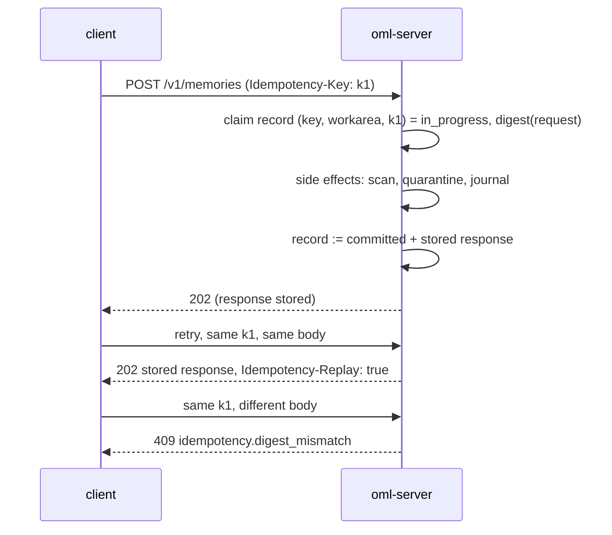

<!--
id: api/http-api
tier: engineering
status: design draft for review · decided, not built
answers: what the two-ring JSON surface commits — /v1 provider and /v2 lab routes, authentication, idempotency records, the pagination convention, and the verb ceiling per endpoint; which events a key sees on the events tail; which records carry a name, what a name may spell, and how a name is accepted and resolved wherever an id is
-->

# HTTP API

**Status:** design draft for review · decided, not built

This page owns decision **D13** as contract: the two-ring JSON surface — the provider ring
(`/v1`) and the lab ring (`/v2`) — authentication, idempotency
records, the pagination convention, and the verb ceiling each endpoint enforces. The
machine-readable form is [openapi.yaml](openapi.yaml) — the two describe the same contract, and a
divergence between them is a documentation bug, not an ambiguity to interpret. Every refusal cited
below is a typed error declared in [errors.md](errors.md). The MCP agent plugin is a stateless
facade over the agent-safe subset of this API ([mcp-plugin.md](mcp-plugin.md)); the `oml` CLI
drives the administrative and review verbs over this same API
([cli/reference.md](../cli/reference.md)) — there is no second surface and no private RPC. The
one-transport posture is deliberate: a second surface would mean a second authentication path, a
second audit story, and a place for the two contracts to drift apart.

Field names and endpoint spellings are design identifiers: normative in shape, adjustable in
spelling at implementation without a design change (the same caveat the
[event catalog](../data/event-catalog.md) carries).

## Two rings

One keyed listener carries two **stability rings**
([ADR-0022](../adr/ADR-0022-two-ring-api.md)); this page remains the one contract document for
both, and `/healthz` and `/readyz` stay unversioned.

- **The provider ring (`/v1`)** is the memory provider foundation: submit (and the reserved
  `POST /v1/memories:batch`, [FR-12](../product/roadmap.md)), read own and promoted, recall,
  supersede, and the attachment upload/fetch flow. **The covenant:** once
  [FR-21](../product/roadmap.md) declares v1 stable, v1 changes are additive only — no field
  removed, no semantic changed, no status code repurposed; anything that would break a v1 client
  is, by definition, a v2 capability. A provider-ring request names no workarea: the target
  resolves from the key's journalled `default_workarea`, with the `X-OML-Workarea` header (a node
  id or [name](#names-and-ids), honored only within the key's grants — plain-passable because it is
  authorization-checked data, never a secret) as the explicit override; a submit, recall or non-own listing from a key
  with neither answers `request.workarea_unresolved` ([errors.md](errors.md)). Get, the own-work
  listing (`own=true`) and supersede never answer it: get and `own=true` resolve no workarea, and
  supersede takes the target's workarea.
- **The lab ring (`/v2`)** is the evolving memory lab: review and ratification ceremonies, claim
  edges, workarea, key and claim administration, bans, simulations, exports, settings, tenants,
  bootstrap, the events tail and vocabularies. It prefers additive change but may re-version to
  `/v3` without ever touching `/v1`. Lab requests keep explicit workarea references — ids or
  [names](#names-and-ids) — in paths and bodies: an administration surface names what it
  administers.

The split is a stability contract, not a trust boundary: the verb ceiling (R1), admission, RLS
and every guarantee in [commitments](../product/commitments.md) apply identically on both rings,
and a `/v1` write is held until review like any write — what `/v1` hides is the machinery, not
the constitution.

## Conventions

| Convention | Rule |
|---|---|
| Base path | Two rings on one listener ([Two rings](#two-rings)): `/v1` the provider ring (covenant-bound once FR-21 closes), `/v2` the lab ring (evolving; may re-version to `/v3` without touching `/v1`). Additive fields are not breaking, and clients must ignore unknown response fields. |
| Content type | `application/json; charset=utf-8`, except attachment part upload (`application/octet-stream`) and the export bundle download. A request body in any other media type answers `415 request.unsupported_media` ([errors.md](errors.md)). Responses are `application/json`; `Accept` is not negotiated in v1. |
| Rate and quota | `429 limit.rate` / `limit.quota` may be answered by any operation; it is declared explicitly only on the v1 ring and high-traffic v2 surfaces ([errors.md](errors.md)). |
| Timestamps | RFC 3339, UTC, e.g. `2026-10-29T14:03:17Z`. |
| Digests | `sha256:<64 hex>`. An attachment is named by the SHA-256 of its plaintext ([storage.md](../architecture/storage.md)). |
| Identifiers | Opaque strings (`artifact_id`, `workarea_id`, `key_id`, `serve_id`, …). Clients never parse them. The ids of workareas, crews, keys and tenants are UUIDs in RFC 9562 hex-and-dash text, so that the server can tell an id from a [name](#names-and-ids). |
| Request id | Every response carries `X-Request-Id`; error bodies repeat it as `request_id`. |
| Deletion | No endpoint is `DELETE`. Every removal is a journalled `POST` act — demote keeps bytes, erase is crypto-shredding (constitution R4; [audit-and-lineage.md](../architecture/audit-and-lineage.md)). |

## Versioning and deprecation

The rings version independently ([Two rings](#two-rings)); this section fixes what *additive*
means, because the v1 covenant is only as strong as that definition.

**Additive** — permitted on a frozen ring without a version change:

- a new endpoint;
- a new **optional** request field (absent means the prior behavior, exactly);
- a new response field — clients must ignore unknown response fields
  ([Conventions](#conventions)), which is what makes this additive;
- a new error code under an existing HTTP status (the taxonomy is closed per release, and a
  client branches on codes it knows — an unknown code under a known status degrades to the
  status's generic handling).

**Not additive for v1, settled exactly this way: extending a response enum.** A client that
matches exhaustively on `state`, `verdict` or any other enumerated response field breaks on a
member it has never seen, so a new enum member is a breaking change on `/v1` — it ships as a
new field, or as a `/v2` capability, never as a quiet widening. Request-side enums may gain
members (a client that never sends the new value never sees a difference).

**The `/v2` evolution process.** The lab ring prefers additive change under the same
definition. Every surface change, additive or breaking, is announced in the release changelog
(no release exists yet — the process binds from the first one). A breaking `/v2` change mints
`/v3`; the retiring ring keeps being served alongside its successor for a stated minimum
overlap window of **one minor release cycle**, and the overlap is announced with the change.
Deprecated endpoints will carry `Deprecation` and `Sunset` headers once implemented — decided,
not built, like everything on this page.

**Freezing v1.** [FR-21](../product/roadmap.md) is the freeze act: a recorded v1-stable
declaration pinning the provider ring at a named revision of [openapi.yaml](openapi.yaml)
(currently `0.3.0-design`), from which moment the covenant — and this section's definition of
additive — is in force.

## Authentication and authorization

Every request on either ring carries `Authorization: Bearer <api-key>`. Only `/healthz` and
`/readyz` are unauthenticated.

- **Tenant is derived server-side from the key, never from the request** (D6;
  [security.md](../architecture/security.md)). No endpoint takes a tenant parameter, with one
  exception: an operator key may name `tenant_id` when creating a tenant's first admin key —
  operator keys are provider-level and have no tenant of their own.
- **Roles do not nest.** A key is issued with one role — `reader`, `writer`, `dreamer`, `admin`,
  `operator` — which names the grant roles it may carry (the
  [admissibility table](../architecture/roles-and-keys.md#grant-admissibility-and-refusal-order));
  each grant confers a role over one workarea subtree
  ([roles-and-keys.md](../architecture/roles-and-keys.md)). Where an endpoint
  below says *requires reader*, it means reader **effective access** on the workarea the request
  names, resolved from grants and denies at call time ([workareas.md](../architecture/workareas.md));
  where it says *requires admin* or *requires operator*, it means the key's role itself, because
  the verb governs tenant- or provider-level objects.
- **The verb ceiling is structural** (constitution R1): no agent-facing role reaches promote, sign,
  demote, delete, or any admin verb, and the refusal is the typed error
  [`access.verb_ceiling`](errors.md) naming the rule. The ceiling per endpoint is stated in
  the [surface table](#the-surface) and repeated per section.
- **Reads fail closed as absence.** A resource outside the key's effective read scope — including
  every simulation row for a key outside that simulation's audience (D10) — answers
  `access.not_found`, indistinguishable from a resource that does not exist. A resource the key can
  see but lacks the verb for answers `access.grant_refused`.
- **One refusal order.** Every workarea-scoped verb resolves its refusal in the fixed four-step
  order declared on
  [roles-and-keys.md](../architecture/roles-and-keys.md#grant-admissibility-and-refusal-order),
  which also names the role each verb needs; this page does not restate it.
- **Every read is logged** (D12): key, role, workarea, the memory ids served, timestamp, and for a
  recall the canonical request digest — in the retention-bounded read log whose batch digests
  anchor into the journal ([retrieval.md](../architecture/retrieval.md#the-read-log)).

Bearer keys are the shipped mechanism; whether and when the MCP facade adopts OAuth 2.1 is open —
[RS-2](../product/roadmap.md). The role vocabulary and key authorization semantics are owned by
[roles-and-keys.md](../architecture/roles-and-keys.md).

## Names and ids

This section is the single declaration site for names
([ADR-0026](../adr/ADR-0026-names-are-keys.md)): which records carry one, what a name may spell,
where a name is accepted in place of an id, and how the server resolves it. Ids stay the binding
everywhere state is kept — grants, denials, journal payloads, idempotency scopes, the read log,
cursors — and a name is only how a caller addresses a row.

**Which records.** Workareas, crews, keys and tenants each carry a `name`, given at creation,
unique in its namespace, never changed (no verb renames a row) and never released: a revoked or
expired key keeps its name, and no other key may take it.

| Kind | Namespace | Named at |
|---|---|---|
| workarea | its tenant, the whole tree | `POST /v2/workareas`; the root is `universe`, created with its tenant ([workareas](../architecture/workareas.md#the-tree-one-universe-per-tenant)) |
| crew | its tenant | `POST /v2/crews` |
| key | its tenant; operator keys share the provider's | `POST /v2/keys`, `POST /v2/keys/{key_id}/rotate` (the successor), `POST /v2/bootstrap/claim` |
| tenant | the deployment | `POST /v2/tenants` |

**The two forms.** An id of these four kinds is RFC 9562 §4 hex-and-dash text: 8-4-4-4-12
hexadecimal digits, either case accepted, lowercase served
([RFC 9562](https://www.rfc-editor.org/rfc/rfc9562.html), fetched 2026-10-30). A name is a
lowercase RFC 1035 label — a letter first, then letters, digits and hyphens, a letter or digit
last, 1–63 characters ([RFC 1035](https://www.rfc-editor.org/rfc/rfc1035.html) §2.3.1, fetched
2026-10-30):

```
^[a-z]([a-z0-9-]{0,61}[a-z0-9])?$
```

— and is neither the hex-and-dash form nor 32 hexadecimal digits, so that no name ever looks like
an id. That is the **reference grammar**, which every field that names a row checks. A creation
checks the **creation grammar**, which also refuses the derived form: `tenant-`, `wa-`, `crew-` or
`key-` followed by 32 hexadecimal digits, which only rows created before names hold
([below](#rows-created-before-names)). A derived name is therefore a name in a reference and
`request.validation` in a creation body. There is no normalization and no case mapping: every
allowed character is ASCII, and names compare byte for byte. `Metals-Crew` is refused, never read
as `metals-crew`.

**Where a name is accepted.** Every request field, path parameter, query parameter and header
that names one of the four kinds takes its id or its name. Field names do not change: a request
field called `workarea_id` takes either, a response field called `workarea_id` always carries the
id, and each object of the four kinds carries its `name`.

| Kind | Accepted in |
|---|---|
| workarea | `X-OML-Workarea`; the `{id}` of every `/v2/workareas/{id}` route; `workarea_id` on `GET /v1/memories`, `GET /v2/events`, `GET /v2/claim-edges` and `GET /v2/vocab/suggest`; `workarea` on `GET /v2/review/queue`, on `POST /v2/review/next` and on `GET /v2/keys/{key_id}/effective-access`; `parent_id` on create, `new_parent_id` on re-parent, `to_workarea_id` on an edge proposal, `workarea_id` on reassign and tip-override; a grant's `workarea_node_id` and its denies' `subtree_node_id`, a denial's `workarea_node_id`, and `default_workarea_id` on issuance |
| crew | the `{crew_id}` of every `/v2/crews/{crew_id}` route; `crew` on workarea create, on `POST /v2/workareas/{id}/crew` and on issuance |
| key | the `{key_id}` of every `/v2/keys/{key_id}` route; `key_id` in a simulation audience entry |
| tenant | `tenant_id` on an operator key's issuance |

The MCP tools pass their workarea arguments through to these fields
([agent plugin](mcp-plugin.md)), and every CLI argument that names one of the four kinds takes
either form ([CLI](../cli/reference.md#conventions)). Neither resolves anything itself.

**Classification and resolution.** Two steps, on the server:

1. **At parse**, before any check that consults state, each value is classified: in the id form,
   it is an id; otherwise, if it matches the reference grammar, a name, a derived name included;
   otherwise the request is refused with `request.validation`, `details.field` naming the field.
   A derived path
   (`universe.procurement`) contains `.`, so it is neither: paths are served and looked up, never
   accepted as a reference, and `GET /v2/workareas?path=` is the lookup by path.
2. **After the verb ceiling**, which needs no row — step 1 of the
   [refusal order](../architecture/roles-and-keys.md#grant-admissibility-and-refusal-order), or
   the key-role check of an admin or operator verb — each name is replaced by the id of the row
   that holds it in the caller's namespace, or, when no row holds it, by its **unresolved
   value**: unique to that kind and name in that namespace, matching no row, never the nil scope
   value of a lab record, and never shared with another name or with any id. The request then
   runs exactly as the same request by id runs.

The namespace is fixed by the caller and the kind:

- A tenant's key, of any role, resolves every name in its tenant.
- An operator key resolves a tenant name in the deployment, and a key name in the provider's
  namespace, which holds operator keys only, so a key name an operator sends never resolves to a
  tenant's key.
- On an operator key's `POST /v2/keys`, `tenant_id` resolves first, in the deployment; the new
  key's `name`, which `name.taken` checks, and every grant node, deny node, `default_workarea_id`
  and `crew` then resolve in that tenant.
- The bootstrap claim's `name` is in the provider's namespace.

Names therefore add no refusal path. An unknown name and a name outside the key's access both
answer `access.not_found`, at the same step and with the same body as the id would, and no
refusal names the id a name resolved to unless it would name that id for a request that sent it.
Resolution never confirms that a name exists: a lookup by a name the key may not see answers
`access.not_found`. The derived paths and parent ids of the nodes a key can read still disclose
the names and ids of their ancestors, and a re-parented node's former parent, as
[ADR-0025](../adr/ADR-0025-the-agent-only-memory-surface.md) d3's naming rule states
([own](../architecture/roles-and-keys.md#own)).

**Refusals.** A value that is neither form is `request.validation`. An unknown or unreadable name
is `access.not_found`. A creation whose name its kind already holds in the namespace — a revoked
key's included, and `universe` for any workarea but the root — is `409 name.taken`, `details`
`{kind, name}` ([errors](errors.md)): it is checked after every other check of the creating
request, the unique index is its authority, and a creation that loses the race to a concurrent one
answers it and journals nothing. Only admin and operator keys hold a creating verb, and they see
every row of their namespace; the bootstrap claim's caller holds a valid enrollment token, checked
before its `name` ([below](#keys-grants-denials)). Only an admin or operator key, or the holder of
a valid enrollment token at the bootstrap claim, therefore receives `name.taken`, and no agent key
ever learns that a name is taken.

**Idempotency.** Path parameters and body fields are digested as sent
([Idempotency](#idempotency)), so a `/v2` request that names a row in a path or a body and the
same request by its id are two requests: reusing one `Idempotency-Key` for the other is
`idempotency.digest_mismatch`. `X-OML-Workarea` is not in the digest, and the provider ring's
record scope holds the resolved node id, so a `/v1` request whose header names the node and the
same request whose header carries its id are one request, and the second replays. On `/v1` the
header is resolved after step 1 of the refusal order and before the record is looked up; an
unresolved header puts its unresolved value in the scope, so every unknown name has a scope of its
own, as every unknown id does.

**Paths.** A workarea's derived path is the names from `universe` to the node joined with `.`
([workareas](../architecture/workareas.md#grants-bind-to-node-ids-paths-are-derived)); its last
segment is the node's name, which the workarea read serves as a child's `path_leaf`. A re-parent
changes a path and never a name.

### Rows created before names

At its first start on the schema version that adds names, and before it serves a request, the
lead names every row that has no name, in four rules, and journals the result:

1. Each tenant's root workarea is named `universe`, whatever its `workarea.create` says.
2. For each kind and namespace, in journal order of creation, a row whose creation event carries
   a name the creation grammar admits, that is not `universe` for a non-root workarea and that no
   earlier row of its kind holds, keeps it.
3. Every other row — one with no name, every key before ADR-0026 among them; one whose name the
   creation grammar refuses; one whose name an earlier row holds — is named `<prefix>-<32
   lowercase hex digits of its id>`, the prefix `tenant`, `wa`, `crew` or `key`. Ids are unique
   and the creation grammar refuses this form, so a derived name collides with nothing.
4. Each workarea's current crew object — the latest of its `workarea.create` and
   `workarea.crew_updated` — is read in journal order; each distinct `{name, charter_uri,
   external_manager}` becomes one crew record with a fresh id, named by rules 2 and 3 in order of
   first appearance, and each workarea with that object points at it. Keys that predate names
   have no crew.

One `system.names_assigned` event per chain that has anything to assign — each tenant's chain,
and the provider chain for tenant and operator-key names — lists every row of the chain that
predates names, those rule 2 keeps included (with `name` equal to `prior_name`), and every crew
record it creates ([event catalog](../data/event-catalog.md)). The fold takes every such row's
name from this event alone, never from a creation event. Every earlier event stays as it was
signed. The schema steps around the event — the `name` columns added nullable, filled by the
fold, then made `NOT NULL` — are on [PostgreSQL schema](../data/postgres-schema.md#names-and-tenants).
An admin who wants a chosen name on a key named by rule 3 issues a new key under that name and
revokes the old one; the derived name stays on the old key, and still addresses it.

## Idempotency

Every state-creating `POST` requires an `Idempotency-Key` header (missing →
`request.idempotency_key_required`). Read-shaped `POST`s — `recall`, `settings/validate` — do not
take one, and attachment part `PUT`s need none: a part is addressed by `(session, part_number)`
and verified by digest at completion, so replaying a part is harmless.

The semantics are D13's **idempotency record**: `(key_id, workarea, idem_key) → request digest +
state + stored response`, claimed in its own transaction **before any side effect** (the row lives
in Postgres; [postgres-schema.md](../data/postgres-schema.md)). On the provider ring the
workarea component is the **resolved** target — the key's `default_workarea` or the
`X-OML-Workarea` override (ADR-0022 d4), never a body field. For supersede, and for lab
endpoints that name no workarea (keys, bans, simulations, exports, settings, tenants), the
workarea component of the scope is a fixed nil value, so no supersede target's workarea ever
enters a record ([ADR-0025](../adr/ADR-0025-the-agent-only-memory-surface.md) d10).

A supersede record is looked up after step 1 of the
[supersede rule](../architecture/roles-and-keys.md#grant-admissibility-and-refusal-order) and
before step 2, and the replay table below answers from it whatever the target's state or the
key's access now: a retry of a committed supersession replays its stored response even after
the target was erased or reassigned, or the key lost its reader grant, because that response
names only the caller's own successor and discloses nothing new. With no record, step 2 runs,
and the record is claimed only after it passes, so a refusal at step 1 or 2 claims no record.

The request digest is SHA-256 over the RFC 8785 JSON of `{method, route, path_params, body}`:
the HTTP method, the route template (`/v1/memories/{artifact_id}/supersede`, say), the path
parameters by name, and the parsed request body (`null` when there is none). Two requests to
different targets therefore never share a digest, whatever their bodies. Path parameters and body
fields are digested as sent, before any [name](#names-and-ids) is resolved, so a request that
names a row in a path or a body and the same request by its id have different digests. Headers
are not digested: `X-OML-Workarea` enters the record only through the provider ring's resolved
workarea component, so the header by name and by id is one request.



| Case | Answer |
|---|---|
| First request | Processed; response stored against the record. |
| Replay, same request digest, record `committed` | The stored response, byte for byte, with header `Idempotency-Replay: true`. A replayed submit does not create a second version. |
| Replay while the record is `in_progress` | `409 idempotency.in_progress`, retryable, with `Retry-After`. The first attempt is still running — crashed attempts leave `in_progress` records that expire. |
| Same key, different request digest | `409 idempotency.digest_mismatch`. The key names exactly one request; reusing it for another is refused, never silently honored. |

A `committed` record is retained for at least **24 hours** — a committed floor, not an
estimate. The `idempotency.retention` setting
([configuration](../operations/configuration.md)) may only **raise** that floor, never lower
it. When retention expires the record is gone, and a later retry with the same key is
processed as a fresh request — expiry-then-reprocess is documented behavior, not an anomaly.
A client whose retry horizon can exceed the deployment's retention must treat a retry past it
as possibly-second work; retry loops belong inside the window.

## Pagination

List endpoints share one convention:

- Request: `limit` (1–200, default 50 — the ceiling is the `api.page_limit_max` setting,
  [Limits](#limits)) and `cursor` (opaque, from the previous page; absent for the first page).
- Response: `{"items": [...], "next_cursor": "..."}` — `next_cursor` is `null` when the listing is
  exhausted. Cursors are scoped to the key that obtained them and expire; a stale cursor answers
  `request.validation`.
- **Ordering** is `created_at` **descending** — newest first — on every list endpoint, so the
  first page is the most recent work. The one exception is below.
- **Cursors are positional, not snapshots.** A cursor marks a position in the live ordering;
  it freezes nothing. An item promoted, demoted or reassigned between pages may appear on a
  later page or vanish from one, and two walks of the same listing can disagree about rows that
  changed in between. A consumer that needs a consistent, replayable view reads the
  [events tail](#events-tail) instead — that is what the journal is for.
- Cursor lifetime is the `api.cursor_ttl` setting
  ([configuration](../operations/configuration.md)); an expired cursor answers
  `request.validation`, never a silent restart from page one.

One deliberate exception: the [events tail](#events-tail) paginates by `after_seq` and is
ordered `seq` **ascending**, because the per-tenant journal sequence is meaningful to clients
and is the resume point a consumer stores.

## The surface

Grouped by ring ([Two rings](#two-rings)). **The provider ring (`/v1`)** — submit, recall, the
listing without `own` and supersede take the `X-OML-Workarea` override header, which supersede
accepts only when it names the target's workarea; get and the own-work listing (`own=true`)
refuse it with `request.validation`. Get, the own-work listing and supersede never answer
`request.workarea_unresolved`: get and `own=true` resolve no workarea, and supersede takes the
target's workarea. The reserved `POST /v1/memories:batch` ([FR-12](../product/roadmap.md)) will
join this table:

| Endpoint | Verb ceiling (effective access unless noted) |
|---|---|
| `POST /v1/memories` | writer — and every `derives_from` ancestor readable by the key; lineage is attribution, not an act of connection |
| `POST /v1/memories/recall` | reader |
| `GET /v1/memories` | reader; `own=true` admits any tenant role, own rows only |
| `GET /v1/memories/{artifact_id}` | reader; the calling key fetches its own rows in any state |
| `POST /v1/memories/{artifact_id}/supersede` | writer (own claims) or dreamer(propose); includes retirement |
| `POST /v1/attachments/uploads` | writer |
| `PUT /v1/attachments/uploads/{session_id}/parts/{part_number}` | writer (session owner) |
| `POST /v1/attachments/uploads/{session_id}/complete` | writer (session owner) |
| `GET /v1/attachments/{digest}` | reader; reviewer under a valid `serve_id`; the author for own held |

**The lab ring (`/v2`):**

| Endpoint | Verb ceiling (effective access unless noted) |
|---|---|
| `GET /v2/memories/{artifact_id}/lineage` | reader |
| `GET /v2/claim-edges` | reader |
| `POST /v2/claim-edges` | dreamer(propose) |
| `POST /v2/claim-edges/{edge_id}/ratify` | dreamer(review); never the proposer (R2) |
| `GET /v2/workareas` · `GET /v2/workareas/{id}` · `/tree` · `/edges` · `/status` | reader; or admin (key role), structure only and tenant-wide ([admin structure reads](../architecture/roles-and-keys.md#permission-matrix)) |
| `POST /v2/workareas` | admin (key role) |
| `POST /v2/workareas/{id}/reparent` | admin (key role) |
| `POST /v2/workareas/{id}/crew` | admin (key role) |
| `GET /v2/crews` · `GET /v2/crews/{crew_id}` · `POST /v2/crews` · `POST /v2/crews/{crew_id}/update` | admin (key role) |
| `POST /v2/workareas/{id}/edges` | dreamer(propose) on ≥1 endpoint, reader on both (edge-authority rule, [workareas.md](../architecture/workareas.md)) |
| `POST /v2/workarea-edges/{edge_id}/ratify` | dreamer(review) on both endpoints; never the proposer |
| `POST /v2/workareas/{id}/transitions` | dreamer or admin |
| `POST /v2/workareas/{id}/transitions/{transition_id}/ratify` | a second, non-proposing dreamer or admin |
| `GET /v2/events` | reader |
| `GET /v2/vocab/suggest` · `GET /v2/vocab/terms/{curie}` · `GET /v2/vocab/terms/{curie}/hierarchy` · `GET /v2/vocab/mappings` | reader |
| `GET /v2/review/queue` · `POST /v2/review/next` · `POST /v2/review/verdicts` · `POST /v2/review/reopen` | dreamer(review); refused per row by lineage-closure exclusion |
| `POST /v2/keys` and every key, grant, denial verb | admin (key role); operator only for a tenant's first admin key |
| `GET /v2/bans` · `POST /v2/bans` · `POST /v2/bans/{ban_id}/lift` | admin (key role) |
| `GET /v2/simulations` · `GET /v2/simulations/{id}` · `POST /v2/simulations` · `POST /v2/simulations/{id}/audience` · `POST /v2/simulations/{id}/end` | admin (key role) |
| `POST /v2/memories/{artifact_id}/reassign` · `/demote` · `/erase`, `POST /v2/claims/tip-override` | admin (key role) |
| `POST /v2/exports` · `GET /v2/exports` · `GET /v2/exports/{export_id}` · `/bundle` | admin (key role) |
| `GET /v2/settings` · `POST /v2/settings/validate` · `POST /v2/settings/apply` | admin (key role) |
| `POST /v2/tenants` | operator (key role) |
| `POST /v2/bootstrap/claim` | single-use enrollment token (bootstrap ceremony only) |

A `held_by: service` key is refused every review-class verb above — the review endpoints,
claim-edge ratify and workarea-edge ratify — and status-transition ratify, with
`access.verb_ceiling` before any lookup, whatever its grants
([roles and keys](../architecture/roles-and-keys.md#grant-admissibility-and-refusal-order)).

`GET /healthz` · `GET /readyz` are unversioned and unauthenticated ([Health](#health)).

Promote, sign and delete appear nowhere in these tables on purpose: promotion is an effect of
ratification inside the admission pipeline, signing is `oml-server`'s alone, and deletion does not
exist (R1, R4).

## Memories

### Submit — `POST /v1/memories`

One endpoint for the two submission verbs; `verb` selects the journal event
(`submission.remember` / `submission.learn`, [event catalog](../data/event-catalog.md)). The
request names no workarea — the target resolves from the token
([Two rings](#two-rings), ADR-0022 d4): the key's journalled `default_workarea`, or the
`X-OML-Workarea` header as the explicit per-request override, honored only within the key's
grants. A key with neither is refused with `request.workarea_unresolved` (422).

```json
{
  "verb": "remember",
  "claim_key": "deploy-runbook",
  "kind": "memory",
  "body": "The canary stage must drain before …",
  "attachments": ["sha256:9c1e…"],
  "derives_from": [],
  "simulation_id": null,
  "simulated_time": null
}
```

- `verb: "learn"` asserts a derived claim: `derives_from` must be non-empty, and an empty or
  omitted `derives_from` is refused (`submission.lineage_required`) — on every surface that fronts
  this verb, the MCP plugin's `oml_learn` included. A derived conclusion whose author cannot or
  will not name lineage is submitted as `verb: "remember"` with `kind: derived_fact` (journalled
  `submission.remember`), where the honesty rule carries the caveat: an undeclared derivation is
  undetectable by the service — the lineage closure is as good as what writers declare
  (the constitution's honesty rule, [ADR-0001](../adr/ADR-0001-the-constitution.md), stated
  plainly on [admission.md](../architecture/admission.md)).
- Submitting with `derives_from` requires writer effective access on the target and no other
  role, even when the lineage names another author's claim — declaring an ancestor is
  attribution, not an edit of it. Every `derives_from` ancestor must still be readable by the
  key — promoted within its reader effective access, or its own row in any state — else
  `access.not_found`, indistinguishable from a nonexistent id
  ([ADR-0025](../adr/ADR-0025-the-agent-only-memory-surface.md) d3).
  The declaration has review consequences, not authorization ones: every named ancestor expands
  the row's reviewer-exclusion set (R2 over the lineage closure), and a false lineage is grounds
  for rejection at review ([ADR-0012](../adr/ADR-0012-admission-and-review.md)).
- When a new claim's `claim_key` collides with an existing version of it
  (`submission.claim_key_conflict`) is declared in
  [audit-and-lineage.md](../architecture/audit-and-lineage.md#supersession-chains-claim_key-and-the-tip).
- `kind` ∈ `memory` | `derived_fact` | `steering` | `term` | `term_mapping` | `vocab_release`. A
  steering row is held and reviewed like any claim and is never ranked at recall (D12). The three
  vocabulary kinds ride this same endpoint and pipeline — proposing a term, a mapping or a release
  pin is an ordinary submission into a vocabulary workarea
  ([Vocabularies](#vocabularies) below) — and a vocabulary workarea refuses
  `provenance: simulation` submissions of these kinds (deterministic scan-class veto): a demoted
  simulation row must never squat a permanent CURIE.
- Every attachment digest must name a **completed** upload session owned by this key, or the
  submit is refused (`submission.attachment_missing`).
- A `derives_from` that touches a simulation row forces `simulation_id` to that row's simulation
  (`submission.simulation_id_required` otherwise); writing with a `simulation_id` requires the key
  to be in that simulation's audience ([simulations.md](../architecture/simulations.md)).
- `universe` refuses direct claim writes (`submission.universe_refused`); a `validated` workarea
  refuses all new writes (`workarea.frozen`).
- The deterministic scan runs in the same call and can veto (`submission.scan_veto` — a refusal
  that journals nothing, reproducible from the journalled rule-set pin; nothing waits in the
  queue; [admission.md](../architecture/admission.md)). Banned authors and sources are refused at this
  same admission check (`access.banned`).

Success is `202 Accepted` — **held, visible to no one else until ratified** (R3):

```json
{
  "artifact_id": "art_01J…",
  "claim_key": "deploy-runbook",
  "version": 3,
  "state": "held",
  "plaintext_digest": "sha256:ab12…",
  "scan": {"result": "pass", "scanner_version": "…"},
  "journal_seq": 4182
}
```

### Recall — `POST /v1/memories/recall`

Ranked retrieval over **promoted** rows in scope: FTS + vector, served from Postgres, never from
the lake (D12; [retrieval.md](../architecture/retrieval.md)). The request names no workarea: the
default scope is the **token workarea's subtree** — the key's `default_workarea`, or the
`X-OML-Workarea` header as the override (within grants; neither present answers
`request.workarea_unresolved` — there is no tenant-wide fallback). Request: `query`, `k`,
optional `kinds` filter (hits only), `include_bodies`, and:

- `include_own_held` (default `false`) — the calling key's own held rows that match join the
  hits, ranked in the same order with `state: held`
  ([retrieval.md — own held rows in recall](../architecture/retrieval.md#own-held-rows-in-recall)).
- `max_tokens` — a budget in budget tokens; steering is never cut, and the hits served are the
  longest rank prefix that fits. Refused with `include_bodies: false`
  ([retrieval.md — token budgets](../architecture/retrieval.md#token-budgets)).

The body refuses unknown fields (`request.validation`), and so does an empty `kinds` or `terms`
array: an absent filter narrows nothing, and a sent one names at least one value. Two optional
vocabulary fields complete it; a server that does not yet serve them refuses them by name, never
ignores them:

- `terms` — CURIEs; filters to rows whose `terms` annotation cites any of them. A CURIE the key
  cannot read matches nothing (fail closed, as `derives_from` does).
- `expand_terms` ∈ `none` (default) | `descendants` — widens the `terms` filter before retrieval:
  each CURIE expands to its `is_a` descendants, resolved **per CURIE against the release pinned by
  the vocabulary that owns the expanded prefix** (a per-release closure lookup,
  [Vocabularies](#vocabularies)). Expansion changes the filter, never the ranking: steering order
  and `k` are untouched.

The `kinds` filter deliberately excludes the vocabulary kinds — term, mapping and release rows are
excluded from the shared recall indexes by default; where a vocabulary workarea's journalled
policy opts them in, they are hits of a recall that omits `kinds`
([retrieval.md](../architecture/retrieval.md#the-recall-ordering-contract-steering-rows-first-unranked),
ADR-0021). Response separates what is ranked from what is not:

```json
{
  "steering": [ {"artifact_id": "…", "kind": "steering", "tokens": 120, "body": "…"} ],
  "hits": [ {"memory": {"artifact_id": "…", "claim_key": "…", "version": 4, "tip": true, "state": "promoted", "tokens": 300, "body": "…"}, "score": 0.83} ],
  "budget": {"max_tokens": 500, "counter": "oml-tc/1", "steering_tokens": 120, "used_tokens": 420,
             "truncated": true, "hits_omitted": 2, "next_hit_tokens": 250},
  "query_digest": "sha256:…"
}
```

Steering rows precede hits and carry no score — the recall-ordering contract: the gate changes
visibility, not ranking (R3/D12). Which steering applies, the total order of hits and the budget
cut are declared on [retrieval.md](../architecture/retrieval.md#the-recall-ordering-contract-steering-rows-first-unranked);
every served row carries `tokens`, and `budget` is present if and only if `max_tokens` was sent.
The read is logged with the ids served after truncation and the canonical request digest
([retrieval.md](../architecture/retrieval.md#the-read-log)). Recall quality and latency are
unmeasured — [FR-4](../product/roadmap.md).

### Search — `GET /v1/memories`

Structured listing, paginated. Filters: `workarea_id` (a subtree filter), `claim_key`, `state`,
`kind`, `since`, `until`, `own`. Returns memory summaries (no bodies), each carrying `tokens`,
`retirement`, `replaces` and `held_expires_at`. With `own=true` the listing is the **own-work
status** read: any tenant role except operator lists every row the calling key authored
([own](../architecture/roles-and-keys.md#own)), in every state — held, promoted, demoted,
rejected — across all workareas minus its globally denied subtrees, with no grant needed; an
operator key answers `access.verb_ceiling`. It resolves no workarea, and an `X-OML-Workarea`
header sent with `own=true` is `request.validation`. An own row
on a node where the key holds no role carries `workarea_id` and `workarea_path` as null
([naming a node](../architecture/roles-and-keys.md#own)). Without `own`, scope defaults to the
token workarea's subtree, with `X-OML-Workarea` as the override, and the listing returns promoted
served tips within reader effective access only — a `self_signed` version only when the scope
node is its own workarea ([retrieval](../architecture/retrieval.md#the-rule-postgres-serves-the-lake-never-does)):
held rows belonging to others are never returned, whatever the filter says (R3).

`workarea_id` must name a node the key may be told about, else `access.not_found`,
indistinguishable from a node that does not exist, so the filter never confirms that a node
exists ([ADR-0025](../adr/ADR-0025-the-agent-only-memory-surface.md) d13). With `own=true` that
is a node the key holds some role on, under the
[naming rule](../architecture/roles-and-keys.md#own), and the filter narrows the listing to the
key's rows in that node's subtree, whatever the key holds below it. Without `own` it is a node
where reader is effective, and the listing is the intersection of its subtree with the scope's:
the scope still resolves from the token, so a key with neither a default workarea nor the header
answers `request.workarea_unresolved` whatever `workarea_id` says.

A retired claim's served tip is its retirement version,
so the listing includes it, flagged `retirement: true`; recall, by contrast, serves nothing of a
retired claim. Ordering is `created_at` descending, then `artifact_id` descending; the cursor is
an opaque position bound to the calling key and expiring under `api.cursor_ttl`, and every page
re-applies the filters ([Pagination](#pagination)). On every listing, as on get and recall,
`derives_from` lists only the ancestors the caller can read ([Get](#get-get-v1memoriesartifact_id)).

### Get — `GET /v1/memories/{artifact_id}`

One memory with its body (decrypted on the serving path only), its `tokens` and attachment
descriptors. The calling key may fetch its own rows in any state, with no grant needed (global
denials still mask, [own](../architecture/roles-and-keys.md#own)); anyone else needs reader
effective access on the row's workarea and sees promoted versions only — superseded versions and
every version of a retired claim stay fetchable as history. Get takes the row's own workarea as
its implicit scope, so a non-own `self_signed` version is served to a key with reader effective
access there ([retrieval](../architecture/retrieval.md#the-rule-postgres-serves-the-lake-never-does)).
Anything else answers `access.not_found`. An erased artifact answers `410 lifecycle.erased` —
attribution and journal trail remain, bytes do not (D4) — but only to a key that could read the
version immediately before its erasure: its author's key set, or, when the version was promoted
then, a key with reader effective access on its workarea. Readability is checked first, and
every other key gets `access.not_found`, so the erasure of another author's held version tells
no one it existed ([errors](errors.md)). Get resolves no workarea, so an `X-OML-Workarea`
header sent with it is `request.validation`. An own row on a node where the key holds no role
carries `workarea_id` and `workarea_path` as null
([naming a node](../architecture/roles-and-keys.md#own)).

`derives_from` lists only the ancestors the caller can read — its own rows in any state, and
promoted rows within its reader effective access — on get, recall and every listing alike, and
`replaces` obeys the same readability test on every read: it is null when the caller cannot
read the replaced version, as after an admin moves that version into another workarea or back
into held ([ADR-0025](../adr/ADR-0025-the-agent-only-memory-surface.md) d3). A promoted
descendant can derive from its author's held row, and its readers never learn that row's id
from either field. The [lineage read](#lineage-get-v2memoriesartifact_idlineage) does name it:
the full closure appears there, with every node outside the caller's read scope elided to a
redacted bare id, so a reader learns that an unreadable ancestor exists and its id, never its
content — a stated residual, [FR-31](../product/roadmap.md).

### Lineage — `GET /v2/memories/{artifact_id}/lineage`

The derivation closure over `derives_from` and claim edges, **pending and ratified both**,
serialized as stored — the server serializes the graph, it does not compute analytics over it
(D13: serialize, don't compute). Nodes outside the key's read scope are elided to bare ids with
`redacted: true`, so the shape of the closure is visible without leaking content. A redacted
node still discloses that the version exists and its id — another author's held or rejected
ancestor of a promoted version included — which is the residual
[FR-31](../product/roadmap.md) tracks.

### Supersede — `POST /v1/memories/{artifact_id}/supersede`

Proposes a replacement for the version `{artifact_id}` names: a new attributed submission of the
same `claim_key`, held like any write, whose `derives_from` includes the target and whose response
names it in `replaces`. Who may propose — a writer key on a target version it authored, a dreamer
key through edit-as-proposal (D9) — is the supersede rule declared on
[roles and keys](../architecture/roles-and-keys.md#grant-admissibility-and-refusal-order), and
R2 keeps every proposer off the review. The target must be the current served tip, else
`submission.tip_conflict` with `details.current_tip` when the caller can read it; a held version
cannot be superseded ([RS-17](../product/roadmap.md)).

The tip moves only at ratification, by compare-and-set;
[audit-and-lineage](../architecture/audit-and-lineage.md#supersession-chains-claim_key-and-the-tip)
owns the tip, version-ordinal, competing-successor, kind-change, retirement and retired-claim
rules. The scope is the target's workarea: an `X-OML-Workarea` that differs from it is
`request.validation`. Every refusal that depends on the target — that header, the tip, the kind
and retirement checks, `workarea.frozen` — is answered only after the target is known to be
readable, in the order step 5 of the supersede rule fixes, so none of them tells a caller that an
unreadable target exists. `Idempotency-Key` is required and honoured, scoped to the key with a
nil workarea; the record is looked up between steps 1 and 2 of that rule, so a committed
supersession always replays, and claimed only after step 2 passes
([Idempotency](#idempotency)). The body refuses unknown fields and carries `simulation_id`,
`simulated_time` and `mapping` as the submit body does. Of the target's fields only `kind` carries
over: an omitted `kind` makes the successor take the target's, and an omitted `attachments` or
`terms` leaves the successor with none — nothing else is inherited from the target.

**Retirement.** The same call with `retirement: true` proposes retiring the claim, open to the
same keys as any supersession ([ADR-0025](../adr/ADR-0025-the-agent-only-memory-surface.md)
d11). `body` is required and states why; it is scanned, normalized, bounded and digested like
any body, and it is what the reviewer judges. Its refusals are [errors](errors.md)'
`request.validation` and `workarea.frozen` rows; what a retired claim serves is declared on
[audit-and-lineage](../architecture/audit-and-lineage.md#supersession-chains-claim_key-and-the-tip).

## Attachments

Resumable upload sessions, then content-addressed fetch (D3;
[storage.md](../architecture/storage.md)).

| Step | Endpoint | Notes |
|---|---|---|
| Create session | `POST /v1/attachments/uploads` | `{expected_digest, size_bytes, media_type}` → `201` session. The expected digest is recorded up front; the session is scoped to the uploading key and expires. |
| Upload part | `PUT /v1/attachments/uploads/{session_id}/parts/{part_number}` | Raw bytes, `application/octet-stream` → `204`. A retry re-puts the part; a lost session restarts (`upload.session_invalid` names which). |
| Complete | `POST /v1/attachments/uploads/{session_id}/complete` | Assembles, hashes, compares: `upload.digest_mismatch` when the bytes are not what the session promised; `200` with `{digest, ciphertext_digest, state: "complete"}` otherwise. |
| Fetch | `GET /v1/attachments/{digest}` | Bytes, decrypted on the serving path, plaintext digest verified before serving. Admits: reader effective access to a promoted claim binding the digest; the author of a held claim binding it; a reviewer under a valid `serve_id` query parameter. Logged as a read. |

A completed upload is inert until a submission binds its digest into a signed envelope; the claim
and its files are then one reviewed unit — a reviewer is served every attachment before a verdict
counts (D3).

### Fetch semantics

`GET /v1/attachments/{digest}` serves the whole object, once per fetch:

- `Content-Type` echoes the `media_type` recorded at session creation — the service stores it,
  it does not sniff bytes at serve time.
- `Content-Length` is the **plaintext** size: the served bytes are decrypted and digest-verified
  plaintext, so the length a client sees is `size_bytes` as declared at the session, never the
  ciphertext size.
- **`Range` requests are not supported in v1.** A `Range` header is ignored and the full object
  is served with `200`, never `206`. The cost is stated rather than hidden: an interrupted fetch
  restarts from byte zero, which at the attachment bound ([Limits](#limits)) means re-moving up
  to 64 MiB — tracked as [FR-29](../product/roadmap.md).

The export bundle download (`GET /v2/exports/{export_id}/bundle`,
[Evidence export](#evidence-export)) has the same fetch semantics: whole object, no
`Range`/`206`, `Content-Length` is the bundle size.

## Workareas

Reads require reader effective access on the node, and nodes outside scope are absent
(`access.not_found`) — or the admin key role, which reads the structure of every workarea in its
tenant without grants and never claim content
([admin structure reads](../architecture/roles-and-keys.md#permission-matrix), footnote 6). The algebra — tree, universe, grants, denies — is owned by
[workareas.md](../architecture/workareas.md); this page only carries the verbs.

| Endpoint | Returns / does |
|---|---|
| `GET /v2/workareas?path=<ltree>` | Resolve a node by derived path. Grants bind to node ids, never paths, and no reference field accepts a path ([names](#names-and-ids)); this is the lookup that bridges the two. |
| `GET /v2/workareas/{id}` | Node: id, name, parent, derived path, status, crew record (`{crew_id, name, charter_uri, external_manager}`, or null) — and, relative to the calling key, its readable immediate `children` (`[{id, path_leaf, status}]`, ordered by `path_leaf` ascending in byte order, then `id`), the `edges` touching it (`[{edge_id, from, to, label, state}]`, ordered by `edge_id` ascending), `my_effective_verbs` (the [effective-verbs table](../architecture/roles-and-keys.md#effective-verbs)) and `permission_epoch` ([workareas.md](../architecture/workareas.md#grants-bind-to-node-ids-paths-are-derived)), in one call. Children and edges outside read access are absent. For an admin key, which reads structure by its key role, every child and edge is present and `my_effective_verbs` is empty, since it lists grant-role verbs and an admin key holds none. |
| `GET /v2/workareas/{id}/tree` | The subtree, paginated; nodes outside read scope are omitted. |
| `GET /v2/workareas/{id}/edges` | Labelled `related` edges touching the node, `pending` and `ratified`, with proposer and ratifier. Edges confer zero access. |
| `GET /v2/workareas/{id}/status` | Status, the review policy object in force, pending transitions. |
| `POST /v2/workareas` | **admin.** Create a child in `development`: `{parent_id, name, crew?, prefix?}` — `name` unique in the tenant (`name.taken`), `crew` an existing [crew](#crews)'s id or name; a `crew` that names no crew record of the tenant answers `access.not_found`, checked after the parent and before `name.taken`. A `prefix` registers the node as a vocabulary workarea — tenant-unique and **permanent** (`vocab.prefix_conflict` on collision), and requires `crew` (a vocabulary needs a named curator crew, [ADR-0021](../adr/ADR-0021-ai-human-ontologies.md)). Refused under a `validated` parent (`workarea.frozen`). |
| `POST /v2/workareas/{id}/reparent` | **admin.** `{new_parent_id, dry_run}` — journalled single-transaction descendant path rewrite; `dry_run: true` returns the paths and grants affected without journalling. Re-parenting into a `validated` destination is refused (`workarea.frozen`). |
| `POST /v2/workareas/{id}/crew` | **admin.** Journalled crew-metadata update: `{crew}` points the workarea at another [crew](#crews) record, by id or name (`workarea.crew_updated`); a `crew` that names no crew record of the tenant answers `access.not_found`, checked after the workarea. Allowed on `validated` areas — freeze covers claims and promotions, not metadata. |
| `POST /v2/workareas/{id}/edges` | Propose an edge `{to_workarea_id, label}`, label ∈ `relates_to` \| `continues` \| `derived_from` \| `mirrors`. Requires dreamer(propose) effective access on at least one endpoint and reader effective access on both (an admin who must act here holds a separate dreamer key — a key never combines admin with dreamer grants, `access.role_exclusive`). → `202`, pending. |
| `POST /v2/workarea-edges/{edge_id}/ratify` | Ratify under dreamer(review) effective access on **both** endpoints; the proposer is refused (`review.ratifier_is_proposer`, R2 extends to edges). |
| `POST /v2/workareas/{id}/transitions` | Propose a forward status transition `{to: "committed" \| "validated"}`. Backward does not exist; `validated` is refused while any child is not validated (`workarea.transition_refused`). → `202`, pending. |
| `POST /v2/workareas/{id}/transitions/{transition_id}/ratify` | A second, non-proposing dreamer or admin ratifies; journalled with the policy snapshot ([workareas.md](../architecture/workareas.md) transition matrix). |

## Crews

A crew is a named record of an externally operated AI crew — `{crew_id, name, charter_uri,
external_manager}` — recorded, not operated; a workarea names at most one, and a key may name one
at issuance. The record and its relations are declared on
[workareas](../architecture/workareas.md#crews-recorded-not-operated). Admin key role throughout;
no agent role reaches these verbs, and no MCP tool fronts them (R1). A key that can read a
workarea sees that workarea's crew record in the [workarea read](#workareas), and no other crew.

| Endpoint | Does |
|---|---|
| `POST /v2/crews` | Create: `{name, charter_uri?, external_manager?}` → `201` with the record. `name` is unique in the tenant (`name.taken`) and never changes. Journalled `crew.created`. |
| `GET /v2/crews` | The tenant's crew records, paginated. |
| `GET /v2/crews/{crew_id}` | One crew record, by id or name. |
| `POST /v2/crews/{crew_id}/update` | `{charter_uri?, external_manager?}`, at least one present — a journalled crew-record update (`crew.updated`). The name is not updatable. A crew record has no status, so an update is admitted whatever the status of the workareas that name it. |

## Claim edges

Claim↔claim connection proposals follow the same propose-then-ratify shape inside the admission
pipeline ([admission.md](../architecture/admission.md)).

- `GET /v2/claim-edges?workarea_id=…&artifact_id=…` — paginated graph read, pending and ratified,
  scoped to read access.
- `POST /v2/claim-edges` — `{from_artifact_id, to_artifact_id, label}` under dreamer(propose) →
  `202`, pending. The label vocabulary for claim edges is not fixed by the design (the closed
  label set exists for workarea edges only); fixing it is an open detail for the
  [roadmap](../product/roadmap.md).
- `POST /v2/claim-edges/{edge_id}/ratify` — dreamer(review), never the proposer, and refused when
  the ratifying key or principal appears in either endpoint's lineage closure
  (`review.author_in_lineage`).

## Vocabularies

The thin read surface over AI+Human vocabularies — terms, hierarchy, mappings and releases are
claims in vocabulary workareas, ridden through the ordinary pipeline; the model is owned by
ADR-0021 ([decision register](../adr/index.md)) and
[ontologies.md](../architecture/ontologies.md). Everything here is reader-ceiling, cursor-paginated
per the convention, and fails closed as absence: an unknown CURIE and one outside the key's read
scope are indistinguishable (`access.not_found` on the term get, an empty match elsewhere).

| Endpoint | Returns |
|---|---|
| `GET /v2/vocab/suggest?q=…&workarea_id=…` | Deterministic prefix+label typeahead over granted vocabulary workareas: `curie`, `label`, `term_status` per suggestion. Matching, never interpretation — no model runs here. |
| `GET /v2/vocab/terms/{curie}` | The term's served tip: owning workarea, version, `term_status` (`active` \| `deprecated` — a structural payload field that survives shredding), definition presence (the CURIE is permanent, the body erasable), ratified `successors` with their relation (`replaced_by` \| `consider`), and the releases whose pin includes it. |
| `GET /v2/vocab/terms/{curie}/hierarchy?direction=…&release=…` | `parents` \| `children` \| `ancestors` \| `descendants` over ratified `is_a` — served from the per-release closure materialized at release ratification (a lookup, never a traversal: serialize, don't compute). `release` is optional and defaults to the latest ratified release of the owning vocabulary. |
| `GET /v2/vocab/mappings?term=…` | Ratified SSSOM-shaped mappings touching the term: `subject`, `object`, `predicate` (`exactMatch` \| `closeMatch` \| `broadMatch` \| `narrowMatch` \| `relatedMatch`), `justification`, `ratified_at`. Both endpoints persist — a mapping never merges. |

There are no vocabulary write endpoints: `term`, `term_mapping` and `vocab_release` submissions
ride [`POST /v1/memories`](#submit-post-v1memories) with those `kind` values — held, scanned,
reviewed and ratified like any claim, with the shipped review policy defaulting
`replaced_by` deprecations, `exactMatch` mappings and `vocab_release` pins to human-required
verdicts (tenant-tunable). Vocabulary workareas refuse `provenance: simulation` submissions of
these kinds. The typed refusals this surface adds — `vocab.cycle_refused`,
`vocab.prefix_conflict`, `vocab.unknown_curie`, `vocab.inactive_curie` (whose `details` carry the
successors for one-hop self-healing) — are declared in [errors.md](errors.md).

## Events tail

`GET /v2/events?after_seq=<n>&limit=<m>&workarea_id=<node>` — the per-tenant journal, served as
the [event catalog](../data/event-catalog.md)'s envelopes with **digest-only payloads** (D1: no
body plaintext ever rides a journal event). Requires reader effective access on `workarea_id`,
else `access.not_found`; omitted, `workarea_id` is the key's default workarea, and a key with none
answers `request.workarea_unresolved`. The tail filters to that subtree within reader effective
access, and events outside it are **omitted**, so a scoped tail has gaps by design.

This page is the single declaration site for which events a key sees
([ADR-0025](../adr/ADR-0025-the-agent-only-memory-surface.md) d15). Visibility depends only on
the journal up to the event and on the key's current access, never on later row state:

| Event family | Who sees it |
|---|---|
| `lifecycle.*` | a key for which **(a)** or **(b)** holds, and no other. **(a) Reader clause:** the key has reader access on the subject's workarea, and the subject passes three conditions. *Promoted:* in the journal up to and including the event, the subject version's latest transition between held and promoted is a promotion (`lifecycle.promote` or `lifecycle.supersede`), not a `lifecycle.reassign` with `re_enters_held: true` or a `review.reopen`; a version never promoted fails it; a `lifecycle.reassign` is judged on the journal before it, so the readers it takes a promoted version from see it leave. *Audience:* the subject is not a simulation row or sim-derived version outside the key's audience ([simulations](../architecture/simulations.md)). *Self-signed:* the subject is not `self_signed` unless the tail's `workarea_id` is the subject's own workarea ([retrieval](../architecture/retrieval.md)). **(b) Author clause:** the key's [own](../architecture/roles-and-keys.md#own) key set holds the subject version's authoring key, read from the journal as the version's submission event (`submission.*` or `simulation.write`) says; the subject's workarea lies within the tail's subtree minus the key's global denials; and the subject is not a simulation row or sim-derived version outside the key's audience. So the erase of another author's held or never-promoted version reaches no reader, and an author sees every `lifecycle.*` event of its own versions in the tail's subtree |
| `workarea.*` | keys with reader access on the subject workarea, per the table below |
| `submission.*`, `simulation.write` | only a key whose [own](../architecture/roles-and-keys.md#own) key set holds the subject version's authoring key, `memories.author_key_id` — for `submission.*` and `simulation.write` the envelope's `api_key_id`, for `lifecycle.*` the `api_key_id` of the subject's submission event, read from the journal — within the tail's subtree minus its global denials, and only while the subject is not a simulation row or sim-derived version outside the key's audience, with no reader grant needed on the event's own workarea: the own-work rule |
| `review.*`, `claim_edge.*`, `crew.*`, `key.*`, `grant.*`, `tenant.*`, `system.*` | no key on this tail; they belong to the [evidence export](#evidence-export) |

The subject and its workarea come from the event's own payload, plus the subject's earlier events
— its submission, and the `lifecycle.promote` or `lifecycle.supersede` that promoted it — for the
simulation, taint and `self_signed` marks:

| Event types | Subject | Subject workarea |
|---|---|---|
| `submission.remember`, `submission.learn`, `simulation.write`, `lifecycle.promote`, `lifecycle.demote`, `lifecycle.erase` | the version the payload names | its `workarea_id` |
| `submission.attach` | the version the attachment binds into | that version's `workarea_id`, from its submission event |
| `lifecycle.supersede` | the new version | its `workarea_id` |
| `lifecycle.tip_override` | the version that becomes the tip (`to_artifact_id`) | its `workarea_id` |
| `lifecycle.reassign` | the moved version | `from_workarea_id`, and `to_workarea_id` when `re_enters_held` is false. The reader clause holds when the key has reader on either listed workarea and that workarea lies within the tail's subtree, and its self-signed condition compares the tail's `workarea_id` with that same workarea; under the author clause, either listed workarea within the tail's subtree suffices. The reader clause's promoted, audience and self-signed conditions apply to it as to every `lifecycle.*` event, so a reassign that fails them — a held version's move, say — is shown only under the author clause |
| `workarea.create`, `workarea.reparent`, `workarea.status_proposed`, `workarea.status_transition`, `workarea.crew_updated` | the node | the node itself |
| `workarea.relate_proposed`, `workarea.relate_ratified` | the edge | both endpoints: shown when the key has reader on both and at least one lies within the tail's subtree |

An event type the tables do not map is not shown. Two keys with equal access therefore see the
same `lifecycle.*` and `workarea.*` events in the same order; each additionally sees only its own
`submission.*` and `simulation.write` events and, under the author clause, the `lifecycle.*`
events of its own versions.

**What a served event names.** A claim-subject workarea id in a served payload —
`workarea_id`, `from_workarea_id` or `to_workarea_id` — that the
[naming rule](../architecture/roles-and-keys.md#own) withholds from the key, a node on which it
holds no role, is replaced by null. `workarea.*` payloads serve `parent_id`, `old_parent_id` and
`new_parent_id` as the [workarea read](#workareas) serves `parent_id`: the ancestors of a node the
key can read, and a re-parented node's former parent, are the node ids the naming rule states it
discloses, so the tail and the workarea read agree about them. An
event served to a key outside its actor's own key set, the actor being the envelope's
`api_key_id`, carries `principal` and `api_key_id` as null, and every payload field that names a
key — `proposer_key_id`, `ratifier_key_id` and each `*_by_key_id` — as null: the tail tells a
key what happened to what it may read, never which reviewer or admin did it. The
[evidence export](#evidence-export) carries the identities.

**What a served event counts.** `seq`, `head_seq` and `next_after_seq` are tenant-wide journal
positions, and so is `permission_epoch` on the [workarea read](#workareas), so a key learns how
many events it cannot see occurred between two it can, and when — a count, never content. It is
a stated residual, tracked with the other counts a key cannot read as
[FR-31](../product/roadmap.md).

One call scans at most `limit` raw events from `after_seq + 1`; the response carries
`next_after_seq`, which the client passes back verbatim as its next `after_seq`, and `head_seq`,
so a consumer can measure its lag. `head_seq` is read in the snapshot the scan reads. When no raw
event follows `after_seq`, `next_after_seq` = `after_seq`; otherwise it is
min(`after_seq` + `limit`, `head_seq`) — the last raw seq scanned, since a tenant's seqs have no
gaps. A page may hold fewer than `limit` events, or none, while `next_after_seq` still advances.
An `after_seq` greater than `head_seq` is `request.validation`.

The honest consequence: a scoped tail is a feed, not a verification surface — omitted events break
naive hash-chain recomputation. Full per-tenant chain verification is served by the
[evidence export](#evidence-export) (`kind: "chain"`), which is how `oml audit verify-chain` reads
the chain live ([cli/reference.md](../cli/reference.md)).

## Review

The review ceremony over HTTP — external crews holding dreamer keys are the designed review
capacity; the CLI is the human exception path (D11, D14). Review throughput is unmeasured —
[FR-2](../product/roadmap.md).

| Endpoint | Semantics |
|---|---|
| `GET /v2/review/queue?workarea=…` | Held-item counts and oldest ages per workarea in the reviewer's scope — the same numbers `oml status` reports as queue depth. |
| `POST /v2/review/next` | Serve exactly one held item: body, **all** attachments (as fetch descriptors honored by `GET /v1/attachments/{digest}?serve_id=…`), and for a supersession the version it replaces. Returns a `serve_id` bound server-side to (reviewer key, artifact version, attachment digest set), expiring, consumed by its first verdict, invalidated by any change to the served content (D14). Serves only rows within the key's dreamer effective access on the row's workarea. `204` when nothing in scope waits. A `held_by: service` key is refused here, as on every review-class verb and on status-transition ratify, with `access.verb_ceiling` before any lookup ([roles and keys](../architecture/roles-and-keys.md#grant-admissibility-and-refusal-order)). Refused per item with `review.author_in_lineage` when the reviewer's key or principal appears in the item's lineage closure, or authored a rival held successor of the same target ([rival successors](../architecture/roles-and-keys.md#the-dreamer-split)) — the server never serves what this key may not judge. |
| `POST /v2/review/verdicts` | `{serve_id, verdict: "approve" \| "reject", reason}` (`reason` required to reject). Accepted only against a valid, unexpired, unconsumed serve bound to this key (`review.serve_invalid` names which condition failed). The journalled verdict records the served digests. Response states the resulting state: `promoted` (policy satisfied, ratification journalled with its policy snapshot), `held` (more verdicts required by the policy's `k`), or `rejected`. Requires dreamer effective access on the row's workarea, resolved by the [refusal order](../architecture/roles-and-keys.md#grant-admissibility-and-refusal-order) like every other verb: `access.grant_refused` with `needed_role: dreamer` where reader is effective there, `access.not_found` otherwise. An approve that would ratify a supersession whose target is no longer the tip of the successor's own workarea and `claim_key` is refused with `409 submission.tip_conflict` (`details.current_tip` when readable): nothing is journalled and the `serve_id` is not consumed, so the same serve can still carry a reject ([ADR-0025](../adr/ADR-0025-the-agent-only-memory-surface.md) d1, d10). |
| `POST /v2/review/reopen` | `{artifact_id, version, reason}` — non-author reopen of a rejection, a journalled verb in its own right, not a resubmission. The original author is refused (`review.author_in_lineage`). A reopen that would put a second live version under one `claim_key` and ordinal is refused with `409 submission.claim_key_conflict` ([audit and lineage](../architecture/audit-and-lineage.md#supersession-chains-claim_key-and-the-tip)). |

The independence checks — reviewer ≠ author, resolved against the full lineage closure at
promotion time, plus the per-workarea independence axis — are owned by
[roles-and-keys.md](../architecture/roles-and-keys.md) and
[admission.md](../architecture/admission.md); this surface only reports their refusals.

## Keys, grants, denials

Admin key role throughout; a grant's role must be admissible under the key's role, and an issued
key's role never exceeds the issuer's (`access.issuer_ceiling`; the
[admissibility table and issuance order](../architecture/roles-and-keys.md#grant-admissibility-and-refusal-order)).
One combination is refused outright: a key holding the admin role never carries dreamer-class grants — minting or amending
one answers `access.role_exclusive` (the two-key rule: admin ≠ reviewer,
[roles-and-keys.md](../architecture/roles-and-keys.md)). Key values appear exactly once,
in the issuance response; the journal records `key.issued` with `value_disclosed: false`
(show-once ceremony, D14).

| Endpoint | Does |
|---|---|
| `POST /v2/keys` | Issue: `{role, name, grants: [{workarea_node_id, role, deny: [{subtree_node_id}]}], default_workarea_id?, held_by?, crew?, expiry?, label?, principal?, tenant_id?}` → `201` with the key **value, shown once**, each stored grant echoed with its `grant_id` and `epoch` (its `grant.issued` journal seq), and the `default_workarea_id` and `held_by` the key was issued with, so the issuer sees the default the server chose and whether its attestation took effect. Unknown fields are refused; the request is validated in the [issuance order](../architecture/roles-and-keys.md#grant-admissibility-and-refusal-order), which also fixes the default workarea, when the value is disclosed and what a part-way failure leaves. `name` is the key's [name](#names-and-ids), distinct from its `principal` and `label` ([key names](../architecture/roles-and-keys.md#key-names-principals-and-labels)); `crew` names the key's [crew](#crews), fixed for the key's life. Every workarea and crew reference takes an id or a name. An operator key must add `tenant_id`, an admin key must not send it, and an operator key may issue only a tenant's first admin key. The server takes exactly the grants it is sent; the CLI's reader grant beside a writer grant is the [CLI's default](../cli/reference.md#oml-keys-issuance-revocation-rotation), sent in this body like any grant. |
| `GET /v2/keys` · `GET /v2/keys/{key_id}` | Listing and detail: name, role, principal, label, `default_workarea_id`, `held_by`, `crew_id`, grants, denials, epoch, issuance/revocation events. Never values. A revoked or expired key's name still resolves here. |
| `POST /v2/keys/{key_id}/revoke` | Journalled revocation; effective at the key's next request served by the lead, and after replication lag on a follower ([workareas](../architecture/workareas.md#grants-bind-to-node-ids-paths-are-derived)). |
| `POST /v2/keys/{key_id}/rotate` | Mint a successor key — new `key_id`, linked by `rotated_from`, grants and crew reproduced from the journalled records — with `{grace, name}`: `grace` bounds the old key's remaining life, and `name` is the successor's own name (`name.taken` if held), since both keys are live through the grace window. One journalled act (`key.rotated`) carries both key ids and the grace deadline; at the deadline the old key is revoked (journalled, epoch bump). Bulk crew rotation is open — [FR-6](../product/roadmap.md). |
| `POST /v2/keys/{key_id}/grants` | Add a grant bound to a workarea **node id**, optionally with per-grant deny masks → `201`, epoch bump. |
| `POST /v2/keys/{key_id}/grants/{grant_id}/revoke` | Journalled grant removal; epoch bump. |
| `POST /v2/keys/{key_id}/denials` | Create or extend the key's **global** deny object — deny-wins across all the key's grants, distinct from a per-grant deny. Journalled as `key.denied`, whose seq is the denial's epoch. A denial on an admin key is refused, `request.validation` with `details.field: key_id`: denials attenuate grants, and an admin key carries none ([admin structure reads](../architecture/roles-and-keys.md#permission-matrix), footnote 6). |
| `POST /v2/keys/{key_id}/denials/{denial_id}/lift` | Journalled lift. |
| `GET /v2/keys/{key_id}/effective-access?workarea=…` | The resolved answer: what this key may do where, and which deny produced each hole — reproducible from journalled grants by construction (permission epoch). |

`POST /v2/tenants` (**operator**) creates a tenant, `{name}` — unique in the deployment
(`name.taken`) — together with its root workarea, named `universe`; the operator then issues its
first admin key and nothing else — operator keys never read, write or review content
(`access.verb_ceiling`).

`POST /v2/bootstrap/claim` is the one endpoint authenticated by something other than an API key:
the single-use, expiring **enrollment token** the Helm bootstrap job minted
([deployment.md](../operations/deployment.md)). `{enrollment_token, name}` → `201` with the root
operator key, named `name` in the provider's namespace, value shown once; the token is consumed on first use, and a consumed, expired or
unknown token answers `auth.invalid` with `details.reason` naming which. The token is checked
first; only then is `name` checked against the creation grammar (`request.validation`) and the
provider's namespace (`name.taken`), so only the holder of a valid token learns that a name is
taken. A refusal after the token check consumes no token and journals nothing; a re-run ceremony
claims a name no earlier operator key held, since none is released. The `oml bootstrap claim`
ceremony fronts exactly this call ([cli/reference.md](../cli/reference.md)).

## Bans

- `POST /v2/bans` — `{subject_kind: "principal" | "source", subject, reason?, dry_run}`. With
  `dry_run: true` (the CLI's default) the response is the reach preview — keys affected, held
  submissions that would be refused, workareas touched — and nothing is journalled. Otherwise
  `201` and the ban is checked at every admission from then on (`access.banned`).
- `POST /v2/bans/{ban_id}/lift` — journalled lift; the ban row stays as history (R4 in spirit).
- `GET /v2/bans` — active and lifted, with who imposed and who lifted each.

## Simulations

The fenced provenance channel (D10; [simulations.md](../architecture/simulations.md)). Admin key
role for the channel objects; the writes inside a simulation are ordinary submissions carrying
`simulation_id`, made by audience keys through `POST /v1/memories`.

- `POST /v2/simulations` — `{audience: [{"key_id": …} | {"grant_ref": …}], label?}` → `201`. A
  simulation whose audience holds no dreamer key can promote nothing — it fails closed, and the
  response says so in a `warnings` field rather than refusing.
- `GET /v2/simulations` · `GET /v2/simulations/{id}` — state, audience, rows written, sim-derived
  taints outside it.
- `POST /v2/simulations/{id}/audience` — `{add: [{"key_id": …} | {"grant_ref": …}], remove: [...],
  reason?}`, at least one of `add`/`remove` non-empty, `Idempotency-Key` required → `200` with the
  resulting audience. Corrects a simulation's audience — the only recovery from the fail-closed
  no-dreamer state short of ending it; journalled as `simulation.audience_changed`, and the same
  `warnings` field as creation fires when the corrected audience still holds no dreamer key.
  Removal takes effect on the next read; past reads stand in the read log. Refusals:
  `access.verb_ceiling` (non-admin), `simulation.ended`, `request.validation` (empty `add`+`remove`),
  `access.not_found`.
- `POST /v2/simulations/{id}/end` — `{dry_run}`: preview lists every row and taint the end would
  touch; the real act is journalled, demotes the simulation's rows and triggers re-review of
  tainted claims → `202` (the demotion closure proceeds through the pipeline).

Refusals this channel generates on *other* endpoints: non-audience keys never see simulation rows
(`access.not_found` on reads — the predicate is applied on every read path); non-audience writes
and verdicts naming a simulation answer `simulation.audience_refused`; acts naming an ended
simulation answer `simulation.ended`; promotion or reassignment that would put a simulation row or
sim-derived taint into a `validated` area answers `simulation.taint_refused`; a promotion,
supersession ratification or tip-override that would make a tainted version the *default* served
tip answers `simulation.tip_refused` — taint shadows the tip only for the audience, as an overlay
([simulations.md](../architecture/simulations.md)).

## Claim administration

Admin verbs over claims — the CLI's `oml claims` and `oml erase` ride these
([cli/reference.md](../cli/reference.md)):

| Endpoint | Does |
|---|---|
| `POST /v2/memories/{artifact_id}/reassign` | `{workarea_id, re_key?, dry_run}` — journalled move recording both policy snapshots; a claim moved to a stricter-policy destination re-enters `held`. Refused into `validated` (`workarea.frozen`); a `claim_key` collision at the destination is refused unless the move records a re-key (`submission.claim_key_conflict`). |
| `POST /v2/memories/{artifact_id}/demote` | `{version, reason}` — journalled demotion; bytes kept (R4). |
| `POST /v2/memories/{artifact_id}/erase` | `{dry_run}` — journalled crypto-shred: erase event plus DEK destruction, scoped to body and attachment bytes. The dry run returns the erasure inventory for this artifact — every copy class and its disposition ([audit-and-lineage.md](../architecture/audit-and-lineage.md)). Attribution metadata survives; closing that is [FR-1](../product/roadmap.md). → `202`. |
| `POST /v2/claims/tip-override` | `{workarea_id, claim_key, to_version, reason}` — designate an earlier promoted version as the served tip without demoting the later one: explicit and journalled (`lifecycle.tip_override`), never a silent re-rank. |

## Evidence export

An export is an **async job** — bundles are large and chain verification is linear in journal
length.

1. `POST /v2/exports` — `{kind: "evidence" | "chain", from_seq?, include_simulations?}` → `202`
   with `export_id`. `evidence` is the signed bundle: per-memory decision trail, per-tenant chain
   verification, grants history, read log scoped to its retention window, reciprocal-approval
   statistics per key pair, and — only when asked — simulation rows listed separately by
   `simulation_id` (D14). `chain` streams the per-tenant journal envelopes, digest-only, for
   client-side verification. The export act is itself journalled.
2. `GET /v2/exports` · `GET /v2/exports/{export_id}` — job state: `running` | `done` | `failed`.
3. `GET /v2/exports/{export_id}/bundle` — the signed bundle, `application/octet-stream`;
   `export.not_ready` before the job is `done`.

The sanctioned description of what this produces: *the evidence an auditor asks for* — never a
compliance claim (D17; [audit-and-lineage.md](../architecture/audit-and-lineage.md)).

## Settings

Configured-versus-effective, over the API so `oml settings` can show the divergence (D14):

- `GET /v2/settings` — the configured document as last applied; `?effective=true` adds what the
  running deployment actually uses, every divergence marked per key (defaulted value,
  not-yet-picked-up change, per-replica variance).
- `POST /v2/settings/validate` — server-side validation without applying: `200` with findings. A
  document naming a **retired settings key is refused by that key's name**, with its replacement —
  the finding carries code `settings.retired_key`.
- `POST /v2/settings/apply` — validate, journal (`system.settings_applied`), apply. Any validation
  error refuses the whole apply (`settings.invalid` / `settings.retired_key`); there is no force
  flag.

The settings schema itself is not fixed by this design; the contract fixed here is the
show/validate/apply shape and the retired-key refusal.

## Health

- `GET /healthz` — liveness: `200 {"status": "ok"}` while the process runs.
- `GET /readyz` — readiness: `200` only when the replica can serve — Postgres reachable and the
  startup fork check passed (the stored chain head verifies against the last signed head;
  [storage.md](../architecture/storage.md)). Otherwise `503` with per-check detail. While a
  replica refuses writes after a failed fork check, API writes on either ring answer
  `system.unavailable`. Ready or not, the body names the build that answered, in a `build`
  object:

  | Field | Value |
  |---|---|
  | `version` | the workspace version the binary was built at |
  | `commit` | the full 40-hex commit it was built from |
  | `commit_time` | that commit's committer time |
  | `build_time` | when the build captured these fields; `SOURCE_DATE_EPOCH`, when the build sets it, fixes this value so a pinned build stays reproducible |
  | `rustc` | the compiler's `rustc -V` line |
  | `target` | the target triple |
  | `profile` | `release` or `debug` |

  Times are UTC, `YYYY-MM-DDTHH:MM:SSZ`. A field nothing could supply reads `unknown`, never a
  guess: a build from a source tree with no git metadata and no `OML_BUILD_COMMIT` /
  `OML_BUILD_COMMIT_TIME` build arguments reports both as `unknown`.

Both are unauthenticated, carry no tenant data, and are the probe targets the Helm chart wires up
([deployment.md](../operations/deployment.md)). The cost of `build`: anyone who can reach
`/readyz` learns the exact build a replica runs. For a released version, that is already public
on the release page; a deployment that wants it hidden keeps `/readyz` off its public route.

## Limits

Two kinds of bounds govern requests. **Size and count bounds** are deployment settings with
shipped defaults — the named bounds below. **Rate and quota bounds** are journalled grant
attributes per key and tenant (D6), a different mechanism with its own refusals.

| Bound | Shipped default | Setting ([configuration](../operations/configuration.md)) | Refusal |
|---|---|---|---|
| Claim body (text) size | 1 MiB | `submission.max_body_size` | `413 request.payload_too_large` |
| Attachment size, each (via [upload sessions](#attachments)) | 64 MiB | `uploads.max_attachment_size` | `413 request.payload_too_large` at session creation |
| Upload part size | 5–64 MiB | `uploads.part_size_min` / `uploads.part_size_max` | `request.validation` at session creation; `413` on an oversize part |
| Attachments per memory | 64 | `submission.max_attachments` | `request.validation` at submit |
| List page `limit` | max 200 (default 50) | `api.page_limit_max` | `request.validation` above the max |

The claim body bound counts UTF-8 bytes of the NFC-normalized body, on every surface that
carries a body — submit, supersede, and the agent plugin's `text` inputs: at most
`submission.max_body_size` (shipped 1 MiB) bytes, and a larger body is
`413 request.payload_too_large`. No schema states a character count for it, because a character
bound neither measures bytes nor follows the setting.

Every value is a **shipped default, deployment-tunable** through the named setting
(`oml settings apply`, journalled). None is tenant-tunable in v1: a tenant that needs a tighter
budget gets one through quota grant attributes (`limit.quota`), not by moving these bounds. And
none is a measured capacity — a default is a policy choice, and the performance consequence of
raising one is unmeasured ([FR-25](../product/roadmap.md)).

Quota and rate-limit enforcement in v1 is per-replica
token buckets at limit/N — a documented approximation whose error grows with replica churn
([FR-8](../product/roadmap.md)) — and the refusal is typed: `429 limit.rate` or `429 limit.quota`
with `Retry-After` ([errors.md](errors.md)). Nothing here is measured; no latency or
throughput number on this page describes OML.
