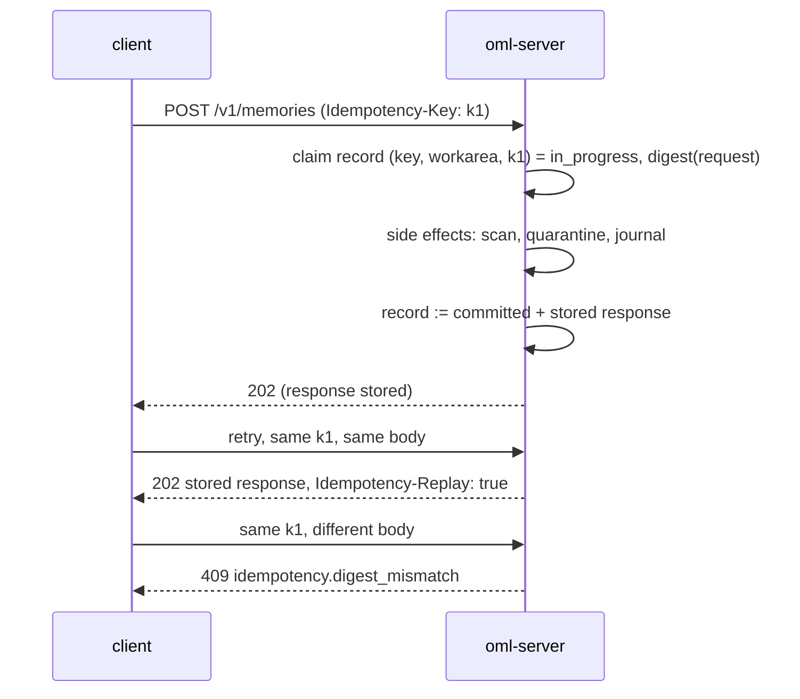

# HTTP API

**Status:** design draft for review · decided, not built

This page owns decision **D13** as contract: the `/v1` JSON surface, authentication, idempotency
records, the pagination convention, and the verb ceiling each endpoint enforces. The
machine-readable form is [openapi.yaml](openapi.yaml) — the two describe the same contract, and a
divergence between them is a documentation bug, not an ambiguity to interpret. Every refusal cited
below is a typed error declared in [errors.md](errors.md). The MCP agent plugin is a stateless
facade over the agent-safe subset of this API ([mcp-plugin.md](mcp-plugin.md)); the `oml` CLI
drives the administrative and review verbs over this same API
([cli/reference.md](../cli/reference.md)) — there is no second surface and no private RPC. The
one-transport posture is deliberate: a second surface would mean a second authentication path, a
second audit story, and a place for the two contracts to drift apart.

Field names and endpoint spellings are design identifiers: normative in shape, adjustable in
spelling at implementation without a design change (the same caveat the
[event catalog](../data/event-catalog.md) carries).

## Conventions

| Convention | Rule |
|---|---|
| Base path | `/v1`. A breaking change opens `/v2`; additive fields are not breaking, and clients must ignore unknown response fields. |
| Content type | `application/json; charset=utf-8`, except attachment part upload (`application/octet-stream`) and the export bundle download. |
| Timestamps | RFC 3339, UTC, e.g. `2026-10-29T14:03:17Z`. |
| Digests | `sha256:<64 hex>`. An attachment is named by the SHA-256 of its plaintext ([storage.md](../architecture/storage.md)). |
| Identifiers | Opaque strings (`artifact_id`, `workarea_id`, `key_id`, `serve_id`, …). Clients never parse them. |
| Request id | Every response carries `X-Request-Id`; error bodies repeat it as `request_id`. |
| Deletion | No endpoint is `DELETE`. Every removal is a journalled `POST` act — demote keeps bytes, erase is crypto-shredding (constitution R4; [audit-and-lineage.md](../architecture/audit-and-lineage.md)). |

## Authentication and authorization

Every `/v1` request carries `Authorization: Bearer <api-key>`. Only `/healthz` and `/readyz` are
unauthenticated.

- **Tenant is derived server-side from the key, never from the request** (D6;
  [security.md](../architecture/security.md)). No endpoint takes a tenant parameter, with one
  exception: an operator key may name `tenant_id` when creating a tenant's first admin key —
  operator keys are provider-level and have no tenant of their own.
- **Roles do not nest.** A key is issued with one role — `reader`, `writer`, `dreamer`, `admin`,
  `operator` — which is the ceiling on the grants it carries; each grant confers a role over one
  workarea subtree ([roles-and-keys.md](../architecture/roles-and-keys.md)). Where an endpoint
  below says *requires reader*, it means reader **effective access** on the workarea the request
  names, resolved from grants and denies at call time ([workareas.md](../architecture/workareas.md));
  where it says *requires admin* or *requires operator*, it means the key's role itself, because
  the verb governs tenant- or provider-level objects.
- **The verb ceiling is structural** (constitution R1): no agent-facing role reaches promote, sign,
  demote, delete, or any admin verb, and the refusal is the typed error
  [`access.verb_ceiling`](errors.md) naming the rule. The ceiling per endpoint is stated in
  the [surface table](#the-surface) and repeated per section.
- **Reads fail closed as absence.** A resource outside the key's effective read scope — including
  every simulation row for a key outside that simulation's audience (D10) — answers
  `access.not_found`, indistinguishable from a resource that does not exist. A resource the key can
  see but lacks the verb for answers `access.grant_refused`.
- **Every read is logged** (D12): key, role, workarea, memory ids or query digest, timestamp — in
  the retention-bounded read log whose batch digests anchor into the journal
  ([retrieval.md](../architecture/retrieval.md)).

Bearer keys are the shipped mechanism; whether and when the MCP facade adopts OAuth 2.1 is open —
[RS-2](../product/roadmap.md). The role vocabulary and key authorization semantics are owned by
[roles-and-keys.md](../architecture/roles-and-keys.md).

## Idempotency

Every state-creating `POST` requires an `Idempotency-Key` header (missing →
`request.idempotency_key_required`). Read-shaped `POST`s — `recall`, `settings/validate` — do not
take one, and attachment part `PUT`s need none: a part is addressed by `(session, part_number)`
and verified by digest at completion, so replaying a part is harmless.

The semantics are D13's **idempotency record**: `(key_id, workarea, idem_key) → request digest +
state + stored response`, claimed in its own transaction **before any side effect** (the row lives
in Postgres; [postgres-schema.md](../data/postgres-schema.md)). For endpoints that name no
workarea (keys, bans, simulations, exports, settings, tenants), the workarea component of the
scope is a fixed nil value.



| Case | Answer |
|---|---|
| First request | Processed; response stored against the record. |
| Replay, same request digest, record `committed` | The stored response, byte for byte, with header `Idempotency-Replay: true`. A replayed submit does not create a second version. |
| Replay while the record is `in_progress` | `409 idempotency.in_progress`, retryable, with `Retry-After`. The first attempt is still running — crashed attempts leave `in_progress` records that expire. |
| Same key, different request digest | `409 idempotency.digest_mismatch`. The key names exactly one request; reusing it for another is refused, never silently honored. |

How long a `committed` record is retained — and therefore how long a replay returns the stored
response rather than being processed fresh — is an open implementation detail, surfaced as a
setting (`oml settings`, [cli/reference.md](../cli/reference.md)), not fixed by this design.

## Pagination

List endpoints share one convention:

- Request: `limit` (1–200, default 50) and `cursor` (opaque, from the previous page; absent for
  the first page).
- Response: `{"items": [...], "next_cursor": "..."}` — `next_cursor` is `null` when the listing is
  exhausted. Cursors are scoped to the key that obtained them and expire; a stale cursor answers
  `request.validation`.

One deliberate exception: the [events tail](#events-tail) paginates by `after_seq`, because the
per-tenant journal sequence is meaningful to clients and is the resume point a consumer stores.

## The surface

| Endpoint | Verb ceiling (effective access unless noted) |
|---|---|
| `POST /v1/memories` | writer — whatever `derives_from` names; lineage is attribution, not an act of connection |
| `POST /v1/memories/recall` | reader |
| `GET /v1/memories` | reader; `own=true` admits any tenant role, own rows only |
| `GET /v1/memories/{artifact_id}` | reader; the author, for its own held rows |
| `GET /v1/memories/{artifact_id}/lineage` | reader |
| `POST /v1/memories/{artifact_id}/supersede` | writer (own claims); dreamer(propose) otherwise |
| `POST /v1/attachments/uploads` | writer |
| `PUT /v1/attachments/uploads/{session_id}/parts/{part_number}` | writer (session owner) |
| `POST /v1/attachments/uploads/{session_id}/complete` | writer (session owner) |
| `GET /v1/attachments/{digest}` | reader; reviewer under a valid `serve_id`; the author for own held |
| `GET /v1/claim-edges` | reader |
| `POST /v1/claim-edges` | dreamer(propose) |
| `POST /v1/claim-edges/{edge_id}/ratify` | dreamer(review); never the proposer (R2) |
| `GET /v1/workareas` · `GET /v1/workareas/{id}` · `/tree` · `/edges` · `/status` | reader |
| `POST /v1/workareas` | admin (key role) |
| `POST /v1/workareas/{id}/reparent` | admin (key role) |
| `POST /v1/workareas/{id}/crew` | admin (key role) |
| `POST /v1/workareas/{id}/edges` | dreamer(propose) on ≥1 endpoint, reader on both (edge-authority rule, [workareas.md](../architecture/workareas.md)) |
| `POST /v1/workarea-edges/{edge_id}/ratify` | dreamer(review) on both endpoints; never the proposer |
| `POST /v1/workareas/{id}/transitions` | dreamer or admin |
| `POST /v1/workareas/{id}/transitions/{transition_id}/ratify` | a second, non-proposing dreamer or admin |
| `GET /v1/events` | reader |
| `GET /v1/review/queue` · `POST /v1/review/next` · `POST /v1/review/verdicts` · `POST /v1/review/reopen` | dreamer(review); refused per row by lineage-closure exclusion |
| `POST /v1/keys` and every key, grant, denial verb | admin (key role); operator only for a tenant's first admin key |
| `GET /v1/bans` · `POST /v1/bans` · `POST /v1/bans/{ban_id}/lift` | admin (key role) |
| `GET /v1/simulations` · `GET /v1/simulations/{id}` · `POST /v1/simulations` · `POST /v1/simulations/{id}/audience` · `POST /v1/simulations/{id}/end` | admin (key role) |
| `POST /v1/memories/{artifact_id}/reassign` · `/demote` · `/erase`, `POST /v1/claims/tip-override` | admin (key role) |
| `POST /v1/exports` · `GET /v1/exports` · `GET /v1/exports/{export_id}` · `/bundle` | admin (key role) |
| `GET /v1/settings` · `POST /v1/settings/validate` · `POST /v1/settings/apply` | admin (key role) |
| `POST /v1/tenants` | operator (key role) |
| `POST /v1/bootstrap/claim` | single-use enrollment token (bootstrap ceremony only) |
| `GET /healthz` · `GET /readyz` | none (unauthenticated) |

Promote, sign and delete appear nowhere in this table on purpose: promotion is an effect of
ratification inside the admission pipeline, signing is `oml-server`'s alone, and deletion does not
exist (R1, R4).

## Memories

### Submit — `POST /v1/memories`

One endpoint for the two submission verbs; `verb` selects the journal event
(`submission.remember` / `submission.learn`, [event catalog](../data/event-catalog.md)).

```json
{
  "verb": "remember",
  "workarea_id": "wa_7f…",
  "claim_key": "deploy-runbook",
  "kind": "memory",
  "body": "The canary stage must drain before …",
  "attachments": ["sha256:9c1e…"],
  "derives_from": [],
  "simulation_id": null,
  "simulated_time": null
}
```

- `verb: "learn"` asserts a derived claim: `derives_from` must be non-empty, and an empty or
  omitted `derives_from` is refused (`submission.lineage_required`) — on every surface that fronts
  this verb, the MCP plugin's `oml_learn` included. A derived conclusion whose author cannot or
  will not name lineage is submitted as `verb: "remember"` with `kind: derived_fact` (journalled
  `submission.remember`), where the honesty rule carries the caveat: an undeclared derivation is
  undetectable by the service — the lineage closure is as good as what writers declare
  (the constitution's honesty rule, [ADR-0001](../adr/ADR-0001-the-constitution.md), stated
  plainly on [admission.md](../architecture/admission.md)).
- Submitting with `derives_from` requires only writer effective access, even when the lineage
  names another author's claim — declaring an ancestor is attribution, not an edit of it.
  The declaration has review consequences, not authorization ones: every named ancestor expands
  the row's reviewer-exclusion set (R2 over the lineage closure), and a false lineage is grounds
  for rejection at review ([ADR-0012](../adr/ADR-0012-admission-and-review.md)).
- `kind` ∈ `memory` | `derived_fact` | `steering`. A steering row is held and reviewed like any
  claim and is never ranked at recall (D12).
- Every attachment digest must name a **completed** upload session owned by this key, or the
  submit is refused (`submission.attachment_missing`).
- A `derives_from` that touches a simulation row forces `simulation_id` to that row's simulation
  (`submission.simulation_id_required` otherwise); writing with a `simulation_id` requires the key
  to be in that simulation's audience ([simulations.md](../architecture/simulations.md)).
- `universe` refuses direct claim writes (`submission.universe_refused`); a `validated` workarea
  refuses all new writes (`workarea.frozen`).
- The deterministic scan runs in the same call and can veto (`submission.scan_veto` — the
  submission is journalled as rejected, nothing waits in the queue;
  [admission.md](../architecture/admission.md)). Banned authors and sources are refused at this
  same admission check (`access.banned`).

Success is `202 Accepted` — **held, visible to no one else until ratified** (R3):

```json
{
  "artifact_id": "art_01J…",
  "claim_key": "deploy-runbook",
  "version": 3,
  "state": "held",
  "plaintext_digest": "sha256:ab12…",
  "scan": {"result": "pass", "scanner_version": "…"},
  "journal_seq": 4182
}
```

### Recall — `POST /v1/memories/recall`

Ranked retrieval over **promoted** rows in scope: FTS + vector, served from Postgres, never from
the lake (D12; [retrieval.md](../architecture/retrieval.md)). Request: `workarea_id` (a subtree
root the key reads), `query`, `k`, optional `kinds` filter, `include_bodies`. Response separates
what is ranked from what is not:

```json
{
  "steering": [ {"artifact_id": "…", "kind": "steering", "body": "…"} ],
  "hits": [ {"memory": {"artifact_id": "…", "claim_key": "…", "version": 4, "tip": true, "body": "…"}, "score": 0.83} ],
  "query_digest": "sha256:…"
}
```

Steering rows precede hits and carry no score — the recall-ordering contract: the gate changes
visibility, not ranking (R3/D12). The read is logged by `query_digest`. Recall quality and latency
are unmeasured — [FR-4](../product/roadmap.md).

### Search — `GET /v1/memories`

Structured listing, paginated: filters `workarea_id`, `claim_key`, `state`, `kind`, `since`,
`until`, `own`. Returns memory summaries (no bodies). With `own=true` the listing is the
**own-work status** read: any tenant role may list its own submissions in every state — held,
promoted, demoted, rejected. Without it, held rows belonging to others are never returned,
whatever the filter says (R3).

### Get — `GET /v1/memories/{artifact_id}`

One memory with its body (decrypted on the serving path only) and attachment descriptors. The
author may fetch its own held or rejected version; everyone else sees promoted rows only. An
erased artifact answers `410 lifecycle.erased` — attribution and journal trail remain, bytes do
not (D4).

### Lineage — `GET /v1/memories/{artifact_id}/lineage`

The derivation closure over `derives_from` and claim edges, **pending and ratified both**,
serialized as stored — the server serializes the graph, it does not compute analytics over it
(D13: serialize, don't compute). Nodes outside the key's read scope are elided to bare ids with
`redacted: true`, so the shape of the closure is visible without leaking content.

### Supersede — `POST /v1/memories/{artifact_id}/supersede`

Proposes a replacement for the version `{artifact_id}` names: a new attributed submission, held
like any write, whose `derives_from` includes the target. A writer key may supersede only its own
claims (`access.author_only` otherwise); a dreamer key proposes edits to anyone's
(edit-as-proposal, D9). The target must be the current served tip — refused with
`submission.tip_conflict` at submission, and the CAS is re-checked at promotion, so the error can
also surface as a rejected promotion when a competing supersession won in between
([postgres-schema.md](../data/postgres-schema.md) owns the tip constraint).

## Attachments

Resumable upload sessions, then content-addressed fetch (D3;
[storage.md](../architecture/storage.md)).

| Step | Endpoint | Notes |
|---|---|---|
| Create session | `POST /v1/attachments/uploads` | `{expected_digest, size_bytes, media_type}` → `201` session. The expected digest is recorded up front; the session is scoped to the uploading key and expires. |
| Upload part | `PUT /v1/attachments/uploads/{session_id}/parts/{part_number}` | Raw bytes, `application/octet-stream` → `204`. A retry re-puts the part; a lost session restarts (`upload.session_invalid` names which). |
| Complete | `POST /v1/attachments/uploads/{session_id}/complete` | Assembles, hashes, compares: `upload.digest_mismatch` when the bytes are not what the session promised; `200` with `{digest, ciphertext_digest, state: "complete"}` otherwise. |
| Fetch | `GET /v1/attachments/{digest}` | Bytes, decrypted on the serving path, plaintext digest verified before serving. Admits: reader effective access to a promoted claim binding the digest; the author of a held claim binding it; a reviewer under a valid `serve_id` query parameter. Logged as a read. |

A completed upload is inert until a submission binds its digest into a signed envelope; the claim
and its files are then one reviewed unit — a reviewer is served every attachment before a verdict
counts (D3).

## Workareas

Reads require reader effective access on the node; nodes outside scope are absent
(`access.not_found`). The algebra — tree, universe, grants, denies — is owned by
[workareas.md](../architecture/workareas.md); this page only carries the verbs.

| Endpoint | Returns / does |
|---|---|
| `GET /v1/workareas?path=<ltree>` | Resolve a node by derived path. Grants bind to node ids, never paths; this is the lookup that bridges the two. |
| `GET /v1/workareas/{id}` | Node: id, parent, derived path, status, crew record. |
| `GET /v1/workareas/{id}/tree` | The subtree, paginated; nodes outside read scope are omitted. |
| `GET /v1/workareas/{id}/edges` | Labelled `related` edges touching the node, `pending` and `ratified`, with proposer and ratifier. Edges confer zero access. |
| `GET /v1/workareas/{id}/status` | Status, the review policy object in force, pending transitions. |
| `POST /v1/workareas` | **admin.** Create a child in `development`: `{parent_id, name, crew?}`. Refused under a `validated` parent (`workarea.frozen`). |
| `POST /v1/workareas/{id}/reparent` | **admin.** `{new_parent_id, dry_run}` — journalled single-transaction descendant path rewrite; `dry_run: true` returns the paths and grants affected without journalling. Re-parenting into a `validated` destination is refused (`workarea.frozen`). |
| `POST /v1/workareas/{id}/crew` | **admin.** Journalled crew-metadata update; allowed on `validated` areas — freeze covers claims and promotions, not metadata. |
| `POST /v1/workareas/{id}/edges` | Propose an edge `{to_workarea_id, label}`, label ∈ `relates_to` \| `continues` \| `derived_from` \| `mirrors`. Requires dreamer(propose) effective access on at least one endpoint and reader effective access on both (an admin who must act here holds a separate dreamer key — a key never combines admin with dreamer grants, `access.role_exclusive`). → `202`, pending. |
| `POST /v1/workarea-edges/{edge_id}/ratify` | Ratify under dreamer(review) effective access on **both** endpoints; the proposer is refused (`review.ratifier_is_proposer`, R2 extends to edges). |
| `POST /v1/workareas/{id}/transitions` | Propose a forward status transition `{to: "committed" \| "validated"}`. Backward does not exist; `validated` is refused while any child is not validated (`workarea.transition_refused`). → `202`, pending. |
| `POST /v1/workareas/{id}/transitions/{transition_id}/ratify` | A second, non-proposing dreamer or admin ratifies; journalled with the policy snapshot ([workareas.md](../architecture/workareas.md) transition matrix). |

## Claim edges

Claim↔claim connection proposals follow the same propose-then-ratify shape inside the admission
pipeline ([admission.md](../architecture/admission.md)).

- `GET /v1/claim-edges?workarea_id=…&artifact_id=…` — paginated graph read, pending and ratified,
  scoped to read access.
- `POST /v1/claim-edges` — `{from_artifact_id, to_artifact_id, label}` under dreamer(propose) →
  `202`, pending. The label vocabulary for claim edges is not fixed by the design (the closed
  label set exists for workarea edges only); fixing it is an open detail for the
  [roadmap](../product/roadmap.md).
- `POST /v1/claim-edges/{edge_id}/ratify` — dreamer(review), never the proposer, and refused when
  the ratifying key or principal appears in either endpoint's lineage closure
  (`review.author_in_lineage`).

## Events tail

`GET /v1/events?after_seq=<n>&limit=<m>` — the per-tenant journal, served as the
[event catalog](../data/event-catalog.md)'s envelopes with **digest-only payloads** (D1: no body
plaintext ever rides a journal event). Requires reader effective access; events whose workarea is
outside the key's scope are **omitted**, so a scoped tail has gaps by design. The response carries
`head_seq` so a consumer can measure its lag.

The honest consequence: a scoped tail is a feed, not a verification surface — omitted events break
naive hash-chain recomputation. Full per-tenant chain verification is served by the
[evidence export](#evidence-export) (`kind: "chain"`), which is how `oml audit verify-chain` reads
the chain live ([cli/reference.md](../cli/reference.md)).

## Review

The review ceremony over HTTP — external crews holding dreamer keys are the designed review
capacity; the CLI is the human exception path (D11, D14). Review throughput is unmeasured —
[FR-2](../product/roadmap.md).

| Endpoint | Semantics |
|---|---|
| `GET /v1/review/queue?workarea=…` | Held-item counts and oldest ages per workarea in the reviewer's scope — the same numbers `oml status` reports as queue depth. |
| `POST /v1/review/next` | Serve exactly one held item: body, **all** attachments (as fetch descriptors honored by `GET /v1/attachments/{digest}?serve_id=…`), and for a supersession the version it replaces. Returns a `serve_id` bound server-side to (reviewer key, artifact version, attachment digest set), expiring, consumed by its first verdict, invalidated by any change to the served content (D14). `204` when nothing in scope waits. Refused per item with `review.author_in_lineage` when the reviewer's key or principal appears in the item's lineage closure — the server never serves what this key may not judge. |
| `POST /v1/review/verdicts` | `{serve_id, verdict: "approve" \| "reject", reason}` (`reason` required to reject). Accepted only against a valid, unexpired, unconsumed serve bound to this key (`review.serve_invalid` names which condition failed). The journalled verdict records the served digests. Response states the resulting state: `promoted` (policy satisfied, ratification journalled with its policy snapshot), `held` (more verdicts required by the policy's `k`), or `rejected`. |
| `POST /v1/review/reopen` | `{artifact_id, version, reason}` — non-author reopen of a rejection, a journalled verb in its own right, not a resubmission. The original author is refused (`review.author_in_lineage`). |

The independence checks — reviewer ≠ author, resolved against the full lineage closure at
promotion time, plus the per-workarea independence axis — are owned by
[roles-and-keys.md](../architecture/roles-and-keys.md) and
[admission.md](../architecture/admission.md); this surface only reports their refusals.

## Keys, grants, denials

Admin key role throughout; a grant's role never exceeds the key's role ceiling, and an issued
key's role never exceeds the issuer's (`access.issuer_ceiling`). One combination is refused
outright: a key holding the admin role never carries dreamer-class grants — minting or amending
one answers `access.role_exclusive` (the two-key rule: admin ≠ reviewer,
[roles-and-keys.md](../architecture/roles-and-keys.md)). Key values appear exactly once,
in the issuance response; the journal records `key.issued` with `value_disclosed: false`
(show-once ceremony, D14).

| Endpoint | Does |
|---|---|
| `POST /v1/keys` | Issue: `{role, grants: [{workarea_node_id, role, deny: [...]}], expiry?, label?, principal?}` → `201` with the key **value, shown once**. An operator key must add `tenant_id` and may issue only a tenant's first admin key. |
| `GET /v1/keys` · `GET /v1/keys/{key_id}` | Listing and detail: role, principal, grants, denials, epoch, issuance/revocation events. Never values. |
| `POST /v1/keys/{key_id}/revoke` | Journalled revocation; effective at the next permission-epoch check. |
| `POST /v1/keys/{key_id}/rotate` | Mint a successor key — new `key_id`, linked by `rotated_from`, grants reproduced from the journalled records — with `{grace}` bounding the old key's remaining life. One journalled act (`key.rotated`) carries both key ids and the grace deadline; at the deadline the old key is revoked (journalled, epoch bump). Bulk crew rotation is open — [FR-6](../product/roadmap.md). |
| `POST /v1/keys/{key_id}/grants` | Add a grant bound to a workarea **node id**, optionally with per-grant deny masks → `201`, epoch bump. |
| `POST /v1/keys/{key_id}/grants/{grant_id}/revoke` | Journalled grant removal; epoch bump. |
| `POST /v1/keys/{key_id}/denials` | Create or extend the key's **global** deny object — deny-wins across all the key's grants, distinct from a per-grant deny. |
| `POST /v1/keys/{key_id}/denials/{denial_id}/lift` | Journalled lift. |
| `GET /v1/keys/{key_id}/effective-access?workarea=…` | The resolved answer: what this key may do where, and which deny produced each hole — reproducible from journalled grants by construction (permission epoch). |

`POST /v1/tenants` (**operator**) creates a tenant; the operator then issues its first admin key
and nothing else — operator keys never read, write or review content (`access.verb_ceiling`).

`POST /v1/bootstrap/claim` is the one endpoint authenticated by something other than an API key:
the single-use, expiring **enrollment token** the Helm bootstrap job minted
([deployment.md](../operations/deployment.md)). `{enrollment_token}` → `201` with the root
operator key, value shown once; the token is consumed on first use, and a consumed, expired or
unknown token answers `auth.invalid` with `details.reason` naming which. The `oml bootstrap claim`
ceremony fronts exactly this call ([cli/reference.md](../cli/reference.md)).

## Bans

- `POST /v1/bans` — `{subject_kind: "principal" | "source", subject, reason?, dry_run}`. With
  `dry_run: true` (the CLI's default) the response is the reach preview — keys affected, held
  submissions that would be refused, workareas touched — and nothing is journalled. Otherwise
  `201` and the ban is checked at every admission from then on (`access.banned`).
- `POST /v1/bans/{ban_id}/lift` — journalled lift; the ban row stays as history (R4 in spirit).
- `GET /v1/bans` — active and lifted, with who imposed and who lifted each.

## Simulations

The fenced provenance channel (D10; [simulations.md](../architecture/simulations.md)). Admin key
role for the channel objects; the writes inside a simulation are ordinary submissions carrying
`simulation_id`, made by audience keys through `POST /v1/memories`.

- `POST /v1/simulations` — `{audience: [{"key_id": …} | {"grant_ref": …}], label?}` → `201`. A
  simulation whose audience holds no dreamer key can promote nothing — it fails closed, and the
  response says so in a `warnings` field rather than refusing.
- `GET /v1/simulations` · `GET /v1/simulations/{id}` — state, audience, rows written, sim-derived
  taints outside it.
- `POST /v1/simulations/{id}/audience` — `{add: [{"key_id": …} | {"grant_ref": …}], remove: [...],
  reason?}`, at least one of `add`/`remove` non-empty, `Idempotency-Key` required → `200` with the
  resulting audience. Corrects a simulation's audience — the only recovery from the fail-closed
  no-dreamer state short of ending it; journalled as `simulation.audience_changed`, and the same
  `warnings` field as creation fires when the corrected audience still holds no dreamer key.
  Removal takes effect on the next read; past reads stand in the read log. Refusals:
  `access.verb_ceiling` (non-admin), `simulation.ended`, `request.validation` (empty `add`+`remove`),
  `access.not_found`.
- `POST /v1/simulations/{id}/end` — `{dry_run}`: preview lists every row and taint the end would
  touch; the real act is journalled, demotes the simulation's rows and triggers re-review of
  tainted claims → `202` (the demotion closure proceeds through the pipeline).

Refusals this channel generates on *other* endpoints: non-audience keys never see simulation rows
(`access.not_found` on reads — the predicate is applied on every read path); non-audience writes
and verdicts naming a simulation answer `simulation.audience_refused`; acts naming an ended
simulation answer `simulation.ended`; promotion or reassignment that would put a simulation row or
sim-derived taint into a `validated` area answers `simulation.taint_refused`; a promotion,
supersession ratification or tip-override that would make a tainted version the *default* served
tip answers `simulation.tip_refused` — taint shadows the tip only for the audience, as an overlay
([simulations.md](../architecture/simulations.md)).

## Claim administration

Admin verbs over claims — the CLI's `oml claims` and `oml erase` ride these
([cli/reference.md](../cli/reference.md)):

| Endpoint | Does |
|---|---|
| `POST /v1/memories/{artifact_id}/reassign` | `{workarea_id, re_key?, dry_run}` — journalled move recording both policy snapshots; a claim moved to a stricter-policy destination re-enters `held`. Refused into `validated` (`workarea.frozen`); a `claim_key` collision at the destination is refused unless the move records a re-key (`submission.claim_key_conflict`). |
| `POST /v1/memories/{artifact_id}/demote` | `{version, reason}` — journalled demotion; bytes kept (R4). |
| `POST /v1/memories/{artifact_id}/erase` | `{dry_run}` — journalled crypto-shred: erase event plus DEK destruction, scoped to body and attachment bytes. The dry run returns the erasure inventory for this artifact — every copy class and its disposition ([audit-and-lineage.md](../architecture/audit-and-lineage.md)). Attribution metadata survives; closing that is [FR-1](../product/roadmap.md). → `202`. |
| `POST /v1/claims/tip-override` | `{workarea_id, claim_key, to_version, reason}` — designate an earlier promoted version as the served tip without demoting the later one: explicit and journalled (`lifecycle.tip_override`), never a silent re-rank. |

## Evidence export

An export is an **async job** — bundles are large and chain verification is linear in journal
length.

1. `POST /v1/exports` — `{kind: "evidence" | "chain", from_seq?, include_simulations?}` → `202`
   with `export_id`. `evidence` is the signed bundle: per-memory decision trail, per-tenant chain
   verification, grants history, read log scoped to its retention window, reciprocal-approval
   statistics per key pair, and — only when asked — simulation rows listed separately by
   `simulation_id` (D14). `chain` streams the per-tenant journal envelopes, digest-only, for
   client-side verification. The export act is itself journalled.
2. `GET /v1/exports` · `GET /v1/exports/{export_id}` — job state: `running` | `done` | `failed`.
3. `GET /v1/exports/{export_id}/bundle` — the signed bundle, `application/octet-stream`;
   `export.not_ready` before the job is `done`.

The sanctioned description of what this produces: *the evidence an auditor asks for* — never a
compliance claim (D17; [audit-and-lineage.md](../architecture/audit-and-lineage.md)).

## Settings

Configured-versus-effective, over the API so `oml settings` can show the divergence (D14):

- `GET /v1/settings` — the configured document as last applied; `?effective=true` adds what the
  running deployment actually uses, every divergence marked per key (defaulted value,
  not-yet-picked-up change, per-replica variance).
- `POST /v1/settings/validate` — server-side validation without applying: `200` with findings. A
  document naming a **retired settings key is refused by that key's name**, with its replacement —
  the finding carries code `settings.retired_key`.
- `POST /v1/settings/apply` — validate, journal (`system.settings_applied`), apply. Any validation
  error refuses the whole apply (`settings.invalid` / `settings.retired_key`); there is no force
  flag.

The settings schema itself is not fixed by this design; the contract fixed here is the
show/validate/apply shape and the retired-key refusal.

## Health

- `GET /healthz` — liveness: `200 {"status": "ok"}` while the process runs.
- `GET /readyz` — readiness: `200` only when the replica can serve — Postgres reachable and the
  startup fork check passed (the stored chain head verifies against the last signed head;
  [storage.md](../architecture/storage.md)). Otherwise `503` with per-check detail. While a
  replica refuses writes after a failed fork check, `/v1` writes answer `system.unavailable`.

Both are unauthenticated, carry no tenant data, and are the probe targets the Helm chart wires up
([deployment.md](../operations/deployment.md)).

## Limits

Quotas and rate limits are journalled grant attributes (D6). Enforcement in v1 is per-replica
token buckets at limit/N — a documented approximation whose error grows with replica churn
([FR-8](../product/roadmap.md)) — and the refusal is typed: `429 limit.rate` or `429 limit.quota`
with `Retry-After` ([errors.md](errors.md)). Nothing here is measured; no latency or
throughput number on this page describes OML.
