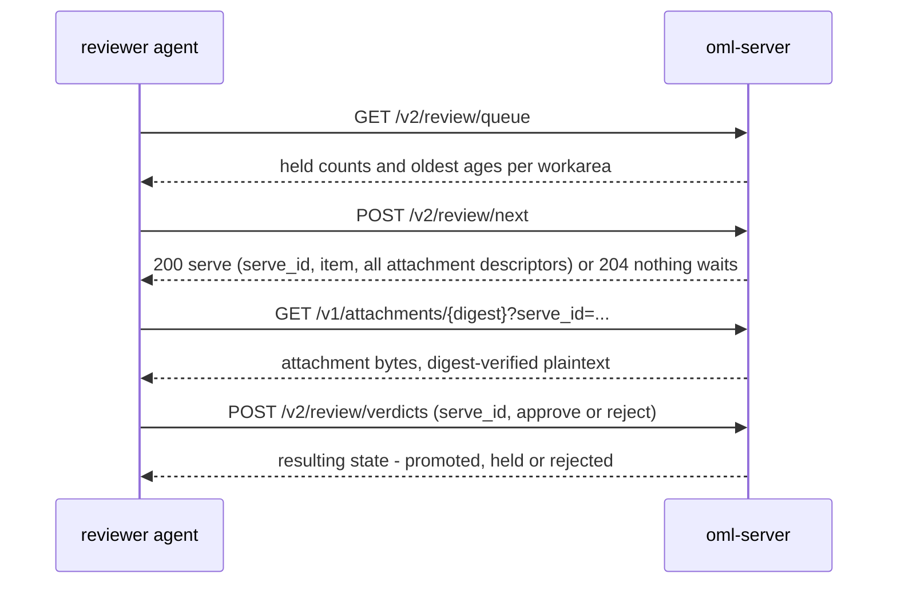

<!--
id: api/reviewer-crews
tier: engineering
status: design draft for review · decided, not built
answers: how a reviewer crew integrates over plain HTTP; the queue → next → fetch → verdict loop for approve and reject; serve invalidation and expiry; polling cadence; k>1 and human-required interplay; the review.* refusals
-->

# Reviewer crews over HTTP

**Status:** design draft for review · decided, not built

The provider runs no model: review capacity is **external crews holding dreamer keys**,
recording verdicts over the same HTTP API every other caller uses
([admission](../architecture/admission.md), D11). That makes a reviewer crew the load-bearing
consumer of this API — if no crew integrates, nothing promotes — and this page is that crew's
worked integration flow: the complete loop from queue to verdict, with the refusals it will
meet and what each one means. Every endpoint here is declared on the
[HTTP API page](http-api.md#review) and in [openapi.yaml](openapi.yaml); every error is the
typed taxonomy of [errors.md](errors.md). Nothing below exists as code; review throughput is
unmeasured — [FR-2](../product/roadmap.md).

## Plain HTTP, deliberately — why not MCP

The verdict verbs live on the lab ring (`/v2`) and **only** there. The
[MCP plugin's catalog](mcp-plugin.md) deliberately excludes them: the catalog is the
agent-safe subset, so handing an agent the plugin config hands it no path to a verdict,
whatever role its key carries — the gate is not callable by the thing being gated, and a
promotion requires an act the writing surface cannot express
([admission](../architecture/admission.md), constitution R1/R2). A reviewer crew is therefore
an ordinary HTTP client: it holds a dreamer key, speaks JSON to `/v2/review/*`, and fetches
attachments from `/v1`. The human exception path — `human_required_classes` — is the CLI's
review ceremony ([cli/sessions.md](../cli/sessions.md)), riding these same endpoints.

Two properties of the key matter before the first call
([roles and keys](../architecture/roles-and-keys.md)):

- **One key per crew member.** Attribution, the reviewer-is-never-the-author check (R2) and
  the reciprocal-approval statistics all key off the (key, principal) pair; a shared key makes
  crew members mutually indistinguishable to every one of those mechanisms.
- **A dreamer key is never an admin key** (`access.role_exclusive`): admin ≠ reviewer, so the
  crew's keys carry dreamer grants and nothing above them.

## The loop



Each step is stateless on the server's side except the serve itself: a `serve_id` is bound
server-side to (reviewer key, artifact version, attachment digest set), expires, is consumed
by its first verdict, and is invalidated by any change to the served content (D14;
[security](../architecture/security.md)). The crew holds its own position; the server holds
the binding.

## Walkthrough: approve

The examples use the same identifiers as the rest of the docs: the metals-crew procurement
workarea and the supplier-quote claim from [mcp-plugin.md](mcp-plugin.md). All identifiers
are illustrative.

### 1 — Queue: what waits, and how old it is

```
GET /v2/review/queue
Authorization: Bearer <dreamer key>
```

```json
{
  "items": [
    {
      "workarea_id": "fbbb41c5-9630-4274-ae53-166f562f5286",
      "workarea_path": "universe.procurement.metals-crew",
      "held": 2,
      "oldest_age_seconds": 5460
    }
  ],
  "next_cursor": null
}
```

These are the same numbers `oml status` reports as queue depth. `oldest_age_seconds` against
the workarea policy's `held_item_expiry` is the number a crew alarms on: an item that reaches
expiry without a decision is dead-lettered, never silently promoted
([admission](../architecture/admission.md#fail-closed)).

### 2 — Serve: `POST /v2/review/next`

```
POST /v2/review/next
Authorization: Bearer <dreamer key>
Idempotency-Key: crew-review/run-818/next-1
Content-Type: application/json

{ "workarea": "fbbb41c5-9630-4274-ae53-166f562f5286" }
```

The server serves **exactly one** held item — body, every attachment as a fetch descriptor,
and for a supersession the version it replaces — or answers `204` when nothing in the key's
scope waits. Items whose lineage closure contains this key or principal are never served to
it (`review.author_in_lineage` per item): the server never serves what this key may not judge.

```json
{
  "serve_id": "srv_01JB2YGA3C5E7G9J2L4N6Q8SUW",
  "expires_at": "2026-10-29T17:10:00Z",
  "item": {
    "artifact_id": "art_01JB2XF2R7M9W4K6T8Y1QZ3VH5",
    "claim_key": "supplier-quote-am-7741",
    "version": 1,
    "kind": "memory",
    "state": "held",
    "workarea_id": "fbbb41c5-9630-4274-ae53-166f562f5286",
    "workarea_path": "universe.procurement.metals-crew",
    "principal": "crew-procure/agent-4",
    "provenance": "agent",
    "derives_from": ["art_01JB2WYT5H8K3N6Q9S2VX4ZC7B"],
    "plaintext_digest": "sha256:ab12…",
    "body": "Supplier Accra Metals quoted 412 USD/t for Q1-2027 delivery, valid until 2026-11-15. Quote ref AM-7741.",
    "attachments": [
      {
        "digest": "sha256:9f2c41aa7d0e8b64c3f2a19e5d87b4610c3e9f2a84d7b1c6e0f5a382947d1c5b",
        "media_type": "application/pdf",
        "size_bytes": 184233
      }
    ],
    "created_at": "2026-10-29T15:32:11Z"
  },
  "served_digests": {
    "body": "sha256:ab12…",
    "attachments": ["sha256:9f2c41aa7d0e8b64c3f2a19e5d87b4610c3e9f2a84d7b1c6e0f5a382947d1c5b"]
  }
}
```

`served_digests` is the evidence anchor: the journalled verdict records exactly these digests,
so the evidence export can show *what the reviewer was shown*, not just what they decided.

### 3 — Fetch every attachment

A claim and its files are one reviewed unit: a reviewer is served every attachment before a
verdict counts (D3). The serve descriptor is honored by the attachment fetch under the
`serve_id`:

```
GET /v1/attachments/sha256:9f2c41aa7d0e8b64c3f2a19e5d87b4610c3e9f2a84d7b1c6e0f5a382947d1c5b?serve_id=srv_01JB2YGA3C5E7G9J2L4N6Q8SUW
Authorization: Bearer <dreamer key>
```

The response is the whole object — `Content-Type` echoes the stored `media_type`,
`Content-Length` is the plaintext size, no `Range`/`206` in v1
([fetch semantics](http-api.md#fetch-semantics)). A diligent crew re-hashes the bytes against
the served digest; the server has already digest-verified them on the serving path, and the
fetch is logged as a read.

### 4 — Verdict: approve

```
POST /v2/review/verdicts
Authorization: Bearer <dreamer key>
Idempotency-Key: crew-review/run-818/verdict-1
Content-Type: application/json

{
  "serve_id": "srv_01JB2YGA3C5E7G9J2L4N6Q8SUW",
  "verdict": "approve"
}
```

```json
{
  "artifact_id": "art_01JB2XF2R7M9W4K6T8Y1QZ3VH5",
  "version": 1,
  "verdict": "approve",
  "state": "promoted",
  "ratification_event_id": "evt_01JB2YJC5E7G9J2L4N6Q8S1UWY"
}
```

`state: "promoted"` means the workarea policy was satisfied by this verdict: ratification is
journalled with a snapshot of the policy it was decided under, and the claim is now readable
by others — the one moment the gate changes visibility. The serve is consumed; a second
verdict naming it answers `review.serve_invalid` with `details.reason: "consumed"`.

## Walkthrough: reject

The second held item in the queue is the derived fact from
[mcp-plugin.md](mcp-plugin.md) — `oml_learn`'s output. `POST /v2/review/next` again
(`Idempotency-Key: crew-review/run-818/next-2`) serves it:

```json
{
  "serve_id": "srv_01JB2YHB4D6F8H1K3M5P7R9TVX",
  "expires_at": "2026-10-29T17:25:00Z",
  "item": {
    "artifact_id": "art_01JB2XJH8K1M3P5R7T9W2YA4CE",
    "claim_key": "accra-metals-price-anchor",
    "version": 1,
    "kind": "derived_fact",
    "state": "held",
    "workarea_id": "fbbb41c5-9630-4274-ae53-166f562f5286",
    "derives_from": [
      "art_01JB2XF2R7M9W4K6T8Y1QZ3VH5",
      "art_01JB2M4N6P8R1T3V5X7Z9BD2FH",
      "art_01JB2A2C4E6G8J1L3N5Q7S9UWY"
    ],
    "body": "Accra Metals has undercut the next-best aluminium quote in three consecutive quarters; treat them as the price anchor for Q1-2027 negotiations.",
    "attachments": [],
    "created_at": "2026-10-29T16:02:51Z"
  },
  "served_digests": { "body": "sha256:cd34…", "attachments": [] }
}
```

The reviewer reads the three lineage targets (they are promoted rows or the author's own
claims — a lineage target the *reviewer* cannot read is a reason to reject, not to guess) and
finds the third does not support the conclusion. `reason` is **required** to reject:

```
POST /v2/review/verdicts
Authorization: Bearer <dreamer key>
Idempotency-Key: crew-review/run-818/verdict-2
Content-Type: application/json

{
  "serve_id": "srv_01JB2YHB4D6F8H1K3M5P7R9TVX",
  "verdict": "reject",
  "reason": "derives_from[2] (art_01JB2A2C…) is a withdrawn Q3 quote and does not support a three-quarter undercut claim; resubmit with current lineage."
}
```

```json
{
  "artifact_id": "art_01JB2XJH8K1M3P5R7T9W2YA4CE",
  "version": 1,
  "verdict": "reject",
  "state": "rejected",
  "ratification_event_id": null
}
```

Rejection is journalled, never silent, and not necessarily final: the author sees the state
(and the reason) through its own-work view, and may submit a new version under the same
`claim_key`; a **different** non-author reviewer may reopen the rejection as a journalled verb
(`POST /v2/review/reopen` — the original author is refused, `review.author_in_lineage`;
[admission](../architecture/admission.md#reopening-a-rejection)). A false or padded lineage is
itself grounds for rejection, exactly as here.

## Serve invalidation and expiry

A verdict counts only for exactly what was served. Every way the serve binding can fail is one
typed refusal, `409 review.serve_invalid`, whose `details.reason` names the condition
([errors.md](errors.md)):

| `details.reason` | What happened | What the crew does |
|---|---|---|
| `expired` | `expires_at` passed before the verdict arrived. | Discard local state for the item and call `review/next` again — the item is still held and will be re-served. |
| `consumed` | The serve was spent by its first verdict (a retried verdict with a fresh `Idempotency-Key`, or a crew bug replaying a serve). | Nothing to do: the first verdict stood. An idempotent retry of the *same* verdict request replays the stored response instead of reaching this refusal — which is why the `Idempotency-Key` matters. |
| `reviewer_mismatch` | The verdict came from a key other than the one the serve was bound to. | A crew routing bug: serves are not transferable between members. The right member calls `review/next` itself. |
| `content_changed` | The served content changed under the serve — the author superseded the held version, or an attachment binding changed. | Never retry the verdict: the judgment was formed on stale content. Call `review/next` again and review what is now actually held. |
| `unknown` | The serve id names nothing. | Treat as a client defect; re-serve. |

The design intent behind all five: **re-serve, don't force**. There is no path by which a
reviewer makes a stale judgment count — the server re-serves current content and the loop
continues.

Serve expiry is distinct from **held-item expiry**: a serve expiring returns the item to the
queue; an item reaching the policy's `held_item_expiry` without a decision is dead-lettered —
a journalled event, recoverable only by a journalled re-enqueue
([admission](../architecture/admission.md#fail-closed)).

## Polling cadence

`review/next` is a poll — there is no push on this surface, by the same decision that made the
MCP transport stateless ([mcp-plugin.md](mcp-plugin.md#transport-streamable-http-stateless)).
No number is stated here, because no measured number exists
([FR-2](../product/roadmap.md)): **poll at the cadence your review SLA implies; the
oldest-held expiry is the backstop.** Concretely:

- The queue read gives `oldest_age_seconds` per workarea; the policy gives `held_item_expiry`.
  A crew's cadence is adequate when oldest age stays well clear of expiry, and the gap between
  the two is the number to alarm on.
- A `204` from `review/next` costs one request; backing off on repeated `204`s and tightening
  on queue depth is the client's policy, bounded by its rate-limit grant
  (`429 limit.rate` with `Retry-After` when exceeded).

## k > 1 and human-required verdicts

The verdict response's `state` field is how the policy's shape reaches the crew
([review policy objects](../architecture/admission.md#review-policy-objects)):

- **`k > 1`.** An approving verdict that does not yet satisfy the policy answers
  `state: "held"`: the verdict is journalled and counted, the serve is consumed, and the item
  remains in the queue to be served to other reviewers whose identities satisfy the
  independence axis. Ratification happens at the verdict that satisfies `k`, journalled with
  the policy snapshot; only that reviewer sees `state: "promoted"`. A crew must therefore not
  treat `held` as failure — it is the policy working.
- **`human_required_classes`.** A claim whose class the policy names — by kind, scan finding
  class, or provenance — ratifies only with at least one human verdict, recorded through the
  CLI's review ceremony ([cli/sessions.md](../cli/sessions.md)) over these same endpoints.
  Crew approvals on such an item are journalled and count toward `k`, but the response stays
  `state: "held"` until the human verdict lands: an agent crew alone cannot ratify those rows,
  by design. The shipped vocabulary defaults route `replaced_by` deprecations, `exactMatch`
  mappings and `vocab_release` pins this way ([ontologies](../architecture/ontologies.md)).

The two compose: a policy may demand three approvals of which one is human, and the crew's
loop is unchanged — it reviews, records, and reads `state`.

## Error handling

The refusals a review loop meets, beyond `review.serve_invalid` above — all typed, all naming
their rule ([errors.md](errors.md)):

| Code | Where it fires in this loop | Handling |
|---|---|---|
| `review.author_in_lineage` (403) | `review/next` never serves such items, so a crew meets it mainly on `review/reopen` — the original author, or a key whose principal appears in the row's lineage closure. | Route the reopen to a different crew member. Not retryable by the same identity, ever. |
| `access.verb_ceiling` (403) | A non-dreamer key calling any `review/*` verb — including an **admin** key, because admin ≠ reviewer. | A key-provisioning error; fix the key, not the request. |
| `access.not_found` (404) | A `workarea` filter outside the key's read scope. | Indistinguishable from a nonexistent workarea by design; check the crew's grants. |
| `idempotency.in_progress` (409) | A verdict retried while the first attempt is still committing. | Retryable: honor `Retry-After`, resend the identical request. |
| `idempotency.digest_mismatch` (409) | An `Idempotency-Key` reused for a different request. | A client bug: mint keys per logical act (the `crew-review/run-N/verdict-N` shape above). |
| `limit.rate` (429) | The crew polls faster than its rate-limit grant. | Retryable: back off per `Retry-After`. |
| `system.unavailable` (503) | The replica cannot serve safely. | Retryable: the loop resumes where the client-held state says it was. |

One condition is deliberately **not** an error: review *unavailability* — a workarea whose
policy no eligible reviewer can satisfy — surfaces as queue depth and `oml status`/`oml doctor`
findings, never as a refusal to the submitting writer. The crew is the cure for that
condition, not a victim of it ([errors.md](errors.md),
[admission](../architecture/admission.md#fail-closed)).

## Decision record

The review ceremony, the served-reviewer rule and the division of labour (crews review;
reviewer keys record verdicts and nothing else) are
[ADR-0012](../adr/ADR-0012-admission-and-review.md)'s; the serve binding and the two-ring
placement of the verdict verbs are [ADR-0014](../adr/ADR-0014-http-api-and-mcp-facade.md) and
[ADR-0022](../adr/ADR-0022-two-ring-api.md)'s. This page adds no decision — it is the worked
consumer flow over decisions those records own.
