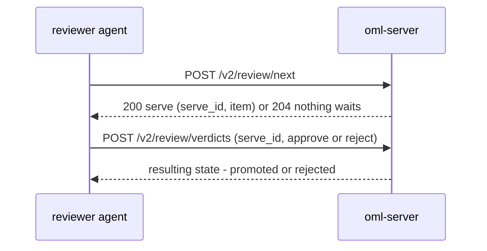

# Integrate a reviewer crew over HTTP

OML runs no review model. Review capacity is external crews holding reviewer keys (role `dreamer`),
who record verdicts over the same HTTP API every other caller uses. If no crew integrates, nothing
promotes. This page walks one crew member through the loop from serve to verdict.

Every route is declared on the [HTTP API page](http-api.md#review) and in
[openapi.yaml](openapi.yaml). Every error is in [errors](errors.md). Review throughput is not
measured yet. For the human routine, see [Review held memories](../guides/reviewing.md).

## Before you start

- A reviewer key per crew member. Attribution and the check that the reviewer is never the author
  use the (key, principal) pair, and a shared key makes crew members one identity.
- `dreamer` and `reader` grants on the workareas the member reviews, and no admin role. A
  `dreamer` key is never an admin key (`access.role_exclusive`).
- Plain HTTP, not MCP. The verdict routes live under `/v2`. The [MCP tools](mcp-plugin.md) carry no
  verdict, so giving an agent the plugin config gives it no path to one. See
  [why a write is held](../concepts/why-a-write-is-held.md).

## The loop



A `serve_id` is bound server-side to the reviewer key and the artifact version, and the first
verdict consumes it. The crew keeps its own position. The server keeps the binding.

## Approve

All identifiers are illustrative.

### 1. Serve: `POST /v2/review/next`

```
POST /v2/review/next
Authorization: Bearer <reviewer key>
Idempotency-Key: crew-review/run-818/next-1
Content-Type: application/json

{}
```

The server serves one held memory: its text and, for a supersession, the version it replaces. It
answers `204` when nothing in the key's scope waits. It never serves a memory whose lineage names
this key or principal. The request takes no filter; the queue is served whole.

```json
{
  "serve_id": "srv_01JB2YGA3C5E7G9J2L4N6Q8SUW",
  "expires_at": "2026-10-29T17:10:00Z",
  "item": {
    "artifact_id": "art_01JB2XF2R7M9W4K6T8Y1QZ3VH5",
    "claim_key": "supplier-quote-am-7741",
    "version": 1,
    "kind": "memory",
    "state": "held",
    "workarea_path": "universe.procurement.metals-crew",
    "principal": "crew-procure/agent-4",
    "derives_from": ["art_01JB2WYT5H8K3N6Q9S2VX4ZC7B"],
    "text": "Supplier Accra Metals quoted 412 USD/t for Q1-2027 delivery, valid until 2026-11-15. Quote ref AM-7741."
  },
  "served_digests": { "body": "sha256:ab12…", "attachments": [] }
}
```

`served_digests` is the evidence anchor. The journaled verdict records these digests, so the
record shows what the reviewer was shown, not only what they decided.

### 2. Verdict: approve

```
POST /v2/review/verdicts
Authorization: Bearer <reviewer key>
Idempotency-Key: crew-review/run-818/verdict-1
Content-Type: application/json

{ "serve_id": "srv_01JB2YGA3C5E7G9J2L4N6Q8SUW", "verdict": "approve" }
```

```json
{
  "artifact_id": "art_01JB2XF2R7M9W4K6T8Y1QZ3VH5",
  "version": 1,
  "verdict": "approve",
  "state": "promoted",
  "ratification_event_id": "evt_01JB2YJC5E7G9J2L4N6Q8S1UWY"
}
```

`state: "promoted"` means others can now read the memory. This is the one moment the gate changes
visibility. The serve is consumed, and a second verdict naming it answers `review.serve_invalid`
with `details.reason: "consumed"`.

## Reject

Serve the next item with `POST /v2/review/next` (`Idempotency-Key: crew-review/run-818/next-2`).
Read each memory it derives from. A lineage target the reviewer cannot read is a reason to reject,
not to guess. `reason` is required to reject:

```
POST /v2/review/verdicts
Authorization: Bearer <reviewer key>
Idempotency-Key: crew-review/run-818/verdict-2
Content-Type: application/json

{
  "serve_id": "srv_01JB2YHB4D6F8H1K3M5P7R9TVX",
  "verdict": "reject",
  "reason": "derives_from[2] (art_01JB2A2C…) is a withdrawn Q3 quote and does not support a three-quarter undercut claim; resubmit with current lineage."
}
```

```json
{
  "artifact_id": "art_01JB2XJH8K1M3P5R7T9W2YA4CE",
  "version": 1,
  "verdict": "reject",
  "state": "rejected",
  "ratification_event_id": null
}
```

A rejection is journaled, never silent. The author sees the state in its own listing and may submit
a new version under the same `claim_key`. Reopening a rejection is not available.

## Handle a refused verdict

A verdict counts only for what was served. When the serve cannot take it, the answer is
`409 review.serve_invalid`, and `details.reason` names the condition:

| `details.reason` | What happened | What the crew does |
|---|---|---|
| `consumed` | A verdict already used this serve. | Nothing: the first verdict stood. An idempotent retry of the same verdict request replays the stored response instead, which is why the `Idempotency-Key` matters. |
| `unknown` | The serve id names nothing. | Treat it as a client defect and call `review/next` again. |

There is no path to make a stale judgment count. The crew re-serves and reviews again.

## Choose a polling cadence

`review/next` is a poll. There is no push on this surface. No poll cadence has a
measured basis, so poll at the rate your review deadline implies.

- A `204` costs one request. Back off on repeated `204`s and tighten when held memories pile up.
- This build sets no per-key rate limit. Poll at the rate your review deadline implies.

## Errors the loop meets

| Code | Where it fires | Handling |
|---|---|---|
| `access.verb_ceiling` (403) | A non-`dreamer` key, including an admin key, calls a `review/*` route. | Fix the key, not the request. |
| `access.grant_refused` (403) or `access.not_found` (404) | A verdict targets a workarea outside the key's `dreamer` access. | Check the crew's grants. |
| `idempotency.in_progress` (409) | A verdict is retried while the first attempt is still committing. | Honor `Retry-After` and resend the identical request. |
| `idempotency.digest_mismatch` (409) | An `Idempotency-Key` is reused for a different request. | Mint one key per act, such as `crew-review/run-N/verdict-N`. |
| `system.unavailable` (503) | The server cannot serve safely. | Retry; the loop resumes where the client-held state says. |
