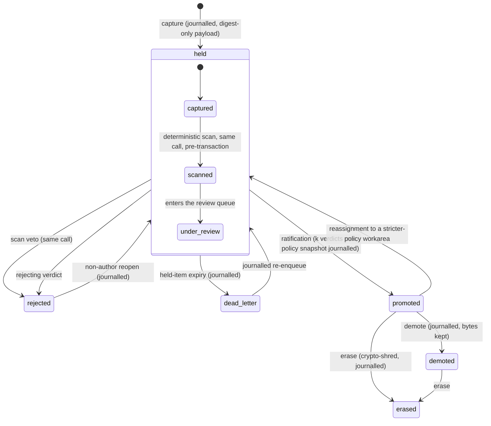

<!--
id: architecture/admission
tier: engineering
status: design draft for review · decided, not built
answers: what the admission pipeline does between capture and release; what a review policy object contains; who supplies review capacity and what happens when it is absent
-->

# Admission

**Status:** design draft for review · decided, not built

Admission is the pipeline every write crosses before anyone but its author can read it:

> capture → quarantine → deterministic scan → non-author review → ratification → journal → release.

This page owns that pipeline (decision D11): the lifecycle states, where held bodies live,
what the scan does, what a review policy object contains, who supplies the review capacity,
and what happens when that capacity is absent. The roles that act in the pipeline are defined
in [roles and keys](roles-and-keys.md); the workarea statuses that select which policy applies
are defined in [workareas](workareas.md); the transactional commit point and the outbox that
performs release are defined in [storage](storage.md). The constitution behind all of it —
the gate is not callable by the thing being gated, the reviewer is never the author, the gate
changes visibility, not ranking, no silent deletion — is declared in
[ADR-0001](../adr/ADR-0001-the-constitution.md) and not restated here.

Nothing below exists as code. Every mechanism is a design commitment with its exit criterion
tracked in the [roadmap](../product/roadmap.md).

## Lifecycle

The durable state column on a memory row takes four values: `held`, `promoted`, `demoted`,
`erased` (the row shape is in the [Postgres schema](../data/postgres-schema.md)). *Scanned*
and *under review* are phases within `held` — the journal records the scan verdict and each
review verdict as events, but a claim that has been scanned and is waiting for a reviewer is
still held: invisible to everyone but its author. The gate changes visibility exactly once,
at ratification.

Reading the diagram:

- **Capture.** A `remember`/`learn` call commits one Postgres transaction: the signed journal
  event (digest or ciphertext reference only — never body plaintext), the metadata row in
  state `held`, and an outbox row. The write is durable iff that transaction commits; the
  commit protocol is [storage](storage.md)'s to define. The author can see and supersede their
  own held claim; nobody else can see it at all. Claim text is Unicode-normalized to **NFC** at
  this step — before the plaintext digest is computed and before the scan runs — so the digest,
  the scan verdict and every downstream index see one canonical byte form; what search does with
  the normalized text is [retrieval](retrieval.md)'s to state. Bans are checked at capture, before quarantine
  or scan: a banned author's or source's submission is refused at the door with a typed error,
  and nothing from it is held, stored or queued ([roles and keys](roles-and-keys.md),
  [security](security.md)). Everything networked and everything deterministic completes
  **before that transaction opens**: DEK generation and the KMS wrap, body encryption, both
  digests, and the quarantine PUT for a bucket-placed body all precede `BEGIN`
  ([ADR-0024](../adr/ADR-0024-performance-foundation.md) d1) — the transaction holds nothing
  but the chain-head read, the signature and one insert statement.
- **Scan** happens in the same call as capture, before the transaction, and can veto — see
  [the deterministic scan](#the-deterministic-scan) below. A veto is a journalled rejection,
  not a dropped request: the caller gets a typed error naming the rule, and the event stays
  in the journal.
- **Review and ratification.** Reviewers record verdicts; when the workarea's policy is
  satisfied (k approving verdicts from identities meeting the independence axis), the server
  ratifies: a journalled promotion event carrying a snapshot of the policy it was decided
  under. Only ratification makes the claim readable by others.
- **Release** is asynchronous and follows promotion: the outbox drains to the lake
  ([storage](storage.md)). Release never gates visibility — reads are served from Postgres
  — so a lagging lake delays analytics, not availability.
- **Dead letter.** A held item that reaches its policy's expiry without a decision is
  dead-lettered: a journalled event, never a silent drop. It is refused promotion in that
  state; a journalled re-enqueue (an admin or dreamer act) returns it to the queue. This is
  the admission-side dead letter; the lake-writer keeps a separate dead-letter table for
  rows that fail materialization after promotion, owned by [storage](storage.md) and reported
  by [reconciliation](reconciliation.md).
- **Reassignment** of a promoted claim into a workarea whose policy is stricter than the one
  it was ratified under re-enters `held` and is reviewed again; the journalled move records
  both policy snapshots ([roles and keys](roles-and-keys.md)).
- **Demoted** and **erased** are post-promotion states, not admission outcomes. Demotion
  removes a claim from every consumer surface and keeps the bytes; erasure is crypto-shredding
  with a named inventory, defined in [audit and lineage](audit-and-lineage.md). Both remain
  possible in a validated (frozen) workarea.

One rule holds across every workarea status: effective access decides who may *write*
(defined in [workareas](workareas.md)); status changes only which review policy applies,
never grant resolution. A `development` workarea may, by journalled tenant policy, permit
marked `self_signed` rows — the one bounded exception, scoped in
[ADR-0001](../adr/ADR-0001-the-constitution.md); such rows never promote beyond that workarea.
Simulation writes pass this same pipeline with their audience as the reviewer pool
([simulations](simulations.md)).

## Quarantine placement

A held body never reaches the lake. Until promotion, body bytes live in exactly one of two
places:

- **Postgres**, alongside the metadata row, or
- **the quarantine bucket** — `oml-quarantine/<tenant>/<digest>` in the object store, readable
  and writable only by the service's own credentials; no client, crew, or downstream component
  (lake-writer, indexer, reconciler) holds a credential that reaches it.

The `body_ref` column records which location class a body took; both placements are inside the
design, and the criterion for choosing between them per body (a size threshold is the obvious
candidate) is an implementation choice the schema accommodates, not a decision this page makes.
What *is* decided: bronze lake events mirror the journal with digest-only payloads, and silver
materialization is enqueued by promotion only — so no path exists by which held bytes appear in
any lake zone, checkpoint, or Delta version. The cost of this placement is a copy at release:
a promoted body moves from quarantine to its ciphertext object and lake row, paid once per
promotion rather than once per read.

One consequence of the pre-transaction ordering above is named here rather than discovered
later: the quarantine PUT for a bucket-placed body completes before the commit transaction
opens, so a transaction that fails after the PUT **orphans a ciphertext object in
quarantine** — bytes no journal event references. The mechanism that handles it is a
**keyless GC sweep over unreferenced quarantine objects**: a scheduled pass that deletes
quarantine objects whose digest no journalled event references, holding no decrypt grant and
reading no plaintext — the orphan is ciphertext whose DEK was never journalled, so the sweep
is harmless by construction. It is a named background mechanism, never an inline concern on
the write path ([ADR-0024](../adr/ADR-0024-performance-foundation.md) d1; the quarantine
store itself is [storage](storage.md)'s).

Attachments upload into the same quarantine regime through resumable upload sessions, bound
into the submission envelope by digest; their storage protocol is
[storage](storage.md)'s.

## The deterministic scan

The scan runs in the same call as capture — before the commit transaction, never inside it
([ADR-0024](../adr/ADR-0024-performance-foundation.md) d1) — and returns before the call does:
the writer learns the scan outcome synchronously, and a veto means the submission is journalled
as rejected and nothing waits in the queue. The scan is same-call by design: an asynchronous
scan either delays the author's error to a moment they are no longer listening, or admits
unscanned bytes into the queue.

*Deterministic* is a load-bearing word: the scan is rules, not a model. Same input, same
verdict, reproducible from the journalled rule-set version — which is what lets a scan verdict
appear in an evidence export without a caveat about sampling temperature. The cost is the
complement: a deterministic scan catches what its rules name (secret patterns, format
violations) and nothing else. Judgment belongs to review, which is
why the scan can veto but can never promote.

For attachments, the scan covers what determinism can reach: where a deterministic text
extractor exists for the type, the extracted text is scanned and gated; for opaque binaries
the reviewed claim is provenance + digest + scan result, stated honestly per type
([storage](storage.md) owns the attachment rules). Scan latency is unmeasured; a rule pass is
expected to scale with body bytes, and no figure is asserted until one is measured.

One scanner lives outside the default set: the **vocab scanner**, selected only where a
workarea's `vocabulary_policy` (below) names a vocabulary. It checks cited CURIEs against the
policy's pinned release — the scan verdict records that release id alongside the scanner version
— and emits the deterministic finding classes `vocab.term_pending`,
`vocab.deprecation_replaced_by`, `vocab.mapping_exactMatch` and `vocab.deprecated_successor`
([ontologies](ontologies.md)). Because `human_required_classes` can name scanner finding classes,
a deterministic finding doubles as a routing mechanism: the shipped vocabulary defaults place the
human verdict on exactly those findings, and no parallel human-gate machinery exists.

## The rule-set registry

The scan's rules ship as a versioned **rule set**, and one identifier names the exact rule set a
deployment runs: `ruleset_vN`. The identifier is pinned per deployment and journalled in every
scan verdict — it is what the `scanner_version` field of the submission events carries
([event-catalog.md](../data/event-catalog.md)) — which is what makes a verdict reproducible
later: same input, same pinned rule set, same verdict, no caveat. Changing the pin is a
deployment act; verdicts taken under an earlier pin stay valid against it, and nothing is
re-scanned retroactively. The rule set loads at process start, and a replica that cannot load
its pinned rule set **fails readiness and serves nothing**
([deployment — probes](../operations/deployment.md#probes)): the scanner is in-process
deterministic rules, so "scanner unavailable" can only ever mean "this replica is not ready" —
never "writes admitted unscanned".

Finding classes are named `family.condition` — the same shape as the
[error taxonomy](../api/errors.md)'s codes, deliberately, but a **separate closed vocabulary**:
a finding class is review-policy vocabulary that `human_required_classes` may name, never an API
refusal. The API-side veto is always one code, `submission.scan_veto`, whose `details.finding`
carries the class that fired. Like the error taxonomy, the registry is closed: a new class is a
design change — a new `ruleset_vN` and a new row here — never an ad-hoc string.

The v1 shipped registry:

| Class | Fires on | Default |
|---|---|---|
| `secret.private_key` | A named private-key pattern — PEM-delimited key blocks, OpenSSH private keys — in claim text or deterministically extracted attachment text | veto |
| `secret.api_token` | A named credential-token pattern: provider-prefixed tokens the pattern list enumerates, OML's own `oml_` key format among them | veto |
| `secret.credential_pair` | A named user-and-password pattern — connection strings, basic-auth URLs | veto |
| `format.encoding` | Declared text that is not valid UTF-8 or cannot be NFC-normalized (the normalization step above has nothing lawful to produce) | veto |
| `format.media_type_mismatch` | Attachment bytes whose leading structure contradicts the declared media type | veto |
| `vocab.term_pending` | A citation of a CURIE that exists but is still held — distinct from unknown ([ontologies](ontologies.md)) | annotate |
| `vocab.deprecation_replaced_by` | A term deprecation carrying a `replaced_by` successor ([ontologies](ontologies.md)) | annotate |
| `vocab.mapping_exactMatch` | A `term_mapping` claim asserting the `exactMatch` predicate ([ontologies](ontologies.md)) | annotate |
| `vocab.deprecated_successor` | A deprecation whose named successor is itself already deprecated at ratification time — judgment, not law ([ontologies](ontologies.md)) | annotate |

The **default** column is the class's behavior when no policy says otherwise: a `veto` class
refuses the submission (`submission.scan_veto` — a refusal like any other refusal, journalling
nothing: the scan is deterministic, so the verdict is reproducible from the journalled rule-set
pin and needs no event of its own; whether refused submissions deserve a durable trace outside
the chain is RS-16 on the [roadmap](../product/roadmap.md)); an `annotate` class
records the finding on the held item and never blocks. The `secret.*` and `format.*` families
ship in the default scanner set; the `vocab.*` family is emitted only by the vocab scanner,
selected where a workarea's `vocabulary_policy` names a vocabulary (above). The exact pattern
lists behind the `secret.*` classes are rule-set content, versioned by `ruleset_vN`, not
enumerated on this page — what is fixed here is the class vocabulary a policy can name.

`human_required_classes` references entries of this registry **by exact class name**. That is
the routing mechanism the vocab scanner paragraph above already uses: a deterministic finding
whose class a workarea's policy names requires at least one human verdict for ratification, and
no parallel human-gate machinery exists. The shipped vocabulary defaults name
`vocab.deprecation_replaced_by` and `vocab.mapping_exactMatch`
([ADR-0021](../adr/ADR-0021-ai-human-ontologies.md)); a tenant may tune any class in or out by
the journalled policy act, including to zero
([ontologies](ontologies.md) owns the zero-human conditions).

## Review policy objects

Each workarea carries a review policy object: a journalled record, versioned by the journal
like everything else, snapshotted into every ratification event so an auditor can read a
promotion against the exact policy it satisfied. Its fields:

| Field | Meaning |
|---|---|
| `k` | approving verdicts required for ratification |
| `required_roles` | which roles' verdicts count (dreamer-review; human where named) |
| `human_required_classes` | claim classes (by kind, scan finding class, or provenance) whose ratification requires at least one human verdict via the CLI |
| `independence_axis` | how far apart reviewer and author must be: reviewer principal ≠ author principal always (constitution R2, enforced at promotion against the row's lineage closure — [roles and keys](roles-and-keys.md)); optionally, for `committed` workareas by policy, reviewer crew / external manager ≠ author crew, resolved from journalled key→crew→manager metadata at promotion time ([roles and keys](roles-and-keys.md)) |
| `held_item_expiry` | how long an item may wait in the queue before it is dead-lettered |
| `vocabulary_policy` | optional `{vocabulary, release, enforcement: require \| annotate \| off}` — **default off**: which vocabulary and pinned release the vocab scanner checks cited CURIEs against, and whether a failing citation blocks (`require`), records a finding (`annotate`), or is not checked at all ([ontologies](ontologies.md), [ADR-0021](../adr/ADR-0021-ai-human-ontologies.md)) |

Policy objects are per workarea because workareas mirror crews with different stakes: a
`development` area's policy may be permissive to the marked limit the constitution allows; a
`committed` area requires full non-author review; a `validated` area refuses new writes
entirely, so its policy governs nothing new ([workareas](workareas.md) owns the ladder).
Changing a policy is a journalled admin act and applies to decisions made after it — items
already under review ratify against the policy snapshot they will be journalled with, which is
the one in force at promotion time.

What the policy object deliberately does not contain: any ranking, scoring, or confidence
field. The gate changes visibility, not ranking; a policy decides *whether*, never *how
prominently*.

## Review capacity: external crews

The provider runs no model. Review capacity is external crews holding dreamer-class keys,
recording verdicts over the same HTTP API every other caller uses — a crew's reviewer agent
is a client, with a key whose verb ceiling is exactly the dreamer surface
([roles and keys](roles-and-keys.md)), and the server's job is to refuse verdicts that break
the rules (author in the lineage closure, no valid serve, policy not met), not to produce
verdicts. Human review through the CLI is the exception path, reserved by
`human_required_classes` and available whenever a person holds a dreamer key
([CLI reference](../cli/reference.md) owns the review ceremony). The crew-facing contract — the
reviewer surface a crew's agent implements, serve handling, and verdict recording end to end —
is specified in [reviewer crews](../api/reviewer-crews.md). The worked crew integration flow —
queue, next, attachment fetch, verdict — is
[reviewer-crews](../api/reviewer-crews.md#walkthrough-approve).

A verdict counts only against a valid serve: the server binds a serve to (reviewer key,
artifact version, attachment digest set), expires it, consumes it on first verdict, and
invalidates it when the served content changes; the journalled verdict records the served
digests, so the evidence export can show *what the reviewer was shown*, not just what they
decided. The serve binding is defined with the CLI ceremony in the
[CLI reference](../cli/reference.md) and enforced server-side for every reviewer, crew or
human. A reviewer is served every attachment of a claim before a verdict counts
([storage](storage.md)).

This design trades operational simplicity for an honest dependency: review quality and review
throughput are properties of the tenant's crews, not of the provider. The provider makes
collusion visible rather than impossible — the evidence export surfaces reciprocal-approval
statistics per key pair — and makes independence checkable at promotion time; it cannot make
an external crew diligent. These decisions — review composition, the served-reviewer rule (a
signature counts only from a reviewer the gate served), and the division of labour (crews
review; reviewer keys record verdicts and nothing else) — are recorded in
[ADR-0012](../adr/ADR-0012-admission-and-review.md).

## Fail closed

When review is unavailable, nothing promotes. Concretely:

- A workarea whose policy no live key can satisfy (no dreamer key with review capability in
  scope, or none outside the author's lineage closure) accumulates held items until a key
  exists or the items expire into the dead letter. The server does not relax `k`, does not
  widen the role set, and does not auto-promote on timeout.
- The lineage case deserves naming, because any writer can produce it: every artifact a
  submission's `derives_from` names expands the row's reviewer-exclusion set — R2 runs over the
  whole lineage closure — so a submission whose declared ancestry excludes every eligible
  reviewer in the workarea is unreviewable and therefore unpromotable. It is not refused at
  capture (reviewer unavailability is deliberately not an API error,
  [errors.md](../api/errors.md)); it lands held, surfaces in `oml status` / `oml doctor` as
  review unavailability, and dead-letters on expiry. Declaring ancestors can only shrink who may
  judge a row, never select a friendlier judge — and a false or padded lineage is itself grounds
  for rejection at review ([ADR-0012](../adr/ADR-0012-admission-and-review.md)).
- A simulation whose audience contains no dreamer can promote nothing
  ([simulations](simulations.md)).
- A verdict whose serve has expired or whose served digests no longer match the artifact is
  refused; the reviewer is re-served.
- Errors in the pipeline are typed and name their rule ([error taxonomy](../api/errors.md));
  an unclassifiable failure refuses the write rather than admitting it unscanned.

The cost of failing closed is availability: a tenant that under-provisions review capacity
experiences admission as an outage for new knowledge, visible in `oml status` as queue depth
and review availability ([CLI reference](../cli/reference.md)). That is the intended shape —
the alternative, failing open, converts a capacity problem into a trust problem, and trust is
the product.

## Reopening a rejection

Rejection is journalled, never silent, and not necessarily final. A non-author — a
dreamer(review) key whose key and principal do not appear in the row's lineage closure — may
reopen a rejected item as a journalled verb, returning it to review. Admin keys cannot reopen:
reopen is a review-family verb, and admin ≠ reviewer ([roles-and-keys.md](roles-and-keys.md)). The reopen event names who reopened and
why; the original rejecting verdict stays in the journal and in the evidence export. The
author cannot reopen their own rejection (that would be self-review by another door); they
can submit a new version under the same claim key, which enters the pipeline as a fresh held
item with its `derives_from` lineage intact.

## Throughput is the honest open question

Review throughput for OML is unmeasured — no code exists to measure. The
[roadmap](../product/roadmap.md) carries review-throughput measurement as FR-2, with an exit
criterion (a measured drain rate for a stated policy and crew configuration, published beside
the method).

One structural expectation can be stated without a measurement: ingress throughput is not
end-to-end review capacity, and the queue, not the store, is where an admission-controlled
system saturates. The binding constraints will be the tenant's crew capacity and the server's
verdict path — both unmeasured until FR-2's exit criterion is met.
