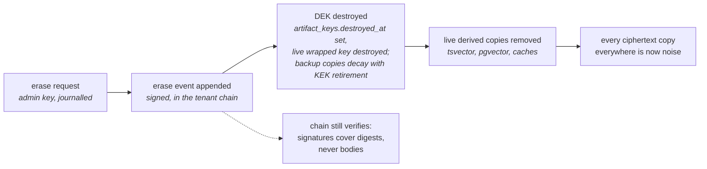

<!--
id: architecture/audit-and-lineage
tier: engineering
status: design draft for review · decided, not built
answers: what the journal records and never records; what an evidence export contains; how lineage is queried; what erasure does to every copy class; how versions are numbered, superseded and retired
-->

# Audit and lineage

**Status:** design draft for review · decided, not built

This page owns the evidence story and decision D4: what the journal records and what it never
records, what an evidence export contains, how lineage is represented and queried, and what
erasure actually does — including the full inventory of every copy class a memory's content can
reach and what happens to each one when that memory is erased. The journal's commit protocol,
per-tenant hash chain and signing are mechanics owned by [storage](storage.md); the read log's
retention and anchoring are owned by [retrieval](retrieval.md); the simulation fence whose rows
every export must separate is owned by [simulations](simulations.md); the CLI verb that produces
the export, `oml audit export`, is specified in the [CLI reference](../cli/reference.md). The
decision record for erasure is ADR-0005 in the [decision register](../adr/index.md).

Nothing below exists as code. Every mechanism is a design commitment whose exit criterion is
tracked in the [roadmap](../product/roadmap.md). The claim this page makes for the system is the
sanctioned one and no stronger: it **produces the evidence an auditor asks for**. It does not
claim compliance with any regulation, and the one place a regulation is named —
[GDPR Article 17, below](#gdpr-article-17-a-named-tension) — names it as a tension with a
designed answer and an open edge, not as a box ticked.

## What the journal records

The journal is the system of record: a per-tenant, signed, hash-chained, append-only sequence of
events in PostgreSQL ([storage](storage.md) owns the chain-head serialization, the synchronous
durability domain, the append-only enforcement and the fork check). Every act that changes what
the system holds or who may see it is a journal event: capture, scan verdict, review verdict,
ratification (with the review-policy snapshot it was decided under), demote, erase, reassign,
supersession, key issuance and revocation, grant and deny changes, workarea creation, re-parent
and status transitions, bans and lifted bans, simulation start, audience change and end,
dead-letter and re-enqueue, materialize-skipped. Each event carries the acting principal and `api_key_id`, a
real chain timestamp, and — where it concerns content — references to that content.

Two deliberate attestation limits travel with every claim this page makes about the journal:

- **The signature attests the deployment, not a unique process.** The signing key is loaded by
  the **lead only** — at most one process, lease-guarded, every takeover journalled
  (`system.lead_acquired`, [ADR-0023](../adr/ADR-0023-install-profiles-and-cluster-mode.md));
  a compromised lead is a compromised key. The threat model is
  [security](security.md)'s to state; the evidence export inherits the limit.
- **Undeclared derivation is invisible.** A writer that omits `derives_from` produces a row the
  service cannot connect to its sources. Lineage exclusion — the reviewer-independence check,
  simulation taint — is exactly as good as the declared graph, and no page of this
  documentation claims otherwise.

## What the journal never records

**Body plaintext never enters the journal.** A journal event — and the outbox row written in the
same transaction — references content only as a plaintext digest or as a reference to
per-artifact-DEK ciphertext. The ed25519 signature covers that digest/ciphertext envelope, not
the body, which is what makes the design's central evidence property possible: **chain
verification survives crypto-shredding.** After an erase, every signature still verifies and
every hash still chains, because nothing the signatures cover has changed; the bytes the digests
point at have simply stopped being decryptable.

Two further exclusions, each with its reason:

- **Reads are not chain events.** Read events (key, role, workarea, memory ids or query digest,
  timestamp) live outside the hash chain in a retention-bounded log whose per-batch digests are
  anchored into the journal. The anchoring keeps the chain from growing at read rate and keeps
  read records erasable, and the chain proves the log's integrity from each batch's anchor
  onward — the not-yet-anchored tail is protected only by ordinary table permissions until its
  batch digest lands, and the anchoring cadence is a stated deployment parameter. Retention is
  tenant policy; the mechanics are [retrieval](retrieval.md)'s.
- **Identity metadata in the chain is minimized.** The chain carries writer identity and
  principal because attribution is a design requirement of this system — who wrote what, when, where.
  It carries no more than that, and the design is honest that what it does carry is not erased
  by crypto-shredding: see [the boundary](#the-honest-boundary), and the attribution-metadata
  erasure FR in the [roadmap](../product/roadmap.md).

## The evidence export

`oml audit export` produces a signed bundle ([CLI reference](../cli/reference.md) owns the verb
and its flags). Each section of the bundle answers a question an auditor actually asks, and each
carries its own stated limit:

| Section | The question it answers | Built from | Stated limit |
|---|---|---|---|
| Per-memory decision trail | "Show me everything that happened to this claim, in order, and who decided each step." | The journal events for the artifact: capture, scan verdict, every review verdict with the served digests it was recorded against ([admission](admission.md) owns serve binding), ratification with its policy snapshot, and any later demote, reassign, supersession or erase. | For an erased memory the trail shows that each decision was made over a digest that can no longer be opened — decisions survive, content does not. |
| Per-tenant chain verification | "Prove this record was not edited after the fact." | Recomputing the tenant's hash chain and verifying every signature against the deployment key; the result names the verified head (tenant, seq, hash). | Attests the deployment, not a unique process ([security](security.md)); proves integrity of the record, not truth of what agents wrote. |
| Grants history | "Who could do what, where, and when — and who gave it to them?" | Journalled key issuance (with the issuer ceiling check), revocations, grants, per-grant denies, global key denials and permission epochs. Every effective-access computation is reproducible from these records alone ([workareas](workareas.md), [roles and keys](roles-and-keys.md)). | History of authority, not of intent; a key's holder is whoever the tenant gave it to. |
| Read log, retention-scoped | "Who read this memory, and when?" | The read-event log, exported only within the tenant's retention window, with the journal-anchored batch digests that let the window's contents be verified. | Answers nothing outside the window, and says so in the bundle rather than exporting an unverifiable tail ([retrieval](retrieval.md)). |
| Reciprocal-approval statistics | "Could the writer and the reviewer be the same interest?" | Per key-pair approval counts across the export window, surfacing pairs that predominantly ratify each other. | Makes collusion **visible, not impossible** — the independence axis ([roles and keys](roles-and-keys.md)) is checked at promotion; this section is the standing check on what slipped past it. |
| Simulations, separated | "Is any of this synthetic?" | Simulation rows, excluded from the main sections by default and listed separately per `simulation_id` when included; the tainted closure is listed in the simulations section of **every** export, even one that excludes simulation content ([simulations](simulations.md)). The simulations section appears in every export, even one that includes nothing, so absence is asserted rather than assumed. | Fencing is as good as declared derivation (§ above). |

The bundle is itself signed, so a recipient can verify it was produced by the deployment it
claims. What the bundle is **not**: it is not a compliance certificate, it is not legal advice,
and no sentence in it or about it reads "audit-ready". It is the evidence; the verdict is the
auditor's.

How the deployment public key reaches a recipient and is authenticated — one fingerprint confirmed over a channel independent of the bundle, cross-signatures extending it across planned rotations, re-rooting after an unplanned one — is stated in [chain-format](../data/chain-format.md#how-the-public-key-reaches-an-export-recipient).

## Lineage

Lineage answers two different questions with two different structures: *what did this claim come
from* (the derivation graph) and *which version of this claim is current* (the supersession
chain). Both are journalled; both are materialized into `gold.lineage` for analytics
([Delta tables](../data/delta-tables.md)), but every authoritative read is served from Postgres.

### The derivation graph

Every submission may declare `derives_from` edges to the claims it was built from. A dreamer's
edit-as-proposal is a new attributed submission whose `derives_from` names the version it edits;
a connection proposal is an explicit claim↔claim edge, pending until ratified by an identity
that proposed neither endpoint. The **lineage closure** of a row — the transitive closure over
`derives_from` and claim edges, **pending and ratified alike** — is computed at promotion time
and is load-bearing twice:

- **Reviewer independence.** A verdict is refused when the reviewing key or principal appears
  anywhere in the closure, not merely as the row's direct author. Pending edges count, so a
  proposer cannot launder authorship through an unratified connection proposal
  ([admission](admission.md)).
- **Simulation taint.** A closure that touches a simulation row makes the claim sim-derived,
  with everything that follows ([simulations](simulations.md)).

Closure over pending edges is deliberately the conservative choice: it refuses some reviews a
ratified-only reading would allow, and the design accepts that cost because the alternative —
an author approving their own work through an edge nobody ratified yet — is the exact failure
the constitution exists to prevent.

### Supersession chains, claim_key and the tip

A `claim_key` names which submissions are one claim in several versions; the served member of
that chain is the **tip**.
The rules, enforced as constraints in the [Postgres schema](../data/postgres-schema.md):

- One served tip per `(tenant, workarea_id, claim_key)` — a partial unique index over served
  rows; the [Postgres schema](../data/postgres-schema.md) records why the index is spelled with
  the workarea: `claim_key` is namespaced per workarea.
- **Each version has its own `artifact_id`, and `version` is its ordinal within the
  `claim_key`.** A new claim's first version is 1. A successor's version is 1 + the greatest
  `version` of any row of that `claim_key` in the workarea, whatever its state, so ordinals grow
  past rejected versions and past a tip that a tip override moved back to an earlier version. `replaces` names the target; the ordinal only places the version in
  the claim's history. The ordinal is read before the capture transaction opens, like every
  deterministic input of a capture ([ADR-0024](../adr/ADR-0024-performance-foundation.md) d1);
  the per-tenant chain lock serializes commits, the `memories_claim_version` index refuses a
  capture whose ordinal a concurrent capture took first, and the server retries that capture.
  The retry re-runs every pre-`BEGIN` read of the capture, the `claim_key` collision test
  included, so a version-1 capture that lost the race answers `submission.claim_key_conflict`
  and is never renumbered; only a successor takes a fresh ordinal. A superseded version reads
  state `promoted`, tip `false`. The ordinal is
  a stated residual: a successor's version ordinal, returned to its proposer and shown on every
  version, counts every earlier version of the `claim_key` in any state, so a key learns how many
  versions it cannot read (held, rejected or demoted, by any author) precede it — a count, never
  content ([FR-31](../product/roadmap.md)).
- **A `claim_key` names one live claim per `(tenant, workarea_id)`.** A new claim (version 1)
  collides with a held, promoted or demoted version of that `claim_key` in the workarea —
  held now, or promoted at some point and not erased (`submission.claim_key_conflict`). A
  version 1 rejected without ever being promoted releases the key for a fresh version 1, and so
  does a claim whose every version is rejected or erased, so a rejection never blocks
  resubmission. A demoted claim keeps its key, because a demoted version can return to service
  ([simulations](simulations.md): a sim-derived row that survives re-review is un-demoted); a
  claim whose every version is demoted therefore holds its key until it is erased or returns to
  service, and its replacement starts under another `claim_key`. No
  two held, promoted or demoted versions of one `claim_key` therefore share an ordinal, and
  (`claim_key`, `version`) — a tip override's `to_version` among its uses — names one version;
  an erased chain keeps its `artifact_id`s in the journal and the evidence export beside any
  fresh chain under the released key. Reopening a rejected first version is refused with
  `submission.claim_key_conflict` under the same test, so a reopen never sets a second live
  first version beside a fresh one. A reopened successor needs no such test, since the
  compare-and-set below guards the tip; any reopen whose ordinal a held, promoted or demoted
  version of its `claim_key` already carries is refused with the same code. The collision is a
  stated residual: it tells any writer on the workarea that a held version, or a promoted or
  demoted one the writer cannot read, holds that `claim_key` — a name, never content
  ([FR-31](../product/roadmap.md); [ADR-0025](../adr/ADR-0025-the-agent-only-memory-surface.md)
  d18).
- **Supersession targets the current served tip, and only ratification moves the tip.** A
  supersession is a held successor that names the version it replaces; the replaced version
  stays the served tip, and stays in every reader's recall, until a non-author ratifies the
  successor. Several held successors of one tip may coexist — an author's revision beside a
  dreamer's edit-as-proposal, say — and none blocks another, though the authors of rival held
  successors are kept off each other's review
  ([roles and keys](roles-and-keys.md#the-dreamer-split)). Ratification compare-and-sets that
  the target is still the promoted tip under the successor's own `workarea_id` and `claim_key`,
  and journals one `lifecycle.supersede`, which promotes the successor and flips the tip in the
  same commit, so the compare-and-set decides between competing successors: once one is
  ratified, a verdict that would ratify another is refused with `submission.tip_conflict`,
  nothing is journalled, its serve is not consumed, and that successor stays held until a
  reviewer rejects it; its author may propose afresh against the new tip, and the fresh proposal
  leaves the stale one held. A target moved to another workarea or re-keyed after the successor
  was captured fails the compare-and-set, and so does a successor moved or re-keyed away from its
  target: the verdict answers `submission.tip_conflict`, nothing is journalled, and the successor
  stays held until a reviewer rejects it. So a verdict in one workarea never retires another
  workarea's tip, and the one `workarea_id` of a `lifecycle.supersede` names both versions. The
  tip never changes except by a ratified promotion, so readers never see a version nobody
  reviewed ahead of a reviewed one. The compare-and-set runs inside the commit's data-modifying
  statement, never before `BEGIN` ([postgres-schema](../data/postgres-schema.md#memories)). For a
  tainted successor (provenance `simulation` or sim-derived) the ratification compare-and-sets
  the same target under the same predicate and journals
  `lifecycle.supersede`, but it sets the audience overlay tip (`memories_overlay_tip`) and never
  the default tip: a target that is the default tip is compared without being flipped, so it
  stays the default tip for every key, and only an overlay target is flipped. Tainted and untainted successors of one tip do not compete under the
  default-tip compare-and-set, and an overlay whose target stops being the default tip stops
  shadowing it. A version's `tip`, on every read that serves it, is computed for the calling key,
  audience-scoped: a key in the simulation's audience sees the overlay as the tip and the default
  tip it shadows with `tip: false`; every other key sees the default tip and never an overlay
  ([ADR-0025](../adr/ADR-0025-the-agent-only-memory-surface.md) d10).
- **A successor's kind changes only within its class.** A successor of a `memory`,
  `derived_fact` or `steering` target may take any of those three kinds, so a revision can turn a
  memory into a derived fact or a standing instruction under review; a successor of a `term`,
  `term_mapping` or `vocab_release` target keeps the target's kind; a retirement successor keeps
  the target's kind. Any other `kind` is `request.validation`, and an omitted `kind` is the
  target's ([ADR-0025](../adr/ADR-0025-the-agent-only-memory-surface.md) d11).
- **A self-signed version takes the tip only from a self-signed tip.** In a `development`
  workarea whose policy permits self-signing, a `self_signed` version may take the tip only as a
  claim's first version or from a `self_signed` tip. A supersession or retirement whose target
  was promoted by non-author review needs full non-author ratification even there — the review
  policy does not admit self-sign for that row. `self_signed` rows are served only to reads
  whose scope node is their own workarea ([retrieval](retrieval.md)), so a self-signed
  replacement would take reviewed content away from every recall and listing scoped above the
  workarea with no second identity
  ([ADR-0001](../adr/ADR-0001-the-constitution.md) d5;
  [ADR-0025](../adr/ADR-0025-the-agent-only-memory-surface.md) d17).
- **A retirement version as tip makes a retired claim.** A ratified supersession carrying
  `retirement: true` takes the tip; recall then serves nothing of the claim — neither hits nor
  steering ([retrieval](retrieval.md#the-recall-ordering-contract-steering-rows-first-unranked))
  — while get still answers for every version as history, and nothing is demoted or erased (R4).
  A later ratified supersession of the retirement version returns the claim to service.
- **Reassignment that would collide on `claim_key` in the destination is refused**, unless the
  journalled move event records a re-key. A silent re-key would break the chain's identity;
  a recorded one is lineage.
- **The default tip is never a simulation-tainted version.** Tip resolution is audience-scoped
  ([simulations](simulations.md)): taint never captures the default tip. Tip computation for keys
  outside a simulation's audience ignores `provenance: simulation` rows and sim-derived claims,
  a promoted tainted supersession is served only as that audience's overlay tip, and any act that
  would make a tainted version the default served tip is refused (`simulation.tip_refused`). The
  default tip of a real claim is therefore bit-for-bit indifferent to every simulation.

A superseded version is not deleted — it remains readable as history behind the tip, carrying
its own decision trail, until demoted or erased by its own journalled act.

## Erasure: crypto-shredding

Bodies and attachments are encrypted under per-artifact data-encryption keys (DEKs) wrapped by a
key-encryption key in KMS or a Secret ([security](security.md) owns key custody; the
`artifact_keys` table is in the [Postgres schema](../data/postgres-schema.md)). Erasure is two
acts in one journalled operation:

The journalled erase event records who erased, when, under what request provenance, and the key
identifier destroyed — never the key. Demotion is a different act entirely: demote removes a
claim from consumer surfaces and **keeps the bytes**; erase destroys the ability to read them.
Both exist on every workarea status, including `validated` — freeze stops new writes, not
governance or legal reality ([workareas](workareas.md)).

**The guarantee is scoped to body and attachment bytes.** That sentence is the boundary of the
promise, and the inventory below is the promise spelled out per copy.

### The erasure inventory

Every copy class a memory's content — or the key material that can unlock it — can reach, and its
disposition at erase. This table is the normative statement; any page that mentions erasure links
here rather than restating it.

| Copy class | What it holds | Disposition at erase |
|---|---|---|
| `journal.payload` / `signed_bytes` | Digests and ciphertext references only, by design — never plaintext | Never needs touching; the chain verifies unchanged |
| `outbox.payload` | Same digest/ciphertext envelope the journal carries | Never needs touching |
| `bronze.events`, including all Delta versions and checkpoints | Digest-only mirror of journal events | Never needs touching |
| `silver`/`gold` body columns | Per-artifact-DEK ciphertext | Unreadable the moment the DEK is destroyed; a retract MERGE updates row state. Parquet files of **earlier Delta versions and checkpoints** keep the ciphertext until `VACUUM` and checkpoint cleanup remove them — that retention bound is part of the erasure SLO, stated, not hidden |
| Object-store versions (`oml-bodies`, quarantine) | Ciphertext of bodies and attachments, including prior object versions | Unreadable at DEK destruction; versions age out under bucket retention |
| `pgvector` rows and `tsvector` entries | **Plaintext-derived** index content ([retrieval](retrieval.md)) | Removed **in the same transaction as the erase event**; **persist in Postgres base backups and WAL until the named backup retention window expires** — that is the honest statement, and the window is a stated operational bound, not an apology |
| Postgres temporary and spill files; standby replicas' own disks | Transient plaintext-derived content (sorts, hash spills over index rows) on the primary's and every standby's volume | Bounded by volume encryption at rest plus the operating system's temp-file lifetime; a standby's disk holds the same WAL and table copies as the primary and inherits every bound above. Named here because the inventory's rule is completeness, not comfort |
| OS/block-level volume snapshots of the Postgres volume | Everything the volume held at snapshot time — plaintext-derived index content **and** wrapped DEKs — outside the base-backup/WAL accounting above | Whether the deployment takes volume snapshots is an operational choice; if it does, their retention window joins the erasure SLO composition exactly as base backups do, and the [deployment](../operations/deployment.md) backup table must list them |
| `artifact_keys.wrapped_dek` in Postgres base backups and WAL | The **wrapped DEK itself** — a usable key copy, not content | The live row is nulled at erase; copies in base backups and WAL survive until the backup retention window expires, and **while the wrapping KEK lives, a restored backup plus KMS unwrap could recover the DEK and decrypt every surviving ciphertext copy**. The designed bound: scheduled KEK rotation re-wraps **live** DEKs only, and a retired KEK is destroyed once the backup horizon has passed — destroying it invalidates every wrapped-DEK copy in older backups. Erasure therefore completes against live stores immediately, and against backups no later than **backup retention window + KEK rotation period** ([security](security.md) owns key custody; the fenced-restore ceremony is [deployment](../operations/deployment.md)'s) |
| The `kms-file` keyring file and its backups (standalone and docker profiles, [ADR-0023](../adr/ADR-0023-install-profiles-and-cluster-mode.md) d4) | The **KEK itself**, held as a host file behind the KMS port — not content, the key that unwraps every DEK it wrapped | The live file's retired-KEK destruction is file deletion, journalled. Any backup of the keyring file — host backup, volume snapshot, copied compose volume — is a usable key copy and extends the erasure SLO exactly as wrapped-DEK copies in Postgres backups do; its window is whatever backs up that path, which only the operator controls, and the bound is stated as exactly that strong ([RS-12](../product/roadmap.md); the backup table in [deployment](../operations/deployment.md) lists this class) |
| `held_fts` (decided, not built — [retrieval](retrieval.md#held-text-containment)) — `tsvector` entries, the class above, on a row of its own for its held transitions | **Plaintext-derived** `tsvector` rows of held versions, readable only by the authoring key | Inserted by every transition into `held` and removed by every transition out of it, each in the commit that makes the transition ([retrieval](retrieval.md#held-text-containment) owns the list), so a held row's index entry never outlives its held state; persists in Postgres base backups and WAL until the backup retention window expires, exactly as the `tsvector` row above |
| `read_events` | Memory ids and query digests, not bodies | Retention-bounded by tenant policy ([retrieval](retrieval.md)); in this inventory because a query digest can correlate with erased content until its window closes |
| Serving-path caches | Decrypted bodies in flight | Invalidated at erase; any cache added later enters this inventory as a named copy class before it ships |
| Attribution metadata (writer identity, principal, timestamps, workarea path) | Plaintext, in journal, metadata rows and lake rows | **Not erased by crypto-shredding.** Its erasure or pseudonymization is a tracked FR with an exit criterion in the [roadmap](../product/roadmap.md) — open, not solved |
| `terms` CURIE annotations ([ADR-0021](../adr/ADR-0021-ai-human-ontologies.md)) | Clear vocabulary labels on claims — they semantically label even an erased claim ("this erased claim was tagged X") | **Not erased by crypto-shredding**, same class as attribution metadata above; inherited by the same FR |

### The honest boundary

What an erase promises: after the journalled erase event, no component of the system can decrypt
the body or attachments from any live store, every live plaintext-derived copy is removed, and
every remaining ciphertext copy decays to noise on its stated retention schedule (Delta `VACUUM`,
object versioning, backup expiry). What it does not promise: instantaneous disappearance of
plaintext-derived index entries from backups taken before the erase; instantaneous invalidation of
the wrapped-DEK copies in those same backups — they remain usable key copies until the retired KEK
that wrapped them is destroyed, no later than backup retention window + KEK rotation period; and
erasure of attribution metadata. All three limits are stated here, bounded by named windows or tracked FRs, and repeated
wherever erasure is mentioned — because the alternative, a one-word "erased" that a reader takes
as absolute, is an overclaim waiting for a retraction. The sanctioned formulation, everywhere:
**a journalled erase event whose effect on each copy class is listed here.**

## GDPR Article 17: a named tension

An append-only journal and a right to erasure pull in opposite directions, and this design does
not pretend otherwise. The resolution rests on one foundational move and one deliberate scoping:

- The foundational move: *decisions are immutable; content is erasable.* A "content stays
  addressable forever" invariant is untenable for personal data — agent memory is free text
  about people as the normal case, not an edge case — and tombstoning (suppress from queries,
  keep the bytes readable) is rejected as the legally weakest option. Crypto-shredding is chosen
  because it is the only option that preserves a verifiable record: destroy the key, keep the
  ciphertext and the chain.
- The scoping: the claim is never unconditional. Statements like "never personal data", "no
  missed replicas", "no race with caches" do not survive scrutiny — a retained usable key backup
  or a surviving plaintext-derived copy is a counterexample to naive "delete the key, done"
  erasure. Deleting the live key alone is insufficient; erasure requires an inventory of every
  usable key copy and every plaintext or derived copy, plus fenced restore. That scoping is why
  [the inventory above](#the-erasure-inventory) exists as a table rather than a sentence, why
  backups and Delta version history appear in it with named windows, why the wrapped-DEK copies in
  Postgres backups appear in it as a usable-key-copy class bounded by KEK retirement, and why attribution
  metadata is listed as not-erased rather than assumed non-personal because adjacent content is
  hashed — signed identifying metadata must be minimized or individually erasable, and OML's
  answer is minimization now and an erasure FR for the rest.

The design's answer to Article 17, then: bodies and attachments are erasable by crypto-shredding
with a journalled, auditable erase event; the journal holds no plaintext, so the record survives;
plaintext-derived copies are removed live and bounded in backups by a named retention window;
wrapped-DEK copies in backups are bounded by scheduled KEK rotation and retired-KEK destruction;
attribution metadata is the open edge, tracked as an FR with an exit criterion. The open edges
are stated because a second-line risk function is paid to find them, and finding them stated is
the difference between a design review and a retraction. None of this is legal advice, and no
sentence here or elsewhere in this documentation claims the design is GDPR-compliant; the claim
is that an erase **produces the evidence an auditor asks for** — the erase event, the inventory,
and a chain that still verifies.

## Decision records

- ADR-0005 — erasure by crypto-shredding with a named inventory and honest boundary
  ([decision register](../adr/index.md)).
- The journal's own decisions (system of record, per-tenant chains) are ADR-0002, owned by
  [storage](storage.md); the read log's are ADR-0013, owned by [retrieval](retrieval.md).
- [ADR-0025](../adr/ADR-0025-the-agent-only-memory-surface.md) — the tip moves only at
  ratification, by a compare-and-set bound to the successor's workarea and `claim_key`; distinct
  version ordinals; rival successors' authors kept off each other's review; retirement as a
  supersession; the self-signed tip rule; the `claim_key` release after a never-promoted rejection
  and the reopen that would collide with it; the `held_fts` table, `tsvector` entries in the
  inventory.
