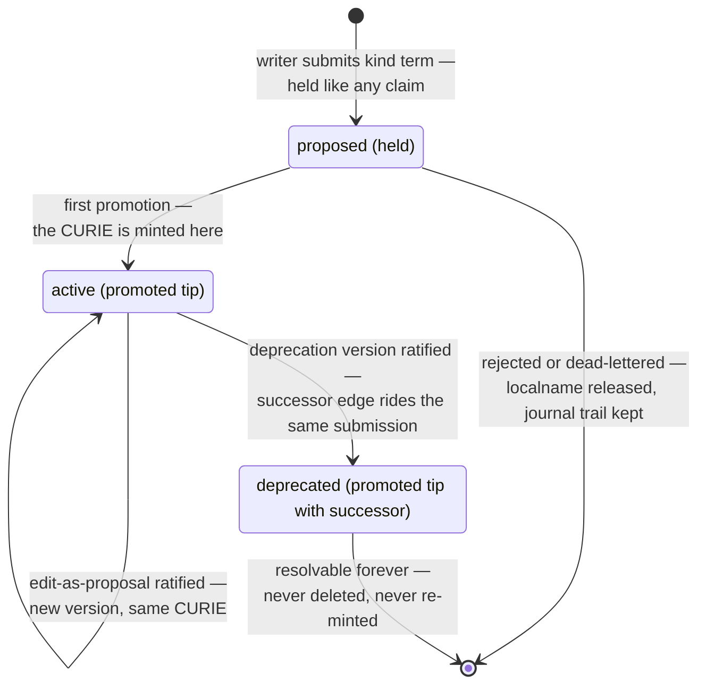

<!--
id: architecture/ontologies
tier: engineering
status: design draft for review · decided, not built
answers: how vocabularies, terms, pinned releases and deprecation work as governed claims on the one existing pipeline; what a classification is and how an ontology crew proposes, ratifies, rejects and retires one
-->

# Ontologies

**Status:** design draft for review · decided, not built

A vocabulary is a governed set of shared words: terms with permanent identifiers, a hierarchy, a
deprecation discipline and pinned releases, so that two crews citing `biz:churn-risk` provably mean
the same thing. OML hosts vocabularies **as claims** — a term is proposed, held, reviewed by an
identity that did not write it, and promoted, exactly like any memory — because an ontology
service, reduced to essentials, is a governed memory provider for vocabulary. Nothing on this page
is a second subsystem; it is the one pipeline plus identifier discipline, three artifact kinds, one
scanner plugin and a thin read surface. The decision record is
[ADR-0021](../adr/ADR-0021-ai-human-ontologies.md).

Two stances govern everything below, stated once here. **AI-first with humans in the loop**: every
role is designed to be held by an agent, human principals enter through the same roles and the same
pipeline, and the human loop is placed by policy (`human_required_classes`,
[admission](admission.md)), never by a parallel mechanism. **On top of the provider floor**: every
vocabulary feature defaults off, and with all of them off OML is a full memory provider — the
features extend the base, they never tax it. A plain memory-provider tenant pays exactly one
default cost for this page existing: one extra MCP tool in `tools/list`
([mcp-plugin](../api/mcp-plugin.md)), on the order of a hundred tokens.

Nothing below exists as code. The v1 slice is [FR-19](../product/roadmap.md); every unmeasured
claim on this page names the roadmap row that will measure it.

## A vocabulary is a workarea with a prefix

A vocabulary is a dedicated workarea subtree ([workareas](workareas.md)) created with one extra,
optional field: a **prefix**, registered in a journalled, tenant-scoped registry
(`vocab_prefixes`, UNIQUE per tenant — never globally, because a global unique would leak
namespace existence across tenants). Workarea creation is admin-only, and that is the whole brake
on vocabulary sprawl: no new ceremony, no issuer-ceiling clone. Because a prefix registration is
irreversible in meaning, the CLI confirms permanence before the act, per the
preview discipline of [cli/reference.md](../cli/reference.md), which extends its
preview-every-mass-act rule to irreversible single acts like this one.

Everything inside the vocabulary rides the ordinary machinery. Grants are ordinary: the vocabulary
workarea grants writer to the crews it serves, dreamer to its curators
([roles-and-keys](roles-and-keys.md)). The crew a vocabulary workarea names is an **ontology
crew**, whose members' keys carry [member profiles](roles-and-keys.md#member-profiles) — classifier,
term creator, curator — that fix those grants' shapes
([ADR-0027](../adr/ADR-0027-ontology-crews.md)); any other key an admin grants on the vocabulary
works there as before. Status is ordinary: trunk vocabulary lives at `committed`;
`validated` (frozen) is vocabulary **retirement** — a freeze, not a revocation: terms stay
resolvable forever, and no past verdict is retro-invalidated, because every scan verdict recorded
the release id and scanner version it was taken against. The `oml:` prefix is reserved in every
tenant's namespace for the provider-published upper vocabulary (`is_a`, `part_of`, `replaced_by`,
`consider`, …) — shipped product data versioned with the release, not journal content
([RS-10](../product/roadmap.md)).

## The term lifecycle

A term is a claim of kind `term` whose `claim_key` is its CURIE — `PREFIX:localname` — and whose
`term_status` is a structural payload field, never body text, so the deprecation marker survives
crypto-shredding and is deterministically readable.

Deprecation is supersession, never deletion. The successor pointer is a ratified claim edge —
`oml:replaced_by` (exactly one; safe for automated rewiring) or `oml:consider` (one or more;
requires judgment) — and it is declared **in** the deprecating submission, the way `derives_from`
is: one serve and one verdict cover the version and its successor edge together, so a deprecation
without its successor can never promote as a dangling half-act.

## CURIEs and permanence

The identifier rule, stated at ADR level and enforced in the domain core: a CURIE is **minted at
first promotion**, and once minted it is permanent. The definition body may be crypto-shredded
([audit-and-lineage](audit-and-lineage.md)), but the term's lineage row and `claim_key` are never
fully erased, and the CURIE is never re-mintable with a different meaning — the one failure an
identifier system exists to prevent. A proposal that never promotes releases its localname; its
journal trail persists under the artifact id. Two writers racing to mint the same `PREFIX:name`
resolve first-promoted-wins: the loser gets a typed `claim_key` conflict at capture and has two
usable paths — edit-as-proposal on the winner, or a different localname plus an intra-vocabulary
mapping. Flood-proposing localnames to squat them buys nothing (nothing is minted before
promotion) and is bounded by what already exists: journalled rate and quota grant attributes,
held-item expiry, and queue depth in `oml status` and `oml doctor`.

One consequence is worth its own sentence: **simulations cannot mint vocabulary.** Vocabulary
workareas refuse `provenance=simulation` submissions of the vocabulary kinds — otherwise a demoted
simulation row would squat a permanent CURIE forever ([simulations](simulations.md)).

## Releases and the materialized closure

A release is a claim of kind `vocab_release`: a journalled **pin**, never a copy. Its body carries
the vocabulary workarea id, the pinned journal `seq`, and a Merkle root over the then-active term
set whose leaves cover definition bytes, not just identity (the construction is RS-4's one
specification, shared with [ADR-0020](../adr/ADR-0020-dataset-onboarding.md)). Releases accumulate
as claims; nothing ever cuts one automatically — a release is always an explicit, ratified act,
and that is load-bearing for the zero-human blessing below.

At release ratification, the `is_a` closure over ratified edges is **materialized** into a
per-release closure table: ancestor and descendant queries, and recall expansion, become lookups
over precomputed rows with journalled provenance — the serialize-don't-compute contract holds. The
cost is storage, O(terms × depth) per release, priced and bounded by release cadence.

A human cannot judge a Merkle root, so the **serve of a release is a diff** against the previous
release: terms added, deprecations with their successors, `is_a` edges added and removed, counts.
The diff artifacts enter the served digest set ([admission](admission.md)) — the evidentiary
contract records what the reviewer actually saw, not a hash they could only wave through.

## Hierarchy and mappings

Hierarchy and relations are ratified claim edges typed from `oml:`. Cycle refusal is a domain
invariant at ratification — a deterministic transaction-time check over the ratified `is_a` edges
plus the candidate, refusing with the typed error `vocab.cycle_refused`
([errors](../api/errors.md)) — and the same invariant covers `replaced_by`, so a replacement loop
cannot form. Supersession chains over time are legitimate; ratifying a deprecation whose named
successor is itself already deprecated is surfaced as a scanner finding
(`vocab.deprecated_successor`) rather than refused, because that is a judgment call, not a law.

Mappings between vocabularies are SSSOM-shaped claims of kind `term_mapping`: subject CURIE,
object CURIE, predicate (`exactMatch`, `closeMatch`, `broadMatch`, `narrowMatch`, `relatedMatch`),
justification (human-curated, lexical, logical), note. A mapping is never a merge — both terms
persist, and the mapping is revocable by supersession. Because a ratified mapping becomes shared
structure of **two** vocabularies, its ratification requires dreamer(review) on both endpoints'
vocabularies with ratifier ≠ proposer — the same argument [workareas](workareas.md) makes for
workarea edges, stated as an extension of that rule. Cross-tenant mappings are
[RS-3](../product/roadmap.md), future.

## Classification: ontology crews attach terms to memories

A memory's own `terms` are its author's citation, inside its signed bytes, and no other identity
can change them. A **classification** lets another identity say what a memory is about without
touching it: a claim edge labelled `oml:about` from a memory version to a term, proposed by a
classifier and ratified by a curator, both members of the vocabulary's ontology crew. This section
is the single declaration site of a classification's rules
([ADR-0027](../adr/ADR-0027-ontology-crews.md) d6–d10); recall's use of them is declared on
[retrieval](retrieval.md#the-serving-tier), and the worked flow is the
[ontology crews](../api/ontology-crews.md) page. Like everything on this page, it is decided, not
built.

**The edge.** Its source is a promoted version of a claim of kind `memory` or `derived_fact` in a
workarea that is not a vocabulary node (a workarea in the subtree of one that registered a
prefix); its target is a promoted version of a term whose served tip is `active`. Anything else is
`request.validation`, naming the endpoint, and a deprecated term is `vocab.inactive_curie` with its
successors. The edge records the term's CURIE as `term_curie`, binds the source **version** — a
successor version of the memory is classified anew, because the curator judged the bytes it read
— and binds the term by its CURIE, so an edit of the term leaves it in force. `oml:about` is a
relation of the provider-published `oml:` vocabulary, shipped with the release like `is_a`
([RS-10](../product/roadmap.md)), and the one whose source is not a term. A classification never
changes the memory: no version is written, and its signed bytes, `terms` and tip stay as they
were.

**Who proposes and who decides.**

| Act | Requires | Refused when |
|---|---|---|
| Propose (`POST /v2/claim-edges`, `oml_relate_propose`) | dreamer effective for `oml:about` on at least one endpoint's workarea, and reader on both — the [workarea-edge rule](workareas.md#edge-authority) extended, as mappings extend it | an endpoint is unreadable (`access.not_found`); the key's narrowed dreamer grants do not list the label (`access.grant_refused`); a duplicate (below) |
| Ratify (`POST /v2/claim-edges/{edge_id}/ratify`) | dreamer effective for `oml:about`, and reader, on both endpoints' workareas | the proposer's key or principal (`review.ratifier_is_proposer`); a key or principal in either endpoint's lineage closure (`review.author_in_lineage`); the policy's crew or manager axis unmet (`review.ratifier_is_proposer`, `details.axis`); the term's tip deprecated (`vocab.inactive_curie`) |
| Reject, pending or ratified (`POST /v2/claim-edges/{edge_id}/reject`, `reason` required) | as ratify | as ratify, except the crew and manager axis: a rejection makes nothing visible |

One ratify act decides, under the review policy of the term's vocabulary workarea, whose snapshot
`review.ratify` journals: the policy contributes its independence axis — the principal always, crew
or manager inequality where it asks — with the classifier standing where an author stands, and no
`k`, since an edge has no serve to count. A curator of the classifier's own crew therefore ratifies
under the shipped default and does not where the policy requires crew inequality, and a tenant
that wants that runs two ontology crews that curate each other's vocabularies. A classification is
AI-only: no human-required class names it, and a tenant that wants human-curated classifications
grants the curators' narrowed content-side grants only to keys attested `held_by: human`. A
classification is admitted whatever the status of either endpoint's workarea, because freeze
covers claim content and promotions and a classification changes neither, and an `oml:about` edge,
in any state, is served only to a key that can read both endpoints.

**How many.** A memory version carries any number of distinct classified terms; the bound on a
flood is the journalled rate and quota grant attributes and the curators' throughput
([FR-2](../product/roadmap.md)). It carries at most one live classification per CURIE: a proposal
naming a version and a CURIE that a pending or ratified `oml:about` edge already joins, or that the
version's own `terms` already cite, is refused with `vocab.classification_exists`
([errors](../api/errors.md)), and a unique index makes a racing proposal answer the same code.

**Rejection.** A rejection journals `claim_edge.rejected`; the edge stays, with state `rejected`,
confers nothing, matches no recall, and frees its pair to be proposed again. Rejection is decided
for `oml:about` alone; an edge of any other label answers `request.validation`.

**Not derivation.** A classification says what a memory is about, not what it was built from, so
`oml:about` edges stay out of the lineage closure and out of taint
([audit and lineage](audit-and-lineage.md#the-derivation-graph)): classifying a memory never
removes the term's authors from the memory's future reviewers, nor the memory's author from the
term's, and a classified simulation row never taints a term.

**Retirement and self-heal.** A ratified classification is **retired** while its term's served tip
is deprecated. Retirement is read from the term's `term_status` at each read; the deprecation's
ratification is the only journalled act, and nothing is written for the classifications it
retires. A retired classification stays `ratified`, is listed with `retired: true`, and stops
matching recall. The classifier self-heals it from the successor that `oml_vocab get` or a refused
proposal's `vocab.inactive_curie` details name — mechanically for `replaced_by`, by judgment for
`consider` — by proposing a classification of the same memory version to the successor, which a
curator ratifies like any other. Recall never follows `replaced_by` on its own.

## Where the humans sit

Volume is AI work. Any writer key proposes terms — mid-task, at agent speed — and dreamer crews
drain the review queue the way they drain every other queue; provenance distinguishes agent from
human authors without privileging either. The human loop is placed by `human_required_classes`
exactly where a mistake is expensive and judgment-shaped: by shipped default, a **deprecation with
`replaced_by`** (automation rewires against it), an **`exactMatch` mapping** (shared structure of
two vocabularies), and a **release pin** (served as a diff a person can actually judge). Everything
else — new terms, edits, the other mapping predicates, hierarchy ratified in batch at release —
drains through AI dreamers, and so do [classifications](#classification-ontology-crews-attach-terms-to-memories),
which are AI-only. The full defaults table is in
[ADR-0021](../adr/ADR-0021-ai-human-ontologies.md) d7, every row tenant-tunable, with the
classification row [ADR-0027](../adr/ADR-0027-ontology-crews.md) d12 adds. Under those defaults an
ontology crew needs at least one curator attested `held_by: human`.

The routing is deterministic, not ceremonial: `vocab_release` routes by kind, and the two
body-field classes route through the vocab scanner's finding classes
(`vocab.deprecation_replaced_by`, `vocab.mapping_exactMatch`), which the shipped default policy
names in `human_required_classes`. The stated coupling: that gate is only as strong as the scanner
being configured — scanner selection is journalled, so an auditor can always answer "was the human
gate active". Auditable, not unmissable.

What "human" means is itself an honesty boundary. A human verdict rests on a journalled,
issuance-time attestation — a key attribute `held_by: human`, attested by the issuing admin and
shown in evidence exports ([roles-and-keys](roles-and-keys.md)). The server verifies the
attestation, never the humanness. `oml doctor` warns when a policy names human-required classes
and no attested-human dreamer key is in scope — the queue would otherwise fill silently.

**The zero-human configuration is blessed.** A 100%-agent tenant may tune every human-required
class off and run vocabularies end to end with zero humans — explicitly supported, under four
named conditions ([ADR-0021](../adr/ADR-0021-ai-human-ontologies.md) d12): the `replaced_by` cycle
invariant (unconditional), no auto-cut releases (a release is always an explicit ratified act),
collusion statistics that cover edge ratifications and slice by kind, and the doctor orphan and
churn signals active. Under those four, a bad vocabulary act degrades to visible, auditable and
reversible — the same posture ordinary claims already hold.

## Validation: the policy and the scanner

Claims gain an optional `terms: [CURIE, …]` field — clear, non-erasable annotation metadata that
enters the signed bytes and keeps labelling a claim even after its body is erased. Whether anyone
checks those citations is a per-workarea choice: `vocabulary_policy {vocabulary, release,
enforcement: require | annotate | off}`, **default off** ([admission](admission.md) owns the
policy objects). The scanner is a plugin, deliberately **not** in the default scanner set — a
tenant that never registers a vocabulary never runs it.

The scanner checks that cited CURIEs exist and are active against the **pinned release**, and the
scan verdict records that release id alongside the scanner version — determinism is pinned, so no
later vocabulary change retro-invalidates a past verdict. `enforcement: require` is refused
without a pinned release; trunk-current checking is annotate-only. The two modes have intended
users:

- **require** — stable, pinned vocabularies: citing an unknown or inactive CURIE holds or vetoes
  the submission, with typed errors (`vocab.unknown_curie`, `vocab.inactive_curie`).
- **annotate** — evolving crews: a citation of a not-yet-active term records the finding
  `vocab.term_pending` (the CURIE exists but is held — distinct from unknown) and never blocks.
  Submit now, re-cite after promotion.

CURIE citations fail closed within the writer's effective read scope, exactly as `derives_from`
does; the scanner can hold or veto, never promote (plugin law,
[ADR-0019](../adr/ADR-0019-hexagonal-architecture-and-plugins.md)).

## The agent loop, end to end

The read surface is thin and reader-ceiling, failing closed as absence: `GET /v2/vocab/suggest`
(deterministic prefix+label typeahead), `GET /v2/vocab/terms/{curie}`,
`GET /v2/vocab/terms/{curie}/hierarchy?direction=parents|children|ancestors|descendants` (closure
lookups), `GET /v2/vocab/mappings?term=` ([http-api](../api/http-api.md)); over MCP, one tool,
`oml_vocab`, with an action field. Recall gains a `terms` filter and
`expand_terms: none | descendants` — expansion resolves against the release pinned by the
vocabulary that owns the prefix and **widens a filter before retrieval**; steering order, `k` and
`max_tokens` are untouched ([retrieval](retrieval.md)).

A working agent's loop, with no human in sight:

1. **Cite.** Before writing, `oml_vocab suggest` offers matching terms; the claim carries
   `terms: [biz:churn-risk]` and, under `annotate`, nothing ever blocks.
2. **Propose mid-task.** No term fits, so the agent submits one — `oml_remember`, kind `term` —
   and keeps working. Under `annotate`, citing the held CURIE records `vocab.term_pending`; after
   a curator-crew dreamer promotes the term, the agent re-cites and the finding class goes quiet.
3. **Self-heal on deprecation.** A later citation of a deprecated term returns
   `vocab.inactive_curie` carrying the successor CURIE(s) and relation in its details; for
   `replaced_by` the rewrite is a mechanical one-hop, and `oml_vocab get` returns `term_status`
   and successor pointers for the same fix at read time. `consider` successors are a judgment
   call, which is why they are a list and not a rewrite rule.
4. **Be found by what it is about.** A memory written without a citation is found by term once an
   ontology crew's classifier proposes an `oml:about` edge to it and a curator ratifies it — the
   memory's bytes untouched ([classification](#classification-ontology-crews-attach-terms-to-memories)).

Vocabulary rows themselves stay out of the shared FTS and vector indexes by default — reference
data must not drown organic memories in recall ([retrieval](retrieval.md)); a vocabulary
workarea's policy may opt in, mirroring [ADR-0020](../adr/ADR-0020-dataset-onboarding.md) d11.

## What this is not

- **No annotation or NER.** `suggest` is deterministic matching; interpreting claim content to
  propose terms or classifications is client-side crew work, which the ontology crew's classifier
  records as a reviewed edge. The provider runs no model, here as everywhere
  ([admission](admission.md)).
- **No reasoner.** No OWL semantics — only the materialized transitive closure of ratified
  `is_a`. Queries agents actually ask are answered as lookups; inference that cannot be priced or
  explained in an evidence export is declined.
- **No auto-import.** An external ontology enters as an
  [ADR-0020](../adr/ADR-0020-dataset-onboarding.md) dataset import whose mapping spec declares
  `kind=term` — post-v1, profiled as [RS-11](../product/roadmap.md). Until then, external terms
  are proposed like any others.

## Curation economics

A junk-drawer vocabulary — registered, half-filled, unreviewed — is the designed-against failure
mode, and the defenses are structural, not exhortative. A vocabulary workarea requires a named
curator crew at creation, of kind `ontology` ([ADR-0027](../adr/ADR-0027-ontology-crews.md) d2).
`oml doctor` flags a vocabulary with no active unnarrowed dreamer grant — a classifier's narrowed
grant is not curation — as orphaned and names "propose freeze" as the next action; retirement is the ordinary two-party
status ceremony, and a frozen vocabulary keeps serving reads forever. The prefix permanence
confirmation at creation makes the one irreversible act deliberate.

The honest load figure: with shipped defaults, an active vocabulary generates **≈7 human verdicts
per week** — a design estimate, not a measurement; review load lands on
[FR-2](../product/roadmap.md)'s measured throughput, and expansion and mapping quality are
[FR-20](../product/roadmap.md)'s to measure. Mapping campaigns that would swamp that budget take
the campaign path: a journalled temporary policy change, reverted after. And one blast radius is
stated plainly: a wrong `exactMatch` in v1 misleads only clients that chose to follow it —
expansion is descendants-only — yet it stays human-required, because a ratified mapping is shared
structure of two vocabularies and future features will build on it.

## Decision record

This page's decisions are registered as
[ADR-0021](../adr/ADR-0021-ai-human-ontologies.md) ([decision register](../adr/index.md)). The
policy objects and scanner context are owned by [admission](admission.md); roles and the
`held_by: human` attestation by [roles-and-keys](roles-and-keys.md); recall semantics by
[retrieval](retrieval.md); the import path by
[ADR-0020](../adr/ADR-0020-dataset-onboarding.md). Ontology crews, member profiles and
classification are the proposed [ADR-0027](../adr/ADR-0027-ontology-crews.md)'s.
