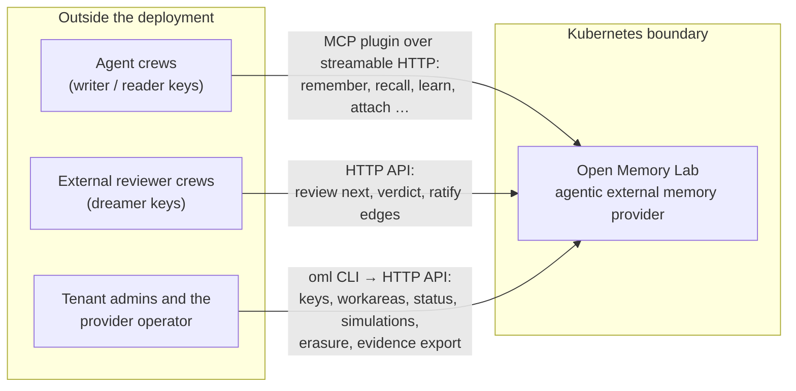
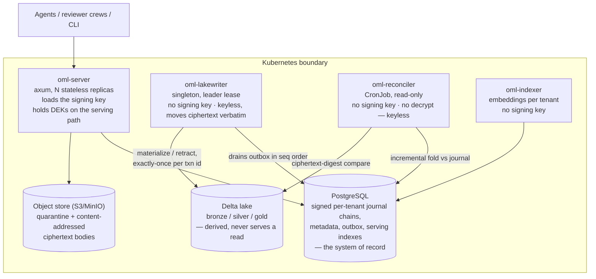
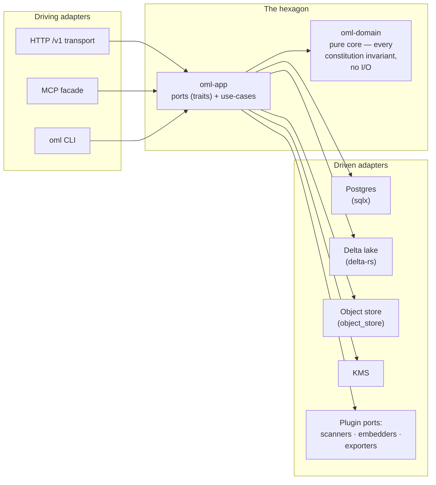
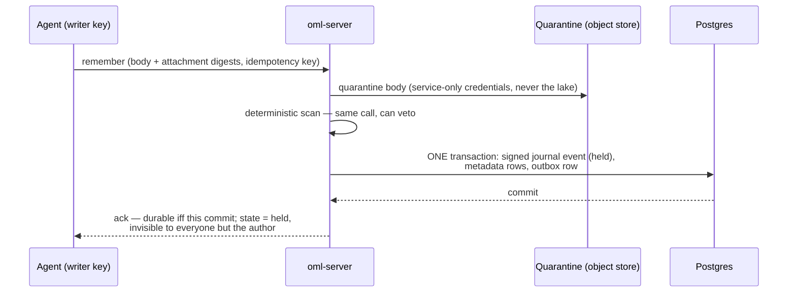
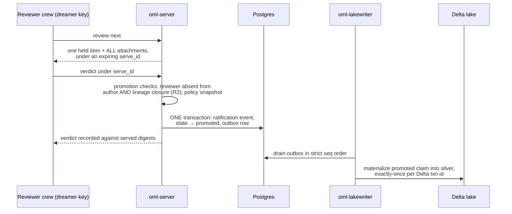
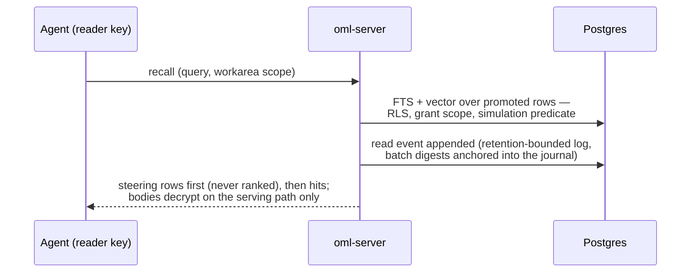
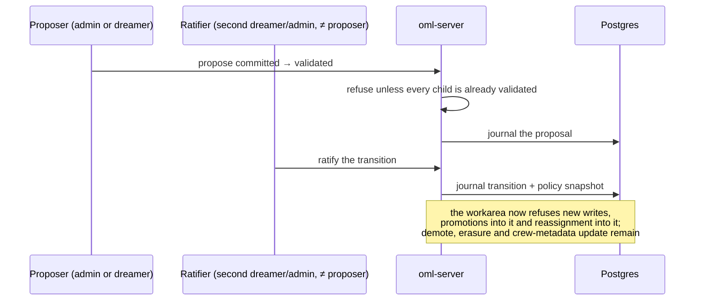
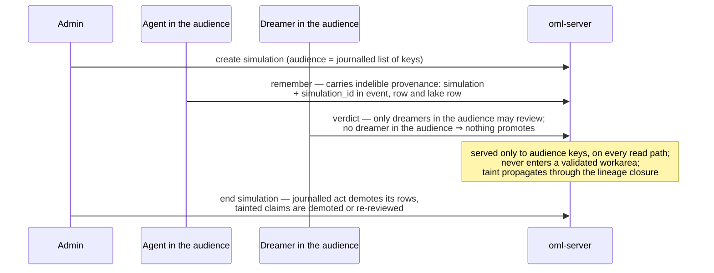

# Architecture overview

**Status:** design draft for review · decided, not built

Open Memory Lab (OML) is an external memory provider for AI agents and crews. Every memory
asserts a claim; every claim is held on arrival, scanned, reviewed by an identity that did not
write it, and only then visible to others. This page is the map: the system in its context, the
containers inside the Kubernetes boundary, the module structure inside every container, the five
runtime scenarios that exercise them, and where each constitutional rule is enforced. Contracts live on the pages that own them — this page
links, it does not restate. The constitution itself (rules R1–R4 and their one bounded exception)
is declared in [ADR-0001](../adr/ADR-0001-the-constitution.md).

## 1. System context (C4 level 1)

Three kinds of actor touch the deployment, all through the same versioned HTTP API
([api/http-api.md](../api/http-api.md)). None of them runs inside the cluster; the provider runs
no model itself — review capacity is external crews holding dreamer keys
([admission](admission.md)).

- **Agent crews** call the agent-safe MCP tool subset, a facade over the JSON HTTP API. The
  surface they can call never promotes, signs, demotes or deletes (R1). Tool list and transport:
  [api/mcp-plugin.md](../api/mcp-plugin.md).
- **Reviewer crews** are externally managed; they hold dreamer keys and work the review ceremony
  over HTTP. Who may review what: [roles-and-keys.md](roles-and-keys.md); how a verdict is bound
  to what was served: [cli/reference.md](../cli/reference.md) and [admission.md](admission.md).
- **Admins and the operator** use the `oml` CLI, which speaks the same HTTP API with
  admin/operator keys. There is no web UI (§6). CLI verbs: [cli/reference.md](../cli/reference.md).

Tenancy is derived server-side from the API key, never from the request; everything below is
per-tenant ([security.md](security.md)).

## 2. Containers (C4 level 2)

Four Rust binaries, one database, one object store, one lakehouse. The deciding asymmetry is key
custody: **only oml-server loads the deployment signing key**; lake-writer, reconciler and indexer
run under their own credentials and can neither sign journal events nor (for the reconciler)
decrypt bodies. Custody and commit-point rules are owned by [storage.md](storage.md); the
privileged-service threat model by [security.md](security.md); workload shapes and the two Helm
profiles by [operations/deployment.md](../operations/deployment.md).

| Container | Role | Signing key | Owning page |
|---|---|---|---|
| oml-server | The only API surface; the single transactional commit point is the Postgres transaction it runs | **yes** — every replica, same deployment key | [storage.md](storage.md) |
| oml-lakewriter | Sole outbox drain; lake writes and all lake maintenance | no | [storage.md](storage.md) |
| oml-reconciler | Read-only journal-vs-lake comparison; repairs re-emitted via oml-server | no | [reconciliation.md](reconciliation.md) |
| oml-indexer | Computes embeddings for the serving tier | no | [retrieval.md](retrieval.md) |
| PostgreSQL | System of record: journal, metadata, outbox, FTS + vector serving tier | — | [storage.md](storage.md), [data/postgres-schema.md](../data/postgres-schema.md) |
| Object store | Quarantine bucket and ciphertext bodies, content-addressed by plaintext digest | — | [storage.md](storage.md) |
| Delta lake | Derived body lakehouse for reconciliation, lineage, analytics, future exports | — | [storage.md](storage.md), [data/delta-tables.md](../data/delta-tables.md) |

A compromised replica is treated as key compromise; the signature attests the deployment, not a
unique process ([storage.md](storage.md)).

## 3. Module structure

Inside every binary the code has one shape, decided in
[ADR-0019](../adr/ADR-0019-hexagonal-architecture-and-plugins.md): a hexagon. A pure domain core
(`oml-domain`) holds the admission state machine, the workarea algebra, the role/verb ceilings,
the status ladder and the taint predicate — every constitution invariant, and no I/O. Around it,
the application layer (`oml-app`) declares ports as Rust traits; everything that touches the
world is an adapter implementing one. The four binaries and the CLI are thin compositions of the
same core with the adapter set each job needs; the crate list is committed in
[ADR-0006](../adr/ADR-0006-pure-rust.md).

Plugins exist only at the scanner, embedder and exporter ports; in v1 they are compiled-in Rust
implementations selected by journalled configuration. A plugin can narrow, never widen — it
cannot mint verbs, can move admission only toward holding, never sits on the signing or erasure
path, and its identity and version ride the journal events its work informs
([ADR-0019](../adr/ADR-0019-hexagonal-architecture-and-plugins.md)).

## 4. Runtime scenarios

Five sequences cover the moving parts. Each diagram names the page that owns its contract; the
diagrams are illustrations, not specifications.

### 4.1 A write — remember → held → scan → ack on Postgres commit

Owned by [admission.md](admission.md) (pipeline) and [storage.md](storage.md) (commit point).

The ack means exactly one thing: the journal event, the metadata and the outbox row committed
together. A held body never reaches the lake.

### 4.2 A review — serve → verdict → ratify → outbox → lake

Owned by [admission.md](admission.md) (review policy, promotion checks) and
[storage.md](storage.md) (outbox protocol). The serve binding and CLI ceremony:
[cli/reference.md](../cli/reference.md).

### 4.3 A read — served from Postgres, logged

Owned by [retrieval.md](retrieval.md). Reads never touch the lake (§6).

### 4.4 A freeze — validating a workarea needs a second ratifier

Owned by [workareas.md](workareas.md) (status ladder, transition matrix).

Transitions are forward-only; there is no unfreeze ([workareas.md](workareas.md)).

### 4.5 A simulation — a fenced provenance channel

Owned by [simulations.md](simulations.md).

## 5. The invariant map

Where each constitutional rule is mechanically enforced. The rules are declared in
[ADR-0001](../adr/ADR-0001-the-constitution.md); each enforcement point is specified on its owning page.

| Rule | Statement | Enforced at | Owning pages |
|---|---|---|---|
| **R1** | The surface an agent can call never promotes, signs, demotes or deletes — verb ceiling per role | The API surface itself: the MCP tool list omits the verbs; every HTTP endpoint checks the key's role; key issuance carries an issuer ceiling | [roles-and-keys.md](roles-and-keys.md), [api/mcp-plugin.md](../api/mcp-plugin.md) |
| **R2** | The reviewer is never the author | Promotion time, in oml-server: the reviewer's key and principal are checked against the author **and the row's lineage closure** (pending and ratified edges), not just at key issuance; R2 extends to workarea edges (ratifier ≠ proposer) | [admission.md](admission.md), [workareas.md](workareas.md) |
| **R3** | The gate changes visibility, not ranking — nothing is readable by others until ratified | The serving tier: held rows are excluded from every read path (FTS, vector, fetch, graph); steering rows precede hits but are never ranked | [admission.md](admission.md), [retrieval.md](retrieval.md) |
| **R4** | No silent deletion — erasure is a journalled act via crypto-shredding; demotion keeps bytes | The journal table (append-only: REVOKE UPDATE/DELETE plus a guard trigger) and the erasure path (journalled erase event + DEK destruction, with a named copy-class inventory) | [storage.md](storage.md), [audit-and-lineage.md](audit-and-lineage.md) |

One bounded exception exists and is named in the constitution, not discovered later: a
`development` workarea may, by journalled tenant policy, relax R2/R3 for rows marked
`self_signed`, which are readable only inside that workarea and never promote beyond it
([workareas.md](workareas.md), [ADR-0001](../adr/ADR-0001-the-constitution.md)). One honesty limit sits beside the
invariants: undeclared derivation — a writer omitting `derives_from` — is not detectable by the
service; lineage exclusion is exactly as good as the declared graph.

## 6. What is deliberately not here

- **No web UI.** Administration is the `oml` CLI against the same HTTP API; a web console was
  considered and declined ([cli/reference.md](../cli/reference.md),
  [ADR-0015](../adr/ADR-0015-cli-administration.md)).
- **No grounded Q&A.** Clients are agents that recall and reason themselves; OML returns
  memories, not answers. Out of scope for v1, recorded in [ADR-0013](../adr/ADR-0013-reads-served-from-postgres.md) and
  [retrieval.md](retrieval.md).
- **Reads are never served from the lake.** The Delta lake is derived — reconciliation, lineage,
  metadata analytics, future journalled exports — and serves no client read; the serving tier is
  Postgres ([retrieval.md](retrieval.md), [storage.md](storage.md)).
- **The provider runs no model.** Scanning is deterministic; review is external crews holding
  dreamer keys ([admission.md](admission.md)).
- **No cross-tenant federation yet.** The "whole world" claim mapping is explicitly future — an
  RS row with its trigger in the [roadmap](../product/roadmap.md).

Everything on this page is a design commitment with a tracked exit criterion, not a property of
running software; open measurements (review throughput, pgvector recall and latency, the delta-rs
exactly-once conformance test) are FR rows in the [roadmap](../product/roadmap.md).
