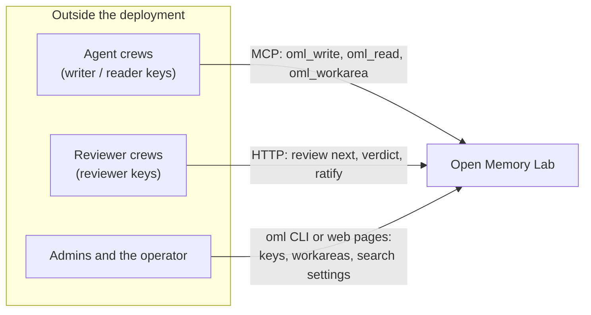
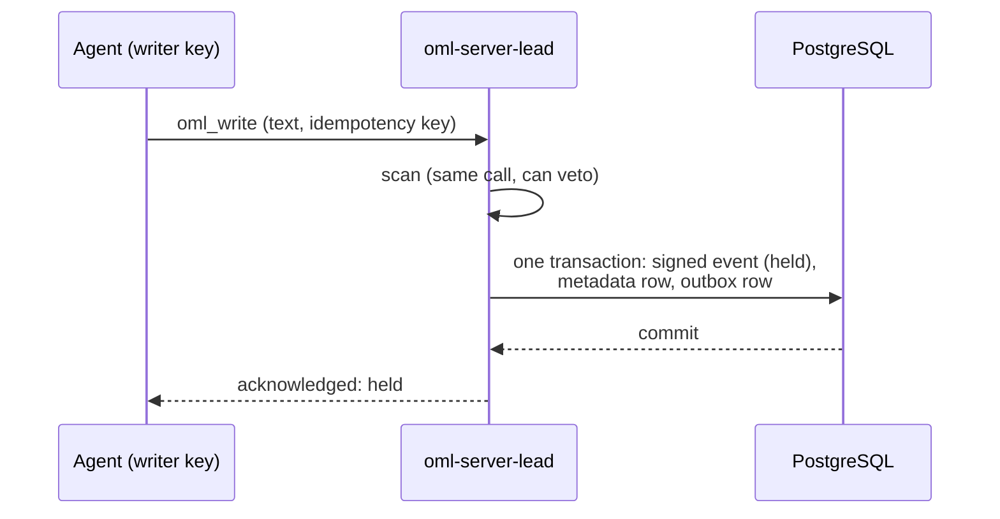
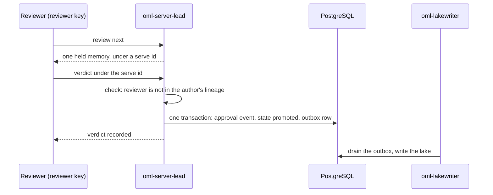
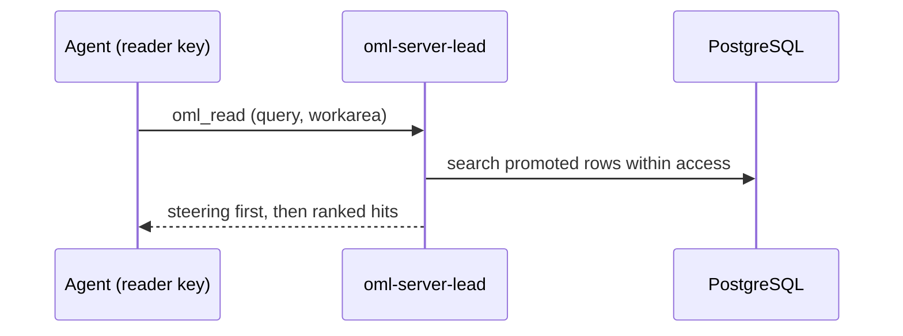
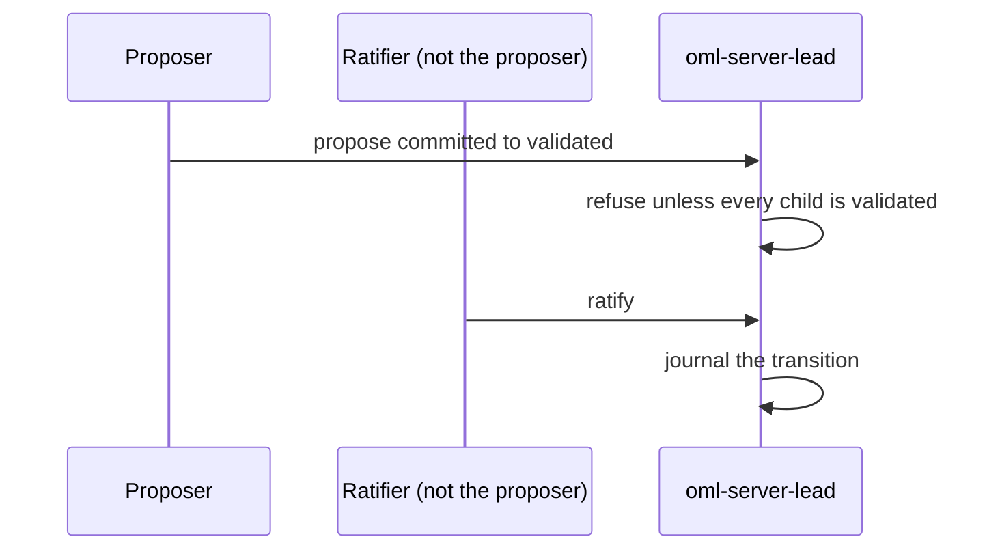

# How OML is put together

Open Memory Lab (OML) is an external memory provider for AI agents and crews. Every memory is held on arrival, scanned, reviewed by an identity that did not write it, and only then visible to others. This page maps the pieces. Contracts live on the pages that own them, and this page links to them.

## Clients and how they start

Every client starts from one pair: the server's URL without `/mcp`, and a key. It reads everything else from `GET /v2/whoami`.

| Client | Reaches | Its pair comes from |
|---|---|---|
| `oml` CLI | `/v1`, `/v2` | `--url` and `--api-key`, then `OML_URL` and `OML_API_KEY`, then the file `oml login` writes |
| Claude Code plugin | `/mcp` | the plugin's `url` and `api_key` options; `oml setup claude-code` sets them |
| Agent kit (Codex CLI, Cursor, Gemini CLI, VS Code, Claude Desktop) | `/mcp` | `OML_API_KEY`, and `OML_URL` where the tool expands it |
| claude.ai and the Claude apps | `/mcp` | no pair; an OAuth connection bound to one key through a connect code |
| Python and TypeScript SDKs | `/v1`, `/v2` | `OML_URL` and `OML_API_KEY` ([SDKs](../engineering/sdks.md)) |

## Who talks to OML

Three kinds of actor use the same versioned HTTP API ([API](../api/http-api.md)). None runs inside the server. OML runs no generative model, so review capacity comes from reviewer crews. The [context view](views.md#context-who-uses-oml-and-what-it-depends-on) draws the same actors with what OML depends on.

- **Agent crews** call three MCP tools. None of them can promote, sign, demote or delete. See [MCP plugin](../api/mcp-plugin.md).
- **Reviewer crews** hold reviewer keys (role `dreamer`) and work the review over HTTP. See [roles and keys](roles-and-keys.md) and [admission](admission.md).
- **Admins and the operator.** Admins use the `oml` CLI with admin keys; the operator runs the deployment. People sign in with Google or GitHub: the lead serves the sign-in, and a separate process, `oml-web`, serves the user and admin pages on the same origin.

The server derives the tenant from the API key, never from the request.

## Processes and stores

Three binaries run beside PostgreSQL, behind a reverse proxy. Only `oml-server-lead` loads the signing key. The [deployment view](views.md#deployment-a-request-from-the-client-to-the-disk) draws them, from the client to the disk.

| Part | Role |
|---|---|
| Reverse proxy (Caddy in production and Compose, an Ingress, when enabled, in the Helm chart) | Terminates TLS and routes by path: each console page to `oml-web`, every other path to the lead. |
| `oml-web` | Serves the console pages over the lead's public HTTP API, as the signed-in person. It has no database access and no signing key. |
| `oml-server-lead` | The only API surface. It commits each write in one PostgreSQL transaction. |
| `oml-lakewriter` | Drains the outbox into the Delta lake under a lease, with a database role and a sealing key of its own. It cannot sign journal events. Compose and the Helm chart do not run it. |
| PostgreSQL | The system of record: journal, memories and their bodies, metadata, outbox and search indexes. |
| Delta lake | A derived copy for analytics. See [storage](storage.md) and [Delta tables](../data/delta-tables.md). |

A compromised lead is a compromised key. The signature attests the deployment, not a unique process. See [security](security.md).

## How the code is laid out

Each binary has one shape. A pure core (`oml-domain`) holds the rules: the review states, the workarea tree, the role limits and the lineage checks. It does no I/O. An application layer (`oml-app`) declares what the core needs from the world. Adapters implement those needs for PostgreSQL, the lake and the clock. The HTTP transport and the MCP facade call the application layer. The `oml` CLI reaches it only over HTTP.

## Four scenarios

### A write

The acknowledgment means one thing: the event, the metadata and the outbox row committed together. See [admission](admission.md).

### A review

### A read

Reads never touch the lake. See [retrieval](retrieval.md).

### A freeze

The workarea then refuses new writes and approvals. There is no unfreeze. See [workareas](workareas.md).

## The four rules and where they are enforced

The four rules, R1 to R4, are declared once, in [the constitution](https://github.com/e8kor/open-memory-lab/blob/main/docs/adr/ADR-0001-the-constitution.md). This table names where the build enforces each, and what it does not build yet.

| Rule | Enforced at |
|---|---|
| [R1](https://github.com/e8kor/open-memory-lab/blob/main/docs/adr/ADR-0001-the-constitution.md), the verb ceiling | The API itself: no MCP tool reaches a verb above an agent key's role, and every HTTP route checks the key's role. See [roles and keys](roles-and-keys.md). |
| [R2](https://github.com/e8kor/open-memory-lab/blob/main/docs/adr/ADR-0001-the-constitution.md), the reviewer is never the author | Approval time, in the server. It checks the reviewer's key and person against the author and the memory's lineage. A workarea status change and a link need a second identity. See [admission](admission.md). |
| [R3](https://github.com/e8kor/open-memory-lab/blob/main/docs/adr/ADR-0001-the-constitution.md), the gate changes visibility, not ranking | The read path. Other keys recall promoted memories only, and steering comes first and unranked. One exception is built: an [in-progress workarea](workareas.md#in-progress-workareas)'s held memories, marked unreviewed. Also, an admin of the tenant reads held text through the journaled [admin read](roles-and-keys.md#the-admin-read) ([ADR-0045](https://github.com/e8kor/open-memory-lab/blob/main/docs/adr/ADR-0045-people-sign-in-to-a-user-page-and-an-admin-page-on-the-servers-own-origin.md) d21). See [retrieval](retrieval.md). |
| [R4](https://github.com/e8kor/open-memory-lab/blob/main/docs/adr/ADR-0001-the-constitution.md), no silent deletion | The journal is append-only, and a retirement keeps every version. Demotion and erasure by crypto-shredding are designed and not built. See [audit and lineage](audit-and-lineage.md). |

## What OML does not do

OML returns memories, not answers, and runs no generative model; the optional sparse and rerank search stages run small local models. Review capacity comes from the reviewers, and the scan is deterministic rules. The Delta lake serves no read. The [web console](../operations/web-console.md) has a Personal side and an Administration side. Memory does not cross tenants.
