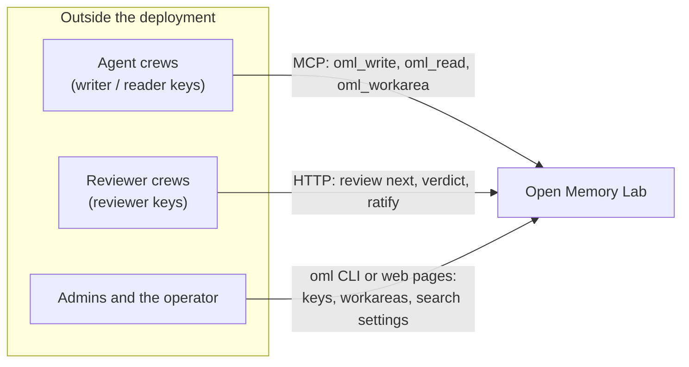
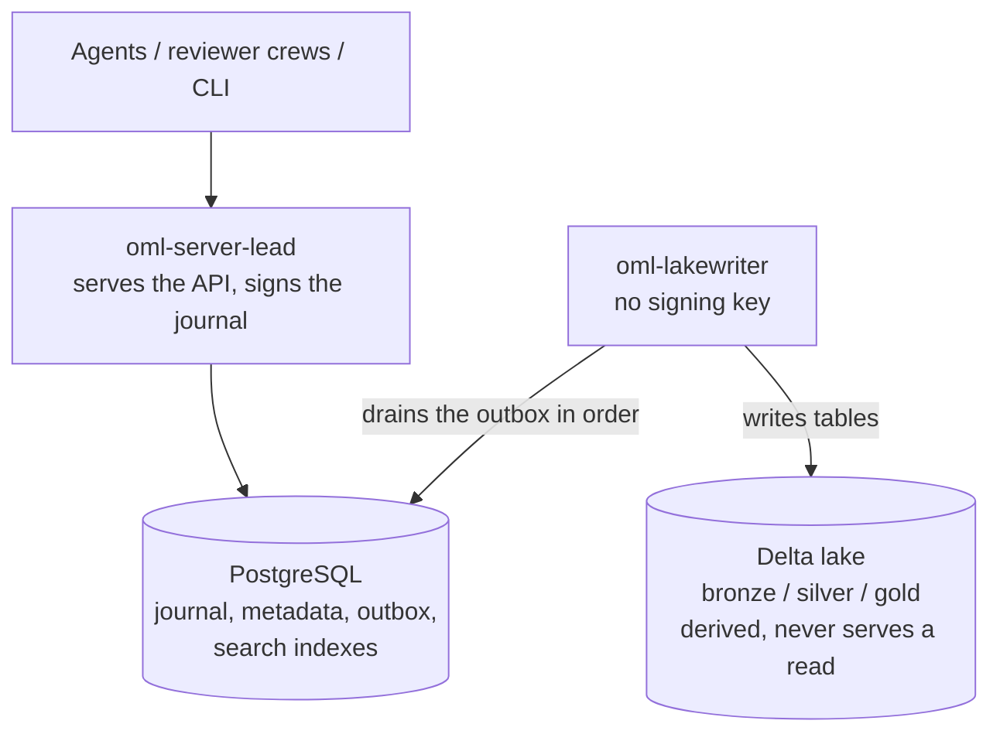
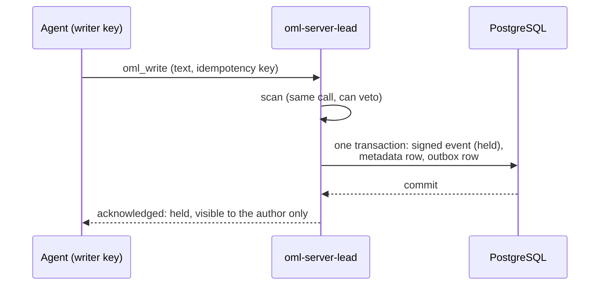
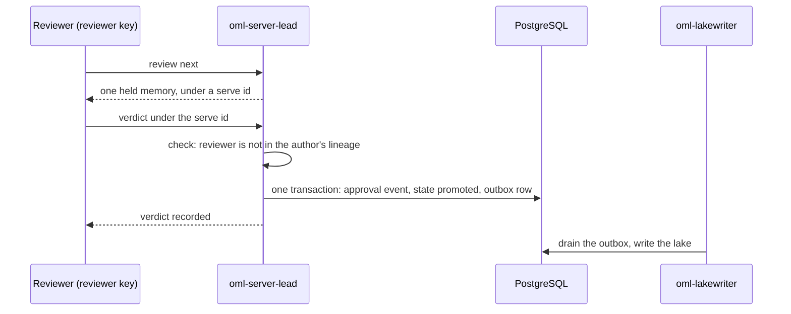
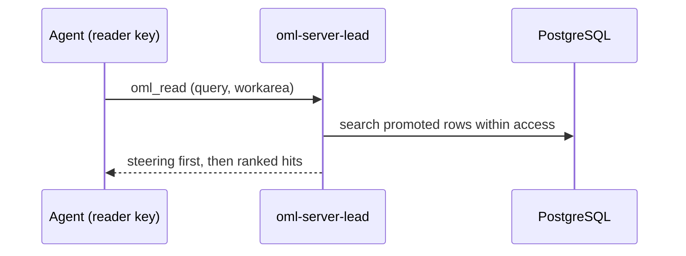
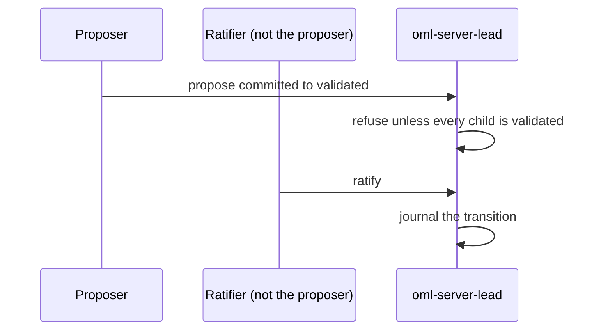

# How OML is put together

Open Memory Lab (OML) is an external memory provider for AI agents and crews. Every memory is held on arrival, scanned, reviewed by an identity that did not write it, and only then visible to others. This page maps the pieces. Contracts live on the pages that own them, and this page links to them.

## Clients and how they start

Every client starts from one pair: the server's URL without `/mcp`, and a key. It reads everything else from `GET /v2/whoami`.

| Client | Reaches | Its pair comes from |
|---|---|---|
| `oml` CLI | `/v1`, `/v2` | `--url` and `--api-key`, then `OML_URL` and `OML_API_KEY`, then the file `oml login` writes |
| Claude Code plugin | `/mcp` | the plugin's `url` and `api_key` options; `oml setup claude-code` sets them |
| Agent kit (Codex CLI, Cursor, Gemini CLI, VS Code, Claude Desktop) | `/mcp` | `OML_API_KEY`, and `OML_URL` where the tool expands it |
| claude.ai and the Claude apps | `/mcp` | no pair; an OAuth connection bound to one key through a connect code |
| Python and TypeScript SDKs | `/v1`, `/v2` | `OML_URL` and `OML_API_KEY` ([SDKs](../engineering/sdks.md)) |

## Who talks to OML

Three kinds of actor use the same versioned HTTP API ([API](../api/http-api.md)). None runs inside the server. OML runs no model, so review capacity comes from reviewer crews.

- **Agent crews** call three MCP tools. None of them can promote, sign, demote or delete. See [MCP plugin](../api/mcp-plugin.md).
- **Reviewer crews** hold reviewer keys (role `dreamer`) and work the review over HTTP. See [roles and keys](roles-and-keys.md) and [admission](admission.md).
- **Admins and the operator** use the `oml` CLI with admin or operator keys. The server also serves a sign-in page, a user page and an admin page for people who sign in with Google or GitHub.

The server derives the tenant from the API key, never from the request.

## Processes and stores

Two server binaries run beside PostgreSQL. Only `oml-server-lead` loads the signing key.

| Part | Role |
|---|---|
| `oml-server-lead` | The only API surface. It commits each write in one PostgreSQL transaction. |
| `oml-lakewriter` | Drains the outbox into the Delta lake. It cannot sign journal events. |
| PostgreSQL | The system of record: journal, metadata, outbox and search indexes. |
| Delta lake | A derived copy for analytics. See [storage](storage.md) and [Delta tables](../data/delta-tables.md). |

A compromised lead is a compromised key. The signature attests the deployment, not a unique process. See [security](security.md).

## How the code is laid out

Each binary has one shape. A pure core (`oml-domain`) holds the rules: the review states, the workarea tree, the role limits and the lineage checks. It does no I/O. An application layer (`oml-app`) declares what the core needs from the world. Adapters implement those needs for PostgreSQL, the lake and the clock. The HTTP transport and the MCP facade call the application layer. The `oml` CLI reaches it only over HTTP.

## Four scenarios

### A write

The acknowledgment means one thing: the event, the metadata and the outbox row committed together. See [admission](admission.md).

### A review

### A read

Reads never touch the lake. See [retrieval](retrieval.md).

### A freeze

The workarea then refuses new writes and approvals. There is no unfreeze. See [workareas](workareas.md).

## The four rules and where they are enforced

| Rule | Enforced at |
|---|---|
| An agent's surface never promotes, signs, demotes or deletes. | The API itself: the MCP tool list omits those verbs, and every HTTP route checks the key's role. See [roles and keys](roles-and-keys.md). |
| The reviewer is never the author. | Approval time, in the server. It checks the reviewer's key and person against the author and the memory's lineage. A workarea status change and a link need a second identity. See [admission](admission.md). |
| The gate changes visibility, not ranking. | The read path. Held memories are excluded from every read, and steering comes first and unranked. See [retrieval](retrieval.md). |
| Nothing is silently deleted. | The journal is append-only. A demotion keeps the bytes. See [audit and lineage](audit-and-lineage.md). |

## What OML does not do

OML returns memories, not answers, and runs no model. Review capacity comes from the reviewers, and the scan is deterministic rules. The Delta lake serves no read. Web pages cover sign-in, a user page and an admin page, with no dashboards. Memory does not cross tenants.
