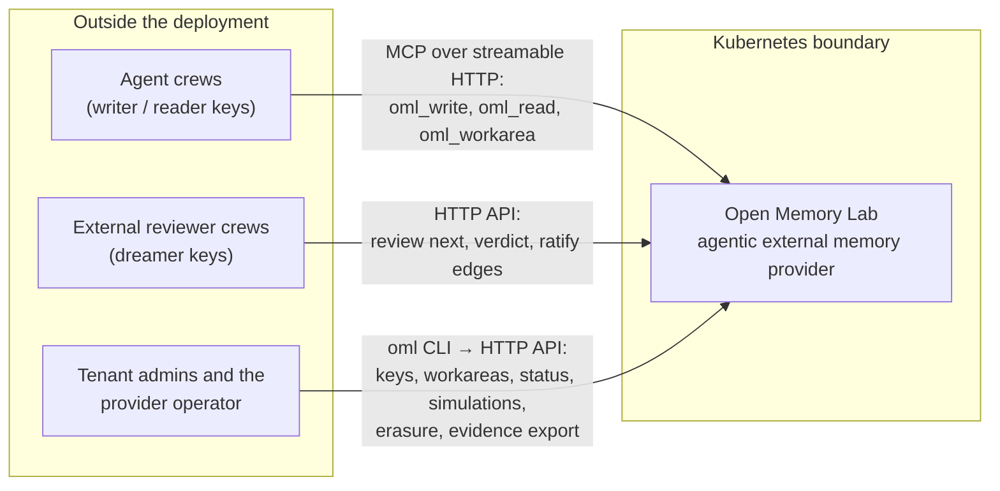
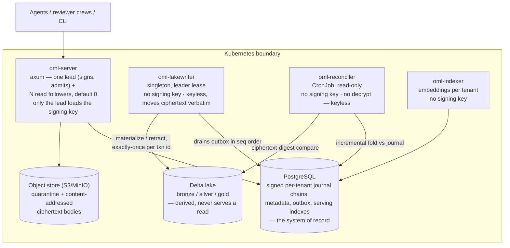
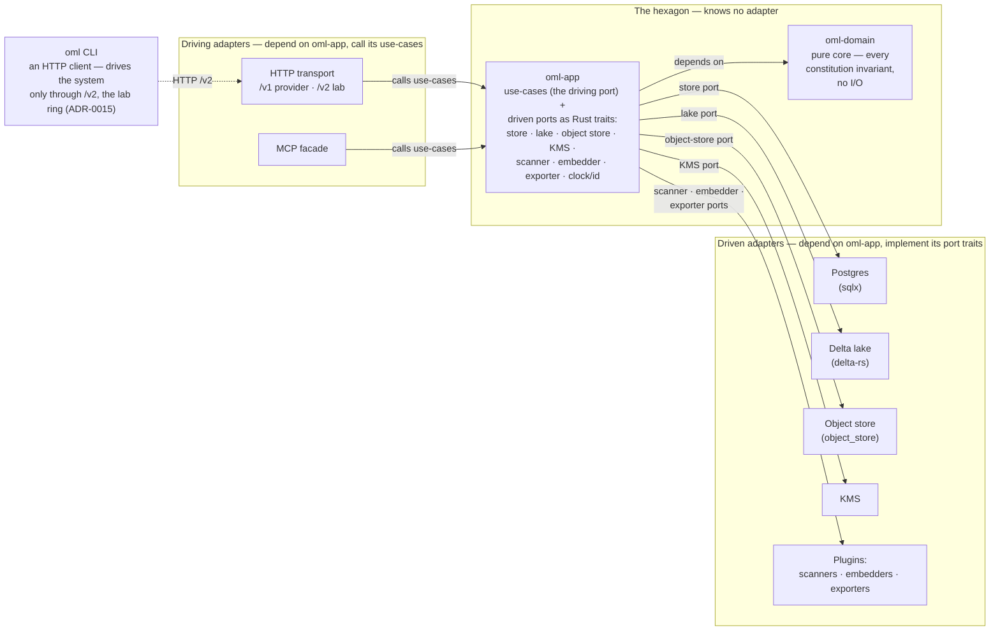
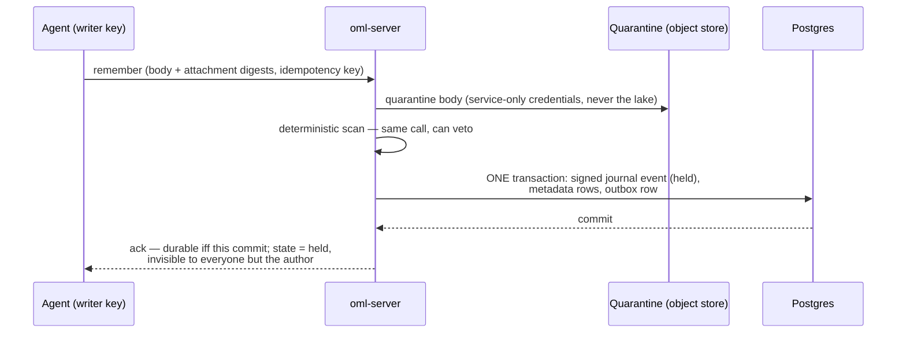
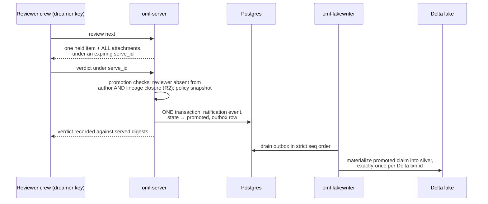
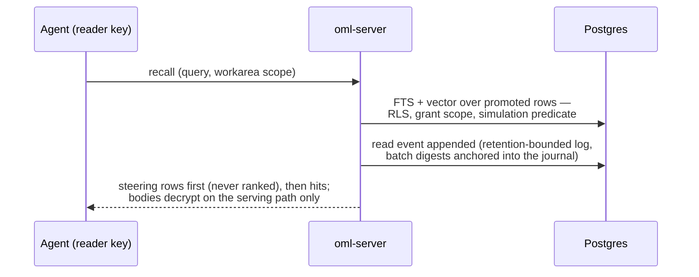
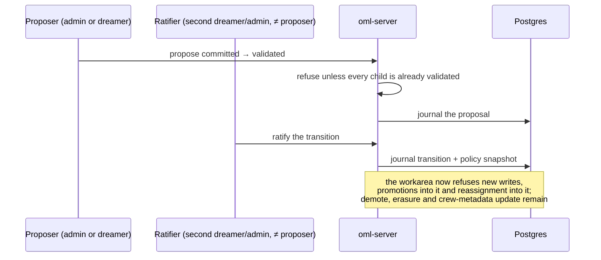
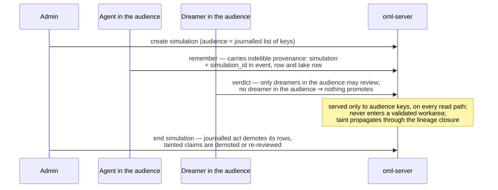

<!--
id: architecture/overview
tier: engineering
status: design draft for review · decided, not built
answers: what the system looks like end to end — what the v0.4.0 build runs, the clients and the one pair each starts from, the per-platform artifacts, plugins and kit, OAuth on the same origin, context, containers, module structure, the five runtime scenarios, and where each constitutional rule is enforced
-->

# Architecture overview

**Status:** design draft for review · decided, not built

**Release:** the first slice since v0.1.0, see each page; the clients section as of v0.4.0; most containers are not scheduled ([releases](../product/releases.md)).

Open Memory Lab (OML) is an external memory provider for AI agents and crews. Every memory
asserts a claim; every claim is held on arrival, scanned, reviewed by an identity that did not
write it, and only then visible to others. This page is the map: the system in its context, the
containers inside the Kubernetes boundary, the module structure inside every container, the five
runtime scenarios that exercise them, and where each constitutional rule is enforced. Contracts live on the pages that own them — this page
links, it does not restate. The constitution itself (rules R1–R4 and their one bounded exception)
is declared in [ADR-0001](../adr/ADR-0001-the-constitution.md).

## 0. What the build runs

Sections 1 to 6 are the design. Release v0.4.0 runs a subset of it:

| Part | As built | Decision |
|---|---|---|
| Server | one binary, `oml-server-lead`, holding the signing key; no follower, lake-writer, reconciler or indexer | [ADR-0019](../adr/ADR-0019-hexagonal-architecture-and-plugins.md); the rest [not scheduled](../product/releases.md#not-scheduled) |
| Store | PostgreSQL alone: journal, metadata, outbox rows nothing drains, full-text search per tenant. No object store, no lake, no vector search | [ADR-0002](../adr/ADR-0002-postgresql-system-of-record.md), [ADR-0013](../adr/ADR-0013-reads-served-from-postgres.md) |
| Database roles | the lead migrates as the owner role (`postgres.owner_url`) and serves as a role that owns nothing (`postgres.url`), and refuses to start when both log in as one role | [ADR-0034](../adr/ADR-0034-the-lead-serves-as-a-role-that-owns-nothing.md) d2, d4 |
| Agent surface | three MCP tools, `oml_write`, `oml_read` and `oml_workarea`, over `/v1`; the eight v0.3 names answer hidden through v0.4.x, logging `mcp_alias_called` | [ADR-0039](../adr/ADR-0039-the-api-rewritten-for-v0-4-0.md) d2, d12 |
| OAuth | the lead is the protected resource and its own authorization server, on the origin that serves `/mcp`, only where `oauth.issuer` names that origin | [ADR-0031](../adr/ADR-0031-oauth-connections-by-connect-code.md) d1 |
| Release artifacts | the CLI per platform (four Unix targets and Windows x86_64), the server for Intel and Arm Linux, one image index for both, the chart, the plugins as an archive and a pinned marketplace, and the agent kit, each signed with cosign and summed in `SHA256SUMS` | [release artifacts](../engineering/ci-and-toolchain.md#release-artifacts-sbom-signing-provenance) |
| Installers | `install.sh` and `install.ps1` fetch the CLI archive and `SHA256SUMS`, verify with cosign when present, and write one file | [ADR-0041](../adr/ADR-0041-a-quick-start-in-one-command-per-role.md) d1, d2 |

## Clients and how they start

Every client starts from one pair, the server's URL without `/mcp` and a key, and reads
everything else from `GET /v2/whoami` (ADR-0039 d15).

| Client | Reaches | Its pair comes from | Adds |
|---|---|---|---|
| `oml` CLI | `/v1`, `/v2` | `--url`/`--api-key`, then `OML_URL`/`OML_API_KEY`, then the credentials file `oml login` writes | `oml setup claude-code`, `oml quickstart` |
| Claude Code plugin `oml` | `/mcp` | the plugin's `userConfig` options `url` and `api_key`, the key in the system keychain, set by `oml setup claude-code` or the install dialog ([ADR-0040](../adr/ADR-0040-plugin-setup-in-claude-code.md) d1) | the skill, the SessionStart, PostToolUseFailure and SessionEnd hooks through `oml hook`, the librarian |
| Agent kit: Codex CLI, Cursor, Gemini CLI, VS Code, Claude Desktop | `/mcp` | `OML_API_KEY`, and `OML_URL` where the tool expands it in a URL ([kit](https://github.com/e8kor/open-memory-lab/blob/main/kit/README.md)) | the `AGENTS.md` block; Gemini CLI's session-start hook |
| claude.ai, Claude Desktop connectors, the Claude apps | `/mcp` | no pair: an OAuth connection bound to one connector key through a connect code | nothing beyond the three tools |
| Python and TypeScript SDKs | `/v1`, `/v2` | `OML_URL` and `OML_API_KEY` ([client SDKs](../engineering/sdks.md)) | typed wrappers |

## 1. System context (C4 level 1)

Three kinds of actor touch the deployment, all through the same versioned HTTP API
([api/http-api.md](../api/http-api.md)). None of them runs inside the cluster; the provider runs
no model itself — review capacity is external crews holding dreamer keys
([admission](admission.md)).

- **Agent crews** call the agent-safe MCP tool subset, a facade over the JSON HTTP API. The
  surface they can call never promotes, signs, demotes or deletes (R1). Tool list and transport:
  [api/mcp-plugin.md](../api/mcp-plugin.md).
- **Reviewer crews** are externally managed; they hold dreamer keys and work the review ceremony
  over HTTP. Who may review what: [roles-and-keys.md](roles-and-keys.md); how a verdict is bound
  to what was served: [cli/reference.md](../cli/reference.md) and [admission.md](admission.md).
- **Admins and the operator** use the `oml` CLI, which speaks the same HTTP API with
  admin/operator keys. Beside the CLI, since v0.5.0, a user page and an admin page for people signed in with Google or GitHub (§6; [ADR-0045](../adr/ADR-0045-people-sign-in-to-a-user-page-and-an-admin-page-on-the-servers-own-origin.md), proposed). CLI verbs: [cli/reference.md](../cli/reference.md).

Tenancy is derived server-side from the API key, never from the request; everything below is
per-tenant ([security.md](security.md)).

## 2. Containers (C4 level 2)

Four Rust binaries, one database, one object store, one lakehouse. The deciding asymmetry is key
custody: **only oml-server loads the deployment signing key**; lake-writer, reconciler and indexer
run under their own credentials and can neither sign journal events nor (for the reconciler)
decrypt bodies. Custody and commit-point rules are owned by [storage.md](storage.md); the
privileged-service threat model by [security.md](security.md); workload shapes, the three install
profiles and the two Helm value sets by [operations/deployment.md](../operations/deployment.md).

| Container | Role | Signing key | Owning page |
|---|---|---|---|
| oml-server | The only API surface; the single transactional commit point is the Postgres transaction it runs | **lead only** — followers never ([ADR-0023](../adr/ADR-0023-install-profiles-and-cluster-mode.md)) | [storage.md](storage.md) |
| oml-lakewriter | Sole outbox drain; lake writes and all lake maintenance | no | [storage.md](storage.md) |
| oml-reconciler | Read-only journal-vs-lake comparison; repairs re-emitted via oml-server | no | [reconciliation.md](reconciliation.md) |
| oml-indexer | Computes embeddings for the serving tier | no | [retrieval.md](retrieval.md) |
| PostgreSQL | System of record: journal, metadata, outbox, FTS + vector serving tier | — | [storage.md](storage.md), [data/postgres-schema.md](../data/postgres-schema.md) |
| Object store | Quarantine bucket and ciphertext bodies, content-addressed by plaintext digest | — | [storage.md](storage.md) |
| Delta lake | Derived body lakehouse for reconciliation, lineage, analytics, future exports | — | [storage.md](storage.md), [data/delta-tables.md](../data/delta-tables.md) |

A compromised lead is treated as key compromise; the signature attests the deployment, not a
unique process ([storage.md](storage.md)).

## 3. Module structure

Inside each of the four service binaries the code has one shape, decided in
[ADR-0019](../adr/ADR-0019-hexagonal-architecture-and-plugins.md): a hexagon. A pure domain core
(`oml-domain`) holds the admission state machine, the workarea algebra, the role/verb ceilings,
the status ladder and the taint predicate — every constitution invariant, and no I/O. Around it,
the application layer (`oml-app`) declares ports as Rust traits. On the driven side, everything
that touches the world — store, lake, object store, KMS, plugins — is an adapter implementing one
of those traits; on the driving side, the HTTP transport (both rings,
[ADR-0022](../adr/ADR-0022-two-ring-api.md)) and the MCP facade are adapters
the other way around: they depend on `oml-app` and call its use-cases, the application's inbound
port. The four binaries are thin compositions of the same core with the adapter set each job
needs; the `oml` CLI reaches the same hexagon only through the HTTP transport
([ADR-0015](../adr/ADR-0015-cli-administration.md)). The crate list is committed in
[ADR-0006](../adr/ADR-0006-pure-rust.md).

Arrows out of the hexagon are runtime calls crossing a named port; the compile-time dependency
runs the other way — each driven adapter implements a trait declared in `oml-app`, so every
dependency in this picture points at the hexagon, and the hexagon knows no adapter.

Plugins exist only at the scanner, embedder and exporter ports; in v1 they are compiled-in Rust
implementations selected by journalled configuration. A plugin can narrow, never widen — it
cannot mint verbs, can move admission only toward holding, never sits on the signing or erasure
path, and its identity and version ride the journal events its work informs
([ADR-0019](../adr/ADR-0019-hexagonal-architecture-and-plugins.md)).

## 4. Runtime scenarios

Five sequences cover the moving parts. Each diagram names the page that owns its contract; the
diagrams are illustrations, not specifications.

### 4.1 A write — remember → held → scan → ack on Postgres commit

Owned by [admission.md](admission.md) (pipeline) and [storage.md](storage.md) (commit point).

The ack means exactly one thing: the journal event, the metadata and the outbox row committed
together. A held body never reaches the lake.

### 4.2 A review — serve → verdict → ratify → outbox → lake

Owned by [admission.md](admission.md) (review policy, promotion checks) and
[storage.md](storage.md) (outbox protocol). The serve binding and CLI ceremony:
[cli/reference.md](../cli/reference.md).

### 4.3 A read — served from Postgres, logged

Owned by [retrieval.md](retrieval.md). Reads never touch the lake (§6).

### 4.4 A freeze — validating a workarea needs a second ratifier

Owned by [workareas.md](workareas.md) (status ladder, transition matrix).

Transitions are forward-only; there is no unfreeze ([workareas.md](workareas.md)).

### 4.5 A simulation — a fenced provenance channel

Owned by [simulations.md](simulations.md).

## 5. The invariant map

Where each constitutional rule is mechanically enforced. The rules are declared in
[ADR-0001](../adr/ADR-0001-the-constitution.md); each enforcement point is specified on its owning page.

| Rule | Statement | Enforced at | Owning pages |
|---|---|---|---|
| **R1** | The surface an agent can call never promotes, signs, demotes or deletes — verb ceiling per role | The API surface itself: the MCP tool list omits the verbs; every HTTP endpoint checks the key's role; key issuance carries an issuer ceiling | [roles-and-keys.md](roles-and-keys.md), [api/mcp-plugin.md](../api/mcp-plugin.md) |
| **R2** | The reviewer is never the author | Promotion time, in oml-server: the reviewer's key and principal are checked against the author **and the row's lineage closure** (pending and ratified edges), not just at key issuance; R2 extends to workarea edges (ratifier ≠ proposer) | [admission.md](admission.md), [workareas.md](workareas.md) |
| **R3** | The gate changes visibility, not ranking — nothing is readable by others until ratified | The serving tier: held rows are excluded from every read path (FTS, vector, fetch, graph); steering rows precede hits but are never ranked | [admission.md](admission.md), [retrieval.md](retrieval.md) |
| **R4** | No silent deletion — erasure is a journalled act via crypto-shredding; demotion keeps bytes | The journal table (append-only: REVOKE UPDATE/DELETE plus a guard trigger) and the erasure path (journalled erase event + DEK destruction, with a named copy-class inventory) | [storage.md](storage.md), [audit-and-lineage.md](audit-and-lineage.md) |

One bounded exception exists and is named in the constitution, not discovered later: a
`development` workarea may, by journalled tenant policy, relax R2/R3 for rows marked
`self_signed`, which are readable only inside that workarea and never promote beyond it
([workareas.md](workareas.md), [ADR-0001](../adr/ADR-0001-the-constitution.md)). One honesty limit sits beside the
invariants: undeclared derivation — a writer omitting `derives_from` — is not detectable by the
service; lineage exclusion is exactly as good as the declared graph.

## 6. What is deliberately not here

- **No web UI, beyond two planned pages.** Administration is the `oml` CLI against the same HTTP API; a web console was
  considered and declined ([cli/reference.md](../cli/reference.md),
  [ADR-0015](../adr/ADR-0015-cli-administration.md)). The proposed [ADR-0045](../adr/ADR-0045-people-sign-in-to-a-user-page-and-an-admin-page-on-the-servers-own-origin.md) amends that
  to a user page and an admin page with a closed set of routes, since v0.5.0;
  dashboards, recall views and graph pictures stay declined.
- **No grounded Q&A.** Clients are agents that recall and reason themselves; OML returns
  memories, not answers. Out of scope for v1, recorded in [ADR-0013](../adr/ADR-0013-reads-served-from-postgres.md) and
  [retrieval.md](retrieval.md).
- **Reads are never served from the lake.** The Delta lake is derived — reconciliation, lineage,
  metadata analytics, future journalled exports — and serves no client read; the serving tier is
  Postgres ([retrieval.md](retrieval.md), [storage.md](storage.md)).
- **The provider runs no model.** Scanning is deterministic; review is external crews holding
  dreamer keys ([admission.md](admission.md)).
- **No cross-tenant federation yet.** The "whole world" claim mapping is explicitly future — an
  RS row with its trigger in the [roadmap](../product/roadmap.md).

Everything on this page is a design commitment with a tracked exit criterion, not a property of
running software; open measurements (review throughput, pgvector recall and latency, the delta-rs
exactly-once conformance test) are FR rows in the [roadmap](../product/roadmap.md).
