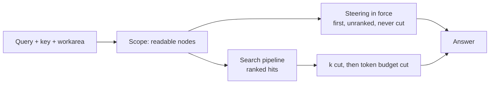

# How recall finds and orders memories

A recall returns promoted memories that the key can read, ranked by the chosen search pipeline. Standing instructions (steering) come first and are never ranked. PostgreSQL serves every read. The Delta lake serves none, because a derived copy must not become an authority.

## Who sees a hit

A recall returns promoted memories inside the key's effective access ([workareas](workareas.md)). It hides two kinds of row:

- **Held memories** are visible to their author only, through `oml read` and recall with `--include-unreviewed`.
- **Demoted and erased memories** are not served.

Superseded versions stay readable by id as history. They are never hits.

## What can be asked

Each flag below belongs to `oml read`. The same fields exist on the `oml_read` MCP tool and the [HTTP API](../api/http-api.md).

| Goal | Flag | Default |
|---|---|---|
| Ranked hits for a query | `--query "<words>"` | none |
| More or fewer hits | `--k` | 8; range 1 to 100 |
| Only some kinds | `--kinds memory` or `--kinds derived_fact`, repeatable | all hits |
| A different subtree | `--workarea <id or name>` | the key's default workarea |
| A different search pipeline | `--search <name>` | the tenant's default |
| Every word to match | `--match all` | `any` |
| The key's own held memories too | `--include-unreviewed` | off |
| Memories anchored in one repository | `--anchor-repo`, `--anchor-path-prefix` | no filter |
| Memories from one origin | `--origin-kind`, repeatable | no filter |
| Workareas beyond the scope | `--sources wide` or `--sources legal,product` | `scope`; needs federation on |

The API also takes `max_tokens` and `include_text` ([token budgets](#token-budgets)). Without `--query`, `oml read` lists instead of searching. Run `oml read --help` for the listing flags.

## How a recall runs

The server decides what the key may read before any ranking runs. A pipeline ranks the rows in that scope and nothing else. It never reads a verdict or a reviewer. Statistics such as document frequency come from the rows the key can read. A memory the key cannot read never moves the rank of one it can.

## Search pipelines

| Pipeline | What it ranks | Offered by default |
|---|---|---|
| `keyword-any` | A hit holds any of the words, exactly | yes |
| `keyword-all` | A hit holds every word, exactly | no |
| `bm25` | BM25 over each word's stored forms: the word, the parts of identifiers such as `useInvoiceFilters.ts`, and English stems | yes |
| `bm25-postings` | The same score as `bm25`, read from an index that works under row security | yes, and the default |
| `bm25-trigram` | `bm25` plus word similarity for misspellings and fragments | no |
| `sparse` | Weights from a local learned model | no |
| `bm25-sparse` | `bm25-postings` and `sparse`, combined | no |
| `bm25-rerank` | `bm25`, with the top hits reordered by a local cross-encoder | no |

The server lists the offered pipelines in `search.enabled` ([configuration](../operations/configuration.md)). A name the server does not offer is refused with `request.validation`, naming `/search` and the pipelines it offers.

### Choosing one

1. A request names a pipeline with `--search`.
2. Otherwise the tenant's default applies. An admin sets it with `oml search set-default`, and it takes effect on the next request without a restart.
3. Otherwise the server's `search.default` applies.

`oml search show` lists what the server offers and which one a recall will run.

The tenant's default can name a pipeline the server no longer offers, for example after an operator removes `bm25-sparse` from `search.enabled`. Then a recall that names no pipeline runs the server's `search.default`, and the answer says so with `search.fallback: "tenant_default_unserved"`. Steering is served as always. A request that names an offered pipeline runs it, unmarked. `oml search show` prints the pipeline that runs and notes that the tenant's default is not served, the server logs `search_tenant_default_unserved` at start naming the tenant, and `oml doctor` warns `search_tenant_default`. To end it, an admin sets an offered default or runs `oml search set-default deployment`, or the operator offers the pipeline again.

### Which one to use

**`bm25-sparse`, where the server loads its model and a recall's scope stays in the low thousands of memories, or a p95 near 85 ms is acceptable.** It finds more than the default, most of all when a question uses other words than the memory:

| Set | `bm25-postings` (default) | `bm25-sparse` | Source |
|---|---:|---:|---|
| Recall eval, 121 queries, success@5 | 0.934 | 0.983 | `eval/recall/results/served_*.json` |
| Recall eval, 121 queries, nDCG@10 | 0.873 | 0.910 | `eval/recall/results/served_*.json` |
| Grown recall set, 665 questions, success@5 | 0.913 | 0.956 | [benchmarks](../benchmarks/recall-grown.md) |
| BEIR SciFact, 5,183 memories, nDCG@10 | 0.685 | 0.730 | [benchmarks](../benchmarks/beir-scifact.md) |

What it costs:

- **A model on the server.** `opensearch-neural-sparse-encoding-doc-v3-distill`, 67M parameters, Apache-2.0, pinned by SHA-256. Its `model.safetensors` is 267,954,768 bytes at the pinned revision. Put the files in `search.sparse.model_dir`, or set `search.sparse.fetch = true` to download them at start ([settings](../operations/configuration.md)). A server that lists a sparse pipeline without the files refuses to start, naming the file.
- **CPU at write time.** The model encodes each written version once, on the server's CPU, after the write commits. It uses `search.sparse.threads` threads, 2 by default. Until the encoder reaches a version, `bm25-sparse`'s postings leg still finds it, ranked without the sparse weight, and `oml doctor` reports the backlog. Encodes per second are not measured yet.
- **No model at query time.** A query is split by the model's tokenizer and weighted from `idf.json`: no network, no GPU and no model run per recall.
- **Latency.** The client's p95 per recall:

    | Memories in scope | `bm25-postings` | `bm25-sparse` | Source |
    |---:|---:|---:|---|
    | 200 | 48.0 ms | 18.7 ms | [scale](../benchmarks/scale.md) |
    | 3,633 | 54.8 ms | 65.9 ms | [scale](../benchmarks/scale.md) |
    | 5,183 | 65.6 ms | 83.7 ms | [scale](../benchmarks/scale.md) |

    Both miss the 50 ms bar above a few thousand memories, and `bm25-sparse` misses it by more. At 100,000 memories, measured at the database, `bm25-sparse` reads two lists 100 deep: 272 ms p95 at universe scope and 114 ms at every scope. `bm25-postings` at `k` 10 took 29.2 and 20.4 ms (`bench/scale/REPORT.md`).

**`bm25-postings`, the default, for any of these needs:** no model file and no download, or a memory ranked fully the moment it is approved. It also gives the same answer for the same query, key, memories and settings, because it reads only those ([when a recall repeats](repeatable-recall.md)). It is the faster of the two at large scope.

To switch, list `bm25-sparse` in `search.enabled` with the model in place. Then set `search.default = "bm25-sparse"` for every tenant, or a tenant's admin runs `oml search set-default bm25-sparse` for theirs. A request can also name it with `--search bm25-sparse`.

### Any word or every word

The default is `--match any`: a hit holds any of the words. `--match all` keeps only memories that hold every word. When none does, the answer returns the any-word hits and marks `search.fallback: "any_term"`.

### What the answer says

The answer reports the pipeline that ran (`search.pipeline`) and the words it read (`search.terms`). Each hit carries `matched`, the words it holds, and `of`, how many words the query had.

When a recall finds fewer than three hits, `search.did_you_mean` suggests spellings. They come from words in memories the key can read, so a suggestion never reveals a word that only an unreadable memory holds. Scores compare within one answer only.

Under `bm25-postings`, a very common word can be left out of the index read. `search.pruned` names every such word, and `pruned: []` means the list is the same as `bm25`'s.

## Order of the answer

A recall returns two segments in a fixed order.

1. **Steering.** Every promoted steering memory of the workarea and its ancestors, in order of depth from `universe`, then promotion time. The query does not rank steering, and the `k` cut and the token budget never remove it. A descendant's steering does not apply at an ancestor.
2. **Hits.** Promoted memories of kind `memory` or `derived_fact`, by score, highest first. Ties break by artifact id.

Steering comes first because a standing instruction that relevance could bury fails when an agent needs it most. Nothing a client sends changes that order.

A recall inside the user root also searches `universe`. Its memories rank with the user's own, and its steering applies as an ancestor's. See [workareas](workareas.md#the-workarea-of-each-user).

### The key's own held memories

With `--include-unreviewed`, the key's own held memories join the hits. Each is marked `state: held`. They rank by the same order and count against `k` and the token budget. Held steering and held retirements never appear, because neither is in force yet.

Inside an in-progress workarea, every author's held memories join, labeled unreviewed. See [workareas](workareas.md#in-progress-workareas).

## Token budgets

Pass `max_tokens` to cap an answer. A memory costs its body size in bytes divided by 4, rounded up. The divisor is a convention, not a model's tokenizer count. Every served memory carries its `tokens`.

The cut works in four steps:

1. Steering is served whole, whatever it costs.
2. What remains of the budget is `max_tokens` minus the steering tokens, never below zero.
3. Hits are served in order while they fit.
4. The first hit that does not fit ends the list. The server skips ahead to no smaller hit and serves no partial body.

For example, take steering of 120 tokens, hits of 300, 250 and 90, and `max_tokens` of 500. The answer serves the first hit. It reports `used_tokens` 420, `truncated: true`, `hits_omitted: 2` and `next_hit_tokens: 250`. When steering alone exceeds the budget, the answer still serves it.

`max_tokens` with `include_text: false` is refused with `request.validation`, because it would budget text that was not requested.

## What was measured

The benchmarks run every pipeline through the same served path as an agent. The table shows BEIR SciFact, 5,183 memories and 300 queries, run on 2026-11-05. The [benchmarks page](../benchmarks/index.md) holds every suite with the commit and host of each run.

| Pipeline | nDCG@10 | p95 latency |
|---|---:|---:|
| `keyword-any` | 0.515 | 1,075 ms |
| `bm25` | 0.685 | 116 ms |
| `bm25-postings` (default) | 0.685 | 65.6 ms |
| `bm25-sparse` | 0.730 | 83.7 ms |

`bm25-postings` ranks the same as `bm25` and answers faster because an index serves it under row security. `bm25-sparse` ranks higher and is the one to choose where the server loads its model; it is not the default because it needs that model, and at larger scope its p95 is higher than the default's. See [which one to use](#which-one-to-use). See [benchmarks](../benchmarks/index.md) for the scale runs.

## Searching beyond the scope

`sources` says where a recall searches ([ADR-0072](../adr/ADR-0072-recall-searches-the-trusted-workareas-a-key-already-reads-chosen-per-query-by-reviewed-descriptors-and-never-widens-what-it-may-read.md)). It is off until a tenant admin enables federation with `oml search federation --enabled on`. Until then `wide` and a list are refused, never answered as `scope`.

| `sources` | Searches | Scores with the statistics of |
|---|---|---|
| `scope` (default) | the workarea's subtree, as before | the subtree |
| `wide` | the subtree, plus the `committed` and `validated` workareas the key reads elsewhere that accept federated reads | the subtree and every such workarea, searched or not |
| a list of names | exactly the listed workareas, answered whole or refused | the listed workareas |

Below the tenant's `max_sources` (8 by default), `wide` searches every such workarea. Above it, `wide` searches the workareas holding the largest share of the query's matching rows. Each word is weighted by its rarity, and ties break by name. `search.sources.cut` counts the rest. A large workarea ranks high only by holding most of the matches. So `universe` is chosen beside a small crew on its share, not its size.

The statistics are fixed before any workarea is chosen, so no hit's score depends on which workareas were searched. With `bm25`, the answer for any searched set is the full search's answer restricted to that set. The same query, key, memories and settings give the same answer. Selection reads no clock, no randomness and no model.

The answer says what it searched. Under `wide` or a list, `search.sources` lists each workarea searched with `via`, `scope` or `federated`. It adds the workarea's estimate and the query words its rows hold. Each hit carries `via` beside its `workarea_path`. A `scope` answer carries `search.widen` when another workarea the key reads is richer in the query's words. It must hold them at least twice as often per memory as the scope, on at least two memories. The hint names no workarea; a retry with `sources: "wide"` searches them. Every name and number in an answer is of a workarea the key reads.

A `wide` recall reads the word counts of every such workarea, exact and never sampled, and a list reads the listed ones. A `scope` recall reads none of them. On a federated tenant it reads its widen signal instead. The signal holds those counts as the server last built them, in the background, per key and scope. A signal serves for at most 300 seconds, and only under the grants it was built with. A `scope` answer without one carries no hint, and the server builds it for the next recall. [Workareas](workareas.md#federated-recall) covers the settings and how to make a workarea findable without granting it.

## What search does not do

- **It does not answer questions.** OML returns memories. The agent that recalls them reasons over them.
- **It does not match word forms in the keyword pipelines.** With `keyword-any`, a query for "deploy" does not find "deployments". `bm25` pipelines add English stems and identifier parts.
- **Latency is measured only in the scale benchmarks.** Without a text index under row security, every pipeline but `bm25-postings` costs more as the readable rows grow.
