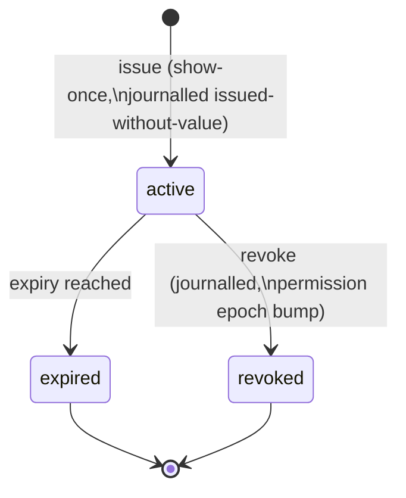

# Roles and keys

**Status:** design draft for review · decided, not built

This page owns decision **D9**: the role vocabulary, the verb ceiling per role, the dreamer's two
capability classes, the admin and operator verbs, key issuance and lifecycle, and the independence
axis that review policies apply at promotion time. Workarea grants and deny semantics are declared
in [workareas.md](workareas.md); the admission pipeline that consumes these roles is declared in
[admission.md](admission.md); what the journal and evidence export record about keys is declared in
[audit-and-lineage.md](audit-and-lineage.md).

Two rules of the constitution shape everything below. R1: the surface an agent can call never
promotes, signs, demotes or deletes — the verb ceiling is per role, and no agent-facing role
crosses it. R2: the reviewer is never the author — enforced at promotion time against the author
and the row's derivation lineage closure, not just at key issuance.

## The five roles

| Role | One line |
|---|---|
| `reader` | Recall, read, search and graph-read within scope. Every read is logged ([retrieval.md](retrieval.md)). |
| `writer` | Remember and learn — every write is held on arrival — plus attachments, supersession proposals on its own claims, and steering rows. Never a verdict. |
| `dreamer` | One role name, two capability classes: **propose** (edit-as-proposal, connection proposals) and **review** (verdicts, connection ratification). The review class is refused per row by lineage-closure exclusion (below). |
| `admin` | Tenant governance: keys, workareas, reassignment, bans, erasure, crew metadata, simulations. Admin verdicts on content are refused: admin ≠ reviewer. |
| `operator` | Provider level: creates tenants and issues each tenant's first admin key. Never writes, reads or reviews content. |

Roles do not imply one another. A key is issued with exactly one role, which is the ceiling on the
grants it may carry; each grant confers a role no higher than that ceiling over one workarea
subtree (grant mechanics, including deny entries and the permission epoch, are declared in
[workareas.md](workareas.md)). A crew member that must both write and recall holds a writer key
whose grants include reader scope — not a writer key with implied read. Which verb a key may
exercise in a given workarea is therefore resolved from effective access at call time, never from
the role name alone.

## Permission matrix

Verbs are journalled acts; the matrix states which role's keys may invoke each one. A dash means
the verb is refused with a typed error naming this rule ([errors.md](../api/errors.md)).

| Verb | reader | writer | dreamer | admin | operator |
|---|---|---|---|---|---|
| recall / search (FTS, vector) — logged | ✓ | — | — | — | — |
| read body / fetch — logged | ✓ ⁵ | — | — | — | — |
| graph and lineage read (serialize, don't compute) | ✓ | — | — | — | — |
| workarea info / events tail | ✓ | — | — | — | — |
| own-work status (own submissions only) | ✓ | ✓ | ✓ | ✓ | — |
| remember / learn (held on arrival) | — | ✓ | — | — ¹ | — |
| attach (resumable upload session) | — | ✓ | — | — ¹ | — |
| propose supersession of own claim | — | ✓ | — | — ¹ | — |
| write steering row (held + reviewed) | — | ✓ | — | — ¹ | — |
| edit-as-proposal (new attributed submission with `derives_from`) | — | — | ✓ propose | — | — |
| propose connection, claim↔claim or workarea↔workarea | — | — | ✓ propose ² | — | — |
| verdict on a held item | — | — | ✓ review ³ | — (refused) | — |
| ratify a connection | — | — | ✓ review ³ | — | — |
| reopen a rejection (non-author) | — | — | ✓ review ³ | — | — |
| re-enqueue a dead-lettered held item (journalled; [admission.md](admission.md)) | — | — | ✓ | ✓ | — |
| propose workarea status transition | — | — | ✓ | ✓ | — |
| ratify status transition (non-proposer) | — | — | ✓ | ✓ | — |
| issue / revoke keys (issuer ceiling) | — | — | — | ✓ | ✓ ⁴ |
| create / re-parent workareas | — | — | — | ✓ | — |
| reassign claims between workareas | — | — | — | ✓ | — |
| ban / lift-ban an author or source | — | — | — | ✓ | — |
| demote (journalled; bytes kept, R4) | — | — | — | ✓ | — |
| erase (crypto-shred, journalled) | — | — | — | ✓ | — |
| crew metadata update | — | — | — | ✓ | — |
| create / end simulations | — | — | — | ✓ | — |
| tip override (designate served tip, journalled) | — | — | — | ✓ | — |
| evidence export / chain verification | — | — | — | ✓ | — |
| settings show / validate / apply | — | — | — | ✓ | — |
| grants and denials on keys (epoch bump) | — | — | — | ✓ | — |
| create tenant / issue first admin key | — | — | — | — | ✓ |
| read, write or review content | — | — | — | — | — (refused) |

¹ An admin writing an ordinary claim uses a writer-scoped key — see
[Admin verbs](#admin-verbs).
² A workarea-edge proposal additionally requires dreamer(propose) effective access on at least one
endpoint and reader on both; ratification requires dreamer(review) on both endpoints, ratifier ≠
proposer. The edge-authority rule is declared in [workareas.md](workareas.md).
³ Refused per row when the key or its principal appears in the row's lineage closure — see the
next section.
⁴ The operator issues only each tenant's first admin key, and operator keys (see
[issuer ceiling](#issuer-ceiling)).
⁵ The author of a held or rejected version may fetch that version of its own claim (own-work
path); everyone else sees promoted rows only ([http-api](../api/http-api.md)).

Promote, sign and delete appear in no column: promotion is an effect of ratification inside the
admission pipeline, signing is done by `oml-server` with the deployment key
([storage.md](storage.md)), and deletion does not exist — demotion keeps bytes and erasure is a
journalled crypto-shred ([audit-and-lineage.md](audit-and-lineage.md)).

One bounded exception is inherited from the constitution: a `development` workarea may, by
journalled tenant policy, permit a writer to self-sign its own rows. Such rows are marked
`self_signed`, are readable only inside that workarea, and never promote beyond it. The exception
is declared in [workareas.md](workareas.md) and ADR-0001; it does not change this matrix — it
changes the review policy a development workarea applies.

## The dreamer split

A dreamer key carries one role name and two capability classes:

- **propose** — edit-as-proposal: a change to someone else's claim is a new, attributed submission
  carrying `derives_from`, which enters the pipeline held like any write. Connection proposals,
  claim↔claim and workarea↔workarea, follow the same shape: proposed, then separately ratified.
- **review** — verdicts on held items and ratification of proposed connections. A verdict counts
  only against a valid serve: the reviewer was served the full item — all attachments, and for a
  supersession the version it replaces — under a server-side serve binding
  ([cli/reference.md](../cli/reference.md)).

The split is not two key types and is **not enforced at issuance**. Every dreamer key may propose
and may review; what is enforced is *which rows* it may review, and that check runs at promotion
time:

**Lineage-closure exclusion.** At promotion, the service computes the row's lineage closure — the
transitive closure over `derives_from` edges and claim↔claim connection edges, pending **and**
ratified alike ([audit-and-lineage.md](audit-and-lineage.md) owns the definition) — and refuses
the verdict if the
reviewing key or its principal appears anywhere in that closure. "I edited an ancestor of this
claim" disqualifies a reviewer exactly as "I wrote this claim" does. Because the closure includes
pending edges, a dreamer cannot launder authorship by proposing an edit and reviewing the result
before the edit is ratified. A dreamer's own proposals always need another reviewer.

The honest boundary: **undeclared derivation is not detectable.** If a writer reconstructs
someone's content without declaring `derives_from`, the service has no way to know; lineage
exclusion is exactly as good as the declared graph. The service does not claim to detect
plagiarized or laundered derivation — it makes declared derivation disqualifying, and it makes
suspicious review patterns visible after the fact (see
[Review independence](#review-independence-and-the-evidence-of-collusion)).

In a simulation, the reviewer pool narrows further: simulation writes are reviewed only by dreamer
keys in the simulation's journalled audience, and a simulation with no dreamer in its audience can
promote nothing ([simulations.md](simulations.md)).

## Admin verbs

The admin governs; it does not judge content. Admin verdicts are refused server-side — the gate's
integrity rests on the reviewer never being the author *or* the authority that issued the author's
key acting as reviewer by fiat.

**Keys.** Issue and revoke, under the [issuer ceiling](#issuer-ceiling) and the
[lifecycle](#key-lifecycle) below. Issuance and revocation are journalled; grants history is part
of the evidence export.

**Workareas.** Create, re-parent, and propose/ratify status transitions; workarea edges are not
an admin fiat — they go through the dreamer propose/ratify ceremony declared in
[workareas.md](workareas.md) (an admin key participates only by holding dreamer-class grants,
which its role ceiling permits). Semantics, including the universe root and the forward-only
ladder, are declared in [workareas.md](workareas.md).

**Reassignment.** Moving a claim between workareas is a journalled act whose event records both
workareas' policy snapshots; a claim moved to a stricter-policy destination re-enters `held`, and
reassignment into a `validated` workarea is refused. This paragraph is the declaration site for
the move semantics; the status-dependent refusals (into or out of `validated`) are rows in
[workareas.md](workareas.md)'s refusal matrix.

**Ban and lift-ban.** A ban names an author or a source and is journalled, as is its lifting. The
check runs **at admission**: a banned author's or source's new submissions are refused at capture
with a typed error. A ban is not a demotion — rows that already passed the gate stay as they are;
removing them is a separate, separately journalled demote or erase. Because a ban's blast radius
is easy to misjudge, the CLI previews it: `oml ban --dry-run` enumerates the reach — the keys and
principals the ban matches and the currently held submissions it would stop — before anything is
journalled, per the preview-every-mass-act rule ([cli/reference.md](../cli/reference.md)).

**Erasure.** Journalled crypto-shred with the honest boundary stated in
[audit-and-lineage.md](audit-and-lineage.md): the guarantee is scoped to body and attachment
bytes; attribution metadata is not erased by shredding (tracked roadmap FR,
[roadmap](../product/roadmap.md)).

**Demotion.** Journalled; bytes are kept (R4). The lifecycle states and what a frozen workarea
still admits are declared in [admission.md](admission.md) and [workareas.md](workareas.md).

**Simulations.** Creating, ending, and auditing the fenced provenance channel —
[simulations.md](simulations.md).

**The writer-scoped-key path.** An admin who needs to write an ordinary claim does not get a
back door: they use a key issued with the writer role, and the write is held on arrival and
non-author-reviewed like any other. "Edit or create by hand" is this path and only this path;
free-form manipulation exists only inside the simulation channel, where every row carries
indelible `provenance: simulation`. The cost is deliberate friction: an admin fixing a typo waits
on a reviewer like everyone else. The benefit is that the evidence export never has to explain an
unreviewed admin write, because none can exist.

## Operator and the bootstrap ceremony

The operator is the provider-level role. Its verbs are creating tenants and issuing each tenant's
first admin key. It holds no grant inside any tenant: it never writes, reads or reviews content,
and the matrix above gives it no content verb to misuse. Tenant isolation mechanics are declared
in [security.md](security.md).

**Bootstrap.** On first start, a Helm job mints the root operator key. The key value is shown
exactly once — printed by the job, never stored in plaintext — and the journal records the
issuance as **issued-without-value**: the event carries the key id and hash, never the secret. A
lost root operator key is therefore not recoverable from the system; it is replaced by the
rotation path below, or, if no operator key survives, by re-running the bootstrap ceremony — a
deliberate ceremony, not an everyday verb. The mockup transcript lives in
[cli/sessions.md](../cli/sessions.md).

From the root operator key the chain of custody is: operator creates a tenant and issues its
first admin key (show-once, journalled issued-without-value); that admin issues the tenant's
working keys under the issuer ceiling. Every link in that chain is a journalled event, so the
provenance of any key in the system folds out of the journal.

## Issuer ceiling

A key is issued with a role no higher than the issuer's. Concretely:

- Only admin and operator keys hold the issue verb at all.
- A tenant admin issues reader, writer, dreamer and admin keys within its tenant — admin is the
  top tenant role, so the ceiling binds where it matters: **no tenant key can ever mint an
  operator key.**
- An operator key issues operator keys (its own rotation path) and each tenant's first admin key.

The ceiling is checked at issuance and journalled with the issuance event, so the evidence export
can show, for every key, that its role was within its issuer's at the moment of issue. The ceiling
does not prevent an admin from issuing another admin key — tenant administration is delegable by
design — it prevents escalation above the issuer.

## Key lifecycle

**Issue.** Show-once: the value is returned exactly once at issuance; the system stores only the
hash (`api_keys.hash`, [postgres-schema.md](../data/postgres-schema.md)) and the journal records
issued-without-value. There is no "show me the key again" verb anywhere in the system.

**Expiry.** Every key carries an expiry set at issuance. An expired key fails closed with a typed
error; nothing is deleted — the key row and its journalled history remain for the evidence export.

**Rotation = issue-new-then-revoke.** There is no in-place re-key. Rotation issues a new key
(new id, new grants copied or re-scoped by the admin), the holder switches credentials, and the
old key is revoked. The overlap window is the admin's choice and both events are journalled, so
the export shows exactly when each credential could act. Bulk rotation ergonomics for whole crews
(re-issue many keys in one ceremony) is unbuilt and tracked as a roadmap FR
([roadmap](../product/roadmap.md): key rotation ergonomics for crews).

**Revocation and the permission epoch.** Revocation is a journalled act that takes effect through
the permission epoch declared in [workareas.md](workareas.md): the epoch bump invalidates every
cached effective-access computation, so no cache can serve a revoked key past the revocation
event. The same epoch mechanism covers grant changes, so "when did this key stop being able to do
X" is answerable from journalled grants plus epochs — reproducibly, which is the property the
evidence export leans on.

## Review independence and the evidence of collusion

Lineage-closure exclusion stops a key from reviewing its own declared work. The **independence
axis** in per-workarea review policies ([admission.md](admission.md)) goes further, and is
resolved at promotion time from journalled key→crew→external-manager metadata:

- always: reviewer principal ≠ author principal — two keys held by the same principal cannot play
  author and reviewer for one row;
- optionally, for `committed` workareas by policy: reviewer crew or external manager ≠ author crew
  — the second opinion must come from outside the authoring crew.

Both checks use metadata as journalled at promotion time, so a later crew reshuffle does not
rewrite what was independent when the verdict landed.

What no check can do is prove the absence of collusion between distinct principals. The design's
answer is visibility, not a claim of impossibility: the evidence export
([audit-and-lineage.md](audit-and-lineage.md), `oml audit export` in
[cli/reference.md](../cli/reference.md)) surfaces **reciprocal-approval statistics per key pair**
— how often key A approved key B's work and vice versa — alongside the grants history and
per-memory decision trails. A pair of keys rubber-stamping each other shows up as a skewed pair in
the export for a human or an auditing crew to judge. The statistics are evidence, not a verdict;
no threshold auto-demotes anything.

## Decision record

This page's decisions are registered as ADR-0010 ([decision register](../adr/index.md)). One
adjacent decision is named elsewhere: programs hold keys, humans hold ceremonies, and OAuth for
MCP clients remains a named roadmap trigger ([roadmap](../product/roadmap.md)).
