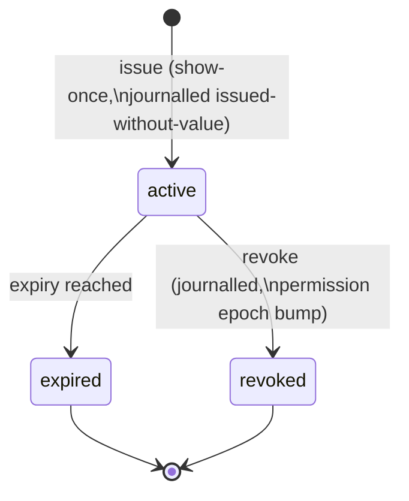

<!--
id: architecture/roles-and-keys
tier: engineering
status: design draft for review · decided, not built
answers: which verbs each of the five roles may perform; how keys are issued, scoped, denied and banned; how the independence axis is enforced at promotion; which grant roles each key role admits and the refusal order; what own means; which verbs each grant role confers; how a key's name differs from its principal and label; how a key's crew feeds the independence axis; what workarea structure an admin key reads without grants
-->

# Roles and keys

**Status:** design draft for review · decided, not built

This page owns decision **D9**: the role vocabulary, the verb ceiling per role, the dreamer's two
capability classes, the admin and operator verbs, key issuance and lifecycle, and the independence
axis that review policies apply at promotion time. Workarea grants and deny semantics are declared
in [workareas.md](workareas.md); the admission pipeline that consumes these roles is declared in
[admission.md](admission.md); what the journal and evidence export record about keys is declared in
[audit-and-lineage.md](audit-and-lineage.md).

Two rules of the constitution shape everything below. R1: the surface an agent can call never
promotes, signs, demotes or deletes — the verb ceiling is per role, and no agent-facing role
crosses it. R2: the reviewer is never the author — enforced at promotion time against the author
and the row's derivation lineage closure, not just at key issuance.

## The five roles

| Role | One line |
|---|---|
| `reader` | Recall, read, search and graph-read within scope. Every read is logged ([retrieval.md](retrieval.md)). |
| `writer` | Remember and learn — every write is held on arrival — plus attachments, supersession proposals on its own claims, and steering rows. Never a verdict. |
| `dreamer` | One role name, two capability classes: **propose** (edit-as-proposal, connection proposals) and **review** (verdicts, connection ratification). The review class is refused per row by lineage-closure exclusion (below). |
| `admin` | Tenant governance: keys, workareas, reassignment, bans, erasure, crew metadata, simulations. Admin verdicts on content are refused: admin ≠ reviewer. |
| `operator` | Provider level: creates tenants and issues each tenant's first admin key. Never writes, reads or reviews content. |

Roles do not imply one another. A key is issued with exactly one role, which names the grant
roles it may carry ([grant admissibility](#grant-admissibility-and-refusal-order)); each grant
confers one of those roles over one workarea subtree (grant mechanics, including deny entries and
the permission epoch, are declared in [workareas.md](workareas.md)). A crew member that must both write and recall holds a writer key
whose grants include reader scope — not a writer key with implied read. Which verb a key may
exercise in a given workarea is therefore resolved from effective access at call time, never from
the role name alone.

Every role above is designed to be held by an agent, and human principals hold the same roles
through the same keys — there is no human-only role and no agent-only ceiling. Where a policy
requires a *human* verdict (`human_required_classes`, [admission.md](admission.md)), the
requirement is satisfied through a journalled, issuance-time attestation: a key attribute
`held_by: human`, attested by the issuing admin, carried in the issuance event and shown in
evidence exports. The honesty boundary is the same sentence: the server verifies the
attestation, never the humanness — a mis-attested key is an admin's journalled misstatement, not
a server failure. `human_required_classes` consumes exactly this attribute: only verdicts from
keys attested `held_by: human` satisfy it ([ontologies](ontologies.md),
[ADR-0021](../adr/ADR-0021-ai-human-ontologies.md)). The attestation has a third member,
`held_by: service`, which a tenant admin issues under the ordinary
[issuer ceiling](#issuer-ceiling) for infrastructure processes — the reconciler's repair key, a
forwarding follower's zero-grant hop key ([security](security.md)) — never for review. Only an
admin key sets `held_by`; the operator issues no service key. A service key is refused every
review-class verb ([the role each verb needs](#grant-admissibility-and-refusal-order)), can
never satisfy `human_required_classes` and never counts as review capacity.

## Permission matrix

Verbs are journalled acts; the matrix states which role's keys may invoke each one. A dash means
the verb is refused with a typed error naming this rule ([errors.md](../api/errors.md)). For a
content verb — recall, read, graph read, workarea info, events tail, remember, learn, attach,
supersession, steering, propose, review, status-transition propose and ratify, and dead-letter
re-enqueue — a column names the grant role that effective access must confer on the workarea the
verb touches, resolved in the [refusal order](#grant-admissibility-and-refusal-order) below; the
admin column of workarea structure and of the last three names the key's role. For a key-level verb — keys,
grants, denials, workarea create and re-parent, crews, reassignment, bans, demote, erase, exports,
settings, tenants — a column names the key's role itself.

| Verb | reader | writer | dreamer | admin | operator |
|---|---|---|---|---|---|
| recall / search (FTS, vector) — logged | ✓ | — | — | — | — |
| read body / fetch — logged | ✓ ⁵ | — | — | — | — |
| graph and lineage read (serialize, don't compute) | ✓ | — | — | — | — |
| workarea structure: workarea info (the workarea read, the lookup by path), tree, workarea edges, status | ✓ | — | — | ✓ ⁶ | — |
| events tail | ✓ | — | — | — | — |
| own-work status (own submissions only) | ✓ | ✓ | ✓ | ✓ | — |
| remember / learn (held on arrival) | — | ✓ | — | — ¹ | — |
| attach (resumable upload session) | — | ✓ | — | — ¹ | — |
| propose supersession of own claim (including retirement) | — | ✓ | — | — ¹ | — |
| write steering row (held + reviewed) | — | ✓ | — | — ¹ | — |
| edit-as-proposal (new attributed submission with `derives_from`, including retirement) | — | — | ✓ propose | — | — |
| propose connection, claim↔claim or workarea↔workarea | — | — | ✓ propose ² | — | — |
| verdict on a held item | — | — | ✓ review ³ | — (refused) | — |
| ratify a connection | — | — | ✓ review ³ | — | — |
| reopen a rejection (non-author) | — | — | ✓ review ³ | — | — |
| re-enqueue a dead-lettered held item (journalled; [admission.md](admission.md)) | — | — | ✓ | ✓ | — |
| propose workarea status transition | — | — | ✓ | ✓ | — |
| ratify status transition (non-proposer) | — | — | ✓ | ✓ | — |
| issue / revoke / rotate keys (issuer ceiling) | — | — | — | ✓ | ✓ ⁴ |
| create / re-parent workareas | — | — | — | ✓ | — |
| reassign claims between workareas | — | — | — | ✓ | — |
| ban / lift-ban an author or source | — | — | — | ✓ | — |
| demote (journalled; bytes kept, R4) | — | — | — | ✓ | — |
| erase (crypto-shred, journalled) | — | — | — | ✓ | — |
| crew records (create, update) and a workarea's crew-metadata update | — | — | — | ✓ | — |
| create / end simulations | — | — | — | ✓ | — |
| tip override (designate served tip, journalled) | — | — | — | ✓ | — |
| evidence export / chain verification | — | — | — | ✓ | — |
| settings show / validate / apply | — | — | — | ✓ | — |
| grants and denials on keys (epoch bump) | — | — | — | ✓ | — |
| create tenant / issue first admin key | — | — | — | — | ✓ |
| read, write or review content | — | — | — | — | — (refused) |

¹ An admin writing an ordinary claim uses a writer-scoped key — see
[Admin verbs](#admin-verbs).
² A workarea-edge proposal additionally requires dreamer(propose) effective access on at least one
endpoint and reader on both; ratification requires dreamer(review) on both endpoints, ratifier ≠
proposer. The edge-authority rule is declared in [workareas.md](workareas.md).
³ Refused per row when the key or its principal appears in the row's lineage closure — see the
next section.
⁴ The operator issues only each tenant's first admin key, and operator keys (see
[issuer ceiling](#issuer-ceiling)).
⁵ The calling key may fetch its [own](#own) rows in any state (own-work path); everyone else
sees promoted rows only ([http-api](../api/http-api.md)).
⁶ **Admin structure reads.** This footnote is the single declaration site of what an admin key
reads without grants ([ADR-0026](../adr/ADR-0026-names-are-keys.md) d15). An admin key reads the
structure of every workarea in its tenant by its key role: the workarea read and the lookup by
path, the tree, a node's workarea edges and its status read — names, ids, parents, paths,
statuses, crew records, children, workarea edges, review policy objects, pending transitions —
beside the crew records, keys, grants and denials its own rows of this matrix already let it read.
No grant and no denial enters: denials attenuate grants, and an admin key holds none. On the
workarea read it sees every child and every workarea edge of the node, `my_effective_verbs`
empty, since that field lists grant-role verbs, and its own permission epoch. It never reads claim
content: recall, read, graph and lineage reads, the events tail, vocabulary reads and attachment
fetch need reader, which no admin key can carry ([admissibility](#grant-admissibility-and-refusal-order)),
so each answers `access.verb_ceiling` at step 1 of the refusal order. The content ceiling of the
two-key rule is therefore unchanged — an admin key carries no grant role, receives no serve,
records no verdict and reads no claim's content — and "admin is never a reviewer" holds as
before.

Promote, sign and delete appear in no column: promotion is an effect of ratification inside the
admission pipeline, signing is done by `oml-server` with the deployment key
([storage.md](storage.md)), and deletion does not exist — demotion keeps bytes and erasure is a
journalled crypto-shred ([audit-and-lineage.md](audit-and-lineage.md)).

One bounded exception is inherited from the constitution: a `development` workarea may, by
journalled tenant policy, permit a writer to self-sign its own rows. Such rows are marked
`self_signed`, are served only to reads whose scope node is that workarea
([retrieval](retrieval.md#the-rule-postgres-serves-the-lake-never-does)), and never promote
beyond it. How a
`self_signed` version may take a claim's tip is declared in
[audit and lineage](audit-and-lineage.md#supersession-chains-claim_key-and-the-tip). The
exception is declared in [workareas.md](workareas.md) and ADR-0001; it does not change this
matrix — it changes the review policy a development workarea applies.

## Grant admissibility and refusal order

This section is the single declaration site for which grant roles a key may carry and for the
order in which a workarea-scoped verb is refused
([ADR-0025](../adr/ADR-0025-the-agent-only-memory-surface.md) d1, d2).

**Admissibility.** A key's role names exactly the grant roles the key may carry:

| Key role | Admissible grant roles |
|---|---|
| `reader` | `reader` |
| `writer` | `reader`, `writer` |
| `dreamer` | `reader`, `dreamer` |
| `admin` | none |
| `operator` | none |

A grant role is never `admin` or `operator`. A grant whose role falls outside its key role's set
is refused with `access.issuer_ceiling`, details `{role, admissible}`, plus `grant_index` at
issuance (step 3 of the issuance order below). A key of role `admin` carrying any dreamer grant
is refused with `access.role_exclusive` — the two-key rule — and that check runs first, at
issuance and at every grant amendment. An admin who must write or recall
holds a separate writer-role key ([Admin verbs](#admin-verbs)).

**Issuance validation order.** `POST /v2/keys` ([http-api](../api/http-api.md#keys-grants-denials))
first checks that `tenant_id` is present if and only if the issuer is an operator key — else
`request.validation` (step 0) — and then validates in this order, and the first failure answers:

1. `access.role_exclusive`;
2. the [issuer ceiling](#issuer-ceiling) on the key role — `access.issuer_ceiling`, including an
   admin minting an operator key, with details `{role, admissible}`: `role` the requested key
   role, `admissible` the key roles this issuer may issue;
3. grant admissibility (the table above) — `access.issuer_ceiling`, with details `{role,
   admissible, grant_index}`: `role` the first refused grant's role, `admissible` the key role's
   admissible set, `grant_index` that grant's 0-based position in `grants`;
4. every grant node and deny node exists in the tenant — else `access.not_found`;
5. each deny node lies inside its own grant's subtree — else `request.validation`;
6. a `default_workarea_id`, when present, is covered by some grant of the key — else
   `request.validation`. When it is absent, the default is the first grant's node; a zero-grant
   key has none, and a key never inherits its issuer's default;
7. the key's `name` is not already held in its namespace, a revoked or expired key's included —
   else `name.taken`, journalling nothing ([ADR-0026](../adr/ADR-0026-names-are-keys.md) d5).

Every workarea, crew and tenant reference in the body — a grant's node, a deny's subtree, the
default workarea, `crew`, `tenant_id` — takes an id or a [name](../api/http-api.md#names-and-ids),
and each name is replaced by its row's id, or by an id that matches no row, before step 1, so an
unknown name fails step 4 exactly as an unknown id does. `name` is checked against the
[name grammar](../api/http-api.md#names-and-ids) with the rest of the body, before step 0. The
server takes exactly the grants it is sent; the CLI's reader grant beside a writer grant is a
[CLI default](../cli/reference.md#oml-keys-issuance-revocation-rotation) the body carries like
any other grant.

`held_by` is the issuing admin's attestation, so an operator key's issuance that carries it is
`request.validation`; `held_by: service` keys are issued by a tenant admin like every other
working key.

`key.issued` is journalled first and one `grant.issued` per grant follows; the key value is
returned only after the last `grant.issued` commits. If issuance fails after `key.issued`, the
server journals `key.revoked` for the key in a following commit, with `reason_digest` over the
fixed reason `issuance_incomplete`, and the key is listed as revoked. Its value was never
disclosed, so it authenticates no request either way, including before that commit lands.

**Refusal order.** A verb that needs grant role R on node N resolves in this order, where
`effective_roles(N)` is the [effective-access](workareas.md#effective-access-union-of-attenuated-grants-then-deny-wins)
formula evaluated at N, on every request:

1. R is not admissible under the key's role → `access.verb_ceiling`;
2. R is in `effective_roles(N)` → allowed;
3. `reader` is in `effective_roles(N)` → `access.grant_refused`, details `{workarea_id, needed_role}`;
4. otherwise → `access.not_found`.

Step 1 depends only on the key's role and needs no node, so it runs before the workarea is
resolved: `request.workarea_unresolved` is answered only to a call that has passed step 1, and a
reader key submitting answers `access.verb_ceiling` whether or not it has a default workarea.

**The role each verb needs.**

- **writer** — submit and steering writes, on the resolved node, which must exist.
- **reader** — recall, on the scope node (the search runs over subtree(scope) ∩ the nodes where
  reader is effective); get of a row that is not the caller's own, on the row's workarea; a listing
  without `own`; the events tail; workarea info, which an admin key also reads by its key role
  ([matrix](#permission-matrix), footnote 6).
- **supersede, retirement included** — [own](#own) is read on the target version, the current
  tip, never on the claim's first version; the rule runs in this order:

    1. a key whose role admits neither writer nor dreamer → `access.verb_ceiling`, before any
       lookup;
    2. the target must be readable — the caller's own row in any state, or promoted within its
       reader effective access — else `access.not_found`;
    3. a writer key needs writer on the target's workarea when the target is its own, resolved by
       the refusal order; a readable target another key authored answers `access.author_only`;
    4. a dreamer key needs dreamer and reader on the target's workarea, resolved by the refusal
       order, whoever authored the target, its own ratified edits included (edit-as-proposal);
    5. only then the refusals that depend on the target, in this order: an `X-OML-Workarea`
       equal to the target's workarea, else `request.validation`; the target is the current
       served tip, else `submission.tip_conflict`; the kind and retirement checks, and on
       `oml_supersede` the vocabulary-kind check, else `request.validation`
       ([kind changes](audit-and-lineage.md#supersession-chains-claim_key-and-the-tip)); the
       workarea is not `validated`, else `workarea.frozen`. The checks every submit runs follow.

    No target-dependent refusal is answered before step 2, so none of them tells a caller that an
    unreadable target exists. The idempotency record, scoped to the key alone, is looked up
    between steps 1 and 2, so a committed supersession replays whatever the target's state now,
    and it is claimed only after step 2 ([http-api](../api/http-api.md#idempotency)).

    A claim whose tip another key authored is that key's to supersede: a writer whose version
    was superseded by another key's ratified version no longer owns the claim and answers
    `access.author_only`, and a dreamer may still propose its revision or retirement.

- **dreamer** — status-transition propose and ratify, and dead-letter re-enqueue, on the node;
  admin keys act on these verbs by their key role.
- **review next and verdict** — dreamer on the row's workarea, in addition to the
  [lineage-closure exclusion](#the-dreamer-split): a row outside dreamer effective access is never
  served, and a verdict on one resolves by the refusal order like every other verb —
  `access.grant_refused` with `needed_role: dreamer` where reader is effective on the row's
  workarea, `access.not_found` otherwise.
- **service keys** — a `held_by: service` key is refused every review-class verb — the
  [matrix](#permission-matrix)'s review rows (verdict, reopen, claim-edge ratify and
  workarea-edge ratify) and the review queue and review next that lead to a verdict — and
  status-transition ratify with `access.verb_ceiling`, before any
  lookup, as at step 1 of the refusal order. A service key's dreamer grant confers those verbs
  like any dreamer grant; this rule, not the grant, keeps it out of review and out of every
  ratification ([ADR-0025](../adr/ADR-0025-the-agent-only-memory-surface.md) d1).
- **admin and operator verbs** — the key's own role, as the [matrix](#permission-matrix) states.

## Own

A row is the caller's **own** when its authoring key (`memories.author_key_id`) is the calling
key; once rotation is built, own also covers a key in the caller's journalled `rotated_from`
chain. Principal equality never makes a row own. This definition governs get of held or rejected
versions, recall with `include_own_held` ([retrieval](retrieval.md#own-held-rows-in-recall)), the
own-work listing, and the `access.author_only` check on supersession, which reads it on the
target version. Wherever a store enforces own, it compares against the caller's whole key set —
the calling key and its journalled `rotated_from` chain — never against one key id
([held text containment](retrieval.md#held-text-containment)).

Own-work reads admit every tenant role except operator and need no grant, but a global per-key
denial covering the row's workarea still masks the row — deny-wins, as everywhere else
([workareas](workareas.md)). An own row that is a simulation row or sim-derived is read only while
the calling key is in that simulation's audience; outside it the row is absent
(`access.not_found`), like any fenced row
([the simulation read predicate](retrieval.md#the-simulation-read-predicate)). Both conditions
hold on get, the own-work listing, `include_own_held` and the
[events tail's](../api/http-api.md#events-tail) author clause. R2 is unaffected: a reviewer is
still excluded by both key id and principal
([lineage-closure exclusion](#the-dreamer-split)).

**Naming a node.** An own row can sit on a node where the calling key holds no role — an admin's
reassignment can move it there. A response names a claim's node to a key only where
`effective_roles(node)` is not empty for that key, and serves null in its place elsewhere: the
`workarea_id` and `workarea_path` of a get or a listing item, a claim-subject workarea id
(`workarea_id`, `from_workarea_id`, `to_workarea_id`) in an
[events-tail](../api/http-api.md#events-tail) payload, and `workarea` and `workarea_path` on the
[agent plugin](../api/mcp-plugin.md#the-claim-item); a listing's `workarea_id` filter accepts only
a node the rule names to the key ([Search](../api/http-api.md#search-get-v1memories)). A key never
learns the id of a node it holds nothing on, except the ancestors of a node it can read, whose ids
(`parent_id`) and names (path segments) the [workarea read](../api/http-api.md#workareas) and every
derived path already disclose, and a re-parented node's former parent, which `workarea.reparent`
names as the workarea read did before the move; the workarea read omits the children the key
cannot read ([ADR-0025](../adr/ADR-0025-the-agent-only-memory-surface.md) d3).

## Effective verbs

The single declaration site for the verb names a key's effective access confers, as
`my_effective_verbs` reports them ([http-api](../api/http-api.md#workareas)): the union over the
grant roles effective on the node.

| Effective grant role | Verbs conferred |
|---|---|
| `reader` | `recall`, `read`, `graph_read`, `events_tail` |
| `writer` | `remember`, `learn`, `attach`, `supersede` |
| `dreamer` | `propose`, `review`, `supersede` |

A dreamer's `supersede` is edit-as-proposal and also needs `reader` on the node, under the
supersede rule [above](#grant-admissibility-and-refusal-order). The array lists verbs in table
order — the `reader`, `writer` and `dreamer` rows, each left to right — without duplicates; for a
`held_by: service` key it omits `review`, which that key is refused whatever its grants. The
set states the access conferred, not what a given server build serves; `tools/list` on the
[agent plugin](../api/mcp-plugin.md) states that.

## The dreamer split

A dreamer key carries one role name and two capability classes:

- **propose** — edit-as-proposal: a change to someone else's claim is a new, attributed submission
  carrying `derives_from`, which enters the pipeline held like any write. Connection proposals,
  claim↔claim and workarea↔workarea, follow the same shape: proposed, then separately ratified.
- **review** — verdicts on held items and ratification of proposed connections. A verdict counts
  only against a valid serve: the reviewer was served the full item — all attachments, and for a
  supersession the version it replaces — under a server-side serve binding
  ([cli/reference.md](../cli/reference.md)).

The split is not two key types and is **not enforced at issuance**. Every dreamer key may propose
and may review; what is enforced is *which rows* it may review, and that check runs at promotion
time:

**Lineage-closure exclusion.** At promotion, the service computes the row's lineage closure — the
transitive closure over `derives_from` edges and claim↔claim connection edges, pending **and**
ratified alike ([audit-and-lineage.md](audit-and-lineage.md) owns the definition) — and refuses
the verdict if the
reviewing key or its principal appears anywhere in that closure. "I edited an ancestor of this
claim" disqualifies a reviewer exactly as "I wrote this claim" does. Because the closure includes
pending edges, a dreamer cannot launder authorship by proposing an edit and reviewing the result
before the edit is ratified. A dreamer's own proposals always need another reviewer.

**Rival successors.** While a successor is held, the reviewer-exclusion set of every other held
successor of the same target (same workarea, `claim_key` and `replaces`) also contains its
author's key and principal; review next never serves such a row to that key, and a verdict from
it answers `review.author_in_lineage`
([ADR-0025](../adr/ADR-0025-the-agent-only-memory-surface.md) d10). Competing successors of one
tip are decided by the tip compare-and-set
([audit and lineage](audit-and-lineage.md#supersession-chains-claim_key-and-the-tip)), so a rival's
author judging the other successor would be deciding its own row's fate. A row's
**reviewer-exclusion set** is therefore the keys and principals in its lineage closure plus, for a
held successor, the authors of its held rivals.

The honest boundary: **undeclared derivation is not detectable.** If a writer reconstructs
someone's content without declaring `derives_from`, the service has no way to know; lineage
exclusion is exactly as good as the declared graph. The service does not claim to detect
plagiarized or laundered derivation — it makes declared derivation disqualifying, and it makes
suspicious review patterns visible after the fact (see
[Review independence](#review-independence-and-the-evidence-of-collusion)).

In a simulation, the reviewer pool narrows further: simulation writes are reviewed only by dreamer
keys in the simulation's journalled audience, and a simulation with no dreamer in its audience can
promote nothing ([simulations.md](simulations.md)).

## Admin verbs

The admin governs; it does not judge content. Admin verdicts are refused server-side — the gate's
integrity rests on the reviewer never being the author *or* the authority that issued the author's
key acting as reviewer by fiat.

**Keys.** Issue, revoke and rotate, under the [issuer ceiling](#issuer-ceiling) and the
[lifecycle](#key-lifecycle) below. Issuance, revocation and rotation are journalled; grants
history is part of the evidence export. One combination the service refuses to mint or amend:
a key holding the admin role never carries dreamer-class grants
(`access.role_exclusive`, [errors.md](../api/errors.md)) — the two-key rule. A person who both
administers and does dreamer work holds two keys, so the journal shows which capacity acted
([ADR-0010](../adr/ADR-0010-roles-and-keys.md)).

**Workareas.** Create, re-parent, and propose/ratify status transitions; workarea edges are not
an admin fiat — they go through the dreamer propose/ratify ceremony declared in
[workareas.md](workareas.md), and an admin key never participates in it: a person who must both
administer and propose or ratify edges holds two keys, because a key never combines the admin
role with dreamer-class grants (the two-key rule above). Semantics, including the universe root
and the forward-only ladder, are declared in [workareas.md](workareas.md).

**Crews.** Create crew records, update their charter URI and external manager, and point a
workarea at a crew record — journalled acts on recorded, not operated, metadata
([crews](workareas.md#crews-recorded-not-operated)). No agent role reaches them.

**Reassignment.** Moving a claim between workareas is a journalled act whose event records both
workareas' policy snapshots; a claim moved to a stricter-policy destination re-enters `held`, and
reassignment into a `validated` workarea is refused. This paragraph is the declaration site for
the move semantics; the status-dependent refusals (into or out of `validated`) are rows in
[workareas.md](workareas.md)'s refusal matrix.

**Ban and lift-ban.** A ban names an author or a source and is journalled, as is its lifting. The
check runs **at admission**: a banned author's or source's new submissions are refused at capture
with a typed error. A ban is not a demotion — rows that already passed the gate stay as they are;
removing them is a separate, separately journalled demote or erase. Because a ban's blast radius
is easy to misjudge, the CLI previews it: `oml ban --dry-run` enumerates the reach — the keys and
principals the ban matches and the currently held submissions it would stop — before anything is
journalled, per the preview-every-mass-act rule ([cli/reference.md](../cli/reference.md)).

**Erasure.** Journalled crypto-shred with the honest boundary stated in
[audit-and-lineage.md](audit-and-lineage.md): the guarantee is scoped to body and attachment
bytes; attribution metadata is not erased by shredding (tracked roadmap FR,
[roadmap](../product/roadmap.md)).

**Demotion.** Journalled; bytes are kept (R4). The lifecycle states and what a frozen workarea
still admits are declared in [admission.md](admission.md) and [workareas.md](workareas.md).

**Simulations.** Creating, ending, and auditing the fenced provenance channel —
[simulations.md](simulations.md).

**The writer-scoped-key path.** An admin who needs to write an ordinary claim does not get a
back door: they use a key issued with the writer role, and the write is held on arrival and
non-author-reviewed like any other. "Edit or create by hand" is this path and only this path;
free-form manipulation exists only inside the simulation channel, where every row carries
indelible `provenance: simulation`. The cost is deliberate friction: an admin fixing a typo waits
on a reviewer like everyone else. The benefit is that the evidence export never has to explain an
unreviewed admin write, because none can exist.

## Operator and the bootstrap ceremony

The operator is the provider-level role. Its verbs are creating tenants and issuing each tenant's
first admin key. It holds no grant inside any tenant: it never writes, reads or reviews content,
and the matrix above gives it no content verb to misuse. Tenant isolation mechanics are declared
in [security.md](security.md).

**Bootstrap.** On first start, a Helm job mints a **single-use, expiring enrollment secret**
(stored as a Kubernetes Secret; the job's logs carry progress only, never key material). The
operator exchanges it over TLS — `oml bootstrap claim` — for the root operator key, shown exactly
once in the operator's terminal and journalled as **issued-without-value**: the event carries the
key id and hash, never the secret. The enrollment secret is consumed on first use. A
lost root operator key is therefore not recoverable from the system; it is replaced by the
rotation path below, or, if no operator key survives, by re-running the bootstrap ceremony — a
deliberate ceremony, not an everyday verb. The mockup transcript lives in
[cli/sessions.md](../cli/sessions.md).

From the root operator key the chain of custody is: operator creates a tenant and issues its
first admin key (show-once, journalled issued-without-value); that admin issues the tenant's
working keys under the issuer ceiling. Every link in that chain is a journalled event, so the
provenance of any key in the system folds out of the journal.

## Issuer ceiling

A key is issued with a role no higher than the issuer's. Concretely:

- Only admin and operator keys hold the issue verb at all.
- A tenant admin issues reader, writer, dreamer and admin keys within its tenant — admin is the
  top tenant role, so the ceiling binds where it matters: **no tenant key can ever mint an
  operator key.**
- An operator key issues operator keys (its own rotation path) and each tenant's first admin key.

The ceiling is checked at issuance and journalled with the issuance event, so the evidence export
can show, for every key, that its role was within its issuer's at the moment of issue. The ceiling
does not prevent an admin from issuing another admin key — tenant administration is delegable by
design — it prevents escalation above the issuer.

## Key names, principals and labels

A key carries three identifying fields, and they are independent: none is derived from another on
the server ([ADR-0026](../adr/ADR-0026-names-are-keys.md) d9). This section is their single
declaration site.

| Field | What it is | Unique | Changes |
|---|---|---|---|
| `name` | What admin verbs address the key by — show, revoke, rotate, grants, denials, effective access, a simulation audience — wherever its id is accepted ([names](../api/http-api.md#names-and-ids)) | in its tenant; operator keys in the provider's namespace | never, and never released: a revoked or expired key keeps it |
| `principal` | Who acts: the attribution identity in every journal envelope, shared by design across the keys one identity holds, compared by R2 and matched by bans | no | never |
| `label` | An optional free-text note for the people who administer the key | no | never |

A principal is not a name: the two keys of the two-key rule share one principal, and a principal
may carry `/` (`crew-procure/agent-7`). Rotation mints a new key, so the successor takes a new name
of its own, given in the rotation request. `oml keys issue-agent` takes the key's name and its
principal as separate, required arguments, and never derives one from the other
([CLI](../cli/reference.md#oml-keys-issuance-revocation-rotation)).

A key may also name a [crew](workareas.md#crews-recorded-not-operated) at issuance: journalled in
`key.issued` as `crew_id`, fixed for the key's life and carried to a rotation's successor. It is
the key→crew link the [independence axis](#review-independence-and-the-evidence-of-collusion)
reads.

## Key format

This section is normative for the key value itself: what crosses the wire, what is stored, and
where the value may never appear.

**Wire format.** An API key is the fixed prefix `oml_` followed by 43 base62 characters
(`[A-Za-z0-9]`) encoding 256 bits drawn from a cryptographically secure random generator —
47 characters in total. The value encodes nothing: no role, no tenant, no key id. Everything
about a key is a row looked up by the value's hash, so a leaked value discloses only that it is
an OML key — which is the prefix's purpose: a fixed, greppable prefix lets secret scanners
(including OML's own [deterministic scan](admission.md) rules) match key material in submitted
content, logs and repositories with a low false-positive rate.

**Hash at rest.** The system stores `SHA-256(full key string, prefix included)` in
`api_keys.hash` ([postgres-schema.md](../data/postgres-schema.md)) and never the value. The hash
is plain — unsalted, single-round — and that choice is defended rather than assumed: a password
hash's salt and work factor exist to protect low-entropy, human-chosen secrets from dictionary
and rainbow-table attacks, and a 256-bit uniformly random key has no dictionary to resist —
brute force against the hash is brute force against the keyspace. What the plain deterministic
hash buys is the request path: every authenticated call resolves the bearer value by one
equality lookup on the `UNIQUE` hash index, with no per-request key-stretching cost and no
secondary lookup identifier. The defense holds only while keys are generated as specified above;
a deployment that minted guessable keys would forfeit it, which is why the generation rule is
part of this normative section, not an implementation detail.

**Presentation.** Every request carries the key as
`Authorization: Bearer <key>` ([http-api.md](../api/http-api.md#authentication-and-authorization))
— never in a query string, path segment or body field, so the value cannot land in URL-position
logs or referrer headers.

**Where the value never appears.** The value is shown exactly once, at issuance (the show-once
rule below); after that moment no component holds or reproduces it. The journal records
`key.issued` as issued-without-value; log lines name keys by `key_id` only, never by value or
hash ([observability](../operations/observability.md) owns the logging rules); journal payloads
carry key ids, never key material. A key value found anywhere but the issuance terminal and the
caller's `Authorization` header is a defect. The one exception is the file `oml keys issue-agent
--out` creates for it, the one place a key value may rest outside the show-once response: new,
owner-only (mode 0600), written once, never overwritten, and the operator's to delete once the key
is in the environment that needs it ([CLI](../cli/reference.md#oml-keys-issuance-revocation-rotation),
[ADR-0028](../adr/ADR-0028-agent-key-issuance.md) d1).

## Key lifecycle

**Issue.** Show-once: the value is returned exactly once at issuance; the system stores only the
hash (`api_keys.hash`, [postgres-schema.md](../data/postgres-schema.md)) and the journal records
issued-without-value. There is no "show me the key again" verb anywhere in the system.

**Expiry.** Every key carries an expiry set at issuance. An expired key fails closed with a typed
error; nothing is deleted — the key row and its journalled history remain for the evidence export.

**Rotation.** There is no in-place re-key. Rotation is one journalled act (`key.rotated`,
[event catalog](../data/event-catalog.md)) that mints a successor key — a **new** `key_id` and a
new [name](#key-names-principals-and-labels), linked to the old one by `rotated_from`, its grants
and crew reproduced from the journalled records — and starts a bounded grace window on the old key, its length the admin's choice
(`oml keys rotate --grace`, [cli/reference.md](../cli/reference.md)). The event carries both key
ids and the grace deadline; the holder switches credentials inside the window, and at the
deadline the old key is revoked — a journalled `key.revoked` citing the rotation as cause — so
the export shows exactly when each credential could act. An admin who wants different grants on
the successor amends them afterward, as ordinary journalled grant acts. Bulk rotation ergonomics
for whole crews (re-issue many keys in one ceremony) is unbuilt and tracked as a roadmap FR
([roadmap](../product/roadmap.md): key rotation ergonomics for crews).

**Revocation and the permission epoch.** Revocation is a journalled act that takes effect at the
key's next request served by the lead: keys and effective access are resolved on every request and
no resolution is cached. A follower resolves them from its local replica, so on follower-served
reads a revocation takes effect after replication lag — the window
[workareas.md](workareas.md#grants-bind-to-node-ids-paths-are-derived) states and
[security](security.md) carries as a residual. Grant changes and denials apply the same way, and the permission epoch labels the
journalled state each answer was computed against, so "when did this key stop being able to do
X" is answerable from journalled grants plus epochs — reproducibly, which is the property the
evidence export leans on.

## Review independence and the evidence of collusion

Lineage-closure exclusion stops a key from reviewing its own declared work. The **independence
axis** in per-workarea review policies ([admission.md](admission.md)) goes further, and is
resolved at promotion time from journalled key→crew→external-manager metadata:

- always: reviewer principal ≠ author principal — two keys held by the same principal cannot play
  author and reviewer for one row;
- optionally, for `committed` workareas by policy: reviewer crew or external manager ≠ author crew
  — the second opinion must come from outside the authoring crew.

A key's crew is the [crew record](workareas.md#crews-recorded-not-operated) it named at issuance
([key names](#key-names-principals-and-labels)), and a crew's external manager is that record's
`external_manager`. A key that names no crew satisfies neither optional requirement, and a crew
that records no external manager satisfies no manager-inequality requirement: such a verdict does
not count toward the requirement it cannot establish, and the row stays held until one that does
— failing closed by holding, as admission does everywhere
([ADR-0026](../adr/ADR-0026-names-are-keys.md) d8).

Both checks use metadata as journalled at promotion time, so a later crew reshuffle does not
rewrite what was independent when the verdict landed.

What no check can do is prove the absence of collusion between distinct principals. The design's
answer is visibility, not a claim of impossibility: the evidence export
([audit-and-lineage.md](audit-and-lineage.md), `oml audit export` in
[cli/reference.md](../cli/reference.md)) surfaces **reciprocal-approval statistics per key pair**
— how often key A approved key B's work and vice versa — alongside the grants history and
per-memory decision trails. A pair of keys rubber-stamping each other shows up as a skewed pair in
the export for a human or an auditing crew to judge. The statistics are evidence, not a verdict;
no threshold auto-demotes anything.

## Decision record

This page's decisions are registered as ADR-0010 ([decision register](../adr/index.md)); grant
admissibility, the refusal order, the issuance order, own and the effective verbs are
[ADR-0025](../adr/ADR-0025-the-agent-only-memory-surface.md)'s (d1–d3, d14); key names and the
key's crew and the admin structure reads are the proposed
[ADR-0026](../adr/ADR-0026-names-are-keys.md)'s (d8, d9, d15). One
adjacent decision is named elsewhere: programs hold keys, humans hold ceremonies, and OAuth for
MCP clients remains a named roadmap trigger ([roadmap](../product/roadmap.md)).
