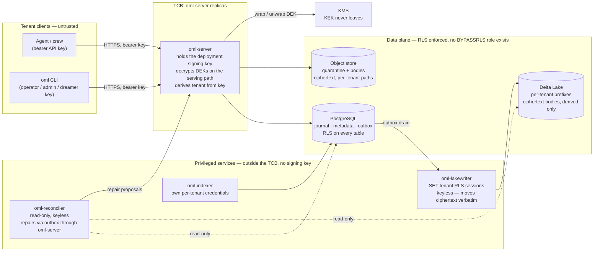

<!--
id: architecture/security
tier: engineering
status: design draft for review · decided, not built
answers: what the tenancy model isolates; who holds which key in the custody map; what the threat model defends against, hostile co-tenants included
-->

# Security and tenancy

**Status:** design draft for review · decided, not built

This page owns decision **D6**: the tenancy model, the controls on privileged services, the key
custody map, and the threat model — written against hostile co-tenants from the start, not
retrofitted onto a single-operator assumption. The signing chain and commit protocol this page
leans on are declared in [storage.md](storage.md); roles, the issuer ceiling and ban verbs in
[roles-and-keys.md](roles-and-keys.md); grants, denies and the permission epoch in
[workareas.md](workareas.md); the admission pipeline in [admission.md](admission.md); the erasure
inventory and read log in [audit-and-lineage.md](audit-and-lineage.md).

The attacker this page is written against is not an outsider. It is a **hostile co-tenant**: a
party with valid API keys on the same deployment, sharing the same Postgres cluster, the same
object store, the same oml-server replicas, who wants to read, corrupt, impersonate or starve
another tenant. Every control below is judged against that attacker first.

## Tenancy model

Tenancy is first-class, not a column added later.

**Tenant is derived server-side from the API key, never from the request.** No request parameter,
header, path segment or MCP tool argument names a tenant. oml-server resolves the bearer key to its
`api_keys` row and takes `tenant_id` from there; a request that tries to name a tenant has no
vocabulary to do it in. This removes the entire class of confused-deputy bugs in which a valid key
is combined with someone else's tenant identifier.

**Row-level security on every table, keyed by `tenant_id`.** Every Postgres table in the
[PostgreSQL schema](../data/postgres-schema.md) carries an RLS policy; there is no table exempted for convenience. Service roles run with RLS
enforced — no role used by any OML workload holds `BYPASSRLS` (see privileged services below).
Two conditions make that true rather than assumed, and both are design commitments: every table
sets `FORCE ROW LEVEL SECURITY`, and migrations run under a separate owner role no workload uses —
a Postgres table's owner bypasses RLS by default, so a service role that owned its tables would
silently not be subject to the policy. Workloads that set a tenant for the session (the
lake-writer) do it with `SET LOCAL` inside the transaction, never session-level `SET`, so pooled
connections cannot leak tenant context between batches. RLS
is the second fence behind application-level scoping: a query that escapes a `WHERE` clause bug
still cannot cross a tenant boundary, because the policy is evaluated by Postgres, not by our code.
The cost is stated plainly: RLS predicates sit on every query plan, and the performance of
per-tenant partitioned indexes under RLS is unmeasured — tracked with the pgvector FR in the
[roadmap](../product/roadmap.md).

**Per-tenant isolation extends through every storage layer:**

- **Journal chains are per tenant** — one chain-head row per `tenant_id`, per-tenant `seq`, so one
  tenant's write rate never serializes against another's chain lock, and a tenant's evidence export
  verifies its own chain without touching anyone else's ([storage.md](storage.md)).
- **Lake table prefixes are per tenant**, and when the object store is externalized, **storage
  credentials are per tenant** — a credential leak for one tenant's prefix does not open another's.
- **Embeddings and FTS are partitioned**: `memory_embeddings` is list-partitioned by `tenant_id`
  with per-partition HNSW indexes and RLS on top ([retrieval.md](retrieval.md)). There is no
  shared vector space across tenants: no HNSW graph spans tenants, so a correctly pruned query
  never ranks foreign rows — and RLS remains the isolation authority if pruning fails, since
  partition pruning is planner behavior, not a security boundary.
- **Quarantine and body objects are keyed under per-tenant paths**
  (`oml-quarantine/<tenant>/<digest>`, `oml-bodies/<tenant>/<digest>`).

What is shared is the deployment: the Postgres cluster, the oml-server replicas and their signing
key, the KMS, the lake-writer. The controls on those shared components are the next two sections.

## Privileged services are designed, not waved through

Three workloads touch many tenants' data by nature. Each runs under its own credentials, with the
narrowest grant that lets it do its one job, and none holds the signing key.

**oml-lakewriter** drains the outbox and materializes lake rows. It iterates **per tenant**: for
each tenant's batch it opens a Postgres session under a `SET`-tenant, RLS-scoped session role — it
sees one tenant at a time, under the same RLS policies as everyone else, with **no `BYPASSRLS`**.
It holds **no KMS grant at all**: body ciphertext is produced exactly once, at admission by
oml-server under the artifact's DEK, and the journalled ciphertext digest is computed over those
bytes — the lake-writer moves them verbatim and never re-encrypts, so a compromised lake-writer
cannot decrypt a single body nor substitute bytes without tripping the keyless digest check. It
writes to the lake under the per-tenant storage credential for the tenant it is currently serving.

**oml-reconciler** compares the lake against the journal fold ([reconciliation.md](reconciliation.md)).
It runs **read-only**: a read-only Postgres role, read access to the lake, and **no KMS grant at
all** — digest comparison is over ciphertext digests, keylessly, by design (D3 records the
ciphertext digest in object metadata precisely so the reconciler never needs a key). When it finds
a discrepancy, it does not repair in place: repairs are **emitted through the outbox via
oml-server**, as journalled acts under the reconciler's own identity. A compromised reconciler can
therefore lie in its findings but cannot silently alter data — every repair it causes is a signed
journal event someone can audit.

**oml-indexer** computes embeddings and FTS entries over promoted rows and, inside an
in-progress subtree, held rows (the proposed
[ADR-0030](../adr/ADR-0030-in-progress-workareas.md) d9), the held plaintext reaching it from
oml-server on the serving side of decryption. It runs under its own per-tenant credentials and
never the signing key. It necessarily handles plaintext (you cannot embed ciphertext); it holds
no KMS decrypt grant and no quarantine credential: promoted plaintext, and that held plaintext,
reach it on the serving side of decryption
([retrieval.md](retrieval.md#the-in-progress-fence)), keeping oml-server the single decryption
locus. Under the proposed ADR-0030 its Postgres role, per tenant under tenant RLS, holds exactly:
`SELECT` on `memories`, `workareas` (which the `in_progress_fence` policy reads with the
invoker's privileges) and its own work items; `INSERT` on `memory_embeddings`; and `UPDATE` on
the one column `memories.created_at`. PostgreSQL requires `UPDATE` on at least one column of a
table that `SELECT … FOR SHARE` locks
([SELECT](https://www.postgresql.org/docs/current/sql-select.html), fetched 2026-10-31), and the
indexer's insert takes the version's row `FOR SHARE`
([the in-progress fence](retrieval.md#the-in-progress-fence)). A `BEFORE UPDATE` trigger on
`memories` refuses every update whose `current_user` is the indexer's role, so that privilege
admits the lock and nothing else.
Where the embedding model runs is the embedding RS row in the
[roadmap](../product/roadmap.md); an answer that required an indexer decrypt grant would revise
this custody map as its own journalled decision.

The common pattern: **the authority to make something true (sign a journal event) lives only in
oml-server; privileged services hold the authority to copy, compare and derive, each scoped so its
compromise is bounded and its actions leave journal evidence.**

## Key custody map

Who loads what. "Never" entries are the point of the table.

| Material | oml-server **lead** | oml-server **follower** | oml-lakewriter | oml-reconciler | oml-indexer | `oml` CLI |
|---|---|---|---|---|---|---|
| ed25519 deployment signing key | **loads it — the only process in the deployment that does** ([ADR-0023](../adr/ADR-0023-install-profiles-and-cluster-mode.md)) | **never** | never | never | never | never |
| KMS: decrypt (unwrap DEKs) | serving + admission paths | **serving path only** | **never** | **never** | **never** — reads promoted plaintext, and inside an in-progress subtree held plaintext (ADR-0030, proposed), on the serving side of decryption ([retrieval.md](retrieval.md)) | never |
| KMS: generate-data-key / encrypt | yes (admission — the single encryption locus; lake copies are these same bytes) | **never** — followers admit nothing | **never** — moves admission-produced ciphertext verbatim | never | never | never |
| Write verbs | executes | **forwards to the lead, executes none** | — | — | — | — |
| Postgres role | RLS-scoped service role (write) | RLS-scoped **read** role + read-log append | per-tenant `SET`-tenant RLS role, no `BYPASSRLS` | read-only RLS role | per-tenant RLS role; under the proposed ADR-0030, `SELECT` on `memories`, `workareas` and its work items, `INSERT` on `memory_embeddings`, and `UPDATE` on `memories.created_at` only to admit `FOR SHARE`, refused by a guard trigger (above) | none (talks HTTP) |
| Object-store credentials | quarantine + bodies | read (promoted bodies) | per-tenant lake prefixes | read-only | read (promoted bodies) | none |
| API keys | verifies hashes; never stores values | verifies hashes | holds none | holds none | holds none | bearer of operator/admin/dreamer keys |

Two statements in this map deserve their own sentences.

**The signing key lives only in the lead — at most one process, lease-guarded, takeover
journalled.** The lead loads the deployment signing key from a Kubernetes Secret or KMS; followers
never do ([ADR-0023](../adr/ADR-0023-install-profiles-and-cluster-mode.md) — enforced as a
composition fact: the follower binary composes no signer port). The signature attests *the
deployment* — one signer process at a time plus its journalled failovers — and the threat model
says the rest without flinching: **compromise of the lead is compromise of the signing key**;
compromise of a follower is serving-path decryption and misserving, never forgery — a follower
cannot sign a journal event, promote, or erase. One more plaintext locus follows from the
topology: a write forwarded by a follower transits that follower's memory in plaintext (TLS
terminates there) — nothing new relative to decrypt-on-serve, listed for completeness. An attacker
on the lead can sign arbitrary events for as long as the compromise lasts. The mitigations are
recovery-shaped, not prevention-shaped: the per-tenant chain makes forged history detectable by any
holder of a prior chain head, the startup fork check refuses to extend a chain that does not verify
against the last signed head, and key rotation after a suspected compromise is a journalled act
(the ceremony is [Signing-key rotation](#signing-key-rotation) below).
What the design does *not* claim: per-replica keys, HSM-resident signing, or threshold signatures.
Those are possible hardenings with real operational cost, and none is committed — if one becomes a
requirement it enters the roadmap as its own row.

**The KEK never leaves KMS — and it rotates on a schedule.** Per-artifact DEKs are wrapped and
unwrapped by KMS calls; no OML process ever holds the KEK. Crypto-shredding
([audit-and-lineage.md](audit-and-lineage.md)) destroys the wrapped DEK, and the custody map above
means that destruction cannot be undone by any service that merely writes data. One copy class
outlives the live row: wrapped-DEK copies in Postgres backups and WAL. The commitment that bounds
it: KEK rotation re-wraps **live** DEKs only; a retired KEK is destroyed once no retained backup
predates its retirement, and that destruction is a journalled act. From then on the wrapped-DEK
copies in older backups are noise — there is no KEK left that can unwrap them.

## Custody by profile

The "never" columns above are backed by different mechanisms per install profile
([ADR-0023](../adr/ADR-0023-install-profiles-and-cluster-mode.md)), and the backing is part of
the claim:

| Backing | kubernetes | docker (compose) | standalone |
|---|---|---|---|
| What enforces a "never" | Composition (no port) **+** external KMS IAM grants **+** pod/Secret separation | Composition **+** container mount boundaries (the keyring is simply not mounted); no external IAM | Composition **+** OS process boundary and file permissions; under one uid, "keyless" is code structure, not custody |
| KEK custody | Never leaves KMS | A file in a compose secret on the host — **host admin ≡ KMS admin** | A file on the same disk as the data it protects; encrypt-only grants do not exist |
| The host admin | Outside the pod trust domain, inside the platform trust (residual 5) | **Is a key-holding attacker by default** — reads every volume, secret and keyring | Strongest form: one host holds signing key, KEK, database, lake and backups — tamper-evidence against the host admin rests entirely on exported chain heads (RS-9) |

The collapse is stated, not apologized for: standalone and docker trade custody separation for
installability, every weakened row is named in [commitments](../product/commitments.md), and the
keyring mechanism itself is RS-12.

## Signing-key rotation

The custody map gives the signing key to exactly one process; this section says how the
deployment changes that key. There are two paths — scheduled and under suspicion — and the
difference between them is the whole point.

**Planned rotation is one journalled act with cross-signing.** The rotation event,
`system.signing_key_rotated` ([event catalog](../data/event-catalog.md)), is the **first event
the new key signs**; the outgoing key's endorsement rides inside it as the payload's
`cross_sig` — pure Ed25519 by the **old** key over the ASCII bytes
`oml-signing-key-rotation:<new_key_id>:<new_public_key_hex>`
([chain-format](../data/chain-format.md) owns the byte rule). The succession is therefore
provable from the journal alone: a verifier whose trust rests on the old key reads the new
public key out of the rotation payload, checks `cross_sig` under the old key, and continues
verifying under the new — old attests new, so trust extends across the pivot with no
out-of-band key distribution, and the evidence export carries the succession record. Rotation
never re-signs history: events signed by a retired key verify against that key forever, which
is why the pivot must live in the chain rather than in configuration.

**Unplanned rotation — suspected lead compromise — is a ceremony, not a verb**, because a
compromised lead can sign anything until the key changes, including a plausible "rotation" of
its own. The committed sequence, stepped through operationally in the
[signing-key-compromise runbook](../operations/runbooks.md#signing-key-compromise):

1. **Stop writes.** Revoke the lead lease (or scale the lead to zero). Followers keep serving
   reads; the write path refuses — the same availability-for-integrity trade the design makes
   everywhere else.
2. **Rotate.** Mint a new signing key outside the compromised process's reach and journal
   `system.signing_key_rotated` with `rotation: unplanned` — `cross_sig` null by definition (a
   suspect key must not vouch for its successor), `ceremony_ref` **required**. The honesty
   limit is stated with the step: the rotation event is signed by the new key, so the journal
   alone cannot prove which pivot is the legitimate one — an attacker holding the lead could
   journal a plausible pivot of its own. What distinguishes the legitimate pivot is the
   out-of-band ceremony `ceremony_ref` names — the record in which the new key's fingerprint
   was established — plus evidence retained outside the deployment, not cryptography.
3. **Fork-check.** Verify every tenant chain against the last chain heads retained outside the
   deployment — the evidence exports tenants kept; a standing anchoring mechanism is
   [RS-9](../product/roadmap.md). Events signed inside the suspected window are flagged for
   audit, never silently trusted.
4. **Re-attest.** The new lead starts under the startup fork check
   ([storage.md](storage.md)), its first act is journalled, and a fresh evidence export of the
   post-rotation chain heads is produced for tenants to retain — the new baseline the next
   ceremony would verify against.

What rotation does not do: it bounds the future, never the past. Everything the old key signed
during the compromise window verifies and will verify forever; separating legitimate events from
attacker events in that window is an audit over outside-retained heads, not a cryptographic
operation — the same limit residual risk 4 states below.

## Transport and internal authentication

Who terminates TLS, what the floor is, and what the non-client workloads present to whom.

**Client-facing TLS, per profile.** The termination point follows the profile's supervisor, and
each row names its shipped default rather than leaving it to discovery:

| Profile | Termination point | Shipped default |
|---|---|---|
| standalone | `oml-server` terminates TLS itself (certificate and key paths in `oml-standalone.toml`), or sits behind a local reverse proxy the operator brings | **Direct termination by `oml-server`.** A plaintext listener is permitted only on a loopback bind — which is what the quickstart transcripts show ([deployment](../operations/deployment.md)) |
| docker | A compose-level reverse proxy service in front of `oml-server` | The proxy terminates TLS; `oml-server` listens in plaintext on the compose-internal network only |
| kubernetes | Ingress — the cluster's TLS stack | Deferred to the cluster stack: [deployment](../operations/deployment.md) names ingress and TLS termination as deployment-site choices the chart parameterizes but does not fix |

The floor in every profile: TLS 1.2 minimum, 1.3 preferred. Plaintext HTTP across any boundary
that is not a loopback bind or a compose-internal network is a misconfiguration, not an option —
the bearer key is the whole capability, and it transits in the clear wherever TLS is absent.

**Postgres transport.** The requirement follows where Postgres sits, not the profile name:
a Unix socket or loopback connection (standalone's bring-your-own host service, docker's
in-compose container) may run without TLS; the moment Postgres is on another host —
standalone pointing at a remote database, the kubernetes `scaled` value set's managed service —
`sslmode=verify-full` is required, certificate verification included, because a bearer of the
service role's credential plus an unverified channel is a tenant-data read path. The kubernetes
`local` value set's in-cluster CloudNativePG speaks TLS under the operator's own issued
certificates. These are deployment requirements the profile payloads carry, in the same class as
C6's three RLS commitments ([deployment](../operations/deployment.md)).

**The service-credential class.** The privileged workloads authenticate with two kinds of
credentials, and the distinction is deliberate:

- **To Postgres**: each workload's own database role, per the custody map above and the workload
  table in [deployment](../operations/deployment.md). Database roles are deployment
  configuration — minted by the profile payloads, recorded by the journalled settings digest
  (`system.settings_applied`) — not individually journalled keys.
- **To `oml-server`**: a **service key** — an ordinary API key, issued by the tenant's admin at
  deployment setup under the ordinary issuer ceiling (the operator issues none,
  [roles-and-keys.md](roles-and-keys.md#issuer-ceiling)), journalled `key.issued` with
  `held_by: service`, hashed at rest, expiring, and rotated
  by the same `key.rotated` act as every other key ([roles-and-keys.md](roles-and-keys.md)).
  There is no new role: the role vocabulary is fixed, so a service key carries the narrowest
  existing role its one job needs, and `held_by: service` is what the evidence export shows.
    - **oml-reconciler** holds a dreamer-role service key with a dreamer grant on the nodes it
      repairs — dreamer is the lowest role holding the journalled repair re-enqueue in the
      permission matrix ([roles-and-keys.md](roles-and-keys.md)). Every repair it causes is
      therefore a journal event attributed to the reconciler's own key, which is the property the
      privileged-services section above leans on. A grant carries a role, not a verb list, so
      nothing narrows that grant to the re-enqueue: it also confers every other dreamer verb
      ([effective verbs](roles-and-keys.md#effective-verbs)). A `held_by: service` key is refused
      every review-class verb and every ratification, before any lookup
      ([the role each verb needs](roles-and-keys.md#grant-admissibility-and-refusal-order)), so a
      stolen reconciler key can still propose within its grants, which only returns work to
      non-author review under other keys. That is a stated residual
      ([FR-32](../product/roadmap.md)); residual risk 8 below.
    - **A forwarding follower** holds a reader-role service key with no grants: it authenticates
      the forwarding hop to the lead and authorizes nothing. The client's own bearer key travels
      with the forwarded request, the lead resolves authorization against the *client's* key, and
      the journalled act is attributed to the client — the follower never becomes the actor. The
      lead accepts forwarded write traffic only over hops authenticated by an enrolled
      follower's service key, so a process that merely reaches the lead's port cannot inject
      forwarded writes.
    - **oml-lakewriter** presents nothing to `oml-server` — it never calls it. Its credentials
      are the `SET`-tenant Postgres session role and the per-tenant object-store credentials in
      the custody map, and that absence is part of the design: the lake-writer has no API-side
      identity to steal.

Service keys obey every rule of the [key format section](roles-and-keys.md#key-format): show-once
issuance, hash at rest, key ids — never values — in logs and journal payloads.

## STRIDE, redone for hostile co-tenants

Each row names the threat as a co-tenant would mount it, the controls that answer it, and what
remains. Nothing in this table is built or measured; every control is a design commitment.

| Threat | Co-tenant attack | Controls | Residual |
|---|---|---|---|
| **S**poofing | Steal or phish another tenant's bearer key; present it as that tenant. | Keys are stored as hashes, shown once at issuance and journalled as issued-without-value ([roles-and-keys.md](roles-and-keys.md)); expiry on every key; revocation is a journalled act effective at the key's next request on the lead, and after replication lag on a follower (EoP row below); tenant is derived from the key, so a stolen key spoofs *one tenant's one role*, never a chosen tenant. | A bearer key is full capability of that key until expiry or revocation. Key theft on the client side is outside OML's reach; short expiry and scoped grants bound the blast radius, they do not remove it. |
| **T**ampering | Use leaked lake/storage credentials to rewrite another tenant's lake rows or objects; or corrupt Postgres rows. | Per-tenant lake prefixes and per-tenant storage credentials bound a leak to one tenant. The lake is derived, never authoritative, and serves no client read ([storage.md](storage.md)) — tampered lake rows mislead analytics, not serving. The reconciler's digest-mismatch finding class detects divergence keylessly ([reconciliation.md](reconciliation.md)). In Postgres: journal tables are append-only (REVOKE UPDATE/DELETE plus guard trigger); the per-tenant hash chain and signatures make any rewrite by a party without the deployment signing key fail verification; a key-holding attacker's rewrite is detectable only against chain heads retained outside the deployment — evidence exports today, an anchoring mechanism if RS-9 adopts one ([roadmap](../product/roadmap.md)). | Tampering between reconciler runs is live until detected; detection latency is the reconciler's cadence. A Postgres superuser is outside the model — the deployment's DBA is trusted. |
| **R**epudiation | A writer denies having written a claim; a reviewer denies a verdict; a tenant disputes what was served. | Every mutation is a signed, hash-chained, attributed journal event (key id, principal, timestamp). Verdicts are bound to a serve record of exactly what was reviewed (serve_id, below). Reads are logged with per-batch digests anchored into the journal ([retrieval.md](retrieval.md)). The evidence export replays the decision trail per memory ([audit-and-lineage.md](audit-and-lineage.md)). | Attribution says which *key* acted. Binding a key to a human or crew member is the tenant's key-hygiene problem; shared keys dilute repudiation evidence and the docs say so rather than pretending otherwise. |
| **I**nformation disclosure | Read another tenant's memories across the shared database or the shared search machinery; or exfiltrate via the lake. | RLS keyed by `tenant_id` on every table, with no service role holding `BYPASSRLS`. Tenant never taken from the request. Embeddings and FTS are physically partitioned per tenant — there is no cross-tenant index to leak through, and ranking never sees foreign rows. Within a tenant, simulation rows are additionally excluded from the shared indexes and served only to the simulation's audience ([simulations.md](simulations.md)). Lake bodies are per-artifact-DEK ciphertext; lake access without KMS decrypt yields digests and attribution, not content. Under the proposed [ADR-0030](../adr/ADR-0030-in-progress-workareas.md), an in-progress subtree's rows sit in the serving indexes behind a fence keyed by the subtree, and its vectors in an HNSW graph of their own that no recall scoped outside scans before the commit ([retrieval.md](retrieval.md#the-in-progress-fence)). | Attribution metadata (writer, principal, timestamps, workarea path) is in the clear in the lake by design requirement — who wrote what, when, where is what the lake is for ([ADR-0003](../adr/ADR-0003-delta-lake-derived-lakehouse.md)); its erasure is a tracked FR ([audit-and-lineage.md](audit-and-lineage.md)). Side channels (timing, resource contention on shared replicas) are not addressed in v1. Under the proposed ADR-0030, the in-progress boundary is a fence only at the serving indexes: the listing, get, the attachment fetch, the graph and lineage reads and the events tail keep a subtree from reads scoped outside by a predicate, through `served_memories` and `events_with_subjects`, held by port-contract tests; a read path that selected `memories` directly would serve an inside row outside. |
| **D**enial of service | Flood writes, uploads or queries to starve co-tenants on shared replicas, Postgres, or review capacity. | Quotas and rate limits are journalled grant attributes; exceeding one returns a typed 429 naming the rule ([errors.md](../api/errors.md)). Upload sessions are bounded and digest-checked. Admission fails closed rather than queueing unboundedly ([admission.md](admission.md)). Bans cut a hostile author or source off at admission (below). | **v1 enforcement is per-replica token buckets at limit/N — a documented approximation.** With N replicas and uneven load balancing, a tenant can transiently exceed or be unfairly denied its global limit; there is no shared counter in v1. Resolving the approximation — shared enforcement, or a recorded decision keeping it with a stated error bound — is [FR-8](../product/roadmap.md). Per-tenant chain locks mean one tenant cannot serialize another's writes, but shared CPU/IO contention on replicas remains. |
| **E**levation of privilege | Mint a stronger key; keep using a revoked or widened-then-narrowed grant; act as reviewer on one's own work. | **Issuer ceiling**: a key is issued with a role no higher than its issuer's — no chain of issuance ever ascends ([roles-and-keys.md](roles-and-keys.md)). **Per-request access**: effective access is recomputed from journalled grants and denials on every request, so a revocation or deny applies to the key's next request served by the lead; the permission epoch labels the state an answer was computed against ([workareas.md](workareas.md)), reproducibly from journalled grants. Verb ceiling R1: no agent-callable surface promotes, signs, demotes or deletes, whatever the key. Admin ≠ reviewer; reviewer ≠ author enforced against the lineage closure at promotion time ([roles-and-keys.md](roles-and-keys.md)). Operator never reads or writes content. | **Follower-served reads lag revocation.** A follower resolves keys, grants and denials from its local replica, so a revoked key, a withdrawn grant or a new deny keeps reading there until replication catches up: the window is replication lag, exposed as a follower metric ([retrieval.md](retrieval.md#reads-in-cluster-mode)), and a lead-only deployment, the default, has none. No effective-access cache adds to it; a cache would be a new decision that states its own window here. Collusion between distinct keys is not an elevation the ceiling can stop — see residual risks. |

## serve_id binding as anti-replay

The review ceremony's serve record is a security mechanism, not an ergonomic one, so its properties
are restated here (the ceremony itself is declared in [cli/reference.md](../cli/reference.md), the
policy it executes in [admission.md](admission.md)).

A verdict is accepted only under a `serve_id` that oml-server bound, server-side, to the tuple
**(reviewer key, artifact version, attachment digest set)**. The serve expires, is **consumed by
its first verdict**, and is **invalidated by any change to the served content**. The journalled
verdict records the digests that were served. This closes four replay-shaped attacks at once:

- **Verdict replay** — a captured approve cannot be submitted twice; the serve is single-use.
- **Bait-and-switch** — content changed after serving (a new version, a swapped attachment)
  invalidates the serve; the verdict that arrives references digests that no longer match and is
  refused.
- **Verdict transplant** — a verdict minted under one reviewer key cannot be submitted by another;
  the binding names the key.
- **Blind approval** — a reviewer cannot ratify what was never served to it; no valid serve, no
  verdict, enforced server-side regardless of what the client claims.

The residual is honest: serve binding proves what was *served*, not what was *read*. A negligent
reviewer that approves without looking produces the same evidence as a diligent one; the
independence axis and reciprocal-approval statistics ([roles-and-keys.md](roles-and-keys.md)) make
that pattern visible over time, they do not prevent a single instance.

## Bans are enforced at admission

A ban is a journalled admin act against an author or source, and it is **checked at admission** —
the first step of the pipeline, before quarantine, scanning or review spend a cycle
([admission.md](admission.md)). A banned principal's write is refused with a typed error at the
door; nothing from it is held, stored or queued for review. This makes bans a denial-of-service
control as much as a content control: a hostile or compromised writer identity is cut off before it
can consume quarantine storage or reviewer capacity. Lifting a ban is an equally journalled act,
and the CLI previews a ban's reach with `--dry-run` before it lands
([cli/reference.md](../cli/reference.md)). A ban names an author or source; it is not a tenant-wide
switch, and it does not touch rows already promoted — demotion and erasure remain the journalled
verbs for those.

## Hostile content after the gate

The gate changes visibility, not truth or safety. Ratification means a non-author looked at the
content under a journalled policy — it never means the content is true
([commitments](../product/commitments.md), never-claimed tier) and it never means the content is
safe to obey. A promoted body can still carry a prompt injection, a malicious URL, or an
instruction aimed at whatever agent recalls it; what review adds is an attributable decision
trail, not neutralization. This section states what that implies for every consumer of recalled
content, because a security reader must not infer a sanitization step that does not exist.

**Recalled content is data, never instructions.** An approved memory — and equally an approved
steering row — recalled into an agent's context is tenant-authored content that passed a
process gate. The recommended consuming-agent posture: delimit recalled bodies as untrusted data
in the prompt, carry the served provenance (artifact ids, author, workarea) alongside them so
the agent and its operator can attribute what influenced it, apply the same injection defenses
the agent applies to any external input, and never auto-execute instructions found in a recalled
body. OML serves provenance with every hit precisely so consumers can do this; it cannot do it
for them, and no page claims otherwise.

**Steering rows: the shipped default, stated honestly.** A steering row is the highest-leverage
injection surface the design has — it precedes every hit, unranked, in every recall scoped to
its workarea ([retrieval.md](retrieval.md)) — and v1 nonetheless ships **no stricter default
review policy for `kind: steering`**: a steering row is held and reviewed under the same
per-workarea policy as any claim ([admission.md](admission.md)). The hook for more exists and is
the recommended posture for `committed` workareas: `human_required_classes` names classes by
kind, so a tenant can require at least one human verdict on every steering row by policy. The
default stays uniform because review policy is per-workarea by design and a global human-verdict
default would impose review capacity many tenants' machine-written steering does not warrant —
a deliberate choice, recorded here rather than implied.

**Hostile attachments are served to reviewers by design.** The reviewer is the first audience
for unreviewed bytes; serving them is the ceremony's purpose and also its exposure. The design
commitments: attachment bytes served for review carry `Content-Disposition: attachment` with a
server-chosen, sanitized filename, `X-Content-Type-Options: nosniff`, and the declared media
type of the submission — never content sniffed, never rendered inline from the API origin. The
CLI review ceremony (`oml review next`, [cli/reference.md](../cli/reference.md)) downloads
attachments to a working directory and verifies them against the served digests; it never opens,
renders or executes them. Past that point the reviewer's workstation is the tenant's attack
surface: the stated guidance is to inspect attachments in a sandboxed viewer, and nothing here
is a malware-scanning claim — the deterministic scan catches what its rules name, and for opaque
binaries the reviewed claim is provenance + digest + scan result ([admission.md](admission.md)).

## Trust boundaries

Boundary crossings, read off the diagram: everything a tenant can do crosses exactly one boundary,
into oml-server, carrying a bearer key — there is no client path to Postgres, the object store, the
lake or KMS. The signing authority never crosses out of the TCB. The privileged services sit
between the data stores but hold no authority to sign and (lake-writer, reconciler) no authority to
decrypt; their writes either go through RLS-scoped sessions or come back around through oml-server
as journalled acts.

## Residual risks, stated plainly

Design commitments above reduce these; none removes them. Each is carried honestly rather than
rounded up to a guarantee.

1. **Undeclared derivation is undetectable.** The reviewer-independence rule R2 excludes a
   reviewer whose key or principal appears in a row's *declared* lineage closure. A writer that
   omits `derives_from` defeats that closure, and the service cannot know. Lineage exclusion is
   exactly as good as the declared graph — the constitution states this honesty rule itself
   ([ADR-0001 in the decision register](../adr/index.md)), and this page repeats it because a
   security reader must not infer more.
2. **Collusion is made visible, not impossible.** Two keys approving each other's work pass every
   per-row check. The independence axis (distinct principal, optionally distinct crew/manager) and
   the reciprocal-approval statistics in the evidence export
   ([audit-and-lineage.md](audit-and-lineage.md)) are detection instruments for a human auditor,
   not prevention.
3. **Rate limiting is a per-replica approximation.** Token buckets at limit/N per replica, no
   shared counter in v1; transient over- and under-admission is expected under skewed load
   balancing. Its resolution is [FR-8](../product/roadmap.md).
4. **Lead compromise is signing-key compromise — and decrypt-everything compromise.** The lead
   holds the signing key *and* the KMS decrypt grant, so a compromised lead can both sign
   arbitrary events and unwrap any tenant's DEKs. This is the largest single trust statement in
   the design, and it is two statements, not one. Detection (fork check at startup and at
   failover promotion, chain verification against prior heads — which requires heads retained
   outside the deployment, RS-9) and journalled rotation
   ([Signing-key rotation](#signing-key-rotation)) are the answer for the signing half;
   nothing detects quiet reads by a compromised key-holding process. Prevention via HSM-resident
   signing or threshold decryption is not committed. **Follower compromise is narrower by
   construction** ([ADR-0023](../adr/ADR-0023-install-profiles-and-cluster-mode.md)): serving-path
   decryption and misserving, bounded by the follower's credentials — a follower cannot forge a
   chain event, so tamper-evidence survives follower compromise. In the default lead-only
   topology the narrowing is vacuous and the lead admission stands alone.
4b. **Indexer compromise exposes the plaintext it embeds.** `oml-indexer` necessarily handles
   promoted plaintext to embed it; its compromise exposes every promoted body, and every held body
   inside an in-progress subtree (the proposed
   [ADR-0030](../adr/ADR-0030-in-progress-workareas.md) d9), of the tenants it serves, bounded by
   its per-tenant credentials. Until RS-1 decides where the embedding model runs, the
   standing commitment is that no plaintext the indexer embeds, promoted or held, leaves the
   deployment's trust boundary.
5. **The platform operator is trusted.** A Postgres superuser, a KMS administrator, or whoever
   holds the Kubernetes Secrets can read attribution metadata, destroy or exfiltrate keys, and
   rewrite unprotected state. OML's evidence (signed chains held by tenants via exports) makes
   some of this detectable after the fact; none of it is prevented. OML is a trusted-provider
   design, and no page claims otherwise.
6. **Attribution metadata outlives erasure.** Crypto-shredding destroys body and attachment
   bytes; who wrote what, when, where remains, in Postgres and in the lake, until the
   attribution-erasure FR lands ([audit-and-lineage.md](audit-and-lineage.md),
   [roadmap](../product/roadmap.md)).
7. **Counts leak what reads hide.** A key that can read nothing of another author's held work
   still counts it. `seq`, `head_seq`, `next_after_seq` and `permission_epoch` are tenant-wide
   journal positions, so a key learns how many events it cannot see occurred between two it
   can, and when ([events tail](../api/http-api.md#events-tail)); a successor's version ordinal
   counts the versions of its claim the key cannot read; the `claim_key` collision tells a
   writer that a name is taken
   ([audit-and-lineage.md](audit-and-lineage.md#supersession-chains-claim_key-and-the-tip)); and
   the [lineage read](../api/http-api.md#lineage-get-v2memoriesartifact_idlineage) names every
   unreadable ancestor of a version the key can read as a redacted bare id, so a reader of a promoted version
   derived from its author's held row learns that the held row exists and its id. Each is a
   count, a name or an id, never content; together they are [FR-31](../product/roadmap.md).
8. **A service key's grant is broader than its job.** The reconciler's dreamer-role service key
   needs only the repair re-enqueue, but a grant carries a role, not a verb list, so it confers
   every dreamer verb. A stolen reconciler key can therefore propose edits and connections inside
   the nodes it is granted; it can never review or ratify one, so every such proposal still waits
   for non-author review under other keys
   ([transport and internal authentication](#transport-and-internal-authentication)). Its
   resolution is [FR-32](../product/roadmap.md).

Everything on this page is decided, not built; no control here has been penetration-tested,
load-tested or measured, and the roadmap rows named above are where each open edge is tracked to an
exit criterion.
