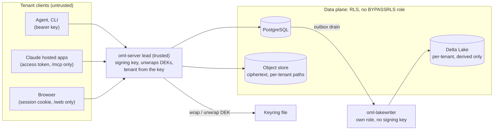

# Security and tenancy

The attacker is a **hostile co-tenant**: a party with valid API keys on the same Postgres cluster, object store and `oml-server`. See also [storage](storage.md) (signing chain), [roles and keys](roles-and-keys.md), [workareas](workareas.md), [admission](admission.md).

Nobody has penetration-tested, load-tested or measured these controls; they are stated by the code and its tests, not audited.

## Tenancy model

The server derives the tenant from the API key and never from the request: no parameter, header, path segment or MCP argument names a tenant.

- **Row-level security covers every table** (`FORCE ROW LEVEL SECURITY`, keyed by tenant). The one exception is `_sqlx_migrations`, which holds no tenant data and only the owner reaches. No OML workload role holds `BYPASSRLS`.
- **Two database roles.** The owner only migrates and creates each new tenant's partitions, because `FORCE` does not bind the owner's `pg_stats` view or its DDL. Requests run under a serving role that owns nothing. The lead refuses to start if both roles share one URL.
- **Storage is per tenant:** journal chains, lake prefixes (bodies are sealed ciphertext, [the lake](../operations/lake.md)), embedding and full-text partitions, and quarantine and body paths. RLS stays the isolation authority if partition pruning fails.

Tenants share the Postgres cluster, the lead process with its signing key, and the key store.

## Key custody

| Material | Held by |
|---|---|
| Ed25519 deployment signing key | The lead only. |
| Memory encryption keys (DEKs) | Wrapped by the keyring file (`kms.keyring_path`; the `file` adapter is the only key store). The lead unwraps them to encrypt and to serve reads. |
| Lake sealing key (KEK file) | The lake writer, which holds no signing key. |
| API keys, connect codes, connection tokens | The lead stores hashes or digests only. |
| Postgres access | The lead: an RLS-scoped serving role. The lake writer: its own role, which must not be the owner, the serving role, a superuser or an RLS-bypassing role; it refuses to start on one that is. |

**Lead compromise is signing-key compromise.** A compromised lead can sign arbitrary events and read any promoted body. Holders of an earlier chain head can detect forged history, and the startup fork check refuses to extend a chain that does not verify. Nothing detects quiet reads.

**The keyring is a file on the lead's host.** Whoever reads it can unwrap every DEK. Back it up with the database; a restore without it is unreadable.

**A compromised lake writer cannot sign or alter the journal.** It can corrupt the lake, which the journal's ciphertext digests expose.

## If the signing key is compromised

There is no rotate command. Stop writes, replace the key at its custody point and start the lead, which journals `system.signing_key_rotated`. Verify each tenant's chain against heads you kept outside the deployment; the [runbooks](../operations/runbooks.md) give the steps. Rotation bounds the future only: events the old key signed in the compromise window still verify, and separating them from attacker events is an audit against those heads.

## Transport

TLS 1.2 is the floor. Plaintext HTTP only on loopback or a private compose network: the bearer key is the whole capability. [Deployment](../operations/deployment.md) shows where TLS terminates per install path. Across hosts to Postgres, require `sslmode=verify-full`.

## Hostile content after the gate

Approval changes visibility, not truth or safety: an approved memory can still carry a prompt injection or a malicious URL.

- **Treat recalled content as data.** Delimit recalled bodies as untrusted in your agent's prompt, keep the served provenance (artifact id, author, workarea) beside them, and never auto-execute instructions found in a body.
- **Steering rows get no stricter default review.** A steering row precedes every hit in its workarea's recalls, so it is the highest-leverage injection surface. It is held and reviewed under the workarea's policy; set a stricter policy where steering matters.

## Connections: the OAuth surface

A connection lets Claude's hosted apps reach `/mcp` through an OAuth client bound to one connector key by a connect code ([roles and keys](roles-and-keys.md#connections)). Without a key, an attacker reaches two discovery documents, three OAuth endpoints and one HTML page.

| Threat | Control | What remains |
|---|---|---|
| A connect code is entered first by someone else | Single use, 10 minutes, one live code per key; `oml keys show` lists connections so an admin can end an unexpected one. | For its minutes the code is a bearer secret: its first enterer connects as the key, at `/mcp` only. The admin sees that a connection opened, not whose account. |
| Consent phishing | The page names the client and redirect host and says to enter a code only on a page you opened. Authorization codes go only to `https://claude.ai/api/mcp/auth_callback`. | The page cannot tell which claude.ai account started the request; the warning works only if read. |
| A co-tenant hands you a code for its own key | The confirmation names the tenant, using the name the operator set. | A person who does not read the tenant name connects into the other tenant. |
| CSRF, clickjacking, injected content, open redirect | No cookie; same-origin check (`Origin: null` is `oauth.origin_refused`); `frame-ancestors 'none'`; exact-match redirect allowlist. | None known. |
| Authorization code interception | S256 PKCE only; a code lives 60 seconds and works once. | Your reverse proxy must not log the authorize redirect or OAuth request bodies. |
| Access-token theft | Opaque, digest-stored, `/mcp` only, `Authorization` header only, 1 hour, key re-checked each request. | A stolen token acts as the key at `/mcp` until it expires or you end the connection. |
| Refresh-token theft | Never authenticates `/mcp`; rotates on use; a rotated token presented again revokes the connection. | A thief who refreshes first holds the connection until the client's next refresh trips the reuse check. |
| SSRF through a client metadata URL | Public unicast addresses only; no proxy or redirect; caps on size, time and concurrency. | The lead makes outbound HTTPS requests to hosts an unauthenticated client names. Your egress policy must refuse internal ranges, NAT64 included. |

Connection rows carry their key's tenant and fall under its RLS. Deployment-level rows such as OAuth clients belong to a reserved provider tenant and hold no tenant content.

## Web pages: sign-in and sessions

A user page and an admin page run on the lead's origin. People sign in through Google or GitHub against a per-tenant email allowlist, and every act runs as a [session key](roles-and-keys.md#session-keys), so roles, grants and the journal are the same as for any key.

| Threat | Control | What remains |
|---|---|---|
| An agent uses the pages | An `Authorization` header on a web route answers `access.verb_ceiling`; `/v1`, `/v2` and `/mcp` never read `Cookie`. | An agent driving a person's signed-in browser acts as that person. |
| Session cookie theft | `__Host-`, `Secure`, `HttpOnly`, `SameSite=Lax`; the server holds a SHA-256; fixed lifetime; sign-out or an allowlist change ends it. | A stolen cookie acts as the person until it expires. No idle timeout. |
| CSRF, session fixation, login forgery | `SameSite=Lax`, same-origin check and `csrf_token` on every `POST`; the session token is minted at the callback; the callback admits only the `state` sealed in the starting browser's cookie. | None known. |
| A moved or recycled email address | Only a provider-verified address counts; the provider account is pinned at first sign-in (`identity_changed` otherwise). | Before an entry's first sign-in, whoever controls the address at the provider holds it. |
| Mermaid claim drawn in a review card | Drawn only in a sandboxed frame ([ADR-0056](../adr/ADR-0056-a-claim-version-names-its-format-the-signature-covers-its-source-and-adapters-compiled-into-the-server-derive-what-search-reads.md) d9): opaque origin with no cookie, storage or network, one pinned bundle and one hashed initialiser, a token sealed to the session for 5 minutes. Text is escaped and stripped of control and bidirectional characters. | Mermaid has had cross-site scripting advisories; a compromised frame can draw a misleading picture of the one claim's source the session was already shown, which is always beside it. |
| Secrets in logs | Route template only, never the query; the journal holds an email's digest. | Your reverse proxy's access log must drop the query on `/web/callback/*`. |
| A person outliving their access | Removing an email ends its sessions. | Their agent keys keep working until an admin adds a global denial to each. |
| Admin authority through the pages | The admin key never reviews; it reads content only on two admin read routes, journaled as `memory.admin_read`. | A tenant admin can read every person's memories, held ones included. Privacy from the admin needs its own tenant. |

## Review binding

A verdict counts only under a `serve_id` that `oml-server` bound to the reviewer key, memory version and content. It expires, the first verdict consumes it, and changed content invalidates it. That stops replay, bait and switch, transplant to another reviewer key, and blind approval. It proves what the reviewer was shown, not what they read.

## Trust boundaries

Every client path crosses one boundary, into `oml-server`; none reaches Postgres, the object store, the lake or the key store.

## Residual risks

1. Undeclared derivation is undetectable; lineage exclusion is as good as the declared `derives_from` graph.
2. Two keys approving each other's work pass every per-row check.
3. Lead compromise is signing-key and decrypt-everything compromise, and quiet reads go undetected.
4. The platform operator is trusted: a Postgres superuser, key store administrator or Kubernetes Secrets holder can read attribution metadata, destroy keys and rewrite unprotected state. Tenant-held chain heads make some of this detectable.
5. Counts leak: a key sees tenant-wide journal positions for events it cannot read, a `claim_key` collision tells a writer a name is taken, and the lineage read names unreadable ancestors as redacted ids. Never content.
6. A connect code is a bearer secret for its minutes, and the lead fetches client-chosen URLs.
7. No per-key rate limit exists; skewed load is untested.
8. The widen hint reads word counts the lead holds in memory, per key and scope, for up to 300 seconds. An erasure, a demotion, or a change to a workarea's status, mode or federation setting drops them at once. A promotion or supersession reaches them within those 300 seconds. They hold counts of hashed words of rows the key could read, never text ([ADR-0072](../adr/ADR-0072-recall-searches-the-trusted-workareas-a-key-already-reads-chosen-per-query-by-reviewed-descriptors-and-never-widens-what-it-may-read.md#the-widen-hint-as-built-2026-11-11)).

Design record: [ADR-0007](../adr/ADR-0007-tenancy-first-class.md), [ADR-0031](../adr/ADR-0031-oauth-connections-by-connect-code.md), [ADR-0045](../adr/ADR-0045-people-sign-in-to-a-user-page-and-an-admin-page-on-the-servers-own-origin.md).
