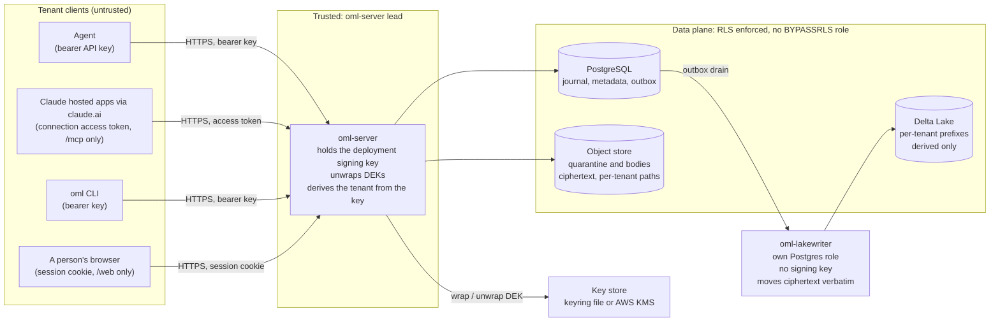

# Security and tenancy

This page explains the tenancy model, the key custody map and the threat model. The signing chain is in [storage](storage.md). Roles and the issuer ceiling are in [roles and keys](roles-and-keys.md). Grants and denials are in [workareas](workareas.md), and the admission pipeline is in [admission](admission.md).

The attacker in this model is not an outsider. It is a **hostile co-tenant**: a party with valid API keys on the same deployment. That party shares the same Postgres cluster, the same object store and the same `oml-server`. It wants to read, corrupt, impersonate or starve another tenant. Every control below is judged against that attacker first.

Nobody has penetration-tested, load-tested or measured these controls. Treat each one as stated by the code and its tests, not as an audit result.

## Tenancy model

OML derives the tenant from the API key on the server and never from the request. No parameter, header, path segment or MCP tool argument names a tenant. `oml-server` resolves the bearer key to its row and takes the tenant from there. A request that tries to name a tenant has no vocabulary to do it in. This removes the class of bugs where a valid key is combined with someone else's tenant id.

**Row-level security (RLS) covers every table.** Every Postgres table carries an RLS policy keyed by tenant and sets `FORCE ROW LEVEL SECURITY`. The one exception is `_sqlx_migrations`, which holds no tenant data. Its fence is privilege, and only the owner role reaches it. No role that an OML workload uses holds `BYPASSRLS`. RLS is the second fence behind application scoping. A query that escapes a `WHERE` clause still cannot cross a tenant boundary, because Postgres evaluates the policy.

**Two database roles split the work.** `FORCE` binds the owner's table reads. It does not bind the owner's `pg_stats` view, which can show another tenant's indexed words, or its DDL, which can lift `FORCE`. The owner role therefore only migrates and creates each new tenant's partitions. Every request runs under a serving role that owns nothing. The lead refuses to start if you give it one URL for both roles.

**Isolation continues through the storage layers.**

- **Journal chains are per tenant.** One tenant's write rate never serializes against another's chain lock.
- **Lake tables sit under per-tenant prefixes.** Bodies in the lake are sealed ciphertext ([the lake](../operations/lake.md)).
- **Embeddings and full-text indexes are partitioned by tenant.** No index spans tenants, so a correctly pruned query never ranks foreign rows. RLS stays the isolation authority if pruning fails, because pruning is planner behavior and not a security boundary.
- **Quarantine and body objects sit under per-tenant paths.**

The cost: RLS predicates sit on every query plan, and a full-text read scans its tenant's partition under RLS. Not measured yet: read latency by tenant size.

Tenants share the deployment: the Postgres cluster, the lead process and its signing key, and the key store.

## Key custody

| Material | Held by |
|---|---|
| Ed25519 deployment signing key | The lead only. No other process loads it. |
| Memory encryption keys (DEKs) | Wrapped by the key store (`kms.adapter`: the keyring file, or AWS KMS). The lead unwraps them to encrypt at admission and to decrypt when it serves a read. |
| Lake sealing key (KEK file) | The lake writer. It holds no signing key. |
| API keys | The lead stores hashes only. Clients hold the values. |
| Connect codes and connection tokens | The lead mints them and stores digests only. |
| Postgres access | The lead serves under an RLS-scoped role. The lake writer uses its own role, which must not be the owner, the serving role, a superuser or a role that bypasses RLS. It refuses to start on one that is. |

**The signing key lives only in the lead.** The signature attests the deployment: one signer process at a time, with each takeover journaled. Compromise of the lead is compromise of the signing key. A compromised lead can also unwrap any tenant's DEKs, so it can sign arbitrary events and read any promoted body.

Three controls bound the damage. The per-tenant chain makes forged history detectable by anyone holding an earlier chain head. The startup fork check refuses to extend a chain that does not verify against the last signed head. The journal shows what the lead did before the compromise. Nothing detects quiet reads by a compromised lead.

**With AWS KMS, the key encryption key never leaves the key store.** With the `file` adapter, the keyring is a file on the lead's host. Whoever reads that file can unwrap every DEK. Back it up with the database. A database restored without it cannot be read.

**The lake writer holds no signing key.** It copies ciphertext the lead already produced. A compromised lake writer cannot sign an event or alter the journal. It can corrupt the lake, and the journal's ciphertext digests expose the change. The lake serves no client read.

## If the signing key is compromised

OML has no command to rotate the signing key. Rotation is a deployment step: stop writes, replace the key at its custody point, and start the lead. The server then journals `system.signing_key_rotated`. Verify each tenant's chain against the chain heads you kept outside the deployment. The [runbooks](../operations/runbooks.md) give the steps.

Rotation bounds the future, not the past. Events the old key signed during the compromise window still verify. Separating real events from attacker events in that window is an audit against heads you kept elsewhere. It is not a cryptographic operation.

## Transport

The floor is TLS 1.2, with 1.3 preferred. Plaintext HTTP is acceptable only on a loopback bind or a private compose network. The bearer key is the whole capability, and it travels in the clear wherever TLS is absent. [Deployment](../operations/deployment.md) describes where TLS terminates for each install path.

When Postgres runs on another host, require `sslmode=verify-full`. A service credential on an unverified channel is a tenant-data read path.

## Hostile content after the gate

The gate changes visibility, not truth or safety. Approval means a non-author looked at the content under a journaled policy. It does not mean the content is true, and it does not mean the content is safe to obey. An approved memory can still carry a prompt injection, a malicious URL or an instruction aimed at whichever agent recalls it.

**Treat recalled content as data.** An approved memory, and an approved steering row, comes from a tenant author who passed a process gate. In your agent's prompt, delimit recalled bodies as untrusted data. Keep the provenance OML serves with each hit (artifact id, author, workarea) beside them. Apply the injection defenses you use for any external input. Never auto-execute instructions found in a recalled body.

**Steering rows get no stricter default review.** A steering row precedes every hit in every recall scoped to its workarea, so it is the highest-leverage injection surface. OML nonetheless holds and reviews it under the same per-workarea policy as any memory. A global human-verdict default would impose review effort that machine-written steering often does not need. Set a stricter review policy on workareas where steering matters.

## Connections: the OAuth surface

A connection lets Claude's hosted apps reach `/mcp` through an OAuth client bound to one connector key by a one-time connect code. [Roles and keys](roles-and-keys.md#connections) explains the model, and the [HTTP API](../api/http-api.md) lists the endpoints.

The surface adds what an attacker can reach without a key: two discovery documents, three OAuth endpoints and one HTML page. It also adds one thing the lead does that it did not do before. The lead fetches a URL a client chose.

| Threat | Control | What remains |
|---|---|---|
| A connect code is read or intercepted and entered first by someone else | Single use. It lives 10 minutes. It never appears in a URL, log or journal. A key has one live code. `oml keys show` lists connections, so an admin can spot and end an unexpected one. | For its minutes, the code is a bearer secret. Whoever enters it first connects as the key, within the key's grants and only at `/mcp`. For claude.ai, the admin sees that a connection opened and when, not whose account made it. |
| Consent phishing: an attacker starts an authorization and sends the person the link | The page names the client and the redirect host before it asks for the code. It tells the person to enter a code only on a page they opened themselves. OML delivers an authorization code only to `https://claude.ai/api/mcp/auth_callback`. | The page cannot tell which claude.ai account started the request. The warning is the defense, and it works only if the person reads it. |
| A co-tenant hands a person a code for the co-tenant's own key | The confirmation names the tenant the key belongs to, using the name the operator set. No tenant admin can set it. | A person who does not read the tenant name connects into the other tenant. |
| Mix-up: a malicious connector steers the authorization code to its own endpoint | Every authorization response carries `iss`, and the discovery document advertises support for it. | The defense works only if the client checks `iss`. |
| Cross-site request forgery on the page | OML sets no cookie. Each `POST` must carry the request handle and pass a same-origin check. It refuses `Origin: null` as `oauth.origin_refused`. | None known. |
| Clickjacking and injected content | `frame-ancestors 'none'`, a content policy with no script, and escaped client-supplied names. | None known. |
| Open redirect | OML admits a redirect URI only by exact match against a fixed allowlist. A refused URI gets a page, never a redirect. | None known. |
| Authorization code interception | S256 PKCE only. A code lives 60 seconds and works once. | Your reverse proxy must not log the authorize redirect or OAuth request bodies. OML cannot check that. |
| Access-token theft | Tokens are opaque and stored as digests. They work only at `/mcp`, only in the `Authorization` header, and for 1 hour. Each request re-checks the key. | A stolen access token acts as the key at `/mcp` until it expires or you end the connection. |
| Refresh-token theft | A refresh token never authenticates `/mcp`. Every use rotates it. A rotated token presented again revokes the connection. | A thief who refreshes before the client does holds the connection until the client's next refresh trips the reuse check. |
| Server-side request forgery through a client metadata URL | The lead fetches public unicast addresses only, with no proxy, no redirect, and caps on size, time and concurrency. | The lead makes outbound HTTPS requests to hosts an unauthenticated client names. Your egress policy must refuse internal address ranges, including NAT64 prefixes. |
| Registration and request flooding | Unused registrations lapse after 24 hours and are capped at 10,000. Past the cap, registration answers `429 limit.rate`. An authorization request writes no row until a connect code verifies. | A flood stalls new dynamic registrations. Slow document hosts can hold every fetch slot for a while. Open connections keep working. |
| Guessing a connect code | 60 bits per code. One message covers every invalid case. | With L live codes and G wrong entries, the chance of a hit is at most L·G / 2⁶⁰. That is a bound, not a measurement. No limit keys on a source address. |

A connection's rows carry its key's tenant and fall under its tenant's RLS. Deployment-level rows, such as OAuth clients, belong to a reserved provider tenant and hold no tenant content.

## Web pages: sign-in and sessions

A user page and an admin page run on the lead's own origin. People sign in through Google or GitHub against a per-tenant email allowlist. The pages add a session cookie, and they act with a person's authority. Every act runs as a [session key](roles-and-keys.md#session-keys), so the roles, grants and journal are the same as for any key.

| Threat | Control | What remains |
|---|---|---|
| An agent uses the pages | An `Authorization` header on a web route answers `access.verb_ceiling`. `/v1`, `/v2` and `/mcp` never read `Cookie`. A session key has no value and no connect code. | An agent that drives a person's signed-in browser acts as that person. OML cannot tell them apart. |
| Session fixation | No session identifier exists before the callback admits. The token is minted then. | None known. |
| Session cookie theft | The cookie uses the `__Host-` prefix and is `Secure`, `HttpOnly` and `SameSite=Lax`. The server holds only its SHA-256. It expires after a fixed lifetime. Sign-out and any change to the allowlist entry end it. | A stolen cookie acts as the person until it expires. There is no idle timeout. |
| Cross-site request forgery | `SameSite=Lax` withholds the cookie from cross-site `POST`s. Every `POST` passes the same-origin check and carries a `csrf_token`. Every `GET` is free of effect. | None known. |
| Login forgery | The callback admits only the `state` sealed in the cookie of the browser that started the flow. | None known. |
| A moved or recycled email address | Only a verified address from the provider counts. The provider account is pinned at first sign-in, and another account with the same address is `identity_changed`. | Before an entry's first sign-in, whoever controls the address at the provider holds it. |
| Memory text rendered to a person | OML escapes it and strips control and bidirectional characters. | The text appears as text and still says whatever it says. |
| Secrets in logs | Logs record the route template, never the query. No cookie, token or email reaches a line. The journal holds an email's digest. | Your reverse proxy's access log must drop the query on `/web/callback/*`. OML cannot check that. |
| A person outliving their access | Removing an email ends its sessions. | The person's agent keys keep working until an admin cuts each off with a global denial. |
| Admin authority through the pages | The admin key never reviews. Review runs as the person's reviewer key. The admin key reads content only on two admin read routes, and the journal records each read as `memory.admin_read`. | A tenant's admin can read every person's memories, held ones included. People who need privacy from that admin need their own tenant. |

## Review binding

A verdict counts only under a `serve_id` that `oml-server` bound to the reviewer key, the memory version and its content. The serve expires. The first verdict consumes it. Any change to the served content invalidates it. This stops four attacks:

- **Replay.** A captured approval cannot be submitted twice.
- **Bait and switch.** Changed content invalidates the serve.
- **Transplant.** A verdict made under one reviewer key cannot be submitted by another.
- **Blind approval.** No valid serve means no verdict.

The serve proves what the reviewer saw, not what the reviewer read. A careless reviewer leaves the same evidence as a careful one. The independence rules in [roles and keys](roles-and-keys.md#review-independence) make that pattern visible. They do not prevent a single instance.

## Trust boundaries

Everything a tenant can do crosses one boundary, into `oml-server`. It carries a bearer key, a connection's access token or a session cookie that resolves to a person's session keys. No client path reaches Postgres, the object store, the lake or the key store. The signing authority never leaves the lead.

## Residual risks

These risks remain after the controls above.

1. **Undeclared derivation is undetectable.** Lineage exclusion is as good as the declared `derives_from` graph.
2. **Collusion is visible only to a person looking.** Two keys approving each other's work pass every per-row check.
3. **Lead compromise is signing-key compromise and decrypt-everything compromise.** This is the largest single trust statement in the design. Nothing detects quiet reads by a compromised lead.
4. **The platform operator is trusted.** A Postgres superuser, a key store administrator or whoever holds the Kubernetes Secrets can read attribution metadata, destroy keys and rewrite unprotected state. Signed chains that tenants keep make some of this detectable after the fact. OML is a trusted-provider design.
5. **Counts leak what reads hide.** A key that cannot read another author's held work still sees tenant-wide journal positions. It learns how many events it cannot see, and when. A `claim_key` collision tells a writer that a name is taken. The lineage read names unreadable ancestors as redacted ids. Each leak is a count, a name or an id, never content.
6. **A connect code is a bearer secret for its minutes.** The lead also fetches client-chosen URLs.
7. **Rate limits are unmeasured.** Not measured yet: request limits under skewed load.
