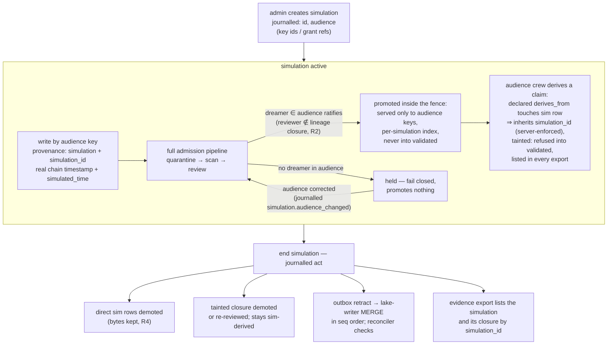

# Simulations

**Status:** design draft for review · decided, not built

A simulation is a fenced provenance channel: a way to inject, alter and replay memories so that a
crew can be tested against a counterfactual world, without those counterfactuals ever becoming part
of what the rest of the tenant believes. The fence is mechanical, not procedural — a row in a
table, a marker in every event, a predicate on every read path — because a rule that lives only in
an operator's head is not a rule the [journal](audit-and-lineage.md) can prove was followed.

This page owns decision D10 end to end: why the channel exists, how the fence is built, how taint
propagates through lineage, and why the constitution's R2 (reviewer ≠ author) and R4 (no silent
deletion) survive inside it. The decision record is ADR-0011 in the [decision
register](../adr/index.md). Its marking discipline is the same one the constitution applies to
its own bounded exception ([ADR-0001](../adr/ADR-0001-the-constitution.md)): an exception is
named, marked on every affected row, and bounded — never discovered later.

## Why simulations exist

Crews are tested by what they remember. To know how a crew behaves when a premise is false, when a
source is poisoned, when two memories contradict, someone has to be able to put those memories in
front of it — which means someone has to be able to write fiction into a memory store whose entire
design is that fiction does not get in.

OML resolves this by giving manipulation exactly one door. An admin may run a simulation
([roles-and-keys](roles-and-keys.md), D9); free-form injection and manipulation of memories exists
*only* inside this channel. Outside it, even an admin writes through an ordinary writer-scoped key
and is held and non-author-reviewed like anyone else. The benefit is that counterfactual testing is
a supported, journalled activity instead of a side door; the cost is that every simulated write
pays the full admission pipeline and the fence adds a predicate to every read path in the system.

## The simulations table and the audience

A `simulations` row (id, tenant, state, audience) gives each simulation its identity; the
column-level definition lives in the [Postgres schema](../data/postgres-schema.md). The **audience**
is a journalled list of API key ids and grant references: the closed set of keys that can see into
the simulation. The audience is set when the simulation is created and changed afterwards only by a
journalled admin act: `POST /v1/simulations/{id}/audience` ([HTTP API](../api/http-api.md)) adds and
removes entries and lands in the chain as a `simulation.audience_changed` event ([event
catalog](../data/event-catalog.md)). Because every change is a journalled event, the membership at
any moment is the fold of the opening event and the audience changes since — reconstructible from
the journal, like every other grant-shaped fact in the system ([workareas](workareas.md), D7).

The audience does two jobs at once:

- **Visibility.** Simulation rows are served only to keys in the audience. Everyone else's reads
  behave as if the rows do not exist.
- **Review capacity.** Only dreamer-class keys *in the audience* may review a simulation's writes.
  A reviewer outside the audience cannot be served the item, so it can never ratify it.

An audience is a fence, not a privilege escalation: a key in the audience still carries only its
own role and grants. A reader key in the audience can read simulation rows in its granted
workareas; it still cannot write or review them.

## Admission inside the fence

Every simulation write is an ordinary journalled, attributed event. It carries an indelible
`provenance: simulation` marker and its `simulation_id` in three places — the journal event, the
Postgres row, and the lake row — so no single store can lose the marking. (A what-if *dataset*
imported into a simulation under [ADR-0020](../adr/ADR-0020-dataset-onboarding.md) follows the
same rule: its rows are fenced as simulation rows, and their external origin is the import
manifest's record, not the provenance column's.)

Simulation writes pass the **full admission pipeline** ([admission](admission.md), D11): capture,
quarantine, deterministic scan, non-author review, ratification with a journalled policy snapshot,
journal, release to the outbox. Nothing is waived. The one narrowing is who may review: only a
dreamer key in the simulation's audience. All the usual review rules still apply on top — the
reviewer is never the author or anyone in the row's lineage closure (R2), the verdict requires a
valid serve, the policy snapshot is journalled.

**Fail closed:** a simulation whose audience contains no dreamer key can promote nothing. Its
writes are accepted, journalled and held — and stay held, subject to the workarea's held-item
expiry policy ([admission](admission.md)) — until the audience is corrected or the simulation
ends. This is deliberate. A simulation with no reviewer is a channel where an admin could inject
unreviewed content; rather than carve an exception, the design lets such a simulation exist and be
useless. The cost is operator friction (a misconfigured simulation looks stuck); the stuck state is
visible in `oml status` queue depths and the fix — an audience correction through
`POST /v1/simulations/{id}/audience`, journalled as `simulation.audience_changed` — is auditable.

The deeper reason to run the full pipeline is evidence parity: a simulated memory that influenced a
crew's behaviour has the same decision trail as a real one — who wrote it, who scanned it, who
reviewed it, under which policy. When a test's outcome is disputed, the [evidence
export](../cli/reference.md) answers for simulated inputs exactly as it answers for real ones. The
cost is that simulation traffic consumes real review capacity from the audience's dreamers.

## Containment

Containment is four independent mechanisms. Any one of them failing still leaves the other three.

### Never into validated

A simulation row is refused promotion into a `validated` workarea, unconditionally. Validated areas
are the frozen, consumer-grade tier ([workareas](workareas.md), D8); counterfactual content has no
path into them — not via direct write, not via promotion, not via reassignment (validated refuses
reassignment into it regardless of provenance), and not via a tainted derivative (below).

### The read-path predicate

Every read path — FTS, vector search, direct fetch, graph and lineage reads — applies one
predicate:

```
provenance ≠ simulation  OR  requesting key ∈ simulation audience
```

There is no "simulation-aware" endpoint and no opt-in flag; the predicate is part of what *read*
means. A key outside the audience cannot retrieve a simulation row, cannot see it in a lineage
walk, and cannot observe it through ranking side effects (next point). Reads of simulation rows by
audience keys are logged like any other read ([retrieval](retrieval.md), D12), so who looked into a
counterfactual world, and when, is answerable.

### Out of the shared indexes

Simulation rows never enter the shared FTS and vector indexes; they are indexed **per simulation**.
This closes the quiet leak the predicate alone would miss: even a filtered-out row can perturb
shared index statistics, approximate-neighbour graphs, or ranking. Keeping simulation content out
of the shared structures entirely means a non-audience tenant's recall is bit-for-bit indifferent
to any simulation's existence. The cost is real: each simulation carries its own index build and
maintenance, and audience queries that should span simulated and real memories must consult two
indexes. The design pays it, because "the fence does not leak through ranking" is the property
under test.

### Never the default tip

**Taint never captures the default tip.** Tip resolution is audience-scoped: for a key outside a
simulation's audience, tip computation ignores simulation-tainted versions — `provenance:
simulation` rows and sim-derived claims alike — so the default tip of every claim is bit-for-bit
what it would be if the simulation did not exist. A promoted tainted supersession of a real claim
becomes an **audience-scoped overlay tip**: keys in the audience see it shadow the default tip
inside the fence; the shared tip index ([audit-and-lineage](audit-and-lineage.md) owns tip
semantics) never records it. Any act that would make a tainted version the default served tip is
refused with `simulation.tip_refused` ([errors](../api/errors.md)).

This is also how the opening sentence's "alter" is expressed: altering a real memory inside a
simulation is a tainted supersession served as the audience's overlay tip, never a rewrite of what
everyone else is served. And it closes the ending story cleanly: when the simulation ends, its
overlay tips demote with the rest of its closure, and because the default tip never moved, nothing
needs restoring.

Injected memories exist to be consumed, so their influence escapes the audience by design: an
audience crew reads a simulated memory and writes something derived from it. That derivative is the
whole point of the test — and it is also contaminated. The design tracks the contamination rather
than pretending it away.

A claim whose declared lineage closure — the transitive closure over `derives_from` and
claim↔claim connection edges, pending and ratified alike
([audit-and-lineage](audit-and-lineage.md) owns the definition) — touches a
simulation row is **tainted**: it carries that `simulation_id` as sim-derived. A tainted claim

- is refused promotion into any `validated` workarea, exactly as a direct simulation row is;
- never becomes the default served tip of a claim lineage: a promoted tainted supersession is
  served as an audience-scoped overlay tip only ([never the default tip](#never-the-default-tip));
- is demoted or re-reviewed when its simulation ends (see below);
- is listed in the simulations section of **every** evidence export, even exports that otherwise
  exclude simulation content.

Taint is closure-wide and indelible while the simulation lives: a derivative of a derivative is
tainted, and no review verdict launders the marker off — a reviewer can ratify a tainted claim as
*good work within the fence*, not as untainted.

### What the taint cannot see

Taint rides on *declared* derivation. A writer that reads a simulated memory and writes a
"fresh" claim with no `derives_from` edge has laundered content past the taint, and the service
cannot detect it — this is the same honesty boundary the constitution states for lineage exclusion
generally: the declared graph is as good as it gets. What the design does guarantee is that
laundering requires a key *inside the audience* (no other key can read the source material), and
that key's reads of simulation rows are in the read log. So an export cannot prove no laundering
happened; it can enumerate exactly which keys were positioned to do it and what they read.
Narrowing this gap further (e.g. similarity flags between simulation rows and audience-authored
claims) is not designed; if it becomes a requirement it enters the [roadmap](../product/roadmap.md)
as a new FR, not a silent feature.

## No nesting

Simulations do not nest. A submission whose declared `derives_from` includes a simulation row
**must** carry that row's `simulation_id` — the server enforces the inheritance and refuses a
submission that names a different simulation or none. One simulation cannot be opened "inside"
another, and a derivation chain cannot hop between simulation ids.

The payoff is operational: because every row in a simulation's blast radius — direct writes and the
whole tainted closure — carries the same single `simulation_id`, one ending act can find and demote
all of it. Nested or cross-linked simulations would turn "end the simulation" into a graph-analysis
problem with edge cases; a flat namespace makes it a predicate. The cost is expressiveness: a test
scenario that wants layered counterfactuals ("world A, and within it, hypothesis B") must model the
layers inside one simulation's content rather than as nested channels.

One refusal the fence makes outside its own walls: **simulations cannot mint vocabulary.**
Vocabulary workareas refuse `provenance: simulation` submissions of the kinds `term`,
`term_mapping` and `vocab_release` — a deterministic scan-class veto — because a simulation's
rows demote rather than erase at its end, and a demoted row must never squat a permanent CURIE
([ADR-0021](../adr/ADR-0021-ai-human-ontologies.md)).

## No backdating

A simulated event gets a **real** chain timestamp — its actual position and time in the per-tenant
hash chain — plus a declared `simulated_time` field carrying the fictional clock. The journal's
ordering is never bent to fit a scenario: chain order is commit order, always
([storage](storage.md), D1).

This keeps chain verification meaningful (a verifier never needs to know which events were
simulated to check the chain) and keeps the counterfactual honest about being one: any reader of
the raw journal sees when the fiction was actually written. The cost is that a crew which inspects
transport-level or chain-level timestamps can distinguish simulation from reality; scenarios
requiring that level of blindness are outside what this design will fake.

## Ending a simulation

Ending a simulation is a journalled act. Its effects:

1. **Direct rows demote.** Every promoted row carrying the simulation's `simulation_id` with
   `provenance: simulation` is demoted — state change, bytes kept, journalled (R4). Held
   simulation writes are closed out; nothing new is admitted under the ended id.
2. **Tainted rows demote or re-enter review.** Sim-derived claims are demoted, or re-reviewed
   where the workarea's policy and the ending act direct it: a tainted claim judged to have
   standalone value (a real lesson learned from a fake world) can survive, but only through a fresh
   non-author verdict taken in full knowledge that its inputs are now demoted fiction. It keeps its
   sim-derived marker either way; survival un-demotes, it never un-taints. Audience-scoped overlay
   tips disappear with these demotions; the default tip of every affected claim was never moved
   ([never the default tip](#never-the-default-tip)), so ending restores nothing — there is
   nothing to restore.
3. **The lake follows.** Demotions flow through the outbox as retract operations and are applied
   in strict sequence order by the lake-writer ([storage](storage.md), D2); the lake converges to
   the same post-simulation state the journal fold defines, and the
   [reconciler](reconciliation.md) would surface any row that failed to.
4. **Exports remember.** The simulation, its rows and its tainted closure remain enumerable
   forever: evidence exports exclude simulation content by default and, when included, list it
   separately by `simulation_id` — ended simulations included. An ended simulation disappears from
   serving, never from history.

How re-review at simulation end is requested and bounded (per-row verdicts vs. per-closure policy)
has open detail at the CLI-ceremony level; the review ceremony itself is owned by
[the CLI reference](../cli/reference.md) and the admission page's policy objects.

## Life of a simulation



## Why R2 and R4 survive

The simulation channel is the one place where fabricated content is welcome, which makes it the
place most worth checking against the constitution.

**R2 — the reviewer is never the author.** Unchanged inside the fence. A simulation write is
attributed to the key that made it; promotion checks the reviewer against the author *and* the
row's lineage closure at promotion time, exactly as outside. The audience narrows *which* dreamers
may review; it never relaxes *whether* independent review happens. An admin running a simulation
still cannot ratify content — admin verdicts are refused everywhere (D9) — and a one-key audience
is simply a simulation that fails closed. Combined with no-backdating, this means a simulated world
cannot manufacture evidence of a review that did not independently happen.

**R4 — no silent deletion.** Ending a simulation demotes; it never deletes. Every demoted row keeps
its bytes, its attribution and its journal trail; the ending act itself is a signed journal event;
the lake applies the same demotions through the ordered retract stream. If simulated bodies must
actually be destroyed (they may contain deliberately harmful test content), the path is the
ordinary journalled crypto-shredding erasure with its named inventory
([audit-and-lineage](audit-and-lineage.md), D4) — an explicit act on the record, not a side effect
of ending the test.

R3 is worth a closing word even though this page does not own it: the fence is a *visibility*
mechanism layered on provenance, which is exactly the shape R3 demands — the gate changed what a
simulation row asserts about itself and who may see it, never how anything is ranked. Steering and
recall ordering are untouched by simulation state ([retrieval](retrieval.md)).
