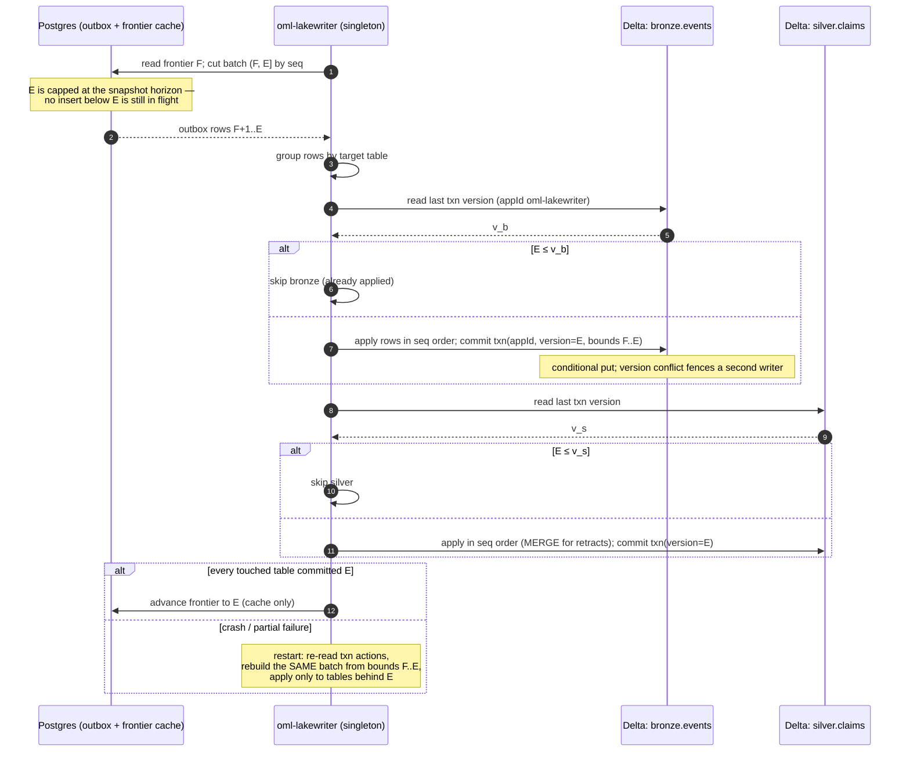

# Storage: commit point, chain, outbox, lake

**Status:** design draft for review · decided, not built

This page is the single declaration site for the transactional commit point and
per-tenant hash chain (D1), the derived Delta lakehouse and the outbox protocol
that feeds it (D2), and attachment storage (D3). The tables named here are
specified column-by-column in [data/postgres-schema.md](../data/postgres-schema.md)
and [data/delta-tables.md](../data/delta-tables.md); journal event payload shapes
are in [data/event-catalog.md](../data/event-catalog.md). Erasure and the
copy-class inventory are declared in
[audit-and-lineage.md](audit-and-lineage.md); the reconciler that audits the
lake against the journal is declared in [reconciliation.md](reconciliation.md);
the read path that deliberately never touches the lake is declared in
[retrieval.md](retrieval.md).

## The commit point (D1)

PostgreSQL is the system of record and the only transactional commit point.
One Postgres transaction commits, atomically:

- the signed journal event (append to `journal`),
- the metadata rows it implies (`memories` and friends — the fold state),
- a durable `outbox` row for everything the lake must eventually see.

A write is durable **iff that transaction commits**. There is no second
commit point: the lake, the FTS and vector indexes, and every export are
derivations of what this transaction made durable. The benefit is that
"did it happen?" has exactly one answer with one authority; the cost is that
every write pays Postgres transaction latency plus the replication latency
below, and the journal table grows without compaction.

### Durability domain

The journal's durability claim requires synchronous quorum replication:
`synchronous_commit = on` or `remote_apply` with quorum synchronous standbys
(`remote_write` does not survive a standby OS crash and does not carry the claim). Without it, a failover can lose committed-and-acknowledged journal
events, which would be a silent violation of the append-only promise. The
production profile therefore treats quorum sync as a requirement of the design,
not a tuning choice.

**Local-profile caveat.** The single-node local profile
([operations/deployment.md](../operations/deployment.md)) has no standbys, so
this guarantee is reduced there: durability is one machine's disk. The local
profile documents this reduction rather than pretending parity.

### The per-tenant hash chain

The journal is hash-chained **per tenant**: one chain-head row per `tenant_id`.
Chain assignment — the per-tenant `seq`, `prev_hash`, and ed25519 signature —
is serialized by a transaction-scoped advisory lock
(`pg_advisory_xact_lock` on the tenant's chain head, held to commit). Because
the lock is held until the assigning transaction commits, **commit visibility
order equals `seq` order per tenant**: no observer can see event *n+1* durable
while event *n* is still in flight. The outbox insert happens inside the same
serialized transaction, so the outbox inherits the chain's order. The cost is
that each tenant's writes serialize through one lock — per-tenant write
throughput is bounded by that serialization — accepted because chains are
per tenant, so tenants do not contend with each other.

Provider-level acts have a chain of their own: a **reserved provider tenant**,
created at deployment genesis, whose chain carries the events that precede any
customer tenant — the root operator `key.issued`, each `tenant.created`. Every
new tenant's chain opens with a genesis event that **references** the
provider-chain `tenant.created` event that created it (a reference, not a
second numbering), so the whole deployment folds out of per-tenant chains with
no global sequence anywhere.

Append-only is enforced mechanically, not by convention: `REVOKE UPDATE,
DELETE` on `journal` plus a guard trigger. Row-level security scopes every
table by tenant ([security.md](security.md)).

**Signing, stated honestly (D17).** The **lead** loads the deployment signing
key (Kubernetes Secret/KMS); followers never do
([ADR-0023](../adr/ADR-0023-install-profiles-and-cluster-mode.md)). What is
single is chain-head assignment in Postgres — the lead lease keeps the common
case quiet, but the chain lock is the load-bearing fence. The signature attests
*the deployment*: one signer process at a time, each takeover journalled
(`system.lead_acquired`), with the startup fork check run at lead startup
**and at every failover promotion**. The threat model treats compromise of the
lead as compromise of the signing key ([security.md](security.md)). The honest
reading: the chain proves that the deployment's key signed these events in
this order; it does not prove which process did beyond the journalled lead
record, and it does not protect against an attacker who holds the key.

**Fork check at startup.** Before accepting writes, `oml-server` verifies that
the stored chain head verifies against the last signed head. This detects the
failure the synchronous-quorum requirement exists to prevent — a failover that
lost committed tail events and would otherwise fork the chain — and refuses to
write onto a forked head.

### Digest-only journal payloads

**Journal payloads never carry body plaintext.** A journal or outbox event
references content only by digest — the **plaintext digest** (the content's
identity) and the **ciphertext digest** of the stored per-artifact-DEK
encrypted object. The body is encrypted under the artifact's DEK at admission,
inside `oml-server`, so both digests exist when the submission event is
signed; every downstream copy — quarantine, object store, lake — is those
same ciphertext bytes. The ed25519 signature covers this digest envelope
(`signed_bytes`), not the bodies. Journalling the ciphertext digest is what
gives the key-less reconciler a journal-side comparand: store bytes are
verified against what the signed event says, never store against store
([reconciliation.md](reconciliation.md)).

This is why chain verification survives crypto-shredding: erasure destroys the
artifact's DEK ([audit-and-lineage.md](audit-and-lineage.md)), which makes the
body unrecoverable, but the signed bytes of every chain event are untouched —
the chain still verifies end to end, and the digest still proves which bytes
the erased event was about. The cost of digest-only payloads is that the
journal alone cannot reproduce content; replaying history into readable form
requires the body stores, which is the lake's and object store's job. Identity
metadata in the chain (writer identity, principal) is minimized but present;
full erasure of attribution metadata is an open, tracked FR with an exit
criterion — see the attribution-metadata erasure row in
[product/roadmap.md](../product/roadmap.md) and the boundary statement in
[audit-and-lineage.md](audit-and-lineage.md).

## The lake and the outbox protocol (D2)

Delta Lake is the derived body lakehouse. Its purpose is narrowed and named:
**reconciliation, lineage, metadata analytics, and future journalled
per-audience exports.** It serves no client read — recall, search, fetch and
graph reads are all answered from Postgres
([retrieval.md](retrieval.md)) — and it is never the authority: when journal
and lake disagree, the journal wins and the lake is repaired
([reconciliation.md](reconciliation.md)). The benefit of a lake that nothing
reads online is that its write path can be asynchronous, batchy, and
repairable without a serving outage; the cost is running a second storage
system whose only consumers are batch jobs, accepted because the data the lake
exists to hold — pure memory data, who and when wrote them, what space
([ADR-0003](../adr/ADR-0003-delta-lake-derived-lakehouse.md)) — wants a
columnar, versioned substrate the journal's digest-only rows cannot be.

Containment rules, restated from their owning pages because the lake writer
enforces them: **no held body ever reaches the lake** — `bronze.events` mirrors
journal events with digest-only payloads, and silver materialization is
enqueued by promotion only ([admission.md](admission.md)); simulation
provenance is indelible in lake rows ([simulations.md](simulations.md)).
Lake bodies are per-artifact-DEK ciphertext; lake rows carry `artifact_id`,
`workarea_id` (the stable key; path-at-write kept as history), writer identity,
principal, timestamps, provenance class, plaintext digest **and** ciphertext
digest (both folded from the submission event, which carries them under the
signature — see above), and state — everything reconciliation needs without
holding plaintext.
Column-level detail: [data/delta-tables.md](../data/delta-tables.md).

Exactly one lake-writer deployment (`oml-lakewriter`, singleton with a leader
lease; split-brain is bounded by Delta conditional put plus the transaction
conflict below — workload details in
[operations/deployment.md](../operations/deployment.md)) drains the outbox in
micro-batches.

### The protocol

Exactly-once delivery rests on Delta application transaction ids: appId
`oml-lakewriter`, version = the last applied outbox `seq`, recorded and checked
**per table**.

> The claim that delta-rs exposes application transaction ids with these
> check-and-record semantics is **to be verified against delta-rs
> documentation, with a fetch date, at writing time** (D17); as of this draft
> it is unverified. The exit criterion is the delta-rs exactly-once conformance
> test FR in [product/roadmap.md](../product/roadmap.md) ("exactly-once,
> verified by conformance test T-n"). Until that test passes, every
> "exactly-once" in this section reads as a design commitment, not a property.

1. **Cut a micro-batch — from the stable prefix only.** Outbox `seq` is
   assigned by the identity sequence at **insert** time, but a row becomes
   visible only when its inserting transaction **commits**, and transactions
   of different tenants are deliberately unserialized — so a smaller seq can
   become visible after a larger one has already been read. The cut therefore
   never trusts "the rows I can see": the lake writer reads outbox rows in
   the half-open seq range `(frontier, batch_end]`, where `frontier` is the
   global frontier (a Postgres column) and `batch_end` is bounded by the
   **snapshot horizon** — only rows whose inserting transaction is older than
   every transaction still active at scan time (in PostgreSQL terms, below
   the oldest active txid of the scan's snapshot) are in the stable prefix,
   and `batch_end` never exceeds it. Within that stable prefix, `batch_end`
   is chosen by size/time limits. This is the only point where size and time
   participate; they never participate in a retry. Because the frontier
   advances only within the stable prefix (step 5), a late-committing row can
   never land at or below the frontier: it is simply cut into a later batch.
   A long-running transaction holds the horizon back; that surfaces as
   frontier lag (`stale-frontier`,
   [reconciliation.md](reconciliation.md)), never as loss.
2. **Group by target table.** Rows in the batch are partitioned by the Delta
   table each operation touches (`bronze.events`, `silver.claims`, gold
   tables).
3. **Per-table idempotence check.** For each table, read that table's last
   committed transaction version for appId `oml-lakewriter` from the Delta
   log. If `batch_end ≤` that version, the table has already applied this
   batch (or a later one): skip it. The check is per table because a crash can
   leave a multi-table batch half applied.
4. **Apply and commit per table.** Each table's portion is applied in strict
   outbox seq order and committed with a transaction action recording appId
   `oml-lakewriter`, version `batch_end`, and the batch bounds
   `(frontier, batch_end)`. On S3/MinIO this commit requires conditional put
   (put-if-absent); a concurrent writer on the same appId fails on the
   transaction-version conflict — the second fence at failover.
5. **Advance the global frontier.** Only when **every** table touched by the
   batch has committed does the lake writer advance the frontier column in
   Postgres to `batch_end`. The frontier column is a cache for cheap restart
   and lag metrics (`oml status`); **the Delta log's transaction version is
   the sole recovery authority.**
6. **Recover deterministically.** On restart or retry, the writer reads each
   table's last transaction action, takes the recorded `(frontier, batch_end)`
   bounds, and reconstructs **the same batch** from the outbox by seq range —
   never re-cut by time or size. Tables that already committed skip it in
   step 3; tables that did not, apply it; then the frontier advances. A batch
   is therefore a stable identity, not an artifact of timing — and because
   `batch_end` was cut inside the stable prefix (step 1), no row with
   seq ≤ `batch_end` can commit after the cut, so the reconstructed row set
   is identical to the first attempt's.

### Retracts: MERGE in stream order

A retract — demote, erase, simulation-end, reassign — is a Delta `MERGE` on
`(artifact_id, version)` that sets state, applied **in strict outbox seq order
in the same single stream as materialization**. There is no separate retract
lane: if a promotion at seq 100 and its demotion at seq 140 land in one batch,
the MERGE at 140 is applied after the insert at 100, and the table ends in the
demoted state. One stream buys ordering for free at the cost of head-of-line
blocking: a slow materialization delays the retracts behind it, which is part
of why dead-lettering exists.

### Dead-lettering

A row that keeps failing must not stall the stream forever. After a bounded
retry budget, the lake writer:

1. journals a `materialize-skipped` event (the skip is itself an attributed,
   chained fact — see [data/event-catalog.md](../data/event-catalog.md)),
2. moves the row to the `dead_letter` table,
3. advances past it.

The reconciler reports dead-lettered rows as a named finding class
(`dead-lettered`, [reconciliation.md](reconciliation.md)); `oml doctor`
surfaces the count. Repair is a journalled re-enqueue — never a manual table
edit. The cost of advancing past a poison row is a lake that is knowingly,
visibly incomplete until repair; the alternative — a stalled frontier — hides
the problem inside unbounded lag, so the skip is journalled instead.

### What is unmeasured, said plainly

Lake-writer throughput and Delta commit latency are unmeasured — nothing has
run — and no figure is asserted until one is measured (D17); the exactly-once
claim itself awaits FR-3's conformance test
([roadmap](../product/roadmap.md)).

## Attachments (D3)

Files, images and PDFs are content-addressed encrypted objects.

**Upload.** Attachments upload through resumable upload sessions: chunked, with
the session recording the expected digest up front (`upload_sessions` in
[data/postgres-schema.md](../data/postgres-schema.md)). A retry resumes the
session or restarts it — the behavior is defined by the session state machine,
not improvised per client. The session is scoped to the uploading key.

**Naming and binding.** An attachment is named by the SHA-256 of its
plaintext and bound into the signed submission envelope by that digest. The
claim and its files are one signed unit: a verdict on the claim is a verdict
on exactly these bytes, and a reviewer is served every attachment of a claim
before a verdict counts ([admission.md](admission.md); the serve binding
ceremony is in the CLI reference).

**Storage and the two digests.** Objects live in an S3-compatible store,
encrypted under the artifact's DEK: `oml-bodies/<tenant>/<digest>`. The
binding event (`submission.attach`,
[data/event-catalog.md](../data/event-catalog.md)) journals **both** digests
under the signature — the same rule as body submissions — and stored object
integrity metadata and the lake carry copies of them; when copies disagree,
the journalled digest is the authority. Who can verify which is a
key-custody fact ([security.md](security.md)):

- the **ciphertext digest** is verifiable by anything that can read the bytes
  — in particular the key-less reconciler, which audits object and lake-row
  integrity without ever being able to decrypt;
- the **plaintext digest** is verifiable only where DEKs are held, which is
  the serving path in `oml-server` — verified when a body is decrypted to be
  served.

So integrity checking is split deliberately: bulk, continuous verification
runs without keys over ciphertext; end-to-end plaintext verification happens
exactly where plaintext legitimately exists.

**What review means per type.** Where a deterministic text extractor exists
for a type, the extracted text is scanned and gated like body text. For opaque
binaries no extractor covers, the reviewed claim is honestly narrower:
provenance + digest + scan result — stated per type rather than implying
content review that did not happen.

## Quarantine placement

Captured bodies — text and attachments alike — are held, before and during
review, in Postgres or in a quarantine bucket
(`oml-quarantine/<tenant>/<digest>`) reachable only by service credentials.
**Never the lake.** The quarantine store is outside every consumer-readable
zone, outside the outbox stream, and outside bronze; a held body has no path
to any reader other than its own author (own-work status,
[admission.md](admission.md)) and the reviewer it is served to. Release to the
lake is
exclusively a consequence of promotion, carried by the outbox
([admission.md](admission.md) owns the lifecycle).

## Decision record

This page declares D1, D2 and D3, registered as ADR-0002, ADR-0003 and
ADR-0004 in the [decision register](../adr/index.md).
