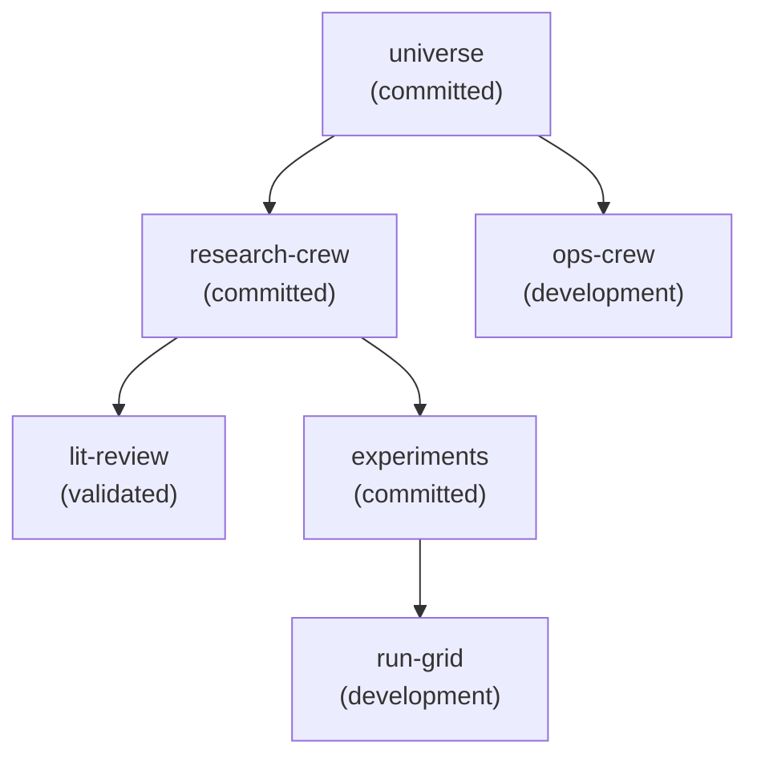
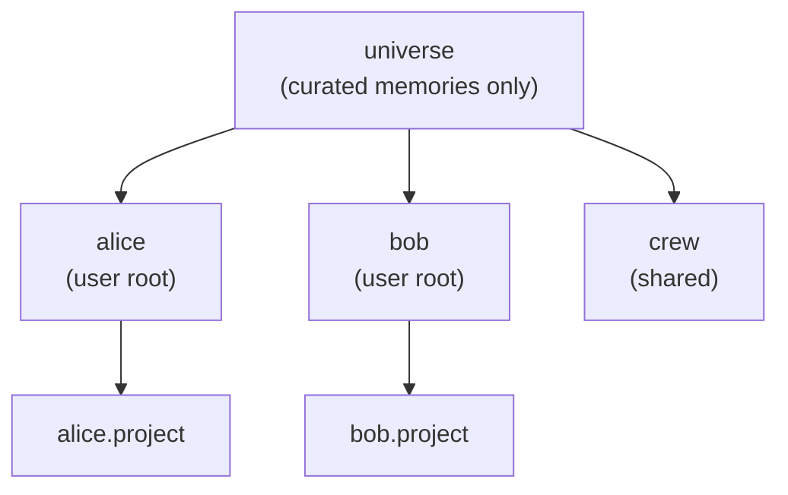
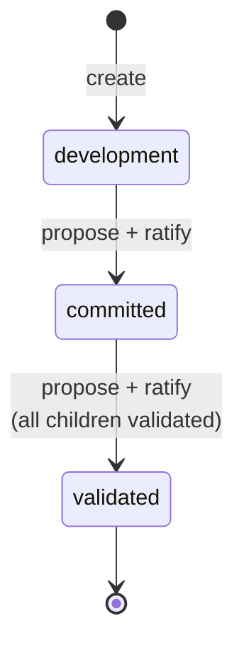

# How workareas grant access

A workarea is a node in one tree per tenant, rooted at `universe`. Keys read and write through grants on nodes. A grant covers its node and everything below it. A denial always wins. The status of a workarea changes how a write is reviewed, never who may write.

OML mirrors an externally managed crew with a workarea. It records which governed space a crew's memories live in. It never runs the crew.

## The tree

Every workarea except `universe` has exactly one parent, so the tree has no cycles and each node has one path from the root. A workarea's name is unique in its tenant and never changes. A node can be referred to by name or by id.

The root, `universe`, has three fixed properties:

- It stays `committed`. It never moves to `development` or `validated`.
- It cannot be deleted.
- It takes writes only from curators. See [user roots](#the-workarea-of-each-user).

The diagram shows one tenant. Solid arrows are the tree.



A tenant's tree never spans tenants. Nothing on this page reaches across a tenant boundary.

## The workarea of each user

When a person's first key is issued, OML creates a workarea of their own under `universe`, named for them. Their keys write, read and create workareas there. With alice's key, `oml workareas create alice project` creates `universe.alice.project`. Two people can each have a `project`.



- **A user key reaches its own root and the `universe` node, nothing else.** It reads memories placed on `universe` itself. It never reads another user's root or a shared workarea.
- **Recall.** A recall inside the root also searches `universe`. A memory shown from `universe` carries no author and no source.
- **Only the keys start a memory in the root.** A reviewer granted there reads, reviews and proposes edits and retirements. Its new memory is refused with `submission.user_root_refused`, and so is putting a retired memory back. The keys of the web session belong to the user: the `<user>-review` key puts the user's retired memory back, and in another person's root it is a granted reviewer like any other.
- **Curation.** `universe` holds only memories that curators place there. A second identity reviews each one like any write. No user key writes to it directly.
- **Climbing the ladder.** A user root reaches `committed` and no further.

Workareas and keys made before user roots existed stay where they are and belong to no person.

## Grants bind to node ids

A grant names a node id, never a path. A name resolves to an id before any access check, so a name the key may not see answers exactly as its id would.

Effective access is computed on every request and cached nowhere. A revoked grant or a new denial applies to the key's next request.

### Effective access

Effective access is the union of the key's grants, minus anything a global deny names. Each grant is first reduced by its own deny entries.

1. **Per-grant deny.** A deny entry sits inside one grant and cuts a subtree out of that grant only.
2. **Union.** The key's grants are combined. A subtree denied in grant A is still reachable if grant B covers it without a deny.
3. **Global deny.** A key-wide deny names subtrees the key cannot reach, whatever the grants yield. Set one with `oml deny set <key> <workarea>`.

On the example tree, grant A is reader on `research-crew` with a deny on `experiments`. Grant B is reader on `experiments`. A global deny names `run-grid`.

| Node | Grant A | Grant B | Union | Effective |
|---|---|---|---|---|
| `research-crew` | yes | no | yes | **yes** |
| `lit-review` | yes | no | yes | **yes** |
| `experiments` | no (denied in A) | yes | yes | **yes** |
| `run-grid` | no (denied in A) | yes | yes | **no** (global deny) |

A `node` grant covers its node and no descendant. Every user key carries one as a reader on `universe`.

### Who may write

Effective access decides. A key with writer access on a node may submit there. A status never recomputes or edits a grant. A `validated` workarea refuses new writes with a typed error that every writer receives alike.

## Links and the brief

A claim link connects two memories with a label: `supports`, `contradicts` or `amends`. A **brief** is the few reviewed memories an agent most needs on entering a workarea. A link or a brief entry follows the propose-and-ratify rule: one key proposes, and a second key confirms. The ratifier is never the proposer.

```sh
oml edges propose --help
oml edges ratify --help
oml edges list --help
```

A pending edge grants nothing and shows as pending. Links between two workareas are not available.

## Crews

A crew is a named record: a name, a charter URI and an external manager. A workarea names at most one crew, and a crew can serve many workareas. A key can name one crew when it is issued.

OML never contacts the external manager and never schedules the crew. It stores the charter URI without checking it. An admin creates and updates crew records with `oml crews`. Admins can correct a crew record whatever the status of the workareas that name it.

## The status ladder

A workarea is in one of three statuses. Transitions go forward only. There is no unfreeze. To change a frozen space, create a new workarea elsewhere.



| Status | What it means |
|---|---|
| `development` | New workareas start here. Review runs as everywhere. |
| `committed` | The working state of a governed space. Promotions are allowed. |
| `validated` | Frozen. Reads continue. The workarea accepts a crew record update and a rejection of a held memory, and nothing else. |

One key proposes a step and a different key ratifies it:

```sh
oml workareas status propose project --to committed
oml workareas status ratify project <transition-id>
```

`oml workareas status pending` lists the live proposals. A step to `validated` needs every child already `validated`. A ratification checks the workarea as it is at that moment. A stale proposal is refused with `workarea.transition_refused`, with a reason such as `stale` or `children_not_validated`.

### What each status refuses

| Operation | `development` | `committed` | `validated` |
|---|---|---|---|
| New memory write | held | held | **refused** |
| Approve a memory | allowed | allowed | **refused** |
| Reject a held memory | allowed | allowed | allowed |
| Create a child workarea | allowed | allowed | **refused** |
| Update the crew record | allowed | allowed | allowed |
| Read | by effective access | by effective access | by effective access |

A frozen workarea keeps serving reads. Freezing is not archiving. A held memory left behind by a freeze can still be rejected.

## In-progress workareas

A person can put a development workarea in progress with `oml workareas mode <workarea> in_progress`, using their own reviewer key (role `dreamer`). Inside an in-progress workarea, readers recall unreviewed memories, labeled as such. Nothing leaves the workarea until its mode returns to standard. The `standard` mode that returns it is refused while any memory is held. See [Organize memory in workareas](../use/workareas.md) for the commands.

## Federated recall

A recall searches its workarea's subtree. An admin can turn federation on for the tenant. Then a recall with `sources: "wide"` also searches the `committed` and `validated` workareas the key reads elsewhere. A list such as `["acme.legal", "acme.product"]` searches exactly those ([retrieval](retrieval.md#searching-beyond-the-scope); [ADR-0072](../adr/ADR-0072-recall-searches-the-trusted-workareas-a-key-already-reads-chosen-per-query-by-reviewed-descriptors-and-never-widens-what-it-may-read.md)). Nothing becomes readable that was not: a source is a workarea the key reads, and a key never learns of one it cannot read.

| Setting | Who sets it | Default | Command |
|---|---|---|---|
| Federation on the tenant: `enabled`, `default_sources`, `max_sources` | an admin key | off, `scope`, 8 | `oml search federation --enabled on` |
| Whether recalls scoped elsewhere may search a workarea: `accept_federated` | a person's reviewer key on the workarea, or an admin key | on | `oml workareas federation <workarea> off` |

`accept_federated` grants nothing. Turned off, a key that reads the workarea still recalls there by naming it as the scope. A `development` workarea, and every workarea inside an in-progress subtree, is never searched by another scope's recall, whatever its setting. Each change is journalled, `federation.policy_set` and `workarea.federation_set`, and an agent's key is refused both.

### A directory workarea

Federated recall searches only what a key reads, so it never tells a crew that a workarea it cannot read exists. A team that wants others to find its work writes a description as an ordinary claim. It goes in a workarea the audience reads, such as a node `directory` under `universe`:

```sh
oml workareas create universe directory
oml write --workarea directory --claim-key legal-crew "acme.legal holds the contract templates and the review checklist; ask the legal crew's admin for reader."
```

The claim is reviewed like any other. Reader on `directory` is the discover grant. Reading an entry grants nothing on the workarea it describes; access is still a grant an admin issues. An entry is a copy that can go stale, and federated recall never routes to the workarea it names.

