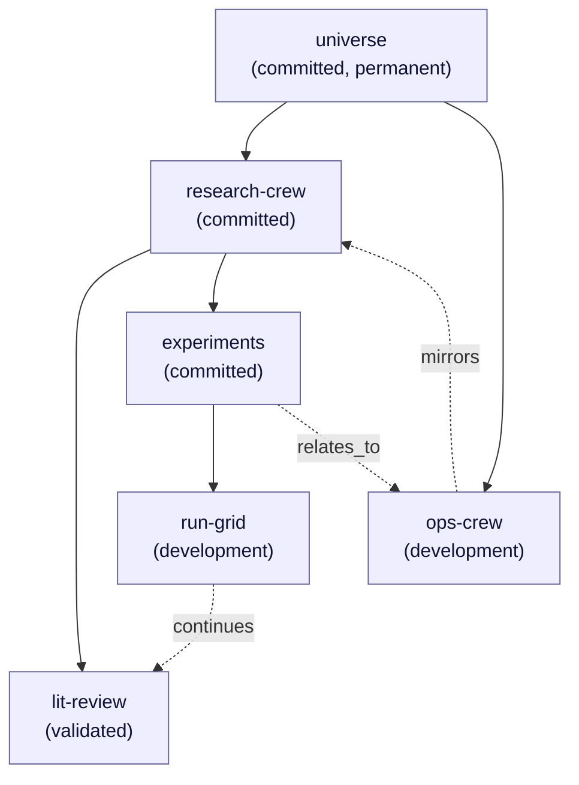
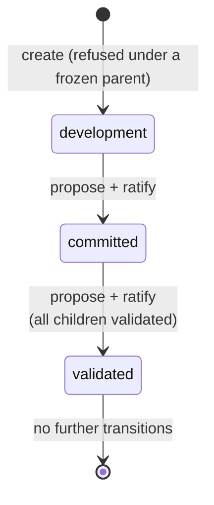

<!--
id: architecture/workareas
tier: engineering
status: design draft for review · decided, not built
answers: how the workarea algebra works — universe tree, node-id grants, deny-wins semantics, edges — how the status ladder changes a workarea's behavior, and what an in-progress workarea is, refuses and releases at its commit
-->

# Workareas: the algebra and the status ladder

**Status:** design draft for review · decided, not built

This page is the single declaration site for the workarea algebra (D7), the
workarea status ladder (D8) and the
[in-progress workarea](#in-progress-workareas). Every other page that mentions a workarea, a grant,
a deny, an edge, or a status links here rather than restating the rules. The
schema that realizes these objects is in [data/postgres-schema.md](../data/postgres-schema.md)
(`workareas`, `workarea_edges`, `grants`, `key_denials`); the roles that hold
the authorities named below are declared in [roles-and-keys.md](roles-and-keys.md);
the review policies that statuses select are declared in [admission.md](admission.md).

A workarea exists to mirror an externally managed AI crew: the crew is operated
elsewhere, and OML records which governed space its memories live in. The cost of
that choice is that OML never orchestrates a crew — it only refuses or admits what
crews write — and that cost is accepted deliberately (see
[Crew metadata](#crew-metadata-recorded-not-operated)).

## The tree: one universe per tenant

A workarea is a governed node in exactly one tree per tenant, rooted at that
tenant's `universe`. Inclusion is single-parent: every workarea except the
universe has exactly one parent, so cycles are impossible by construction, and
every node has one derivable path from the root.

The universe root is special in three ways, all of them refusals:

- it is permanently `committed` — it cannot be moved to `development` or
  `validated`;
- it cannot be deleted or re-parented;
- it refuses direct claim writes. Claims live in crew workareas beneath it. The
  universe exists so that paths, subtree grants, and subtree denies have a
  well-defined top, not so that anything is stored at the top.

Cross-tenant mapping — relating workareas of different tenants into one "whole
world" — does not exist in this design. It is an explicitly future federation
item; see the federation RS row in [product/roadmap.md](../product/roadmap.md).
Nothing on this page extends across a tenant boundary.

### An example tenant

The diagram shows one tenant's tree. Solid arrows are the containment tree
(exactly one parent per node). Dashed arrows are `related` edges — a separate,
labelled edge kind that confers **zero access** and is not part of the tree.

Note that `lit-review` is `validated` while its parent `research-crew` is
`committed`: the child-status rule constrains a parent becoming validated, not a
child (see [the status ladder](#the-status-ladder-d8)). `run-grid` under
`experiments` is legal because `experiments` is not frozen.

## Grants bind to node ids; paths are derived

A grant names a workarea **node id**, never a path. The path (stored as
Postgres `ltree`) is derived from the tree at check time: the subtree a grant
covers is "every node whose derived path is prefixed by the granted node's
derived path". Two consequences:

- **Renames and moves never invalidate grants.** A grant on the node that is
  today at `universe.research-crew.experiments` still covers the same node and
  its descendants after that node is re-parented elsewhere, because the grant
  holds the id, and the path is recomputed.
- **A path string is never an authority.** Anything that compares paths
  (subtree checks, scoped search filters in [retrieval.md](retrieval.md)) is a
  derived view of the tree as of the current permission epoch, reproducible
  from journalled state.

Every effective-access computation is reproducible from journalled grants: the
grant, its denies, and the global per-key deny objects are all journalled
records, and each carries the **permission epoch** it was written at.

The permission epoch of a key is the journal seq of the latest `key.issued`,
`key.rotated` (for its `new_key_id`), `key.revoked`, `grant.issued`,
`grant.revoked`, `key.denied` or `key.denial_lifted` event for that key; a
grant row and a denial row each store their own event's seq as their epoch
([event catalog](../data/event-catalog.md)). A successor minted by
`key.rotated` has no `key.issued` and no `grant.issued`, so its
`api_keys.issued_seq` and the epoch of each grant row reproduced for it are the
`key.rotated` seq. A
[re-parent](#re-parenting)'s `workarea.reparent` event joins that list for
every key of the tenant (when re-parent is built, ADR-0025 d14), because it
changes which nodes a node-id grant covers. A tenant's journal seq only increases, so the epoch is monotone and
reproducible from the journal; no separate counter exists beside it
([ADR-0025](../adr/ADR-0025-the-agent-only-memory-surface.md) d14).

Effective access is computed on every request, and no resolution is cached:
the epoch labels the journalled state an answer was computed against, and
invalidates nothing. The cost is one grants read and one ancestry walk per
request, unmeasured like every cost on the request path
([FR-25](../product/roadmap.md)). A revocation, grant change or denial
therefore applies to the key's next request served by the lead. In cluster
mode a follower resolves keys, grants and denials from its local replica, so
on follower-served reads a revocation, grant change or denial takes effect
after replication lag — the same follower metric
[retrieval](retrieval.md#reads-in-cluster-mode) states for promoted reads, and
the window [security](security.md) states as the EoP residual. A lead-only
deployment, the default, has no such window. A cache would be a new decision
that states its own staleness window there.

## Effective access: union of attenuated grants, then deny-wins

One formula, applied everywhere a key touches a workarea:

> **Effective access = the union of the key's grants, each grant first
> attenuated by its own deny entries, minus anything named by a global per-key
> deny object.**

The three parts, in evaluation order:

1. **Per-grant attenuation.** A deny entry lives *inside* a grant and names a
   subtree (by node id, like the grant itself). It masks that subtree **within
   its own grant only**. A deny is not a tenant-wide prohibition; it is a hole
   cut in one grant.
2. **Union.** The key's grants are then unioned. Because attenuation happens
   per grant before the union, a subtree denied in grant A is still reachable
   if grant B covers it without a deny. This is deliberate: a grant is a
   self-contained statement of scope, and composing grants never makes any one
   grant mean less than it says.
3. **Global per-key deny, deny-wins.** A global deny is a **distinct journalled
   object** attached to the key, not an entry inside any grant. It names
   subtrees that the key cannot reach **regardless of what any union of grants
   yields**. When the operator intent is "this key must not touch that subtree,
   full stop", this is the only object that expresses it.

Worked on the example tree: suppose a key holds grant A = reader on
`research-crew` with a deny on `experiments`, and grant B = reader on
`experiments`.

| Node | Grant A (attenuated) | Grant B | Union | Global deny on `run-grid` | Effective |
|---|---|---|---|---|---|
| `research-crew` | yes | — | yes | — | **yes** |
| `lit-review` | yes | — | yes | — | **yes** |
| `experiments` | no (denied in A) | yes | yes | — | **yes** |
| `run-grid` | no (denied in A) | yes | yes | denied | **no** |

The `experiments` row is the per-grant-masking rule made visible: grant A's
deny does not defeat grant B. The `run-grid` row is deny-wins: the global deny
defeats every grant.

A reader grant also carries `unreviewed`, resolved block-wins over the same
attenuated grants; the rule is declared in the permission matrix
([roles-and-keys.md footnote 6](roles-and-keys.md#permission-matrix),
[ADR-0030](../adr/ADR-0030-in-progress-workareas.md), proposed).

### The one write-eligibility rule

Across **all** statuses there is exactly one rule for who may write into a
workarea: **effective access decides**. A key with writer-role effective access
on a node may submit there; a key without it may not. A workarea's status
**changes only the review policy applied to what is submitted — it never
changes grant resolution**. No status recomputes, suspends, or edits a grant.

The `validated` status refuses new writes — but it refuses them as the
admission policy of that status (a refusal every holder of write access
receives identically, as a typed error), not by altering anyone's effective
access. The distinction matters operationally: grant state answers "who could
write here if the status allowed it", and status answers "what happens to a
write here", and the two are never mixed. Audit questions about access are
answered from grants and epochs alone; audit questions about why a write was
refused are answered from status and policy snapshots alone. Under the proposed
[ADR-0030](../adr/ADR-0030-in-progress-workareas.md) (d12), a read's audience
inside and at the boundary of an [in-progress subtree](#in-progress-workareas)
is answered from grants, epochs, the journalled `workarea.create` mark and the
root's `workarea.status_transition`; neither event joins the permission epoch.

## Edges

### Edge kinds

`related` is a separate labelled edge between two workarea nodes. The label set
is closed: `relates_to`, `continues`, `derived_from`, `mirrors`. An edge
confers **zero access** — it is pure recorded structure for lineage and
navigation, never an input to effective-access computation. (Claim-level
edges — claim↔claim connection proposals — follow the same
propose-then-ratify shape but are part of the admission pipeline; see
[admission.md](admission.md). This section governs workarea↔workarea edges.)

Edges live in `workarea_edges` with a `pending`/`ratified` state and recorded
proposer and ratifier.

### Edge authority

Edges are governed objects and follow the propose/ratify split, with R2 — the
reviewer is never the author — extended to them:

| Act | Requires | Refused when |
|---|---|---|
| Propose an edge | `dreamer(propose)` effective access on **at least one** endpoint, **and** reader effective access on **both** endpoints | either endpoint is outside the key's read scope |
| Ratify an edge | `dreamer(review)` effective access on **both** endpoints | the ratifying key or principal is the proposer (**R2 extends to edges**) |

The asymmetry is intentional. Proposing requires seeing both ends but holding
proposal authority on only one, so a crew can propose a relation to a space it
reads but does not govern. Ratifying requires review authority on both ends,
because a ratified edge becomes shared recorded structure of both subtrees, and
neither side's governance may be bypassed. A pending edge confers nothing and
appears as pending in graph reads.

## Crew metadata: recorded, not operated

A workarea records its crew: name, charter URI, external manager. The record
answers "whose memory space is this, and who runs that crew" — it does not make
OML a crew orchestrator. OML never contacts the external manager, never
schedules the crew, and never validates the charter URI beyond storing it;
"recorded, not operated" is the honest scope of the feature.

Update rules:

- Crew metadata update is a **journalled admin act** (admin role; see
  [roles-and-keys.md](roles-and-keys.md)).
- It is allowed **on `validated` areas**. Freezing covers claim content and
  promotions, not workarea metadata: a crew that renames itself or changes
  manager after its area froze still gets its record corrected, and the
  journal shows who corrected it and when.

The reviewer-independence axis in [admission.md](admission.md)
resolves reviewer crew and external manager from this journalled
key→crew→manager metadata at promotion time, which is why its updates must be
journalled acts rather than free edits.

## Re-parenting

Re-parenting a workarea — giving the node a different parent — exists as a
**journalled admin act**. It performs, in a single Postgres transaction:

1. the journalled move event (old parent, new parent, actor, timestamp);
2. the parent-pointer change on the node;
3. the **descendant path rewrite**: every derived `ltree` path under the moved
   node is rewritten to its new prefix.

Because grants bind to node ids, no grant is touched; because paths are
derived, the rewrite is a cache-maintenance act on the derived column, not an
authority change — but its event still joins every key's permission epoch
(above), because an access answer computed against old paths no longer
describes the tree. The cost of the
single-transaction form is a lock proportional to the size of the moved
subtree; that cost is accepted so that no read ever observes a tree in which a
path and its parent pointer disagree. [Decided, not built: the locking
granularity of the rewrite is an implementation choice inside this committed
transactional envelope.]

Re-parenting **into** a `validated` destination is refused (the child-creation
refusal below covers acquiring new children in any form). Lake rows keep
`workarea_id` as the stable key and retain path-at-write as history (see
[storage.md](storage.md)), so re-parenting never rewrites the lake.

## The status ladder (D8)

Statuses: `development` → `committed` → `validated` (frozen). Transitions are
**forward only**; backward transitions do not exist in the design — there is no
"unfreeze" verb, journalled or otherwise. A space that must evolve after
validation gets a new child elsewhere in the tree (and typically a `continues`
edge), not a thaw.

### What each status means

- **development** — review runs as everywhere; tenant policy MAY additionally
  permit `self_signed` rows under the one bounded constitutional exception
  (such rows are marked, readable only inside that workarea, never promote
  beyond it, and never enter silver or gold — the full scope is declared in
  the constitution, [ADR-0001](../adr/index.md)). How a `self_signed` version
  may take a claim's tip is declared in
  [audit and lineage](audit-and-lineage.md#supersession-chains-claim_key-and-the-tip).
  Under the proposed ADR-0030 an admin may instead create a `development`
  workarea [in-progress](#in-progress-workareas): R2 holds there in full, its
  readers read its held claims at once, and nothing in it is served outside
  until its commit. Self-signing never applies inside one.
- **committed** — full non-author review required; promotions allowed. The
  working state of a governed crew space, and the permanent state of the
  universe root.
- **validated (frozen)** — the area serves reads and admits exactly three
  mutations, all journalled: **demote**, **erasure** (crypto-shred), and
  **crew-metadata update**. Everything else is refused.

### Transition matrix

| Transition | Proposed by | Ratified by | Preconditions | Journalled with |
|---|---|---|---|---|
| `development` → `committed` | admin or dreamer with effective access on the node; for an [in-progress workarea](#in-progress-workareas) (proposed in ADR-0030, binding only on its acceptance), **admin only** (a dreamer key answers `access.verb_ceiling`) | a **second, non-proposing** dreamer or admin (R2 applies to transitions); for an in-progress workarea, a second admin of a different principal | — for an ordinary workarea. For an in-progress workarea, **no version in its subtree is `held`**, checked at the proposal and again inside the ratifying transaction (`workarea.held_remaining`); a node inside an in-progress subtree other than its root makes no transition until that commit (`workarea.in_progress_refused`) | transition event + policy snapshot; an in-progress workarea's commit carries `in_progress_released: true` |
| `committed` → `validated` | admin or dreamer with effective access on the node | a second, non-proposing dreamer or admin | **every child of the node is already `validated`, and no simulation is fenced on the subtree** — a live simulation must be [ended](simulations.md) first, since taint can never enter a `validated` area | transition event + policy snapshot |
| `committed` → `development` | — | — | **does not exist** | — |
| `validated` → anything | — | — | **does not exist** | — |

The policy snapshot in the transition event records the review policy in force
at the moment of transition, so later audit of any promotion can be answered
against the policy that actually governed it, not the policy in force at read
time.

### Refusal matrix

What each status refuses, per operation. "Effective access" is assumed
throughout — a key without access is refused everywhere, before status is even
consulted. Proposed in [ADR-0030](../adr/ADR-0030-in-progress-workareas.md), binding only on its acceptance: the last column is a `development` node inside an
[in-progress subtree](#in-progress-workareas): the in-progress workarea itself
or any of its descendants, while the in-progress workarea is `development`.

| Operation | `development` | `committed` | `validated` | Proposed in ADR-0030, binding only on its acceptance: inside an in-progress subtree |
|---|---|---|---|---|
| New claim write | admitted (held) | admitted (held) | **refused** | admitted (held; readable at once by the keys the [permission matrix](roles-and-keys.md#permission-matrix) allows) |
| Promotion of a claim in the area | allowed (policy of the area; `self_signed` only under the constitution's bounded development exception, [ADR-0001](../adr/ADR-0001-the-constitution.md) d5) | allowed (full non-author review) | **refused** (nothing new promotes into it) | allowed under its workarea's review policy with at least one non-author verdict: a ratification inside counts at least one verdict by a key and a principal outside the row's lineage closure and applies `k` = max(policy `k`, 1), whatever that policy says, checked in round trip two's statement beside the R2 lineage check ([ADR-0030](../adr/ADR-0030-in-progress-workareas.md) d4); never `self_signed`; readable outside the subtree only after its commit |
| Self-signing (a ratification that sets `self_signed`) | allowed (journalled tenant policy) | not admitted: R2 and R3 hold unconditionally | not admitted | **never**: a ratification inside counts no author-key or author-principal verdict and never sets `self_signed`, whatever tenant policy says, checked inside the ratification beside the R2 lineage check ([ADR-0030](../adr/ADR-0030-in-progress-workareas.md) d4) |
| Demote | allowed (journalled) | allowed (journalled) | allowed (journalled) | allowed (journalled) |
| Erasure (crypto-shred) | allowed (journalled) | allowed (journalled) | allowed (journalled) | allowed (journalled) |
| Reassignment of a claim **into** the area | allowed (re-enters `held` if destination policy is stricter; see [roles-and-keys.md](roles-and-keys.md)) | allowed (same rule) | **refused** | allowed from a node inside the same subtree; **refused** from outside it (`workarea.in_progress_refused`) |
| Reassignment of a claim **out of** the area | allowed | allowed | **refused** — not in the closed list of mutations a frozen area admits | allowed to a node inside the same subtree; **refused** to outside it (`workarea.in_progress_refused`) |
| Lineage or claim edge across the boundary | per the readability rules | per the readability rules | per the readability rules | a `derives_from` target or claim-edge endpoint here, held or promoted, is admitted only for a submission whose workarea, or an edge whose other endpoint, lies inside the same subtree; otherwise **refused** (`workarea.in_progress_refused`), answered after the readability check, which does not depend on where the submission lands ([footnote 6](roles-and-keys.md#permission-matrix)), so a key that cannot read the target gets `access.not_found` |
| Create a child workarea under the node | allowed | allowed | **refused** | allowed — the child is inside the subtree; **refused** with `in_progress: true` or a `prefix` (`workarea.in_progress_refused`) |
| Re-parent a subtree to put this node's subtree elsewhere | allowed (journalled act above) | allowed | **refused** (the node is frozen structure) | the in-progress workarea itself: allowed, the subtree moves whole; any other node, or a move that would bring a node in from outside: **refused** (`workarea.in_progress_refused`). Re-parenting an in-progress workarea, or any node whose subtree holds one, to a destination inside another in-progress subtree is **refused** with `workarea.in_progress_refused`: subtrees never nest |
| Crew-metadata update | allowed (journalled) | allowed (journalled) | **allowed** (journalled; freeze covers claims, not metadata) | allowed (journalled) |
| Status transition forward | → `committed` | → `validated` if all children validated | none exist | the in-progress workarea: → `committed`, proposed and ratified by admin keys only, once nothing in its subtree is held (`workarea.held_remaining`); any other node: none until that commit (`workarea.in_progress_refused`) |
| Reads | per effective access | per effective access | per effective access — a frozen area **serves reads**; freezing is not archival | per effective access, plus the held claims of other keys the [permission matrix](roles-and-keys.md#permission-matrix) allows; a read scoped outside the subtree serves nothing from it |

Two composite rules fall out of the table and are restated here because they
are the ones implementers get wrong:

- **Child-status rule.** An area may become `validated` only when **all** of
  its children are already `validated`, and no new child may be created under a
  `validated` area. Together these make "frozen" mean the whole subtree below
  the node: a validated node can never acquire an unfrozen descendant, by
  construction rather than by patrol.
- **Frozen is not read-only-dead.** `validated` keeps serving reads, keeps
  admitting journalled demote and erasure (governance and legal reality do not
  freeze), and keeps its crew record correctable. The refusals are exactly: new
  writes, promotions into it, reassignment in or out, child creation,
  re-parenting, and any further status change.

## In-progress workareas

Proposed in [ADR-0030](../adr/ADR-0030-in-progress-workareas.md), binding only on its acceptance: an **in-progress workarea** is a `development` workarea an admin created with
`in_progress: true` ([HTTP API](../api/http-api.md#workareas),
[ADR-0030](../adr/ADR-0030-in-progress-workareas.md)). It is not a fourth
status: the ladder keeps its three. Its **subtree** — the workarea and every
descendant — is one unit. A node is **inside** it while the in-progress
workarea is `development`; a read is inside when its scope node is, and
outside otherwise. Inside and outside describe a read's scope, never the key:
a key whose reader grant on an ancestor covers the subtree reads it by scoping
inside it or by id. The scope of this relaxation is set by
[ADR-0030](../adr/ADR-0030-in-progress-workareas.md) d3, which
[ADR-0001](../adr/ADR-0001-the-constitution.md) d5 would reach by back-pointer;
this section declares its mechanics.

**Made at creation, ended only by the commit.** The mark is set by the
admin-only `POST /v2/workareas`, journalled in `workarea.create`, and no other
verb sets or clears it: no agent tool reaches it (R1). Creation with
`in_progress: true` is refused under a `validated` parent (`workarea.frozen`),
inside another in-progress subtree (`workarea.in_progress_refused`: subtrees
never nest) and together with `prefix` (`request.validation`: a vocabulary is
never inside one). The workarea read reports `in_progress_root_id`, which
names the in-progress workarea while the node is inside its subtree, and the
caller's `reads_unreviewed` ([HTTP API](../api/http-api.md#workareas)). A
re-parent never makes subtrees nest (the [refusal matrix](#refusal-matrix)).

**Inside.** Every write is held and reviewed as anywhere else; R2 holds in full,
every ratification inside counts at least one non-author verdict, and none is
self-signed (the [refusal matrix](#refusal-matrix)'s promotion row). A held claim inside is readable at once,
marked `state: "held"` and `reviewed: false`, by the keys the
[permission matrix](roles-and-keys.md#permission-matrix) allows. How recall,
get, the listings, the graph reads and the events tail serve it is declared in
[retrieval](retrieval.md#held-claims-inside-an-in-progress-workarea) and on the
[events tail](../api/http-api.md#events-tail).

**The boundary.** Until the commit, nothing crosses it: the refusal matrix above
refuses a reassignment or re-parent that would move a claim or a node into or
out of the subtree, a `derives_from` target or claim-edge endpoint inside it
named from outside it, and a status transition on any node inside it but the
in-progress workarea. A read scoped outside — at an ancestor, up to `universe` —
serves nothing from the subtree, the reading key's own rows included, and its
counts count nothing from it; the node itself stays visible to its readers as
structure.

**The commit.** The in-progress workarea's `development` → `committed`
transition is proposed and ratified by two identities like every transition
([transition matrix](#transition-matrix)), both admin keys of different
principals, since the commit opens the whole subtree to readers outside; a
dreamer key that proposes or ratifies it answers `access.verb_ceiling`. It is
refused at the proposal and at the ratification while any version in the
subtree is `held`, dead-lettered ones included (`workarea.held_remaining`,
which names the workarea and counts nothing). Rejected, demoted and erased
versions do not block it. The ratification's test is a condition inside its
transaction's one data-modifying statement, under the chain lock, so no held
version arrives unseen; it is one probe of a partial index on the root
([ADR-0030](../adr/ADR-0030-in-progress-workareas.md) d12). At the commit:

- the workarea becomes `committed`, and its subtree stops being in progress;
- every promoted served tip in the subtree becomes readable at scopes outside
  under the ordinary rules, at once — no index row and no lake row is rewritten
  ([retrieval](retrieval.md#held-claims-inside-an-in-progress-workarea));
- the descendants stay `development` and become ordinary `development`
  workareas, whose later writes are readable by their author alone until each
  is promoted;
- the journal records one `workarea.status_transition` with
  `in_progress_released: true`, which is what a tail outside sees of the whole
  period.

Transitions are forward only and the mark is set only at creation, so the usage
pattern is a fresh in-progress workarea per project or iteration, typically a
sibling with a `continues` edge to the last.

## Medallion words name lake zones only

`bronze`, `silver`, `gold` are the names of physical Delta Lake zones —
declared and specified in [storage.md](storage.md) and
[data/delta-tables.md](../data/delta-tables.md) — and nothing else. The status
ladder keeps its own words: `development`, `committed`, `validated`. No page,
message, error, or CLI output may call a workarea "gold" or a lake zone
"validated". The two vocabularies touch at exactly one point, stated where the
lake is declared: unreviewed content never enters a consumer-readable zone.

## Decision record

The workarea algebra is registered as ADR-0008 and the status ladder as
ADR-0009 ([adr/index.md](../adr/index.md)); the permission-epoch reading and
per-request effective access are
[ADR-0025](../adr/ADR-0025-the-agent-only-memory-surface.md)'s (d1, d14). The
in-progress workarea is the proposed
[ADR-0030](../adr/ADR-0030-in-progress-workareas.md)'s, which would amend
ADR-0001 d3 and d5, ADR-0008 d4 and d6, and ADR-0009 d1, d2, d3 and d4.
