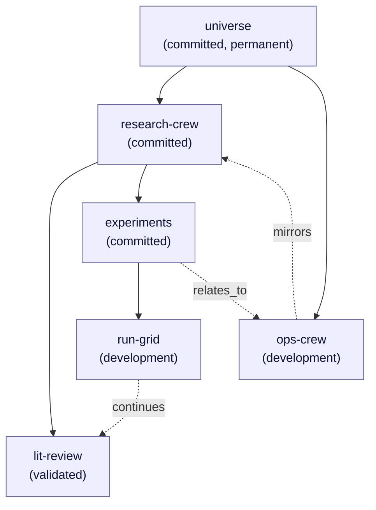
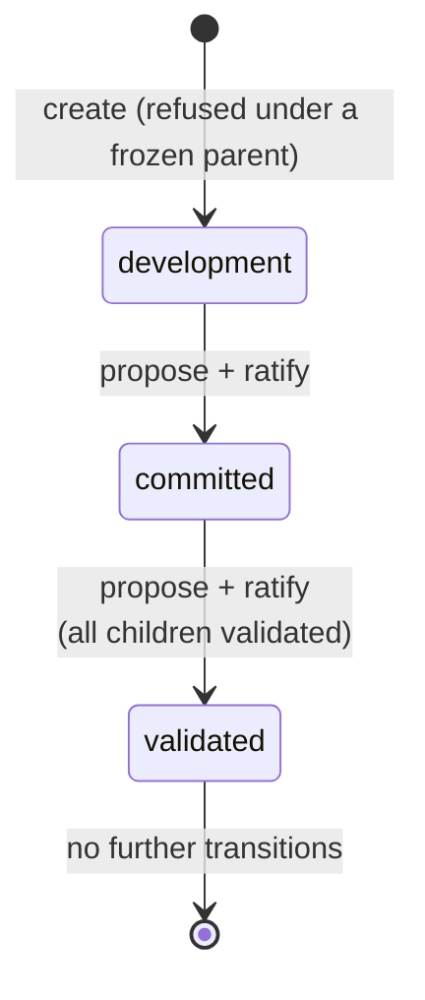

<!--
id: architecture/workareas
tier: engineering
status: design draft for review · decided, not built
answers: how the workarea algebra works — universe tree, node-id grants, deny-wins semantics, edges — and how the status ladder changes a workarea's behavior; what the root is named and how paths relate to names; what a crew record is, which kind it is, and how workareas and keys name one
-->

# Workareas: the algebra and the status ladder

**Status:** design draft for review · decided, not built

This page is the single declaration site for the workarea algebra (D7) and the
workarea status ladder (D8). Every other page that mentions a workarea, a grant,
a deny, an edge, or a status links here rather than restating the rules. The
schema that realizes these objects is in [data/postgres-schema.md](../data/postgres-schema.md)
(`workareas`, `workarea_edges`, `grants`, `key_denials`); the roles that hold
the authorities named below are declared in [roles-and-keys.md](roles-and-keys.md);
the review policies that statuses select are declared in [admission.md](admission.md).

A workarea exists to mirror an externally managed AI crew: the crew is operated
elsewhere, and OML records which governed space its memories live in. The cost of
that choice is that OML never orchestrates a crew — it only refuses or admits what
crews write — and that cost is accepted deliberately (see
[Crews](#crews-recorded-not-operated)).

## The tree: one universe per tenant

A workarea is a governed node in exactly one tree per tenant, rooted at that
tenant's `universe`. Inclusion is single-parent: every workarea except the
universe has exactly one parent, so cycles are impossible by construction, and
every node has one derivable path from the root. Every workarea has a
[name](../api/http-api.md#names-and-ids), unique in its tenant across the whole
tree and never changed, and the root's is `universe` in every tenant: tenant
creation creates the root under that name, so no other workarea can take it
([ADR-0026](../adr/ADR-0026-names-are-keys.md) d6).

The universe root is special in three ways, all of them refusals:

- it is permanently `committed` — it cannot be moved to `development` or
  `validated`;
- it cannot be deleted or re-parented;
- it refuses direct claim writes. Claims live in crew workareas beneath it. The
  universe exists so that paths, subtree grants, and subtree denies have a
  well-defined top, not so that anything is stored at the top.

Cross-tenant mapping — relating workareas of different tenants into one "whole
world" — does not exist in this design. It is an explicitly future federation
item; see the federation RS row in [product/roadmap.md](../product/roadmap.md).
Nothing on this page extends across a tenant boundary.

### An example tenant

The diagram shows one tenant's tree. Solid arrows are the containment tree
(exactly one parent per node). Dashed arrows are `related` edges — a separate,
labelled edge kind that confers **zero access** and is not part of the tree.

Note that `lit-review` is `validated` while its parent `research-crew` is
`committed`: the child-status rule constrains a parent becoming validated, not a
child (see [the status ladder](#the-status-ladder-d8)). `run-grid` under
`experiments` is legal because `experiments` is not frozen.

## Grants bind to node ids; paths are derived

A grant names a workarea **node id**, never a path. The path (stored as
Postgres `ltree`) is derived from the tree at check time — the names from
`universe` down to the node, joined with `.` — and the subtree a grant covers is
"every node whose derived path is prefixed by the granted node's derived path". A
request may name the node by its id or its unique name; the server substitutes
the id before any check, and only the id is stored
([names](../api/http-api.md#names-and-ids)). A path is never accepted as a
reference: with unique names its last segment already identifies the node. Three
consequences:

- **Moves never invalidate grants, and nothing renames a node.** A grant on the
  node that is today at `universe.research-crew.experiments` still covers the
  same node and its descendants after that node is re-parented elsewhere,
  because the grant holds the id, and the path is recomputed; the node keeps its
  name `experiments`, which no verb can change.
- **A path string is never an authority.** Anything that compares paths
  (subtree checks, scoped search filters in [retrieval.md](retrieval.md)) is a
  derived view of the tree as of the current permission epoch, reproducible
  from journalled state.
- **A name is never an authority either.** It is resolved to the id before the
  [effective-access](#effective-access-union-of-attenuated-grants-then-deny-wins)
  formula runs, so a name the key may not see answers exactly what its id would.

Every effective-access computation is reproducible from journalled grants: the
grant, its denies, and the global per-key deny objects are all journalled
records, and each carries the **permission epoch** it was written at.

The permission epoch of a key is the journal seq of the latest `key.issued`,
`key.rotated` (for its `new_key_id`), `key.revoked`, `grant.issued`,
`grant.revoked`, `key.denied` or `key.denial_lifted` event for that key; a
grant row and a denial row each store their own event's seq as their epoch
([event catalog](../data/event-catalog.md)). A successor minted by
`key.rotated` has no `key.issued` and no `grant.issued`, so its
`api_keys.issued_seq` and the epoch of each grant row reproduced for it are the
`key.rotated` seq. A
[re-parent](#re-parenting)'s `workarea.reparent` event joins that list for
every key of the tenant (when re-parent is built, ADR-0025 d14), because it
changes which nodes a node-id grant covers. A tenant's journal seq only increases, so the epoch is monotone and
reproducible from the journal; no separate counter exists beside it
([ADR-0025](../adr/ADR-0025-the-agent-only-memory-surface.md) d14).

Effective access is computed on every request, and no resolution is cached:
the epoch labels the journalled state an answer was computed against, and
invalidates nothing. The cost is one grants read and one ancestry walk per
request, unmeasured like every cost on the request path
([FR-25](../product/roadmap.md)). A revocation, grant change or denial
therefore applies to the key's next request served by the lead. In cluster
mode a follower resolves keys, grants and denials from its local replica, so
on follower-served reads a revocation, grant change or denial takes effect
after replication lag — the same follower metric
[retrieval](retrieval.md#reads-in-cluster-mode) states for promoted reads, and
the window [security](security.md) states as the EoP residual. A lead-only
deployment, the default, has no such window. A cache would be a new decision
that states its own staleness window there.

## Effective access: union of attenuated grants, then deny-wins

One formula, applied everywhere a key touches a workarea:

> **Effective access = the union of the key's grants, each grant first
> attenuated by its own deny entries, minus anything named by a global per-key
> deny object.**

The three parts, in evaluation order:

1. **Per-grant attenuation.** A deny entry lives *inside* a grant and names a
   subtree (by node id, like the grant itself). It masks that subtree **within
   its own grant only**. A deny is not a tenant-wide prohibition; it is a hole
   cut in one grant. A dreamer grant may also carry `edge_labels`, which cuts
   verbs rather than a subtree out of that one grant: it is attenuated the same
   way, before the union, and never narrows another grant
   ([narrowed dreamer grants](roles-and-keys.md#narrowed-dreamer-grants-edge_labels),
   [ADR-0027](../adr/ADR-0027-ontology-crews.md) d5).
2. **Union.** The key's grants are then unioned. Because attenuation happens
   per grant before the union, a subtree denied in grant A is still reachable
   if grant B covers it without a deny. This is deliberate: a grant is a
   self-contained statement of scope, and composing grants never makes any one
   grant mean less than it says.
3. **Global per-key deny, deny-wins.** A global deny is a **distinct journalled
   object** attached to the key, not an entry inside any grant. It names
   subtrees that the key cannot reach **regardless of what any union of grants
   yields**. When the operator intent is "this key must not touch that subtree,
   full stop", this is the only object that expresses it.

Worked on the example tree: suppose a key holds grant A = reader on
`research-crew` with a deny on `experiments`, and grant B = reader on
`experiments`.

| Node | Grant A (attenuated) | Grant B | Union | Global deny on `run-grid` | Effective |
|---|---|---|---|---|---|
| `research-crew` | yes | — | yes | — | **yes** |
| `lit-review` | yes | — | yes | — | **yes** |
| `experiments` | no (denied in A) | yes | yes | — | **yes** |
| `run-grid` | no (denied in A) | yes | yes | denied | **no** |

The `experiments` row is the per-grant-masking rule made visible: grant A's
deny does not defeat grant B. The `run-grid` row is deny-wins: the global deny
defeats every grant.

### The one write-eligibility rule

Across **all** statuses there is exactly one rule for who may write into a
workarea: **effective access decides**. A key with writer-role effective access
on a node may submit there; a key without it may not. A workarea's status
**changes only the review policy applied to what is submitted — it never
changes grant resolution**. No status recomputes, suspends, or edits a grant.

The `validated` status refuses new writes — but it refuses them as the
admission policy of that status (a refusal every holder of write access
receives identically, as a typed error), not by altering anyone's effective
access. The distinction matters operationally: grant state answers "who could
write here if the status allowed it", and status answers "what happens to a
write here", and the two are never mixed. Audit questions about access are
answered from grants and epochs alone; audit questions about why a write was
refused are answered from status and policy snapshots alone.

## Edges

### Edge kinds

`related` is a separate labelled edge between two workarea nodes. The label set
is closed: `relates_to`, `continues`, `derived_from`, `mirrors`. An edge
confers **zero access** — it is pure recorded structure for lineage and
navigation, never an input to effective-access computation. (Claim-level
edges — claim↔claim connection proposals — follow the same
propose-then-ratify shape but are part of the admission pipeline; see
[admission.md](admission.md). This section governs workarea↔workarea edges.)

Edges live in `workarea_edges` with a `pending`/`ratified` state and recorded
proposer and ratifier.

### Edge authority

Edges are governed objects and follow the propose/ratify split, with R2 — the
reviewer is never the author — extended to them:

| Act | Requires | Refused when |
|---|---|---|
| Propose an edge | `dreamer(propose)` effective access on **at least one** endpoint, **and** reader effective access on **both** endpoints | either endpoint is outside the key's read scope |
| Ratify an edge | `dreamer(review)` effective access on **both** endpoints | the ratifying key or principal is the proposer (**R2 extends to edges**) |

The asymmetry is intentional. Proposing requires seeing both ends but holding
proposal authority on only one, so a crew can propose a relation to a space it
reads but does not govern. Ratifying requires review authority on both ends,
because a ratified edge becomes shared recorded structure of both subtrees, and
neither side's governance may be bypassed. A pending edge confers nothing and
appears as pending in graph reads.

## Crews: recorded, not operated

A crew is a named record of its own: `{crew_id, name, kind, charter_uri,
external_manager}`. This section is the single declaration site for the record
and its relations ([ADR-0026](../adr/ADR-0026-names-are-keys.md) d8). The record
answers "who runs this crew, under what charter" — it does not make OML a crew
orchestrator. OML never contacts the external manager, never schedules the crew,
and never validates the charter URI beyond storing it; "recorded, not operated"
is the honest scope of the feature.

- **A crew has a kind**, `general` or `ontology`, given at creation and never
  changed; an absent kind is `general`, and every crew record created before
  [ADR-0027](../adr/ADR-0027-ontology-crews.md) — `system.names_assigned`'s
  among them — is `general`. A `general` crew is any crew, writer or reviewer,
  whose keys carry no profile. An `ontology` crew maintains vocabularies: every
  key that names one carries a
  [member profile](roles-and-keys.md#member-profiles), and its business is
  worked through on the [ontology crews](../api/ontology-crews.md) page.
- **A workarea names at most one crew**, the one whose memory space it is; a crew
  may serve many workareas. The crew is named at workarea create, and pointing
  the workarea at another crew record is the workarea's journalled
  crew-metadata update (`workarea.crew_updated`). A vocabulary workarea must
  name one, its curator crew, and that crew must be of kind `ontology`, at
  create and at every crew-metadata update — else `request.validation`
  ([ontologies](ontologies.md), ADR-0027 d2).
- **A key may name one crew** at issuance; it is journalled in `key.issued`,
  fixed for the key's life and carried to a rotation's successor. A key holder
  who changes crews holds a new key ([roles and keys](roles-and-keys.md)).
- **The crew record itself** is created and updated by journalled admin acts
  (`crew.created`, `crew.updated`, admin role;
  [roles-and-keys.md](roles-and-keys.md), [HTTP API](../api/http-api.md#crews)).
  Its name is a unique, immutable [name](../api/http-api.md#names-and-ids) — OML's
  key for the crew, not its display title — so a crew that renames itself
  outside OML keeps its record and its key; its charter URI and external manager
  are what an update corrects, and neither its name nor its kind is. A crew record has no status, so it stays
  correctable whatever the status of the workareas that name it.
- **Reads.** Crew records are admin reads; a key that can read a workarea sees
  that workarea's crew record in the workarea read, and no other.

The crew-metadata update of a workarea is allowed **on `validated` areas**.
Freezing covers claim content and promotions, not workarea metadata: a frozen
area whose crew changes still gets its record corrected, and the journal shows
who corrected it and when.

The reviewer-independence axis in [admission.md](admission.md) resolves the
authoring and reviewing keys' crews, and their crews' external managers, from
these journalled records at promotion time
([roles and keys](roles-and-keys.md#review-independence-and-the-evidence-of-collusion)),
which is why every change to them is a journalled act rather than a free edit.

## Re-parenting

Re-parenting a workarea — giving the node a different parent — exists as a
**journalled admin act**. It performs, in a single Postgres transaction:

1. the journalled move event (old parent, new parent, actor, timestamp);
2. the parent-pointer change on the node;
3. the **descendant path rewrite**: every derived `ltree` path under the moved
   node is rewritten to its new prefix.

Because grants bind to node ids, no grant is touched, and no name changes;
because paths are derived, the rewrite is a cache-maintenance act on the derived
column, not an authority change — but its event still joins every key's permission epoch
(above), because an access answer computed against old paths no longer
describes the tree. The cost of the
single-transaction form is a lock proportional to the size of the moved
subtree; that cost is accepted so that no read ever observes a tree in which a
path and its parent pointer disagree. [Decided, not built: the locking
granularity of the rewrite is an implementation choice inside this committed
transactional envelope.]

Re-parenting **into** a `validated` destination is refused (the child-creation
refusal below covers acquiring new children in any form). Lake rows keep
`workarea_id` as the stable key and retain path-at-write as history (see
[storage.md](storage.md)), so re-parenting never rewrites the lake.

## The status ladder (D8)

Statuses: `development` → `committed` → `validated` (frozen). Transitions are
**forward only**; backward transitions do not exist in the design — there is no
"unfreeze" verb, journalled or otherwise. A space that must evolve after
validation gets a new child elsewhere in the tree (and typically a `continues`
edge), not a thaw.

### What each status means

- **development** — review runs as everywhere; tenant policy MAY additionally
  permit `self_signed` rows under the one bounded constitutional exception
  (such rows are marked, readable only inside that workarea, never promote
  beyond it, and never enter silver or gold — the full scope is declared in
  the constitution, [ADR-0001](../adr/index.md)). How a `self_signed` version
  may take a claim's tip is declared in
  [audit and lineage](audit-and-lineage.md#supersession-chains-claim_key-and-the-tip).
- **committed** — full non-author review required; promotions allowed. The
  working state of a governed crew space, and the permanent state of the
  universe root.
- **validated (frozen)** — the area serves reads and admits exactly three
  mutations, all journalled: **demote**, **erasure** (crypto-shred), and
  **crew-metadata update**. Everything else is refused.

### Transition matrix

| Transition | Proposed by | Ratified by | Preconditions | Journalled with |
|---|---|---|---|---|
| `development` → `committed` | admin or dreamer with effective access on the node | a **second, non-proposing** dreamer or admin (R2 applies to transitions) | — | transition event + policy snapshot |
| `committed` → `validated` | admin or dreamer with effective access on the node | a second, non-proposing dreamer or admin | **every child of the node is already `validated`, and no simulation is fenced on the subtree** — a live simulation must be [ended](simulations.md) first, since taint can never enter a `validated` area | transition event + policy snapshot |
| `committed` → `development` | — | — | **does not exist** | — |
| `validated` → anything | — | — | **does not exist** | — |

The policy snapshot in the transition event records the review policy in force
at the moment of transition, so later audit of any promotion can be answered
against the policy that actually governed it, not the policy in force at read
time.

### Refusal matrix

What each status refuses, per operation. "Effective access" is assumed
throughout — a key without access is refused everywhere, before status is even
consulted.

| Operation | `development` | `committed` | `validated` |
|---|---|---|---|
| New claim write | admitted (held) | admitted (held) | **refused** |
| Promotion of a claim in the area | allowed (policy of the area; `self_signed` only under the constitution's bounded development exception, [ADR-0001](../adr/ADR-0001-the-constitution.md) d5) | allowed (full non-author review) | **refused** (nothing new promotes into it) |
| Demote | allowed (journalled) | allowed (journalled) | allowed (journalled) |
| Erasure (crypto-shred) | allowed (journalled) | allowed (journalled) | allowed (journalled) |
| Reassignment of a claim **into** the area | allowed (re-enters `held` if destination policy is stricter; see [roles-and-keys.md](roles-and-keys.md)) | allowed (same rule) | **refused** |
| Reassignment of a claim **out of** the area | allowed | allowed | **refused** — not in the closed list of mutations a frozen area admits |
| Create a child workarea under the node | allowed | allowed | **refused** |
| Re-parent a subtree to put this node's subtree elsewhere | allowed (journalled act above) | allowed | **refused** (the node is frozen structure) |
| Crew-metadata update | allowed (journalled) | allowed (journalled) | **allowed** (journalled; freeze covers claims, not metadata) |
| Status transition forward | → `committed` | → `validated` if all children validated | none exist |
| Reads | per effective access | per effective access | per effective access — a frozen area **serves reads**; freezing is not archival |

Two composite rules fall out of the table and are restated here because they
are the ones implementers get wrong:

- **Child-status rule.** An area may become `validated` only when **all** of
  its children are already `validated`, and no new child may be created under a
  `validated` area. Together these make "frozen" mean the whole subtree below
  the node: a validated node can never acquire an unfrozen descendant, by
  construction rather than by patrol.
- **Frozen is not read-only-dead.** `validated` keeps serving reads, keeps
  admitting journalled demote and erasure (governance and legal reality do not
  freeze), and keeps its crew record correctable. The refusals are exactly: new
  writes, promotions into it, reassignment in or out, child creation,
  re-parenting, and any further status change.

## Medallion words name lake zones only

`bronze`, `silver`, `gold` are the names of physical Delta Lake zones —
declared and specified in [storage.md](storage.md) and
[data/delta-tables.md](../data/delta-tables.md) — and nothing else. The status
ladder keeps its own words: `development`, `committed`, `validated`. No page,
message, error, or CLI output may call a workarea "gold" or a lake zone
"validated". The two vocabularies touch at exactly one point, stated where the
lake is declared: unreviewed content never enters a consumer-readable zone.

## Decision record

The workarea algebra is registered as ADR-0008 and the status ladder as
ADR-0009 ([adr/index.md](../adr/index.md)); the permission-epoch reading and
per-request effective access are
[ADR-0025](../adr/ADR-0025-the-agent-only-memory-surface.md)'s (d1, d14); the
root's name, names as references and crew records are the proposed
[ADR-0026](../adr/ADR-0026-names-are-keys.md)'s (d6–d8); the crew kind and the
`edge_labels` attenuation are the proposed
[ADR-0027](../adr/ADR-0027-ontology-crews.md)'s (d1, d2, d5).
