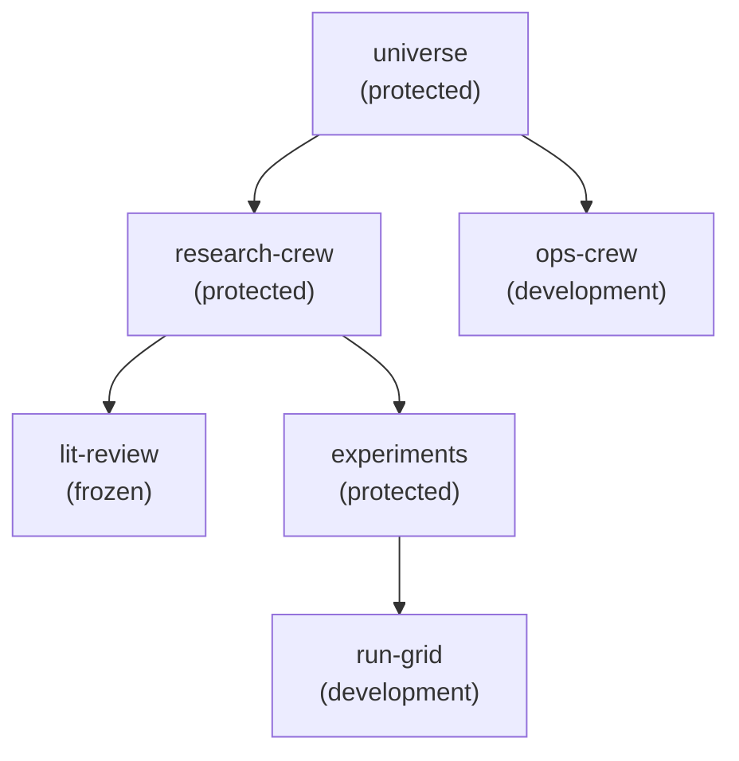
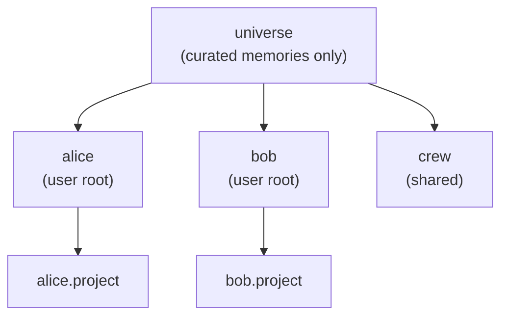
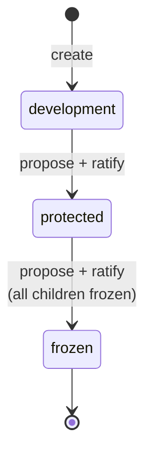

# How workspaces grant access

A workspace is a node in one tree per tenant, rooted at `universe`. Keys read and write through grants on nodes. A grant covers its node and everything below it. A denial always wins. A status never changes a grant: `frozen` refuses new writes, approvals and child workspaces for every key alike, and review runs the same way at every status.

The [serving view](views.md#logical-one-agent-key-and-everything-it-is-served) draws what one key reads in the tree, and the [workspace lifecycle](lifecycle.md) draws development, release and sharing.

OML mirrors an externally managed crew with a workspace. It records which governed space a crew's memories live in. It never runs the crew.

## The tree

Every workspace except `universe` has exactly one parent, so the tree has no cycles and each node has one path from the root. A workspace's name is one label, unique in the tenant's shared namespace or within one user root, and never changes. A node can be referred to by name or by id.

The root, `universe`, has three fixed properties:

- It stays `protected`. It never moves to `development` or `frozen`.
- It cannot be deleted; no workspace can.
- It takes writes only from curators. See [user roots](#the-workspace-of-each-user).

The diagram shows one tenant. Solid arrows are the tree.



A tenant's tree never spans tenants. Nothing on this page reaches across a tenant boundary.

## The workspace of each user

When a person's first key is issued, OML creates a workspace of their own under `universe`, named for them. Their keys write, read and create workspaces there. With alice's key, `oml workspaces create alice project` creates `universe.alice.project`. Two people can each have a `project`.



- **A user key reaches its own root and the `universe` node, nothing else.** It reads memories placed on `universe` itself. It never reads another user's root or a shared workspace.
- **Recall.** A recall inside the root also searches `universe`. A memory shown from `universe` carries no author and no source.
- **Only the keys start a memory in the root.** A reviewer granted there reads, reviews and proposes edits and retirements. Its new memory is refused with `submission.user_root_refused`, and so is putting a retired memory back. The keys of the web session belong to the user: the `<user>-review` key puts the user's retired memory back, and in another person's root it is a granted reviewer like any other.
- **Curation.** `universe` holds only memories that curators place there. A second identity reviews each one like any write. No user key writes to it directly.
- **Climbing the ladder.** A user root reaches `protected` and no further.

Workspaces and keys made before user roots existed stay where they are and belong to no person.

## Grants bind to node ids

A grant names a node id, never a path. A name resolves to an id before any access check, so a name the key may not see answers exactly as its id would.

Effective access is computed on every request and cached nowhere. A revoked grant or a new denial applies to the key's next request.

### Effective access

Effective access is the union of the key's grants, minus anything a global deny names. Each grant is first reduced by its own deny entries.

1. **Per-grant deny.** A deny entry sits inside one grant and cuts a subtree out of that grant only.
2. **Union.** The key's grants are combined. A subtree denied in grant A is still reachable if grant B covers it without a deny.
3. **Global deny.** A key-wide deny names subtrees the key cannot reach, whatever the grants yield. Set one with `oml deny set <key> <workspace>`.

On the example tree, grant A is reader on `research-crew` with a deny on `experiments`. Grant B is reader on `experiments`. A global deny names `run-grid`.

| Node | Grant A | Grant B | Union | Effective |
|---|---|---|---|---|
| `research-crew` | yes | no | yes | **yes** |
| `lit-review` | yes | no | yes | **yes** |
| `experiments` | no (denied in A) | yes | yes | **yes** |
| `run-grid` | no (denied in A) | yes | yes | **no** (global deny) |

A `node` grant covers its node and no descendant. Every user key carries one as a reader on `universe`.

### Who may write

Effective access decides. A key with writer access on a node may submit there. A status never recomputes or edits a grant. A `frozen` workspace refuses new writes with a typed error that every writer receives alike.

## Links and the brief

A claim link connects two memories with a label: any non-empty label outside the `oml:` prefix, or `oml:is_a` or `oml:part_of` between two terms. A **brief** is the few reviewed memories an agent most needs on entering a workspace. A link or a brief entry follows the propose-and-ratify rule: one key proposes, and a second key confirms. The ratifier is never the proposer.

```sh
oml edges propose --help
oml edges ratify --help
oml edges list --help
```

A pending edge grants nothing and shows as pending. A link may join memories in two workspaces the proposer reads, with reviewer on at least one of them; one that crosses an in-progress subtree's boundary is refused with `workspace.in_progress_refused`, reason `edge_crosses`.

## Crews

A crew is a named record: a name, a charter URI and an external manager. A workspace names at most one crew, and a crew can serve many workspaces. A key can name one crew when it is issued.

OML never contacts the external manager and never schedules the crew. It stores the charter URI without checking it. An admin creates and updates crew records with `oml crews`. Admins can correct a crew record whatever the status of the workspaces that name it.

## The status ladder

A workspace is in one of three statuses. Transitions go forward only. There is no unfreeze. To change a frozen space, create a new workspace elsewhere.



| Status | What it means |
|---|---|
| `development` | New workspaces start here. Review runs as everywhere. |
| `protected` | The working state of a governed space. Promotions are allowed. |
| `frozen` | Reads continue. The workspace accepts a crew record update and a rejection of a held memory, and nothing else. |

One key proposes a step and a different key ratifies it:

```sh
oml workspaces status propose project --to protected
oml workspaces status ratify project <transition-id>
```

`oml workspaces status pending` lists the live proposals. A step to `frozen` needs every child already `frozen`. A ratification checks the workspace as it is at that moment. A stale proposal is refused with `workspace.transition_refused`, with a reason such as `stale` or `children_not_frozen`.

### What each status refuses

| Operation | `development` | `protected` | `frozen` |
|---|---|---|---|
| New memory write | held | held | **refused** |
| Approve a memory | allowed | allowed | **refused** |
| Reject a held memory | allowed | allowed | allowed |
| Create a child workspace | allowed | allowed | **refused** |
| Update the crew record | allowed | allowed | allowed |
| Read | by effective access | by effective access | by effective access |

A frozen workspace keeps serving reads. Freezing is not archiving. A held memory left behind by a freeze can still be rejected.

## In-progress workspaces

A person can put a development workspace in progress, when every workspace below it is `development` too, with `oml workspaces mode <workspace> in_progress`, using their own reviewer key (role `reviewer`, used by a person). Inside an in-progress workspace, readers recall held memories and derived facts, labeled unreviewed, when the scan did not hold them and they were last scanned under the current rule set; a retirement version is never served there. Nothing leaves the workspace until its mode returns to standard: a reader scoped outside it sees nothing from inside, approved rows included. The `standard` mode that returns it is refused while any memory is held. See [Organize memory in workspaces](../use/workspaces.md) for the commands.

## Federated recall

A recall searches its workspace's subtree. An admin can turn federation on for the tenant. Then a recall with `sources: "wide"` also searches the `protected` and `frozen` workspaces the key reads elsewhere. A list such as `["legal", "product"]` searches exactly those ([retrieval](retrieval.md#searching-beyond-the-scope); [ADR-0072](../adr/ADR-0072-recall-searches-the-trusted-workspaces-a-key-already-reads-chosen-per-query-by-reviewed-descriptors-and-never-widens-what-it-may-read.md)). Nothing becomes readable that was not: a source is a workspace the key reads, and a key never learns of one it cannot read.

| Setting | Who sets it | Default | Command |
|---|---|---|---|
| Federation on the tenant: `enabled`, `default_sources`, `max_sources` | an admin key | off, `scope`, 8 | `oml search federation --enabled on` |
| Whether recalls scoped elsewhere may search a workspace: `accept_federated` | a person's reviewer key on the workspace, or an admin key | on | `oml workspaces federation <workspace> off` |

`accept_federated` grants nothing. Turned off, a key that reads the workspace still recalls there by naming it as the scope. A `development` workspace, and every workspace inside an in-progress subtree, is never searched by another scope's recall, whatever its setting. Each change is journalled, `federation.policy_set` and `workspace.federation_set`. The policy takes an admin key; `accept_federated` takes an admin key or a person-held reviewer key with reviewer on the workspace, and any other agent-held key is refused.

### A directory workspace

Federated recall searches only what a key reads, so it never tells a crew that a workspace it cannot read exists. A team that wants others to find its work writes a description as an ordinary claim. It goes in a workspace the audience reads, such as a node `directory` under `universe`:

```sh
oml workspaces create universe directory
oml write --workspace directory --claim-key legal-crew "acme.legal holds the contract templates and the review checklist; ask the legal crew's admin for reader."
```

The claim is reviewed like any other. Reader on `directory` is the discover grant. Reading an entry grants nothing on the workspace it describes; access is still a grant an admin issues. An entry is a copy that can go stale, and federated recall never routes to the workspace it names.

