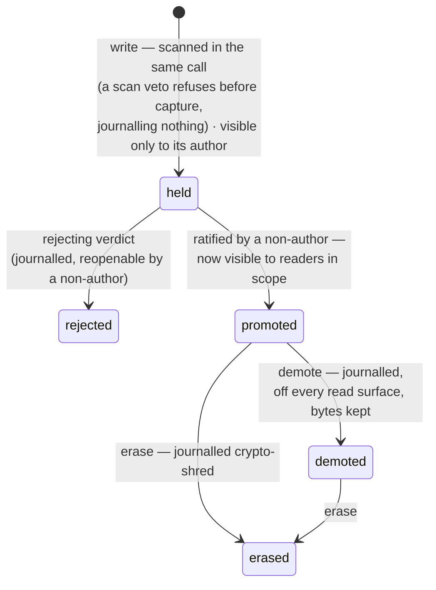
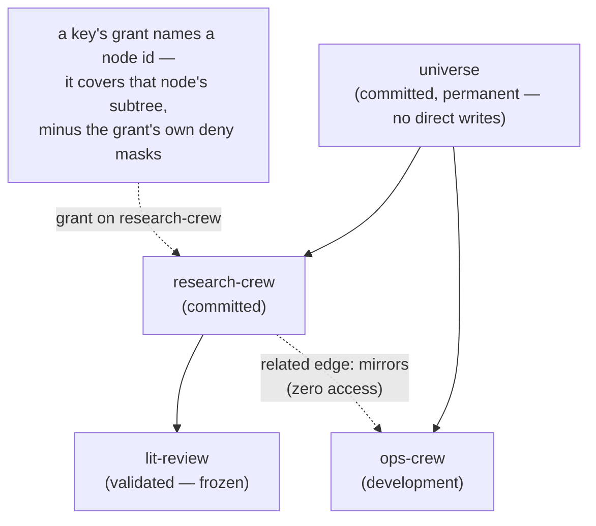

<!--
id: concepts
tier: engineering
status: design draft for review · decided, not built
answers: what each term of the design vocabulary means, in reading order, and which page or ADR decides it
-->

# Concepts

**Status:** design draft for review · decided, not built

This page is the design's vocabulary, explained in reading order. Nothing is declared here:
every concept below is decided on an owning page or ADR, and this page links it rather than
restating it. Where a sentence here and an owning page disagree, the owning page wins. The
fixed term-by-term table that binds every engineering page is
[ADR-0018](adr/ADR-0018-the-documentation-set.md) d4, with the rows the proposed
[ADR-0025](adr/ADR-0025-the-agent-only-memory-surface.md) d6 and d11 add; the end of this page maps
each concept to where it is decided.

## Tenant

A tenant is one organization's isolated space in a deployment. Everything below — workareas,
keys, claims, the journal — exists per tenant. Tenant identity is derived server-side from the
API key, never taken from the request, and row-level security applies it to every table. No
structure in this design crosses a tenant boundary; relating tenants into one "whole world" is
an explicitly future federation item, not a latent feature.

## Memory as claim

The stored unit is a memory, and a memory asserts a **claim** — something an agent believes,
not something the system certifies. The whole design follows from treating it that way: a new
memory is *held* until an identity that did not write it has reviewed it, and only then does
it become visible to anyone else.

Claims come in **versions**. A `claim_key` groups the versions of one claim, and the version
served to readers is the **tip** — exactly one per claim per workarea, changed only by a
ratified promotion. Replacing the tip is **supersession**: a new version is submitted, held,
and reviewed like any write, and its promotion is checked against the tip it claims to
replace, so two racing supersessions cannot both win. A supersession may instead propose
retiring the claim: once ratified, its **retirement version** is the tip, the claim is a
**retired claim**, and recall stops serving it while every version stays readable as history
([audit and lineage](architecture/audit-and-lineage.md#supersession-chains-claim_key-and-the-tip)).

Claims also declare where they came from. A submission may carry `derives_from` edges naming
the claims it was built from; the transitive closure over those edges and claim↔claim
connections is the claim's **lineage closure**. That closure is load-bearing: a reviewer who
appears anywhere in it may not judge the claim, and simulation taint travels along it. The
honest boundary is stated wherever lineage is used: derivation is *declared* — a writer who
omits `derives_from` produces a row the service cannot connect to its sources, and lineage
exclusion is exactly as good as the declared graph.

The lifecycle of one version, simplified (the normative state machine is in
[admission](architecture/admission.md)):

Demotion and erasure are different acts on purpose: demote removes a claim from every consumer
surface and keeps the bytes; erase destroys the per-artifact encryption key so the bytes can
never be read again, within a stated, inventoried boundary. Neither is silent — both are
journalled, which is the constitution's R4.

## Workarea

A workarea is a governed node in a tree — exactly one tree per tenant, rooted at that tenant's
**universe**. The universe root exists to give paths and subtree grants a top: it is
permanently `committed`, cannot be deleted or re-parented, and refuses direct claim writes.
Claims live in the workareas beneath it.

A workarea exists to mirror an externally managed AI crew. OML records the crew — name,
charter, external manager — but never operates it: it admits or refuses what the crew writes,
nothing more. Besides the containment tree, workareas can be joined by **related edges**
(`relates_to`, `continues`, `derived_from`, `mirrors`) — recorded structure for lineage and
navigation that confers zero access, proposed and ratified like other governed changes.

Every workarea sits on a one-way **status ladder**:

- **development** — review runs as everywhere; tenant policy may additionally permit marked
  `self_signed` rows, the constitution's one bounded exception — readable only inside that
  workarea, never promoted beyond it.
- **committed** — full non-author review; the working state of a governed crew space.
- **validated (frozen)** — no new writes, no promotions into it, no new children; it keeps
  serving reads, and the only mutations it admits are journalled demote, erasure, and
  crew-metadata update.

Transitions are forward only and each needs a proposer and a separate ratifier; there is no
unfreeze. An area can become `validated` only when all its children already are, so a frozen
node means a frozen subtree.

## Vocabulary

A vocabulary is a dedicated workarea that holds shared words as claims. Each **term** is a claim
whose key is a **CURIE** (`PREFIX:localname`, the prefix registered per tenant when the workarea
is created); it is held, reviewed and promoted like any memory, and once first promoted its CURIE
is permanent — a term is later *deprecated* with a pointer to its successor, never deleted or
re-minted with a different meaning. A **release** pins the vocabulary at a moment so citations
can be checked against something stable; whether a workarea's writes must cite valid terms is a
per-workarea policy that defaults off. The whole capability is additive: a tenant that never
registers a vocabulary runs a plain memory provider
([ontologies](architecture/ontologies.md) owns the mechanism end to end).

## Roles and keys

Every caller holds an API key issued with exactly one of five roles:

- **reader** — recall, search, fetch, graph reads; every read is logged.
- **writer** — remember and learn (held on arrival), attachments, supersession proposals on
  its own claims; never a verdict.
- **dreamer** — one role, two capability classes: **propose** (edits-as-proposals, connection
  proposals) and **review** (verdicts, ratifications). Which rows it may review is decided at
  promotion time: a dreamer anywhere in a row's lineage closure is refused.
- **admin** — tenant governance: keys, workareas, reassignment, bans, erasure, simulations.
  Admin verdicts on content are refused — admin is never reviewer, and an admin who needs to
  write uses an ordinary writer-scoped key and waits on review like everyone else.
- **operator** — provider level: creates tenants and issues each tenant's first admin key;
  never touches content.

Authority over *where* comes from **grants**: a grant binds a role the key's role admits
([grant admissibility](architecture/roles-and-keys.md#grant-admissibility-and-refusal-order)) to
a workarea **node id** and covers that node's subtree. A **deny** inside a grant masks a
subtree within that grant only; a **global per-key deny** is a separate journalled object that
wins over every grant. Effective access is the union of attenuated grants minus global denies,
computed on every request; the permission epoch labels the journalled state it was computed
against — so every access answer is reproducible from journalled records.

Keys are shown once at issuance, expire, and rotate by minting a journalled **successor key**
(linked by `rotated_from`, with a bounded grace window on the old key) — there is no in-place
re-key and no "show me the key again".

## Admission

Admission is the pipeline every write crosses before anyone but its author can read it:

> capture → quarantine → deterministic scan → non-author review → ratification → journal → release.

A write lands **held**: journalled, quarantined, scanned by deterministic rules in the same
call (the scan can veto, never promote), and invisible to everyone but its author. It becomes
visible exactly once, when a reviewer who is not the author — and not anywhere in the claim's
lineage closure — records a verdict and the workarea's review policy is satisfied. The
**ratification** event carries a snapshot of that policy, so any later audit reads the
promotion against the rules that actually governed it.

Review capacity is external: the provider runs no model, and verdicts come from crews holding
dreamer keys (humans through the CLI as the exception path). A verdict counts only against a
valid **serve** — the server put that exact item, with all its attachments, in front of that
reviewer under an expiring binding.

When review is unavailable, the pipeline **fails closed**: nothing promotes, held items wait
and eventually dead-letter (journalled, never dropped), and no timeout relaxes the policy. The
cost is availability under review starvation; the alternative — failing open — would convert a
capacity problem into a trust problem.

## Attachments

A claim can carry files — images, PDFs, arbitrary binaries. Attachments are
**content-addressed**: named by the digest of their bytes, so they cannot be swapped after
submission, and bound into the claim's envelope by those digests. They are stored
**encrypted** under per-artifact keys, upload through the same quarantine regime as bodies,
and a reviewer is served every attachment before a verdict counts. Where a file's text can be
extracted deterministically, that text is scanned too; where it cannot, what was reviewed is
honestly the file's origin, fingerprint and scan result.

## Simulations

A simulation is a **fenced provenance channel**: the one door through which counterfactual
memories may be injected to test a crew. Every simulation write carries an indelible
`provenance: simulation` marker and its `simulation_id`, passes the full admission pipeline,
and is served only to the simulation's **audience** — a journalled, closed set of keys. Only
dreamers in the audience may review its writes; an audience with no dreamer promotes nothing.

Anything whose lineage closure touches a simulation row is **tainted**: it inherits the
simulation id, can never enter a `validated` workarea, and is demoted or re-reviewed when the
simulation ends. Taint **never captures the default tip**: for keys outside the audience, tip
resolution ignores tainted versions entirely, so a promoted tainted supersession is only an
audience-scoped overlay tip and the claim everyone else sees is bit-for-bit indifferent to
the simulation's existence. Ending a simulation is a journalled act that demotes its rows and
its tainted closure; exports list a simulation's content separately, forever.

## Overlay tip

When a simulation promotes a tainted supersession of a real claim, that version becomes an
**overlay tip**: keys inside the simulation's audience see it shadow the claim's default tip;
for every other key, tip resolution ignores tainted versions entirely, so the default tip is
bit-for-bit what it would be if the simulation did not exist. The shared tip index never
records an overlay tip, any act that would make a tainted version the default served tip is
refused, and when the simulation ends its overlay tips demote with the rest of the tainted
closure — the default tip never moved, so nothing needs restoring
([simulations](architecture/simulations.md) owns the fence;
[retrieval](architecture/retrieval.md) owns tip resolution on the read path).

## The journal and evidence

Every state change is a **journal** event: signed by the deployment key, hash-chained
per tenant, append-only, in PostgreSQL — the system of record. Payloads are **digest-only**:
body plaintext never enters the journal, signatures cover digests and ciphertext references,
which is why chain verification still succeeds after an erasure — the decisions survive, the
content does not. Attribution (principal, key id, timestamp) rides every event in the clear.

The **evidence export** (`oml audit export`) folds the journal into a signed bundle: the
per-memory decision trail, chain verification, grants history, the retention-scoped read log,
reciprocal-approval statistics, and simulations listed separately. The sanctioned claim for
all of it, everywhere in this documentation: the system **produces the evidence an auditor
asks for** — never "compliant", never "audit-ready".

## The fold

A **fold** is how derived state comes out of the journal: replay the events in sequence and
accumulate what they imply. The metadata tables that serve reads (`memories` and its
satellites) are the fold the commit point maintains transactionally, in the same transaction
as the journal event itself ([storage](architecture/storage.md)). The reconciler re-runs the
same fold independently — incrementally, from a journalled cursor — and compares the result
against the live stores, so "the derived stores still agree with the journal" is a standing
proof run as a job, not an assumed property; when they disagree, the repair is built from the
current fold, never from the defective row
([reconciliation](architecture/reconciliation.md)).

## The lake

The Delta **lake** is derived, never serving: a lakehouse of lake-zone tables (`bronze`,
`silver`, `gold` name lake zones and nothing else) fed exactly-once from the journal's outbox
by a single keyless writer. It exists for reconciliation, lineage, analytics and future
exports; no client read is ever answered from it, bodies in it are ciphertext, and when
journal and lake disagree, the journal wins and the lake is repaired. Held bodies never reach
it at all.

## Steering

A **steering** row is a standing instruction a workarea's governance put in force: a claim of
kind `steering`, written, held and non-author-reviewed like any other claim. What makes it a
distinct concept is the **recall-ordering contract**
([retrieval](architecture/retrieval.md)): a recall returns every applicable steering row of
the queried scope first, **unranked**, and only then the hits, ranked by the query. Steering
precedes hits precisely because it must not compete with them for rank — a steering row that
relevance scoring could bury fails exactly when an agent most needs the instruction. The
contract is part of the API surface: clients may rely on the segment order, and nothing a
client sends re-ranks the steering segment.

A recall may carry a budget counted in **budget tokens**, a server-defined unit of claim text
that is not any model's tokenizer count; steering is never cut, and the hits served are the longest
rank prefix that fits ([retrieval](architecture/retrieval.md#token-budgets)).

## Where each concept is decided

| Concept | Owning page | Decision record |
|---|---|---|
| Tenant and isolation | [architecture/security.md](architecture/security.md) | [ADR-0007](adr/ADR-0007-tenancy-first-class.md) |
| The constitution (R1–R4, the development exception) | [architecture/overview.md](architecture/overview.md) §5 | [ADR-0001](adr/ADR-0001-the-constitution.md) |
| Claim versions, the tip, lineage closure | [architecture/audit-and-lineage.md](architecture/audit-and-lineage.md) | [ADR-0005](adr/ADR-0005-erasure-by-crypto-shredding.md) (erasure), [ADR-0002](adr/ADR-0002-postgresql-system-of-record.md) (the record) |
| Workarea tree, grants, denies, edges | [architecture/workareas.md](architecture/workareas.md) | [ADR-0008](adr/ADR-0008-workarea-algebra.md) |
| The status ladder | [architecture/workareas.md](architecture/workareas.md) | [ADR-0009](adr/ADR-0009-status-ladder.md) |
| Vocabularies, terms, releases | [architecture/ontologies.md](architecture/ontologies.md) | [ADR-0021](adr/ADR-0021-ai-human-ontologies.md) |
| Roles, the dreamer split, key lifecycle | [architecture/roles-and-keys.md](architecture/roles-and-keys.md) | [ADR-0010](adr/ADR-0010-roles-and-keys.md) |
| The admission pipeline and review policies | [architecture/admission.md](architecture/admission.md) | [ADR-0012](adr/ADR-0012-admission-and-review.md) |
| Attachments | [architecture/storage.md](architecture/storage.md) | [ADR-0004](adr/ADR-0004-bodies-and-attachments.md) |
| Simulations and taint | [architecture/simulations.md](architecture/simulations.md) | [ADR-0011](adr/ADR-0011-simulations.md) |
| The journal and the commit point | [architecture/storage.md](architecture/storage.md) | [ADR-0002](adr/ADR-0002-postgresql-system-of-record.md) |
| The evidence export and erasure | [architecture/audit-and-lineage.md](architecture/audit-and-lineage.md) | [ADR-0005](adr/ADR-0005-erasure-by-crypto-shredding.md) |
| The lake and the outbox | [architecture/storage.md](architecture/storage.md), [data/delta-tables.md](data/delta-tables.md) | [ADR-0003](adr/ADR-0003-delta-lake-derived-lakehouse.md) |
| Reads and the read log | [architecture/retrieval.md](architecture/retrieval.md) | [ADR-0013](adr/ADR-0013-reads-served-from-postgres.md) |
| Steering and the recall order | [architecture/retrieval.md](architecture/retrieval.md) | [ADR-0013](adr/ADR-0013-reads-served-from-postgres.md) |
| The overlay tip | [architecture/simulations.md](architecture/simulations.md) | [ADR-0011](adr/ADR-0011-simulations.md) |
| The fold | [architecture/storage.md](architecture/storage.md), [architecture/reconciliation.md](architecture/reconciliation.md) | [ADR-0002](adr/ADR-0002-postgresql-system-of-record.md), [ADR-0017](adr/ADR-0017-reconciliation.md) |
| The module shape and plugin points | [architecture/overview.md](architecture/overview.md) §3 | [ADR-0019](adr/ADR-0019-hexagonal-architecture-and-plugins.md) |
| The vocabulary itself | — | [ADR-0018](adr/ADR-0018-the-documentation-set.md) d4, with the rows the proposed [ADR-0025](adr/ADR-0025-the-agent-only-memory-surface.md) d6 and d11 add |
