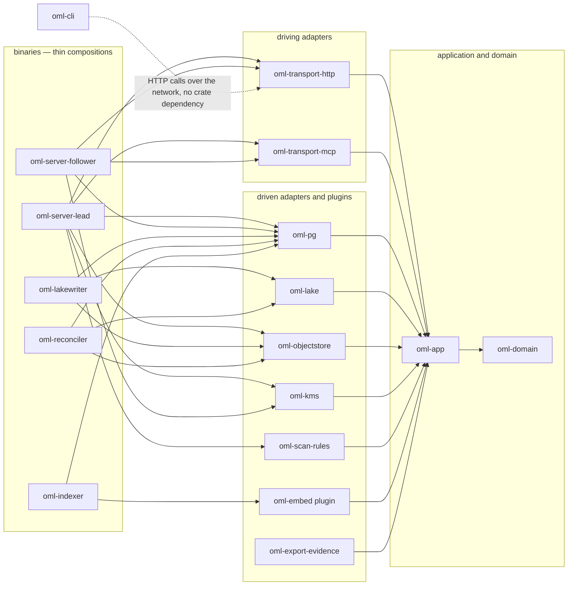

<!--
id: engineering/workspace-plan
tier: engineering
status: design draft for review · decided, not built
answers: what the Cargo workspace looks like, which crate depends on which, what each port trait's shape is, what M1 builds first
-->

# Workspace plan

**Status:** design draft for review · decided, not built

This page is the Cargo workspace that realizes
[ADR-0006](../adr/ADR-0006-pure-rust.md) d6's crate table and
[ADR-0019](../adr/ADR-0019-hexagonal-architecture-and-plugins.md)'s ports — directory layout,
dependency direction, workspace manifest policy, one illustrative signature per port, and the M1
build order. No crate exists; every name below is a design identifier, normative in shape.

## Directory layout

```
open-memory-lab/
├── Cargo.toml                    # [workspace]: resolver = "2", workspace deps, workspace lints
├── Cargo.lock                    # committed — the workspace ships binaries (ci-and-toolchain.md)
├── rust-toolchain.toml           # the one pinned toolchain (ci-and-toolchain.md)
├── deny.toml                     # cargo-deny policy (ci-and-toolchain.md)
├── migrations/                   # sqlx migrations, NNNN_name (postgres-schema.md, Migrations)
├── crates/
│   ├── oml-domain/               # the pure core — every constitution invariant, no I/O
│   ├── oml-app/                  # port traits + use-cases driving the domain through them
│   ├── adapters/
│   │   ├── oml-pg/               # journal-and-metadata store port — sqlx
│   │   ├── oml-lake/             # lake materialization port — delta-rs
│   │   ├── oml-objectstore/      # object store port — object_store (S3, MinIO, file)
│   │   └── oml-kms/              # KMS port — cloud KMS and the kms-file keyring (RS-12)
│   ├── transports/
│   │   ├── oml-transport-http/   # both rings (/v1, /v2) as an adapter over oml-app
│   │   └── oml-transport-mcp/    # the MCP facade, same rule
│   ├── plugins/
│   │   ├── oml-scan-rules/       # first scanner behind the scanner port
│   │   ├── oml-embed-.../        # embedder plugin — crate name waits on RS-1's model decision
│   │   └── oml-export-evidence/  # evidence-bundle exporter behind the exporter port
│   └── bins/
│       ├── oml-server-lead/      # composes signer + KMS + all write-path ports + transports
│       ├── oml-server-follower/  # composes KMS decrypt-only, read ports, transports — no signer
│       ├── oml-lakewriter/       # outbox read side + lake port — keyless
│       ├── oml-reconciler/       # read-only ports
│       ├── oml-indexer/          # embedder port + serving-side read
│       └── oml-cli/              # thin HTTP client — composes no port trait, no domain crate
├── testing/
│   ├── oml-port-contracts/       # the port-law contract suites (test-strategy.md)
│   ├── oml-conformance/          # the FR-22 profile-parameterized binary (test-strategy.md)
│   ├── oml-crash-harness/        # the FR-3 kill/restart harness (test-strategy.md)
│   └── oml-corpus/               # corpus generators with committed recipes (test-strategy.md)
└── bench/
    └── oml-load-rig/             # the FR-25 macro rig (benchmark-harness.md)
```

The `testing/` and `bench/` members are workspace crates like any other — same toolchain, same
lints, same audit — because a test rig outside the audited graph would be a hole in the
[CI and toolchain](ci-and-toolchain.md) supply-chain story.

## Dependency direction

Arrows point at what a crate depends on. Everything points inward at the domain and nothing points
out — that direction is the hexagon, and the build breaks if it is violated, which is the point of
encoding it as crate dependencies rather than convention:



Three facts the graph encodes, restated as sentences because they are load-bearing:

- **Only `oml-app` touches `oml-domain`.** Adapters and transports see the domain's types through
  the application layer's use-case surface, so no adapter can run a private copy of the
  constitution ([ADR-0019](../adr/ADR-0019-hexagonal-architecture-and-plugins.md) d1).
- **A binary that lacks a crate lacks the capability.** `oml-server-follower` does not depend on
  the signer composition and `oml-lakewriter` does not depend on `oml-kms` — "a follower cannot
  sign" and "the lake-writer is keyless" are dependency-graph facts plus secrets never mounted
  ([ADR-0006](../adr/ADR-0006-pure-rust.md) d5, d6).
- **`oml-cli` has no inward edge.** It is a `/v1`-and-`/v2` HTTP client compiled from the same
  workspace for toolchain convenience, and it composes no port trait and no domain crate
  ([ADR-0006](../adr/ADR-0006-pure-rust.md) d6) — the dotted line is network traffic, not a
  dependency.

## Workspace manifest policy

- **`resolver = "2"`** in the workspace root; feature unification across this many crates under
  the v1 resolver is how a test-only feature leaks into a release binary.
- **`[workspace.dependencies]` is the only place a version is written.** Member crates declare
  `dep.workspace = true`; a version string in a member manifest is a defect. This is the
  one-declaration-site rule ([ADR-0018](../adr/ADR-0018-the-documentation-set.md) d5) applied to
  the dependency graph, and it is what makes
  [ADR-0019](../adr/ADR-0019-hexagonal-architecture-and-plugins.md) d2's "a version bump is one
  review" literally true.
- **`[workspace.lints]`** declares the lint table once (clippy at deny-warnings strength,
  `unsafe_code` forbidden in `oml-domain` and `oml-app`, denied in adapters unless a reviewed
  exception names its reason); members inherit with `lints.workspace = true`. Enforcement is the
  [CI and toolchain](ci-and-toolchain.md) clippy gate.
- Release profile: thin LTO per [ADR-0024](../adr/ADR-0024-performance-foundation.md) d8; the
  allocator choice stays a rig-measured A/B, so no allocator crate is a default dependency.

## The port traits

[ADR-0019](../adr/ADR-0019-hexagonal-architecture-and-plugins.md) d2 enumerates eight driven
ports, all declared in `oml-app`. One signature is sketched per port; each is **illustrative,
normative in shape** (the [schema page](../data/postgres-schema.md)'s convention) — names and
exact types move at implementation, the shape does not.

| Port | Illustrative signature (one of the trait's methods) |
|---|---|
| journal-and-metadata store | `async fn commit(&self, tenant: TenantId, event: SignedEnvelope, fold: MetadataFold, outbox: OutboxRow) -> Result<CommitReceipt, CommitError>` — one call, one transaction: the [ADR-0002](../adr/ADR-0002-postgresql-system-of-record.md) commit point as a type |
| lake materialization | `async fn apply(&self, table: LakeTable, batch: MaterializeBatch, txn: AppTxnId) -> Result<DeltaVersion, LakeError>` — the txn id parameter is the exactly-once mechanism, not an option |
| object store | `async fn put_if_absent(&self, key: ObjectKey, body: ByteStream) -> Result<PutReceipt, PutConflict>` — conditional put is in the port so every backend must answer for it |
| KMS | `async fn generate_data_key(&self, kek: KekId) -> Result<WrappedDek, KmsError>` (decrypt is a separate method a composition may omit) |
| scanner | `fn scan(&self, envelope: &AdmissionEnvelope) -> ScanOutcome` where `ScanOutcome` is `Pass \| Hold(Reason) \| Veto(Reason)` — **no promoting arm exists to return**, which is the plugin law as a type |
| embedder | `async fn embed(&self, text: &NormalizedText) -> Result<Embedding, EmbedError>` plus `fn identity(&self) -> PluginIdentity` — identity rides the rows it informs |
| exporter | `async fn export(&self, bundle: &EvidenceBundle, sink: &mut (dyn AsyncWrite + Send + Unpin)) -> Result<ExportDigest, ExportError>` |
| clock/id | `fn now(&self) -> Timestamp` and `fn new_id(&self) -> ArtifactId` — time and identity enter the core as inputs, which is what makes domain properties deterministic |

One enumeration note, flagged rather than silently resolved:
[ADR-0006](../adr/ADR-0006-pure-rust.md) d6 and
[ADR-0024](../adr/ADR-0024-performance-foundation.md) d9 name a **signer port** as the
lead/follower composition split, while ADR-0019 d2's list of eight does not include it. This page
carries the signer as a ninth `oml-app` trait (`fn sign(&self, signed_bytes: &[u8]) -> Signature`,
composed by `oml-server-lead` only); whether ADR-0019's enumeration is amended to nine is that
record's call, not this page's.

## M1 build order

The [critical path](../product/critical-path.md)'s M1 builds inward-out, because each step is the
test bed for the next:

1. **`oml-domain`** — types, transition functions, and the named property suite
   ([test strategy](test-strategy.md)) green with no infrastructure;
2. **the port traits in `oml-app`** plus in-memory doubles, with `oml-port-contracts` suites
   written against the doubles first — the contracts exist before any real adapter, so the first
   adapter has something to pass;
3. **`oml-pg`** — the first real adapter, passing the identical contract suite against a
   containerized Postgres over the committed migrations;
4. **the `oml-server-lead` composition** — minimal submit/review/promote/read-own over the
   standalone profile, which is M1's exit rig.

Everything else — the lake adapter, the transports beyond the minimal slice, the remaining
binaries — joins at the milestone that needs it, per the critical path.
